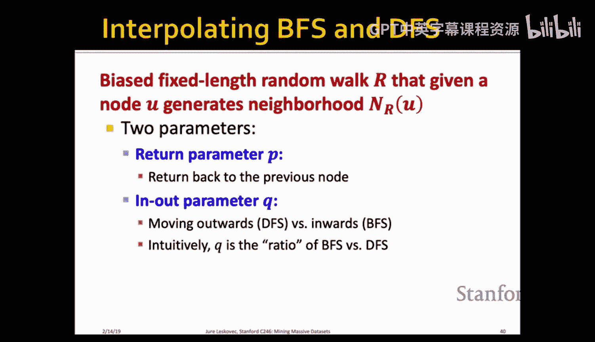
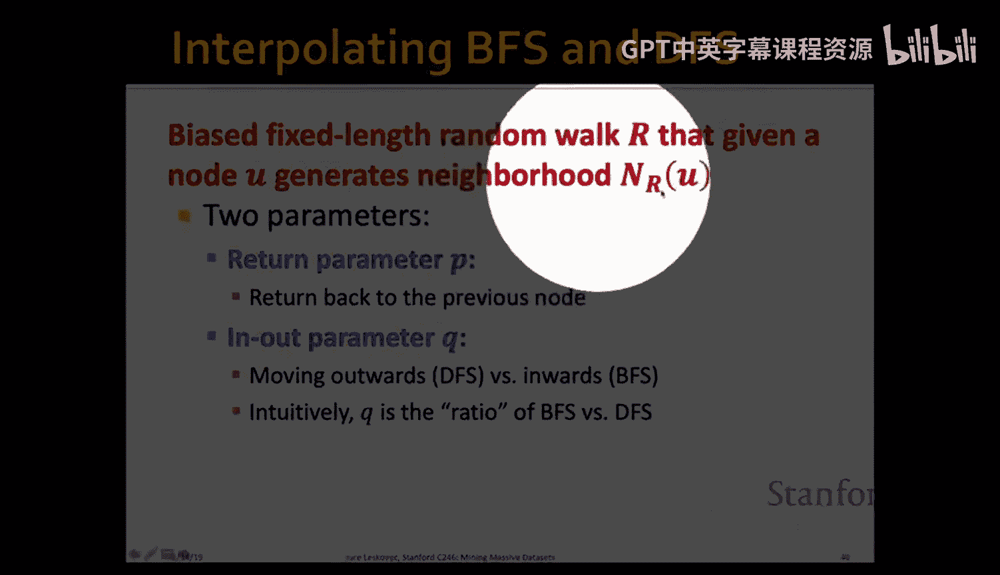
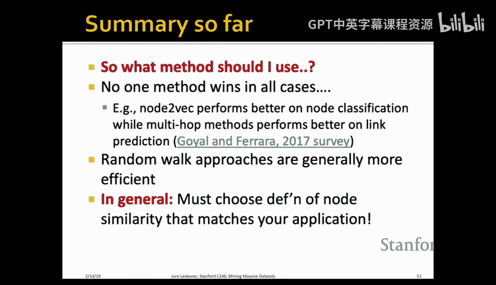
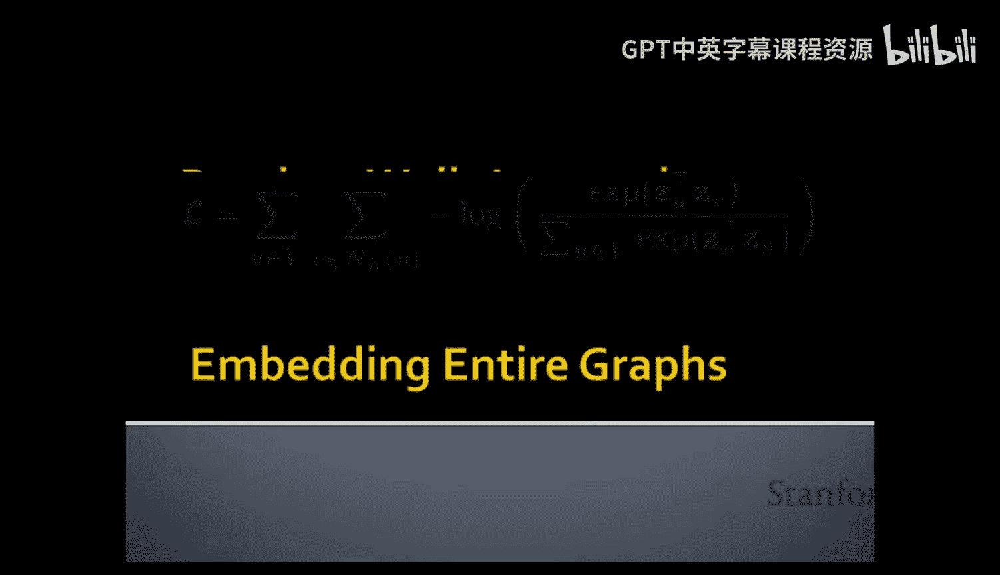
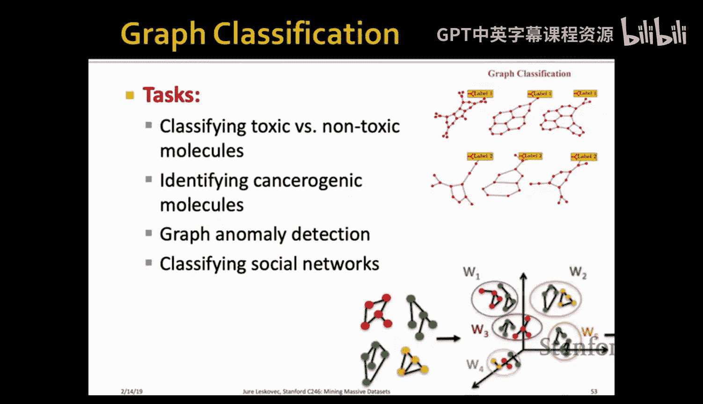
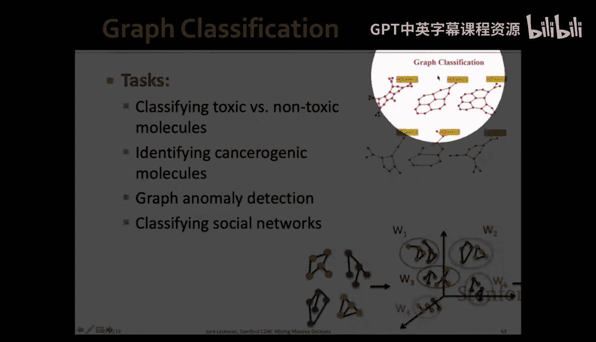
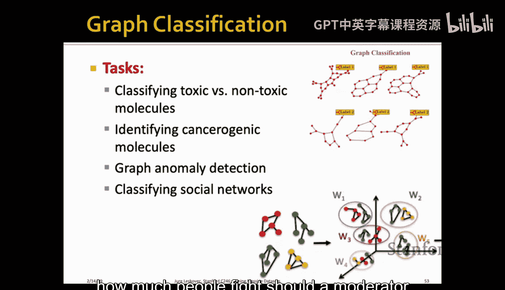

# 斯坦福大学《海量数据集挖掘｜CS246： Mining Massive Data Sets 2019》中英字幕 p12 -P12-lec12 Graph Representation Learning.zh_en -BV1raSjBuE3d_p12-

Wecome to the class。I'm not sure if you notice， but whether gods said it's important to come to 2，4。

6 so they gave us， I think， three hours of sunshine so that you can safely come to the classroom and leave the classroom。

 And then again， it will pour I just checked on weather。 So great。 Thank you， whether gods。

 So we are talking about graphs and what I want to talk today about is some recent ideas。

 how can you how can you think of taking graphs or taking node nodes in the graph and of computing coordinates of them so that you can then do various kinds of tasks on top of on top of those coordinates right So the idea is imagine you you want to do link prediction in a network。

 like friend recommendation。 people you may know。 and so on。

 then the way you could you can formalize those tasks is to say I have a social network of people And I want to make predictions whether certain pairs of people are friends with each other or not And this will be called the link prediction task。

 are。😊，Given a network。 and we， we want to know for a certain pair of nodes。

 whether they are connected or not， right， And then we would make predictions and say。

 we predicted this one correctly。 We， we made a mistake there and so on and so forth。

 So this is an example of a link prediction task in networks。

And there are many applications in which link prediction task can be create can be can be formulated。

 You could even think of a recommender systems as a link prediction between a user and an item。

 you can think of creating heterogeneous graphs of I know people or researchers papers。

 conferences they publish and you could start asking， can I predict a link。

 whether a given person is going to publish at a given conference right or in kind of in biomedical applications。

 you can create these kind of heterogeneous networks of patients， diseases， genes。

 drugs and you can start asking various types of relationships or associations between different objects And the way you would formalize you would formalize it as a link prediction task。

 So this is first example。 A second example of the task we'd like to be able to do is what is called note classification where idea is。

 again， I'm given a network nodes are labeled by color。😊，Some of the nodes don't have a color。

 and I w to predict the color of the node。 What could the color mean， For example。

 if you are if you are a telco， then you have this problem that people churn。

 meaning people leave your network。 So could I predict what is the risk of a given person to leave my network。

 right So to quit A and T and go to Verizon。 Could I could I detect based on the usage pattern。

 the structure of the coal network who's going to leave right thats churn and prediction problem。

 Another thing you could do is you could say， oh， I'm doing a commander system。

 but I'm doing it on top of the social network。 And what do that mean is， you know。

 maybe red means you like action movies and green means you like movies about the nature。

 then you could say， hi I have this person here。 what kind of movies do they like and based on the friends they have that should tell me something about what kind of movies does this person like right So I would basically take this graph that is maybe partially。

Labeled， and I would like to label the rest of it。Another example of this is if you think this of a social network。

 some people tell you their age gender location。 and you want to infer age gender location for everyone else。

 Why would you want to do this inference because maybe you can then do recommender systems better。

 Maybe you w to use this because when you do targeting an advertiser comes and says I want to only target women between 20 and 30 years old。

 So you need to be able to go into this graph and say here is where the women are right And most of this graph is unlabeled So you have to infer who's a woman。

 how they are so that you can let's say show the ads or certain promotions or whatever you are doing So this would be an example of a node classification task Because for a given node。

 you have to figure out its label， whatever that label is right Another example of node classification task is what is called。

 for example， Pro function prediction where you can take a network of proteins。

 Pro are molecules in our bodies that essentially regulate。😊。

How life works and they physically come work together for ourselves cells to be alive。

 and different proteins have different functions。 So and for certain proteins。

 we know their functions， we were able to experimentally validate it。

 basically some biologists spend， I know， half a year or a year in the lab and validates a function。

 there is about 20000 proteins in human body so that 20000 biologists years to do to do all that right。

 And I'm probably underestimating So the question then becomes could I develop machine learning tools that would allow me to say。

 what is the function of a given proteins and use this as a hypothesises so that biologists can go investigate that hypothesisthe maybe in half a year and not spend entire year or whatever。

 right So this is an example of a node classification task。😊，So what is。

 why is this hard and why is this interesting， The reason why this is hard and the reason why this is interesting。

 Maybe I go back。Is that what do you need to account for here。

 One thing you need to account is to say， I know nothing about this node。

 but let's say I have some labels， some colors of the nearby nodes。

 So I need to learn how to combine those labels of the nearby nodes。

 Another thing that is important is I need to know what is the pattern of connections right So for example。

 this node has this particular degree。 These are its neighbors。

 They are connected in this kind of way， right So if I want to be able to label the node。

 So this node classification， I have to kind of capture the structure of the graph。

 I somehow have to be able to say what how does the surrounding of a given neighbor look given node look like so that I can make prediction then right So if you think about it。

 it is very hard to do this because you don't have good features。 you have to generate good features。

 What do I mean by this is you can take your row data row network data。

 you generate a set of features for every node。So that later later down you could apply some learning algorithm。

 get a model and make some predictions and the crucial part here that happens in every machine machine learning task is that you have to do feature engineering and the feature engineering for network data is so much more intense because you want to say oh。

 I need to capture the structure of the the network structure of the network around that node So you could say I will have one feature that tells me how many links the node has then I'll have the second feature that will tell me how stronger this links and then I'll have the third feature that will tell me whether the friends of a friend are connected with each other and the fourth one that will be the page rank score of that node and the fifth one will be the most the highest page rank score neighbor of that person and you could create gazillience of these features and get lost so the question becomes you know could we kind of get away from this feature engineering could I somehow。

😊，Automatically learn the structure of the network and and be able to capture this topological structural property of the network around the node somehow automatically。

 That's the hope that we can do that in a purely structural way。😊。

And the way we will do this is the topic of today's lecture。

 which is about how do I do what we will call task independent feature learning for graphs。

 right where the idea will be that I'm given a network and for every node in the network。

 I want to figure out some set of coordinates let's say I want to assign each node coordinate。

 So I will embed every node in a d dimensional space where these is provided by the user think of a few hundred or a few thousand。

 So you know maybe 40 dimensions，10 dimensions， something of that sort。

 So still a relatively small but quite big and I would like to figure out how to assign each node a vector such that nodes that have similar network surroundings that and are close in the network have similar have similar embeddings have similar representations。

 So the idea will be that this vector representation will capture the structure of of the。

Work around the node。 That's， that's kind of intuitively what we would like to do。 right。

 And this will be super cool because we don't have to now create these manual descriptors that say。

 oh， this note has degree1。 And then， you know， the its neighbor has degree 2。 And， you know。

 the two neighbors are then connected with each other。 But here this guy has degree 1。

 And then it's 3。 But then two of its neighbors are connected， but not the the the third pair is not。

 and。😊，And so on and so forth。 right， So we would just like to do this in some sense automatically。

 And today， we'll talk about how to do that。Right so our goal will be to take every node and map it into a point in a low dimensional space。

 and the idea will be right that we call it distributed representation because the idea is that this representation captures similarities between nodes。

Right， that node that are in the same part of the space or somehow have somehow similar network around them。

And the idea is that similarity of the embedding of the nodes indicates the similarity of their networks。

 However， we will define that， right and this will encode network information and and kind of generate the representation for the node。

 So the idea is that I'll take my network。 I can think of it as an adjacency matrix right number of nodes。

 number of nodes and there is a dot if particular pair of nodes is connected and out of this I can embed every node into this d dimensional space that is much smaller than the number of vertices right So you could think that even you could take your adjacency matrix and you'd say。

 oh， what this really is is every node here is every node。

 every row is is an embedding it's a binary embedding。😊，Right， in principle， every node is。

 is represented If I have N nodes。Each node is represented by n0，1 coordinates。

 That's a silly embedding， but it is an embedding。 What we would like to do is come up with coordinates with the coordinates per node where D is much less than the number of nodes in the network and be able to kind allow us to compare these coordinates。

 and it will allow us to compare the structures the structure of the nodes neighborhood in the network。

 And once I have this coordinates。 I can do anything I like。 I can do clustering。

 I can do anomaly detection， I can do attribute prediction node classification。

 I can do link prediction。 anything you like， I could run sVD on top of this。

 I can run hierarchical clustering or K means on top of I could run L H on top of this I can do anything I like。

 like everything that we talked about how do you deal with high dimensional data in let's say Euclidean space。

 cosine similarity and so on。 I could just apply here and live。😊，be good。 Okay。

 so that's why this is kind of so cool。 And the way well think of this is that it doesn't really matter why the task is。

 if we do a good job here， all these tasks will work well。 That's the， that's the exciting part。

 Are there any questions about this idea。😊，Any thoughts。How do you validate？Great。

 how do you the way you validate these things is that you say， I will take my network。

 I will learn these things。 And then here you can define some prediction task and say。

 how good is this at that prediction task。そらから。you will see I will I will give you a definition of what exactly is the optimization problem that you compute this。

 And then， of course， you can then evaluate it on some downstream task。 But the hope is。

 if this kind of captures the network structure， then this will be good representation。

 regardless of what is the downstream task。 It will be kind of。Non specialized good representation。

 It may not be the best representation for the task。

 but it will be a good representation for the task。 And， of course。

 you could further specialize it if you， if you really say。

 I only care about this task and not in general。What's the heuristics for picking up a D。

 What would be a right What is a good heuristic for D， Usually， we think of D to being hundreds。

It depends on the network。 Depend on the size of the data。 For example。

 when we take last time I was talking to you about the the Pinterest graph in the Pinterest recommender system in Pinterest。

 D D is actually we started with about 1000 right now is  to 56 for 3 billion nodes and 20 billion edges right。

 So this is relatively small right If this matrix is 3 billion by 3 billion。

 this is 3 billion by 256 right So。2，56 is relatively small。

 but you wanna make it small because you want， you want it to be efficient。

 We experimented with bigger first。 But then we figure out that actually small works as well。

 So we were happy。😊，Yes。So given the latestnt matrix， is it possible to recover the adjusted matrix？

Great question。 So the question is right， we want to go this way。 The question is， we。

 can we recover it。 So in some sense， the answer is yes， and the the trick， how do we train。

 how do we do this embes is this notion of self supervision where you kind of can train the model without any without any labels。

 But kind of you， you you， the model supervises itself， right， So in some sense。

 the way we will create self supervision is to say。

 can I recover this matrix from those from these coordinates。

 That's optimization problem will'll be solving。 That's a good point。😊，Yes。

So designing these kind of task independent features and then doing whatever very on top of that。

 I perform trying to design some kind of end to end to learning Great， the question is。

 do you wna do this still here and then apply or if you do end to end， end to end will be better。

Right， because you can super specialize it。 What， what I will show you is something that that works well across the tasks。

 but it's not specialized。 right， The problem is， if you wan to do end to end， you need labels here。

But if you don't have enough labels， then maybe you want to do this first and then only specialize here。

 right， It's the same argument that in， in text， you do words to act。Right。

W to work is also not specialized。 It's just a good embedding that you can do for any kind of task。

 right So essentially what this will be the method I'll talk about is essentially extension of worth to work to graphs。

 for those who know what I'm talking about。 great。 So how would this look like。

 Here is an example This is a social network of people joining a karate club at some university in around 1950s。

 and what was interesting about this network， this network is called Zacharys karate Club network。

 This are people who were part of one karate club。 And then there was a quarrel between an influential person。

 This is this node and the instructor that node and the karate club split into two。

 And what was interesting is that split happened。 I think like actually no split happened here and kind of can be beautifully explained by the structure of the network。

 So this is the first case where it was really shown that the social network matters。😊，When。

 you know， who will join the， the， the influential person versus who goes with the old instructor as。

 as this breakup happened。 But the point here is that if you are given this network uncolored。

 just nodes and edges on the input， if you would say， let's create these coordinates。

 here would be our set of coordinates。 And I just added colors so that you can easily map the nodes。

 And every node has an idea and every node matches here， right。

 And what is interesting is that for this small network of。😊，34 nodes。

 you see how the coordinates kind of correspond to the structure and location of the node， right。

 Like the green nodes are down here。 But then 26 and 25 are these two nodes。 And then， you know。

 the violet from there are here。 and then the red are kind of in the center in the middle。

 And then the top right are the。The can nodes， right。

 So you see how kind of these coordinates tell us how similar are are are the nodes， right and。

It kindin of reveal the structure of the network in this two dimensional space。

 We won't embed in two dimensions， but will embed in multiple dimensions。

Why is this training dis embedding is hard， One reason why this is hard is because kind of the modern deep learning toolbox is specialized to work with simple data types right we know how to work with fixed size grids。

😡，Right we can take images。 We can resize them。 They are all the same size。

 so we know how to work with grid graphs and we also know how to work with chain graphs。

 right if you think about text and speech， that has a linear structure。

 so I can define some notion of a sliding window， and I know in this where am I on this on this sequence。

 or if I think of images， again， I can define some notion of a window， and again。

 I have some notion of locality。 I know where the top left corner is。

 I know where the bottom right corner is things are easy， I kind of know where I am in the network。

 If you think about the graphs。 graphs real world graphs， Natural graphs look like this。

 There is no sense of direction， there is no sense of what's up。

 what's down the structure is more more complex， I don't even know how to resize a graph。

 I know how to resize an image。 I don't know how to resize a graph。

 Another thing that's interesting is that graphs are are isomorphic。

 What does that mean is I can take this graph re number。

Or renumbered the nodes and the graph will look different。

 but it's still topologically the same structure。 What that corresponds to is essentially that I can swap。

Rsing columns of the adjacency matrix。 and that's still the same structure。

 While if you take an image and reshuffle the rowsing columns， it's a different image。

 So you have a lot of very interesting challenges when you try to kind of go and take this simple data types and generalized methods that were developed here because it's kind of much easier to see what happens in this more complex and in some sense。

 much more general case right So this is what we will try to do is in some sense。

 thinking how do methods from from here， generalize this more complex， more interesting case。

 So let me now start telling you about how are we going to do this and how are we going to think about it。

 So here is how we'll think we'll say we have a graph。

 and the graph will have a set of vertices and let's say a will be our adjacency matrix。 And for now。

 let's assume binary and let's assume undirected edges。

 even though everything will work for directed address as well。 And for now。

 let's assume that nodes have no features。😊，Nots have no attributes。

 All I care about is capturing the structure of the network。 Okay， so here is our goal。

 Our goal will be to encode nodes into some low dimensional space。

 So basically map them into some low dimensional space。 such that the positions， the similarities。

 the distances in this low dimensional space will be will will correspond to the similarities in the original space。

 right， so the idea is， I'm given this original network undirected just nodes and I want to learn this function will'll call it encoder function that takes the node and maps it into some vector Z in this embedding space。

 And the idea is that nodes that are similar in this network map close together in this embedding space。

 That's what we would like to achieve。😊，Sna， you have a question。Or just exercising。

Just exerciseerci it。 Okay， so this is， this is the goal that we will。

 we will of what we will try to do。 So now， maybe if I go back， there are two things to notice here。

 We say similarity and the embedding space approximate similarity in the original network。

 So there is kind of two things to define one is what。

 one is what is similarity in the embedding space。 What is our similarity metric here And then the other thing we have to define is what is our similarity here。

😊，Right， so there are kind of two similarities to define。

 So let's first define the similarity in the in the embedding space。 right。

 So we will say that similarity of you and we in the original network has to approximate the similarity in the embedding space right up here right So how do I define similarity in the embedding space。

 let's say I will define similarity by dot product。 Okay， so by the dot product of the two vectors。

 Okay， I could， in some sense， what I choose a similarity up here。 doesn't matter that much。

 What will matter more is how do I define similarity here。 right。

 This is some metric in this embedding space。 and however we define this metric Then the embedding might be a bit different。

 But the point is that whatever is the similarity in the network respects the similarity in the embedding space right。

 now， of course， what we need to define is similarity in the network and how do we learn what is the。

😊，ructure of this function， this encoding function that takes the node and gives out。

 spits out the coordinates。 Okay， so let's now keep making progress。

 So there are few things we need to define。we need to define this encoder function that takes the node and gives me the coordinates。

😡，We need to define a node similarity function that tells me how similar are two nodes in the network。

 How similar is the structure of the network around these two nodes。

 And then we want to optimize parameters of this encoder function such that the similarity in the original network is approximates as closely as possible。

 The similarity in the embedding space。 right， So there is an encoder function here that creates these coordinates and I want to optimize these encoder function here that creates the coordinates so that these similarities。

Equal those similarities， right， That's， that's kind of the game。 the game we wan to play。 Yes。

 I'm assuming we normalize somehow Z vectors that like a really large Z vector wouldn't overpower like dissimilar vectors。

The question is， do we normalize Z vectors。 There is a good。You can， but it's not here why， right。

 This is still a very well defined task。 You don't have to。

Because the point is just you want to take the similarities and overfe them to those similarities right So what this means is that。

 of course， here if you would embed this in a100000 dimensional space。😡。

Then you can kind of make it a very easy thing。 But if you make this low dimensional space 2。

56 with 3 billion nodes， then then it will kind of force you to， to。

 to be very strategic how you assign coordinates。 So that's， in some sense。

 what you do and don't necessarily do what you what you suggest that we would be kind of keep the vector small。

 which is what we did in recommender system。 So here the dimension is how you force the model to actually try to learn something。

 But a good point， actually，right， good。 So these are the three things we need to do。

 So there are two， two key components。 First is this notion of an encoder that maps each note to allow dimensional vector。

😊，Right so the idea is that the encoder takes the identity of the node and and outputs the d dimensionional embedding Z of that node V and then the second important component is the similarity function that specifies how relationship in the vector space map to the relationship in the original network right so similarity of U and V in the network is can be approximated by the dot product or the similarity between the assigned coordinates by the encoder of the two nodes so now what would be a simplest type of encoder we could come up with。

😊，The simplest type of encoder you can come up with is shown here where Z is a matrix。

 And v is what is called the one hot encoding of the node。 So let me explain， right。

 So Z will be our parameters， right， Z is a matrix of the dimensions times number of nodes。

 So essentially， this says for， for every node， we want to learn the coordinates。

 And this will be this huge matrix or huge matrix that way， Okay， and then node V。😊。

Will be a vector of length number of nodes and this vector is what is called one hot vector or an indicator vector that will have all0 except one single one in the column indicating the node V so I can number the nodes from one to to V and then if I have node number 7。

 I'll have all zero is only a value1 at coordinate 7。 So this is this indicator vector。

 so now how does our encoder work here is basically what our encoder is we will call this this matrix Z the embedding matrix and essentially our encoder is just an embedding lookup right if you think if I go back if you think what z times v does essentially it selects the width column out of this matrix。

 So essentially every node has is a column here and z times v just selects a given column right so。😊。

Essentially， what this means， we will have one column per node so we have columns as many as the nodes and we have rows as many as what is the dimensionality or the size of the embedding。

 So if you think about what is the number of parameters we want to estimate the number of parameters we want to estimate is this matrix Z right it is the parameters per node。

Okay， and then， you know。Once I have that， I can multiply to this indicator vector。

 And this is my encoder function。 right， it will return just the。

 the width column that represents the embedding of the node V。 And that's， and that's it。 So it's。

 we call it shallow encoder because it's just a table lookup。Essential。

 it's a matrix lookup that takes out the appropriate column， yes。😊，啊哈。

What is one hot indicator vector is one hot。Just a technical term to say it's a vector that has all zeros except a value of one at whatever is the index of this node。

Okayright， good question。 Great， thank you。Super so moving on。 So right。

 So this is the simplest possible encoder because the encoder is just a embedding lookup is just a table lookup。

 And， you know， each node is assigned a unique embedding vector。

 Because each node has a set of parameters， the entire column reserved for itself。

 And there are many methods that that do this， we'll talk about to today well talk about one that's called deepwalk。

 and then we'll talk about another one that's called node to back， Those are the two things。 Okay。

 so now what is really the important parties， How do we define no node similarity， right。

 How should you say how how similar are two nodes in the network， right。

 You could say are the two nodes connected， Do they share neighbors， Do they have friends in common。

 Do they have similar structural roles does the network locally look similar to to who they are。

 This idea of structural roles is in a sense that you know。😊，In a company。

 you may have bosses and admins and workers and a social network of the worker is different than of the admin versus the boss。

 And， you know the boss may talk to the admins and admins talk to the workers and you。

 you could think about that your network kind of shows how your what your role in organization or you know a network of of interactions of a professor versus a student versus an admin at the university。

 Again， those networks look different。 right So thats that's the idea。

 So what we will do is I'll show you random walk approaches to embedding。 right So in some sense。

 it seems that the theme of our investigation of graphs。

 one way or another know there are random walks that always pop up。

 So here random walks will pop up as well。 So let's see how we can do this。 these are the two papers。

 one is from 2014。 One is from 2016。 So this is kind of really recent stuff。

 Okay so here is the idea。How how do we define node similarity。

 we say that the dot product between the emings on node U andV approximates the probability that UV cooccur in a random walk over the network so the idea is that if I have a random walk in the network and the random walker visits nodes you andV close together in its walk like they are in close proximity to one another in the walk in the sequence of steps that it takes then those two nodes are more similar to each other so we should embed them closer to one another so the idea is that the random walker walks and it essentially creates a sequence of node ideas that it visited and the more often you andV coopear together in this sequence close to one another the more similar they are that's the idea I have this explained a bit more so the idea is that we want to estimate and this is where。

Random walk come from， right， It's a random walker walking over the over the network。

 So the idea is that I w to estimate the probability of visiting a node V on a random walk starting from node view。

 And we will say using some random walk strategy are。

 because this random walker can be kind of page rank and bias random walker but can be， you know。

 a random walker that is using some weird way how to how to transfer the network。

 And our goal is right to say how likely if I start the walker node view。

 How likely am I to visit node V， That's the idea。😊，Right。

 so this is how do I think of random walks and covisitation。

 And then I can think about optimizing embeddings so that they encode these random walk statistics from step 1。

 right so that similarity dot product encodes the random walk similarity where we say how likely am I to visit node V。

 if I start the random walk from node from node U。 And again。

 dot product is simply the cosine of the angle between the two between the two nodes。

 right So so if they are orthogonal， then the similarity is 0。

 And if they kind of over if the angle is very small， then the similarity is large。

 So that that is that is that is the idea。 So now the question is why randoms。

 why not something else and the reason why random walk is that random walks are extremely flexible stochastic and we can and they they allow us to define node similarity that incorporates both kind of。

😊，Local and higher order or more global network network similarity information， right， It really。

 they allow you to， to， to really capture what is very close around the starting note and also how the network looks farther away。

So that's one in terms of the they are the good thing。

 And then the second thing is that they are amazingly computationally efficient， right。

 We don't need to consider all node pairs and how similar they are when training。

 but we only need to consider pairs that cooc on a random work。 right So if I go back。

 And I do my random walks starting from this node。 And I only export the network locally。

 I don' I will probably never need to consider the top left node and this particular node because the random work will never visit them。

 right， So kind of computations are nicely local， That's another good thing about random walks。

 they only explore the network locally rather than need to consider all all pairs of nodes when I when I when I train these embeddings。

 Okay so this quite an important point。 right and similar to what we had last time。 Okay。

 so this is the reason why we want to do this。 So now。😊，A bit of intuition。

 And then I'll give you the formal。Spation of the of the optimization problem。 And we'll talk a bit。

 how do we solve it efficiently。 Right， So the intuition is that I want to find embedding of node in the dimensional space so that node similarity in the network is preserved。

 The idea is that I want to learn node embedding such that nearby nodes are close together nearby nodes in the embedding are close together in the network。

 So given a node view， how do we define nearby。 We will define this notion of a neighborhood。

 We will say， let n of you via neighborhood of node U obtained by some strategy R。Okay。

 so R is unspecified by the idea is I take a nodeU and I say。

 how does the network network neighborhood of you look like， who is in the network neighborhood。

 Okay， and here is now， what do we want to do， We want to do this embedding embedding estimation as an optimization problem。

 So we will say we are given a graph。 our goal is to map every node in the graph in the de dimensional space and we want to optimize the following equation。

 So what does this say says the following。 It says maximize the coordinates。

 find the coordinates of the nodes， such that if you go over all the nodes in the network from the coordinates of the node。

 you can predict which nodes are nearby。😊，this is the neighborhood of nodeU。

 so Im saying from the coordinates of nodeU， predict who's in the neighborhood of you。😊，Right。

 so I came up with a prediction problem where I don't need any labels。

 What I need to do is for every node， I need to define the neighborhood， some set of nodes。

 Maybe these are direct neighbors。 maybe these are neighbors size or some nodes that I somehow selected from the network。

 and now I want to fix the coordinates， right， I want to solve for the coordinate Z such from the coordinates。

 I can guess or predict who the who the neighbors are who's in the neighborhood， right。

 So this N sub bar is right now， abstractly defined notion of a neighborhood of node U。Right。

 so now given an a， we want to estimate the feature representation predictive of the nodes in its neighborhood and of view。

 And if we solve this， then we came up with coordinates and these coordinates will put similar nodes that are neighbors of one another close together。

 That's the， that's the idea。Okay so now how do we define the neighborhood when I define the neighborhood。

 I don't want to just look at the immediate neighbors。

 but I want to expand my view of the network a bit。

 So here is how the original paper called deep walk proposes to do this。 They say。

 take a starting node view and run short fixed length random walks from the starting node in the graph right some random walk strategy are So the would be I pick a node U and I say I will I will run 100 random walk of seven steps from this node and I run a random walk of seven steps and I record the identities of the nodes。

 I visit in this seven steps。 And this would create。

 give me if I repeat this process 0 times it would give me 100 different neighborhood sets and for that starting node U Okay and these are now my neighborhood sets。

 and I can generate， let's say100 for each node。And the now the size of the neighborhood set。

 let's say is 7 because my random walk takes seven steps before I stop and restart。 Okay。

 so the idea is that now right each node will collect this neighborhood set and。

 these are the nodes visited on the random walk starting from node U。😊。

And now right our goal is to optimize embeddings such that given the node U。

 we are able to predict what are the neighbor who is in the neighborhood of that node and just what do I do。

 Why do I have summation in the log right This is now probability how well can I predict the neighborhood of a given nodeU。

 but I have all the nodes so I want to multiply these probabilities but I don't multiply probabilities because numerically you never want to multiply probabilities you always want to take the log if you take the log the product becomes a sum。

😊，Right， and then that's why I say a sum over lock probabilities over all the nodes in the network and。

Right， and this is all all all to think about the neighborhood can have repeated elements can have repeated nodes because a node can be visited multiple times in the in the in the in the in the walk。

 And the last thing I say is you always want to work when you implement any kind of probabilistic model。

 you always want to work with lock probabilities because probabilities are small and if you multiply them numerical error skill you very quickly。

 but if you take the log， then small numbers are not so small anymore and summations are much more robust。

 So just kind of for numerical reasons， you never want to work with the raw probabilities。

 you want to you always want to work with lock probabilities。 Okay so this is what we said so far。

 What we still need to do is unpack this equation。 but at least at high level things should be clear。

😊，Yes。Any questions。 Oh you have， Yeah， go ahead。Why is something there always better support plot？

Because if you have 0。00，0，00，1， if you， if you take a log of that， you know。

 it will be -6 or whatever。Right， and then when you multiply these small probabilities。

 you these exponents will just keep expanding。 And。

 and if you know how the float numbers are encoded as bits。

 there is only a fixed number of fixed precision to them。 But if you take the log。

 then you are working with numbers plus 5-7， whatever。 and adding things up。 you don't lose anything。

Alright， yeah， there is really good reasons why you want to do that。Great。😊。

about how do you define multi， exactly How do you do this。 This is what we are going to say， right。

 How do I say， what's the probability of a multi set given the bearing。

 This sounds very like it's not clear what how how you would really go do this。

 So we have to unpack it。 So actually my next step unpackex it right。

 So here is the assumption right， Like I'm really saying。

 what's the probability of a set given the coordinates of the nodes of the node。

 And and this like working with this like high dimensional combinatorial object like a multiet is very hard。

 So what do you do usually you have to make some independent assumption。

 So the independence assumption we will make， willll say that conditional likelihood factorizes over the set of neighbors。

 So what I'll say is that the lock probability of a set of neighbors given the coordinates。

Will be basically， I'm saying that neighbors are conditionally independent from one another。

 So I will make an assumption that this probability can be expressed in the following way。

 where I say， a the， the total log probability is simply a sum of log probabilities that for a given node。

 this given node V who is in the neighborhood is is is is a neighborhood。 Okay。

 so now this is much easier to do because it' just a sum of whoever is in the neighborhood。

 And if this is a multiet again， is just a sum。 So this is quite easy。Okay。

 so now I'm saying I'm sum so to estimate the log probability of a multi set given the node。

 I'm saying this is simply a sum over the element of that multiet probability of that basically the。

 the probability of node V given the embedding of node view。 Now。

 I still have to ask as explain what is this this probability here。 And the way you you do it。😊。

Is written down here。 And this is called the softm parameterization。

 I will explain why is it called this way。 But I say probability of node V given node U is simply their dot product expentiated divided by the sum over all the nodes in the network and then here I'm going over all the nodes。

 And then their dot product with the node U and exponentiate so that this is essentially a normalizing factor。

 so that if I sum up this probability over over over V。

 I get I get one right So this is a normalizing factor。 and this is how I do it。😊。

The reason why this is called a softmax is because I want node V to be most similar to the to the node U because it's in the neighborhood right and the intuition is that some of the exponents it's the same as the maximum of the exponent right So if I have a sum over I exponent of X that will be kind of similar to will give me the similar value if I say what's the largest X and I exponentiate it right So the idea is that I want to find the maximum the largest element and one way how I can find the largest element is that I expentiate the elements and sum it up because when I exponentiate the biggest guy will get so much bigger that will overshadow everyone else right So this is like a maximum。

 but it's like a soft version of it。 So that's why this is called softmax。

So intuition should be fine。 This is how we do it。 We have this normalizing factor here that is a bit tricky because we have to sum over all other nodes in the network。

 right， we have to say， what is the similarity between nodes U and V。

 And then we have to divide this by the sum of the similarities between node view and any other nodes in the network。

 Yes， do we handle elements why wouldn't you know how to handle them。😊。

Like what happens if they have。yes， they can like I don't like who cares。

 Like I have a summation if this， if there are multi if the same element。

 a same node X appear here seven times， I will sum it up seven times together。I mean。

 it's just a summation over some node who cares whether nodes appear multiple times or only once。

Right， should we should know。 we know how to sum。So it should be fine。Right。I mean。

 you may be confused， but there is nothing to be confused about， right。

 I have some sequence of stuff， and I sum over that sequence。 What do I care What's in the sequence。

What's the meaning of this NS， is that a typo or is that a different thing than that？Oh， yes。

 That's a type。 sorry。 This is an。 Yes， good question。 Sorry， I should fix that。Yeah。

 I think in the original paper， it was used S。 And then I somehow decided maybe not too wisely to rename that to。

 Good， good catch。 Thank you。Right， so that's just the neighborhood set of a given node。 Great。

 So let's now put it all together。 So how does our overall optimization problem look like。

 If we say let's sum over all the nodes for every node。

 let's sum up over all the neighbors and then we have this log of the softm right。

 where now I'm saying the following， I say some over the nodes some some over all the neighbors of that node U V。

 And then I say what is the softm between the embedding of U embedding of V。

 And then I have this normalizing factor， right， So what this means is that if I solve this optimization problem。

 Right， So if I optimize the random box embeddings。

 then I'm basically saying I'm finding the coordinates Z of the nodes such that I minimize this function L。

😊，Right， this is， in some sense， my， my loss function。

 It tells me how well can I predict the neighbors given the coordinates of the node。Right。

 the better I can predict the neighbors， the， the smaller these loss function will be， right。

 because here I have the softm。 So the。The better the better this thing will be。

 So the smaller the total value will be why smaller because I have a minus there。

 right So that's that's the idea。 So now there is one thing that we should all notice is that this is quite expensive to do。

 And the reason why this is expensive to do because I have nested summation over the nodes I have to sum over the nodes once。

 And then for every node， I have to sum over all the other nodes again。

 to compute the normalizing factor。 right So this algorithm just computing L once takes quadratic time in the size of the network。

 And now I would want to apply some stochastic gradient descent type method over this coordinate Z。

 So this would mean I would have to for every step I would have to do this quadratic computation of a gradient descent method。

 right So this would be amazingly slower。 So what I want to say is I have the same equation。😊。

Is that solving this optimization problem naively， basically taking the gradients with respect to Z and and skiing down the slope。

 as we did in using stochastic gradients or mini batch stochastic gradients or whatever you want。

 right， will be expensive because the I have a nested summation。

 So this summation takes quadratic time in the size of the network， which is prohibitively expensive。

 So here is what we will do。What we will do is we will try to get rid of this normalization term。

 we will try to approximate this normalization term right the idea will be that if we can compute this normalization term not in the linear time but in constant time time that is independent of the size of the network。

 then our algorithm just became from quadratic it became linear。😡，Right。

 and that's a major win for us。 So the question is， how could I approximate that thing up there？

And the solution to this is called negative sampling。 Okay， so the idea is kind of the following。

The idea is that we will take this this summation and and we will we will do the following will take we will take the we will distribute the log inside and I'll have log of the the numerator and the log of the denominator and then what I will also do is I will as I do the。

😊，As as I take the logs rather than taking the X up there。

 use I will use a sigmoid function here so I will replace the exponential with the sigmoid and also at the in the here at the bottom I am taking the summation and I am again replacing the X with the sigmoid function and I distribute the log the log inside。

😊，RightIf I now think of how do I compute this， this thing is easy to compute Its U and V and I just do the dot product and it's fine。

 But what is interesting is that。😊，This thing here rather than summing over all the nodes。

 I will say I will approximate it by summing over some random set of nodes that I sample from from the distribution of nodes so the idea is essentially that this summation here。

😡，I will approximate it， approximate it by using some set of random nodes that I will sample。

 and rather than computing this over all the nodes， I will sample over the some subset of nodes。

 right， So the idea is， instead of normalizing with respect to all nodes。

 I will normalize against K random nodes。 And this K random nodes nodes are called negative samples。

 This is why this is called negative sampling strategy。 Yes。Just my question。

 do we want the negative samples to be outside of the neighborhood so that we're minimizing the probability that great。

 good question。 Do we want， do we want neighbor negative samples to be outside the neighborhood if you think here。

 this is a sum over older the node。 So it's the nodes in the neighborhood plus nodes that are not in the neighborhood。

 right， So I think what because like it's a good question。 What do we wanna do。

 what do we wna do in practice。It's a good question。 So what usually。

 I think people do is these negative samples， because you are just thinking of this as an approximation of that。

 you would just take a random set and you wouldn't even worry about right and again。

 the point is usually this neighborhoods are so small with respect to the the rest of the graph that these are really those that are outside the neighborhood。

All right， good point。Right， but you don't even check。 You just do it。 and it doesn't matter。 Okay。

 and there are good reasons why you wanna do this。 And I describe them here。 And there is a paper。

 and you can read more why this is a good way of doing it， yes。Sorry。

Is there a heuristic to choose K the， the bigger the， the more， the better in some sense。

 the approximation， the value of K will also depend on the on in some sense。

 how big neighborhoods you， you， you are creating generally， I don't know， a good rule of Atom is。

 maybe 10 x。😊，Conreex depends how much can you afford。

Every time we want to update using create something do you have to select another K or you saw kit at the beginning and then just always use those moves question。

The best thing would be if you could repeat the， if you could resample the nodes as you go along。

 right， what do you w to do in practice， Maybe you don't want to rele every step。

 but you would rele every so often。Alright， good。 thank you for this question。

 This is actually great。 So this is what we had what we had so far。 And now， of course， here we say。

 take a random sample of the nodes。 What turns out to be important to work really well is that you take k negative nodes。

 But you pick them proportional to the degree they have in the network。

 So that nodes with lots of edges that have lots of degree， they get picked more often。

 And the reason why why this is good is because this is this is good because the random walk walks over the nodes with higher high degree more often then the nodes of low degree。

 So if you do it this way， then you kind of normalized for the for the random walk。

 And as I mentioned， you guys were asking me how do you pick K。 you have two two options。

 One is higher k gives you more robust estimates， but higher k corresponds to higher。😊。

Kind of prior or negative events， right that this summation here will be bigger and bigger。

 So what people do in practice。 if neighborhoods are of， let's say size 5， then or or even less。

 Then people would do K K between let's say 5 and 20 where I is super low and 20 is more what people like to choose right。

 So K number of negative samples to be around 20 is a good is a good ballpar ballpark number。

 the important thing is we want to sample them proportional to the degree。Okay。

 this is what I wanted to say。 So let me summarize the method and。

 and then we can kind of talk about extensions。 right。

 So the idea is the following for every node view， I will run。😊，Execute short， fixed。

 fixed length random walk， and I will count。 I will memorize which nodes do I visit。

 And I will run this random walk for the same node multiple times。😊，And out of this。

 I will create this multiet or multis of neighbors。

 We'll call it the neighborhood Now that I have this neighborhood and sub bar。

 then I will optimize embeddings using stochastic gradient descent where essentially I'm trying to minimize this equation L where I'm summing over the nodes。

 I'm summing over the neighborhood of a given node。

 and then I'm trying to to to optimize this log probability where given the coordinates of node U。

 I want to predict whether node V is in the neighborhood right and this probability we approximate using negative sampling and what are we trying to solve for here。

 we try to solve for this coordinate Z and and that's the method and this method is called deep walk and if you think for people who have taken more deep learning classes。

 the way you can think of this is that。😊，Essential， this is this is very much analogous to word to e。

 right， What are we really doing here。 What we are doing is that in words to work。

 you have the sliding window over the over the documents and the idea is that for every word you want to find an embedding so that when you are given the word。

 you can predict which other word is nearby to it， right So it's very similar。 given the word。

 predict who is who is close to it。 But the on the text is easy because you have the sliding window and and that defines the neighborhood。

 So what we are doing here with the random walk In some sense。

 we are taking the graph and we are linearizing it we create this notion of the neighborhood of a window using the random walk。

 So in some sense， we take the we take the graph， we create sentences out of it。

 and then we can almost do something like word to。 That' what that's kind of philosophically what we are what we are doing。

 right， we take a graph random the random walk。 random walk gives me our sentence。😊。

A sequence of words， a sequence of nodes。 And then I， I， I try to predict what the sentence is。

 given the， given， let's say the first guy， the first word in the in the， in the sentence。

 that's one way to think of it。 So it's very kind of related and， and similar and in some sense。

 yeah， related to how word to v for embedding of words works。All， great。 Yes。

 actually the that you can actually have embe embe for the。 Yeah。

 so can you apply something similar saying okay， we know in the。 Yeah， good point。 So， so， yes。

 you can make these things fancier， right， you could say that embedding dis embedding should be different than that embedding。

 So every node maybe should have two embeddings， whether they are the the center of the set or whether they are in the context of that set。

 right， you have your neighborhood embedding and your your own embedding that is that is different。

 So you could do things like that。 Yes， these are。😊，Kind of natural extensions。 And。

 and these things have been extended in 700 different ways， right， But the basic。

 the base idea I is here。 And yes， you could have multiple embedding a different embedding when you is here versus when you is here。

 right， That's easy to do。Natural idea。All right， yeah， good point。 super Anything game more， yes。

why can you replace the when you're doing an negative sampling。

 why can you replace the exponential the statewide function？ good question。 Why did I do that。

There are， let's just say that there are good theoretical reasons beyond the scope of this class to do so。

 I。I， I gave， because people ask this， I gave you a link to the paper。

 and I'm happy to discuss it more kind of offline。😊，Hi， good。Yes， the。关什。Yes。

 why do we sample proportional to the degree。 One thing why we would sample proportional to the degree is that in the random walk。

 nodes with high degree are more likely to be visited。Right。

 so this means that the node that has high degree will appear more often in the neighborhoods than nodes with low degrees。

 So we want to kind of upsampble those high degree nodes also as negative samples。

 Otherwise that the， the， the kind of the distribution， the distributions don't。

 between numerator and denominator don't match。O。Last question we have toization。You can。

 you could do the。 So the question is， do you need to do any reormalization， You could。

 but it doesn't really matter。Because， yeah， it doesn't really matter。Alright， let me continue。

 So what I wanted to do now is talk about extension where you can say， like I said， oh。

 you have a random walk strategy R。 And so far we said。

 let's just use a normal kind of random surf type model。 But the question is。

 what if you have this random walk to be a bit smarter， right， And the the technology。

 the algorithm I talk to you about right now， it's called deep walk。

 which is just basically says run fixed length， unbiased random walk from it starting node you。

 But you could have weights on the edges or something like that。 And the question becomes。

 could you use some kind of biased random walk。 So here is one idea。😊。

So this is now extension of this basic node deep walk。 The method is called node to work。

 And the idea is that again， I want to embed nodes with similar network neighborhoods close in the feature space。

 I want to frame this goal as a prediction task of kind of independent maximum likelihood optimization problems as we saw before。

 and the key observation will be to say， let's make the notion of the network neighborhood N of node U to be more flexible because it can lead to different types of embes。

 And the idea will be that well generalize this first order unbiased random walk into something that is called a second order random walk and well label it with R so that we have more flexibility in how do we how do we define this this neighborhood N of a given node U right So now we'll be using different types of random walks。

 So so that's why I have that subscript R there。 That's the idea。😊，So let me now give you an example。

 So the idea is that I want to have bias strand of walk and the idea is that bias Str of walk can trade off between kind of the local and the global view of the network If you think about it。

 if this is my starting node。 I would really I could say， oh。

 I really care about understanding to a very fine degree。

 how does the local structure around the node， you looks like and this maybe means that maybe I want to define as my neighborhoods nodes S1 S2 and S3 where where in kind of in the in contrast。

 I could say， oh， what I really care about is to understand kind of network a bigger。

 more global scale， and then maybe the neighborhood I would want to define would be S4 S5 S6 So this is a neighborhood of size 3 and this is a neighborhood of size 3。

 And you know these are kind of two extreme ways to define the neighborhood but maybe I would want to kind of even interpolate between the two right and the first one。

 it's almost like a breath for search。And the second one is more like a depth for search。

 And I want to go as far away from the node view as possible。Right。

 so the idea is that these two classic network exploration strategies。

 breadth for search and depth for will give me kind of different view of of network neighborhood right if I would use the BFS as the exploration strategy。

 the neighborhood would be like S1 S2 S3。 while if I would use the depth for search exploration the network the neighborhood would be S 4。

5 and 6 right so when I would do this in my optimization problem here I would really try to nail down all these nodes 1。

2 and3 have to be very close together while in this particular case。

 I would more like to capture this longer scale distances because this will be now the examples over which the method will optimize So how do I now interpolate between this breadth for search and the depth for search and the way to do this is to define a bias random walk R that has two parameters。

This bias strand and walk R will have two parameters。

 and then it will generate me this neighborhood and as we had so far。 So what are the two parameters。

 Paras are P and Q。😊。

And parameter P will be a return parameter。 And the idea will be that as the random walk makes a step。

 does the random walk want to backtrack a step。 So this will be the return parameter。

 You kind of backtrack one step。 And in order to backtrack one step。

 you need to know where you came from。 So this is why this is the second order。

 you need to remember one step so that you can do the second step。 while in the unbiased random walk。

 you don't remember where you came from。 You just do one you do one more step。

 So that's kind of the first order here you remember where you came from so that you can make a step back So that's the return。

 And then we will have another parameter that's called Q that will be in out parameter。

 And the idea will be do I want to move outwards more like BFS away from node node U or do I want to move inwards kind of stay close to the node U and imitate the breadth for search strategy right And this Q in some sense intuitively will be like the ratio between。

😊，How much of the breath for search am I doing versus how much of the depth for search am I doing。

 Okay， that's the intuition。So here is how this looks like if I write it out。

 the idea is right that let's say that the random walk just came from node S1 to node W。

 So we just traversed this edge and now at node W， we need to decide what do we want to do and the observation that is important is that when you are at a given node。

 there is only three things you can do。😊，What are the three things， right， when I say three things。

 I say three things with respect to where you to your starting node you。

 And what can you do is navigate back and go a step closer to where to。

 to you from where you from where you were。Stay at the same distance。 right here。 I'm at a distance。

 too from you。 If I go here， I stay at the distance 2。

 or make one more step to increase the distance from the starting node， right。

 so I essentially have only three options that that I can do with respect to the distance from the starting node。

 I can decrease the distance。 I can stay at the same distance or I can increase the distance。Right。

 so here Im two steps two hops away。 I can stay two hops away。 I can go to one hop away node。

 or I can go go to a three hop away node， right， and nothing else I can do in one， in one step。

 I can only get plus 1-1 where I stay at the same distance。 Okay， so， and the idea here， right。

 is I need to remember where the， where the walk has， has come from。 So what are we going to do now。

 we are going to use this parameters P and Q。😊，To put transition probabilities on these edges。Right。

 and here is how the transition probabilities would look like。 If right now we are at node W。

 If we are at node W， then the idea is the following。 if we。

 we would the weight of the edge to stay at the same distance from node U would have weight1。

The the the edge to to make a step back would have the weight of one over P and then edges lead away would have the weight1 over Q。

 Okay， and these are now you can think of this as unnormalized transition probabilities。 Okay。

 so P is the the return parameter。 the smaller the P， the more likely we are to return。

 and Q is the walk away parameter。 Again， the smaller the Q。

 the farther the more likely we are to walk away from the from the node Q。 Okay。

 so the way you can think of this is to say， oh， I'm a w， these are now edge weights。 So you know。

 how likely am I to go from W to one of the to one of the target nodes here are anormalized probabilities。

 So staying at the same distance gets weight1 making a step away gets weight1 over Q returning gets weight。

1 over P。This is unormalized so I could sum them up。

 divide them divide divide by the sum so that this would sum up to one。

 And then the the random walk would flip a coin， and the decision would follow according to this probability distribution。

 Okay and thats and that's essentially the idea。 And the idea is right， if the value of P is low。

 then we will always make kind of a step back。 So we will be doing more like a breadth for search。

 right， we make a step and go back and we make a step and go back， right， if I make Q low。 Then this。

 this weights will be large。 And this means that I will want to escape node V as quickly as possible。

 So I will， we will be doing more like a depth first search。Okay， and now for the values of P And Q。

 I will get a different kind of view of the network。Okay， so how does this work again。

 First thing is we need to compute this random walk probabilities。

 Then we will simulate our random walks of length L starting from each nodeu。

 And then we will optimize our objective function from before using stochastic gradient descent to come up with a coordinates right。

 and this will， this algorithm also takes linear time because each of these steps is linear in the size of the graph。

😊，Right and just to to say whats what's the idea what's the difference between this breathth research and depth research exploration right with breath research you will create these small local neighborhood sets。

 So when you run optimization for a fixed number of steps this optimization will really kind of focus on getting these micro level distances correctly。

😊，Right， and it will really learn who is really a neighbor of whom to very high degree。

 And then if you do more like depth for search， you will get more this global picture of the network where you will say what are the what are the nodes that are super far away from one another right so this will give you more miroscopic view。

 This will give you more localized microscopic view。

 And to give you an example how this macro versus micro would look like。

 this is a very small toy network example， this are this is a social network of characters interacting with each other in a novel。

 So this is a novel， a book every node is a person in that book。

 and two two nodes are connected here with a way to that。

 depending on how often they they interact in this novel。

 Okay so you can create graphs out of stories and study the structure of these graphs。 right So here。

😊，We are using p equals 1 and Q equals 2。 So here we get a very microscopic view of the network。

 right， And you see the way that we color the nodes。

 I color the nodes based on whether they are embedded in the same part of the space。

 and it's kind of interesting because the the method really focuses on identifying local nearby nodes。

 all these nodes have similar embedding coordinate nodes right， And you know。

 what do you notice is that， for example， yellow are the nodes who are these low degree periphery nodes and this blue are the nodes that are kind of connecting between red parts of nodes right。

 So by doing this local exploration， we are putting nodes with similar local network structure on top of one another in embedding。

😊，And the reason for this is because the optimization really focuses on these local pockets and the neighborhood never walks this way to say how do these two nodes relate to one another。

 the method only kind of focuses so so solely on this local graph that it really kind of overlaps these nodes on top of one another to be really able to make these predictions well while if you run you know p equals one。

 but  Q。5。 So now the walkaway parameter is more strong and you walk further out you get this more microscopic view of the network right so now you know the red nodes are clustered together in the embedding space yellow are here。

 light blue are there and so on。 So now you essentially try to kind of find almost like communities in this network and the reason for this effect is that the optimization method kind of focuses on different things here it focuses on being。

😊，To to predict nodes are the higher higher distances。

 And it's using the expressive power of the embedding space to be able to say where in the network nodes are。

 While here， when you only explore locally。The， the method never gets asked。

 is this node a enable of that node， So it never uses any representation power to distinguish between these two nodes but it's kind of using representation power to distinguish red from blue。

RightAnd that's why this works this way。All， great。 there is a lot more。

 This is an extremely hot research area。 So there is a lot of research papers that take this these fundamental ideas and extend them in many different ways with multiple embeddings。

 dynamic networks。 No that attributes weighted networks。

 directly optimizing one hop and two hop random works。

 modified versions of the original graph and so on and so forth。 Okay。

 so this is what I wanted to say。 And now I have about five minutes left。

 So I want to kind of bring this to some conclusion。

 So the first thing I want to say is I told you about how to compute these coordinates。

 and I gave you these good stories about how these coordinates are useful。

 but didn't tell you how to use the coordinates right So once you have coordinates。

 you can do many different things。 You can take the coordinates of the node Z and cluster them。

 And this is what I showed you here。 op。😊，Right， this is what I showed you here。

 I created the coordinates， and I clustered them， and then I colored the nodes based on the cluster they belong to。

 And you see that clusterings are very different depending on what the what's the parameters that I set。

 right， So that was， you know， the top one is when you do， when you w to do clustering。

 The way you do node classification is to say， oh， I will just predict the label of a node given its coordinates。

😊，If you want to do link prediction， you would say I will predict an edge between I and J based on some function of coordinates of node I and coordinate of node J and one simple way to do this would be to say。

 oh， I will measure some notion of distance like for example。

 the distance between the two embeddings or I could even say I will try to learn in some function G that maybe takes the representation of one node and a representation of another node。

😊，Maybe I learn a function G that takes one node multiplies it coordinate by coordinate with the with the coordinate positions of the other node and then takes this vector as a prediction function。

 I could add the two vectors together， make a prediction or I could take the distance between the two the two points and make a prediction。

 And again， depending on the particular network and the network structure。

Different choices will give you different performance。 Maybe this is all I say。

 So let's maybe summarize。😊，The following， what should you do and what should you use？

No method means in all cases。 node to V is generally better for node classification， while。

 for example， these multih methods， like especially like deepwalk that goes farther out are better for link prediction。

 but random random work approaches that are generally very efficient。 And in general。

 you must choose the definition of node similarity that that matches your application。

 that kind of matches what is the application you are trying to do。 That's that is the idea。

 So what I will do to to in the last few minutes。 I will just tell you about how do you embed not just individual nodes。

 but entire graphs。 So the idea is that you wna maybe classify graphs， right given a graph。

 you want to predict some label for the entire graph。 What is this。

 you can take molecules represent them as graphs。 And now you want to predict what is。😊。

Property of the molecule， maybe a molecule can be toxics， toxic or nontoxic。

 or a molecule can can be concineroogenic or not。 right， The idea is。

 I give you a graph of the molecule。 Preic whether that molecule you know， is is bad for you or not。

You can do this to do graph anomaly detection where the idea is you would take your graphs。

 you would embed them and now you can model the structure of the space and when a new graph comes and if it gets embedded into a weird position in the space you say this is an anomaly you can use this to classify social networks or you can look。

 for example， you take one of the applications is you take Reddit and you take Reddit common threads and you represent them as graphs and now you want to classify something about the Reddit common thread。

 I don't know。 maybe how bad it is how much people fight should a moderator come in and calm people down and so on and so forth。

😊。

So how do you do this What we want to do is we want to take the original network and embed it into the embedding space。

 the entire graph， not just one node， there are two ideas。

 the first idea that people have used and surprisingly works。

 you say the embedding of the graph is simply the sum of the embeddings of the nodes。😊。

 so I'm just saying I'll take the graph， I'll figure out the coordinates of fold the nodes。

 and then I will just sum those coordinates up， and that's the embedding of the graph。

 This was actually used quite successfully a few years ago to classify molecules based on the graph structure。

 So that's one way to do this a very naive way， but people do this a lot and it workss。😊。

And then the second idea is that if you say， I want to embed this particular subgraph。

 then the way you could embed it is to create a super node like this virtual node up there。

 and then find the embedding for the virtual node。 And the idea is that the virtual node will now capture the structure of this subgraph。

 and we' give you the embedding of this subgraph right So if I would want to embed this entire graph。

 I would create a virtual node here connect it to every node of the graph and then find an embedding for the virtual node。

 And this way I can now create the to create embeddings of entire graphs of particular subgraphs in the graph by essentially creating this virtual nodes and applying the technology we talked about before。

 So with this I will， I will finish here。 I'm happy to take a question if there is one。😊，Good。

 if none， thank you very much。 next week， we'll talk about large scale machine learning。

 So this how do you take these coordinates and learn models on top of them。😊。

