# 斯坦福大学《海量数据集挖掘｜CS246： Mining Massive Data Sets 2019》中英字幕 p14 -P14-lec14 Large-Scale Machine Learning II.zh_en -BV1raSjBuE3d_p14-

All right， welcome everyone， second module on large scale machine learning today， first of all。

 a couple of announcements， homework three assignment tree is due tonight and likewise we're going to be releasing homework for later today okay。

And as usual， keep on working on the gradient quizzes on a weekly basis。All right。

 what we're going to talk about today， so on Tuesday you recovered the first set of techniques for large scale machine learning that we are going to be talking about in CS246。

 so we have seen how to build decision trees， scale them for very big data sets。

 and we have been talking about these planet system that has been developed by Google roughly 10 years ago。

So today， instead， we're going to be focusing more on SVM so support vector machines。

 I'm going to give you an overview about stochastic gradient descent。

 more advanced techniques based on death。 And then at the end of the lecture。

 we're going to be seeing how to parallelize those techniques to work with very large data sets。

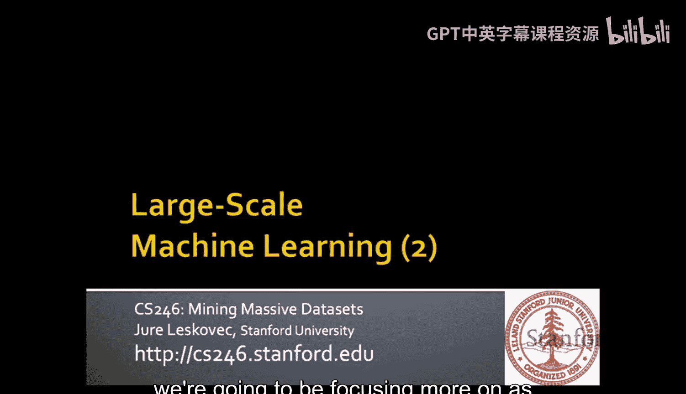

But first of all， let's go to a very quick refresher about what is supervised learning so that you we don't get lost throughout the lecture so once again。

We， we would like to， you know， execute a prediction task。 We have our function F of x。

 and we want to predict our label Y， and our y can be。😊，It can take many different shapes。

 It can be a real number in that case。 We have a regression problem。 It can be categorical data。

 In that case， we have a classification task。 And last but not the least。

 you can also be working with complex subjects like ranking items， Part3 and NLP and so forth。 Okay。

 so there is a quite large amount of different tasks that you can perform。

 The reason why it's called supervised learning is because we are provided with labels。

 a least in our training data。 Okay， so we have many pair， X， Y， X。😊。

Is our training instance and why is the label。 And especially today。

 we're gonna be focusing on perhaps with this like the matter of all the classification task。

 which is binary classification。 Okay， so in our case。

 the Y class will take the shape of either a plus1 or-1 label。 And towards the end of the lecture。

 I'm gonna show you how powerful this kind of assumption is because pretty much from a binary classificationifier。

 you can use it as a building block to then construct multi class classification and so forth。 Okay。

 so being able to solve this task and do it fast， then allows us to open up a lot of new scenarios。

 Allright。😊，Okay， so。Now that we are given our our training data。

 I'm gonna lie once again with is the main crux of machine learning。 Like what。

 what can you do horribly wrong in machine learning。 Okay， so we have X our training data。

 Y is our set of labels and ultimately， what wna do is we hope that our F of x generalizes so well that is gonna work on predicting unknown Y prime values。

 Okay， so basically when we see new data， our X， Y。

 we have to be able to predict correctly our y prime labels， okay。😊。

So this is what is usually called in machine learning the training and test split。

 And the main mistake that you can do is to basically train on both the training and test data。

 and then believe that your model is actually working correctly。 Okay。

 I know that youve heard this probably in five different machine learning courses。

 but it always helps to hear it once again。 So what is our hope here。 Basically。

 we want a model that can generalize。 Okay， so generalization means I see unknown data。

 Ive trained on our x and y sets。 And I'm gonna be doing a good job with Y prime。 okay and。😊。

The main mistake here that we can do apart from the capital scene of training also the test data is the fact that we can have our model learning so much the characteristic of the training data in such a way that is' going be overfitting So overfitting means that the model is going learn each single different peculiarity of our training data so that it will do a perfect job at predicting why but then once it goes to work on y prime only in a sudden is going be doing a very bad job。

 it means that the model is not generalizing and we are facing overfitting so today we're going to be seeing how to make sure that even in our support vector machines。

 we do a good job in terms of avoiding overfitting as much as possible。😊，Now。

 let's try to formalize a bit more our setting， so say that our training data is drawn independently at random。

😊，From a non probability distribution P of X Y， and our learning algorithming what is going to do basically is analyze all the examples and produces a classifier F okay。

😊，And once this classifier is given new data still drawn from P。

 the classifier is going to be able to predict our Y hat values。

 Why is it very important to allow the fact that the new data is drawn from P so this turns to be in reality a very strong assumption in machine learning。

 especially in context like I don't know， like companies receiving new data or receiving a different kind of traffic over time the characteristics of the data tend to change right so we're going to be using this assumption today and pretty much throughout all the direction of the class。

 but I'm going to be giving you this hint that especially recently we're working on a lot of what are called online machine learning algorithms that are basically able to learn data as it's ingested by the system and change the characteristics of the model but let's stick to this assumption for today is going to make things much easier and as usual we want to be able to measure something。

We need a measure of the quality of our model and we're going to be calling this the loss okay so the way in which we measure our loss is pretty much what is the difference between the actual labels of the data and the labels that we predict now given the nature of the labels。

 say those are numbers or classes we can compute loss in different ways it could be a meanscor error。

 it could be mismatch misclassifications through positive false positive and so forth。

 what counts is that each model to be trained correctly must expose some kind of loss measure so that we can optimize and we can minimize the loss of our model so as I was saying。

 the goal of our learning algorithm is to make sure that we find function apps such as we minimize the expected loss of our model okay。

So let's go through the formula setting once again with an architectural drawing。

 so we have our training data as I was saying before。

 our training data is basically drawn at random from our probability distribution P of X O Y and with the training set we ingestted in the learning algorithm and then we produce our function F as the classifier and。

😊。

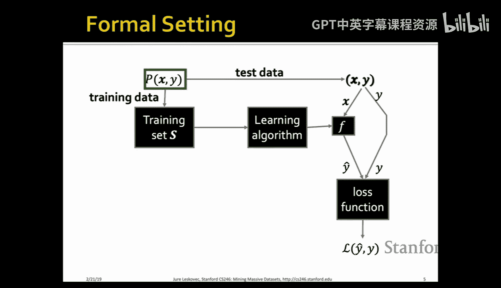

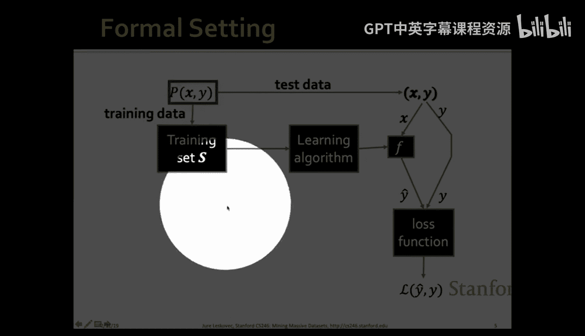

WhatWhat we do here is that on top we also have our test data on which we didn't train the algorithm but is still as y labels。

 And what we're going to do is we're going to be comparing the predictions produced by our model F and the actual labels okay so we put both of them together in our black box as a loss function。

 We compute it and our goal once second is to minimize L okay。

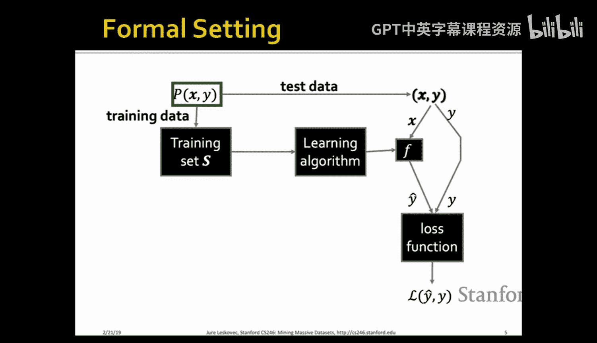

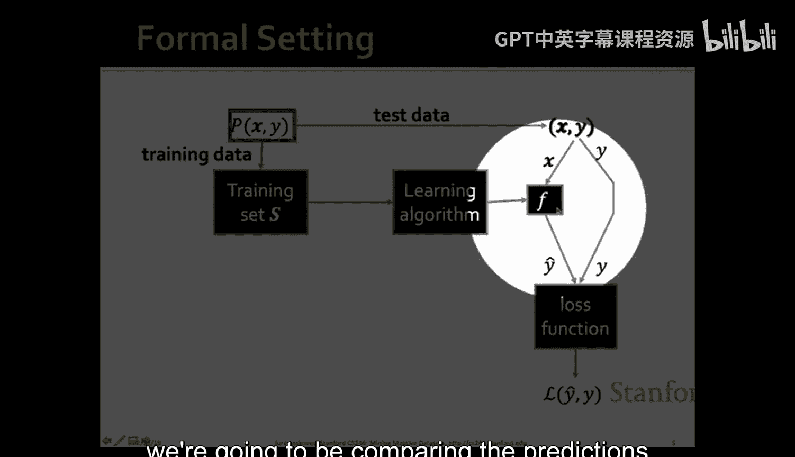

As simple as that so in reality， this is a hard task and I basically summarize all the challenges of machine learning in five minutes as you might have realized so why is this once again extremely hard because when we do our estimation on F on our training data we also want this to work well on unseen future test data and as I was saying before。

 sometimes this un seen future data looks very similar to the training data so that is coming pretty much from the same probability distribution sometimes is much different right。

😊，So that's why this is a very challenging problem。How do we minimize the loss now， okay。So。😊。

Once again on top we have our expected loss function， we want to minimize it。

 but as we said we don't have access to the labels in our test data。

 so what we're going to do is we're going to minimize the average loss on the training data okay so we are just basically going to be taking the average。

 we have n instances in our training data， we compute the loss and we minimize the average。Okay。

 now what is the problem here in case we don't understand what we are doing with our loss function。

 So say we just try to optimize it in any possible way。

 The most trivial and powerful way to optimize to minimize this loss function is to memorize all the labels in the training data。

 Okay， so basically， we can achieve zero loss on the training set just by memorizing each single label for our training data。

 Okay， so that that is a very powerful and stupid classifier because it doesn't generalize。right。

 but。😊，You would be surprised， especially in the past。

 there have been a lot of papers or studies published on， you know。

 large media outlets that were based on very ill defined classifiers。 Okay。

 so always keep in mind that that's one of the other capital scenes that you can commit while trying to。

Minimize the loss function。 Okay， so we don't want to memorize training data。Okay。

 so I think what I'm trying to do here is to convince you that overall machine learning boils down to an optimization problem apart from the different models that we are going be seeing we seeing decision trees on Tuesday。

 we're going to be seeing another different type of model today。

 but overall we know that there are different models in which you can capture characteristic of the data。

 but the important part is the fact that we have to optimize this model。

 Otherwise it would have very poor performance right。😊。

So let's start working with a very simple model。 So basically today we are going to be seeing models that are pretty much linear in their nature。

 okay so we have a set way it's y x is our data we take with product and then we have a bias term。😊。

And we're going to be seeing that pretty much already linear our models are extremely powerful。

 and you can also work with I dimensional data with them。 Okay。

 so that's going to be mostly the focus for today。😊，And once again。

 now we can rewrite the loss function that we had before in terms of expected loss on the training data so once again we're going to be taking the average and all the N instances on our training data sets and now we express it in these way so we're going to be taking the product of the weights and our training data。

We compute the loss compared to the actual label for the instance I so we have y of I which is our label for that distance and then we compute what is the loss okay so that's the function that we want to minimize today。

Now how do we express the loss as I was telling to before it can take different shapes it depends on how the data looks like is it numerical data is it categorical data。

 I'm going to be showing you the very first kind of loss function that can come to your mind which is nothing but a stepwise constant loss function and it works in the following way so if there is an agreement between the label predicted and the label in the actual data so like you take the product between them and both of them are positive or both of them are negative then you're going to be seeing a positive value and our loss is zero as soon as there is a is match between the label that we predict and the actual label in the data then the product is going to be negative and then we're going to be seeing a loss of one okay。

😊，What is the problem with this kind of function， which I kind of spoiled already down here at the bottom of this line is the fact that it's very hard to take the derivative of this function。

 So it's gonna be having derivative 0 in this to discontinu part。

 And then it's gonna have a derivative of infinite。

On when x when when x is equal to0 okay and as we're going to be seeing later。

 we also cover this during the latent factor lecture in the Reis module。

 you recall that the main ingredient that we use for gradient descent is the fact that we can differentiate function so that we can walk down the gradient and quickly converge towards the minimum of our loss function so the issue is we cannot really use a loss function that cannot be derived Okay otherwise。

This kind of peak at infinite here is not going to be making our life easy。

 So we're going to be seeing a variation of this function。 Okay。

 but at least this should already give an idea of how loss function can look like。

So how are we going to approximate then our loss？We said that we want something smoother。

 so were be we're gonna be basically replacing it with a surrogate loss function。 For example。

 the hinge loss。 So the hinge loss is probably the second most trivial loss function that you can think about is called hinge because we remind you of a hinge of a door and I'm going to be showing you the graphlet around to make you realize why this is the case。

 So how does it look like the rest of these the equation is pretty much similar to before。

 So we're going to be averaging over all our training instances。

 So our n instances in the training set and then we're going be taking either the max the max between0 or one minus the actual prediction of our model So what is happening here if。

😊。

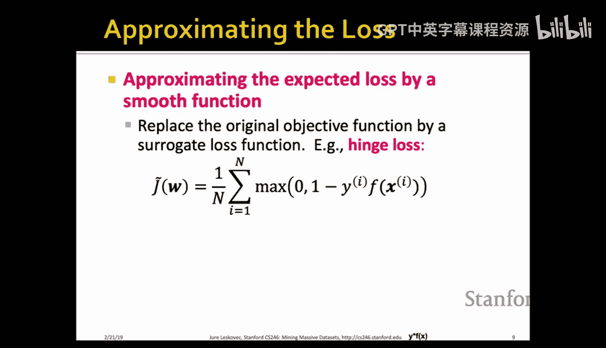

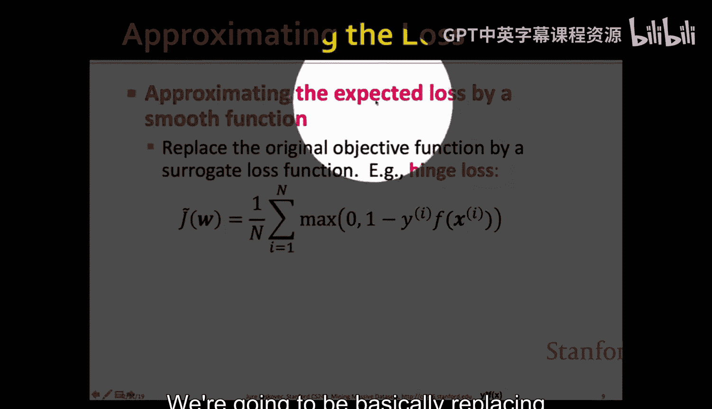

TheThe prediction and the label are matching and then their value is positive and large enough。

 then this value is going to be negative。 therefore we're going to be taking0。

 okay so our loss is 0 in case instead these two values are mismatching。

 so one of them is positive and the other one is negative。

 we're going to be coming up with a large we're going to be having here a negative quantity。

 so there is a minus this is going to become positive and then these one will be the loss in core powerer model okay so that's why is called hinge。

😊，And that's how it looks like。 So the idea is， if our prediction is， you know。

 we have high confidence that is correct， then we're going to be in this part of the plot。

And our loss is gonna be 0 once we start to get close to the origin。

 So we're gonna be incurring a small loss。 Okay， and the reason here is we are so close to the splitting point between doing a misprediction that we're gonna be slow to start to slowly start to increase our loss。

 And then the loss keeps on growing linearly。 Okay。

 so this is our hinge coming from someone we had a lot of creativity when they wanted to name it。

 Okay。😊，Okay， so any questions up to now or shall we jump to the sub power vector machines。

 which is the first model for today。Alright， so let's go to S VMs。 So what is the。

 the concept N and S VM and why are they exciting。

Let me highlight this fact。 first of all， once again。 So from Tuesday。

 you remember that we talked about decision trees。 We said that they are amazing for many different reasons。

 They're fast。 the model is compact。 they can capture。😊，No linearity in the data and so forth。

 So extremely powerful。 The only shortcoming is the fact they don't do very well with high dimensional data。

 Usually what the decision3 expects is data is already well preprocessed and where we have extracted features that are really extremely informative。

 Okay， but there are there is， you know， another set of the spectrum in machine learning where you can feed the data that is highly dimensional to your models。

 The first one， you can think about this text。 Okay。

 so you take a dictionary in the English language。 You can， you know。

 copy that 50 K terms of 100 K terms。 That's very high dimensional data。 Okay。

 so you're gonna be representing a document as a very high dimensional vector。😊，In that case。

 decision threes don't do a very good job。That's why today we're gonna be seeing is support vector machines。

 which converses we do very well with dimensional data。

 So the key idea here is we want to separate the plus from the minuses。 Okay。

 so this is now two dimensional data。 do an F 14 abstraction。 You can think this as the dimensional。

 And our plus and minuses are basically the labels。 Okay， so this is a binary classification task。

 And we just want to divide。 We want to find a linear model that is going split the plus and and the minuses。

 Okay。😊，So data once again， we describe it as before， so it always is a top of x。

 the training coordinates and y the label and。😊，In each example。

 the coordinates are going to be real valued clearly。

 and the label belongs to this set of minus1 or plus1。And what we can do is basically。

 we can take the the inner product once again。 So W is the set of weights。

 X are thes of our pointing space and。😊，What we can find here is basically what is gonna be the best linear separator defined by our weights W and our term B Okay so this is basically the only parameters that we need to find in order to define the line the speeds between the two sets of data okay so you can imagine this is one candidate that does a good job at classifying there will be many more of them Okay so you can imagine lots more lines splitting the plus and the minuses so the task that we are gonna be working on today is finding which is the best line separating those points okay。

So like which one do you think is better in terms of a separator。 This one or the top one。

 and the intuition here will be that for instance， if we pick this one。

 this plus sample is very close to the line。 So this classification will have a very low confidence intuitive。

 okay， well this one is a much better split between the two sets because most of the points are very far from the line。

 Okay， so we want to formalize how to find the line in an efficient way。Okay。Alright。

 so now we introduce the concept of margin。 So， how do we go from what I was saying in terms of distance to something that is a bit more formal that we can optimize for。

 okay。So we basically want to take the distance between the separating hyper planee and this distance we can think about it as the confidence of our prediction。

 So in our case， once again， like point A and B are predictions with very high confidence Y C will be a prediction with a very low confidence。

 okay。😊，And we want to avoid as much as possible， points like C。

Okay so we're going to be calling our margin gamma and what we're going be taking to be optimized is the distance of the closest example from the decision line or our hyper plane So you see these are two potentially good separating hyper planes。

 but we like the one on the right， much more because if we take the instances that are the closest possible to the separation line。

 their distance will be much further compared to that case that we have on the left so we have to find basically a strategy on how to define the separating hyperplan you might be wondering why are we focusing exclusively on the distance of the closest example。

 why are we working with the average for instance， like we can take the average distance of all the pointss to our separating hyper plane and we can try to maximize that is's mostly following theoretical convenience if。

Going with the papers and how the fact that SVMs are working correctly has been improved。

 it makes life much easier to work with this concept of the point。

 it is the closest to the separating outer plane but the intuition pretty much stays the same we want to make sure that the points are as far as possible for our separating line。

😊，So a short refresher on what is the dot product because we're gonna be using it later on。

 So if you want to take the dot product between A and B。

 what we are doing is basically we take the normal vector A。

 the normal vector B and then we do the product of the cosine of the angle between them and there is a geometrical interpretation that we're gonna to be using later。

 which is the fact that basically A dot B is going to be nothing but the projection of a over the vector B。

 so that's how we can we can imagine it。 and we can compute it directly with this。

With this formula there。You can imagine today we're going to be seeing a lot of geometric interpretations of why that hyperper plane fits correctly and splits our training points。

 so that's why it's very useful to think of the dot product in this way。😊，All right。

 so now that we refresh these， let's take some example of what is a good margin。

 how can we pick a good margin gamma。😊，So first example here。😊，This one is the origin。

 Then we have point x 2 and x1。 How do we compute the distance of those point to our separating line。

 Okay， so we take the coordinate。 And now what we can do is。

This is the vector w that defines the upper plane for as an assumption。

 we're going to always be working with a vector w of norm equals to 1， okay？

And the way in which we can compute the distance is that x1 is nothing but the projection over the vector W。

 Okay， so it's gonna give us this distance to the upper plane。 So in this case。

 you can think that the margin between x 1。And the separating line is going be roughly equal to the magnitude of w。

 Now， you take x 2， for instance， instead， And in this case， projection is much longer。

 So roughly you can see that we're talking about twice the norm of W， okay。

So you can imagine that we're gonna be doing this pretty much with all the points that are close to our separating line and always make sure that we maximize those distances。

Okay， so the bottom line is the bigger is our margin that we can find。

 The bigger is gonna be the separation。 Therefore， the bigger is gonna be the confidence with which our classifier produces the the predictions。

Now let's be a bit more formal。 and let's start to see how do we compute the distance between the points and the separating line。

 So we have our point a up there carding our x sub1 x sub of a 1 and x sub of a 2。

 Then once again we have our vectoror w that defines our splitting line and once again we assume that the norm is equal to 1 okay。

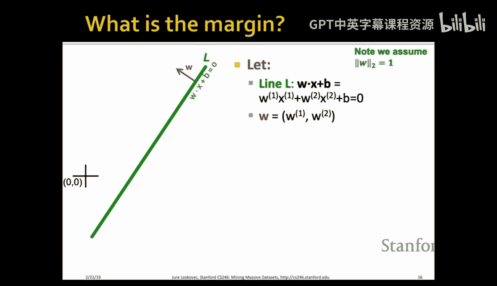

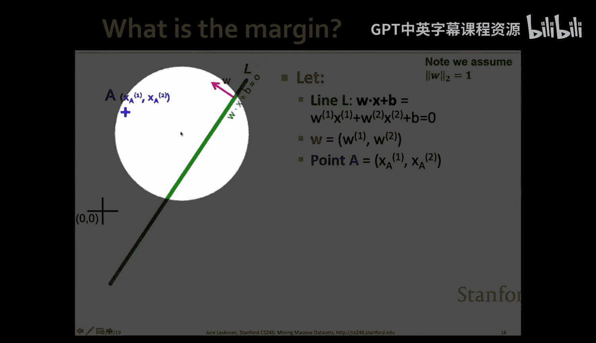

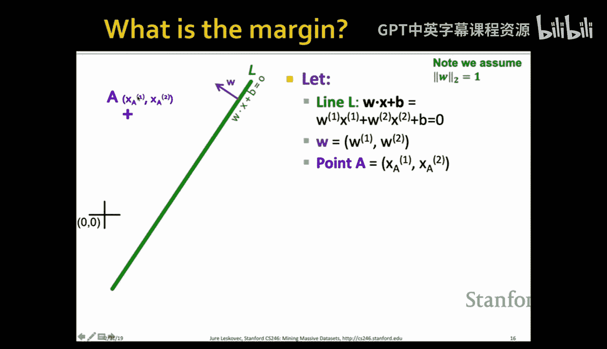

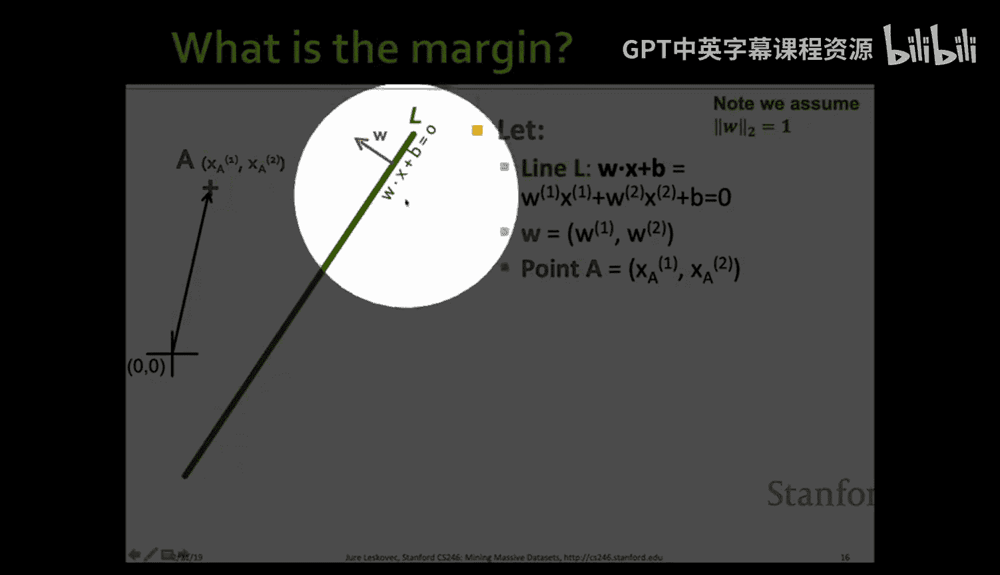

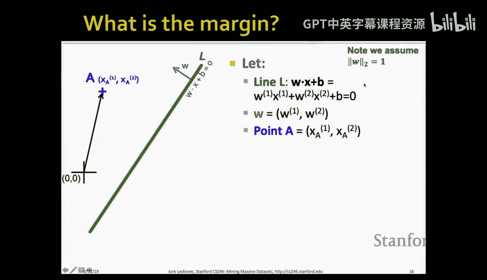

So that's our origin。 and let's take any point M on the line。 Okay。

 so on our line on our line defined by the vector W。

 and this one is going to be I've coordinate x sub M 1 and x sub M 2。

How do we compute the distance between a and our line L， So we're going to be calling that A H。 Okay。

 so the distance is nothing but the normal A H。 We can rer in the following way。

So it's going to be a minus m。 So our point here on the line， Dr Prado W。

 and the reason is here because we are basically taking the projection。

How can we rewrite this once again， so let's remember that our point he it belongs on our on our line so we can rewrite it in the following way。

 remember that we have this expression up here that every point on the line follows this equation right W times x plus b equal to0 so we can rewrite those coordinates and make it equals to minus B so we are carrying the B on the other side。

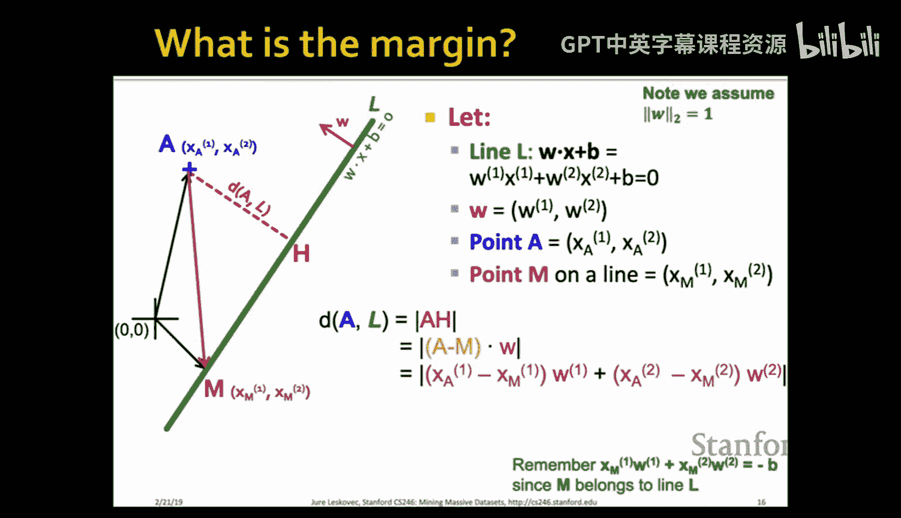

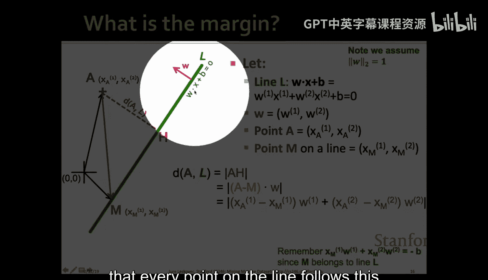

Since we know that M belongs to hell。 So we take， and we substitute our he in this way。

 we expand the equation。 and then we simplify what do we get。 So we are getting。

 we are keeping B from the substitution。 And then the terms with M are disappearing。

 So we are just gonna be having x A x sub a 1 times the weight1 plus。The second term plus B。

 and that's how we go so we prove that the distance between a and our line hell theduct product is the product of the weights W and a plus B okay。

So now we have any question in our hands on how to compute the distance between our line and each point。

 and this is going to be the way in which basically we compute what is the margin and that's eventually what we're going to be trying to minimize。

😊，So。How do we now compute the how do we compute our predictions。

 So our prediction is nothing but the sign of this product， Okay， so if。

If the points are on the right side of the plane defined by our separating line。

 then the sign is gonna be positive。 but if they're on the wrong side of the plane。

 then the sign is going to be negative。 okay and that's how basically we computed。

 So we're just going to be taking the sign of this expression。 And once again。

 the confidence is not about what we have just seen。

 So is the distance computed between the point and the separating line。😊。

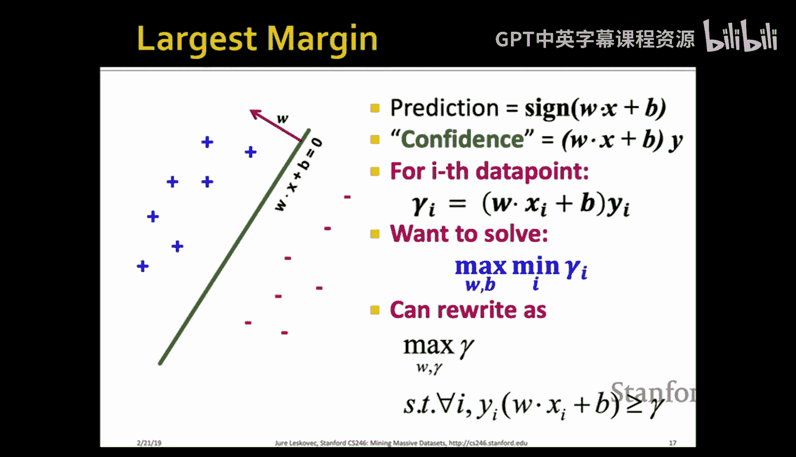

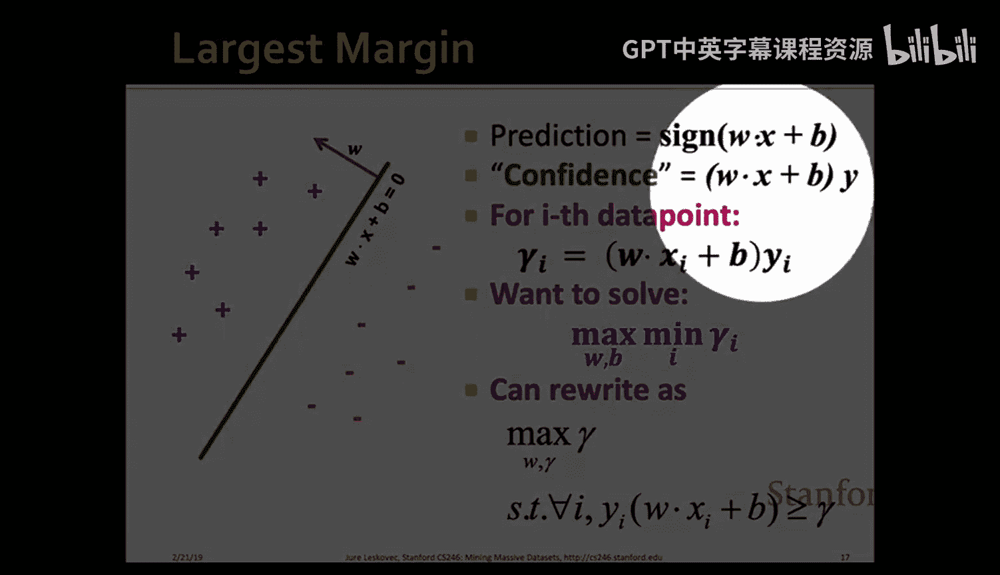

So for for each data point， we can compute the gamma margin。

 So we have data point I and our gamma high is nothing but what we computed before， okay。😊。

Now what do we want to solve what kind of loss are we trying to optimize here so this expression is a bit tricky basically what we want is we compute all the possible margins okay and the margins that we care about are those that are the closest to the line so let's say is these plus on top here and then it's probably these minus here these are the two margins that we are worried about are the two data points the closest possible to the separating line。

Now， once we have this， what we want to do is we wan to。After we pick the minimum margins。

 we want to make sure that we maximize them。 okay we want to make sure that the points that are closest once second to the separating line are as far as possible。

 So how do we maximize them by tweaking the weights W and value B okay so were basically we're going to be finding the best possible parameters for these separating line such that the minimum margins are going to be as large as possible。

Now， given that the expression of this one is not very easy to optimize， we can instead rewrite it。

 and we're gonna be rewriting it in the following way， so。

What we are doing is were trying to maximize the margins given the value of the weights w and our gamma value。

 such that per for each instance in our training set。😊。

All the the the margin the all the distances to the separating line are going be larger than our gamma。

 okay and basically we took this minimum here and we carry it over in in this expression here。

 okay so we're making sure that each distance is at least as large as our as our minimum gamma okay and we want to maximize this over all the possible gammas。

 Okay so it's just a trick to make sure that we have only one maximization so that now we are going to be able to optimize this expression okay。

😊，Any questions。Okay， let's， let's go on。On defining then what is an SVM。 Okay。

 so now that we understood what kind of problem we want to solve。

 let me give you a first definition of why it's called a subed vector machine。 So we wantna。

 we want once again define what is this line。 And to define a line。

 or to define a separating upper plane in a dimensional space。 we need D plus one vectors。 Okay。

 so for instance， in this case， were working in D。 We are gonna be needing three vectors to define。

What is the separating line， Okay， and the way in which we define these vector。

 So the way in which we find the parameters W and B for this line is by maximizing this expression that we have just seen。

 Okay， so that's why it's called support vector machine。 It turns out that。

There are many different types of SVMs。 What we' are going to be seeing today is the first and possibly least advanced form of a separate vector machine because it works exclusively with a linear model it turns out that there is a lot of additional work later on on SVMs where you can substitute a linear model with something that is called kernels so you can have more advanced functions basically splitting your data and you can imagine that this becomes much harder routes in terms of finding what the best possible margins but。

The key idea of what were trying to attempt with an SBM。

 even if we substitute a linear model with something more advanced， is still the same。

 We just want to separate our upper space in such a way that we find areas where all the。

Same labels can be found clustered together， okay。

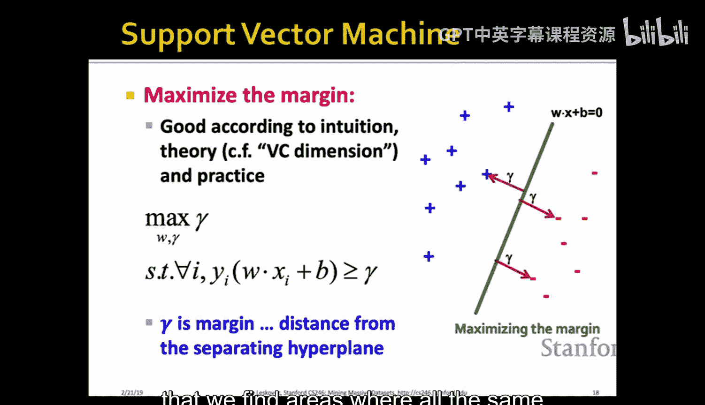

Okay， now， how do we derive this margin， Okay， how do we actually compute it so that in we can then optimize and find the。

 the correct values for it。

So once again， we want to separate our upper plane and the way in which we do it is defining by our support vectors。

 so we have our plus and minus points so the red points and the blue points。

 you can imagine them you know you just map them to two classes that you like and。😊，The。

 the key aspect here is that these don't have even to be points belonging to your training data。

 Okay， this， this could be three fictitious point。 The The important thing is that we want to find these three support vectors that are gonna be defining。

Our， our separating line。 Okay， so as I said before。

 we need D plus one support vectors for the dimensional data。

 And while this problem is relatively easy to。Imagine right now because we're working in 2D。

 as soon as you start to feed it with let's say， English documents with a vocabulary of 50。

000 dimensions， then only in a sudden this becomes much harder okay？

But it's good to work with this geometrical explanation on the side so that you can get the intuition of why this is working。

 okay。Now。The problem here is the following。 So， if， you know。

 if we are trying to maximize this value from the expression that we've seen before。

 what we could be doing is that we could just be boosting the weights in order to scale up the increased margin。

 okay， so if we are putting in a constant in front of our weights and we make them twice larger or four times larger or 10 times larger。

 Then our margins are growing as well。 Okay， but。It turns out that this is not what we want。

 because this is similar to overfitting our data。 You know， we。

 were not really learning what is the best separator。 We' are just introducing a constant that。

Increases the size of our weights。 So how do we find a work around for that。

 We gotta make sure that we always work We， we normalize weights。 Okay， so for now on。

 every time we are computing the margin， we make sure that we divided by the norm of the of the W vector。

 okay。So we always want to make sure that that expression is equal to one。

Okay so in this way basically we are requiring that our support vectors are defined with this expression okay so we have our separating line and then we are going to be having support vectors of norm just equal to 1 so if you take plus and minus1 basically we're going to be having a parallel separating line on the left and another parallel1 on the right has sign respectively V2 plus and minus1 and that's where we're going to be having our support vectors okay。

Perfect， so now that we have this， how do we find the solution for our problem so we said that we want to maximize the margin so for instance。

 what is now the relation between x1 and x2 so what is the relation between these two margins？

So we can write x 1 in the following way。 So x 1 is nothing but x2 plus twice the margin going on the other side。

 Okay， so we know that there is a distance of two between the the parallel line on the left and the parallel line on the right。

 What do we also know。 So from what we have seen before is that we know that our support vectors all will be expressed in this way。

 So it's either plus 1 or -1， depending on which side of the plane they are。

So we can rewrite that expression in the following way。 Okay。

 so say we have the expression for the first support vector。

 then we can go and we can substitute it from up here。 Okay。

 so this is the a way in which we can express x1。 So we take this x1。 We substitute it in here。

And what we get is the following。 So we， we distribute。 we just expand the expression and。

We know that this is equal to minus-1 okay where it up here。

 So we can substitute all of these two -1。 And that's what we get。 Okay。

 so we make sure that basically if we if we do all the map。

 we see that our margin is always going to be normalized to1 over the norm of w Okay so in this way。

 we make sure that all the margins in here are equal to 1。

 Okay and these are the margin of our support vectors。

 So now that we know how to express these in an economical way。We can start to do the following。

 So let's go back to our problem from before。 we want to maximize our margin， such that。

All the points are lying outside of the separating line。

 and we said that in this way we can be arbitrarily large。 So that's why we normalize。

 otherwise we can basically just boost the weights for w and make this expression arbitrarily large。

 but that's not what we want。So how do， how can we rewrite this。

 So we can take basically the arc max of gamma。 Okay， that's what we were trying to do。

 We want to maximize gamma。 This we can rewrite as the max of one over the norm W。

 That's what we just expressed from before。 So that's what we just found out。😊。

We can now rewrite it in this way， so we take the reciprocal and this will become then the mean instead of the normal of w and。

All these steps should be trivial because we derive all of them。

 The only one that might look slightly strange is this last step。 Okay。

 so we said that now we want to express this problem as the argument mean of。

1 over two times the norm of w to the power of2 Why do we want to do this we're going to be see it in a little y little while。

 but you can imagine that if you take the derivative of this expression then this is going to be equal to just the norm of w okay so this is just a small trick that we're going to be carrying over so that once we plug this expression in our gradient descent。

 then all in a sudden then we're going to be working again just with the norm of w okay so。

Bear with me for a while。 And then we're gonna bebusing this expression in that way So that is going to make our life easier for the。

For the optimization Okay， so we found a way to rewrite that so we went from something that was depending on gamma to know something that just depends on the weights okay of basically the parameters that define our separating line we made this tweak so that after we can make sure that we can plug that into gradient descent and we're able to optimize it and。

This is the expression that defines what we call， and as we am with heart constraints。

What do you think we call it in this way， Like what is one thing that we haven't consider up to now。

Like this seems to be a very ideal example in life， right。

 We're always able to find a line that splits perfectly between elements of one class an element of another class。

 What do you think is there the assumption that we should relax right now。😊，Sorry， perfect exactly。

 So this is what we're gonna be doing right now。 So the the sets here are perfectlyable separable。

 And this is properties is called linear separability。 and this is not clearly always the case。 Okay。

 data tends to be very messy and noisy。 So it's extremely hard to always find such a perfect separating line that gives us pretty much no loss。

 Okay， so from now on， we're gonna be relaxing those hard constraints。

 and we're gonna be working with something that is also able to deal with more noisy data。 Allright。

😊，So。For this reason。We need a concept of basically penalty。 So if our data is non separable。

 then we need a way to include that in our loss function， right。And。

The first way in which we can think about it is that we can account for the number of mistakes that the model is making。

 Okay， so you can imagine， okay， we are in this case here。 how many mistakes we have， We have one。

 we have1，2， So2 red minuses and1 blue plus on the wrong size of the plane。 Okay。

 so we know that apart from the。😊。

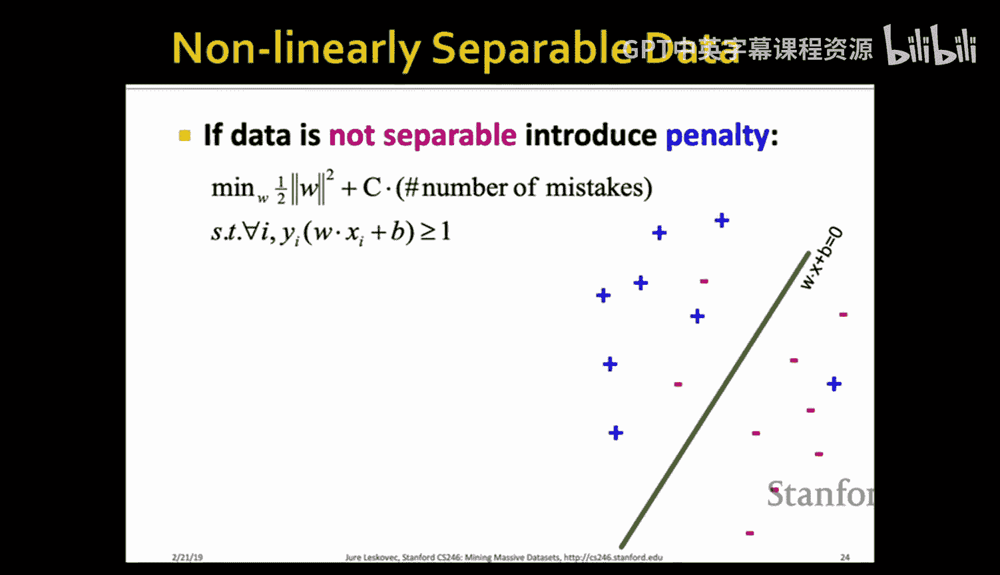

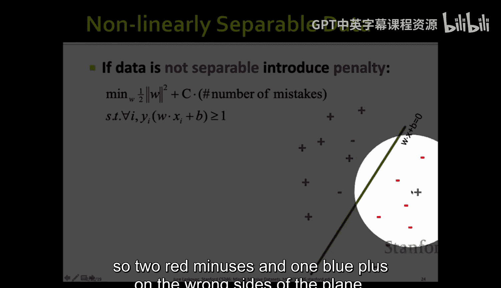

A fact that we have to minimize the margins so that we find the best possible separating line。

 we're also taking into account how many misclassifications we make。 This is a good start。

 let's call it in this way， but we can do much more right so you can imagine that misclassification happening very close here is going be less problematic than a misclassification happening very farther away because here were already know that the confidence of our classifications is very low like these are data points for which is hard to distinguish to which class they belong。

 Well something that is completely in one side of the space separated by our upper plane should be relatively easier to classify。

😊，So that that's why we're gonna be going from something that depends just on the number of mistakes to something rather than also capture the distance of those mistakes from our separating line。

 okay。Okay。So to do that， we're gonna be introducing a concept called lack variables。

 And these like variables are doing nothing but encoding how far away these points are from the wrong side of the plane。

 Okay， so if。If a point is on the right side of the separating line。

 then we don't attach to it as like variable， but once they are。

 then were going to be basically computing the distance from the separating line to where they actually are okay。

So basically， for each the point， if the margin is larger than one， we just don't care。 Okay。

 if the margin is less than one， then we pay a linear penalty。 as easy is that。

 So as we were saying before the farther you are from the separating line in case you are you lie in the wrong side of the plane the more penalty we're gonna be paying。

 And what what do we want to do， we want to basically include these in our loss function。 Okay。

 so we are just gonna be adding a term there， that depends on C。

 So C still the number of mistakes that we can make。

 and then were we are iterating on all the possible points。

 you see the sum goes up to n and for those。

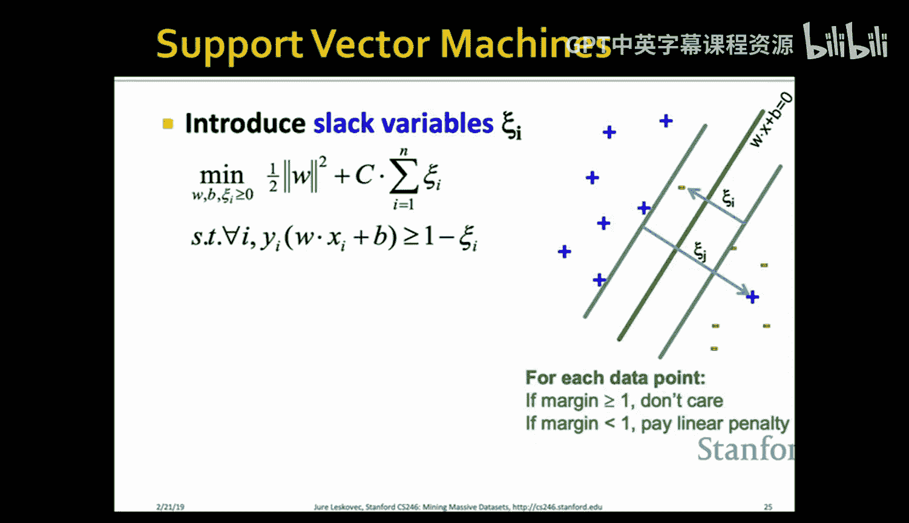

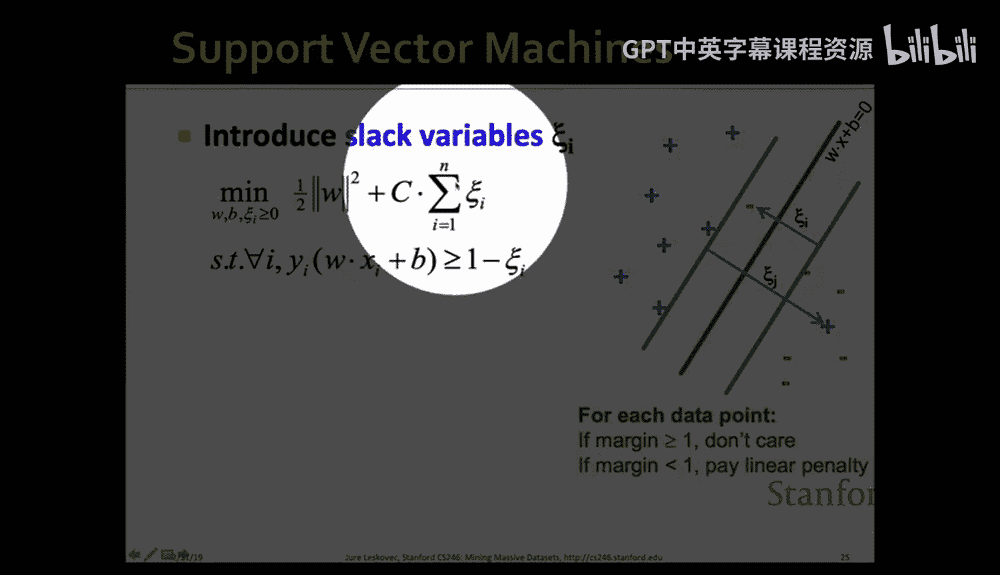

Where there is an error， then we're going to be using a lack a variable that encodes the linear penalty in our model。

😊，And the other change that we have to make， everything stays the same。

 But here we are gonna also be including the value of this like variable。 why do we do that。

 So basically， if we are on the wrong side， then we wanna。

 we w to compute once again which is the distance of the separating line so that。

You want to make sure that one minus this lack variable is gonna be bringing you to the right side of the plane。

 Okay， so we're basically carrying this lack variable also down in in that expression。 And if we。

 if we minimize this problem， now we're gonna be able to find a model that not only takes into account what is the best separating line。

 but also takes into account the possible mistakes that it is' making， okay。As we were saying before。

 though， this is relatively risky。 and in which way。

 in the sense that if we try once again to optimize this too much。

 we might hand up over5 in the model。 So let's， let's try to work first through through an example through a visual example so that you get an idea what is going on。

 So you can see that once again here， we have the expression from before。

 And we have this basically wait， see that we put on top of it。 Okay， so。😊。

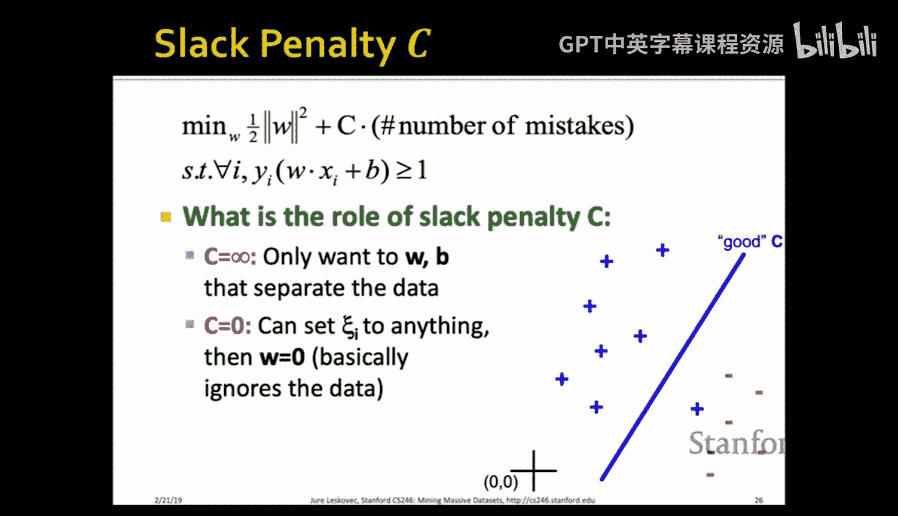

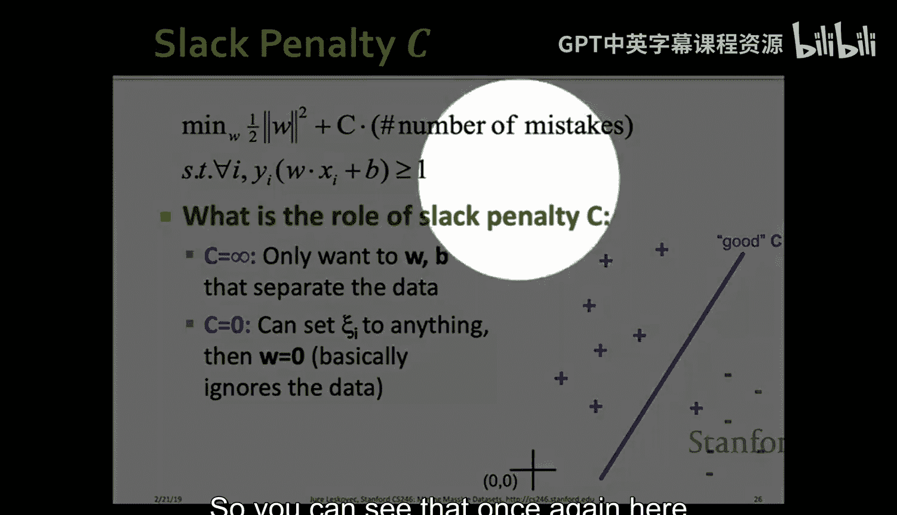

If we put C equal to0， then basically you can set this like variables to to anything and a model with that kind of penalty value can basically fit any kind of separating line。

 conversely， if we bring C to infinite， we're gonna be making those mistakes extremely penalized。

 Okay， and there is a chance that we are just not gonna be able to find a separating line that can minimize that expression。

 so。This is where we start to talk about overfitting in SVM。 So if we have a standard C value。

 then most likely this is the kind of separating line that we're gonna be finding but if we boost stop that value we're going to be finding this separating line that actually does a perfect job in this case。

 but that very more confidence Can you see because it penalizes more mistakes so it carries over to this side but then we're going to be producing some of these predictions that have very low confidence values okay。

And conversely as we were saying before， if C is very small。

 then the model doesn't have anything to learn from because this lack variable allows a lot of slack to the model so it can pretty much choose any set of weights and then we are going to be fitting a line that doesn't make any sense whatsoever okay so。

You can think about see as a regularizer， as a regularization parameter for our model。 Okay。

 you might have seen that in other models in machine learning。

 pretty much every good model in machine learning allows you to have a tuable that tells you if you're overfitting or not Okay yeah variable。

😊，No， theres like bearies The is the distance between the。

The separating line and your actual value so you can see it as the margin。

 but is not is not the margin that we compute from like the closest point to the separating line okay it's just the distance of the misclassified points to the separating line and you use that as a penalty value that is going to be hand up in your loss function okay。

 so you compute it only for the points that are misclassified， not for all them。Yeah。Yeah。

 a second question， so if W is always normalized to have magnitude why they。1 W。

 the norm is gonna be equal to one。 But the components， that's what were， we are looking for。

 Like we， we， we change the values of W to define a different line that then allows us to find the more less possible。

Penty coming from those errors。So we normalizing W just means that we make sure that the norm is always equal to one。

 but the value of the different components can vary。 Okay。

 so we vary the the components of W to find the best possible separating line that brings down the penalties as much as possible。

Okay，Okay。Yeah， we me imagine the top function。 And then we， this is a condition， right。

 It' such that per each training point we want that condition to hold。Okay。Perfect。Okay。

 so we've seen different tradeoffs with our penalties。

 So now we can express a support vector machine in what is called usually its natural form。

 So by natural form， we mean something that now can capture both the misclassifications。

 the fact that data is not linearly separable。 and we're going to be bringing everything together in one single model。

 Okay， so。

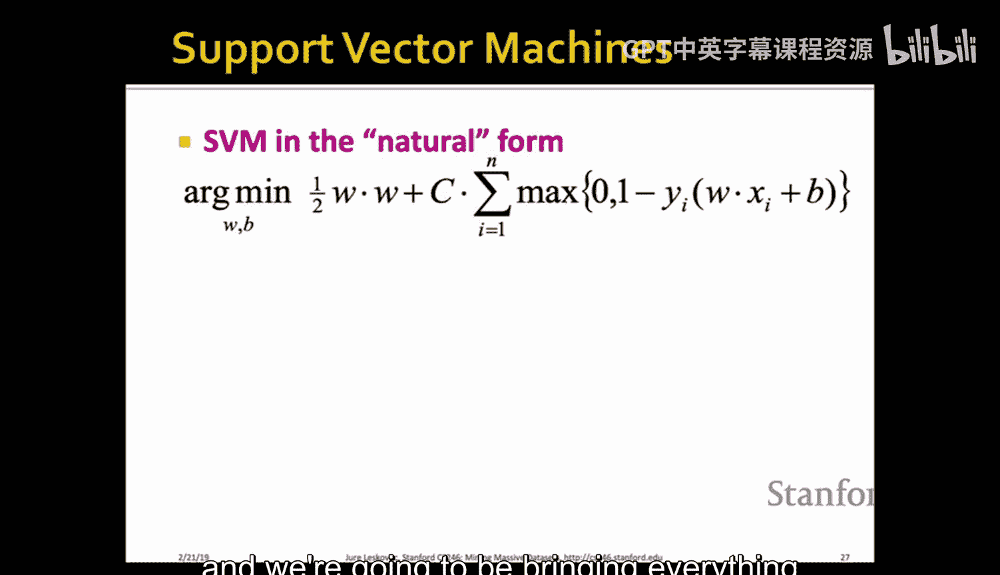

Everything here to still look familiar so we are trying to minimize this here we're just taking the dot product。

 this is our regularizing factor and then we're just going to try to maximize this expression that we have seen from before so that is our margin see as I said before is our regularization parametermeter and this big sum is our empirical loss okay so it's how well we fit to the training data。

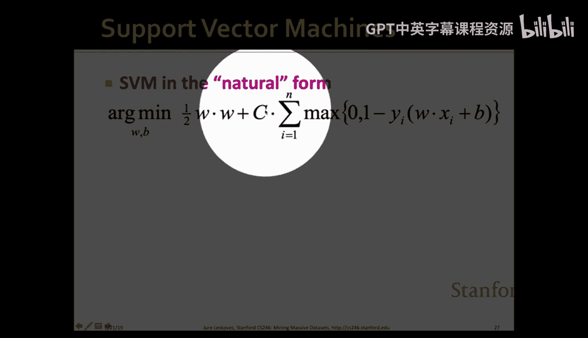

And as I introduced before， SVM is basically using the hinge loss and you can recognize it from up there。

 so were taking the max between 0 and1 minus the actual prediction so that's how we are expressing that as the hinge loss so we cannot work again with this stepwise function because we cannot derive it so we're going to be working with our hinge loss。

And this is the combat version to express the same loss function that we've seen from above， okay。

So now that we derive this beautiful formula， how do we make sure that we we can find。

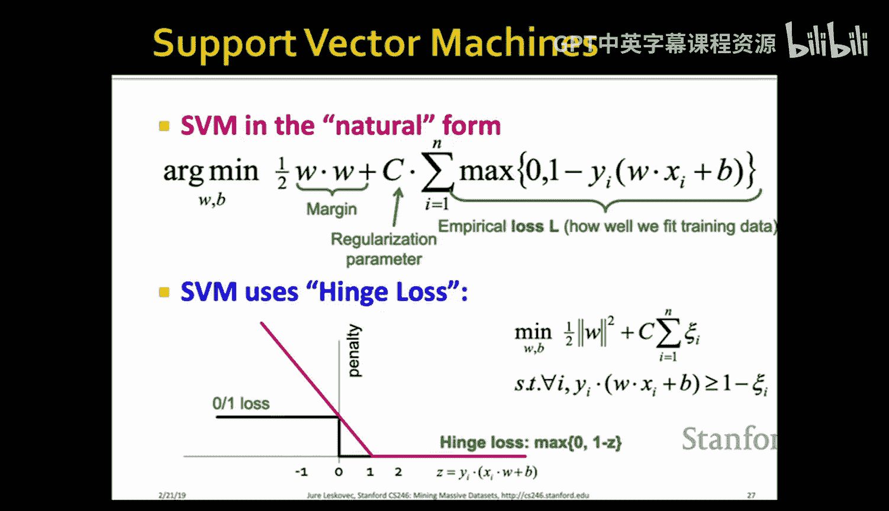

Or you can actually compute the margin， okay。So how do we perform this estimate。So we want to。

 as I was saying before， we want to estimate both the weights W and B。 Okay。

 so we want to find what are the parameters that define our separating hyper plane and。

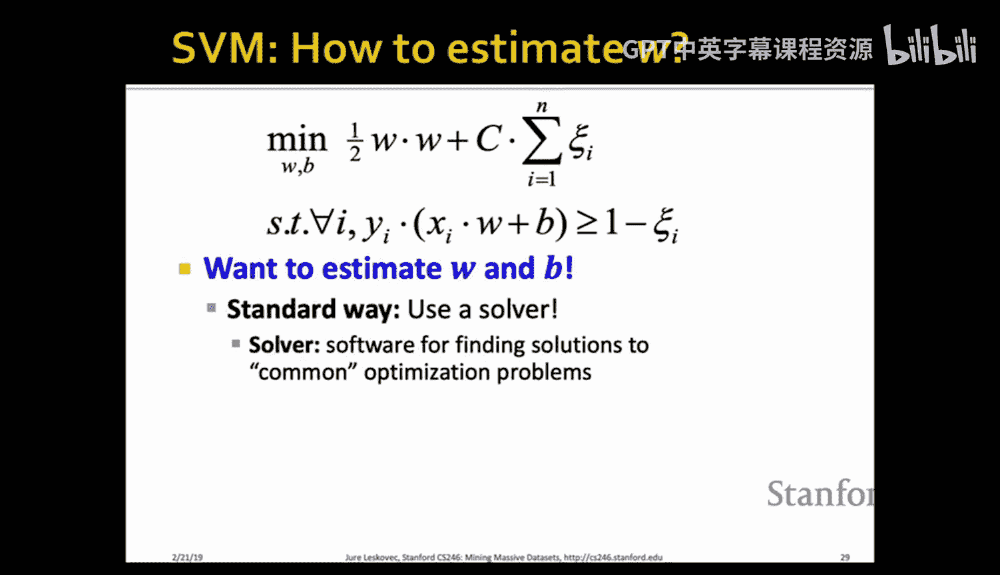

You can recognize that this is basically aquadratic function， right。

 because you know we have this product up there。 So you will be tempted in just using a solver。

 We know that quara functions are very beautiful。 are convex。 There is one global minimum to find。

 So why not？ And there is there are a lot of software for funding solutions to this kind of common optimization problems。

 You can throw this in Matub with a one liner， and it will do it for you。

 What is the potential issue here。 Like why don't we just。

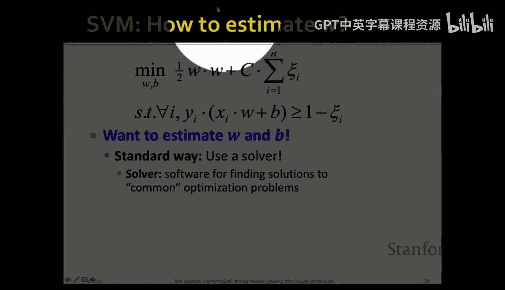

Use a solver and call it the day。What do you think is the shortcoming。

Especially if you ever use the solver in your life， you might remember why it's painful。

So solves are extremely low in general。 they don't deal well with very large data。

There are a lot of people doing amazing research on solvers。

 So I'm not trying to discourage the kind of work that they' are doing。

 The solvers have improved a lot throughout the decades。 but still， you know。

 when they're facing the size of the data sets that you know， we even talk about in this course。

 they simply cannot scale to something at large。 So thats， that's the reason why。

 like minimizing aquadtic function ideally easy to do， but they're very inefficient for big data。

 So how do we find a solution to this， What is the work around that we can employ。😊，Okay。

 so once again。This is what we want to minimize our loss function J and all the work that we have done before now puts us in a condition where we can actually take the derivative。

All that beautiful expression up there。 Okay so why do we want do derivative once again。

 we're going to be working with a gradient。 we just want to make sure that we can work down that function differentiated and then find the global minimum for our loss。

 okay， very similar to what we've seen， I guess in week5 week four when we were talking about the latent factors in recommender systems。

 okay。😊，So we' are going to take the derivative of the expression up there on W。

This is how it's going to be looking like。 So that's the trick that we played before we work with the square and we put one off in front。

 So once we take the derivative， that will just look w to and clearly we're going to be working with each single component of W。

 and this is the derivative of our empirical loss。😊，So。I is what we get once we compute our gradient。

 So there are two different things that can happen when we are deriving this expression on top。

So it could even be 0 in case this conditional holds。

 And you can see up there because we're basically taking the max of either0 of the expression on the right。

 So if it's equal to 0， then we know that this condition holds or。

If we are taking the right side of our max， then this is the this is the derivative that we compute from the OK。

 like everything else is going to be canceled because they' are constants。

 So we're just left with minus y sub by x sub by J okay so now that we compute derivative。 you know。

 it depends on w and it's either0 or this value。We can plug， so we computed our gradient。

 How can we use now gradient descent to find the minimum。So again。

 this should remind you what we've seen us a week ago or so。

And what we are gonna be doing is the following so。For each dimension of our data， okay。

So we evaluate our gradient in the following way。 so this is what we computed before and then we update with a gradient step okay I think you implemented these also in homeworkmark2。

 so you remember that you can have different learning rates atta depending on what kind of value you choose there our convergence rate can be faster or lower it can become unstable as you have unfortunately found out during the homework and so forth okay。

So basically， F is our learning rate parameter。 and once again， C is our regularization parameter。

 Okay， what was the problem with gradient and descent， Like， why。

 why do we like it by why aren't we satisfied about it。😊，Who wants to answer this。Yeah。

 can get stuck in exactly you can get stuck in local optimum because it's missing the stochastic aspect。

 and is also very slow right So given that today， we focus on the large scale Sa machine learning。

 I'm gonna be giving you some alternative to the standard gradient descent。

 Okay so this is still faster than using a solver in most of the times。

 but we need much more once the data is scaling even further。 Okay so as I was saying。

 basically computing our gradient takes linear time。

 because what we are doing is we are we are iterating over all distances in our training data each single time。

 Okay， so M is the size of our training data set。 the more it grows。

 the more our computation time for the gradient grows。 Okay so not ideal for what we want to do。😊。

So there is the reason why we need an alternative and this alternative is called stochastic gradient descent and the key insight here is that instead of evaluating the gradient over all the examples that were given。

 we evaluated it for each individual training example so we do just one training example at a time。

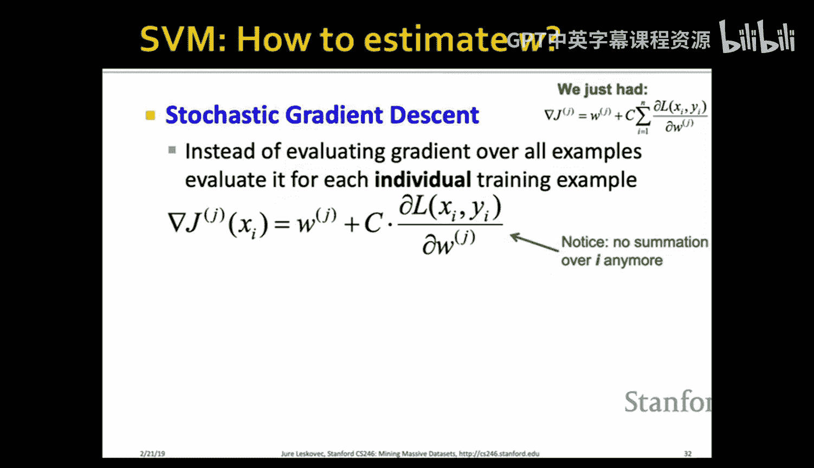

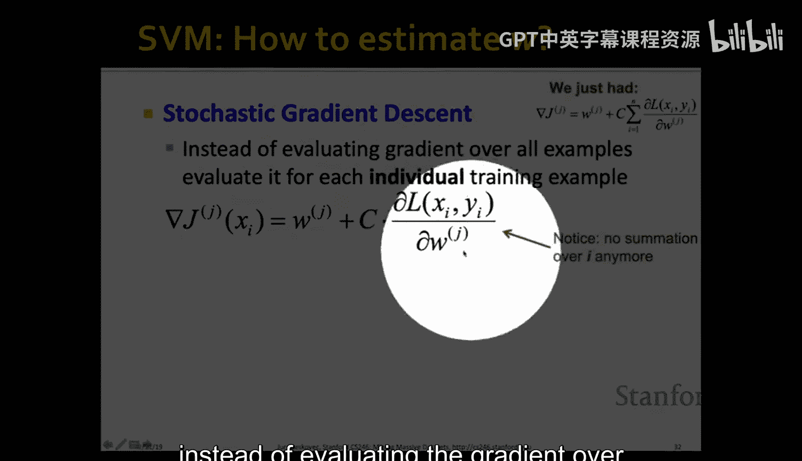

And what's the only thing that changed from the expression before is that the sum of I is gone。 Okay。

 Otherwise， we're optimizing exactly the same function as before。

 And the pseudocode will be pretty much the same。 But now this。

 what was before in the inner loop has come out in the outer loop。 Okay。

 so here were over the dimensions。 And per each single。Training instance。

 we're gonna be doing one computational of the gradient and one update step。 Okay， and as we've seen。

 this tend to converge。Faster is a bit more unstable。

 but it has a lot of interesting properties okay now before we go and see one example of how well it performs。

 I also want to give you a couple of pointers on additional variations over gradient descent that have been become extremely used especially in the past few years thanks to deep learning so the first one is what is called the batch gradient descent okay and the good news is you're going to be implementing a variation of this for your assignment4 okay so you will get an idea of why doing this kind of optimization is very powerful so in a batch gradient descent we do the following we calculate the error for each example in the training data set but we update the model only after all the examples that been evaluated and this is what is usually called the training epoch so we go through all the points。

😊。

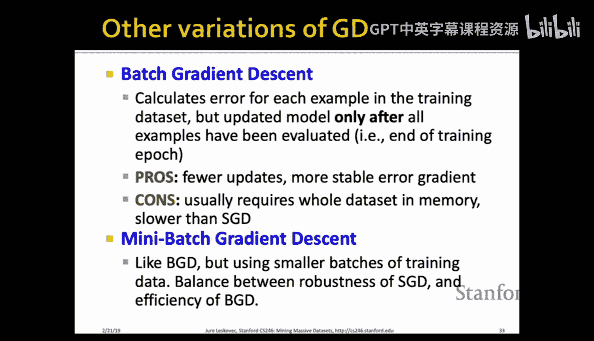

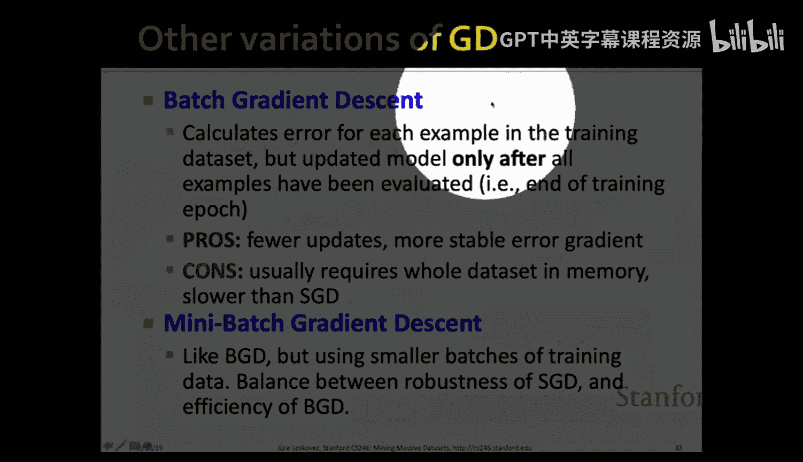

And then we do just one big update to our gradient so without the pros。

 we're doing fewer updates compared to the gradient designscent that we've seen before and it also turns out that this can be also proven theoretically that the error gradient is more stable so it tends to have as smoother way of reaching the minimum conversely the shortcomings are usually requires the whole data set in memory and it's lower than SgD it's lower than the stochastic gradient designscent like nothing really beats the stochastic gradient designscent in terms of sheer performance because we're working just with one training distance at a time。

 so you cannot really make it cheaper than that okay but SgD comes with some shortcomings So that's why I'm talking to you about some possible alternatives。

Now the big thing that we don't like too much about the batch gradient in descent is the fact that it requires the whole dataset set in memory and once again this is something that we cannot afford with the kind of data sets we talk about in this course so rejoice we have the mini batch gradient in descent which is a tradeoff basically it's a middle ground between the standard batch gradient and descent andsGD so what we do here is we are still working with a concept of batches but in the case of BGD。

 a batch is the full training dataset。In the case of the mini batch gradient descent is usually a small multiple of two like 3228th and so forth。

 Okay these are usual values that you can assign to a mini batch gradient in descent algorithm and the nice property of this technique is the fact that the balances between the robustness of SGD and the efficiency of the batch gradient in descent。

 so this will not require as many updates as you perform with SGd because SgD will perform one update per instance and we're gonna be seeing later today why those updates are expensive like you might think that doing an SGD updates is relatively cheap because you tend to be working a lot in local but when you work with very large data sets you have to maintain these large set of parameters for your models and the gradients in other servers and this server will be receiving a lot of different updates concurrently。

 So that's why this becomes only in a sudden。😊，Swireming expsive to maintain， okay？Okay。

 so let's go quickly through one example so that I convince you why these numbers are exciting and why they make a big difference in terms of。

How much you can scale。 So we take like a routerss document corpus。

 So these are basically news and announcements。 and we have roughly 800000 training examples。

 So documents 23000 test examples。 As I was mentioned before。

 were working with a very high dimensional data here， you can see 50000 features。

 These are mostly three words。 Okay so we basically kept the English diction into the 50000 most occurring words。

 So we do one feature per word。 we remove the stop words。

 we remove the low frequency words and so forth。 Okay。

 so this is our very basic feature engineering that we perform on this data set。😊，呃。

So without the questions that we want to answer， the first one is。

 the most exciting can S GD basically successfully minimize our loss function。😊。

And then how quickly is going to as you define the minimum of our loss function。

 And last but not the least， what is the error on a test set。 Now。

 these three conditions they will have to coexist at the same time。

 You cannot find a way to opt your model and then do very bad on the test set okay。

 because it totally defies the purpose of optimizing it with a faster technique。 Okay。

 so we want the three of them to be holding at the same time。

So let's go through this example here is training our standard SVM without SGD and the training time is roughly six hours。

 seven hours until that and this is our lost value and this is our test error and the good news is you can see that we are experiencing basically a five orders of many to the difference between the standard one and the SGD version so it takes roughly a second to to converge and the lost value is pretty much the same and the test error is pretty much the same so we match all the requirements that we had in mind before and as you can see this is extremely fast and our test error is comparable okay。

😊，So its an example to convince you why using SGD is the right way to go with S VMs。

 And now in this plot， we are gonna be seeing， what is the tradeoff between using a conventional SVM。

Train with gradient and descent。 And one that goes through the stochastic gradient descent。

 So the difference here is the following。If you w to have a very fast training time。

 then you w to be working with an SGD。 Okay， as you can see， you can quickly converge to， let's say。

 an error of loss to the 10 to the minus-5。 The problem is。

If you want to make sure that the precision of your solution goes all the way down here to 10 to the minus-9。

 then this is a solution that you can only reach with a standard gradient and the it turns out that we really care about this know we just want to make sure that how our loss is small enough and we want to optimize this model as quick as possible so that's why we have we have this we have this tradeoff so basically to optimize our loss function with a reasonable quality then we know that how stochastic gradient and descent approach is super fast well this is capturing basically is think about this separation line in SVn that we were seeing before we said you can find plenty of them okay and by applying this small tweaks you can always possibly find a solution is largely more optimal compared to what SGD will do for you but this gives you very fast or read a solution that is very good。

Most of the times this is just what you need in machine learning you know because these models will never achieve 100% accuracy and 100% generalization right because we said they can do as well as you want on training but then they're not going to generalize perfectly to your test set so trying to strive for this kind of solution is most of the time pointless。

Okay， I live with some other practical consideration。 We don't have time。

 but there are some other tricks in there in case you want to make your SGD go even faster。

 Now let's jump quickly to how we can solve multi class classification with SVMs。

 and this kind of intuition doesn't work on with SVms。 It works with a lot of different classifiers。

 The first one is say now we want to classify three different classes。 We have the classes。

 the mouse and the circles。 we can do we can do one classifier per each class。

 Okay so this will be we basicallyop I lost my point。

 sorry So the first idea is that we have one against all classifier so we're gonna have the classes versus the other classes。

 We train three different them。 We train them separately。

 and then we just classify by taking the majority voting of those classifiers。 So this is one idea。

 The other one is that you can also try to jointly。😊。

Learn together the three set of weights that are defining the the separating lines。 Okay。

 so that we can find the three classes。 I'm not gonna go into the details on how to do this。

 But what I wanted to give you right now is the intuition that as you can see。

 as soon as your task becomes more advanced， your models are becoming more complicated， right。

 So now we're gonna to be having multiple classifiers or we're gonna be having to find more weights in parallel。

 And。😊，This opens an outlet not only to be able to work with large dataset sets。

 That's what we have seen on Tuesday。 Like we have these large scale decision trees。

 but we also have to be able to work with very large models。

 Okay so this should give the intuition that if you go from an SVM to something as a very large and neural network。

 the complexity of your model grows a lot。 And only in a sudden。

 you cannot store any the parameters of your model in a single computer。

 and you cannot train anymore just in a single computer。

 You need more computational power to make this happen okay。😊。

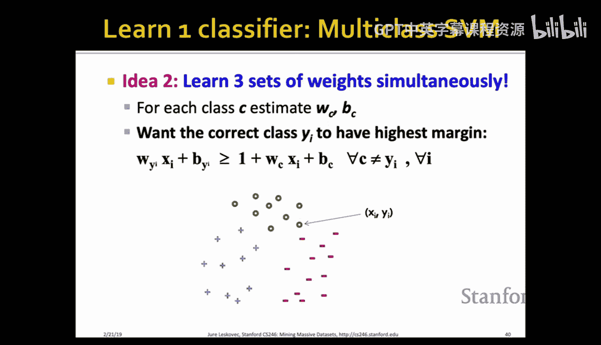

So that's how we're gonna to be closing the lecture。 And I'm gonna be giving you a crash course。

 So now you can parallelize machine learning where。😊，eventually。

 you just need an optimization function。 Okay， so as I was saying before。

 Ml boils down to this big optimization problem。 and how can we make sure that we can still perform an optimization when the model is very large and the data is very large。

 So we have seen very quickly， this slide on Tuesday。 I'm just gonna give a refresher。 So in 2017。

 Google kind of revisited a 15 years old experiment where they show that both the size of the data and the complexity of the model。

 they play a role in the performance that you can achieve with our machine learning pipeline。

 And they've done this with very famous deep learning models for computer vision。

 Like you can think of imagenet and so forth。 So what。😊。

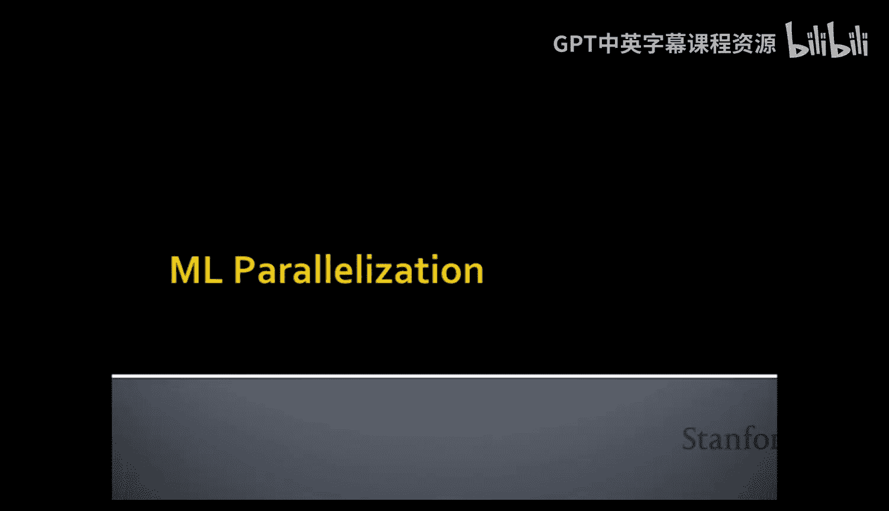

What this plot shows you is the fact that growing the number of examples。 so the number of images。

 the performance is growing logarithmically。 but at the same time to be able to capture all the characteristics of such a large dataset you also have to grow the size of your machine learning model and this has become a very hot problem recently because now we learn how to have such expressive machine learning models so we are going you can think of the example we had before from a single SVm。

 you can start to have different kernels， you can start to work on multiclass problems and only in a sudden in your model is growing。

 now make this even worse and apply to deep learning and your network is going to be growing to hundreds of millions of parameters and all in a sudden then this becomes another problem for scale so what I want to commit to today is that large dataset sets plus large machine learning model are what are leading us to amazing results。

 but how。😊，We make sure that we can tackle both of these problems。

So the last lecture we focus on decision trees and planet and there mostly there was the prime example for data parallelism。

 So we said we have our decision trees， how do we make sure that this skill to very large data sets and we use mapreduce So okay now we can partition the data naturally among different servers Each server is going to be learning as lies to our decision3 and then in the end we are gonna to be merging it together okay。

So today's lecture instead， I want to tell you that you can leverage both data parallelism and model parallelism at the same time these are the two main aspects where we can perform better or large data sets and as I was saying before some of these state of the art deep neural on that for instance for visual recognition test they have more than 100 million parameters a very recent model released by Open AI not even a week ago I think on language models that thats more than a billion parameters like billion with a B so these numbers are extremely big and you can imagine that if you have to maintain a billion parameters and update them in your any kind of gradient descent optimization that they're running that's extremely hard to scale so how can we deal with such large models。

So first of all， let me tell you what are the three different dimensions where we can scale our our machine learning pipeline。

 So the first one， we already see it。 We already saw it。

 we said that we can leverage data parallelism。 So we have more data and then we can split this data among different machines。

 and like in the case of planet， each Mapredus worker will be taking care of a。😊。

Of a slice from the data。The other dimension is the model parallelism。

 So think about this graph as as a neural network。 You can see that we're splitting the neural net。

 or you can think about this being the weights of different S BMs。

 We're splitting them among different cores。 So we're trying to train。😊。

A part of this network on each different server。 And once again。

 if you think about the number of parameters I was mentioning to you before。

 like a billion parameters， then it starts to be necessary to be able to split those models on multiple servers。

 Okay， so this is the model parallelism axis。 And the last one is the workload partitioning。

 which we're not gonna be seeing today。 But basically， I wna make you understand that。

I is not that easy at the end of the day， because there are there are always some synchronization barrier and and blocking factors on why this is not an embarrassingly parallel task So once again。

 if you think of this as as a neural network。 server2 and server 4。

 We have to wait for this first stage to finish in order for the data and for the weight to propagate to the next stage。

 So that's why there is always some kind of workload partitioning involved。

 So the fact that there will be some block barriers between the different steps。 Okay， but for now。

 let's focus on data parallelism and model parallelism。

 because this can be all tackled from the theoretical side。 Well， this is more of a systems problem。

 Like we already know to schedule efficiently task on large clusters， okay。😊。

Okay so this is a very quick overview。 we have our model。

 we have servers that can communicate with each other so we have a full mesh servers will have multiple core you can think of those as CPUs。

 GPUs， whatever kind of computational unit that does the job and we have our training data feeding into our model so with this kind of architecture we can work on Bo and superervised and supervised objectives usually we're going to be applying what adjust just explainos so these mini batch stochastic gradient descent because it's a good tradeoff。

😊，And the model parameters are gonna be sharded by partition。 So basically， as we said before。

 the model， parts of the model will be residing on one on each of the servers。

 and models can scale up to thousands of core or even more。

 so this is how a large scale M architecture looks like。

 how are we gonna now to parallelize this process。 So here's where parameter servers play a role。

 And I'm gonna be explaining to you very quickly what is a parameter server。

 So you can imagine that a parameter server basically holds all the weights of your model。

 They can be SVM weights from our separating upper plane。

 they can be neural network weights whatever you like。 And at each step。

 the parameter server will communicate the weights to the model。

 And then the model will communicate back a deelta piece so。😊。

A change to those weights due to a gradient and de step。

 And the parameter server updates everything to be prime。 And then we go forward。

 and we're going to be having another step， so。

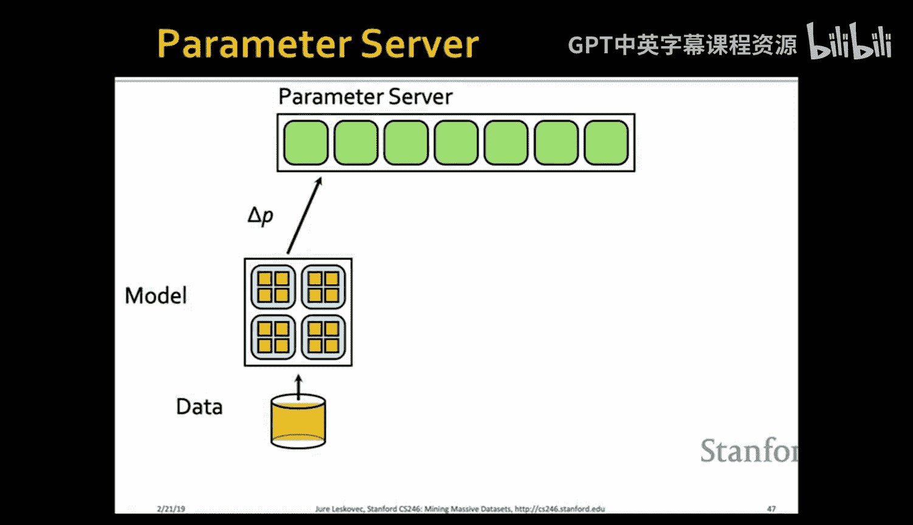

Basically what a parameter server is is nothing but a keyvalue store。

 Keys are the indexes of the model parameters。 let's see the different weights and the values are the actual parameters of the model so as I was saying before maybe these are weight so our neural network and there are some system challenges to implement something this large clearly there is a high bandwidth problem So all these cores have to communicate together with a parameter servers we' will be getting thousands of updates per second。

 there is a synchronization issue as I was saying before。

 So the model has to block every time a stage has completed and last but not the least there is always a full tolerance issue when we're working with a lot of server serververs can get slower they can crash and so forth。

 So whenever you are trying to work a large scale you always have to take into account the full tolerance problem so with a parameter server what we're actually doing is we're decoupling the problem we're moving away the parameters from our model and if one of this server fails。

 we can just replace it with。Another one， and that server will be keep on updating the parameter server。

 so that's the key insight on why we do it in this way。

And so this is now the idea of yeah you start to have multiple workers。

 they all updating in parallel in our parameter server and there is a key question that we have to solve right away。

 Ill come that this parallel updates are working。 So if you remember when we've seen gradientd descent or stochastic gradient descent。

 we always doing one update at a time。 Those updates we're not happening in concurrently。

 okay so only a sudden the kind of architecture I'm showing to you here supportscurrent concurrent updates。

 and there are either two options。 the first option is each update is a blocking update So you have to you freeze the status of the parameter server。

 everyone waits for this server to do the update and then this server follows but that defies the parallelism right if we put a big lock in front of the parameter server。

 then it becomes a serial bottleneck allright。So the other insight is the fact that we can actually update the gradient in parallel concurrently。

 Okay， and this is what enables this class of problems。

 The fact that you we can work now with a parameter server that receives concurrent updates。

 So this was。😊，A very exciting result from eight years ago。

 So it's how to perform SGD asynchronously And the key idea is is baffling for how easyD is。

 okay basically what you do is you don't synchronize you just overrite the parameters opportunistically So first come first serve okay from the multiple workers and our work is usually our servers right。

 and implementation is exactly the same as the schastic gridd descent。

 but you just throw away the loging。😊，So the legend is one of the graduate students working on this piece of research just you know out of board on disabled the locking in his own implementation of SGD and he found out it was still working so at first they thought it was a bug and then it turns out that they work back the theory on why that was actually working and that's how ag while was born so I recommend you to check this paper it's very interesting and what is the main insight。

 why this is working。 So in theory， they proved that the asynchron SGD is still converging but that has a lower rate than the serial version because there are updates happening in parallel so you can imagine that the rewriting each other updates but it turns out that when the graded updates are sparse so when we're working with dimensional data they almost achieve the same convergence rate so that's the very fascinating result。

😊，That they found out。 And in practice， this happens pretty much all the time because with this very large model and we large data。

 we always work with I dimensional data。 So our updates are gonna be sparse。

 And when an update is sparse， it just means that we are gonna be updating different components of this parameter server。

 So that's why there are not a lot of overrdes， okay。And as you can see from this graph。

 so HoG will pretty much achieve linear speed up with the number of splits that were performing on the data and RR。

 the one that is completed fat is a very optimized version of the online griding design that we've seen before so all in a sudden throwing moreardor at the problem we almost achieve a linear scale up。

😊，And， you know， this is basically the ho grail of a few years ago for optimization of very large models。

 So I will guide you very quickly through the through the pseudo code。 it looks exactly like SGD。

 The only catch is that youd perform this partitioning at the beginning。

 So appears the number of partitions or processes， then this you will recognize as SGD that we already seen。

 and the only catch here is that whenever you apply the updates of your gradient。

 there are component wise。 Okay so you see here we are taking only the components that are knownzero right and this realize。

 as we said on the sparsity of the data。😊，So last slide we are done I know I'm running out of time。

 So let's put everything together all the ingredients that we have seen today， the data parallelism。

 the model parallelism， the as synchronous SGd。 and only a sudden we get basically the architecture that Google published in 2012 called disbelief or largescale distributed deep networks and this is what's considered usually the dawn or large scale deep learning that's when Google was able to only a sudden go from smaller models to something that was able to handle data sets of the size of imagenet or YouTube or so forth。

 and the beauty of this thing is that there are very few synchronization steps as we have seen before。

 it's very robust to slow machines。 So as we said before it's one of these servers is failing。

 there will be someone else performing still the updates on the parameter server and it still makes progress to finding the minimum of our loss function So that's all if。

😊，Questions I'm happy to take them。Yeah， did you average the gradient coming in？

Could you average the gradients coming in from the to on the parameter server， Yes。

 but it would be kind of expensive because。If you w to have a full overview of the gradients of different servers。

 then you're introducing yet an additional synchronization step between them。

 So they all to communicate the data on a single server。

 Then you take the average and you perform the update。 So in these way， it's as easy as it gets。

 You don't even average them。 you just to a right。 more yeah， yeah， I understand your question。 Yeah。

 that's why this works， for instance， within mini batch gradient and design because you do the averaging on a single core already。

 You work on a small batch， work with that gradient and then perform an update。 Yeah， absolutely。

Yeahep。And's going to part。D you can't use any other。For what we've seen today， Yes， yeah。

 there are other adaptations on how you can include more powerful kernels。 But yeah。

 let's not complicatedlicate it further。 Yeah， absolutely。Other questions？Okay， thank you。

 See you next time。