# 斯坦福大学《海量数据集挖掘｜CS246： Mining Massive Data Sets 2019》中英字幕 p16 -P16-lec16 Mining Data Streams II.zh_en -BV1raSjBuE3d_p16-

Okay。Great， so hello welcome to the class What we are doing today is we are talking about the second lecture on data streams and before I talk about that just now an official announcement so we will be having the information session for CS341 next week on Tuesday at 6 pm in the gates building second floor in the AI area so it's kind of when you come up the stairs just go straight or when you come out of the elevator you go kind of back and we will talk about how the class is being organized basically the idea for this course is that you go and apply skills that you learn in this class for a 10 week long project course where we will provide data project ideas and we provide the compute power and you organize yourself into the groups of three submit a project proposal and then we will review the project proposals and then admit you into the class the compute environment。

😊，With the Google Cloud we provide the data mentorship and the problem so it's a very very fun class we admit usually between 10 to 15 groups and there is a research that is done there are research publications coming out of this and it's a really good experience to kind of practice some of the things we do here theoretically actually do them for real and do like a machine learning data mining project for real so if you'd like to learn more you can go to CS341。

1ford to TDU it's a last year's website but there are Google slides posted on the website just scroll down enough and you can go through the slides and you'll get an idea what we are looking for the slides from last year kind of the coursey structure similarly just the project ideas will be different than this year because every year we update。

So that's the idea come on Tuesday at 6 pm to Gates to learn more okay so now the lecture for today we are talking about streams and today we'll learn about four more new methods about how to do stream processing we'll start with what is called B filters and this is something a method that is amazingly useful and it comes up in many different use cases I'll talk about that this is for filtering a data stream in a sense the goal is how do I select elements with property X where X is some known property sounds easy but it's super cool then we'll talk about how do I count distinct elements in in the stream with these flashmar algorithm we'll talk about how do you estimate moments of a stream and then I'll talk about frequent item sets and exponentially decaying Windows which is also very useful so first filtering a data stream so。

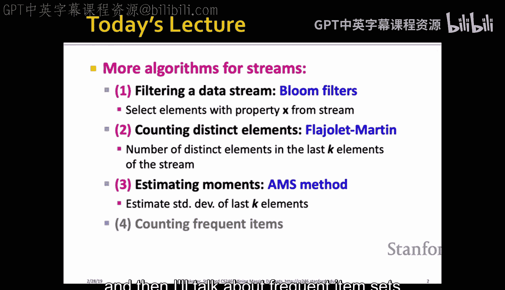

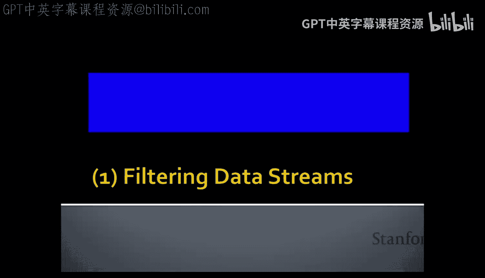

Abstractly what we'd like is that we think of every element in the stream as a couple and given a set of keys S。

 we want to determine if that element from the stream is in the set S Okay， this is what is called。😡。

Filtering right so an obvious solution would be that you have some dictionary。

 some hash table in which you store all the elements that are in as so that when the next element from the stream comes。

 you test it against the hash table and if that thing is in the hash table。

 you emit it and if it's not you say oh I will filter it out right so but what if it happens that you don't have enough space to store this hash table right maybe you are processing millions of these types of filters in the same stream and let me give you an example where this is very realistic and it happens a lot right here's one way how you could implement a spam filter right imagine that each us of us each one of us has a set of good trusted email addresses right and maybe we know also 1 billion good email addresses that we trust right now the question is when an email comes in。

 we quickly want to check is it from one of these。1 billion email addresses or not。

Right or imagine that each one of us has I know 5000 trusted email addresses right and I'm Gmail a new email comes in。

 I need to load your set of trusted email addresses addresses compared that new incoming email to that set and say should I light it through or do I declare it a spa right and obviously I cannot have a hash table of I know several thousand email addresses for every user it' just too much。

😡，Right so how do I do that？Another example more broadly is this notion of published subscribe systems where you are collecting lots of messages。

 maybe you can think of this as news articles， you could even think of this as events happening on a given website or in a given application maybe Facebook maybe Pinterest and various people or various sub applicationsplication of your system express interest in certain subsets of keywords or certain subsets of messages so now what you need to do is whenever a message arrives。

 you need to decide out of all the subscribers all customers in some sense who has subscribed to the messages of this type and then send the message to them very quickly and you know think of the messages here as user activity on an app like Pinterest or Facebook and various applications subscribing or various subsetsystems subscribing to a subset of those messages so when a new message occurs a new action on the site。

😡，Is takenn you want to very quickly go and say who has subscribe to this who do I send it to right that's in general what is called publish subscribe systems。

 you can think of content filtering a similar a similar thing right and then。😡。

another example I will talk about that also has this type of property is for example。

 if you think you are doing advertising and one thing in computational advertising is that you must not show the same ad to the same user multiple times so what would this mean is that for every user I want to keep track of what ads has this user seen so that when there is a new ad I may want to show them I check have they seen this or not right so now every user has a set s of the ads they have already seen and I need to check against that set to say should the led is through or not and that's a very realistic use case in many of of the companies across the street right so how would I go do this right the idea the first cut idea is the following right I have this set of keys set of elements as that I wantna filter right and the idea would be that I will create a big array of length of nbits and I will set it to all zero。

上。And then I will have a hash function H that will take this key from the set s and it will hash it to a range of 0 to n right I have a n beat n beat beat array and I'm hashing into that bit beat array so what I will do is for each member of the set s that I wantna filter on I I will hash it into this n different buckets and I will set the bit in that buckets bucket to be equal to1 right so I take every element s in the set capital S I compute the hash value and then I set the corresponding beat in my bit array to be equal to 1 so what will I do now this means that now when an element from the string a arrives what I will do is I will only output it if it hashes to a bit of value1 right so here is what I em when a new element a arrives I say oh if it hashes to a bit that is set。

😡，To one， I will output it otherwise and discard。😡。

Okay and this is already quite an interesting idea right I have this bit array I first hash the elements of the set into this bit array set the values to1。

 so now now the stream starts and when I take an element from the stream I see whether it hashes to a bit to to an element of the bit vector which is set to1 and if the answer is yes I output right so here is one way to think about it。

 I have my bit array here the stream items are coming in I have this hash function。

 the hash function hashes my element into the bit vector if entry in the bit vector is set to1 I output that item and and if it hashes to an entry in the bit vector that has value0 I don't output that item right so in this case if it lands on a1 I let it through and it plans on a0 I drop it。

😡，what is the observation the observation is the following if this element from the stream lands on a bit value that is set to0。

 I know for sure that it is not in S right I know for sure that I can throw it away。😡。

But if it lands in the entry with value1， I actually don't know。😡，It could be from the set S。

 or it could be just lucky that it got hashed into the same value as the entry from S。😡。

Okay so what does this mean， this means that this will create false positives。

 but no false negatives right it will let some elements through the stream even though they should be let。

 but everything that should go through will be let through。😡，Okay。You guys see this argument？Yes。

 all， great， so right so if the item is in S， we will for sure output it。

 we will for sure let it through and if it's not in S， we may still output it。😡，Right。

So let's now look at how bad is the error of our approach right so let's say I have 1 billion email addresses and I have  one gig of memory so this means I have 8 billion bits right so now what do I do I will take this 1 billion email addresses and I will hash them to 8 billion buckets right so this means now that if the email addresses in S then it surely hashes to a bucket that is that has the value set to one so I will always let it through which means I have no false negatives negative type arrows right but right approximately one eighth of all the bits in my 8 billion bit array will be set to one。

😡，Right， because I have 1 billion addresses and I hasd them into 8 billion buckets， so about one ace。

😡，Approximately of the bits will be set to one， so this means that when the new email addresses come through。

 about one8 of them will be passed through even though they may not be nice。😡，Okay。

 the reason for that is because when a new email address comes it's randomly hashed into the bucket and if the email address is lucky to be hased to a bucket with value1。

 I will still let it through and because about one eighth of the buckets are set to one。

 about one a of email addresses will be let through regardless whether they should be or not。😡。

Okay so that's the that's the argument now this is kind of the heuristic computation that kind of argues why do we get these false positives right mistakes that will let two actually it will be a bit less than one eighth of the bits that will be set to one and let me now give you the argument。

😡，Why how do we correctly compute this one A Okay， so here is now a more accurate calculation on how many bits will be set to one in reality。

 a few， a few less。😡，Then one eighth of the bits will be set to one and the reason for that is that even two email addresses from S。

 they can hash to the same bucket right so if every email address from S hashes to a different bucket。

 then one eighth of the buckets will be set to one because I have a billion over 8 billion but if some of the email addresses out of this8 billion sorry out of this 1 billion hash into the same bucket they collide then the number of once number of buckets that are set to one will be a bit less than one eighth or a bit less than a billion so let's compute how much less or how many email address how many buckets precisely will be set to one okay so this will be now a more accurate analysis of the number of holes positives or the number of bits that are set to one in our big array of buckets right so here is now abstractly and then we'll see how this maps to our problem consider the following thing when I'm throwing M darts into n equally likely target。

And what I ask is， what is the probability that a target gets at least one done？😡。

And why do I want this because then I'll be asking how many Dar how many targets get at least one dart right how many buckets get at least one email address caching to them right so in our case targets will be buckets bits in our week array and darts are the hash values of items。

 the hash values of email addresses right mapping back。😡。

So let's do this analysis and derive what happens right so we have again M dartts。

 M email addresses and end targets and buckets。😡，And what we want to compute is what is the probability that the target gets at least one dollar？

😡，And the way we do this is the following right we will say we have each we are throwing these dartts kind of uniform a random into target right so this is the probability that a particular target is being hit by one dot one minus that is the probability that our target does is not hit by a given dot right our email address does not hash into a given bucket。

😡，Now what we do is to say aha， so if I raise that to the power of M。

 this means that none of the M darts that I threw hit my bucket and one minus that is the probability that at least one dartt hit the given target。

😡，This is that。And this should be clear how how we derive now I'll do a little trick what I will do is I will multiply and divide by n right I multipied by n here and I divide it by there so this would cancel out and everything still stay the same right but the reason why why I did this is because it will allow me to kind of simplify this intermediate or this middle term here and what I will remember from high school is that the limit of1 minus1 over n raised to the power n that converges to1 over e as n is set to infin right when the number of targets that I get as that gets as that gets loud what this means is that I can take this expression。

😡，And I can simplify to 1 minus e raised to the power of m over m where m is the number of darts and n is the number of targets okay so and this approximation is especially accurate when n is large and usually we have lots of targets so it's a validd approximation okay so now。

😡，Let's see how well how well this works right so we are saying that the fraction of ones fraction of bits that are set to one which means the fraction of targets that have received at least one Dar is minus1 minus e over e raised to the power of minus m over n where n is the number of darts and n is the number of targets right so this means that the probability of a false positive is exactly that。

😡，Okay so now let's go back to our example we said we have a billion email addresses and 8 billion bits right so if I ask what fraction of once are there in a bitta array where I'm throwing 1 billion email addresses into 8 billion buckets it is one minus e raised to the power of minus1 over 8 if I do that I get 11。

75% which is very close to what my heuristic estimate which was which is1 over 8 which is 12。

5% so our calculation is good or our heuristic calculation early beyond was quite accurate right so this now tells me how many bits will be set to1 and this is now my probability of a false positive if our random email address comes we hash it into a bucket and this is the probability that it lands into a bucket that is value1。

😡，IThe probability we will let it through， even though we shouldn't have。 Okay。

 so the number of mistakes we will make is about 10%，11。7%。O。😊，Are there any questions so far？😡。

Good everyone excited。 Yes， okay， so but this is not the super cool solution yet。

 This is a cool idea， but it's not super cool。 so now we'll make it super cool。 Okay。

 so the way we'll do that is the following。 We will use multiple hash functions Okay so I'm still having this set S of size M。

 I have the bitta array of size n and now I will use multiple hash functions。

 I will use hash functions H1 to H sub K。😡，And what I will do is the following。

I will set all the entries in my beta A to be 0。😡，And then I will take every element in this set S。

 and I will use every hash function and I will set the entry in the bitta array to one if any of these hash functions hases that element s to value 1。

😡，Okay， so。What does this mean is that I go over all the elements， I go over all the hash functions。

 and I take a given element， a given hash function， and I hash them all into the same Bta。

 and I set the value1 if they hash to the same value。😡。

Okay if they hash to that bucket right so this means that I'm using multiple hash functions and I'm just setting the entries of this bit array to1 as as I scan through right what is important to note is that we have a single array right there is a single B there is multiple assets and then there is multiple hash functions but we are just hashing into the same bitta array right and now what do I do at the runtime。

😡，At the runtime when a stream element with entry x arrives， I will do the following。

 I will say here in my x I will go over all hash functions and I say I will only let x through if for all the hash functions this x caches to a bit with value 1 right and if that is the case then I output the element。

😡。

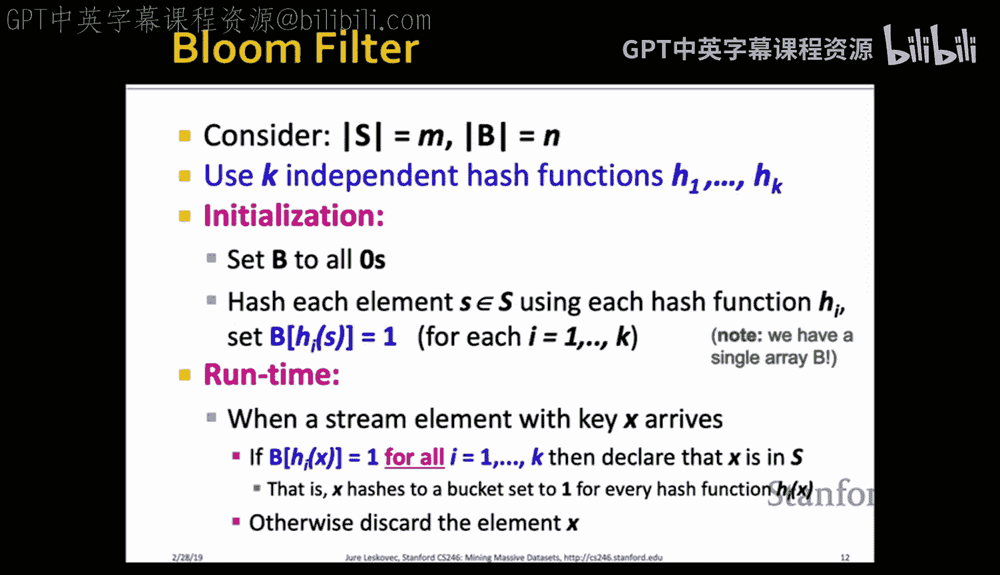

Okay， so。The condition is that for every of the K hash functions。

 each hash function has to hash this element to an entry of value1。

 and if that is the case right for all of the hash functions。

 then I output the element otherwise I discard。😡，Okay， that's the idea。😡。

So let's now do the analysis of how well does this work， Does it give us any benefit。

 does it decrease the number of falses positive at the first site。

 it seems like a bad idea right here we are using multiple hash functions so more entries of these bitta A B will be set to one because we are hashing every entry k times so now we are increasing the number of bits that will be set to1 by a factor of k if you want to think of it right so in some sense we are we are polluting these bitta array with more ones than what we did before but why is this a good idea is because here we don't say oh at least one of the hash functions has to hash to the bucket one we say all the hash functions have to hash you to to the bucket that is set to one for you to be let through so here we are saying for all the hash functions you should have the value of the bucket one。

😡，Whatever the individual cache functions you to cash you to， okay， so that's the idea。

 So let's do now the analysis how why does this work。😡，If there is a question。

 now is a good time to ask a question if this is not clear。😡，All right。So let's now see how。

 why is this a better idea， why does this work？😡，Right so before we said what fraction of bit vectors in bits in the bit vector B are set to1 right as I mentioned before now I'm in some sense increasing the number of darts right because now every element every email address gets hash k times so I have k times m dartts and still I have n targets right so my1 minus t function is now1 minus c raised to the power of minus k times m times n right because now the number of darts is k k times n。

😡。

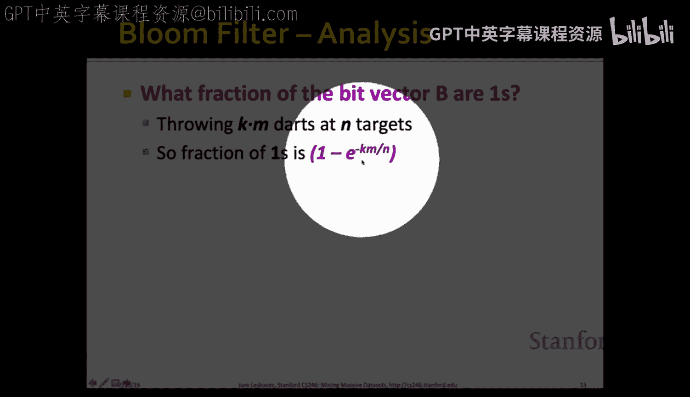

So this means this would increase the number of entries that are set to one in our beta array right but as I mentioned before we have k independent hash functions and we only let the element x through if for all the hash functions the x hashes to a bucket with value 1 right so for every of the hash functions you have to land in a 1。

😡，So what does this mean this means the following that the false positive probability is this is the fraction of buckets that are set to one。

 but it's not enough for one bucket to be set to one for all of the k buckets that you hash to。

 they have to be set to one， so we are multiplying with a k here。😡，O。😊，So that is great。

 So this is now the probability of a false positive right we got a multiplication with K here。

 but if we also got another multiplication with the K outside because we say for all the buckets that you hash to you have to hash to a value1 so that's where this second K comes from this one comes because more entries are set to one because we are now hashing every email address K times and this one comes from this fact where we say every of the k hash values of a given element have to be set to one for the element to be left through so if this is the probability of one of hashing into a value into a bucket of value1 now we have to be hash into a bucket of value1 K times so it's raised to the power of K。

😊，Okay， so now this is our new formula， let's look at what does this formula do。😡，so for example。

 before we said if use one hash function we computed， then the number of false positive would be 0。

11 so 11% if I use two hash functions here is now the calculation the error drops to 5%。😡。

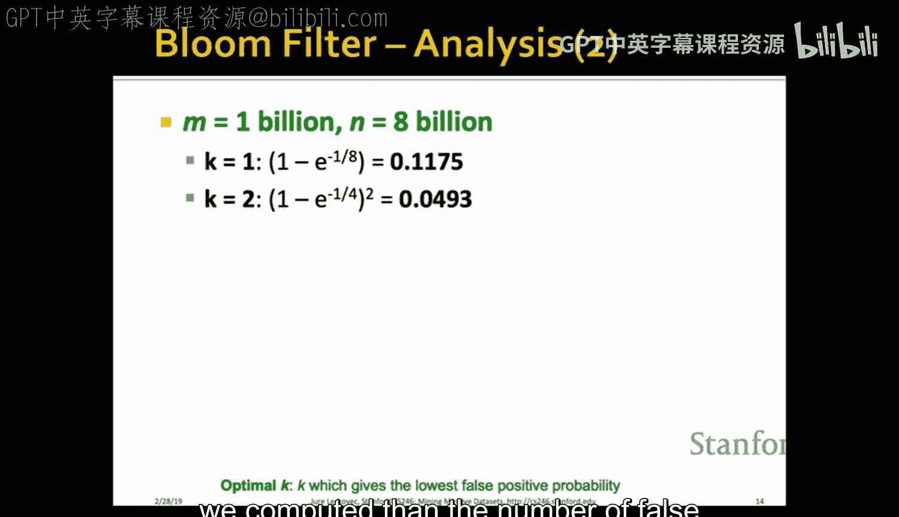

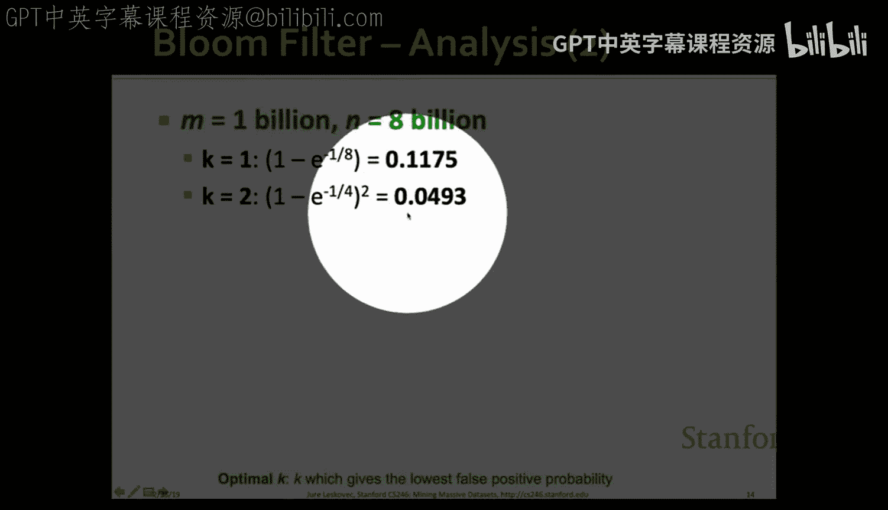

So using two hash functions is strictly better than using one hash function right so then the question is what happens as we increase the number of hash functions does it mean that if I just keep increasing the number of hash functions I will push down the error to be arbitrary load。

😡，And the answer is no right the point is that there is this sweet number of hash functions where I will get the minimum error right so for this particular use case with 1 billion email addresses and 8 billion buckets the optimal number of hash functions to use is around 6 and if I use six hash functions then my error would be around 2% so my false positive error would be around 2% and remember。

😡，With one hash function， we were at 11%。And by just using multiple hash functions and the same storage cost。

 our error drops by in this case by a factor of 5 to 2。16。😡，Right， right。

This this is now the probability of a false positive plotted as a number of hash functions and of course。

 why does the number as I increase number of hash functions， why does the error not decrease？😡。

Because once I have a lot of hash functions， essentially the entire bit vector is set to one。

 so everything will be let through， so that's why the error keeps increasing。😡。

Right so I want just the right kind of mixture between zeros and ones in my bitta so that the bitta is not porous enough to let mistakes through and in the optimal value of k。

 the value of k where the error is the lowest， you can compute by dividing m with n and multiplying with a logarum of 2。

 if you do that for our case you get 5。5 which we around 26 and that is the matter。😡。

So let me just wrap up right so bloom filters guarantees no false negatives right everything that should be let through is led through and they use a limited amount of memory。

😡，And they are very useful for preprocessing before more expensive checks are being done they are actually so simple that you can implement them on hardware so there are hardware implementations and the computation can be parallelzed right you can run older the hash functions in parallel and then the last thing you can ask yourself is it better to have one big bittaB or is it better to have K small bit array B and if you do that computation it turns out it is the same。

😡，essentially the same is to say I run I throw in k times m dots and I require the item to be hashed into the k bucket set to value1。

 or you can say I throw now M dots but my beta array the width of it is not n but n divided by k and I still require you to be hashed into the k buckets with value 1。

 if you calculate the two you get the same value because this k can be kind of written here。😡。

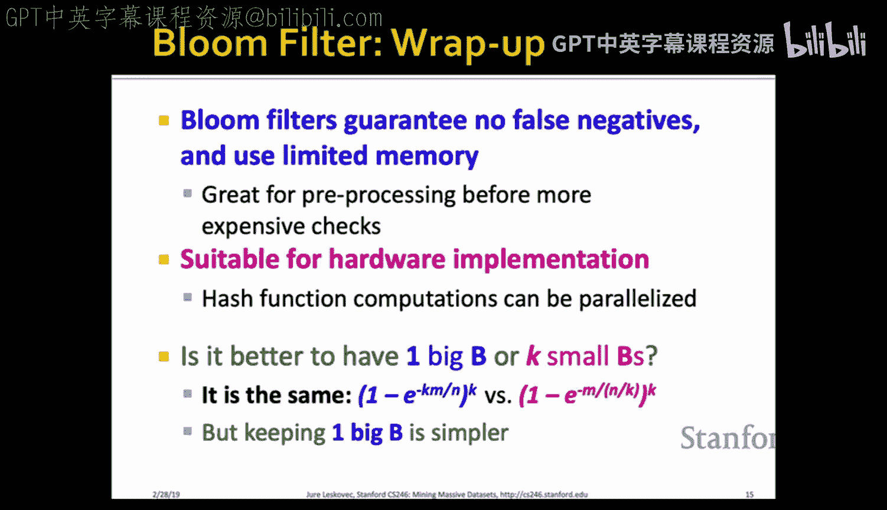

So why do we like one bitta because it's simple， So this is what I wanted to say about B filters。

 Are there any questions。😡，Yes， so how do you get the close form bound on the K。

 how did he drive the case you could do？好后边就系后边就系知嘅咧。Oh， you can just take the the take the equation。

 take the derivative， this will be the solution。😊，Yeah， this is the yeah。Sa it to 0， it's convex。

 so it's easy。But you could even do it numerically， like I plotted this， I think。

 in Matla or whatever。Great， anything else？Good， so this is the first algorithm we want to talk about。

 so now we will talk about our second algorithm， which is about counting distinct elements in a stream and this is also a very nice way of doing things so the problem now is the following。

😊。

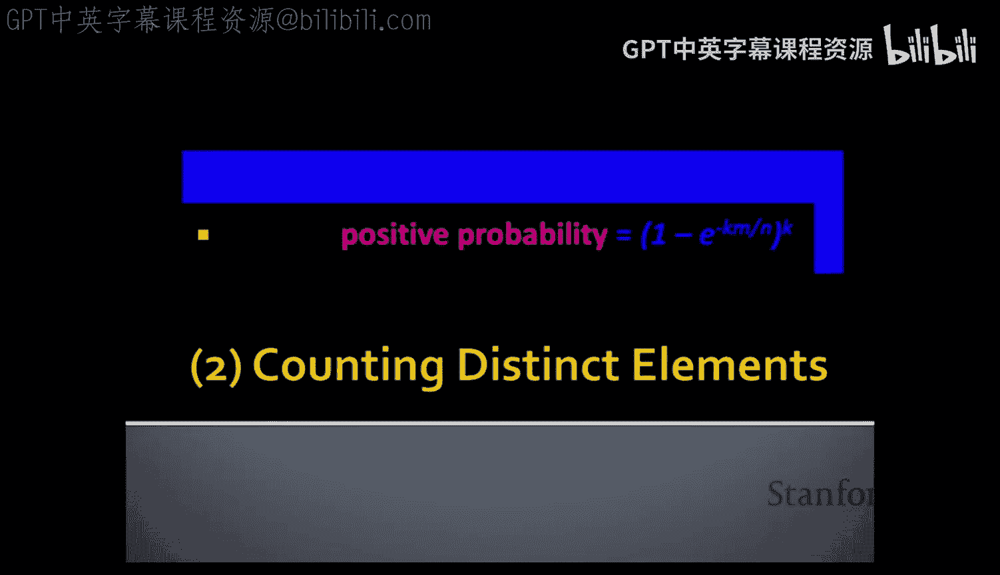

You have a stream of items and this stream of items contains elements from some set universe of size capital land。

😡，And what I want to maintain count of is the number of distinct elements or distinct items I have seen so far。

😡，And again how could I do this， I could have a dictionary and I would be just memorize like throwing my elements into the dictionary and at at any point in time I would ask what's the size of my dictionary。

 but again， imagine I cannot do that I don't have enough memory so if I cannot maintain a set of elements I've seen so far how would I still count how many distinct elements have I seen。

😡，What do be some applications of this right you could ask how many different words have I found among the web pages that I have crawled on a given website right you could keep a hash table of all the words you've seen or you could try to do something something so smaller because the number of different websites is so huge or you could ask how many different web pages does each customer request in a week and again you cannot have a hash table now for every person who's browsing the web to keep track of what they have seen in a given week right or how many distinct products have we sold last week again you could have a hash table of all the products but maybe you do this for every region or for for every market that you have again you cannot store everything in memory so can the methods that we talk about now can they help right so the idea will be the amount of storage？

😡，I can afford myself is small， so the problem is what do we do if we don't have space to maintain a set of all the elements or items seen so far right and you want to estimate the count in an unbiased way。

 but we accept the count if it has a little error but we would like to limit the probability that the error will be very large。

😡，Okay and the method is called fljoier Martin and here is how it goes and its a very interesting algorithm that does this and it's kind of surprising so the idea is the following let's pick a hash function that maps each of the elements into a bit string of length log log base2 n right so if I have and if my universe a all elements coming that can come from this string from the string is size n then I want a hash function that basically maps each of the elements into some into some bit string okay。

😡，And then the idea is the following that for every element in the stream I will first hash it and then I will represent the hash value in binary and I will ask how many and and I will go from the right and I will ask how many zeros are there before I see the first one and this is what I will label as r of a a is an element from the stream I take the a I compute the hash code I represent the hash code in binary and then I go from the right and I keep counting how many zeros I see before I see a1 right so for example if I take an element from the stream it hashes to the hash value 12 I represent 12 as a binary stream I go from the right and I count how many steps do I take before I see a value of1 right and because I have to take two steps my r of a equals2。

😡，Okay， so I'm just counting how long is the tail of zeros in the hash code of a given element？😡。

And now given that I've done this， what is my estimate， I will say。

 let me now go and compute the longest tail of zeros that I have seen in my stream so far。

 and then I'll say that my estimate on the number of distinct elements I've seen is to raised to the power of Cap R。

😡，Okay so once the algorithm， the algorithm is elements come， I hash its element。

 I represent its hash code as binary， I see what is the tail of zeros that it has。

 what's the length of it， I keep doing that， you wake me up and say you how many different elements were there。

 I say what's the longest tail of zero I've seen， I will take two to that length of the tail that is my answer to you。

😡，And that will be a correct answer almost always okay so this is this is the cool algorithm and it's not clear why this should work okay so let me first give you kind of a rough intuition why this why this works okay and this is kind of very rough。

 very heuristic but it's a good intuition okay so right the idea is that a when you have a hash function the。

😡，The property of hash functions we exploit is that they kind of randomly hash into these buckets or into these numbers right so a the function H has hass a with equal probability to any of the n values n integers right and then if you think about it H of a is a sequence of log n bits right and if you think about how many numbers from one to n have have a tail a given of a given length of zeros is that。

😡，A to the race to the power of minus r is the fraction of， all entries。

 all numbers between 1 and n that have a tail of r zeros。😡，Right， so。Now。

 if you are thinking about picking a random hash function。

 this means that about half of the time you will see something that is some bit some bit。

 and then you have a0， right about half of the numbers are even and half are all。😡。

So it will take you to see about after you've seen about two numbers， you will see a tail of length1。

😡，Right and now you can make a similar argument right about quarter of all the all the elements cash to something that is you know something something00 so kind of you need to see about four elements from the stream before you can expect to see a tail of length too okay and this is kind of the the the the。

😡，The the heuristic argument right is that it takes you a certain time to see you have to see a certain number of elements before you see a tail of a given length and everything this relies on is this idea that hass that hash function hashes your elements into this numbers one to n with equal probability that the hash function is random so you need to weigh a certain amount of time before you see a tail of a given length of zeros right。

😡，It takes me about 2 to DR times or 2tDR items before I see one that has a zero suffix of length R。

 that's a heuristic argument。😡，What I want to do now is actually give you a more precise argument。

 okay， so why this works more formal。😡，Are there any questions about what we said so far？😡。

So let's talk about giving a more formal argument right why does this Martin flagier algorithm works formally we will show the following thing we will say that the probability of finding a tail of r zeros goes to1 if I've seen the number of items that is greater than much greater than 2 to dR and the probability of seeing a tail of r0s goes to0 if the number of distinct elements we've seen so far is less than 2 to theR right so we will say if its more the probability of seeing it goes to 1 and if it's less it goes to0。

😡，where m is a number of distinct elements seen so far in the stream right so what this means is that this value2 to the capital r will almost always be around value of M right because if 2 to the R。

 if m is less than 2 to the R then with probability 0 I'm going to see that tail of that length and if m is more Im going to see that tail with probability 1。

😡，Okay， so that's kind of the argument why this will work。

So now let me actually prove you these two bullets okay so the question is what is the probability that are given hash function hash value H of a ends with at least r zeros right the probability of that is to rise to the power of minus r the reason for that is because hash functions are randomly taking the elements and assigning them to numbers between1 and n so you know about as I said before half of the numbers are are even so there is half of the numbers will have a tail of length1 about a quarter of length2 about an eighth of length 3 and so on and so forth right so the probability that the random number ends in at least r zeros is2 to the minus r so that should be clear right and then you know what is the probability of not seeing a tail of length r among m distinct elements let's compute that and the thing is。

😡，fo right this is the probability of seeing the tail of length R。

 this is the probability of not seeing the tail of length R now we take m different elements so we have to raise this to the power of M and this is now the probability of not seeing the tail of length R among the M distinct elements we've seen so far right so just this is probability that any given H of a ends with fewer than r zeros and now this is out of all the distinct elements we've seen so far all of them have fewer than R zeros。

😡，Okay and then I use the same approximation that we used before right here is my equation from the last slide I will multiply or raise it to the power of2 to dR and then also multiply to the2 to DR2 to the minus r so this thing would cancel out and then again by the same argument as we had before this thing equals to e raised to the power of minus m raised to the power 2 to dr minus2 to so2 raised to the power of minus r I sorry so now what is the probability of not finding a tail of length minus r right and we need to analyze two cases the first case is when the number of distinct elements we the C m is much less than2 to DR right then what you want to show is the probability tends to r。

😡。

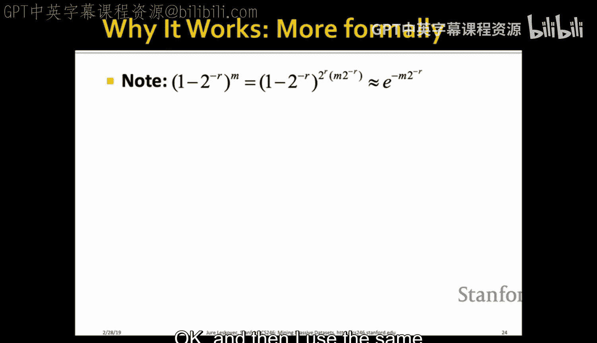

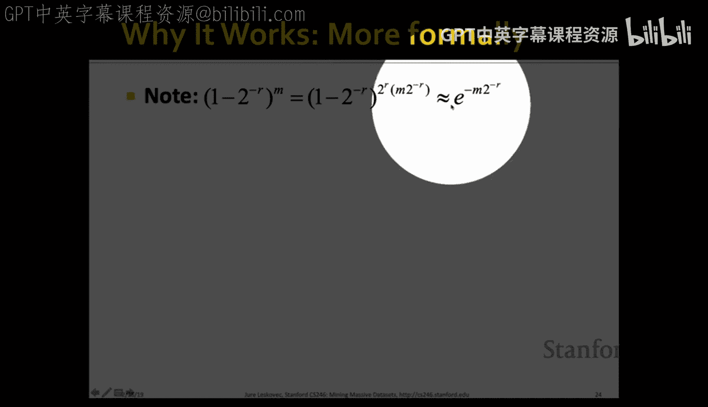

That tends to one， how do I show this？😡，This is what we had on the last slide by simplification above this is just e raiseded to some power and now by this way because m is much much less than 2 to theR the ratio of m divided by 2 to theR goes to0 so it means that e raised to the power0 equals equals1 right so this is the argument why the probability of not seeing the length of a tail length r goes to 1 if m divided by 2 to theR goes to0 which mean m is much less than 2 to theR and then similarly what if m the number of distinctelements is much greater than 2 to theR then the same thing but now m divided by 2 to theR this is infinite because m is much bigger so if I insert this here。

😡，what this will mean is that this will be e raisedse to the power of negative something so this thing will go to 0 right so the probability of not seeing the tail of length r goes to 0 if the number of distinct elements we've seen is greater than 2 to dR right and this means that the 2 to dR will almost always be around the value of m because if 2 to theR is greater than m that happens with probability 1 and if 2 to theR is much much smaller than m that happens with probability 0 so r has to be somewhere in between。

😡，Okay so now how does this work right if you would actually do the math if you would want to compute the expected value of 2 to DR。

 you would figure out that is that the expected value is infinitefin right so the reason for that is that the probability of seeing a length of a given of a given length is halfd that every time but the value we predict doubles right if we go from 2 to DR to 2 to dR plus 1 so in if you compute this expectation it will be infinitefin what is the workaround the workaround is that you don't only use one hash function but you use multiple hash function right you have multiple hash functions h sub a so now you have multiple samples or multiple instances of these longerest scale of zeros that we found are suba under the hash function h sub a right？

😡，And now that you have multiple of these guys how do you combine them and there are two options you may want to say one option would be what if I take the average of these estimates coming out of 22DR and the problem would be is that if by some luck one of the Rs is very large that will take over your average and your estimate won't be good。

😡，And if you would say I don't like that， let me take the median of 2 to DR values。

 the problem is that then your estimates are always a power of2。

 which is kind of unsatisfactory and has relatively large error。😡。

So what the solution is is that you partition your r sub I values into small groups for every group you take the r sub I and then you take the average of the medians to compute your estimate and the idea for doing this is that。

😡，You know， maybe under one hash function， you are unlucky and you have a very long tail of zero。😡。

Right but if so and if you take the average over2 to the R。

 then this unlucky big R would take over and your average would be super big and if as I said if you take the median then you are taking the median of value of values2 to the R so every answer is a power of2 so the best way is to take your values r split them into small groups in every group you take the median value of r right so that prevents you from taking one unlucky r that has a lot of zeros and screwing over your estimate and then you take the average of these estimates over the groups and that works really well in pre。

😡，Are there any questions？😡，Yes， great。Again， why it's problematic for the meeting？Great， why yeah。

 So you mean， why is this problematic？So this is problematic right so I use multiple hash functions for every hash function Im saying what is the longest tail of zeros that I have found right if I now say I have 100 hash functions I have 100 values so far。

😡，Now my estimate is2 raised to the to DR right so the problem is if I take the median then out of all these values of r I will take the middle1 and I will then compute 2 to DR so every answer I get naturally is a power of 2 because number number of zeros is an integer so I'm taking 2 and empowering it with an integer。

😡，So my overall estimate of the number of distinct items we'll get is only1，2，4，8， 16， and so on。😡。

So I cannot give you a value of 27。Because it has to be2 to the power of an integer right what's the problem with taking the average。

 the problem with taking the average is that you know maybe there is one hash function that you are unlucky to select that takes the first element from the stream and it hashes it to something with a lot of zeros。

😡，And if we are looking for the longest scale of zeros。

 this means that this one lucky hash function will give you this huge value。

 so all the other hash functions don't really matter in this average。

 so your estimate will be way off。😡，so you want to kind of throw away this extreme random event and the way you do that is to take the medium。

😡，And then you want to take the average so that you can give the answer that is not that has a resolution higher than two race to some in。

😡，That's again good idea。Thank you for asking。 Great， anyone else。Come on， people。 Yes， great。

So it's fair like the。Formal derivation of how this fixes the issue expectation。

Is there a formal derivation， how does this fix the issue？Not that。 I would know。

at least intuitively right where does it why does it where do you get screwed you get screwed right because we said that you are going over wow okay we say you go over and you are looking for the longest right out of the all the tails that you've seen you look for the longest tail。

😡，So you might be unlucky to see a very long tail of zeros and because you are taking the maximum over all the tails。

😡，You kind of want to be careful with that maximum and taking the median allows you for that maximum to not kind of skew you too much。

😡，That's maybe all I can say， I don't know of a formal definition。 it's a good question。Good。

 so making strong progress two out of four， three out of four。 so this is now for computing moments。

😊，Right the idea is the following， imagine you have a stream of elements where elements are integers and let's say the M subi be the number of times item I occurs in the stream。

😡，Then the case moment of the stream is defined as the sum over the elements elements of the stream number of times you've seen that item in the stream raised to the power of K。

😡，This is the same definition of the moment as you see the moment definition in statistics。

 usually in statistics you would center the moment you would subtract the mean here we don't center the moment right so I'm asked basically the thing is I have a stream of items for every item I keep the count how often have I seen it and then the moment when I want to compute let's say the second moment of the stream I take the item counts raise them to the power k in our say case K would be two and sum them up。

😡，RightSo let me give you special cases of this。😡，Right the zeroth moment is the number of distinct elements and this is the problem we just talked about the first moment is simply counts the number of elements right it's the length of the stream right because for every item type I ask how often did it occur if I sum up the number of occurrences of hold the items I get the length of the stream so this is very easy to compute。

😡，What is maybe less easy to compute is then the second moment which is what we call the surprise number and it's a measure of how uneven distribution is right and then of course you could compute the third moment that is called the skew and would tell you if the distribution of your items is more skewed to the left or it's more skewed to the right and then you know the fourth the fourth moment is called corosis and so on and so forth right so let me know。

😡，Give you an idea what does the second moment do and why do we call it a surprise number right imagine I have a stream of 100 elements and the stream takes 11 distinct values or 11 these different items appear in the stream so then I could say what are the counts of my items right I could see item number one。

 10 times a number number item number two two nine times and you know item number 109 times as well right so then if I would compute the second moment of the stream it would be 10 squared plus 9 squared plus 9 squared and so on the value would be 910。

😡，Right now if I had take the same stream of length 100 with 11 distinct items but the item number one appears 90 times and all the items all the other items appear one time and I compute the second moment of the stream the second moment would be 8110 right so what's the point the point is here the stream on the top of the stream is very even the distribution is very even so you know if you want the entropy is very high so I get or the distribution is very even I get a very low surprise number and here the distribution of count is very uneven right this is a super popular item and other items don't occur at all then the distribution is very uneven so the surprise number is very high。

😡，Okay that is the idea， so what I want to do is I want to be able to compute this surprise number for a given stream without the need to maintain a hash table of counts of the occurrences of the items thats the whole。

😡，All right？The method we'll talk about， it's called the AMSS method named by the authors who have proposed this。

 and this method gives us an unbiased estimate of a given moment。

 and be for this analysis well only focus on the second moment。

 but this can work for moments higher order so third and fourth as well。😡。

The idea is the following is that we will keep track of many random variables x。

 where a random variable x stores two things， it stores the element and it stores the value。😡。

The element corresponds to the item， let's call it I and value corresponds to the count m sub i of that value I okay and note that that this requires that we basically say we will take this element and we will count how often how often it occurs in the stream。

 but the point is that the number of this x that we want to instantiate is relatively limited and then our goal is to compute this surprise number s that is a sum over all the distinct items that appear in the stream value how often they appear in the stream so far squared sum together。

😡，O。😊，And of course， if I could initialize a different random variable x for every distinct element of the stream。

 every distinct item of the stream， then computing this would be trivial。

 but I don't want to do that， okay I cannot say for every corresponding item I will keep calm。

 I cannot allow that。😡，Okay， so the question is how do I set this value and so the count and the element for this random of variable apps？

😡，For now， let us assume that we know the stream has length n。

 we know that in the stream we will read n elements of the stream。😡，And the idea is the following。

Let's pick some random time t we will start at which we will initialize our random variable x and let's pick this t to be kind of picked uniform a random from the beginning to the end of the stream right now we are assuming finite stream of length time and whatever is the time we decided at that time you know we get to see some item coming from the stream so we initialize x to be to that item I and then we simply maintain the count C to be the number of times we've seen this item I from time t to the end of the stream。

😡，Okay so saying again I have a final stream of length hand。

 I pick a random time point t in this stream， this is when I wake up。

 I look at look what is the element Ive just that is at position T that's when I initialize my random variable X and from then on to the end of the stream I simply count how often have I seen this item I that appeared at position T。

😡，Okay， that's what you do。And now what is my estimate of the second moment。

 my estimate of the second moment is n， which is the length of the stream times 2 times c。

 which is the number of times I've seen the item I appear in the stream minus1。😡，O and of course。

 this is estimate for one random variable in reality I will keep multiple of these random variables and then my final true estimate will be the average estimate over the K random variables that I have kept。

😡，Okay。So this is what the algorithm is right so the idea is that I have a stream。

 I wake up at a random time， I initialize x， I remember what is the item that is that I see at that time and then I simply keep counting item current the number of occurrences of that item I from that point t to the end of the stream onward and at the end of the stream I simply say the surprise number is two times the number of times I've seen that item minus1 multiplied by n this is for one random variable x because I have multiple I compute multiple of these estimates and take the average。

😡，Okay， so that's the algorithm Are there any questions mechanistically about this data？😡，All good。

Okay， so now what we want to do is we want to prove why this works。😡，Okay。

 so here is how we will prove this that this works right， imagine the following。

 imagine I have a stream。😡，And for now let's say my stream only has items A and B so only two types of items appear in my stream right so my stream starts at the beginning and you know goes to the end and then right I'm counting how often have I seen item of type A how often have I seen the item of type B right and then I will denote by sorry here M sub a to be the number of times item A appears in the entire stream from the beginning to the end。

And then what I want to compute is I want to compute this second moment。

 which is the sum of the counts squared。😡，Right so now one way how I can think of this is I can say c sub t is the number of times item at time t appears from time t onward right so the idea is the following right like so for example if I would say what is c1 what is c1 right C1 equals m sub a why is that because I'm saying item at time1 is a and I'm asking how often does item at position1 appear to the end of the stream it appears m sub a times right if I say what is c sub 2 that's how often does item at position number two appear towards from there on to the end of the stream it appears however often it appears in the entire stream minus1 because to the left of it is the same item right and then you know C3 is M sub B again why because position。

The item of position three is。Is B and from there on b appears m sub b times。😡，Okay。

 so that's my notation and now using this， let's write out what is our estimate。😡。

We say that our estimate into the expectation over f of x which is f is the random variable and f is our function that gives us the estimate f of x is this expression but now because we sample T t the time at which we start counting a random this is simply1 over n a sum over all the times from one to n when n is the length of the stream and then for any for any of the times here is our estimate in the surprise number of the stream right it is length of the stream times two times c sub t right where c sub t is the count of the number of times the item at position t appears from there on to the end of the stream that is right here I define what c sub t is so let's see and now try to compute what is this expectation we would want this expectation to be equal to the surprise number up there so our goal is。

😡，Take this equation and massage it to something that looks like sum over I and subbi squared。😡，Okay。

 notice that dis sumation goes over the times， it goes over the elements of the stream。😡。

Because we are picking the time t a random， any time t is equally likely。

 so I'm saying over all possible times， what is the estimate in the surprise number we get？😡。

And here is the key step in this derivation。😡，Is that this summation here counts over the time of the stream。

 while this summation here counts over the items of the stream。😡。

So the way to think of this is the following what I'm doing here is I'm really going and saying for the time number one。

 how often do I see item at position one to the end of the screen at time number two。

 how often do I see item at position two to the end of the screen？😡。

And here I rearrange the summation so that now I'm counting over distinct items in the stream and then for every item right there is I you can think of it when I first see that item that item will appear m subi times so this is this is that expression then right and so on and when I last see the item。

 that item is going to appear one times two times one only one left。😡。

Right so what this is really doing I'm saying how I'm kind of looking at this expression for every occurrence of the item right when I first see the item I get 2 m subi minus1 when I see the item this is the third time before the end it's two times3 minus1 is5。

 when I see the item the second time before the end of the stream like。😡。

Couning backwards I'll get two times 2 minus1， I get a3 and when I see the item for the last time in the stream。

 I get two times1 minus1， I get a1。😡，Okay， so the point here is that I'm grouping these values not by time。

 but by item they belong。😡，Okay and then the way I think of this is this is the time t when the item I is seen last right and then you know this is the time when item I is seen for the pen much time right and you know this is the time when item I is seen for the first time right where c sub t equals m subi and then if I insert m sub I in here I get 2 m subi minus1 this is how we did the rearrange so now Ill go to the next slide where I will copy this equation over。

😡，Okay， so I could just。Computed is that expectation over F of x over our estimate is a sum 1 over n。

 but the sum now goes over all the different item times， n times。

 and then is 1 plus 3 plus 5 all the way to 2M minus1。😡。

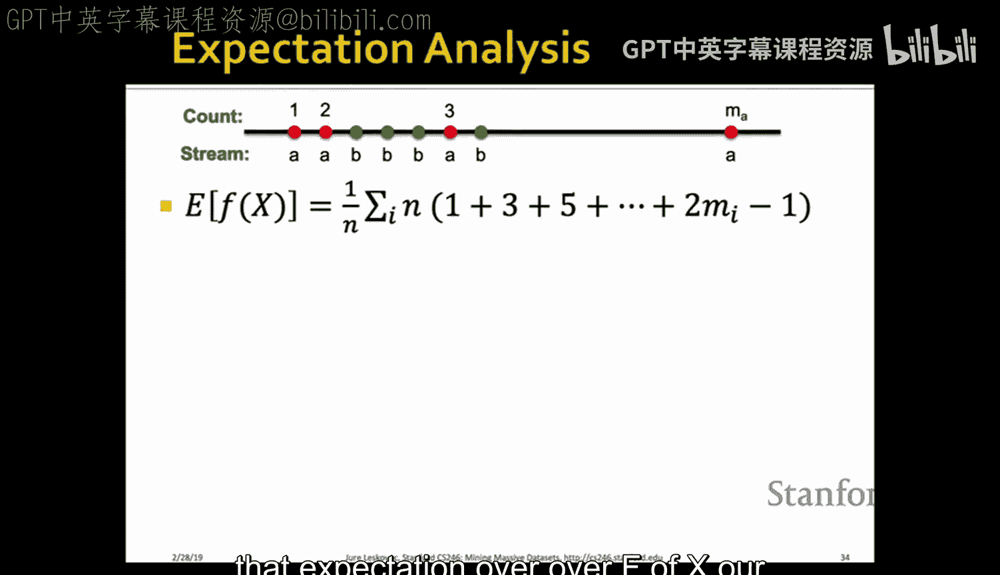

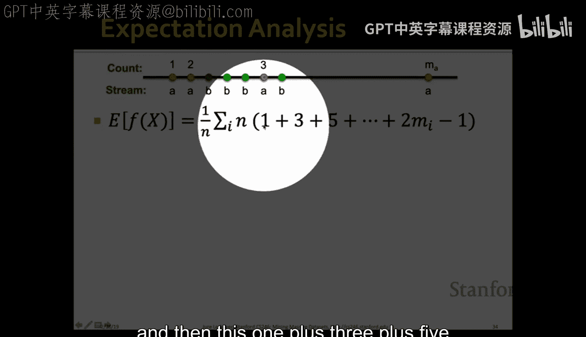

Okay， so now let's try to compute what does this sum add up to？😡。

And the way to write out this sum is to say a the sum we have there goes from 1 to m subi and then I'm summing up2 times i minus1 right1 is 2 times 1 minus13 is2 times 2 minus15 is 2 times 3 minus1 and so on right and this summation what is it it is2 times x m subi times m subi plus 1 divided by 2 so this is what this summation adds adds up to。

And if I now cancel out the tools and I multiply m inside。

 I get M square plus M and here I have minus M so that cancels as well。

 so what is last is M sub i squared。and what this means。

 this means that expectation over f of x equals 1 over n sum over I n times Mi squared right and now the ns will cancel out。

 so all I'm left with is that expectation of f of x is a sum over I m sub i squared。😡。

which is exactly what we wanted right this means that when we initialize this random variable x count the number number of times item I occur to the end of the stream。

 compute that value of f of x which is which I gave you on the previous slide then in expectation that value has has the expected value of that thing is exactly the surprise number。

 so it's exactly what we want。😡，Okay， so we have a second moment in expectation。 so on average。

 we will get the second moment， yes。We you find alphabeX。

 was it essentially so that it worked out this way or was there other intuition for why it was N times C Why did we define this F of X in this magic way？

Here is why right so I'll try to explain it so for estimating the case moment we will essentially need to use the same algorithm as I gave you。

 we will just define f of x differently our definition of f of x was that this is n times 2 c minus1 if you want to estimate the third moment you define f of x differently you define it as n times three times c squared minus3 c plus1 okay and this may so I mean initializing my random variables in the same way but I'm initializing but I'm computing f of x in a different way so now like where you know where did I pull this number solve right so here is what you need to remember like going to your question right you have to remember that when I was computing my expectation I had this sum 1 plus 3 plus5 all the way the 2 m sub i minus1 so we all followed where did I get this。

😡，And what we showed is that these termss2 c minus1 sum up to m squared what our goal was to show that this summation over all over termem c from1 to m so basically this summation sums up to m squared。

😡，That's what we showed and the way the way you show this right is that you distribute the sum inside and this is really two times the sum over C minus the sum over C of1。

 So here you get the the the the。😡，You get the m subbi as we had before。

 and here you get m subi times you get m subi square。

 and then the things cancel out and what is left is m squared。

So now what about for the value of k equals3， we need the same thing we need that whatever we take here and sum it together。

 it has to sum up to M race to the power of three。And the way I compute that is to say the the。

What I really want is I want c cube minus c minus1 cube this is my estimate this is what I want so that these Cs cancel out each other as I do the sum so that only the biggest guy survives right and if I compute this thing then what is left is here and this is exactly my estimate right so really what I want is that the sum of this estimates kind of adds up to either m squared or n cube and the way I can write this out right here Ive wrote this as a sum over c squared minus or sum over c minus1 squared and if I do this right then basically here everything will cancel except the last element when C will be m so that's why this survives。

😡，Right and thats how I got here， thats how I got it and in generally if I want to estimate the case moment。

 then this is the formula to estimate the case moment it's C race to the power K minus C minus1 race to the power of K right because I want these things to cancel out so that only the last c to the K when c equals m survives thats the intuition why this happened。

😡，Now what is there to say is how do we combine samples right now we did everything by assuming the stream has the fixed length。

 but what if I so and we have instantiated a single x。😡，If I want multiple access。

 then I would create multiple random variable sex， I would now average them in groups and then take the mediumn of the average that turns out the best in practice。

😡，There is one more thing we need to fix and the thing we need to fix is that we assume that the stream has a fixed s。

 but in reality strings never end。😡，So what we need to do is we assume that we have a number end of the elements in the stream。

 so the length of the stream， but as I said real streams have infinite length so I don't know what will the number of inputs or elements that I will see in the stream so how do we solve this。

😡，The way we solve this is that we have this variable x。

 but we also keep a counter and that tells me how many items。

 how many elements have we read from the stream。😡，And then what we need to be able to do is from whatever is the length of the string we've seen so far。

 we must figure out how to sample position t uniformly a random out of this string right so what this means is that we if we can only store k counts as this axis this K random variables x。

 we will want to throw some random variables out and instantiate the new ones。😊。

So the objective that we really want is that any starting time t is selected with equal probability right that after we have seen n n elements or nups from the stream。

 each starting time T is selected with probability k over n if we want to have k or random variables in kept in memory。

😡，Right。And hopefully this now rings a bit of a bell and what this really means is this is really that we need to be able to sample uniformly right we want to create a fixed size sample of an infinite stream of a stream where n is increasing as we read more element and last time we talked about the method to do this and the method is called reservoir sample right so the solution here is to do fixed size sample where the idea is that first you choose the first K random variables from the first k items you sample from the stream and then from there on whenever you read a new element from the stream。

 you keep you keep that element that reading that value with probability K over n。

 if decide to keep it you throw one of the existing x out and initialize a new x and start counting that element from there on。

😡，At any point in time， you are able to compute the surprise number by using my estimate F of x that we have derived before。

So this is what I wanted to say about number the algorithm number three。

 computing the surprise number， you have a question， no question， any questions。😡。

So what all the magic here was is that we had this estimate that when we computed the estimate over it。

 essentially kind of it allows us to create this telescopic sum and everything would cancel out except the count of that item square would survive。

 and that was the big insight here， right？😊，Where kind of randomness and being able to uniformly sample from the stream helped us a lot。

This is kind of the intuition here。Good， any questions？

Good so let me now try to see I'll cover this thing I probably won't get to the end。

 but this is also something that is very useful so I think out of this lecture the bloom filters are amazingly useful in everyday life and the next topic is also amazingly useful in everyday life okay so here is what I would like to do。

😡，I would like to do item set counting， think of frequent item sets。

 but I want to do this on a stream。😊，Right so given a stream I want to ask what items appear more than as time seen the window right and one way how I could solve this is that I could use the I could represent stream of let's say baskets as a binary stream per item this is how I finished the last lecture and then I say right I am a supermarket。

😡，Each basket contains a set of items and I have these multiple streams。

 one per item and whenever a new basket comes， I emit a vector of zeros and ones that tells whether a given item in the stream is in the basket or not。

😡，Right and then I could use the DGIM method to estimate the counts ones of all the items across all the baskets。

 and this would kind of tell me how many times how many times have I sold an individual item across the last k basket。

😡，O。😊，So here is now， if I want not only the counts of individual items， but I want more， right。

 how could I now count frequent pairs？😡，Right how could I count what pairs of items have sold many times right so I could have one stream per a pair of items and then the number of streams I would have would be quadratic in the number of items and that you know the number of streams now would be way too big and I really couldn't do this and also the answers I would get would be approximatexy so I don't want to do that。

😡，So here is what I would want to do so the idea that is super useful is this notion of exponentially decaying windows and the idea is and this is really a heuristic that kind of allows you to keep frequency of an item over time and that frequency can kind of decay over time if you haven't seen that item repeatedly。

😡，And the idea is this in some sense， if you ask what are currently popular movies？😡。

Where instead of computing the raw count over the last n elements or you what are the most popular celebrities on Twitter today。

 you wouldn't say oh what are what are the follower accounts they obtain in a given day but you want to use some kind of smooth aggregation where kind of getting a follow right now is more important than getting a follow seven hours later right so we want to have some kind of smooth aggregation of item appearances over the entire stream。

😡，And the way you achieve this is the following。😡，Right imagine you have a stream of items and we are taking the sum of the stream but then rather than taking the sum what you do is you say I'll take the sum over the entries as I read them I take the value but I will multiply it with this 1 minus c raised to the power of t minus I right where basically I is is the item is the current time and t is the length of the stream and this means that that the items closer to the beginning of the stream will count more than the items very right and the idea for this is that C will be a very small constant so it means that this will be like 0。

99 something so as you raise it to a big power it will decay to 0 so it means that that the earlier counts will kind of count more than the counts later on and this is the idea of exponentially。

Exponentially decaying Windows and how do you really implement this is the following when a new item arrives you multiply the current counterfe by 1 minus C and then add that value。

Okay so the idea is that you kind of multiply by this discounting factor that is I know around 0。9。

99 and then add the value and of course this will now mean that discounts will kind of decay to 0 if you haven't seen the item for a very long time so let me give you an example now I still have some time right so。

😡，Let's say that each item sub a sub I is an item and we can compute a characteristic function of P which basically means that for every possible item X I have this exponentially decay in window so the idea will be the following whenever this characteristic function of a given item will be the following I'm basically saying let me sum over the all the entries in the stream delta sub i returns value of1 if that position I the item I see equals x and otherwise it's 0 right and then I'm multiplying this with1 minus c t minus I。

😡，So what this means is that imagine that for each item X we have a binary string where essentially one means that the item X appears a that position and 0 means that the item X did not appear at that position so then what do I need to do is when new item X arrives I'll multiply counts of all items by 1 minus c so think of this as 0。

99 and then I add the count plus 1 to the element x right so now the idea is right items arrive at every step I multiply the counts of all items with 0。

99 so they get a bit smaller only the item that really arrive gets the increase in the count。

And this way that these items who I've seen in the past。

 their counts will decrease exponentially with time because at every time they get multiplied by 0。

99， so that count will quickly go to 0 and only the items that appear they will get a boost in their count。

😡，So we call this sum to be the weight of an item so this weight will exponentially decay with time and whenever the item appears it will get a boost of one。

😡，And that's the cool idea。And why is this useful this is useful because this type of exponentially decaying windows have an important property and the property is the following is that you can compute what is the sum of these decaying weights as a function of t and if t goes from 0 to infinity then this sum of 1 minus c raised to the power t actually equals 1 over c。

 the way you can compute this is that there is a well-know formula for how do you compute the sum of the values raised to the power of k where sum over k here is the thing if you insert it you get1 over C。

😡，So what does this mean， it means that if you want to ask what are the currently popular movies you could say I want to find movies whose weight whose this kind of characteristic function is more than one half we can actually compute because we know that the sum over the whole weights is one over C we know that only about two over movies will have the count of or the weight of one half or more。

 so this means that I can set a threshold and based on the value of C。

 the discount factor of C I'm using and the threshold I can actually estimate ahead of time how many items do I expect to have the value higher than that and this now allows me in some sense to keep a limited amount or limited count of items in the stream in in the memory where I'm basically keeping the count and I'm multiplying discounts with the discount factor。

😡，1 minus C and then if the discount if their total weight drops below my threshold。

 I throw them out， otherwise I keep them in and if I throw something out I initialize the new one and this means that I can always kind of keep in memory the most popular item。

😡，By basically having a threshold on this exponentially decay count。

 this is essentially the idea here， I will stop here because I'm out of time but thank you everyone for coming don't forget for the 341 session next week thank you and see you next week。

😡。

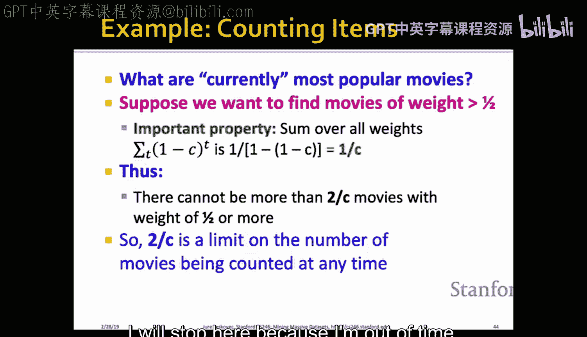

嗯。

