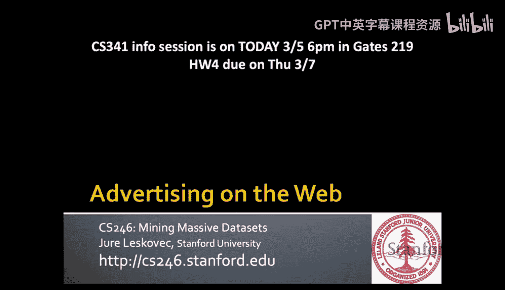
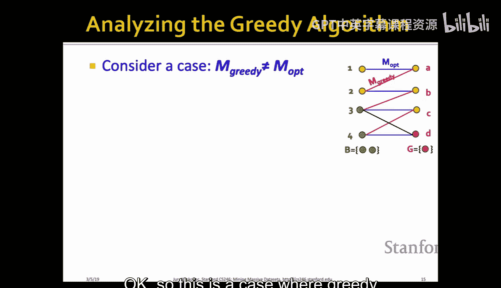
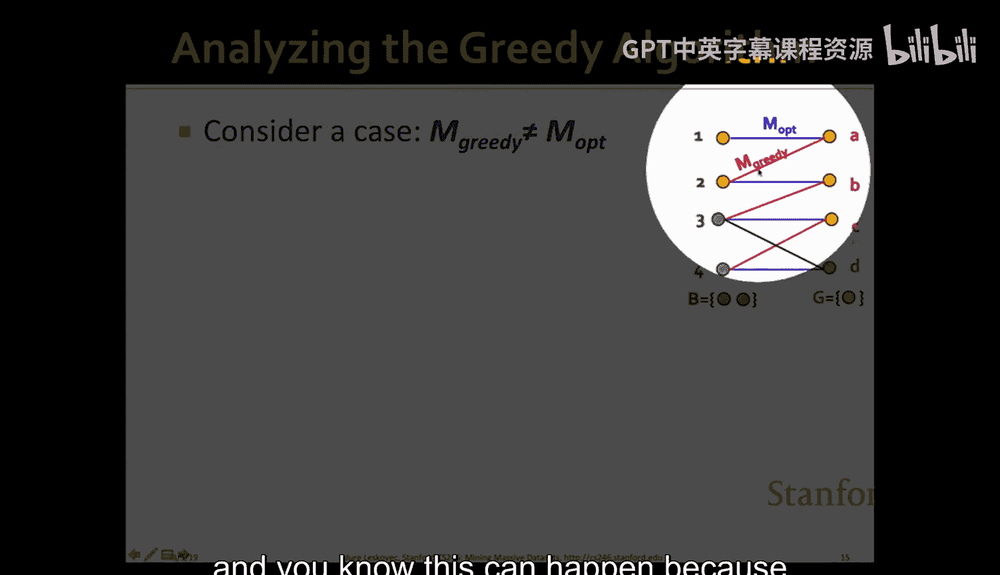
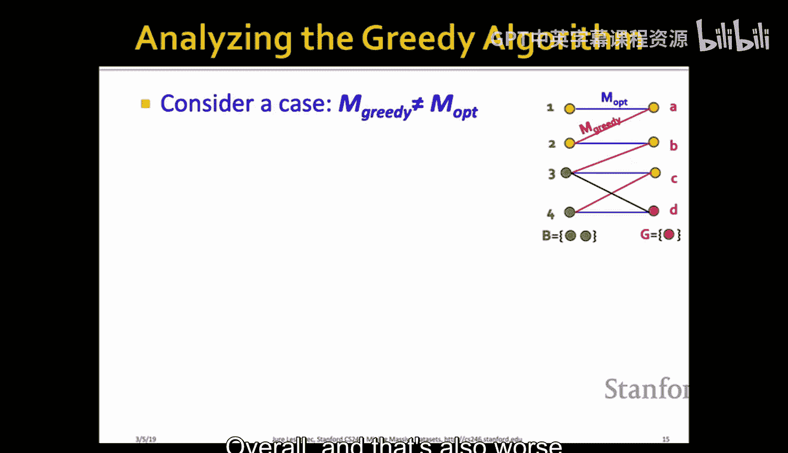
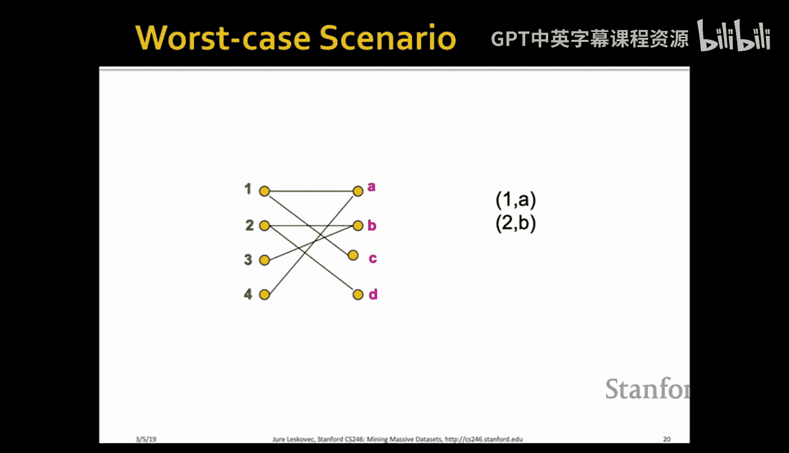
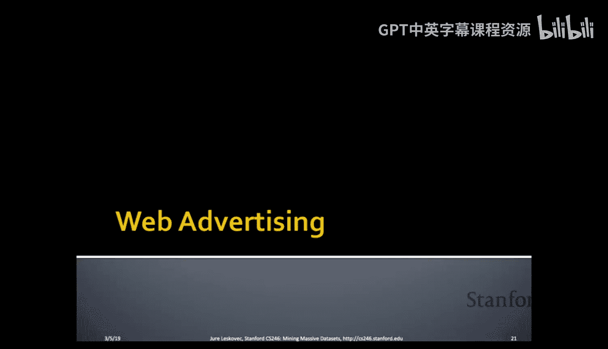
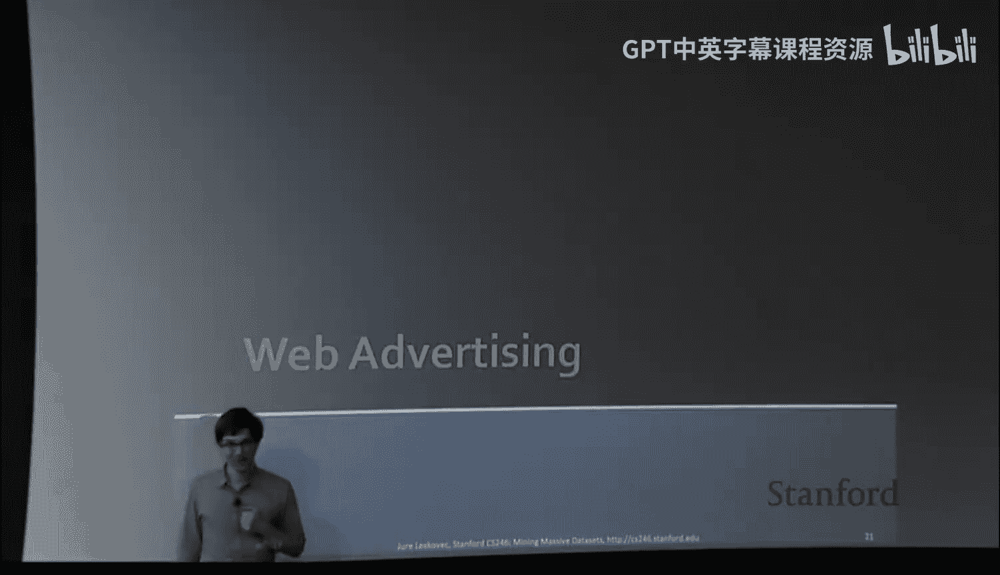
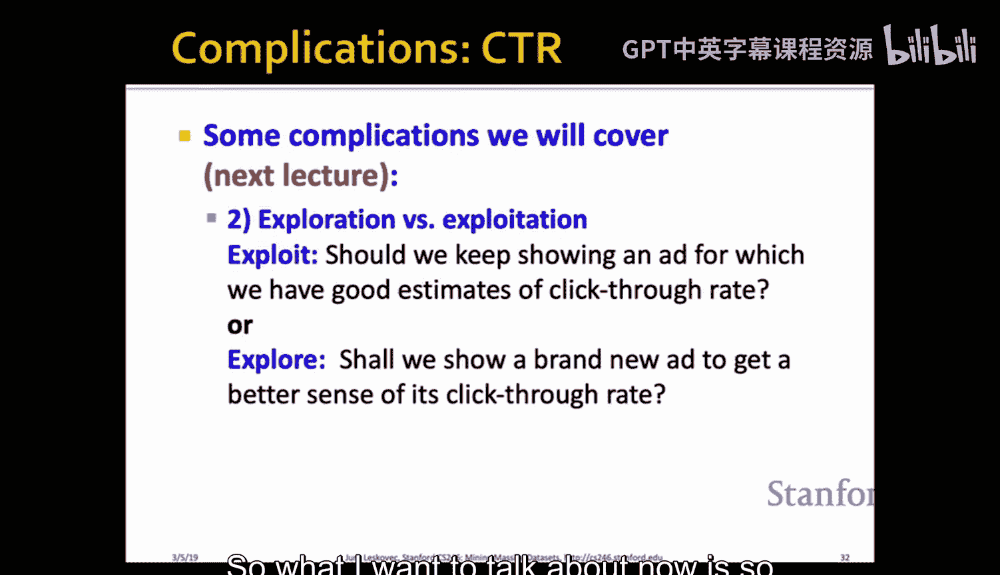
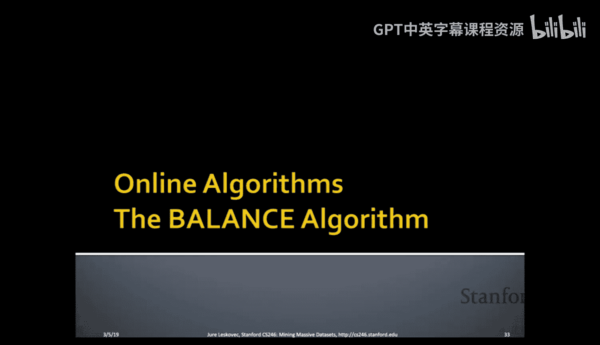
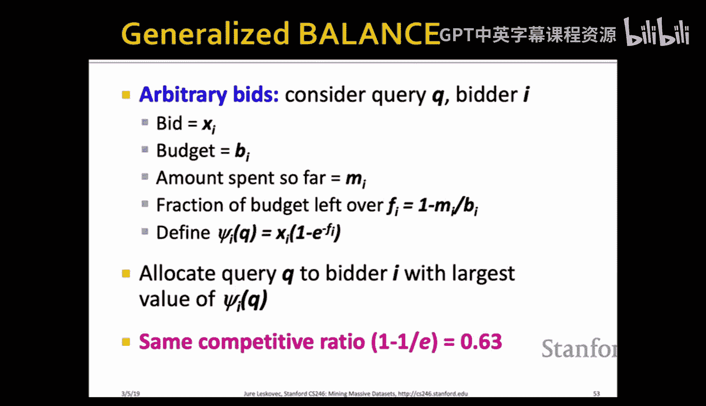

# 斯坦福大学《海量数据集挖掘｜CS246： Mining Massive Data Sets 2019》中英字幕 p17 -P17-lec17 Computational Advertising.zh_en -BV1raSjBuE3d_p17-

And on Tuesday next week we'll talk about computational advertising and algorithms that allow us to do that and today we will talk about how do you match advertisers and customers and then on Thursday Ka will give a lecture to talk about how do you discover which ads are good for which people so essentially whenever you have a content ecosystem。

😊，The problem is that you have the content but you don't know who is it good for so you kind of have to try out different users to learn over time who this content is good for right if you have a new movie you don't know who likes that movie so you want to go and strategically show it to a couple of different people to figure out who likes it and then you can actually decide and learn who to show it to right and this is kind of an exploration problem where you want to go and identify who we like a given ad beforehand and this is what we'll talk about Thursday there are two more things to say today first is that we have the CS341 info session today at 6 pm in the Gs 2 19 the Gs common area please come to learn about all the exciting research projects that you can apply to to work on next quarter as a part of CS341 class if you cannot make the session the slides will be published on the course website and you'll be able to browse through and actually learn everything。

about the course and then the last homework of the quarter is due this coming Thursday good luck you did an amazing job is the last one great okay so where are we in the course we are here talking about infinite data。

😊。

They are processing data streams and web advertising is one example of streaming algorithms so this is what we'll talk about today so essentially what I want to define is this notion of online algorithms where the classic model of the algorithm is that we get to see the entire input all the data at once and then compute some function over that input and return the answer and this is called offline algorithm because it gets to see all the data at once and then online algorithms are algorithms where we get to see the input one piece at the time and we make some irrevocable decision along the way and after we've seen one input and made the decision the next input arrives right and this is very similar to the data stream model only here basically the examples or the elements come one after another and we have to make some decision。

😡，Now what is the model of advertising we will look at so if you say how is Google making money it's making money by basically filling in this matrix where you have a lot of advertisers and advertisers bid and say what queries do they want their ads to be shown for right so we have this matrix of advertisers who bid on different keywords and whenever somebody comes and asks a query of this type all these ads are eligible to be shown to that user to that query right and now of course if you have all these candidate advertisers who want their ads shown for that particular query。

 we need to select which a to show to what query and notice that for example the same way as multiple advertisers bid wants to show the ad for the same query the same advertiser is interested in many different queries right and the way we can。

😡，Model this is the following。 We can model that we have these advertisers1 to K。😡。

And right and the idea is that the advertiser wants to show an ad for a giver set of queries or a particular set of keywords or topics right so whenever a new user shows up。

 let's say that user A then let's say this user types in a query such advertisers one and4 one are eligible to show the ad to that user right and then you know a new and we may make a decision we maybe make a decision that we will show the a one to user A right and then the new user arrives and this user asks a different query so it is maybe advertisers2 and3 who bid it on that query so now out of two and3 we have to decide who to show which of the two eligible ads to show to the user B and let's say we shows ad number two right and then let's say a user C comes and the user C enters such a query that only advertiser one is interested in。

😡，In showing the query showing the ad to that user C and in this case right because maybe the advertiser one only wanted to show one ad we run out of budget so we cannot show an ad to user C right and then a new user let's say de arrives advertiser number3 is the only one who bids on this particular user and let's say that advertiser number3 is not yet still has the advertising budget to use so we would now show the ad3 to user D right and so on and so forth and what is what is a a instance of this problem this is called a graph matching problem right because I have a graph a biparttype graph and I'm trying to match nodes on the left to the nodes on the right and nodes on the left can be matched to exactly one node on the right right so this is why is this an online problem it is an online problem because we have to make this。

😡，DesionsWhat advertiser to match with what user based on as this graph gets revealed to us right so as new users show up。

 we have to decide what app to show to that user And after we show the ads to the user。

 we cannot show that same ad to some other user later on。

 we already used our opportunity to show the ad to the first to the first user right And because we don't know how user in what order the users are going arrive and what kind of queries they are going to us。

 this is an online problem right the opportunity to show an ad。

 the user arriving to the site and entering the query is revealed to us one step at a time right while let's say the advertisers come ahead of time and they say this is a set of queries we want a bit on this is the。

Number of Q this is the amount of budget number of dollars we want to spend right so what I want to talk about now is talk about this kind of abstract notion of online bipartite graph matching right so this is the first thing we'll talk about problem in the abstract and then I'll kind of bring it back to this problem of matching advertisers to users or two opportunities to show on it okay so online bipartite matching What is the example The example is that we have this bipartite graph with the left and the right hand side let's for you know let's be old session we'll have voice and well have girls and the idea is that right I have this graph where boys and the things in this graph reveal preferences right and my goal is to match boys to girls so that the most preferences are satisfied right I have the two sides each edge means a preference right so this would mean that for example。

Boy number three would be happy to be matched with the girl B or D girl B would be happy to be matched with boy number two or boy number three right and my goal is now to to what is called find a maximum matching which would be fine as many pairs of boys and girls such that。

😡，As many preferences are satisfied right so here is one example of the matching right each boy is a map to exactly one girl and whatever girl is map is only map to only one boy right I cannot split the notes so this would be one example of the matching where I'm able to find a cardinality3 of matching right I match by obeying the preferences I'm able to match three pairs of boys and girls so cardinality my matching equals three and of course you could ask is there a better way to do this could I match all four boys to all four girls and if you look at this sharper here is actually what is called a perfect matching because we are able to match every boy to every girl again obeying the same set of preference right so if I would match boy number one to the girl C boy number two to the girl B and so on。

😊，I'm matching everyone， Im kind of I find the perfect matching because every boy and every girl are matched again obeying the preferences。

 right？😡，Some terminology perfect matching is a matching where all the veres in the graph are matched and then maximum matching is a matching that contains the largest possible number of matches right so a perfect matching is always a maximum matching but a maximum matching may not be perfect matching right if I would have a lonely boy here that would have no preferences or no girl would select a preference for the boy then this case wouldn't be a perfect matching。

 but it would still be a maximum matching so that is the idea so now the problem is how do I find a matching for a given bipartite graph right basically find the maximum matching or a perfect one if it exists right there is a very nice polynomial time offline algorithm based on the idea of augmented path by a hopcroft and carp here you can read about the algorithm that will find you the maximum matching why this algorithm assumes is that。

entire graph is given to you ahead of time。😡，Our goal is not to know the entire graph ahead of time but what if we don't the question is what if we don't know the entire graph up front right and this is an example of the online matching where the graph is not known to us ahead of time so here is now what is the online graph matching problem right we will know a set of boys and at each round one girl's choices will be revealeding okay and that is basically the girl will come and we will know her preferences she will reveal her addresss and then at that point in time we have two choices to make we either pair the girl with some of the boys she reveal preferences for or we do not pair the girl with with with any boy and you know the girl is unmatched sitting on the side。

😡，so those are the two options right neither decide that the new nodes that arrive。

 we pair it with one of her preferences and this way it means we kind of reserve that boy for the or we say sorry girl。

 we decided not to match you you sit here on the side， okay so that's the idea。😡。

What's an example of this type of problem， for example。

 assigning tasks to servers right tasks are arriving one after another right so boys are the servers。

 girls are the tasks， the task arrives says I'm able to run on this particular set of computers this is my set of preferences and then what we get to decide is to either schedule a task on a given server or say sorry task we are not able to schedule you please wait。

😡，This is an example of the online graph matching problem where every task has a set of preferences where it can run。

 and as soon as we assign a task to the server， that server is now kind of the market。

 it's been consumed by that task。😡，Okay so give you an example here is my set of boys and the way this will work is you know girls arrive one at a time and they reveal the preferences and we get to make a choice either to match to select one of these two boys to match to the node A or we do nothing right and imagine I decided yes somehow I will match a with the boy number one right and now the second girl appears reveals its preferences and again I somehow decide who do I match her with right now the next girl appears reveals the preference。

 boy number one is already taken so I cannot match this girl with anyone so she remains unmatched and then the node the girl D arrives reveals the preference node3 boy3 is still unmatched so I can match them and this way I came up with the matching。

😊，Of Carinality 3， because I was able to match three pairs of boys and girls Okay so that that's the idea。

😡，So now let's define an algorithm。😡，That we'll try to do this matching and our algorithm we will call it it's a greedy online algorithm where basically in this online graph matching problem when the new girl appears any eligible boy if there is an eligible boy that is not matched lets just match that boy to that girl and if no eligible so no unmatched boys exist then we are not able to match that girl and we move on right and the question is how good is this algorithm right so basically the idea is a girls will arrive we will see what are their preferences if among their preferences there is at least one unmatched boy so basically available boy we will create that matching and we will continue and of course if a girl arrives and we will see matches her matches and all the boys that that are preferred by that no are already matched there' is nothing we can do so we say sorry we cannot match it right。

😡，So now the question is， how good is this greedy matching algorithm？😡。

And the way we define the goodness in this case is that we have this notion of competitive ratio。😡。

And the competitive ratio is essentially saying how far away is the cardtinality of the matching of this gridy algorithm from what the optimal algorithm would do right so we are saying for inputi。

 suppose that the greedy algorithm produces the matching M subgrading This is a set of matched pairs right and then assume that the optimal algorithm would produce some other set of matching。

 let's call it M opt。😡，Then we say that the competitive ratio is the。

Minimum ratio between all possible input side between the cardinality of the matching produced by greedy divided by the cardinality of the matching in the optimal case right so in some sense I'm asking at what fraction of the optimal solution is my greedy algorithm right I'm asking what is the gridit is worst performance over all possible inputs and then I say worse performance。

😡，Worse with respect to what the optimal would do okay so I'm always judging myself to the bar of what is the optimal solution and how close to that would my greedy get and this ratio is called competitive ratio because we are asking how competitive is greedy with respect to be what the optimal would give us。

😡，Okay so that's how we do it so now lets try to compute the competitive ratio of this greedy matching algorithm right so let's consider the case where greedy doesn't give us the optimal solution。

😡，Okay and here is an example that I will show you for the next few slides where I have boys on the left girls on the right the edges reveal preferences。

 the blue edges is what the optimal solution would be so it would be a perfect matching but imagine that when the girl number a arrives greedy assigns her to the boy number two so that when girl2 arrives。

 now two is already taken so she has to match with boy number3 so that C arrives matches to boy number4 and when the D arrives D cannot match to3 or4 because both three and4 are already taken so this is a case where greedy would give me suboptimal and the reason why greedy would be suboptimal because here we were unlucky when the first node a appear we chose to match it with node number one not with node number sorry we chose。

😊。

to match it with note number two and not with note number one and you know this can happen because we kind of among all eligible boys。

 we pick a random one and maybe we were just unlucky here okay。😡。

Yes。😊，pererformance overall input is that also performance over type behavior so we assume all the ties are broken in the worst possible you can imagine you can imagine either two options one option is to measure imagine that ties are broken in a worst possible way another way to say I break ties are random or another way to say things is I break ties in some arbitrary but deterministic way。

Okay， so。And essentially。嗯。What the result is。

You know， on super small examples like this， these things might matter。

 but in big graphs and in the limits these things don't matter。

 the best way to think about it is that we break ties arbitrarily but in a deterministic way。😡。

ok。😊，So that's the best way to think of okay so let's now make some definitions first I will define the set G。

 which will be the set of girls that are matched in the optimal。

 but theyre not matched in so in our case the node G would the node D would be in set G right because D is not matched in but is matched in the optimal so that's the first definition is the set G。

😡，By definition the number the following holds is right the cardinality of the matching in the optimal matching is less than equal than the cardinality of the greedy matching plus the number of girls that were matching the optimal but were not matched in greedy right so this is essentially anequ because Im saying optimal the size of the optimal solution is whatever greedy finds plus whatever are the girls that we were not able to match match but were matched in greedy okay so this is。

😊，Through by definition of how we define G。Now the second thing is I will define a set of boys B to be that are the boys who are linked with the girls in G so in our case B would be boys3 and4 because they linked to a girl in G so to the node D right and one thing we have to notice is that boys in B are already matched in the greedy right why is that the case because if boys in B wouldn't have been matched in the greedy solution。

 this means they would be available which means I could match them to a girl in G which is a contradiction okay so basically if there would exist such a non-matched boy B on the lefthand side that is linked to a unmatched girl in G then I could do that matching and I would contradict my definition of G so what this means is that every boy in B is。

😡，Linkked to an unmatched girl， but every boy in B has already been matched to some other girl is unavailable right because if that boy would be available。

 I could match it to the girl in G， but then the girl shouldn't be in G because we say that the girl is only in G if it's matched in optimal but not in greedy okay so boys in B are linked to girls in G and boys in B are matched in the greedy solution。

😡，So what does this mean？😡，This means is that the number of the card of the optimal solution is greater or equal to the boys in B right boys in B are matched in the greedy but linked to the girls in G and this means that the card of greedy must be bigger than the number of these boys in B so thats the second observation so what do we have so far we have defined G be to be the girls matched in the optimal but not matched in greedy we defined B to be boys adjacent to the girls in G the first thing is we found the inequality that optimal is less than greedy plus size of G that greedy is bigger than B because all the boys in B have to are already matched in the greedy solution plus and so greedy contains at least the boys in B。

😊，probably some other boyss now that we have one and two。

 we need to also come up with another observation is that that the optimal solution matches all girls in G to some boys in B。

😡，Right what does this mean is that the number of girls in B has to be less than equal than the number of boys in B because in the optimal solution these girls in G have to be matched to some boy which means that the number of girls versus the number of possible boys that they could be matched to it has to be the girls have to be fewer than the boys so that all the girls can be matched in the optimal solution so the cardtinality of G is less than cardtinality of B right so what I can do now is I can go and combine equations2 and3 and out of this I can get that size of G is less than the size of B is less than the size of greedy solution so now that I have done this I can I will call this equation4 here now in the next step I will now compare equations1 and 4 so this is what's happening here。

We have my equation number inequality number one or equation one that I proved before we have just derived the G is less than b is less than 3D Now if I combine these two things together。

 then I ask。😡，What is the worst case right what is the the worst case when these inequalities are satisfied and I will get the biggest difference in ratio between optimal ingredient right and the worst case is attained when。

😡，G equals b equals  greedy right so this will mean that the optimal is less than equal to  greedD plus the size of G which is equal to  greedD so is here。

 so this means that optimal is less than two times  greedD which means that the competitive ratio ratio between  greedy and optimal is 12。

😡，Okay so what this means is that the greedy algorithm will achieve competitive ratio of1 half。

 which means that the worstcase performance of the greedy algorithm will be one half over all possible input so well be at worse at the 50% of the optimal solution so let me give you an example here is my here are my boys here are my girls and essentially how this worstcase performance can happen is that you know as the girls come。

 I essentially make a mistake early on the death kind of penalizes me through the rest of the time right so here I would match1 and a so that then I can match let's say2 and B and now in the second case I can get something like this where C selects already match boy and a D comes and selects an already matched boy right and this means。

😡，I was only able to match two girls out of four even the optimal solution would be to match four right is at the time when A appeared I would match herit4。

 when B appeared I could match herit3 so that when C came one would still be available and when D came two would still be available and that would be the optimal solution but because we made two mistakes early on we then got penalized in the second half and that's kind of the words that can happen。

😡，is that basically for the first half of time， we make call the mistakes so that in the second half of time we cannot match anyone and that's the kind of the worst case scenario for the green。

😡，Okay， so that's about abstractly about the graph matching problem now I want to talk about web advertising and then connect back to how does it relate to the online graph matching problem yes。

😡。

That I think that one greedy edge wants another optimal。 great。

 That's a very nice way to think of it， right， I that whenever we， in some sense。

 make a wrong greedy decision， this basically means that we prevent one optimal decision later on。😊。

So here I made two mistakes with A and B so that later on。😡。

Kin of I like I kind of prevented myself to use those to use those edges in some sense。

 so exactly one greedy edge can kind of screw over at most one optimal edge that's a great way to think of it Thank you for saying thats super。

Great， anything else？All right， so web advertising， a bit of history。

 So this is not at all right It's basically the way this was started was in 1995，1996。

 and the early history of head advertising is something that is called banner ends。

And if you open a picture of if you go to New York Times do com。

 then banner X would be these types of images here。 you see three of them。

 maybe four on the New York Times page。 And the way you would usually do this。

 right is that New York Times advertisers would come to。newer times and they would say。

 you know I'm willing to pay X amount of dollars per thousand impressions right so the same way as if you go to the newspaper and you say I want to put my ad in the newspaper newspaper says we print00000 copies a day so 100000 people will see your ad so that is I know 50000 so half a dollar per person who see the right the same thing was really imitated on the web and this type of advertising is called CPM this stands for cost per milea where Mila is thousand0 impressions okay so CPM advertising is essentially modern after TV and newspaper ads where all you pay is per impression okay and of course you can do this in an untargeted way or you could do this in a demographically targeted way where you can go let's say on Facebook today and I say I want to show my ad to females from。

Pa Al have this age bucket， and I'm willing to pay 20 cents per impression。😡。

And Facebook will say thank you very much and they will find the users to show that ad。😡。

RightAnd the problem with these types of ads is that they lead to low engagement。

 they lead to what is called low clickthrough rates because all that the advertiser is paying for is is pay for impression they don't pay for any kind of activity on the user side so these types of ads generally lead to low return on investment right and of course if you are Coca Cola and you just want people to be aware that Coca- Cola exists you are willing to do this type of advertising because you just want to do kind of brand awareness and you know you want to appear somewhere and you hope that people will memorize your brand this is what is called basically this is what happens with CPM advertising。

😡，What actually happened then around the year 2000 there was a company that innovated what is now called performance-based advertising and performancebased advertising is the following right is the case we were talking about is where advertisers bid on keywords right and then when somebody searches for that keyword the highest bidder bidder's ad is shown so this means that whenever somebody visits a website there is an auction where the advertisers bid on that user and then the highest bidder wins and the important thing is that the advertiser only gets charged if the ad is actually clicked on。

😡，Right before in the CPM the advertiser gets charged per impression here this is called CPC because it's cost per click not cost per mill in the CPC advertising the cost only gets you only get charged if the user clicks and this is exactly the same model that was later adopted by Google in 2002 and is still the main advertising model across the web where basically it's performance based advertising and where the advertisingr only pays if the user clicks there are also other types of advertising where it's not only per click but you also can do by conversion where you know you would put an ad on Google and if the user clicks through that ad and makes a transaction on the website then only then you pay you pay Google so that's even more。

kindind of strict version of engagement or performance but for now let's look at this click based or CPC based type advertising where basically the advertiser gets charged only if they get click right where do these types of ads appear if you go on Google and search for something they usually appear on the side and these advertisers only get charged if you actually click the link if you don't click the link the advertiser doesn't pay Google any money。

😡，What this means is right like that these types of things are amazingly complex because these auctions have to happen in real time right you come。

 you search for I know GeicCO and now other advertisers are like oh I want to advertise on the query GeICO and I'm willing to pay this much and then out of that Google decides which of the three advertisers who are interested in advertising on that particular query or that particular time to that particular user actually gets to impress their ads and whoever gets to impress their a if the user actually clicks then has to pay Google some money whatever their bid was yes。

😡，I' funny the advertises， but what's the sample for。Sorry。

 so you said it's clear why this is good for advertisers。 Why this good for for the company。

Why Google wants to do this Why does Google want to do this because they want advertisers business。

RightSo of course， if Google would be lazy and say， hey。

 we'll just do CPM and sorry we don't have a CPC product。

 advertisers would go elsewhere because advertisers want good return on their investment。😡。

So Google is amazingly good at deciding what ads to show。😡。

And you wouldn't believe how many people at Google work on this problem。😡，So essentially。

 like hordes and hordes of people work on this， like really， and if you look at Google at Facebook。

 hordes and hordes of people work on this。😡，Because that's how these companies make money。

So what is what are the conclusions of this， this performance based model works much better than the display based model because the incentives are more aligned。

😡，Right it is in Google's best interest to find most relevant ads to you so that you click them so kind of that's why Google actually wants to do this or why companies want to do this because the incentives are aligned and also the advertiser gets good return on investment because only they only pay for the people who actually transfer to their website who actually click by themselves right so what is the interesting problem what ads to show to a given query to a given user right are that at that time right and what will what are other problems right if I'm an advertiser which search terms should I bid on。

😡，And how much should I be right how much am I willing to pay and what users am I willing to pay for。

 this is not the focus of today's lecture we'll talk about what add to show for a given query or for a given user。

😡，So here is now the Google AdWorts problem right we have a stream of queries that arrives to the search engine。

😡，And several advertisers bid on each query and then when a query Q subai arrives search engine must decide what subset of advertisers are going to be shown right out of the advertisers who reveal the preference for that query we need to decide what which subset of them to show right and what is the goal the goal is to maximize the Google's revenue right we want to make as much money as possible right and here is one important detail here right rather than initially I said what overture did they said we will show people the ads that have the highest bids。

😡，But showing the ads with the highest bids is not necessarily what you want to do if you want to maximize the revenue。

😡，And instead， what you really want to do is you want to show the ads that give you the highest expected revenue per click。

😡，So what this means is that you want to sort the ads by the amount that they bid times the probability that they will actually be clicked and the probability of clicking the schools CTR click through right。

😡，Right。So you don't want to sort the ads by the amount they bid but you want to sort by bid times probability of clicking because you want to maximize your expected revenue and you only get revenue when the click occurs and when the click occurs you charge the bid amount of dollars so and in this case of course we need an online algorithm because these queries arrive one at a time and we need to decide whats to do right so here is the idea I have advertisers imagine a user came I have the advertisers who give me different bids for that for for that user for that query for that instance now I don't necessarily want to say oh I will show ads one and two what I won't show ad number three because what I want to do is I also want to estimate how likely is this user to click on the ad right and this clickthrough rates are usually around 1% right so you know the add。

😡，One may not be so relevant to the user so the estimated probability of them clicking that ad is 1% while this addd C。

 you know maybe the advertiser is willing to pay a bit less but the user is very likely to click it so my estimated clickthrough pro is 2。

5% right so my expected revenue by using the slot and showing that ad here would be 1。

25 cents in the case B it would be 1。5 cents and for the ad1 would only be 1 cent。

 so what I would want to do is I would want to show the ads B and C because they have the highest expected revenue for me right？

😡，So what this means instead of sorting the advertisers or ads by B。

 I want to sort them by the expected revenue。😡，And one thing that is one challenge that is important is that in this case the bids are known but the CTR。

 the clickthrough rates are unknown right and this clickthrough rates are user specific right so the CTR of an ad is unknown and another so I have to estimate it I have to have a machine learning model that makes prediction for this set for this user whats the probability of clicking。

😡，And then the second thing is that advertisers have limited budgets and they bid on multiple queries and what this means is that I have to be careful how I allocate advertisers' budget right and this is where the online matching problem will come from okay so there are two complications right one is how do I deal with finite budgets and then the second one is that the CTR of an ad is unknown。

😡，Right。The problem with budgets is that each advertiser has a limited budget。

 they say I'm willing to spend $100 a day on this a and I want to show this ad on a this subset of queries right and the search changing guarantees that advertiser may not be charged more than the daily budget。

😡，RightOf course Google can show that that 10 million times。

 but if the advertiser has $100 daily budget， this means Google won't be able to charge for more than the $100 so this means that this online advertising systems has to be super precise and super real time because after you exhausted the daily budget and you keep showing that ad you cannot charge for it so you are losing money right so this is an important complication and then around budgets and then the second one is the clickthrough rate which is you know how do I predict the clickthrough rate between each ad query pair and this likelihood might be different right so you you could have advertiser one that reads a lot but has the low click probability and advertiser too that reads less but has a much higher quick probability and the problem is that CTR。

Is both kind of predicted and also measured historically and usually kind of average over a time period。

😡，Right and about the CTR the things that we won't talk about is actually click through is position dependent。

 meaning the ads that are appear higher up on the page are more likely to be clicked than the ads towards the bottom of the page the same as with search results right so add number one will always be clicked more than the addd number two and you have to kind of debias your CTR estimate from this position bias and that's a very important problem。

😡，And then what complications about CTR are we going to talk about next lecture is this exploration versus exploitation trade where you when a new ad arrives and you've never seen it。

 you don't know what is it click through it。😡，So then the problem becomes this notion of what do you do A brand new ad you've never seen has a clickthrough rate of zero so if you just assume it has click rate of0。

 you will never show it but then you will never discover how good of an ad that really is so you have this notion of exploration where you basically say shall I take the brand new ad and just show it a couple of times that I see who bites on me versus shall I just keep showing the ads that I know are good and I have shown them many times before and I know who they are good for right and the same this kind of Exp exploit problem happens in recommender systems where let's say a new song arrives or a new movie arrives and you haven't shown that movie to anyone so you don't know how good it is and what subgroup of people we like it and when a user arrives to let's say Netflix you could say oh I'll just recommend the movies that I already know this person is going to like because I have a lot of data about it or should I maybe just show them the movie。

😡，That I'm very uncertain about， but it's a very new one and by showing the movie to that user I'm going to learn something about the movie。

 this is called deexoration so what I want to talk about now is so this is what we'll talk about Thursday and it's an important problem。

 what I'm going to talk about now is this online algorithms for matching advertisers to queries or to matching advertisers to users。

😡。

Okay， so that's what we are going to do next。 Are there any questions？😡。

All right so moving on， what's the Google AdWors problem right we are given a set of bids by advertisers on the search queries。

 let's say we are given a search click rate for each advertiser query pair。

 we are just assuming this is given to us we are given the budget for each advertiser。

 let's say we are given a monthly budget or a daily budget and we are given limit on the number of ads to be displayed with each query。

 let's say three or let's say one and what are we trying to do。

 we try to respond to each search query with a set of advertisers such that the size the of the set of the advertiser is no larger than the limit on the number of ads per query that each advertiser has bid on that search query and that each advertiser has enough budget to。

😡，Pay in the case that you know if you show that head， the user will click。

 we still have money to pay for that click， right you don't want to give away clicks for free。

 you want to be able to have budget from that advertiser to pay for the click if it occurs。😡。

So these are the conditions we want to do okay so here is we already talked about the greedy algorithm and if we simplify this setting a bit then our greedy algorithm of matching boys and girls applies very nicely here right where what are we simplifying we will say that there is one ad shown for each query right we can match one one girl with one boy all advertisers have the same budget B all ads are let's say equally likely to be quick and the bid of each ad is the same it's let's say one dollar okay these are just simplifying assumptions and under this simplifypling assumptions I could apply this greedy algorithm that we talked about before where basically for a query I pick any advertiser who has be that for that query and we already know that the competitive ratio of that algorithm is one h right so what would。

😡，Mean is if if in the optimal scenario I could make a million dollars a day this algorithm will make at least 500。

000 or more right so we know that we'll be making at least 50% of all possible money that it is to be made。

😡，So it's quite good， we have a guarantee how well we are doing with respect to the algorithm that would actually know how the future looks like。

😡，Okay， so it's useful right so let's now keep talking about what is what are some bad scenarios for this greedy algorithm and I'll give you one。

😡，Imagine that I have two advertiser A and B advertiser A bids on query X and sorry advertiser A bids on query X。

 advertiser B bids on X and y okay and both have the same budget of 4 imagine that the query stream is I first see four instances of x and then I see four instances of y。

😡，And what would the optimal solution be， the optimal solution would be that when the queries X arrive assign them to a so that when queries y arrive。

 the budget of B is still free and and I assign B to the to Y what would be the worst case that can happen for greedy it would be that the greedy does exactly the opposite right when the queries X arrive the greedy says oh I could choose a and a or B let me choose B so that then after four slots I have exhausted B's budget now the queries y arrive a does not bid on the queries y so I would only be able to select B but B is out of budget so I can select nothing right so in this case we would spend 4 and the optimal solution would spend all8 it would exhaust both advertisers' budget right so this would be the optimal for the queries X use the advertise。

A so that when queries y arrive， you can use them for B and this is the competitive ratio of12 right even if we do the worst possible thing。

 we still do 50% of what the optimal solution can do right so the competitive ratio is1 half right and this is the worst case right one thing about the worst case you were asking me before the only thing is we break ties in an arbitrary way but in a deterministic way right we always resolve the draws in the same way and if this is the assumption then the following analysis holds is right no random tie breaking but consistent deterministic tie break。

Whatever whatever it is。😡，Okay， are there any questions about the greed algorithm？😡。

So everyone sees how it works。Yeah， all good so this is now the simplest one so now I'll give you an algorithm that actually works much better this algorithm will allow us will give us。

 I think 75% of of the budget so so its competitive ratio will be three quarters so it can be much better than green and here is how this algorithm works it's called balance and the rule it uses is very simple right it says for each peak the advertiser with the largest unspent budget。

😡，So whenever a query arrives and multiple advertisers want to show。

 I'll pick the advertiser who has the most unspent money。😊。

Right and again I'm breaking times arbitrarily but in a deterministic way right so let me give you an example I have advertisers A and B same as before A bids on x B bids on x and y both have budget of4 the sequence of the query see that I first see four instances of x and then I say four instances of y now what would the balance do here is what the balance would do right first the x arrives and it chooses a so that now the second x arrive a has $3 left B has $4 left so now we choose B because B has 4 left because largest unpenent budget so now I choose1 A1 B they both have 3 left so when the next x arrives I choose a right again I break tie arbitrarily let's say alphabetically now a has $2 left B has 3 left so that when the fourth x arrives now。

😡，I choose the eligible advertiser with most unpenent budget， this would be advertiser B。

 so I put it here now I use two units of money for a。

 two units of money for B so that when queries why arrive。

 I can do two more impressions of add B so I'm able to make to spend 6 while the optimal as we had before would be able to spend $8。

😡，Right so and in general for the balance algorithm on two advertisers。

 the competitive ratio will be three quarters right so we are spending six out of eight possible dollars so that's three quarters right so in general what we are going to prove is that balance for two advertisers gives me competitive ratio three quarters so it means it's making 25% more money than what the greedy algorithm will be making which can be quite significant so let's try to analyze the balance algorithm before I do that any questions about how this works。

😡，Okay， so everything clear， let's analyze it。 So here is how we will analyze this algorithm。

 So we will do this without a loss of generality。 We will assume there are two advertisers A and B。

 and they both had have the same budget B。And we will also assume that the optimal solution advertisers。

 both advertisers budgets。😡，Right and this is without loss of generality because if the optimal solution cannot exhaust advertisers' budget。

 then that budget we can do nothing we so we can just throw it away and for the purpose of analysis assume that both budgets gets exhausted right so if this is the optimal solution then one thing is that the balance must exhaust at least one of the two advertisers budget why is that the case if both advertisers would still have unexhausted budget then you know whenever balance makes a mistake which means both advertisers bid on the query but we assign it to the wrong to the wrong advertiser the advertisers unpeed budget only decreases。

😡，So this means that because the optimal exhausts both budgets。

 this means that one of the budgets will for sure get exhausted right because it means that when we we essentially here when we make a mistake we further decrease the budget of the advertiser whose budget will be exhausted anyway。

 so in the end that advertiser's budget kind of for sure must be exhausted because we assign the queries that should be assigned to it to it plus we assign additional mistakes to it which further decrease the budget so at least one of the two budget has to be exhausted right let's assume that the balance exhausted exhaust a2's budget。

😡，And the way but at the same time allocates x queries fewer than the optimal solution does so this means that the revenue of balance will be two times b right I have two advertisers each the budget B minus x these are the queries we were not able to allocate right so optimal solution would exhaust both advertisers' budgets so it would be b while the balance will get we get the revenue of two times b minus x so now we want to figure out what x is so our goal is to figure out what xs and if we know what xs then we can take 2 b minus x divided by b and well get divided by 2 b and we will get the competitive ratio that is our plan figuring out what the value of x which is how many fewer queries we allocate than the optimal solution would。

Okay so here is the picture I have advertisers a1 and A2 B the bar shows the budget and the color in the bar shows what queries got assigned to each advertiser right so it mean that blue queries are allocated to a1 in the optimal solution and the green queries are allocated to a2 in the optimal solution and how these things will look in general in general is that what will happen is that some of the blue queries will be assigned to a2 some of the green queries will be assigned to a1 and because of that one budget will be exhausted。

 another budget will be left unspent and this is the amount of unspent budget right because we won't be able to allocate this here so this is kind of how how we are going to reason about this and what is important to know it's important to know that the optimal solution that I note up here will。

Will exhaust both budgets so it will have revenue of two times B and in our case when the balance does we will have revenue of B plus b minus x right so this is the amount of money we are not able to spend these are not used or unallocated queries and the height of this is x which is here and then if this is x we will call this y and x plus y equals B which is the budget。

😡，Okay and what is our claim our claim will be that y is greater than x。

 Our claim will be essentially that we spend at least half of a1's budget right if we exhaust a2 we have to spend at least half of a1's budget and if we spend at least half of the a1's budget。

 this means that we spend half plus1 out of2 so it's 1。

5 divided by two so that's three quarters right so if if y is greater than x then the minimum revenue is obtained when x equals to y so x equals y is b over 2 which means that the minimum revenue for balance is 3b divided by2 which would mean competitive ratio is three quarters which is what we want to approve so let's now go and figure out how how do we prove this and the way we'll prove this is to analyze two separate cases one case。

😡，Be trivial and one will be less trivial so this is the setting queries and so on。😡。

Right so here is our picture we assign we exhaust the budget of a2 because we made mistakes and took some of the queries from a1 to the advertiser to now we cannot take these queries the green one and assigned them here so they become unassigned and that's kind of the loss we gain right the observation to notice is that unassigned queries should have been assigned to a2 and these queries the blue ones should be assigned to a1 right because if we could assign them to this queries to a1 then we would still have budget on the side of a2 right so the goal for us to show is that the amount of budget of blue queries that we assign to a1 is at least half right so the first case is when the balance assigned at least half。

Of the blue queries to a1 right so this is the first case right where we assign at least half of the queries to a that should go to a1 to a1 and less than half of the queries of a1 got assigned to a2 and then the rest the rest the green queries8 up all the budget right in this case basically I'm assuming that y is at least1 half if if y is at least one2 then the competitive ratio will be at least three4 because our revenue will be at least b plus something that is more than more than half of the B so we will get 3b divided by2 will be the minimum of our revenue so this is the easy case where essentially the mistake that happens is that we took some blue queries assigned them to to a1。

and to A2 and then exhausted the budget of A2 so now I want to show you the second case right where the balance assigns more than half of the blue queries to A2 so it makes more than half of the mistakes right whatever it took here in a it signed over。

😡，And now the question is am I still able to argue that the amount of spent budget on a1 is greater than 15 right how can I argue this right the way I can argue this is the following I can consider the last blue query that was assigned to a2 right because lets and if I take the last query that was assigned to a2 then here is the crucial observation right you have to remember that balance assigns the query to the advertiser with most unspent budget。

😡，O。😊，So now things should click right so if I'm making the assumption that more than half of the bluequeries got assigned to A2。

😡，And I am looking at the last query that got assigned to A2 this means this last query got assigned to A2 because A2 has had more unspent budget than a1。

😡，Okay and if I'm assuming I spent at least half of the bluequeries here。

 it means that I must have already spent half of the budget here so that the A2 had more unspent budget and the blueQu got assigned here rather than that。

😡，Okay， so because this means that at this time when I was assigning the last blue query to A2。

 A2's unspent budgets must have been at least as big as a once unspent budget。😡。

So this means if I want this bar to go over1 half。😡，Right over 50%。

 this means this bar must be over 50% because these blue queries otherwise would be assigned here。

 so it means that some of the green queries must have been assigned here and that the amount of unspent budget here was smaller than in A2 so that I decided to assign the blue query to A2 even though I should have assigned it to A1。

😡，And because of this argument， this means that at least as many queries have been assigned to a1 as they have been assigned to A2。

😡，And if we assume that at least that you know more than half of the blue queries are here。

 this means more than half of the budget of a1 has been spent when this assignment happened because otherwise I wouldn't assign it。

 I would assign it to the guy with the more unspent budget so again。

 what does this mean this means that at this point we have already assigned at least half of half of the queries to a2 which means that also we have assigned at least half of the queries to a1 as well。

 so it means again we have spent at least half of the half of the budget of a1。

 so in total we spend full budget plus half of the budget so again we get the result that y is greater than one half which means the competitive ratio is greater than three queries okay？

😡，So here is the result， the result is that the revenue is minimum where x and y equals 12。😊。

Which means that minimum the the minimum revenue of balance is 3b over 2。

 the optimal is 2b so the competitive ratio of balance versus optimal is three quarters and the key step in this proof lies here and it re on the crucial thing here is that we are using the algorithm and that we remember that the algorithm assigns a query to the advertiser with highest unspent budget and if we want now the queries that should be assigned to a1 to go to a2 which means that they could go to either of the two。

 this means that here we must have spent enough more than half of the budget so that this blue queries can be even assigned to a which means A2 must have had bigger unspent budget than a1 right and this gives us the proof。

Okay。Great， so this is what I wanted to say about this proof， are there any questions？😡。

So the case1 is easy， the case two， the only thing we have to use is the definition of the algorithm and then the argument holds。

😡，O。😊，Any questions？Please don't be so quiet。All， no questions， all right， good， so moving on。

 so this is for two advertisers and the simplifying assumptions。😡，In general。

 we can prove that with multiple advertisers， the worst case competitive ratio of balance will be 1 minus1 over E E is 2。

7 right so this is about 063。 So if I have multiple advertisers balance will give me。

The the competitive ratio of 。63。 And what is interesting is that there is no online algorithm that gives me better competitive ratio。

 So this is the best we can hope for。Period right so what I want to give you now is give you the analysis of what is this worst case performance when this competitive ratio of 0。

63 appears。😡，Okay， so I will repeat again what I just said and what is important to remember。

 we proved that for two advertisers， competitive ratio of balance is three corporates。😡。

That is the first thing， two advertisers， three corporates。

 if I have arbitrary number of advertisers， then the competitive ratio is 0。63。😡。

Right so a problem with two advertisers is easier than the problem with a very large number of advertisers that's the first thing and then the second thing is I didn't give you the proof。

 but the paper of balance also shows that this is the optimal you can hope to do so there exists no better algorithm that would have better or higher competitive ratio。

😡，Okay， that's the idea now lets see how do I derive this compare in what case would this happen it's a very intricate case right so we have N advertisers a1 to AN。

😊，And let's say every advertiser has budget B that is greater than N。😡，We will we will have queries。

😡，appear in rounds and in each round will we will have big queries to appear so in total we will have n times B queries to appear in each round there will be big queries okay and the way the bidding works is the following because this is the worst case I can kind of make it I can make this is very carefully chosen but the idea is that in round one all the advertisers be in the round two advertisers2 to the end B in round3 advertisers3 to the end B right so the idea is that the bidding has this kind of triangle shape right so what does this mean right this means that the optimal solution to assign all all queries in round1 to a1 all queries in round2 to a2 all queries in round 3 to a3 so that in round n。

😊，Where only advertiser ands all queries could be assigned to advertiser end okay so this is what the optimal solution would be to basically exhaust a1 first then and a2 a3 a4 right and what balance will do balance will try to spread the budgets across all the advertisers right and what we will analyze is how how how bad is then right so as I said the optimal allocation is that in a given round I we allocate all our queries to the advertiser are right because this has this funny triangular shape that's why this is the optimal thing right？

And in this case we will be able to spend all the advertisers' budgets so we will make money and times B okay so what will the balance do in these case right like the way。

 if you think these are the budgets of the advertisers what balance will do is in the round one rather than spending the advertiser A1 budget fully and then not utilize other advertisers's budget the balance will kind of evenly spread the queries across all the advertisers right if there are big queries that appear in one round and there is an advertisers then B over n of every advertiser's budget will be eaten right because why is that because balance always assigns a query to the advertiser with highest unspent budget。

😡，Okay so this means that after the first round about all the advertisers will have about equal unspent budget right now we are at round2 and to the queries of rounds two everyone but a1 bids so what will happen in round two again basically every advertiser's budget will be equally spent right and how much of the budget will be spent B is the number of queries that appear in each round but now in round two we only have n minus one eligible advertisers so each advertiser will spend B over n minus one fraction of each or dollars of its budget right and then when you know in round3 again in round3 only only advertisers3 to n are eligible right so again what balance will do it always assign signs。

😡，The query to the advertiser that is eligible but has largest unspent budget so again it means that only advertisers3 to n we will spend their budgets we will spend each the same amount of every advertiser's budget how much are we going to spend we have big queries and we assign them equally between you know advertisers3 to n so it means we divide that to the B divided by n minus2 right and that's the amount of budget that we are going to spend right and now you can see as the rounds progress we will kind of building up the triangle。

😊，And this means that this， for example， A1's budget will remain unsspent and A2's budget will remain unspent and A3 will remain unspent and so on and so forth。

😡，Right because we are kind of smearing out or splitting the ads across the advertisers and the optimal solution would be to take all these impressions and put them here so that all the green impressions can be put here and all the yellow here so that for the later rounds we still have budget to allocate in the later rounds right this is how we set up the problem。

😡，Okay， are there so what should be clear is that we came up with this weird worst case assignment of how advertisers has been。

😡，And now I gave you some intuition how the budgets of these advertisers are going to get exhausted over time and because the algorithm always assigns an F to the advertiser with largest unspent budget。

 these budgets will kind of be spent to equal levels as time progresses as round progress。

 are there any questions？😡，Everything good。Yes， okay so now that we know how this works。

 let's try to kind of do some derivations and try to do some math so the first thing is the following balance assign each of the queries in round one to n to advertisers。

😊，And after K rounds， the sum of the allocations to each advertiser K to n right so from you know K to n is the following right is the so basically it means that all the advertisers from the case advertiser to the last one。

😡，We'll have the same amount of budget left。😡，And this will be a summation where I goes from1 to k it's the total number of theoriess versus the number of eligible advertisers right at round one I have n advertisers right there are n advertisers in the blue around two I get n minus- one advertisers right but doing guys around3 I get n minus-2 advertisers。

 the blue guys and so on and so forth。😡，So this means that at round k。

 the amount of spend budgets for advertisers from K to n will be equal like I have it here from advertise after three rounds the amount of budget spent by the advertisers from three to n is all the same and it is and the amount is B over n plus b over minus minus n plus B over n minus2 this is this summation that corresponds to the summation up here so this is how much budget can be spent for all the advertisers from advertiser K onwards after K rounds right？

😡，Are there any questions， so this is clear？😡，Right the reason the reason for this is the way balance algorithm works and always assign to the advertiser with most unsp budget。

 which means that old budgets will be kind of spent with the equal rate among all the eligible advertisers so now what is our goal our goal is the following if we find the smallest K such that the amount of spend budget for that case advertiser is greater than B。

 this means that we cannot assign any more queries to the advertisers。

 but because it means that from advertiser K to N we have exhausted all the budgets。😡。

Right why is that because we are assuming that in round k only advertisers K to n are eligible。

 so if we find the first such K where the amount of spend budget increase is greater than the amount of budget of the advertiser this means that in the later rounds we won't be able to allocate any queries to any advertisers anymore right so essentially I'm saying how long can I run K until the sum of these bars reaches the top。

😡，Right that's what I'm saying。So one way to think of this is right that at every round。

 if I think of an advertiser at every round I spend some fraction of advertisers' budget in round one I spend n of B over fraction amount of advertisers budget in rounds two I spend additional B over n minus1 of advertisers' budget and so on and so forth right and what I'm asking is how many of these fractions do I need to sum up so that they sum up to the total budget I have and the question is how many terms do I have to add x together so how many rounds do I have to go through before I spend the budget B of the advertise。

😡，Okay now notice if I take this thing up there and I divide it by B then this is what I'm left to okay so essentially rather than thinking of dollars I can now think of the fraction of the advertiser's budget that gets spent right so if I have any advertisers。

😡，And I have one unit of budget or one unit of query and I split that evenly across N advertisers I spend one over n fraction of every advertiser' budget right and then in round two I have n minus one eligible advertisers I spread that across I spread that query across all of them so it is one over n minus1 so that's you know the amount of budget I expend after two rounds and you know this would be after three after four and the sum of these numbers is the amount of budget or the fraction of budget I spend after K rounds and I'm asking how long can I run k until the amount of spend budget equals the total budget of the advertiser which is one I took B but I divided everything by B so I'm left with one so here is one fact that we need to know and one thing we need to know is that the sum over。

😡，I of the1 over I equals natural logarithum of n so basically this is the result Ubi Euler that says that the sum of the first n harmonic numbers is equal to the logarith of n this is the fact right so even though these numbers get smaller and smaller and smaller they keep adding to bigger and bigger number that is of sum of log n。

😡，Okay so what does this mean in our case you can think we are spending the budget from this side right but really theulers harmonic numbers go from this side right so it's 1 plus1 half plus1 third plus so1 all the way to1 over n and the sum of this thing is log n thats according to the formula above right so what do I want what I want is to say what is the sum of the lowest k harmonic numbers so that the sum to 1 okay so if this lowest k harmonic numbers sum to 1 this means that the first。

N minus case of harmonic numbers have to sum to log n minus1 right the entire thing sums to 1 these guys sorry the entire thing sums to log n these guys seem sum to1 so then whatever is here has to be log n minus1 okay so this is what we know from here right so if the sum of the last k。

😡，Harmononic numbers is1。 this implies the following implies that the sum of the first。😡。

N minus k right if there is n total and here is k this means this is n minus k harmonic numbers is equals to log n minus n minus k so this would mean that this is the same as log of n minus1 because this sums to 1 if I ask what this is this is log n divided by log e right because log of e equals 1 so that is the first observation。

😡，The second observation is that the sum of the first。N minus k harmonic numbers is log n minus k。😡。

Okay so now I can basically equate this equation with that equation and if I do that I get that n minus k equals n over e okay so now I can solve this equation for K and I obtained that K equals n times1 minus1 over E right so this means that in the number of rounds that is equal to n times 1 minus1 over E I spent the advertisers budget right so what did we just showed we showed that the balance will run in our case for n times1 minus1 over e rounds and after that we won't be able to allocate any advertisers's budget so the revenue of balance will be B times n B times the number of rounds we run which is n times1 minus1 over E the optimal revenue would be b times n so the competitive。

Astia is this factor 1 minus1 over3。😡，Okay， so。This is what I wanted to say so let me quickly conclude with the last two things right in the arbitrary version of the problem we have arbitrary bids and we have arbitrary budgets right and in this case you can consider the following thing you can consider that you have one query and advertiser I so it means that the advertiser the bid will be x sub B and the budget will be b sub by so this is the bid of the advertiser and the budget of the advertiser and general in this general case the performance of the balance can be quite bad right so consider I have two advertisers advertiser1 bids on query 1 and has the budget of 110 and advertiser2 has the bid of 10 and has a budget of 100 and if you consider that we see 10 instances of Q then the balance will always select a。

😡，One， because it has higher unpenent budget and because of this we will earn $1$1 for every impression。

 even though what we should have done is show the advertisers two ads because they are willing to pay $10 and we would exhaust their budget right so in general the performance of the balance or can be bad if the budgets are uneven because then in this case right because a1's budget is bigger we will use cheaper impressions rather than to use more expensive impressions right and。

Here is how to generalize balance that it avoids this spread the generalization of balance goes the following again we say we consider a query Q。

 we have B the I， we have the beat x subi and we have the budget on that query b subi and let M subi be the amount of the budget we have spent so far so we will define F subi to be the fraction of the budget we have spent so this is one minus the total available budget minus over the spend budget。

😡，And we can now define this function basically that multiplies the bid with 1 minus e raised to the fraction of unspent budget。

😡，And if you now allocate the query queue to the bidder with the largest value of this function。

 then what we can show is that we will achieve the same competitive ratio that I showed you which is 0。

63 right so essentially if we are rescaling the budgets based on the fraction of the budget we have spent so that we are renormalizing the budgets of advertisers。

 then we can still achieve the right competitive ratio so with this I will stop thank you sorry for running two minutes over。

😡。

是的。