# 斯坦福大学《海量数据集挖掘｜CS246： Mining Massive Data Sets 2019》中英字幕 p18 -P18-lec18 Learning through Experimentation.zh_en -BV1raSjBuE3d_p18-

Okay。Welcome everyone， La but one week of CX246。First of all。

 a couple of announcements O for deadline is tonight and midnight congrats for all of you who endured till the very end with all the long assignments we are aware that they are advanced but they're also very exciting and next week on Thursday we're going to be having a review session of the whole course。

 which I believe is going to be extremely useful for the final exam and we're also going be releasing a few final exam from the past year that you can use as training material so stay tuned on the and you know we're going be giving you all the tools required to hasze the final exam okay。

Perfect， so today we're going to be talking about learning to experimentation which is basically the continuation of Tuesday lecture that was covering web advertising and the reason is the reason why we care in general about learning to experimentation is that we should not only focus on ads like the kind of techniques that we saw on Tuesday and we're gonna be talking about today as well。

 they do apply in general whenever you want to be testing multiple settings or multiple different configuration of your website。

 let's say So at the end of this lecture I'm going to be giving you basically some of the tools set techniques to deal with these。

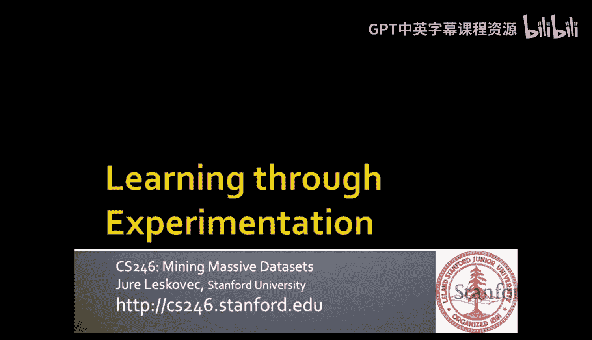

Different problems。 So let's conduct， first of all， with web advertising。

 So what we discussed on Thursday on Tuesday was basically how to match advertisers to queries in real time。

 Okay， so we wanted to find the best possible ads relevant for a specific user。

 But what we did not discuss there was how do we estimate the click to rate。

 So how do we figure out how often a certain user is gonna click on that ad。And。😊，Similarly， here。

 we are coming， we are going back a few weeks。 We also talk about recommendation engines。

 And then when we were talking about， you know， how to build them。

 we also highlightedlighted this big issue of the cost star problem。 So the， as a reminder。

 the cost star problem is this。I basicallyically， whenever you have new items on your system or new users joining your platform。

 you have very scarce information about that item。 So how do you recommend it。

 That's why it's called Colstar， because you have no data about that that items？

 So how can you match it to the best possible user in your platform， Okay， so your Netflix。

 have a new series， a new movie， How are you gonna recommend it， Okay。

 so and we're gonna be basically drawing a link between these two different problems。 The reason is。

 if you think about web advertising， there are a lot of new ads you know。

 going on Google on on a daily basis。 So how do they match those ads to the best possible users in in their platform。

 Okay。😊，So the goal to this is， how do we run experiments together as quickly as possible information about ads or items that will then allow us to perform the best possible recommendations。

 okay。😊，And the idea is whenever an ad is shown or a product is recommended。

 we can gather more data about that item。 And the reason is both when there are clicks。

 So but when the user shows some interest for that item。 But also when the item or the ad is ignored。

 we do gather some information。 Okay， so like you're on Google。

 you have this set of ads on the right。 And if you're consistently ignoring then。

 then Google gets a signal that probably those ads are not relevant or theyre not interesting。 Okay。

 conversely， if you click through them， then Google gets， again。

 this signal that will boost them up in their own rankings。 okay。😊，So as you as you can。

 the intuition here is that every time these platforms are running live rather than consider them as a you know static system。

 you can imagine them as a run always running experiment basically okay so every time there is user interaction。

 you can leverage this interaction as a running experiment。

 gather useful information and then make decisions based on that， okay。😊。

So let's go to the web advertising example that we've seen on Tuesday。

 and let's try to make it a bit more advanced。 Okay， so your company， your Google。

 you are one of the many companies here in the valley that are sustained through ads。

 What is your goal is to maximize revenues， Right， So you want to show as many ads possible。

 You want to make sure that people click to them， convert， become users。

 pay subscriptions and so forth。 Okay， so the old way to deal with advertisement was to paying by impression。

 Okay， the old CPM style and paying by impression means that everything you're showing an a on your platform。

 you're gonna be asking money。😊，From the person who's buying those ads。 And keep in mind that this。

 you know， this paradigm is not only coming from the web board。 You know。

 this is a much older paradigm。 The fact that you're paying by impression。

 If you think about the newspapers working that way， billboards working that way。

 the larger is the billboard that you buy。 you know。

 in on the101 or in a on a big building than you will be paying more money because the impression is。

 you know， is more lasting because people can see it much easier。And。In that case。

 what is the best strategy for the， you know， for the person who provides the ads is just going with the highest bidder。

 Okay， so if if you have multiple entities that are willing to pay you a certain amount of money for。

 for your space， let's say on a billboard， then you're just gonna be accepting the person who's willing to pay the most。

 Okay， that's how you maximize your revenues。The reason why that， you know， this parking was not。

As being revolutionized by the Web， is the fact that it's very hard to assess with the effectiveness of those ads。

 You know， you just know that they are on the newspaper that are shown on the  one on one。

 But you don't know how many people are gonna be paying attention to them， okay。

So the new way or the Web way that revolutionize the advertisement industry is to pay per click。

 Okay， so our CPC。 and they are the best strategy to maximize your revenue is to basically being able to compute with is the expected revenue and your expected revenue is basically a function of not only the ad。

 but also the query that is going be performed by the user on your platform。 Okay。

 so we want to estimate how often those ads are gonna be clicked on。 Alright。

 so basically our estimated revenue， as we said， is probability of。😊。

Clicking on an a conditional specific query times the amount that the company is willing to pay for that ad。

 okay and。The problem with this very simple equation is the fact that our right side。

 the amount is known。 Okay， so the bid amount for node A given the query Q is known because we are bidding for that。

 right。Conversely， this probability here is unknown。

 So the probability that user will be clicking on a specific ad is is unknown。 We don't know。

 we have basically to test it over time。 Okay， and the idea here is， as we were saying before。

 we're gonna be showing this ad。 and then we're gonna be logging all the user actions。

 and we're gonna be able to figure out what is the conditional probability here。 Okay。

 so this is the core of what we're gonna be talking about today。

 And just to give an idea of how big this industry is， I was checking。😊。

An article before coming here to give this lecture just， you know， to give a reasonable number。

 And we are talking about roughly $1。2 trillion。 Okay， so that's there's a gigantic interest here。

 And you can imagine that every optimization that you can do here for maximizing your revenues。

 If you're a company based on ads means that you're splitting a very large pie。 Okay。

 so that's why there are many people working on this problem on a daily basis。😊。

Now without the other applications， let's not talk only about ads because everyone does that in the valley。

 let's see also where these kind of techniques we're going to be talking about today can be applied。

 First example is you can apply them on clinical trials。 So the idea is that in a clinical trial。

 what you do is you try to investigate what the effects or different treatments。

 And at the same time you also want to minimize the adverse effects on the patients right so you're testing new medications。

 you're testing new surgery techniques， you want to make sure that you have both a treatment and control group。

 but at the same time you don't want to have adverse effect on the people that are receiving those treatment。

 totally different example， but still applies very well is if you think about the networking word。

 the networking word。 So for instance， the internet that goes all around the globe。

 the idea there is that it's a best step for the architecture。

 there are no fixed routing schemes the packet routing is not。😊，Deterministic。

 So what we do every time you know， you send a packet online is there is an adaptive routing going on。

 Okay， so every time you know， an network connection falls， packet has to be routed and so forth。

 So the idea there is that you want to minimize the delay in the network by investigating different routes。

 You don't want to have a fixed route that goes from point A to point B。 Okay。

 you always want to keep trying testing other possible routes in case something happens or simply if a route becomes faster。

 you want to find it out over time。 Okay， so this is an example based on networking。

 thats but not the least。You can think about asset pricing。

 which is usually a very big problem for every startup， you know。

 every new company appearing on pretty much every different kind of market。

 So how do you figure out your product price。 Okay。

 once you know the cost on how much cost you have for making a certain item， you know， in your。

 in your catalog， How do you how you price that product in the right way。 Okay， so you。

 you wanna basically test it， you want to test different price points。 And then eventually， again。

 what you want to do is you want to try to maximize your revenue。

 So you want to make the most possible money， right。So no。

 rather than running your product at a specific pricing point for three months and then making a decision if you should increase it or lower rate。

 you wna be testing different， different pricing points at the same time and figuring out which one sells the most and which one sells the least。

 okay。How do we attack this problem。So today， we're gonna be talking about bandits。

 not comic book bandits， but rather the mattyar bandit。 So we went from bandit to octopus。

 But the idea here is that so we have these very good octopus playing slot machines in Vegasas and。😊。

As any person who is addicted on gambling， Artopus is playing multiple slot machines at the same time。

 and the reason why this whole set techniques is called Ben this is because we all know that gambling in general robs money from people right So what we're going to be trying to do today is to minimize how much money this gambling is going to be robbing from us okay。

😊，So what is the setting of the K arm bandit。 How does it work？ So we have our slot machine。

 And the only variation is the fact that rather than having just one arm is gonna be having multiple people arms。

 Okay， or you can think about this person in bes with squats， you know。

 between five different slot machines。 And they try to use all of them at the same time。

 Okay so let's say you have5 slot machines。 and you want to use all of them at the same time。

 And how do we characterize our harm。 So each harm as could even win， So it gives you one coin。

 a reward one。 And this comes with a fixed but unknown probability。

 which we're gonna be calling mu a， or it can lose。 So it gives you zero coins。 word 0。 Again。

 this is a fixed unknown probability。 And clearly is the reciprocal is1 minus Mo A。😊。

And another important assumption is that all our draws are independent。 Okay。

 so basically to each harm， we can assign a different win probability， okay。The problem here is。

 how do we pull our harms to maximize the total reward， Okay， now。

 start to think about the mapping between how ads work and how we are defining this problem。 Okay。

 so how do we map it。 Basically， each query is a bandit。

 So each query is a different set of slot machines that you are playing with。

 And then each ad is an arm。 so what we're doing here is you get you。

 you send a query to the system and the system returns as slot machine and this slot machine can show different ads。

 Okay， and pulling an arm and getting a reward means that the user has clicked on that ad。 Okay。

 so that's how you map the web advertising word to the multihar bandit problem。😊。

So what we wna do is to estimate the R's probability of winning。 Okay， how move8， which， again。

 in the context of。The ads can be seen as the click to rate， okay。

And the intuition here is that every time we pull an arm， we do an experiment。 Okay。

 so we are not only logging if the user clicked or not with a had。

 but we're also using all this information to basically make our system more aware of which adss are likegged by people and which adss are ignored by people。

 And then based on this， we're gonna be slowly optimizing our strategy or what are the ads that we show and what are the ads that we eventually eyed。

 okay。Perfect， so let's formalize the setting， okay。So this is called this stochastic Kr and bandit。

The setting is the following， so k will be throughout the whole lecture。

 our number of arms so we have basically k choicess and each choice a is associated with an unknown probability distribution that basically goes from0 to 1 okay and we are going to be playing the game for t round so t is our time variable okay。

😊，And at each round T， we do the following， we decide to pick an army。

And then we obtain a random sample x sub T from our probability distribution。 Okay， and once again。

 let's remind each other that the rewards are independent of the previous rows， okay。

I cannot tell you for sure if this applies to slot machines。

 I think these details are from Vegass and we are not allowed to know。 But in Java for our setting。

 every time you're clicking or not on an ad， we， we take into account the fact that it's independent on what has been shown before to the user。

 okay。😊，And simply， basically， we want to maximize the sum over the possible rewards over the time P that we are running the experiments。

 okay。What is missing here。 We still don't know our mu of A， right？

 We don't know what is the win rate of the specific arm that we picked。 Okay。

 but now every time we're pulling the arm hay， we get to learn a bit more about Mi of A， Okay。

 so basically。Here is what were discussing before we the costar problem。

 As soon as you're given these new set of z machines。

 you don't know anything about each one of the arms。 Okay。

 so we're in front of the standard class in front of the classic coar problem。

 But then as soon as we start to pull the arm。 Then we start to gather some information。 Basically。

 what we're doing is the more we pull the arm， the more we are estimating what is the probability distribution for that harm。

 Okay， and eventually this will converge into our value mu of a that we are interested about。

 So let's go through to an example， okay。😊，So this is over time， as you can see here。

 this is our choice of arms。 So we have K arms in total。 and these are all the outcomes。 Okay。

 so you start with one machine number  two， then you jump to K， then you see， okay。

 number two has give me as giving me a rewards。 I'm gonna try once again。 you get a0。

 you jump to one and you get couple of rewards and you go forward。 Okay， so。😊，Basically。

 what we are doing is this is an optimization algorithm。

 but it's online because we don't have all the input at a given time T and we can analyze it。

 We actually have to analyze it at each single step。 Alright。

 So like any other online algorithm that we've seen also in the in the past week we have to make a choice each time。

 So each time we have more information about the system。

 Therefore we can make a more informed choice。 and。😊。

The shortcoming here is that we're receiving information about only the shows in action。

 So whenever I'm picking， you know， a 2， I'm not gathering additional information about a 1。

 So my probability， the estimate of my probability distribution for a 1 isn' unchanged。 Okay。

 so basically。We're gonna be talking about this exploitation versus exploration trade off。 Allright。

 so the idea that if you trust a2 and you keep on drawing that harm because in order that it gives you more rewards。

 you will not be exploring the potential of the other arms。Question， does the query or。The。

 the the includes an arm。So the query is， the query is your， is your setting。

 The query gives you this table。 Okay， and then these are all the different ads that you can be showing for that query。

 each query have a Each query will have a different table exactly。

 So that's why it's multi arm bandit。 And if you make it bandit。

 then you get your whole experiment on the system， okay。

 query different what we're gonna be seeing today。 No， every query is a separate entity。

 there is additional literature that shows that， you know。

 when two queries are semantically close to each other。

 then you can you know gather some information from the table and transfer it to the other one。

 But we're not gonna be able to over that today。 Yes， very good question， thanks。😊，And what's。

Where are the X Oh， X is the outcome。So a time 1， basically the A2 gave you a reward 0。

 So didn't give it a coin。 Time 3， it gave it a coin， okay。Perfect。

 and it's a binary matrix because we are just keeping into account and click through rate now。

 So the， the options are just to click or not click， okay。Thanks。Okay。

 so how do we solve our bandwidthit problem， Basically， what we are looking for is。

 is a strategy that generations will tell me which harm to pull。 Okay。

 and our policy hopefully will depend on the three of the rewards， right so。

For those of you who are taking reinforcement learning courses or are gonna to do them。

 This is basically a reinforcement learning problem。 Okay。

 we we we have an agent and we're trying to learn a policy for that agent。

 So I'm trying to draw a parallel between these two fields， okay and。

So how do we quantify the performance of the algorithm， Basically。

 we're gonna be computing a quantity that we call regret。 And intuitively。

 the regret is if you know that there is one arm of the slot machine that gives you consistently more money。

 you should be always using that harm， right， now， this is based on the assumption that we knew all the probability distribution。

 we don't。 So we are gonna be trying to estimate them as fast as possible。

 such that we minimize our regret。 Okay， so we minimize how much money we are losing in this experiment。

So how do we compute our regret。 Let's make it more formal。 Okay。

 so our mu of a is basically the mean of the probability distribution。

 So we take all the possible outcomes， and then we take we take the mean and the reward of our best arm is our mu star。

 which is nothing but the max among all the possible mu parameters。

 Okay so we're gonna be picking the max1 there。 and then we pull different arms until time T and at each time step we can compute with these theseaneous regret。

 Okay so thisous regret at time T is nothing but the difference between the best possible outcome that we get from mu star。

 So our max minus the mu of a， So the arm that depict at time T。

 and how do we compute the total regret。 You just do a sum over all the time steps that we are taking into account in our experiment。

 okay。😊。

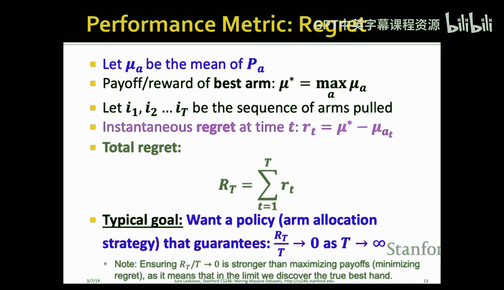

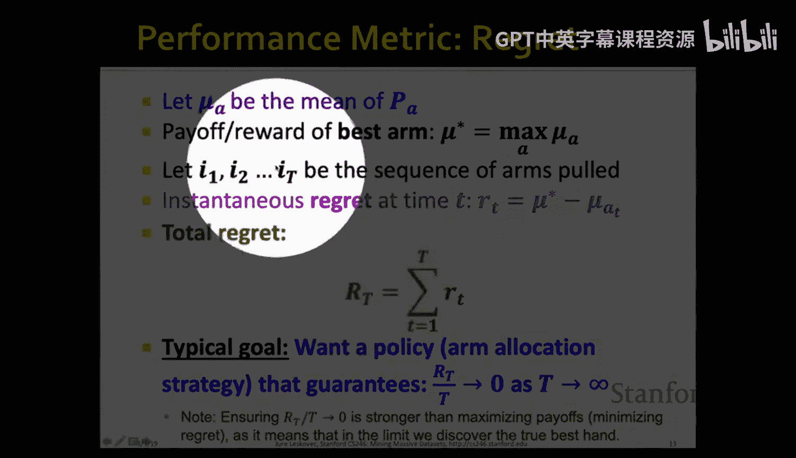

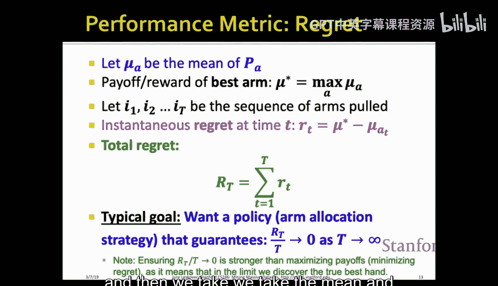

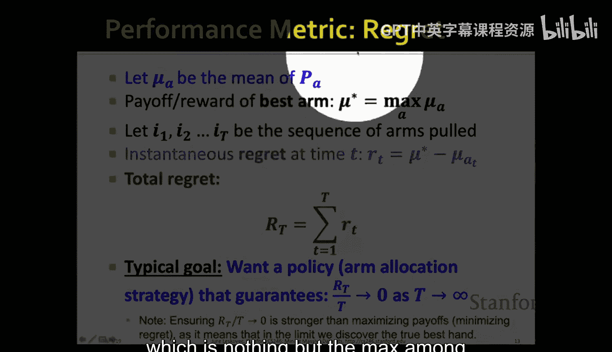

So the goal， what we're gonna be trying to solve today is we want to find a policy。

 which is not you know a normal location strategy。 So picking which arm you want to pull that guarantees that S T。

As time goes to infinite， how a regret is going to 0。 So we wna make sure that the， the。

 the division between the， the， the， the， the total regret divided by the length of your experiment goes to 0。

 And here it's interesting to know that this kind of。

Let's say the the kind of minimization that we're trying to do is stricter compared to what we talked about before。

 So we're， we're not just trying to maximize the revenue or minimizing the regret。 But actually were。

 we're trying to find what is the best hand， What is the best possible strategy because we're making this quantity go to 0。

 Okay， so basically over time。 eventually， the regret will be so small and it will be paid just at the beginning that it dilutes over the whole duration of the experiment。

 And then this quantity goes to 0。 Okay， so we're actually solving。

A stricter problem than just trying to minimize the regret。So。😊，If he knew。

All the payoffs or our arms。 The strategy will be trivial， right， We will be picking always the max。

 Okay， we will always be picking the the best mu among all the possible arms。 Now。

 what if we only said care about estimating the the payoffs Okay， because actually。

 at the very beginning when we just kickstar the system。 That's the only thing we can afford to do。

 We don't know all the mu。 So we want to estimate them。

 So what we do is we pick each of the K arms equally often。 So basically we。

 we do around robin during the over the duration of the experiment。

 So we give it T divided by K number of pools。 And how do we compute our estimate。😊。

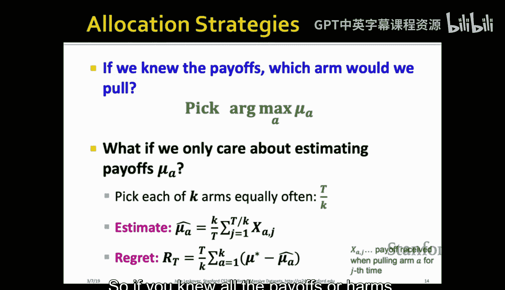

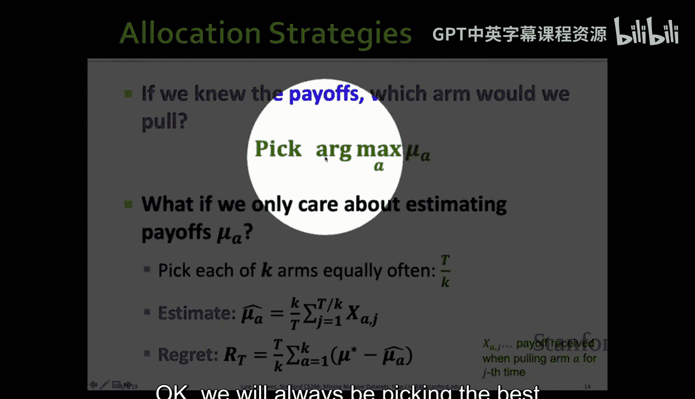

So it's nothing but the average over all the returns that we get。 Okay， so this is。

 this is the variable that encodes our coin return。 If we win， it's a one， if we lose it at 0。 Okay。

 so we just take the average over them。 And conversely。

 the regret is gonna be computed once again as a sum over all the possible arms。 And here again。

 we're gonna be using the difference between the best possible strategy。

 our must star minus the estimate for our arm。😊，Okay。

So these are the two main quantities that we're gonna be dealing with。

Let's try then to solve this problem。 Okay， so let's go with the， with the first technique。

So we said that the regret is defined in terms of the average reward。

 so if we can estimate the average reward， then we can also minimize the regret right。

 these two quantities are connected and the first algorithm that can come to your mind is a greedy algorithm。

 Okay， so what you do is you always take the action with the highest average reward。So let's。

 let's go to an example。 Let's think about it。 Okay， so we make it easy。 We make K equal 2。

 So we have two different actions。 And we know that the action 1 reward  one with probability 0。

3 and action 2 has reward 1 with probability 0。7。 Okay。

 so arm 2 appears to be strictly better than arm 1， right。😊，Now， let's see what happens。

 You play a1 and you get a reward of one。You play a2 instead and you get a reward of0。

 What do you think happens here。Yep。update your probability estimates。

 So you give a one more weight and H U less weight。 Exactly perfect。 Great answer。 So you。

 after you played。A1 and E2， you're gonna be updating your estimates。

 and it turns out that your estimate for a 1 will be equal to1。

 your estimate for a 2 will be equal to 0。 So we reached a standpoint where the the average reward of a1 will never drop to 0 while the and therefore。

 you will never be playing action a 2 again。 So this is a pathological example。 It's。

 it's a very small one。 but。😊，It highlights one of the comings of the greed algorithm that it can basically converge into a solution that is not optimal。

 okay。So。And this is not uncommon in decision making。It's it's a very classic problem。

 And as I was mentioning before， whenever you're making a decision。

 you want to be finding a tradeoff between the exploration part when you're gathering data about the R payoffs and the exploitation。

 which is making decision based on the data that you already gathered question which are we excited to choose're doing。

😊。

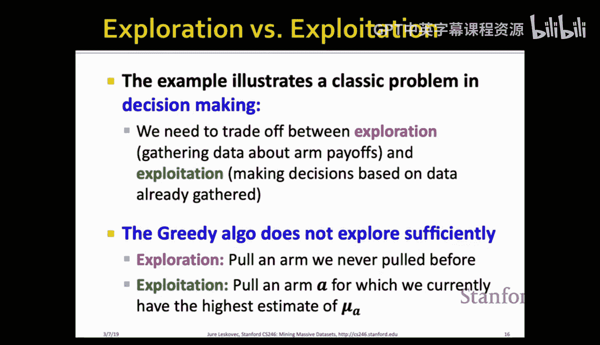

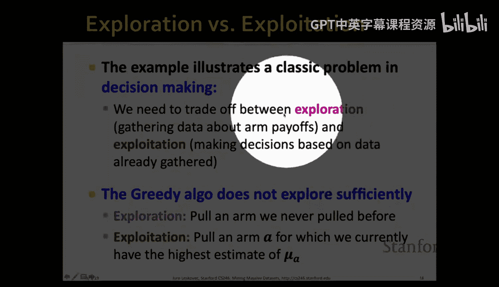

In the example that we saw before at the beginning， you basically draw each one of them。

I'm saying Oh， we're going to be seeing different techniques today and some of them is deterministic and some of them is not。

 yeah。Perfect。Okay， so now we know that we have this trade off。

 And the problem with they algorithm is that we went very quickly from the exploration phase where we pulled to the arm 1 and and arm 2 to the exploitation 1。

 because then we got stuck who is using a one。 even though we know that。😊，Eventually。

 the return will be lower because the probability was lower。 Okay。

 so the issue with the grid algorithm， therefore， is that it does not explore sufficiently the， the。

 the space， okay。And to make it more realistic， basically。

 the exploration is whenever you pull an arm that you never pull before。

 And the exploitation is that when you keep on pulling arm A。

 that is currently the higher highest estimate for mu of8。 Okay， so once you're know in your system。

 there is one arm with that as the highest possible payoff， you keep on playing pulling that arm。

 okay。Alright， so now that we alled what is the problem with greedy。

 let's try to jump to something that can overcome getting stuck in a local sub in。

 in a local minimum right away。😊，So the idea here is working on a variation of the grid algorithm that is called the epsilon gridity。

And the variation works in the following way。 So we're still running our experiment capital T number of steps。

 But what we add to the question is our parameter epsilon that depends on T。

 and our T is our epsilon of T is in the order of one divided by the time， okay。

 so the interesting aspect about the parameter is that it decays over time。

 It becomes smaller and is smaller。 the longer the duration of the experiment。

 So what we do in this variation is that we probability epsilon of T。

 we explore by by peak an arm shows and reform me at random。 Okay。

 so this answer question is basically a stochastic draw among all the different arms that you have available。

 conversely with probability1 minus epsilon of T。 we keep on exploiting by picking the harm that is the highest possible reward。

 okay。😊，Now。In this paper， know， there is a theoryem that proves that if you choose absilin of T in a suitable way in the right way。

 then。This nice nice property holds。 So our， our totally regret with the right choice of ebsin of T is in the order of k log t。

 So if we try to compute， you know， you remember that we were trying to bring this quantity to 0。

 right？ So our total regret divided by the duration of the experiment。

 and if we substitute this quantity。 So we do basically it's in the order of k log t divided by t。

 then we know that this limit goes to 0 because log t divided by t goes to 0。 Okay， so we。

 we solve our minimization problem in this way。Not so fast。 Okay， so now I'm gonna show you why。

 in reality， this approach is not used all the time， so。

What are some of the issues with our epsilom greedy algorithm， The first one is， is not very elegant。

 Basically， what it does is it it interleaves。And these joint phases。

 and one of them is about exploration， and the other one is about exploitation。 Okay。

 so there are some phases where it's just exploring different options， as we said before。

 is basically picking different arms stochically uniformly at random。

 And then in the other phase is just exploding and always betting on the arm that gives the best possible reward。

 But apart from that， there is a more important， fundamental problem。

 which is even the exploration phase can makes a boal choices。 Okay。

 since is basically picking any arm equally likely。 Why do you think。😊，This is a problem。Okay。

Think about it for a second。Anyone wants to give a right？

So why the fact that it's speaking the arms in the exploration phase randomly is suboptimal。一。

If you stick one arm and every if you've drawn from one arm 100 times already and every time it's been zero。

 you probably don't want to continue trying to explore that one perfectect， Okay。

 great answer I'm going to justra you basically。The answer is。

 if you have already information about an arm。 If you already know that an arm has an estimate that is very low。

 Why would you keep on， you know， using that in your exploration phase。

 The problem here with the apstilent greed is that your exploration phase is not informed。

 All the you know， different draws of the arms that we gather before time T are basically ignored。

 Okay， so we can do better。 The apsilinon greed doesn't face the issue of getting stuck like the standard greed algorithm。

 but we know that by ignoring that information， there is something else that we can leverage in order to get even better performance。

 Okay， So that is exploring Exper and exploitding need to compare the estimate outcomes of the different arms。

 so how do we how do we compare the arms。 Okay so let's go with this very simple example now instead of two。

 we have just three arms and。For some of them， we have quite a lot of values。 Okay， so for arm 1。

 we know that five times out of 10， we get a we get a positive co for arm 2。

 we just have one instance， but we know that it was a positive one。 And then for arm 3。

 we know that we get， we get a con  eight times out of 10。😊，Which harm would you pick next？

And how would you make your choice。Anyone wants this right？

So the the the key aspect here to consider is the denominator of these quantities。

 The fact that for some arms， we have quite a lot of data points。 But for arm 2。

 we have just one data point。 So if we do our payoff estimate， arm 2 will be the winning option。

 right， because it's one over one。 So ideally， we will keep on exploitloding arm 2。 But in reality。

 the confidence attached to this value is very low because we only did one row， right。

 And we have a much better confidence about the estimates instead for arm 1 and arm 3。

 So this is the key inside that we want to explode。 Okay， so we don't want to just look at the mean。

😊，So the expected payoff。 But we also wantan to take into account the confidence of our expected payoff。

 Okay， so let's try to plug in now the confidence and see how it makes our framework more powerful。😊。

Okay。So how do we， how do we use confidence intervals。 Okay， so confidence interval。

 we can define it basically as a range of values within which we are sure that the mean lies with a certain probability。

 Okay， so if we know that say the mu A， our mean is within 0。2 and 0。

5 and the probability that this happens to be in that interval iss 0。95。

 we are way more confident about the user result than when our confidence values is like 0。5 Okay。

 so that's the。😊，Main inside that we care about right now and。

The if we try to draw that arm less often， then our estimate will be less accurate。 And therefore。

 the confidence interval will be much larger。 Okay， so the intuition here is。

If you didn't pull the arm very often， then。Even if the estimate is very low。

 there is still potential in that harm。 You don't know if eventually it's going to be giving you a higher payoff。

 Okay， while conversely， the more information together about an arm， the more the interval we shrink。

 Okay， so after many rounds， you will start to， you know。

 be confident about the probability distribution assigned to that harm， okay。

So how do we use this information to get better results okay？

So assume that we we know our confidence intervals And what you can try to do is the following basically。

 So instead of trying the action with the highest mean。 So this is what we were doing before。

 we estimated our mu values for each arm。 And then in the exploitation phase。

 we were going with the arm that has the highest mu value。

 What we do here is that we tried the action with the highest upper bound on its confidence interval。

 Okay， so。😊，Say our。Me is easier。 So let's use our usual box plots。 It's not really a box。Okay。We。

 you don't care only about the the mean。 You care about the upper bound。 Okay。

 and the reason is basically， we try to be optimistic。 We say if we do more draws from that arm。

 and it turns out that in reality， the the mean will slowly drift towards the upper bound。

 that there is more potential for that arm。 So it should be exploded more。 Okay。

 so that's the intuition behind。Working with a confidence interval rather than just with the estimates。

And this is called an optimistic policy。 Okay，'s often used in the context of greedy algorithms as well。

 And basically， it's， it's based on the belief that every action is gonna be as good as possible。

 given the available evidence， al right。Let's try to see this with numbers and with a better drawing at whatever have on the board。

 Okay， so now we have some plots。 and alright， so we start for here。 Okay， this is。

 this is the different distribution just for， for R A， okay， so。😊。

One distribution will be the following。 This is the medium。

 and these are the bounds of our confidence interval。 And then we know that we you know 99。

99% confidence interval， the upper bound of the blue bar is much higher。

 So rather than always going with the red one because it's the one with the highest average reward we're gonna be going with the blue1 Okay and now after we do more exploration。

 it turns out that the confidence interval of the blue bar shrinks。

 Okay so we gather more information about this arm and and it turns out that we were too optimistic So the average moves。

 but not that much。 okay and now we can go back to to the red arm because we know that the upper bound is the highest okay。

😊，So in this way， as you can see， we keep on gathering information。

 We keep on doing exploration until the confidence intervalts are shrinking。

 and then eventually we have enough data for each single arm to make an informed decision of which one is the best。

 okay。😊，So to translate these into ads， if you just have a new ad that arrive on your system。

 you show it only for one day and it's not getting you know plenty of clicks。

 you don't give up right away you keep on showing it。

 you keep on getting data and then after you have a good estimate of what is the click to rate for the a。

 then you decide if you should be the one that is showed most often or not okay otherwise if you don't do these data ads will will tend to disappear right away because there are some of them which are always used which are already clicked by people question。

To do some kind of like a vision approach where you have a a fire and then you're updating your beliefs perfect。

Great question。 So the question is， how does this compare to a Bayesian approach What we're going be seeing at the end of the lecture is we' are going to be talking about Thompson sampling I not going to explain in terms of know Bayesian approach but you will see the parallel very easily so there are basically different ways in which you can perform sampling over the data and one of them will be exactly to assign prior to to the different probabilities and then the more draws you make the more updates you make and then your sampling will be more informed yeah。

😊，Great question， thanks。Okay， now how do we calculate our confidence bounds， okay。

So here is the deal。 We have our variable y of a1 to A M are the payoffs of our arm A in the first M trials。

 Okay， so the duration of the trials is of M steps in total。

 and our y variable are random variables that can take values。😊，Between 0 and1。

 So our the mean payoff for arm A is our mu of a as we as we've seen before。

 and how do we compute the estimate once again is nothing but the average over the sum over the possible returns over the positive returns that we're having during the m trials。

 okay so what we want to do is that we want to find B。

 B is our bound such that with high probability， the difference between the mu of a。

 the real one and the estimate is less than the bound and we want our bound to be as small as possible right。

 because we want our estimate to be as reliable as possible。😊，Okay。

 so the goal is basically to find what is the probability that。

This difference is less than our quantity B， so our bound B。

How do we do this So there is a very elegant result in probability theory called the often of things inequality and what this inequality provides to us is basically an upper bound on the probability that the average deviates from the expected value by more than a certain amount so it's exactly what we need what we are seeing before。

 We have the expected value of mu and we have the average that we are computing after M trials。

 We want to know how much these two quantities are deviating from each other okay。😊，So once again。

 in the ideal word， we will know what is the value of mua be hat， because。

 it means that we knew already what was the estimate， but we don't know it。

 So we have to estimate it by running multiple trials And we want to find out what is the difference between the actual value and the one that we're estimating。

 okay。So the trick here is the following。 We take this inequality。

 which is expressed in the following way。 So this is the probability that we were talking about before。

 The fact that the， the difference between the the。

 the real one and the expected is larger than our bound。

 And we know that this probability is gonna be less than two times yet the。

It elevated to minus2 B to the power of 2 M。 Okay， and we can call this Dlta。

 which is gonna be our confidence value， okay。So how do we go from this inequality。

 The oftening is inequality into something actionable that， you know。

 we we can use for our computation。 So what we find is that the confidence interval B。😊。

Which is going to be basically connected to our confidence level。

 So let's say our death is 95% or 99%。 that will turn into a specific value beam。 So what we do is。

We take this quantity。Right here， okay？Which were we wrote here。

 And then we want this quantity to be less or equal than deelta。 Okay。

 then we just use standard log in properties。 We move this on the other side。

 So we got two stays there， then。We bring the exponent on this side。

 and then the now we want to extract what is the value of B。

 So we're gonna be bringing the two on the other side。

 we're gonna be applying the square root so that we get B， the sign of the inequality。

 the direction of the inequality changes。 And then we get this final result of basically B is to be larger recall than the logarithm of two divided by deta。

Divided by two times M。 And the interesting insight about this this quantity is the following。

 So as you can see， the， the longer is the number of trials， the， the。

 the longer the experiment runs。 Remember， M is our number of trials that we saw from before。 Okay。

 first time trials。😊，The bigger is this quantity。 the smaller our bound will be。 Okay， so that's。

 that's what we were saying before。 The more drugss we do from a specific harm。

 the the higher is the confidence that we have about it。Estimate for that probability。 And similarly。

 the bigger is the is the confidence is the confidence level that we have。

 So the bigger is our depth， the quantity for data， the smaller will be our B。 Okay。

 so the more we want our confidence level to be high， the more our bound to be strict。 Okay。

 so that we have our mu and our expected mu to be as close as possible to each other。😊，Okay。

 questions are until long。Perfect， let's go forward。So。Now that we figured out how to apply it。

 So once again， is our quantity。 B is our upper bound。

 Hem is the number of times we play that action。 So we do we did a math before to extract B。

 So what we can do is that we can set B to be equal to this quantity。 Okay。

 So it will be equal to square root of two times log of t divided by he。 once again。

 hem is the number of trials that we do on that specific R。 So if we do that。

 then we're gonna be obtaining the following quantity。

 So our probability that our two mus are within this specific bound is gonna be less or equal than two times T to the power of-4 and。

😊。

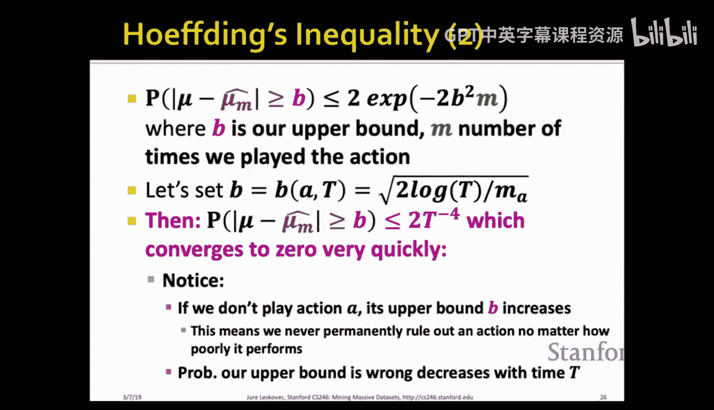

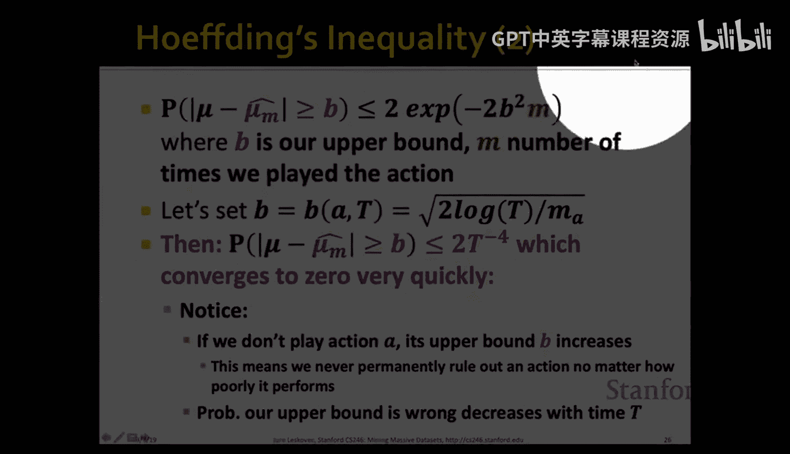

The interesting factor and the interesting fact about extract these quantity is that。

 as you can imagine， it converges to 0 very quickly as time goes。 Okay， so time passes by。

 and very quickly， this bound will go very close to 0。😊，Now， what is the catch here。

 If we don't play the action A。 So if we don't， if we basically forget that arm of this lot machine。

 or if we stop showing a specific cut for a long amount of time。

 then our up and our upper bound B will increase， okay。

And so it means that in this with this strategy， we never permanently rule out a specific option。

 Okay， so a certain arm of our slot machine will just not disappear completely from our experiment。

 we're gonna keep on pulling it every now and then to see if we can further update the estimate。

 and conversely the probability the upper bound is wrong is is decreasing with time P。

 So the more the experiment runs， the more time we pull the the arm。

 and the this smaller is gonna be our bound。 So the more confidence we're gonna be having about the probability distribution for that specific arm。

 Okay， so if you want to convince ourselves about these two results。😊。

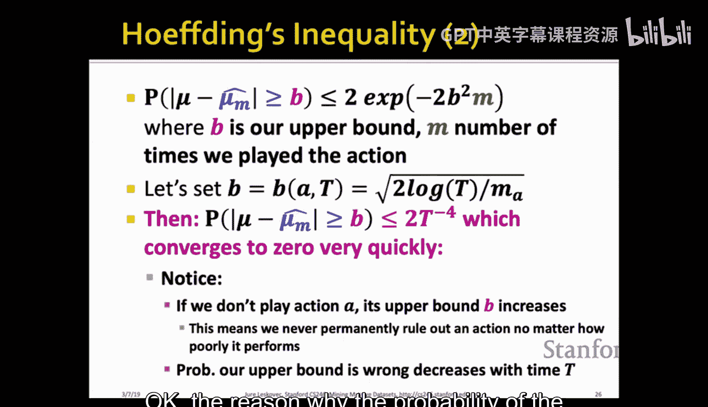

Okay， the reason why the probability of the upper bound decreases with time T。 We have seen it。

 We have seen it here。 Okay， so it's two logs，2 two times log T。

 And this is divided by the number of trials， so。

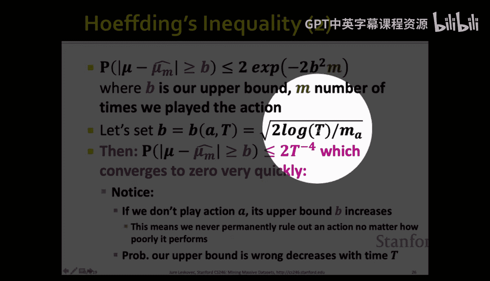

If the number of trials goes down with time， basically， this quantity is just increasing。 Okay。

 time passes by you， we don't keep on testing that specific harm。 Okay。

 so the number of trials stays constant。 then our bound is increasing。 Okay， conversely。

 if you do more trials， this quantity is gonna be growing and our bound is gonna be decreasing。 Okay。

 so that's the intuition behind that。Now， why。Apart from the fact that this gives a very elegant solution to the problem。

 it also capture another important aspect。So。Behavior of the users is is not stationary。

 is very is very unrealistic to model users as a stationary probability distribution， right。

 because our taste changes over time， the ads that we care about might be changing after you know two months or the movies that we're watching change。

Depending on the season or on the mood or on the test and so forth。 So what this does。

 it pretty much captures the fact that every entity on the system introduces some kind of randomness。

 Okay， so the idea that a user that was ignoring specific head or even a certain demographic that was ignoring a specific head might be changing their taste over time。

 So that's why we keep on running those tests。 Okay so the bound keeps on increasing if the ad is not shown。

 And eventually， the ad will pop up again on Google。

 and then Google will give it another run and basically test if people are interested or not。 Okay。

 so it also captures basically this interesting characteristic about users。😊。

Now how do we use this concept of confidence bound。

 how do we plug it into our multiarm banded problem to make it even more efficient and this algorithm is called UCB1 and it stay for upper confidence sampling。

 upper confidence bound， the reason why it's called one。

 if you go on the original paper there are multiple variants of this algorithm okay so today we're going to be basically going through the domain one but then if you go to the paper you will see also a bunch of different variations of that okay。

So how do we use it， we， we start by having， you know。

 zero assignment on all the variables of the system。

 So we set to0 our new estimates and the number of trials， okay。😊。

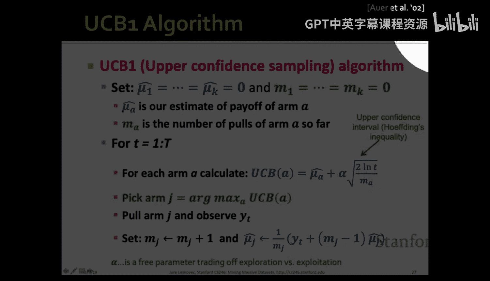

So again， mu a is our estimate of the payoffs for a specific harm A。

 M O is the number of pools that we're doing on that arm。 and we run our experiment for these steps。

 Okay， and for each harm a， what we do is that we calculate our upper bound。

 and the upper bound we calculate in the following way。 So we know the estimate， Okay， the our mu a。

 So we know what after a few trials， we know more or less what is the expected success rate of the arm plus alpha times the upper confidence interval that we computed from before。

 Okay， so all the mat that we have done before basically boils down to this to this term here， okay。

😊。

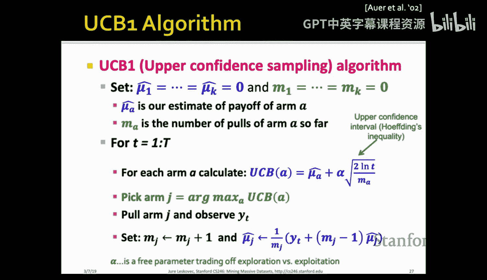

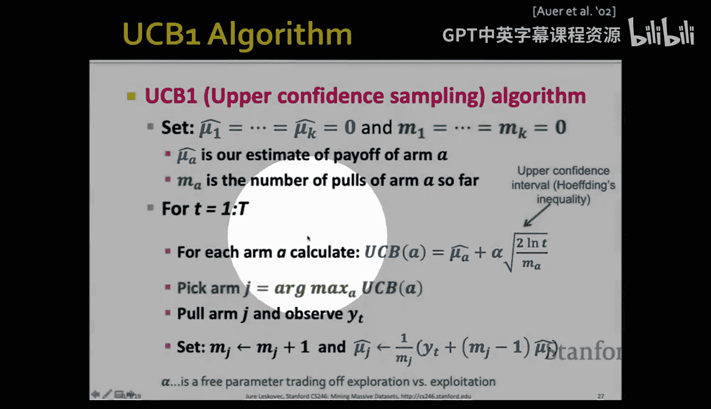

And then our strategy of the UB will be the following。

 We basically pick the arm J that will be the a max among all the possible arms。 Okay。

 and then we pull our arm J。 So the one associated to the I possible return。

 And then we observe our Y of T， which is the actual return。

 And the last step of UB is updating this equation。 So what do we do here。嗯。So we。

 we update our he of J。 Okay， so we do plus one step。

 and then we' are gonna be updating the the estimate for our mu of J。

 And the way in which we do it is the following。 So let's go。

 let's split these equation so that you can follow here on the， on the right side。

 you would see M of J-1 times the。M estimate。 So this gives you basically is just on all the step。

 on all the previous M step， you're taking the， the average and you multiply by all the number of steps。

 And then what you do is you， you， you add the outcome for the last step。 Okay， so our Y of T is the。

😊，Is the observation that we get at time T。 And then once again， we compute the average。 Okay。

 so basically， what we do is every time we have an observation， we are gonna be updating the。

 the move of J estimate for that， for that harm， okay。And。

One last interesting thing to discuss about this algorithm is this alpha parameter。

 So the alpha parameter is basically， it's something that encodes the trade off between exploration and exploitation。

 So if you set alpha to 0。 What do you think happen0。😊，Sorry， there is an exploration， right。

 So you set alpha to0， and then your peak is always based on the average estimates for that specific harm。

 What we actually do when we set alpha to0。 we turn this into the greedy strategy that we've seen at the very beginning。

 right， So we compute our estimates， then we go we pick the best one。

 we updated and we're back to that。 So that's how we can nullify the the contribution of this term。

 Conversely， if we push alpha to a very large value。

 What we do is that we're gonna be doing mostly exploration。 So what happens with actual， you know。

 systems running in production is that the value of alpha is not ared over a month or so。

 there is there is a data scientist and there is a team that is deciding the value of alpha over time。

 Okay， so the more time and goes by。 and once you're happy with your initial exploration phase。

 then you try to go more towards the exploitation part。 So that's why alpha is is a very。😊。

Useful tunenable in this approach。Any questions up to now。Okay。So let's discuss a bit more。

The outcome of UCB。U。

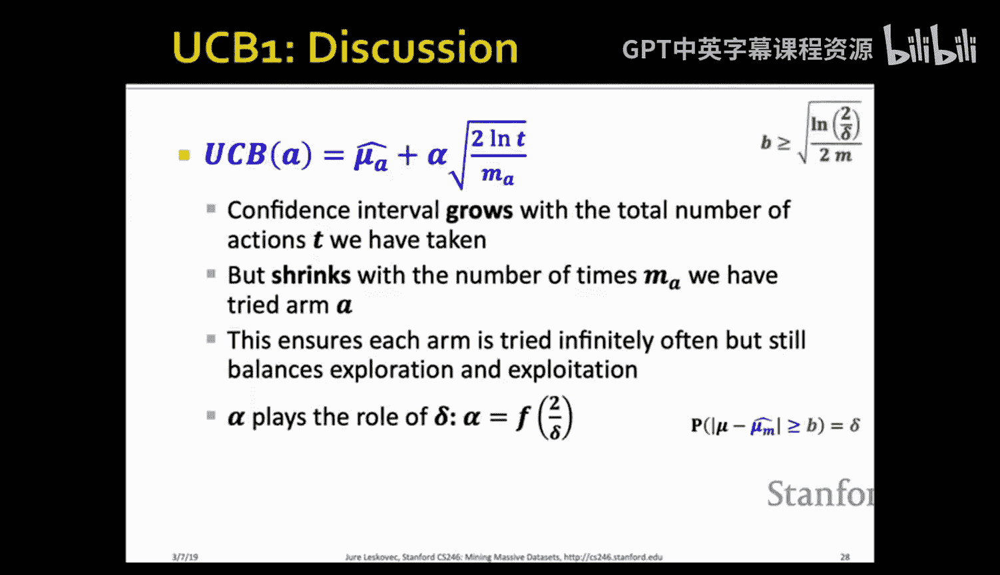

So our confidence interval grows with the total number of actions that we have taken and this we have seen before because our m grows。

 so the bound becomes smaller。😊。

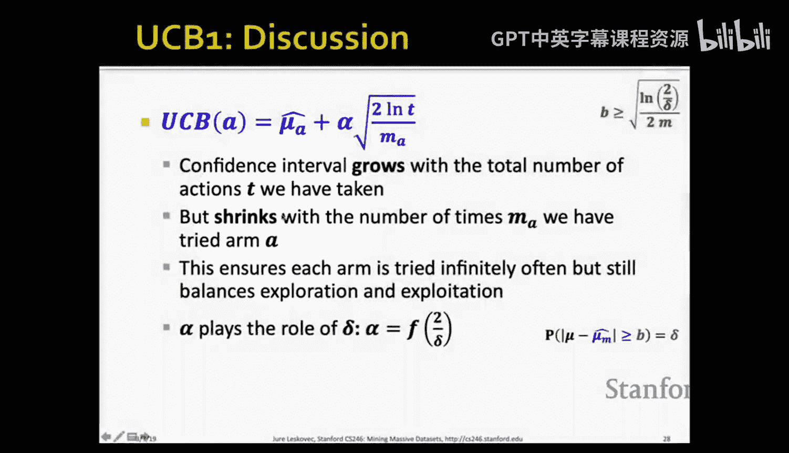

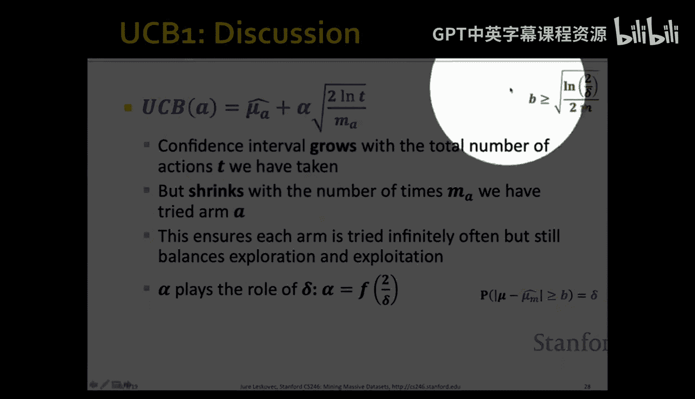

And at the same time is。Basically， this ensures that each harm is going to be tried infinitely often。

 Okay， but it still balances between exploration and exploitation。

 So this is the insight that I was explained to before when when we said。

We don't just ignore an ad or a certain arm of this slot machine forever。

 after we know that the estimate is below certain value。

 So we keep on getting back to that every now and then， okay。

And what our alpha does here it basically plays the role of our confidence interval。

 so if we put alpha to0， what we're saying is we are sure that our estimates are correct and conversely if we make alpha very large。

 then we are saying that we don't trust our estimates and then we keep on doing exploration until we have more information about about each single arm all right。

Okay， so。What we are doing here is basically， it's what we encode is a class of， you know。

 strategies or is also almost a philosophical argument that we are trying to be bringing in optimism in phase of uncertainty。

 So you could be having different kind of strategies， right， You could be way more。

way more conservative and not trying to explore too much。

 But what we do here is basically we believe that we can always obtain extra rewards by reaching unexplored parts of the state's pace。

 okay。Question， just want to double check this is an online learning。Correct， always rely us。Yeah。

 it's so aligned because。Once again， we don't have the estimates。For the muse。

 for the different arms。 So we have to collect it over time。

 And then we're basically learning the values over time。

 And as the parallel was making before with reinforcement learning。

 you have an agent that has zero knowledge at the beginning， the more rounds you play。

 the more knowledge the agent gains and that it can make better choices， okay。Great。Okay。

So I leave to you， you know， going around and check。

 and definitely there are other version of these argument that are not based on complete optimism。

 but they tend to be more conservative， okay。But we like optimism。

 So I'm telling you about the most optimistic algorithm that we could find。

We're not going go through the math of this for this for the sake of time。

 If you go back to the UB paper， they also prove， this interesting inequality。

 And basically what it passes is that if youre trying to。

 to compute the expectation of the total regret that we were talking about before。

 this will be less or equal to the following quantities。 so。

This quantity will be in the order of k of times the logarinm of T。

 So then the the time and the other quantity will be the order of k。 So， sorry， so it。

 it turns out that basically our， the ratio between the total regret and the amount of time we run our experiment is gonna be less recall than k。

Times logm of T divided by T。 Once again， as we said before， this quantity。

 when time goes to infinite goes to 0。So even this， even the U B1 technique。Maches the， the。

 the criterion that we wanted to have at the beginning。 So the fact that we wanted our。A regret。

 To regret to go to 0 over time。 Okay， so it matches exactly the same condition of the greedy of the apsilon greedy and so forth。

Okay， so let's summarize。 and then I'm gonna go and show you some examples coming coming from the real world。

 So we have seen the。

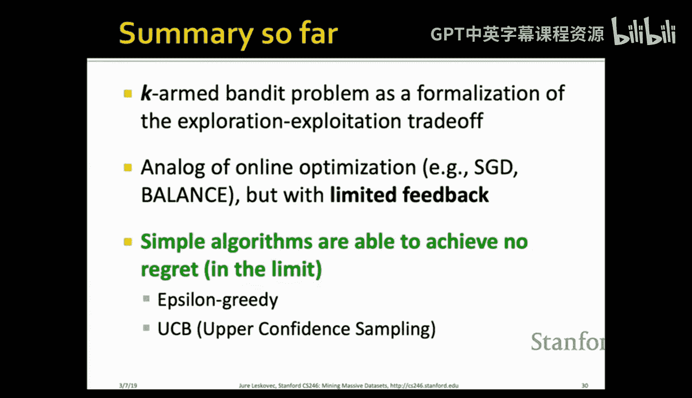

Okay arm bandit problem， which is basically a formalization of the exploration。

 explorationation trade off。 And it's very similar to other online optimizations that we talk about during the course。

 So the stochastic gradient descent balance that we have seen on Tuesday and so forth。

 But it comes with very limited feedback。 like if you think about S GD。

 we have the different components of the gradients， you can compute the derivatives and so forth。

 while here we only have information come from the different rows of the arm。 Okay。

 so we have to do the best possible we can with that limited amount of data。

 And the interesting thing is that we cover a couple of algorithm that even if simple are able to achieve no regret when time goes to infinity。

 okay。😊。

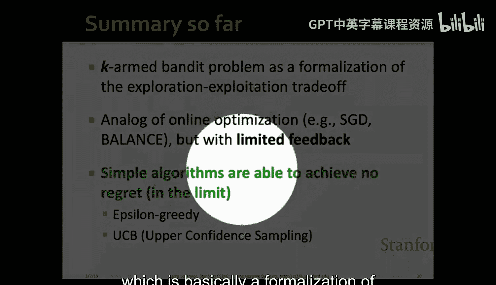

Any questions or we， we jump to the examples question。 it seems like in the limit， we had  zero。

 but what about cases and which。single mistake。D， like medical cases， for example。

 of like pulling the bandit arm is like prescrib medication。Very good question。

 So what happens if we are not in the context of ads where missing a click through is not dramatic。

 but whether we are in a clinical trial and then。Making a big mistake comes to to a larger price。

 So the reason why should clinical trials at the beginning was more to tell you that this set of techniques can be applied to those contexts。

 but really when when the regret is's much higher compared to the ads you're not going be peging exactly this kind of technique out of the box。

 So there are other more conservative ways to do it。 And that's what I was saying before like today。

 I'm showing you the most optimistic version because it applies very well to ads or to recommended systems or Netflix。

 for instance， but then in the。In the case of medical trials。

 you will be doing something much more conservative。Thanks， great question。Anything else or we。

 we jump to the examples。Okay， okay。 so let's go to the example。

 First thing I wanted to show you is the following， like。Many other algorithms in computer science。

 and if you， if you plan to do research in the future or you're already doing that。

 I always suggested to do this。 always try to plot what is the theoretical worst case。

 And in our case， we care about the commulative regret。 that's the quantity we want to minimize。

 versus the real cumulative regret that that you actually get。

 Okay so let's take this example where we have。

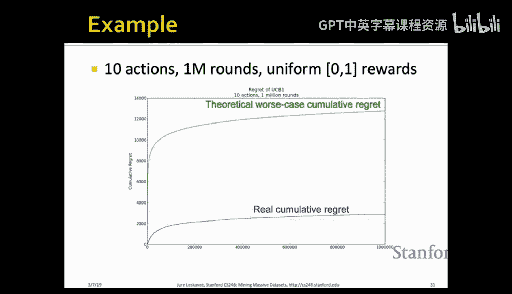

K is equal to 10。 So we have 10 different arms。 We run the simulation for a million rounds。

 and then we have a uniform distribution that gives us rewards of 01。

 so the interesting thing is the upper bound from the theoretical result that we've seen before goes around up to 14000 but in reality the real cumulative regret plates very quickly and it's around 200 so this simulation is just to show that multi arm bed works extremely well and it can give you very little regret and after we have this initial exploration phase。

 it converges very quickly。 and basically this very low lobe that you can see from this parts of the plot is the fact that every now and then we try other harms as we were saying before right so the fact that every now and then we still explore but the price that we're paying for that explorationir is extremely little okay。

😊。

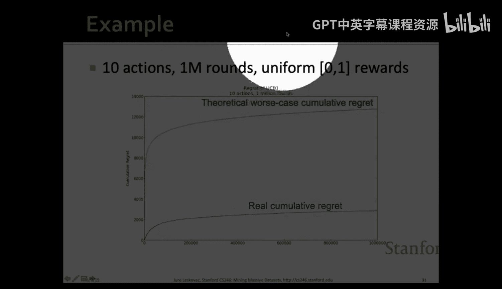

And that's why the cumulative regret over time goes very quickly to 0。So let's see1， one use case。

 And this is more related to the recommender system。 So think about Pinterest。

 So Pinterest is this platform where users are。Are preparing boards where they when they pin different images related on different topics or passions or objects that they have。

 And the problem with Pinterest is the fact that new pins or also the new ads that are showing on the platform。

 they they don't have enough signal about how good they are， especially at the beginning， right。

 So there is a new user that joins creates a new board。

 How do you know that that board is gonna be interesting for， for other people。 Okay。

 and how regular people to to interact with that board or with that with that had。😊。

So this maps very well to the mar band problem that we were seeing。

 So what we want to do is we want to try to maximize the rewards from several unknown slot machines。

 Okay， and our slot machines are basically the the different pins up there and。😊。

We want to decide which ones we want to play and which in which order we want to play them Okay And so each pin is regarded as an arm and the user engagement are considered as rewards。

 Okay and this is a very interesting thing to think about at the end of the day。

 Pinterestries is a company that sustains itself to ads。

 But what is key in this field is the fact that you have a lot of user engagement。

 because you want your platform to grow。 You want to get to more users。

 You want to get user passionate and interested about the content that you are generating。

 So this does not apply only to add what we've seen today。

 it can just be used to study how much your content is creating user retention and is creating know user engagement and traffic and once again here is we want to find a tradeoff between the exploration and exploitation because the risk on this platform would be to always be showing the ads that people are often clicking on。

 So say you。😊，Checking boards about clothing。 Then there are some brands that everyone has bought at least wants in their life。

 and you could be just you know hammering the users always with the same brands。 Okay and sure。

 this is this is a technique that will give you some click to rate。

 but it might trap the system into some local opt。 Okay so that's why you want to make sure that even with the content that you show to the user。

 you always strike a a balance between exploration and exploitation Allright。

So the solution that apply to Pinterest is the following。

 So they apply the standard banded algorithm and what they do is that they observe the the set of A pins and ads that they have on the platform。

 And then based on the payoffs from people try So how many times people clicked or liked certain images。

 then the algorithm will choose a specific harm that will receive。

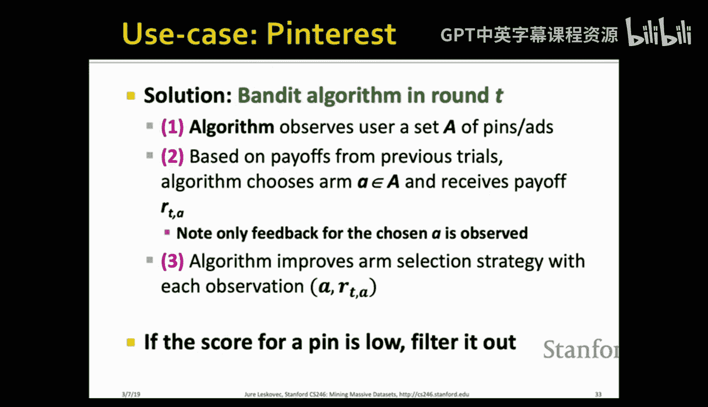

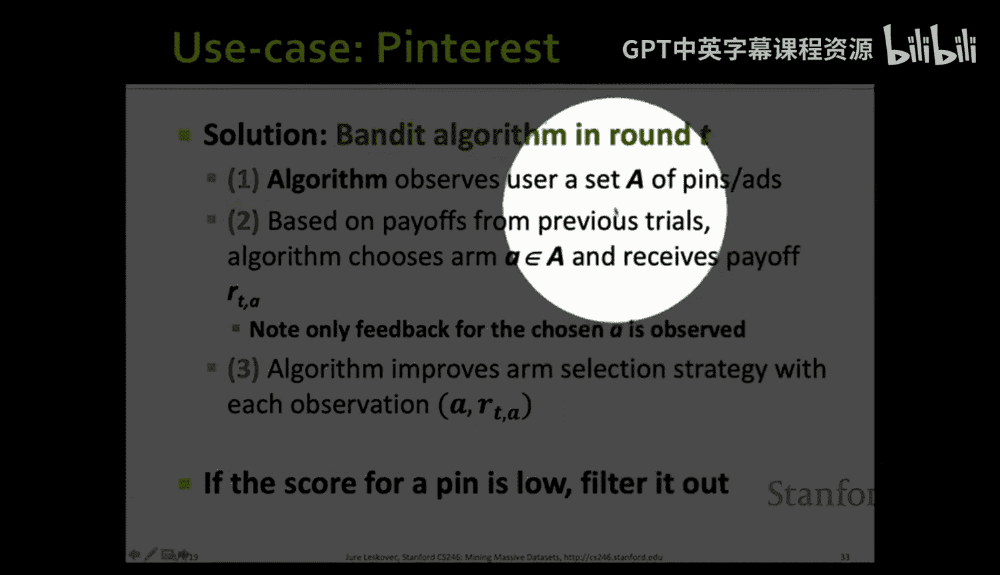

Our estimate payoff。And once again， I'm gonna keep on repeating this。

 It's very important to remember that only feedback for the chosen arm is observed。 Okay。

 so every time Pers makes the choice of ranking down a certain pin or a certain bird。

 then they are not getting information about how much users like or find relevant that content。 Okay。

 so that's why every now and then， as we have seen in UB。

 you want to make sure that certain pins or birds are popping up so that you can receive some user feedback。

😊，Okay， and our algorithm will improve the arm selection strategy after each observation。 Okay。

 so that's what weve seen before when we were updating the the confidence bounce。

 the more trials we make。😊，Now， the difference between。All the examples that we've seen before。

 you know， from the theory and the practice is the fact that in a platform like Pinterest。

 after the score for a certain pin is very low for a long period of time。

 they basically filter it out。 And the reason is， if you， if you think about it。

 not only is expensive to maintain a logging system and collect logs for the millions of users that such a large platform can have。

 But if every time there is an action， you need to recompute and update a lot of weights。

 this will become extremely expensive in your in your architecture。

 So in terms of computational power that is required to make that happen。 So what you do is。

In the real world， once you have been sure that something doesn't work very well for a long amount of time。

 then you filter it out from the potential candidates， okay。Okay， any questions or we jump to。

 to the next example。Okay， next， so we're gonna be talking about A B testing。

 A B testing can be seen sort of as a primitive version of multiar bandit。 Okay。

 because A B testing is the following。 you have a control experiment with two different variances。

 variance A or variant B and say you're on a website。

 Part of the traffic of your website will end up on this page。 Okay， that is a blue button。

 Then one of your web design， you will decide， you know what。

 I think a green button with an arrow will get much more people clicking or registering on our platform。

 So you want to try if the intuition of your web design is correct or not。 Okay。

 and that's how you make it happen。 you route part of the traffic on condition A。

 Part of the traffic on condition B， And then you're gonna be computing what is the click rate on that button over time and。

😊，If these examples sounds trivial to you， it it's well known that Google。

 possibly almost 20 years ago， they they tested 50 different variations of blue for the result page。

 This is something that an experiment that was run by Marisa Meyer， very correctly。

 So it's it's one of proud point back in the days。 So the idea there is there are so many different little details that impact the user engagement and the click rates that you really want to try to test all of them。

 Okay， and that's something that a lot of websites do on a daily basis。

 And we are all part of these testing。 All of us using the web。

 especially if you go to large platforms。 You always are gonna end up into some different conditions。

 Now， this is a example， like the fact that the click rate could be this different because it's almost 20% of difference。

 but。😊，If you think about Facebook or Google， if， if they can design an experiment that's even a 1% improvement in the click create when it comes to ads or it comes to anything else。

 that's a huge result for them。 Okay， like it's very hard to have such an abrupt change from one condition to another。

 Okay， so if you're ever gonna be working on these problems unless you have a very small startup。

 don't expect something。 you know a very big impact with your A B testing。

 But the interesting thing here is that you w to put inroll many of them until your interface converges into the most optimal one for the users。

 okay。😊，Now， where can you apply be testing is not only on you know。

 clicking buttons the different colors but let me give some， some different examples。

 So let's say you want you have， you know， you have to compute the average revenue per paying user。

 And what you're going do is that you assume the distribution for the for the average revenue is closer to asion。

 then you can apply a certain a certain type of statistical test。

 And if you go through this different example。 each one of them。

Can be modeled from a specific probability distribution。

 And then you can find and assign a different statistical tests to find out if there is a statistically significant difference between your condition A and your condition B。

 okay， so。Basically， you have to do this homework， find out what is the right distribution for the kind of problem youre modeling。

 then you run your AB testing。 And if you find out， okay， my condition A outperform B。

 then eventually you're going be stopping condition B from your platform and you're going to be running only the condition A so this is the gist of idea of doing A B testing is just testing an hypothesisthees。

Now。Imagine that you have two different version of the website。

And you want to test which one is better。And you already know that version A as engagement rate of 5%。

 while B as a lower engagement rate of 4%。

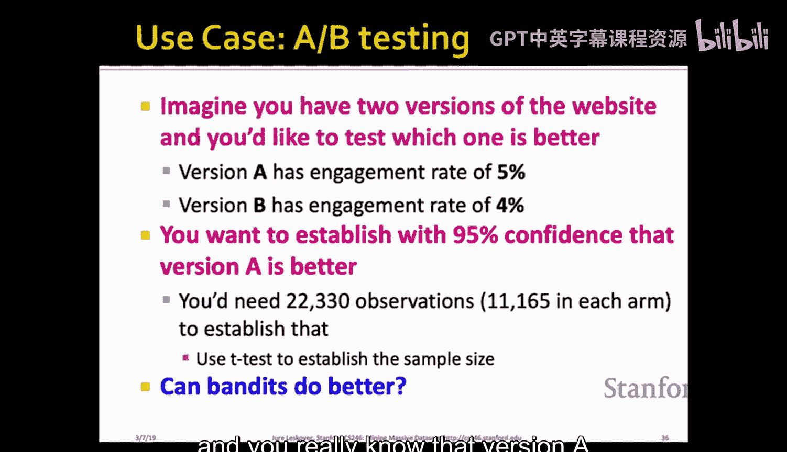

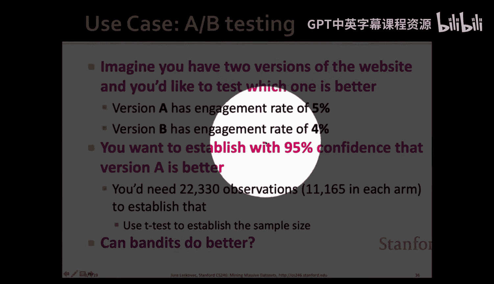

And you want to establish that with 95% confidence that your version A is better。

I'm going guide you now to different strategies。 and I'm going be showing you how much they cost in terms of number of observations that you have to collect。

 Okay， and eventually， what I'm going to try to convince is the fact that A B testing as simple and elegant as it is is much more expensive than what we have seen today through the much armbanded problem。

 okay。So in the case of A B testing， if you go to the mud。

 you're going to be needing roughly 22000 observations。 So 11000 per each arm。

 So each condition condition or condition B to establish within that confidence value if a is better than B。

 and youre we're gonna be using a T test example to establish what is the correct sample size， okay。

Now， can we do better with what we've seen today， Can we collect fewer observations still going to the。

 to the right solution， Okay， so in the case of a B testing。

 say your website receives a mere 00 page views per day。

 then you're gonna be editing more than 200 days to complete this old test。 And if you're a startup。

 you， you probably cannot afford to wait 200 days to find out。

 you know what is the best U I for your product。 Okay， so you want to make this happen much faster。

 So how do we do that， okay。嗯。So。let's basically use this idea。 So rather than， you know。

 fixing and statically assigning condition A and condition B。

 what you could do is that like twice per day， you know or a fixed amount of times per day。

 you examine how often each of the variation as being performing。 So how often you got you know。

 more engagement from one of the two arms。 Okay and then you adjust the fraction of traffic that each arm will receive going forward。

 So you can think about this as some kind of adaptive routing。

 the more you you receive information about a specific harm。

 the more you decide how to assign traffic to each one of them。 Okay。

 and if an arm that appears to to be doing well gets more traffic。

 then the one that is clearly underpering will receive less traffic。 Okay。

 so rather than having this fixed split that usually getting in。😊，Be testing。

 we're going to be trying to adapt the amount of traffic that we send to each arm。

And an elegant way to do this is called the Thompson sampling。

 And this is another nice result coming from probability theory。

 And this connects very well to the question that I received before of can we think about this problem What's invasion terms。

 And that's exactly what the answer that I was given to you before。 Okay。

 so what is Thompsson sampling。 basically， what it does is it will assign to to each session basically。

 to each harm a proportion of the traffic。 So basically the probability that each harm is is optimal is。

 is gonna be proportional to the， to the amount of traffic that it receives。

 So how do we formalize these okay。😊，So we take a vector of conversion rates for armss 1 to k。

 Our conversion rates again can be if you're clicking on a certain ad。

 if you're registering on the platform， you know， like your Netflix。

 you try a red interface or a black interface and then we' will be seeing how many users are subscribing on Netflix and each of these conditions will be includedd in one of those variables。

 Okay and each one of those variables works in the following way。

 So you're basically keeping account。 you're counting off in you get a success divided by all the possible trials。

 which is nothing but the sum of all the successes and all the failures in that condition。

 and then we have our vector Y， which is all the data observed thus fine the experiment so。😊。

If someone is registered or not， and。The key part to the Thompson sampling is that you're gonna be having this indicator function that tells you if the。

basicallyically it touch if the arm A is the optimal arm or not。

 Now what is the problem here is that this is some kind of， you know articleac function。

 We still don't know if a certain arm is optimal or not right because we basically gather this information as the experiment goes through。

 So in theory， you know， you can write this expression with the following integral the problem of this integral is apart from the fact that it captures the outcomes it captures the success and failure rates given the outcome observed is the fact that it cannot be solved in cross form。

 So we cannot find a clean mathematical way to estimate the different the different probability the different probability the probability distributions of the outcomes for each single arm。

 So given that we cannot solve it in this way， how can we overcome this problem。 We're gonna。

Be doing sampling。 Okay， so， we're gonna be basically using observations and slowly narrowing down what is the the exact value of the。

Of the muse for each single harm。 So how does this work。 So once again。

 we are basically drawing independent random variables。 we assume that all our harms are independent。

 And what we do is we model each harm as a better distribution Okay and our better distribution will have two priors。

 the up and better prior plus you will encode the successes and the failures that we observe up to now on the system。

 So that's how a better distribution looks like。 So like this is better of two comma8。

 It means like two successes and8 failures。 He looks in this way。 This is an a2。

 So8 successes and two failures。 and this is a5，5。 So pretty much almost Gsion where you have five successes and five failures。

 So our sampling looks like。 How does it work Basically， for now。

 you can almost ignore what is the prior assignment is not the the key。😊，Aspect of the algorithm。

 What you care about is you're keeping theseers of all the successes and failures for the。

 for the different arms。 Okay， so our。I is the index of the arm。

 And then you run the experiment from step1 to step capital T。 So the direction is our usual T。

 And now for each single arm， rather than running the the actual experiment experiments。

 So rather than pulling it。 What we do is you draw a value according to our better distribution。

 Okay， so we are basically trying to simulate how these harms would behave without actually doing it。

 And then once we run these initial simulation step， what we do is we actually draw from the arm I。

 and this will be the arm with the maximum。😊，Expected outcome， okay。

 and we're gonna be observing our reward R。 Now that we observe our reward。

 What we do is we're gonna be updating the either the success count or the failure count for that harm。

 Okay， so what we， what we're doing here is the following。

 We're using these better distributions as a proxy of how an arm will behave without pulling the lever。

 And then after we run the simulations， we just go and draw from the actual arm。

 and then update our counts， okay。😊，So this allows us basically to just keep very few counts per different options and run the sampling over time。

 and it gives us yet another strategy to perform the multiar bandit， okay。Now。

 what is the difference between the actual experiment and what what you know。

 you actually you do in reality， you do in production。 So in our case。

 what we have to do is that we have to route part of the traffic per each。

 per each different condition。 Okay， so you， again， your Netflix。 You have the red interface。

 the black interface。 You w to send part of the traffic to the red。

 part of the traffic to the black1。 So what you do is。

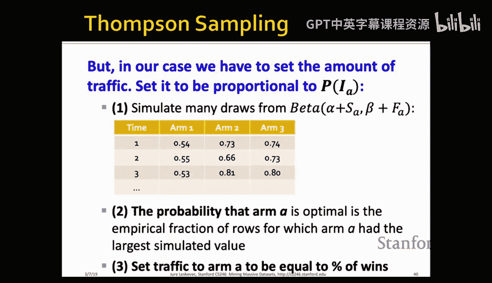

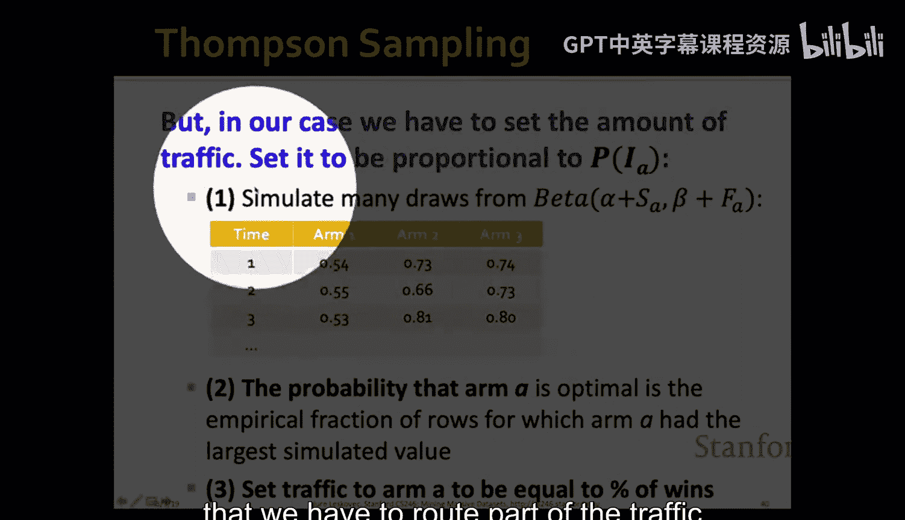

First， once again， you do the， the， you simulate the draws from our different better distributions。

 Okay， and you do this over time。 You simulate the draws。 You simulate which one will give the。

 the highest reward， and then the values are gonna be updated。

 Then the second step is the probability， the R A is optimal is basically the fraction of the rows where the R at the largest simulated value。

 because it means that， for instance， in。In row3， arm2 is the winning one and it will be drawing for arm 2。

 then for from time two， arm3 was the highest value。 So you will be drawing from here。 Okay。

 so you run the simulation and after it's done you set a portion of the traffic per each harm okay。

 so you try you set traffic to R to be equal to the percentage of winds。And basically。

 this beautifully balances how much traffic you sendingy to to each arm。

 given what is your expectation of the。Of the win rate for that harm。 Okay。

 and the reason why this is a very interesting technique is the fact that it's。

 it's very fast and it' not very expensive to maintain because you just have a just have a few counters per different conditions。

 okay。Alright， so now let's， let's put this in number and let's see what are what is the difference between standard A B testing or mat arm bandit to the Thompson sampling。

 Okay， so the condition is， as before， our condition A is 5% engagement rate B 4% engagement rate。

 What we want to do is we want to establish within a certain confidence that version A is better。

 And we said that with they be testing， we're gonna be needing roughly 22000 observations。 Okay。

 so how much are we gonna be doing better with the bandit。😊。

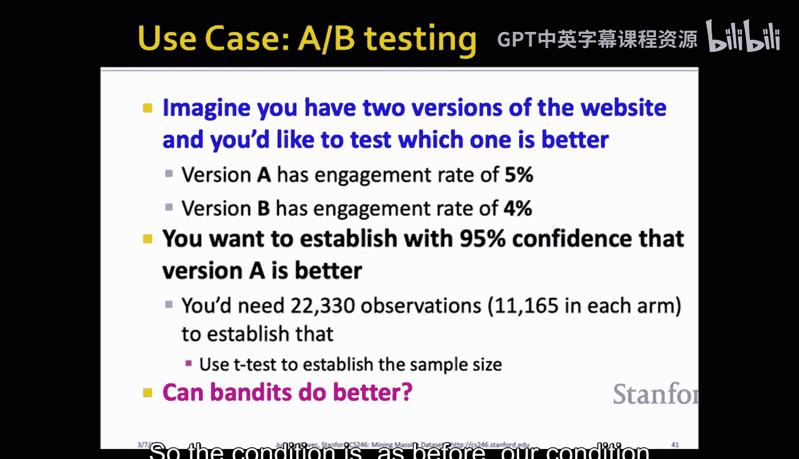

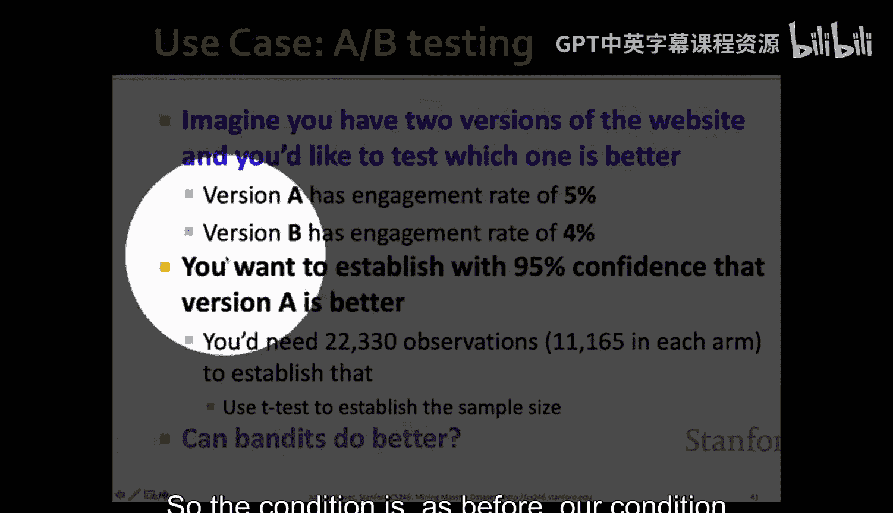

And here is the result。We're gonna be doing the following on on day  one， we start the following way。

 We we send basically roughly 50 sessions to each arm。 Okay。

 so we have a uniform distribution at the beginning because we don't know which one is gonna be performing best。

 Okay， and now we we find that a got really lucky。 Okay， and on the first day。

 it has roughly like 70 percent chance，70%% chance of being the best one to being superior and converse level band and B gets only 30%。

😊，So we accumulate these observations。 Then we're on day2。 and now we can。

 we can basically send traffic in different ways to the， to the different conditions。 Okay。

 so we accumulate all the traffic that we' seen so far。 And once again。

 we can recompute the probability that each harm is the best。

 So at every day or basically that every time we change the the traffic distribution between the conditions。

 we're gonna be recomputing our probabilities， okay。😊，And it is what we get。 So， these are days。

 Our X axis is in days。 the time period。 and on the Y axis。

 you will see the probability field being the optimal strategy。 So arm 1 is the is condition A。

 the 0。4。 Im sorry， condition B is 0。4 and arm2 is the 0。5。 And see at the beginning。

 there are some fluctuations because the system takes some time to converge。

 And then eventually you see that the the worst one condition B will will slowly drop down and then our condition。

😊，A will go all the way up to almost 95%。 And basically， we stop the experiment where we eat the 95%。

 So when we hit our confidence level。 and the interesting thing here is that our experiment finished in just 66 days and we saved roughly 150 days compared to the A B testing experiment。

 Okay， so it makes things go much faster。 and。😊，Same technique applies to multiple arms。

 So this is just a plot where instead of aiming only two conditions， we have six。

 if I call correctly。 And once again， you can see at the beginning， there are some fluctuations。

 different conditions take certain amount of time to converge。 And then after a few hundred days。

 the top condition shows up。 And then the web designer can decide basically to get rid of a specific UI and keep only the optimal one。

😊，Okay， so I interrupt here the lecture。 And if you have any questions， I'm happy to take them。

 Thank you。😊。

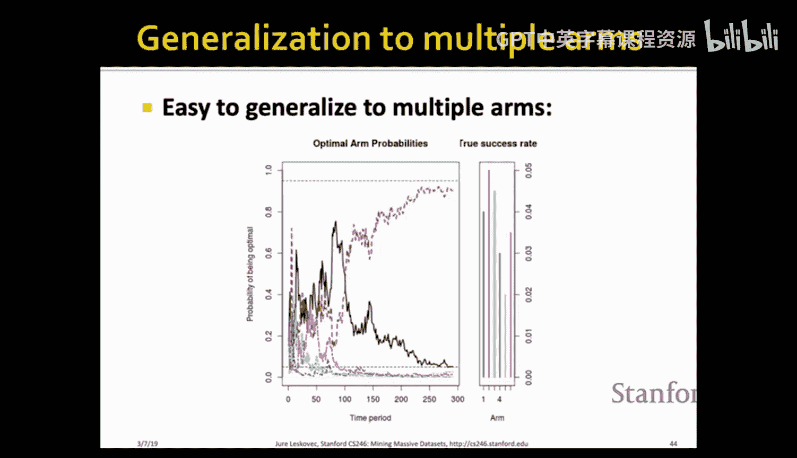

Alright， thanks。 See you next week。