# 斯坦福大学《海量数据集挖掘｜CS246： Mining Massive Data Sets 2019》中英字幕 p19 -P19-lec19 Optimizing Submodular Functions.zh_en -BV1raSjBuE3d_p19-

Okay great welcome everyone back to the class It's last week of quarter What we are going to do today is we are going to talk about an exciting topic of optimizing sub modular functions and the application of this will be to ensuring that the kind of quantifying diversity in a mathematical proper way and then given that this is the last week of the quarter。

 this will be the last real kind of topic and then on Thursday the Ts will go through the entire quarter and kind of cover what are the important aspects of each of the lectures and what can you kind of aspects for the final exam what I want to actually do is discuss the logistics for the final exam which will be held next week here is how things will go so we are having the final exam on Tuesday next week from 330 to 630 pm we are holding it at two different locations given that you guys have written some code。

😊，You should be able to to understand what this means what basically people with the sunnet ID that starts with a or L you are in building 420 room 040 and the people with M to Z with the first letter in their sunnet ID you are in the bishop auditorium the alternate date for the final is this coming Monday630 to 9。

30 pm it will be in Gs 104 if people really need to take this exam send a email and will try to accommodate accommodate you Also I hope you are familiar with the。

With the Stanford honor code， make sure you read that， but during the final exam。

 basically Ts are not in the room， so you are there on your own to do the exam so we won't be able to answer questions during the final and then for the SCD students these are the students from industry who are mostly attending the class remotely you have two options one is just show basically let us know and show up at Stanford then take the exam at Stanford if you are local the exam when when the time when the final exam can be can be taken is the same as as what the regular students are doing Now there is also kind of a second option which is taking the exam remotely and the way this works is that we give you this 24 hour window from Tuesday 330 pm Pacific time to Wednesday 330 pm Pacific time when you find somebody who will be your exam。

orAnd together with your exam monitor， you agree on a three hour window。

 The exam monitor will receive an email from the SCPD with the Pf copy of the final exam the exam monitor is then going to forward this final exam to the SCPD student who is going to finish it and then complete the exam and send it back to the exam monitor who will then forward it back to CPPD and then that way the exam will come to us and again during the final exam time we will not be able to answer questions or be available for things So this is really for people who are remote that needs to be a trusted person call the exam monitor。

 they are in touch with SCD SCD does all the communication and you don't need to contact us the core stuff we will just grade the final exam and let you know So this is for SCPD How out for Stanford students。

😊，The the important things are the final exam is open notes， open book， but not open internet。

 the calculator is required and you may use your computer to do arithmetic calculations you may also use your computer to read and search the notes but no internet。

 Google Python or anything like that is allowed right so your computer is offline so that you don't have to waste the trees to print out the course notes。

 you can use them on your computer and then you can use the calculator application in your computer to do any necessary calculations。

 that should be all you are you don't need to or you are not allowed to browse the internet。

 use stack overflow， things like that or you don't need to and you don't and you must not to write Python code or anything programmatic。

 So essentially it's just it's a calculator plus paper but you can have calculator and paper on your computer。

 That's the idea。Praccticed final exams on piazza。 So use those to practice and to get a good sense of what the final exam is look like。

 One thing that is a very good tip is bring a power strip。 right。

 everyone will show up with their laptop and people may run out of power。

 So what you usually do is we run the power cords and power strips up the lecture holes so people can connect and get some juice and don't panic after three hours and the laptop shutting now。

 So bring a power strip that will save you a lot of nerves。 Okay。

 so thats that's about the final exam。 Are there any questions。 Yes，😊。

You can only use like a calculator shape app on the computer to do the calculations correct。

Right like now if you'd like to type your calculations in something else。

 but the equivalent is you just need a basic calculator and you need and you can have the notes on your laptop。

 that's essentially what the spirit of these things are and we count on you that you can make proper interpretations of this rule。

😊，Right， so， but you must not， or you don't need to bring a library of code and now run that code。

 That's forbidden， right， But now if you wanna type in your calculation。

 your expression in Python console， I'm fine with that right。

 but I'm not fine with your writing code bringing external libraries and things like that。 right。

 So all you can use is the nine number keyboard keys plus the plus minus and so on。

 and a P Df reader for the notes。 that should be plenty of computer is used。 Okay。

 that's the spirit of the of the rules。 So no connectivity no chatting nothing like that。

 are will but don't write code code is forbidden but having a basic calculator function that's allowed。

😊，All， is that clear， Yeah， anything else。Right you can do that。 Yeah。

 however you like in common line， I don't care right So topic for today is about optimizing some modular functions。

 So here is what we will talk about right when you are so the motivation for D。😊。

When you are recommending， let's say items or when you are doing some kind of selection。

 the point is that you you want the point is that kind of you have limited real estate right you can only show so much to the user。

 you can only recommend so much so much right and what generally happens if all you are trying to do in your recommendations is to say what are the things that the user is going to like the most。

 then essentially you have a very good signal on one topic and you will recommend the same thing over and over again。

 right So kind of there be a lot of redundancy in your recommendations right and the problem that we are going to to address is really we don't want to put kind of all our eggs in the same basket right we don't want to if we are doing news recommendation。

 we don't want to say I can give you three recommendations and just give you three recommendations on exactly the same topic maybe from different media right we are uncertain about what is the user information So we want to be strategic。

 how are we going to use our。Our slots right and this happens in many applications like our commander systems it happens in search if you do search Google is very careful not to show you too many results from the same website because they want to show you some diversity about the topic you are searching for right so essentially the idea is how do we optimize for diversity。

😊，How would I say I want you， I want to show you the most relevant results to you。

 but somehow I want to cover all possible interests that you might have well， right。

 not that I only say， oh， you care about the X US president And here are the three news about the X US president。

 right So if you think about making news recommendation。

 This will be kind of our running example for the lecture today， you could say you know。

 this is now a particular day in January of 2013。 and you could say what has happened on that day。

 What is what all the articles have written about， right。

 And here is now the the word cloud of those。

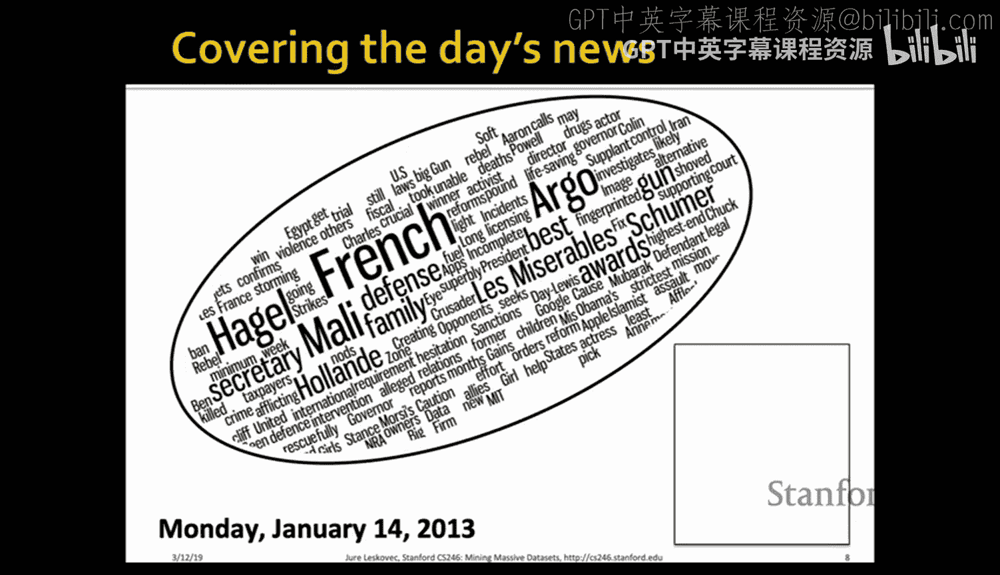

Of those of the words used by the media that day， right， And you know what was going on， right。

 there was some something around French involvement in Mali in Africa。

 there was something about US defense secretary things going here。

 I think it was just speculation about which movie is going to win the Oscars。

 So there was this Argo movie and some other movies and there was a bit of Google in the news and so on and so forth So what you could now say is to say。

 if I give you a recommendation for news article called France interwins。

 then I kind of cover this particular part of the of the news space。

 And if my second recommendation is that you know， something titled Chuck for Def。

 which is basically about the Chuck Hegel to be the secretary of defense in United States。

 I kind of cover this part of of the World Cloud。 And if if。😊。

If I want to now also cover the Hollywood news about which movie is going to win Oscars。

 you I could say Argovins big and I would cover that part kind of of the word cloud and this would make now a lot of sense to say these are the recommendations news recommendations I'm giving to you that kind of nicely diverse but still match your interests so that essentially is the idea and of course if I would now say you know give you another recommendation maybe Hegel expect to fight essentially this is very much overlaps with this article so maybe that's a bad recommendation it's kind of overlapping it's too redundant with respect with what I have already recommended so maybe what I would want to recommend is maybe it's something about the new gun proposal which was about some gun legislation in United States that is let's say badly needed so the idea is how would I formalize this kind of recommendation system problem where I want to give you。

Diverse recommendations that kind of cover what is happening in the news today。

 but is still personalized。 Okay， so our idea how to do this is first。

 we'll talk about it at the high level， and then we'll mathematically formalize it。

 So the idea is that I want diversity to encode diversity as a coverage problem， right。

 I'm essentially saying I have my work cloud。😊，And every article kind of covers part of this word cloud and my goal will be to give you a fixed number of recommendations and try to cover as much of this word cloud as possible。

 right so an example of of this is what I've been showing you so far where I have the word cloud of the news in a single day。

 and I want to select articles in such a way that the most of the words are covered right so that the most kind of important events。

 important words are covered by my recommendation so if I were to give you the recommendation about that Argovin big。

 then basically this would be the part of of the word cloud that covers it's about Argo。

 It's about some other movie。 It's about award。 It's about Benneffck and some actresses and so on and so forth。

 right So that was that is the idea So now if we have this coverage idea in mind。

 Now let's go and mathematical formalize right So what I'll do now is I'll make a step back and。😊。

Kind of ignore our problem definition for a bit。 and I will be in abstract and say。

 I want to I want to think about how do I formalize coverage problems Okay so if I if I want to formalize coverage problems then I need to define two things what is being covered and who is being covered right and in our case。

 what is being covered are the concept， which means let's say name entitiesities。

 the words in the word cloud and who is doing the covering is the documents right each document covers a few of the named entities right and the same thing would happen if you would say I want to give you diverse product recommendations or in any other area。

 you need to say what are the things that are being covered and then who is covered them in this case。

 to the documents right so I can say a I have all my， let's say name entities。

 the important words the keywords and here are the documents one document at the time。

And each document， for example， this corresponds to a news article about this you know Hegel expect expects to fight。

 So what this means is that this particular news article is covering know these by addresses covering three keywords or three concepts right it's covering Hegel Pentagon and Obama and of course。

 all other news articles that I can recommend from today。

 each one of them kind of covers some set of these keywords and of course。

 there is also redundancy between them right the same keyword is or the the same keyword can be covered by multiple by multiple articles right maybe except you know the NFL is only covered once so on But the idea is that I have multiple documents and they cover these keywords and the same keyword can be covered by multiple documents and of course the same document can covered multiple of these keywords So now that I have defined the。

problem now， how do I now define what is the objective function。 Like what is that I want to achieve。

 And here is what I want to achieve。 So this is now in abstractstruct。 I'm saying。

 let's say I'm given some set of documents， D， capital D， and let's let each document。

 little D cover some set of topics or or words， right， So going back， this is a document D。

 and the set of words cover， it covers is 1，2 and 3， right So it's Hegel Pentagon and Obama。

 So for this document D， X subd is a set of Hegel Pentagon and Obama， right。

 now that I defined how document covers a words。 What is my objective function。

 My objective function is to select a set of documents， A right。

 A is a subset of the entire set of documents。 So I want some small subset of documents。 Let's say 7。

 and I want to maximize the the following function F。

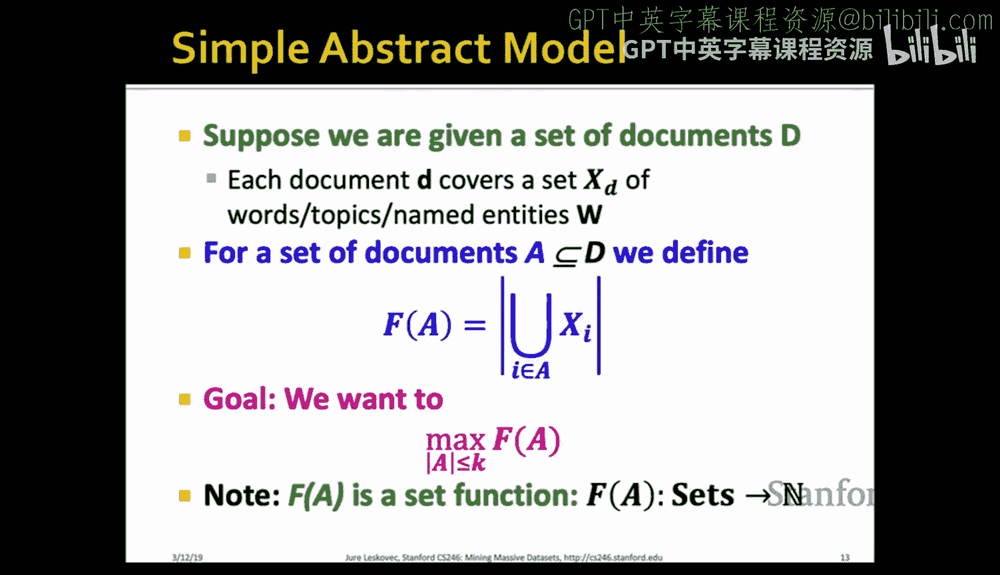

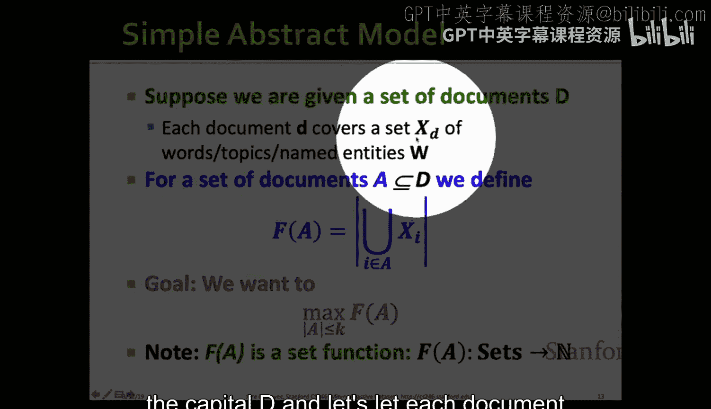

The way this function F is defined it says， let me take a union over all the documents in my recommendation set and this is the set of words that each document covers right so what this is essentially saying is say Im measuring the diversity of given the recommended set of documents say by the total number of different words。

 these documents cover right this is the size of the union each document covers some words and I take the size of the union of these covered words of all the documents。

 all the recommended documents and that's my objective function。😊。

And then what is my goal my goal is to say find a set of k recommendations。

 find a set a that has k recommendations that maximizes the number of covered documents right so this is this bars mean side of the set each document is covering a set of keywords。

 I take the union of this set of covered keywords， this gives me a big set and I take the size of that set thats my objective function okay。

😡，So what this means is that this function A， the way F of a， the way to think of it。

The function F takes a set of documents， right， So as an input， it takes a set and on the output。

 it gives me a a natural number， an integer that tells me what is the total number of covered covered concepts or covered keywords by the set of documents in the set a。

😊，Okay， is that a question？We are happy。Yes， you are smiling。 That's a good time。No， it's good。

 right， It's clear。 This should be like super clear what this is。 This is a key concept。 Okay。

 so if you， if you are having， if you are in doubt， now it's the time to， to raise your doubt。 Okay。

 but essentially， I'm just saying， what's the union。

 the size of the union of the keywords that these documents cover。😊，That's， that's what we do。

 And we want to maximize over that union。 So here is how you can really think of this。

 This is really a maximum coverage problem。 right， Here's another way to say it。

 we say we have a set of words。 W going from W1 to W N， These are our keywords。

 Then I say every document is a subset of these wordss， right。

 every document X subd is covering some subset of that key of those keywords， right。

 So now the way I can say is to say this is my universe of all the keywords。

 and each document document here kind of covers a subset of these keywords。

 right like is covering a subset of keywords。 So let's say that document X1 covers all these keywords right And you know。

 maybe x 2 covers all these keywords here。 And x 3 covers all the keywords up there。 and you know。

 maybe x 4 is a funny document So kind of covers all these keywords and so on。 And then what is my。😊。

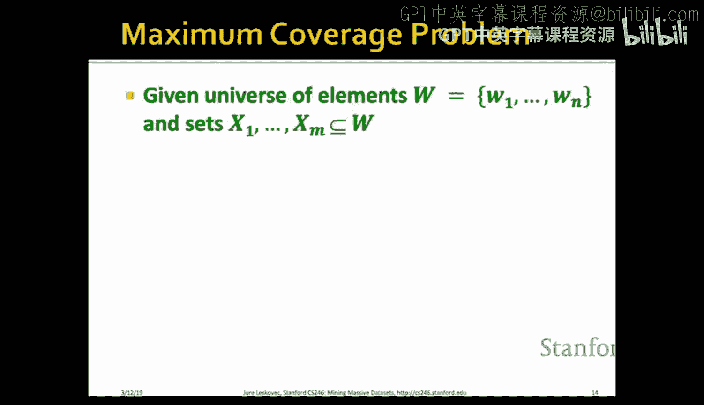

My goal is to find k of these x sub I such that the most of this W space is covered right more precisely I want to find I want to select K sets x sub I whose size of the union is the largest right whose size of the covered area is as big as possible right。

😡，So just before I give you the bad news， what would be the good news， for example， in this case。

 what would make sense is probably to select x2 and cover all this area here and then select x4 and cover everything else here right of course this is the place where x to an x4 overlap So this is covered twice。

 but I don't care but in terms of the total covered area。

 let's see if I can do this right I cover this and then I cover kind of this part and I cover that part right so I cover a lot we just selecting x to and x4 right So now the question is how do I select a fixed number of sets x sub by。

 let's say K is the hyperparameter coming from the user such that I maximize the amount of covered area。

 What is bad news bad news is that this is a knownmp complete problem So no fast good algorithm exists for this that gives me the exact optimum because I can。

Not because of this bad news， let's consider a very simple heuristic。

 We will call this greedy heuristic or a greedy hill climbing heuristic。

 right And here is my greedy greedy heuristic algorithm。 I will start with an empty set a。😊。

And then if I want to select k elements， K sets， here is how I will do it。

 I will have a for loop that goes one to k and at every at every step I will say。

 let me find the set D that gives me what is called the highest marginal benefit right and then if I find the set that gives me the highest marginal benefit。

 I include that set in my solution。😊，Okay， so say this again。

 So what I'm doing is I'm selecting sets one by one where in every iteration， I。

 I go over all the sets that I haven't yet selected。 And I ask。

 given what I have only selected plus this new set。 How much benefit do I get。

 How much new area do I cover and whatever set max is gives me the max gives me the highest benefit。

 I will put that set into my solution， right， I had I was I picked a minus one set so far。

 I found the one that increases the value of F the most， and I added into my solution。

 And now my solution just grew for one step。 So for one element。 So after K K iterations。

 the a sub K contains K documents or K sets。 Okay， So here's an example。

 how would this work right at the first iteration I would say。

 what is the F of D1 the two all the way to the Dm right。😊，This would be。

 And I would say I would pick the best one。 Let's say D1 F of D1 is the highest value。

 right in the second iteration， I would say A A1 includes D1。

 So let me now figure out what else to add to D1 to see how much it improves the objective value。

 So now I would be evaluating the following thing。 I would say I already selected D1。

 So now I will try， how much does D2 help， What does it do to the objective function。

 How much does D2， D3 help。 how what does it do to the objective function。

 And I would evaluate all these things and pick the best one。 So that in the third third iteration。

 I would have， let's say D1， D2。 and then I would try to add the third element to it， right， D3， D4。

 D5， And again， I would pick the best thing that is possible， right。

 So I'm basically selecting sets by1 by one。 And at every iteration。

 I select the set that gives me the most benefit， I greedily pick the best。😊，The best set。Okay。

I'm not sure if I explain this really well， but is it clear what we are doing。

 We are just greedily selecting the sets。Okay， great， so let me try to give you an example。😊，Right。

 imagine that this is these are my sets here。 I draw them。

 And let's say what I want is to I want to maximize the amount of covered there right。

 and I'm using my greedy heuristic。 What would be the first set we would pick。The big one， right。

 So the first we pick this one。 This one covers the most area， this， this， this circle， right。

 So here it is。 Now， what would be the second one we would pick。Right， we pick this one， right Why。

 Because it covers the most new area that is not yet covered。Right so this would be now。

 I think let's see if I did it。 Yes， that's the second one。 Now it's a good question。

 What is the third set we should pick， right， Like we could say， oh， this one looks quite big。

 Actually， this one is bigger。 but this has been already covered。

 So the benefit of picking this set is only the area here right And in our case， we would say。

 you know， is this area bigger than this area is it bigger than that area is it bigger than this area。

 Yes， it the bigger So the third set we would pick is this one right And now the fourth set we would pick is。

 I know it's probably either this one or that one， which but you know whatever is the uncovered area here because this part is already covered or maybe that one right And I think the way I draw it we pick that one right So this is how the gridy algorithms work。

 It basically says what is the set that covers the most uncovered area I pick and I will pick that right And of course。

 you can ask yourself is。😊，heuristic， as I call it， does it give me optimal solution。

 What would be the easy case where this thing would fail， right。

 It would not select the best possible thing for me， right， And I give you the example next。 right。

 Here is an example where this would fail。Right I have this big set A and then this sets B and C。

 And I tell you pick two sets that you maximize the amount of covered area。

 The optimal solution would be pick B and C and you cover a lot。😡，What， what the greedy will do。

 greedy will first say， oh， set A is the biggest， so it will pick set A， but after it picks set A。

 it will probably pick peak B， but B now covers very little new area because it overlaps so much with setay。

😊，Right， so this is the， the， the， the bad case scenario where。

 where greedy can give us suboptimal solution， right， greedy would pick a。

 And then it would followed， let's say， by C。 while the optimal thing would be to pick A and C。😊。

Okay， and we see how greedy here fails， how it doesn't give us the optimal solution， right， And then。

 of course， the question is。😊，Can we say anything about the solution quality of this greedy heuristic。

 Could we prove a theorem that would say how badly can greedy fail？

 This is an example where it fails。 It doesn't give us the optimal solution。

 but how bad is the failure of greedy。Right， so that's what I wna say next。

 Maybe a good time to ask a question。Al， so then the next thing， how badly does greedy fail。

 And actually， greedy is a really good algorithm。 So there is a famous theorem from by name H fier and Wallley from 19 78 where they say that the greedy will produce your solution that gives you the score F of a and that solution score will be bigger Then1-1 over3 times the score of the optimal solution。

 right， So this is f of opt and this is some constant。

 So what this means it basically says that here is written any differently。

 It says that the greedy will always find you a solution that is at least at the level of 63% of what the optimal solution is right So greedy will never give you something worse than 63% of optimal Op is emptyhar to compute So we cannot even compute it for any any big instances because it's too expensive because it would take exponential time。

 So this greed。😊。

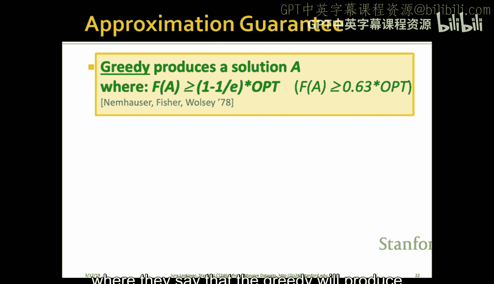

The heuristic gives us something that is， you know， what63% of the optimal solution， right。

 So it's quite good。 We have a certificate now that says that discovery problems can be solved almost optimally right。

 we will never be worse than 60 the 63% of the optimal solution。

 So if the optimal solution gives us score of 100。 We will always have score that is 63 or higher。😊。

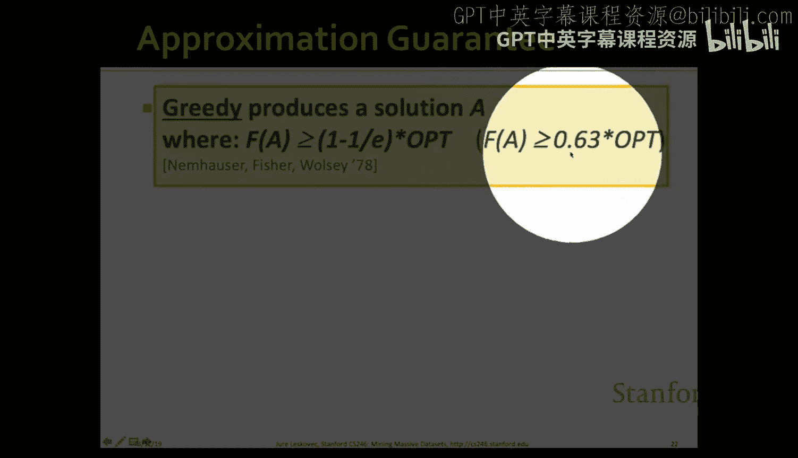

Right， and the magic is that we don't need to compute F of optimal。

 It might be F of optimal is MP hard to compute， but we。

 we still have a certificate that greedy is good。 That greedy will never fail terribly。😊，Right， yes。

 a question。But how would you go about proving something like this？Yes。

 how would you go about proving something like this， I do the proof of this in 2，24 W。

 So take my other class， and I'll teach you how。😊，It's it's not too， it's not too hard。

 It takes about three slides to get through， but it's not too hard。

And I'm happy to point you where the proof is， if you are interested， Just send me an email。😊，Okay。

 good， but I won't do the proof here。 It's kind of beyond What I will tell you here， though。

 is that this only holds for functions。 F that have certain properties， right。

 this doesn't hold for arbitrary function。 So function F have to have some beautiful structure。

 What is this beautiful structure。 The first part is the this function F has to be monotone right。

 And when we have functions of real numbers， we know what what monotonity means。

 But notice that F in our case is a function over sets is a function over discrete sets。

 So what this means we need to define what does monotonity mean， right， And in in if。

 if I work with the， let's say Uniivariate functions， I say， you know， a is less than B。

 then F of a is less than F of B。 And then the function is monotone。

 What I say here is if a is a subset subset of B， then F of a is less than F of B。😊。

Or less than equal。 Okay， and this is called a monotone function。 Okay， what does this mean。

Like in our case， if you think about coverage， if I give you a set of recommended documents a。

 and I ask how many words do these documents cover and now， you know， I say。

 and I will throw three more documents in for three。 So I have a super set of it。 Let's call it B。

 right then if I add more documents， I will only cover more words。 I won't cover less， right。

 I cannot uncover a word by giving more recommendations， right， so our set coverage。Is。

 is is monotone， right， It's only increasing。 The more documents I recommend。

 the more things I cover。So this is the first important property。

 And then the second important property where the title of today's lecture comes comes from is that F is sub modular。

 that it has this sub modularity property， right， and intuitively what we are going like what we are going to do next is we are going to talk about sub modularity。

 and what is sub modularity intuitively， it basically says adding an element to a set gives you less improvement then adding it to one of its subsets。

 right， you get this kind of marginal diminishing returnsnce。

 the marginal benefits are getting smaller and smaller。😊，So let me now give you a precise definition。

So if you have a function over sets F， then F is called sub modular， then if A and B are two sets。

 then f of a plus F of plus f of B is greater than F A union B plus F A intersection B。

 right So if I have AM and B as two sets。 Then I'm saying F of a by itself plus F of b by itself is greater than equal than F of the union plus the F of the F of the intersection。

 or another way to say this is to say this plus this F of this plus this is greater than F of the greater or equal。

 F of the union plus F of the intersection。 right， That's one way to define sub modularity。😊。

And an equivalent way to define sity is this diminishing returns definition that might be kind of easier to grasp。

 And the way this goes is the following， we say。We have a set function F。 We call it a modular。

 If F A is a subset of B， right， This is a。 sorry， this is B and a is a subset of it。

 And then we say that I have a small I have a big set and I have a small set， right。

 and a small set is a subset of the big one。 And now I consider adding one element。😊，To。

 to the small set or one element to the big set。 And we are saying that the benefit of adding this element D to the small set is bigger than the then the benefit of adding the same element D to the super set B。

 Okay， so let me try to explain this again， So what does， what does this expression mean。

 This expression says what is F of a union D minus f of a。

 So this says what is the marginal benefit of adding element D to the set A， right， This was F of a。

 And now I have a， and I add one element to it， How much benefit do I get。😊。

RightAnd we are saying that the benefit of D， the amount of increase in the function value。

 the benefit of d is bigger than if I add it to a， then if I add that same d to B。😊，Right。

 where a is a subset of B。 Okay， so this is called sorry。

 This is called the the diminishing returns definition of sub modularity。 right。

 So adding the same element to the small set Give me bigger improvement and adding the same element to the bigger set to the super set of it。

 right， here I get large improvement。 right， I get large increase。 and on this side。

 I get smaller or equal increase。 Okay， so this is also quite important。 So please ask me a question。

😊，Okay， so we are good with what some modularity， how how it is defined。O。

So if we are good with that， then we need to talk about the next thing， right。

 Let me give you an example how to think about this sub modularity。

 right I'm saying if I think of here's an example of why。Set cover is sub modular。 right。

 We need to prove that what I was telling to you before is sub modular， right。

 And the way I would prove is to say， oh， it has this diminishing returns property。

 So the way I can think of this is the following， right？ I have this sets D1 to D M。

 and my goal is to maximize the size of the covered area right each document。

 each document covers a set of keywords。 I take the union of all these covered keywords。

 and I say what is the size of the union。 And my claim is that this F of a is submodular。

 This is exactly what we care for our diversity news recommendation problem， right。

 we care to cover as many different keywords as possible。Okay。

 so why is this sub modular So here is how to think of this。

 You can say here is my universe of documents。 each each each eip is a document and documents cover different sets of keywords right and let's say that this is I give you three recommendation。

 So I make I give you a recommendation on three documents and this is what are the keywords they cover And of course maybe and what I ask myself is this is now the size of covered area is f of a is up here iss f of a So now question is what is f of a union some document D。

 let's take some document D Here it is。 And I'm asking what is f of a union D minus f of a right So I'm in some sense asking what is the size what is the marginal benefit to recommending document D In our case。

 the marginal benefit is essentially is the size of the newly covered area。Right。

 what's the size of the newly covered area is basically all this red area。 right。

 This part is already covered。 So this is the marginal benefit of D， so。

This red area is F of a union D， minus F of a。 right？ That's， that's the first thing。

 So we have the lefthand side work through。 Now about how about righthand side， right。

 one important condition up here is that a is a subset of B。 Okay， so if this is my a。

 I need to now say how about a super set of a super set of it。 Let's call it B。

 Here is right here is a and I have a few more sets。 Let's say this two right。

 So this is now a super set of a， because a contains these three sets B contains the three as well。

 plus two more， And I can ask what is the marginal benefit of D now， How much new area does D cover。

 And now D covers only this much area。 So this area is bigger than that area。😊。

So my inequality holds， and I gave you the proof。Right， of course。

 if you take these two things and and put them here。

 then the size of newly covered area will be the same between A And D。

 but that's still sub mod because I have greater than equal。😊，Right， so that would be the equality。

 if these two hypothetical sets would be somewhere here。

 And then the amount of newly covered area between these two would be the same。

 So that would be when the inequality becomes the equality。Okay。

 but this is now a visual proof that actually our diversity recommendation based system has the。

 has the diminishing returns properties。 So it's sub modular。 And then the second thing is。

 it's clearly also monotonone， right， If I throw more documents here。

 I'm only going to cover more area， not less area。 So this function F is clearly monotone， okay。😊。

Great。😊，Any questions。Yes， great， yes。I that not so much。

What's an example of a set function that is not submodular。 So this is。

 you can define arbitrary set functions， right， You could define a set function that。

 that says if I have a inside return 5。 If I have B inside the return 5。 But if I have A and B。

 return 4。 that's a non monotone function。 right， So you could just tabulate for this input。

 here's the output。Right， so you can come up with arbitrary。 right。

 One way to specify a set function is to have all the possible sets on the left and the real valued output on the right。

 And you can come up with whatever monstrosity you want。Right。So that's a good。

 That's a great question。 It's a good one。 right， So it's not。 it seems like all set functions。

 like set functions are super general。 But this is。

 these are set function that is about maximizing the size of the union。

 So the size of the covered area。 And that's a sub modular set function。 Actually。

 small small minority of set functions are sub modular。😊，喂。And monotonnes so， great， Anything else。

Good， so thank you for the question。 It was awesome。 So here is another way how to， I。

 I told you about diminishing returns。 So the way you could think of this is the following， right。

 you could say， how big is my solution size， This is the size of a versus what is my F of a。😊。

And diminishing returnsnce intuitively means that your F of a kind of increases like this。😊。

RightAnd the way we think of this is to say， oh， if I have F of A and I add some element to it。

 I get some marginal benefit。And then we say， oh， but if I have F of B and I add that same D to it。

 the marginal benefit is smaller， right？ And this is what sub modularity is。

 The only relationship between A and B that we have to。

 we have to keep in mind is that a is a subset of B。 Otherwise， A and B are not comparable。

 But if one is a superet of the other so that there is a direct relationship。

 then the amount of benefit for the same element is only going to shrink as we move farther to the right。

 This is kind of a visualization of diminishing returns， which again。

 is nothing else than just this equation。 So it's a second way how to try to give you some intuition。

 what submodularity is。😊，And then I have the fourth definition that essentially sub modularity and concavity are kind of analogous concepts right so here is how to think of this is right I can define this notion of marginal gain where I say how much does element D help with my solution right so it's like what is f of a union D minus f of a right and we define a function to be sub modular to say f of a union D minus f of a is greater than equal to f of B union D minus f of b where a is a subset of B If you say how do we define concavity here is how we define concity。

 we say for a less than B f of a plus some constant D minus f of a is greater than equal than f of B plus the same constant minus f of B right so let's see right what this means is that if I set a here and I move the same。

😊。

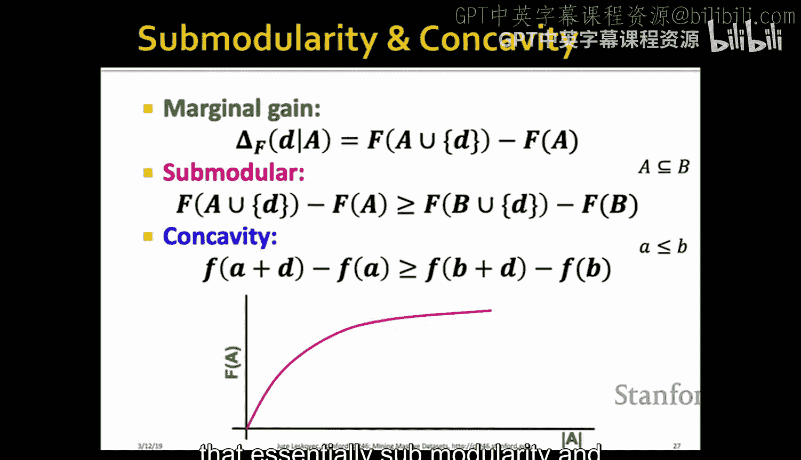

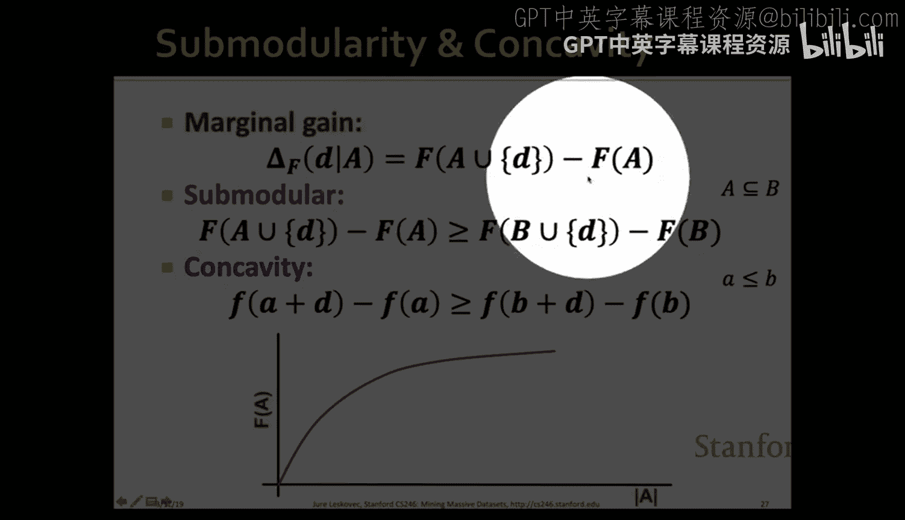

Delta D to the right， the amount of increase in the y value of the function will be higher here than it is if I make the same step the same delta step to the right right so the point is sub modularity is like concavity just that sub modularity is defined over set functions and concavity is defined over real real valued functions。

😊，Okay， so that's another way to， to， to think about some modular functions。 Okay。

 is they have these diminishing returns。 They， they kind of， they increase less and less as， as。

 as they get， as they get bigger。Okay， so that's third way to think of this。And the last， yes。

 go ahead， sorry。 So implies concity。 Doesn't that mean like the function is automatically the same conityity good question。

 Does concity imply imply monotonity in， in set in， in set functions， it doesn't。😊。

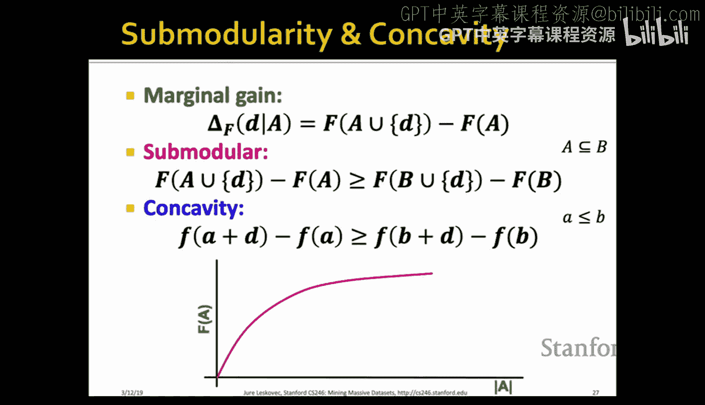

And you could have some larger functions that are a non monotone。So this is just an analogy。

 not an exact correspondence。 So in set functions， you can have submodular nonmontone functions。

 And then the greedy fails， and there are different algorithms that you try to to use for optimizations。

 But we are focusing on monotone submodular functions。 good point。 Thank you for asking that。

 So I give you one last kind of mathematical fact about submodular functions。

 which is the following is that subular functions can be combined。 What I mean by that。

 if you have submodular functions。 F1 to F M， and you have some non negative coefficient Lada。

 Then you can combine you can create a new functions。 F。

 that is some kind of weighted linear combinations of submodular functions。 F sub I。

 then then these linear combination will also be sub modular。

 right So what this means is sub modularity is closed under non negative linear combinations。

 right if lambdas are greater than zeros。😊，And some of sub modular functions is still as a modular function。

 or an average of sub modular functions is still as a modular function。 right。

 So an extremely useful fact is if I'm optimizing different functions。

 But I have some probability distribution over them。 How likely each of the sub modular functions is。

 and then this sum is still as a modular function。 So greedy heuristic will work。

 if I want to opt f of a， if I know that this each of F subbi of a is sub modular。

 then the weight that sum is still sub modular and greedy heuristic will work right and that can be very good。

 because you can think of this as multicit and optimization。

 I can have different criteria F if each of the different criteria F sub is sub modular。

 then the way that some of these criteria will still be sub modular。

 which means that the approximation guarantee and our greedy algorithm will still work well。

 is that is why this is such a。😊，Super useful fact。Okay， so sub modularity property。

 sub modular functions can be combined together to new and the sub modularity is maintained。

 That's the point。Okay， great。 So now we kind of finished our tour of mathematical properties of submodular functions。

 And what we w to do is go back to our problem， right。

 like go back to our diverse recommendations problem。😊，Before I do that， are。

 are there any questions or doubts about what we covered so far。Yes。

 what is probably mean your expression。 Oh， what does this mean。

 Just think of it as some non non greater and equal to0 number。 you don't care。 I don't care。

 just as long as this is not negative。I if these things are sub modular。

 then these thing is a modular as well。 Of course， this will be application specific。

 And I will show you in the next few slides how， how to make how to make use of this fact。 Okay。

 good point， great， So moving on， we were talking about our problem of coverage where we said we have the concepts and we have the documents and documents cover concepts。

 right， and we create， we thought of this as this kind of bipartite graph where we want to select a few notes here。

 So that we cover as many concepts of the top on the top as possible。

 and what we also show this is that this is a submodular function， right。

 we convinced ourselves that this objective function is sub modular， right So what now。

 how do I define this coverage problem。 I say my objective。

 My goal is to pick k documents so that so that they cover the most concepts， right。

 I want to pick k documents here。😊。

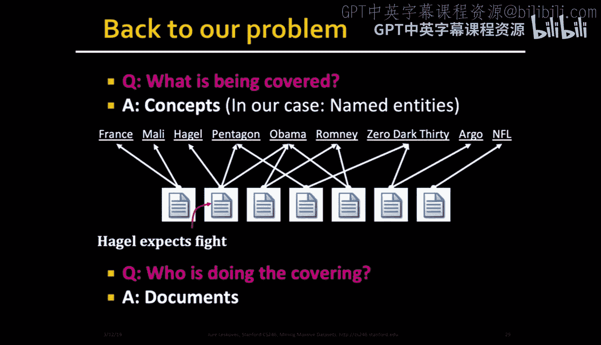

Such that the most concepts up there are covered right and what is now a is a set of documents I cover and what is my f ofA is the number of the cover of the concepts covered by a right so it's basically every document covers a few concepts and I take the union of all these little sets。

 whatever they cover and I say what is the size of the union right so my elements are the concepts and my sets are the concepts in the document and I say if I take this union of the sets。

 what is the total number of concepts in the document that I cover so if I were to pick these document。

 I cover Obama and Romney and and so on and so forth and then I could go pick another document and for example。

 now if I were to pick this document I can essentially ignore it because it cover it would cover the same document as the same。

Ocepts as， as the first one did。 So the value of this document is 0 to me right now。

 So I can think of it as it's covering what what has already been covered， right。

 And I would not select that document because it overlaps too much with the 1 I selected first。Okay。

 so as I showed you before， F of A， submodular and monotone， why。

 because this is an instance of maximizing the basically of maximizing the coverage。

 trying to maximize the size of the union。 and this means that we can now use greedy algorithm to optimize F。

Right， so we can actually run this to find a set of documents A that maximizes the coverage that maximizes the number of covered concepts。

 right， And we have the certificate， our theorem that I showed will tell us that we won't do too badly。

 we will do quite well in comparison to the to the to the to the optimal solution that we cannot even compute because it's too expensive to compute。

 Okay， So that's how how to think how to think of this。

 Now I want to discuss some pros and cons of this solution。 and and see if we can further improve。

 right， So our goal is Pk documents that cover most of the concepts。 right。

 What is good about this thing is that it penalizes redundancy， right。

 If I have another document that covers the same concepts I won't go select that document because it's kind of talks about the concepts I have already covered。

 right。😊，This was the example I had before， right？We， we don't care about a document， right？

 And penalizing redundancy is really about this sub modularity property that I talk to you about。

 But what， what is bad about， like what is not satisfactory about this solution。

 What is not satisfactory is that kind of it doesn't consider concept importance， it just says。

 you know， you get the same reward， if a document mentions Obama  hundred times or it。

 if the document only mentions Obama once， in both cases， you cover Obama， right。

So the problem is that we are doing this kind of all or nothing you either cover you either cover a concept or you don't cover a concept right so this kind of all or nothing coverage is too harsh and we want to generalize it so the way we will generalize it is that we will talk about this concept of probabilistic coverage。

😊，And that's what I'm going to explain， next。Before I do that， is there any question。Right。

So what we learned so far is to how to define this notion of diversity by coverage。

 We talked about sub modularity property showed that that our our coverage optimization problem has this sub modularity property。

 And then we talked about the greedity Hill climbing that gives us near optimal solution to this coverage problem。

 That's the summary of the lecture so far。 Okay so now we are going to extend this machinery to this notion of probabilistic set cover。

 right， we are trying to cover a set， but in a probabilistic way， right。

 so we still want to select a document that cover the most important concept。

 the same thing as before。 But the idea is that each concept C has an important importance weight W。

 right， So this would mean that maybe I'm the user。

 and I really care about France and Mali and Hegel and Obama， but and Argo。

 but I don't care about NHL and Romney and Pentagon， I guess and so on。

So the idea is that for every user I have this bar chart to dissus that tell me how much does the user care about this topic。

😊，Okay， so because if I want to personalize， different users will care about different topics differently。

 So I have this WC， which goes for every， for every word C is the is the weight or the importance of that concept for a given user。

Right， so now we are going to use these concept weights to generalize our approach。

 And the way we are going to do is to say the following。

 we are also going to not only have the importance of of words。

 but we are also going to add weights on the edges。

 We are going to define this concept called cover subd of C。

 which is the probability or the amount that document D covers the concept C。 So it's in some sense。

 how strongly does document D cover a given topic C， right so。It's a weight。

 So the way to think of this is if I have a document and it talks about two people。

 It's not only whether you talk about the person or not， but how strongly you talk about the person。

 right， So we will have this cover of the sub to be the amount of time。 Let's say the frequency。

 The number of mentions that this document talks about this given entity， yes。

The probabilistic sense， could you interpret this as if you were to pick a random word from the document。

 what would the probability be that would be concept C？Good question。 So great idea。

 So what you are saying is discover cover idea。 You could think of it。 if I pick a random word。

 or if I pick a random concept， a random keyword from the document。

 how likely it is to to be either Romney or Obama。 That's one way to make this precise， correct。

 That's a good into issue。 That's how I would I would code it up if I were to do this， Yes。

 that's a good idea。 So that's a good way to think of it， right， So right， so basically。

 in some sense， what we want to， what we want to capture in discover cover is in some sense。

 we want to model， how much does a document cover a given concept。

 but we can then also want to model， how much does this concept， how relevant it is for the user。

 a concept is a keyword。 So the way I， I can do this， I can do this now the following。

 I can say now what is the cover of the of the concept， given a set of recommendations。 A， then。😊。

Here is the formula， But essentially， what this formula says is says the following。

 Let me go over all the documents。And let me for every document ask how much do you cover the concept C and and this is the probability of document covering C1 minus that is the probability that the document doesn't cover C so I'm basically saying let me go over all the documents I recommend and ask what is the total probability that none of these documents covers C and if I do one minus that I get the probability that at least one of the documents in my recommendation set covers my concept C。

😡，Okay so this expression， if these are the probabilities as as a person at the back asked。

 then then this means that this is now capturing the probability that at least one document in the set A covers this concept C。

RightWhere each document can cover it with a different probability。

And then what is now our objective， our objective is now let's go and find a set of documents a that is of size at least at most k。

 so it basically find a set of k documents that maximize f of A where f of A is the sum over the concepts the weight of that concept。

 how much does the user like that concept times the probability that at least one of the documents in a covers the concept C。

😡，Okay。So this is now our our new definition so rather than saying you have a deterministic coverage。

 we came came up with this probabilistic notion of coverage where we say this is the probability that D covers C now that we have this we formulated this objective function that says let's select a set a such that the the concept is covered by at least one of the documents if the coverage we can think of it as probabilistic and then we say let's take the weight that some of the over the concepts where this is the coverage of the recommended set a for that concept C defined up here and each each concept has a different way has in different importance for that given user okay。

😊，Now， what is interesting here。 What is interesting here is that。

1 if one proves that cover a of C is submodular and then these things are non negativegative。

 they are weights， so they are greater than equal to0。 then if this is sub modular。

 this entire f of a is submodular as well and this is essentially what happens What happens is that the overall objective function F is sub modular So it has this diminishing returnsnce property。

 and the reason why it's a modular because it cover a of C is sub modular then by by the slide I told you about that we can combine sub modular functions our function f of a is also sub modular because this is a non- negativegative combination So it's a non- negativegative linear combination of submodular functions right and what is will mean this will mean that the greedy algorithm that I use to optimize this f of a will give me near optimal solution So it will give me a solution that。

😊。

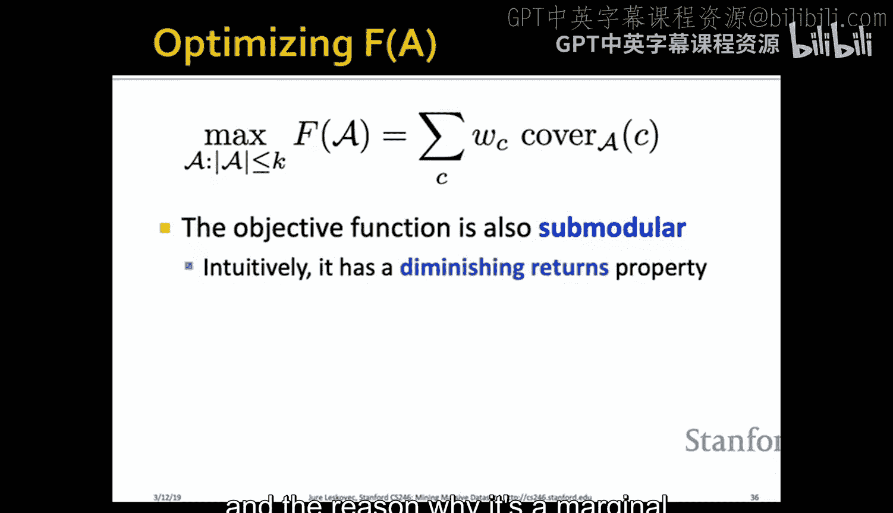

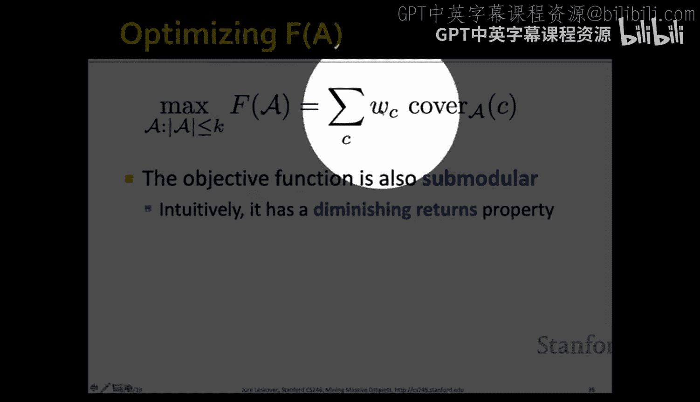

Will never be worse than 363% of the optimal solution。 So that's essentially what this is。

 what this is about， right？ So now I can give you。basicallysically what we learned so far。

 we said let's pick k documents that cover the most concepts。 Every concept has a weight W。

 every document probabilistically covers different concept and the idea is right that we have this partial coverage or probabilistic coverage of a concept where a document this is the probability that a document covers a concept。

 And we said now what we want to optimize is we want to select a set a of documents such the weight that sum over all the all the concept C where this weight is the importance of the concept times this probabilistic notion of coverage。

 which was the probability that at least one of the documents in the set a covers the concept that overall weight that sum is as large as possible。

 and that optimization problem is a modular and we can solve it near optimally using。

E greedy optimization。Is there any question。So if not。

 I need to address what I want to do in the last 20 minutes。 There are two more things I want to do。

 First， I want to show you how you can speed up the greedy algorithm by a lot。

 And then the second thing I will show you how do you learn this personalized ways W。

 How do you learn these blue bars。 how do you learn what the user likes and what user doesn't like。

 So we'll learn about we'll figure out how to learn the ways W and we'll also figure out how to make how to evaluate a modular functions faster And the first thing will be how do you make this scale faster。

 And this is by technique called lazy optimization， right well do it in a lazy way。

 So we will use lazy optimization of some modular functions。

 This is a super useful trick that saves us a lot in practice。

 So here is how greedy algorithm works right The idea of。😊，Cty algorithm is that at each iteration。

 we need to reevaluate the marginal gains of all the remaining documents。

 all the documents we haven't yet selected right so if I have the documents and I want to select k out of them this means that I have to evaluate K times D number of times right because first I go over all the documents pick the the first one now I have to go through the remaining d minus-1 documents to pick the second one and so on and so forth。

 So essentially the the complexity of these algorithm is quadratic right。😊，The way this would work。

 if these are my documents and the size of the bar is is the marginal gain is f of a union this document x minus f of a right in the first round I would ask how much area does each of these documents or how many keywords does each of these documents by itself cover and I would pick the maximum one。

 this would be number A and then what would I do in the second round。

 I would now forget all these things and now I would say how much keywords do I do I cover if I take a plus B。

 if I take a plus C， if I take a plus d or a plus E， right， I could evaluate their marginal gains。

 And again pick the one that helps the most and fix it And now， you know。

 I would go through this again and say already have a AM and B， how much does C help。

 How much does the help， How much does E help and I would go and pick the best one right So you see how after every selection I have。

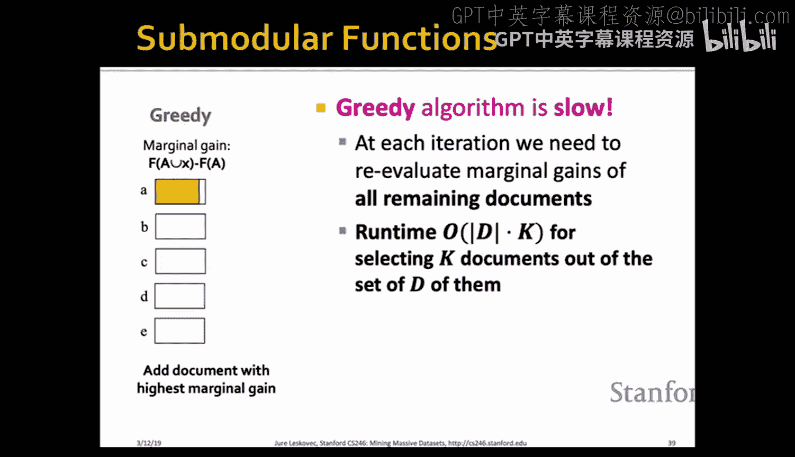

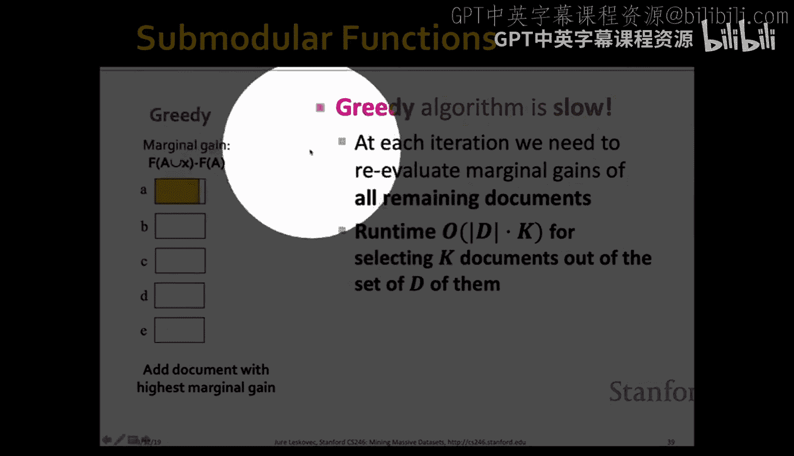

To go through all the other documents。 So essentially， my algorithm is quadratic。

 That's one way to think of it。So the question is， can we do it faster？And the answer is yes。

 we can do it faster and we do it faster based on this observation that will allow us to speed up gridy algorithm through the concept that is called lazy evaluation we will want to be lazy we will want to kind of only evaluate or consider a document if it has some promise for it to lead to a good to a good coverage so here is the observation so this is a huge slide but I want to cover it go through it line by line right imagine I'm running my greedy algorithm。

😊。

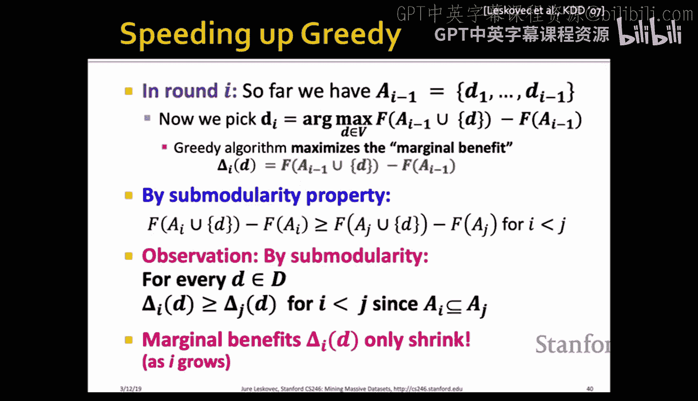

And I have so far composed some， I have selected some documents D1 to D I-1。

 And let's call this a sub I -1。 So this is my current recommended set。

 And then what the greedy algorithm does， it says， okay。

 out of all the documents that hemp had been picked。 Find the one that maximizes your marginal gain。

 This is here and selected right， here it is。Okay， this is the greedy algorithm。

 We have seen this a couple of times。 We should be familiar with this right What this means is that the greedy algorithm really picks document D that maximizes this delta sub i of D right is this marginal gain Wellow sorry right here okay right So this is the marginal gain right So here is one important characteristic of the one way how to think of sub modularity property right if I am building my set of documents a1 after another right then if I denote a sub i to be the first i documents I pick and a sub J to be the first J documents I pick then I know that f of a union D minus f of a is greater than f of j union D minus f of J。

😊。

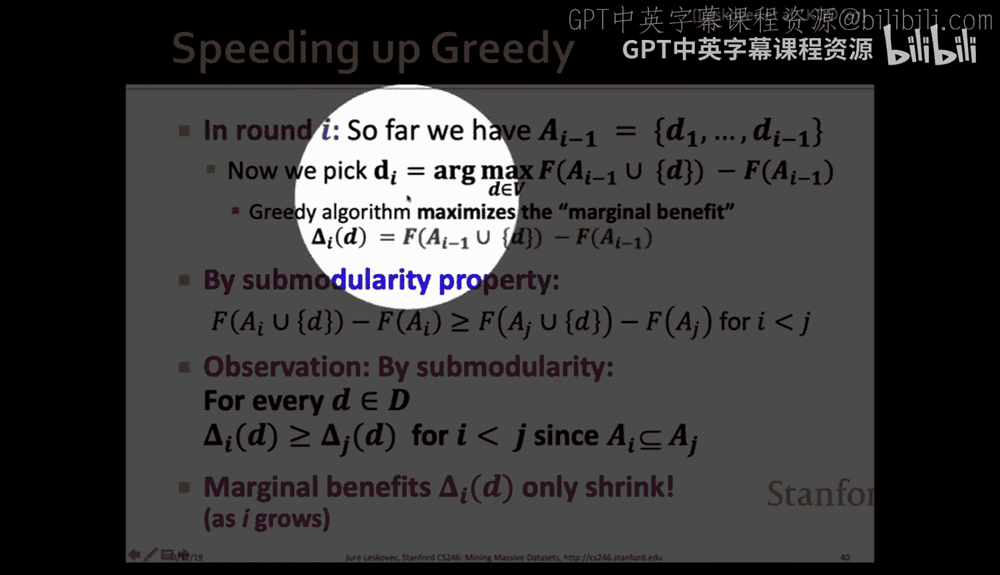

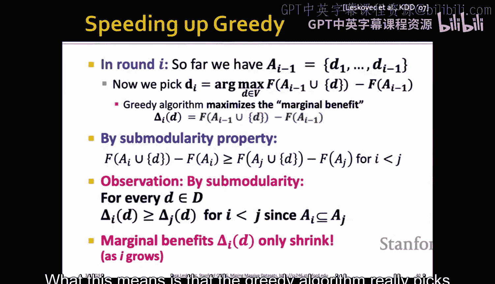

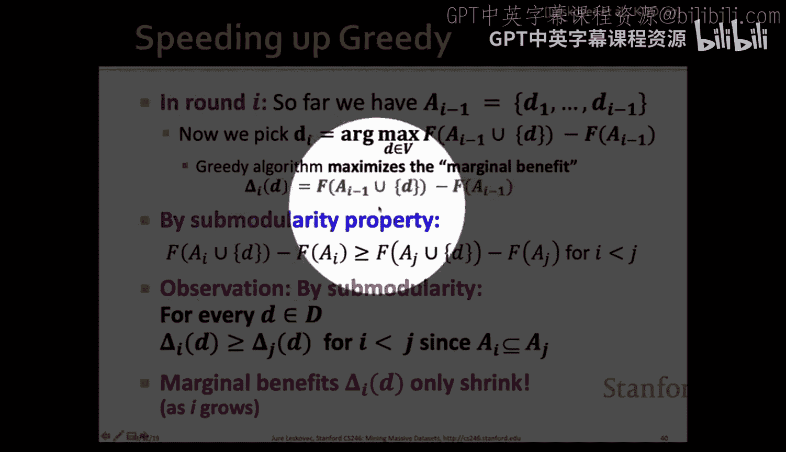

Why is that true。Yeah。Can you speak up？As AI is a subset of H。 Great， exactly。 Why is this true。

 This is true， Because a sub I is a subset of app A sub J， right。

 Because I build these recommendations step by step。 So when I'm at step I。

 I put something in and at step J， I only throw more stuff in it， right。

 So this is really saying that a sub I is a subset of a sub J。😊。

That's why this is true because our F sub our F is sub modular。

 So we are just restating sub modularity effect for part for I be less than J。 Okay。

 Does everyone see that a sub I is a subset of a sub J， yes。😊，Awesome， great。 So if we see that。

 then here is the the super important observation。 The observation is the following， right。

 If I say I， I denote this function delta as the marginal gain。

 then I say the marginal gain of the document at time I is greater than the marginal gain of the document at time J。

😊，Right， so I'm just rewriting this by saying this is deelta I of d and this is deelta J of d。😡。

Right， this is true because I is less than J， which means that a sub I is a subset of a sub J。 Okay。

 But what does this mean， This is the key， This means that this marginal benefits of documents are only going to shrink as my recommendation set increases。

Right another way to think of this is imagine I have a document and it covers three keywords。

 if I ask how if I made no recommendation so far， and I say how much does this document help it covers three new keywords because I have selected no other documents。

 Now imagine I select two more documents， And I ask， how much does this document here。

 how much does it help， it will only help less right in the best， it will cover three keywords。

 but maybe one of the two other document I have selected covers one of those three。

 So this document is now only help me to cover two more keywords， right。

 So the marginal benefit of this same document is only going to shrink right。

 It won't increase as as more documents get recommended and this is the key of these observation I that marginal benefits only shrink right or another way if I use my visualization from before。

 if this is the。😊，If we have the height of this bar is the marginal benefit of the document D at round I so when I have already fixed other i documents and now if I add a few more documents into the set A so that I get a sub J then the marginal benefit of this document D is only going to shrink it will only going to get smaller right so what this means is that selecting document D at step I covers more words then selecting the document D at step J right sometime later。

😡，And it should be kind of obvious if you think about it because if right now this document covers three more words and now I select a few more documents then if I ask how much does this help now it will only cover less because some of the stuff I have selected may also cover one of these three words so the marginal benefit of my document D only shs。

😊，All right。So why is this， Why is this so cool？ Why does this have important consequences？

 The important consequence now is that I can be lazy， right， I can use lazy evaluation。 And why lazy。

 What I mean is that I can use deelta from around I as an upper bound on the delta at some later around J。

 So what this means is that I can say I can use this estimate of how much a given document can help me at most。

😊，RightAnd if if some document is not helping my upper bound on its help on its benefit is not high enough。

 I don't even have to worry about it。 I don't even have to evaluate it， right。

 So here is how this would work。 right， The idea is that I want to keep an ordered list of documents based on their upper bound。

 their estimate of marginal gain。 and I will only evaluate documents based on their marginal gain if they are on the top of my list。

 And then I will update my upper bound resource and continue。 So let me give you a case。

 and youll see why this is a good idea。 right， I have my five documents。

 I ask each document what it is marginal gain。 I pick the best document。 and I fix it。Now。

 in the second round， I don't evaluate B C， D and E。

 but I resort these guys by their marginal gains from the previous round right because this is now an upper bound on how much these guys can help。

 so now I will evaluate a union D。😡，And imagine the the marginal benefit of a of D when I add to a is only what the light light yellow part。

 right， So now I will put it down。 Now， imagine I say how much do A and B。

 How much benefit does B give me when I evaluate it together with A， Imagine I get this much benefit。

 Now I know I can stop。 right？ I know I found the， the。

 the document that gives you the highest marginal gain。 Why do I know that。😊。

Why do I know I found the best document。Yes。 so below you already have a little。 Awesome。

 super great， right， So why do I know， right， I know that this benefits only shrink。

 So if this is the benefit that is up to date， right， I just computed it。 the light yellow 1。

 And I know this will only shrink。 This cannot be bigger than what I already have。

 And this will only shrink as well。 So I don't care about it。 And this is already up to date。

 So I already found the best document， so I can fix B， and I can continue。😊，Right。

 and now evaluate them in this order， right， And then if。

 if the benefit now of E is below this yellow guy， I'm good to stop because， again， I know that this。

 these two guys will only shrink。 So again， I found the best document。😊。

So this is what is called lazy evaluation， and in practice， this gives you a lot of benefit。😡。

Alright， so let me let me summarize what we learned so far。

 We learned that diversity can be formulated as a set cover。

 We talked about set cover being an instance of the sub optimization problem。

 and we talk we talked that the sub optimization problems can be approximately solved using the greedy algorithm。

 and then we talked about the lazy greedy algorithm that gives us significant speedup right。

 So you could say here is the number of， let's say I'm doing you blog recommendations。

 This is the number of blogs I recommend you to read versus the runtime of the algorithm right。

 If I were to use all possible subsets of blogs and see how much which one is the best for you。

 the runtime is here。😊，Right， I can maybe select two blogs。 and then it's over。 right。

 If I use naive greedy， This is how the algorithm scales with the number of recommendations I give you。

 right， This is number of seconds， right， But if I do this lazy greedy， it's essentially going up。

 but very， very， very slowly。😊，It's super fast。Right。

So this is what I wanted to say about optimization。 One thing to note。

Is that this lazy greedy in the worst case， is as fast as greedy。

Because it you can set the input data in such a way that the lazy gridy doesn't help。😡。

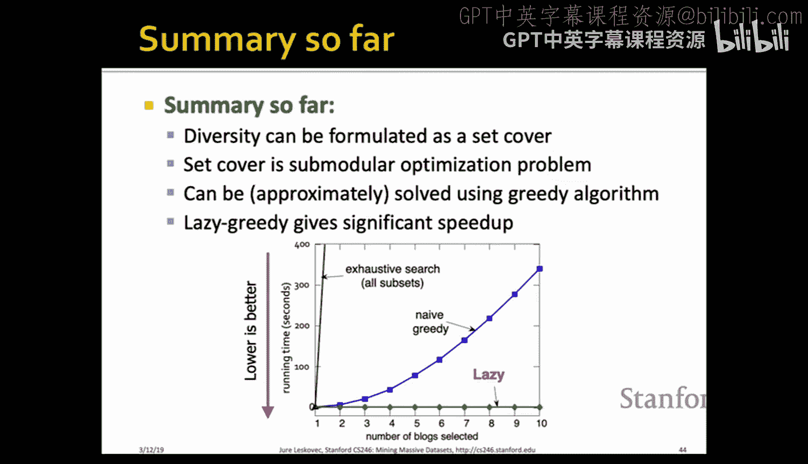

And you can think about， you know， how would you need to set up the input so that lazy greedy wouldn't help that the runtime of lazy greedy would be the same as the runtime of greedy。

 But in practice in， in real data sets， the， the real data sets are not worse case。

 So the lazy version works quite well。 Okay， so， yes， lazy have。You don't need to sort。

 You can use a priority queue。 Okay right， So you don't need to。 You don't really need to sort。

 You all you care about is what's the maximum element。 And you can use a priority queue。

 So that's cheap。Good point。 great， yes。Thank you for listening。Good。

 so this is what I wanted to say about lazy computation of these functions。

 And the reason why it's called lazy， right， is because we have this upper bound。

 and we only examine a given document If we have some some some indication that it might actually be the best one。

 And we are kind of lazyzily evaluating them。 We don't evaluate all of them。

 but only the one that kind of has the most promise。 That's why we are this is called lazy。

 And and this is general the the word lazy is a technical terms。

 So we have a lot of lazy algorithms elsewhere as well。

 and lazy algorithms are usually good in contrast to the real life laziness。 Okay。

 so now the last thing in the last five minutes is to talk about personalization right Like how do I learn what words are important or what concepts are important to a given user right So I want to have this feedback loop where I make recommendations。

 the user creates some。😊，And then I use this data to update my model so I can give you next even more useful recommendations。

 So I want this feedback loop。😊，Right， and we already know what to do， right。

 we know if we have the ws， the the the concept weights， how important is a given concept to you。

 and we have a set of documents。 We know how to select the most important subset for you。

RightSo we know how to select the most important subset that is the most diverse that covers the concepts you care about。

 We know how to do that。Right， but what we assumed so far is that we assume that these concept weights。

 these concept importances are either the same for everyone or somebody gave them to us。

 somehow we somebody told us that you worry about France and Obama and Argo and so on， right。

 But how would I learn this concept weights if I don't assume I know them， Okay。

 so each user can have a different distribution， different preferences over this concept。

 So each user may have different concept weights。 right， so if you are interested in politics。

 maybe this is the this is the way the concept weights would look like for somebody interested in politics。

 right， And if somebody likes movies， then their concept weights might be like this， right。

 they really like these types of concepts and they couldn't care less about other types of concepts。

 right so each user could have a different distribution over the concept weights。😊。

So the question is， how would we how would we do this。

 How would we include this personalization And the idea is that before we had this concept weights W sub C and they were not indexed by the user。

 So we assume all of them to be the same for all users Now we will index them by the user right here。

 So it means that that every user has a different weights over this concept。

 So every user now potentially gets different recommendations because they care about a different set of concepts right so the way we now include personalization is that these ws become personalized。

 They become user specific。 Just think of this This is not raised to the power。

 it is just index So every user has a vector of weights。

 This is how to think of this and everything still goes。

 Everything still works right like all the coverage and everything else I said is exactly the same The only differences。

That these weights now become personalized。 So now our goal is the following。

 Our goal is to learn personal concept weights from the user feedback。

 from user interacting with our news recommender system。😊。

RightAnd the way we will do this is that we will say I have I have a user and imagine this is my document set these are these probabilistic coverage probabilities and I have the weights on the top。

 and now imagine that the user says I really like this news article they give a thumbs up or they click on it or whatever is the positive signal。

 if this is if I get this type of positive signal， then what do I know I know that particular that the user really like this second document So user really like this document that covered Hegel Pentagon and ob right So this means that this document covered these three concepts。

 So what I want to do in in some sense， I want to increase go back increase the weight on this concepts and maybe I want to decrease weights on some other concepts because user just click gave me。

😊，S that this is what they care about。 I look at that corresponding document and I increase the importances of the corresponding weights。

Right， that's how I want to do this。At least， intuitively。

And the way I would do this is called the algorithm to do this is called multiplicative weights update algorithm。

 So the idea is that I want to。😊，Search for these weights by always doing them up or down a bit。

 And here's how this will work。 The idea is， I assume is each concept C has a weight W。

 And let's say when I recommend you a document， I get feedback either plus 1 or -1。

 Then the idea is the following。How do I update the weights。

 I say for if I get some feedback on document D， then I go over all the words。

 all the concepts that this document covers and I say the previous weight I multiply it with beta raised to the power R where r is either plus 1 or minus1 right and this is how I update the the weight。

😊，Okay， so what this means is that if concept C appears in the document and we received positive feedback where r is plus one。

 then we increase the weight by multiplying it with factor beta where beta is greater than one right And otherwise。

 if we receive the negative feedback are minus-1 we are we are multiplying it with1 over beta beta to-1。

 So we are essentially dividing it by beta right So if I would set beta， let's say to be 1。1。

 This means that every every feedback stage， the weight will either increase by 10% or decrease by 10% because I either multipied by 1。

1 or I divide it by 1。1 right And through this kind of feedback。

 this weights will will will stabilize and they will be reactive or adaptive as the user gives me more feedback So this is one way how you can learn this weights double。

😊，In a personalized way by having this feedback and based on the feedback。

 you multiply the weight or you multiply the weight with something bigger than one。

 or you divide it by something bigger than one。 right So this is R is either plus1 or -1。

 let's say beta is 1。1。 So if the feedback is positive， I take w and multiply to 1。1。 And if R is -1。

 then it's1 over beta times W。 So I divide it by 1。1 and make it smaller。

 Okay so let me just summarize why did we learn Here are the six important things。

 We learn how the algorithm works。 And it works by first identifying a set of documents to recommend from。

 then we identify the concepts you know， the name the entities the keywords in those documents。

 And this will tell us how things can be redundant。

 We will then weigh these concepts based on the general importance。😊。

Then we define this item concept coverage function， this notion of probabilistic coverage。

 we then set let's use the greedy lazy greedy hill climbing algorithm to select a set of items using our probabilistic set cover idea and then as we show these recommendations to the user user will click and we will get the feedback and base the multiplicative update algorithm well be able to update these personalized importance ss of concepts for every user。

😊，So this is the summary， One last question。 How can we update update algorithm such that we can。

Were very。Such like reading instead of plus1 or Great question。 So how would you。

 if you have feedback that is more than just plus1 plus1-1， you could， you can play it with it here。

 right， if you， you would get a feedback of5。 you could somehow select a bigger beta。

 Then you get a feedback of one or something like that。

 right So you have some freedom of about given the feedback how aggressive you wna increase or decrease the weight。

 right， and you could tune what exactly you do here。

 the simplest way I did was just assume it's plus1-1， and then it this kind of elegant equation。

 But essentially， based on the feedback， you choose beta And if beta is close to0。

 then you are decreasing w by a lot。 if beta is much much more than one。

 you are increasing W by a lot， right， And based on the feedback。

 you could kind of tune how aggressive you wantna be changing these weights。 Okay。

 that's a great point。 Sure。😊，I would like each document covers conflicts differently。

How do I calculate like these document doesn't cover concepts。 Yes。

 the way you cover this is slide 26。 When we said that we have this probabilistic notion of coverage and thats and where we said that function cover D of C。

 that cover that the idea for that is to capture how much as a document cover a given concept。

 So when you do NLP or when you count thats how you would set that function。

 I think person there at the back， ask a good， good way how to do that。I mean。

 when we're increasing the weights， the one we lift on it and then we increase the weights in this situation。

Let's talk more。 Let's finish here because I'm over time， but come here and we can talk more。 Okay。

 thank you very much。