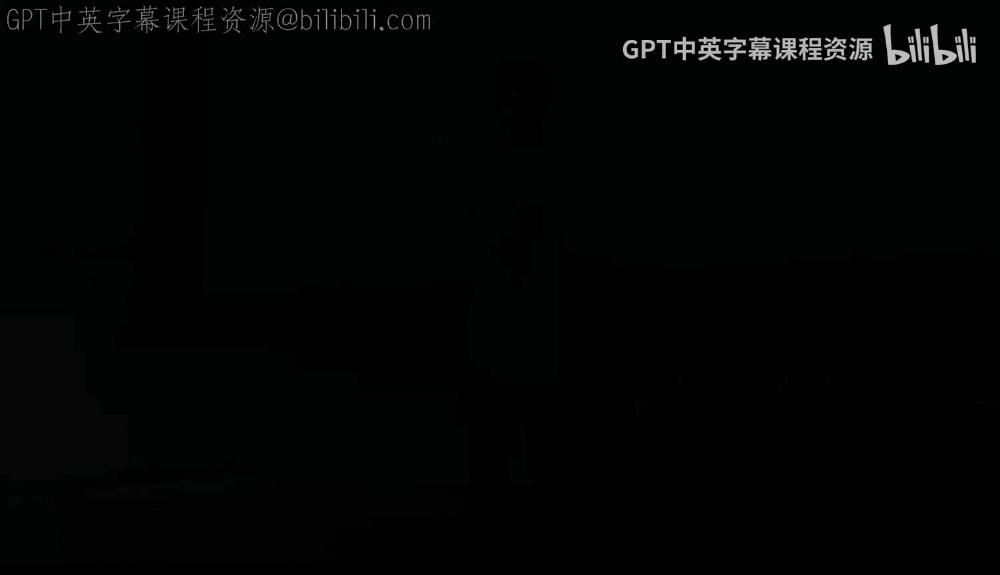
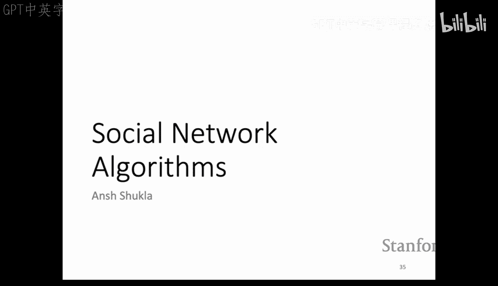
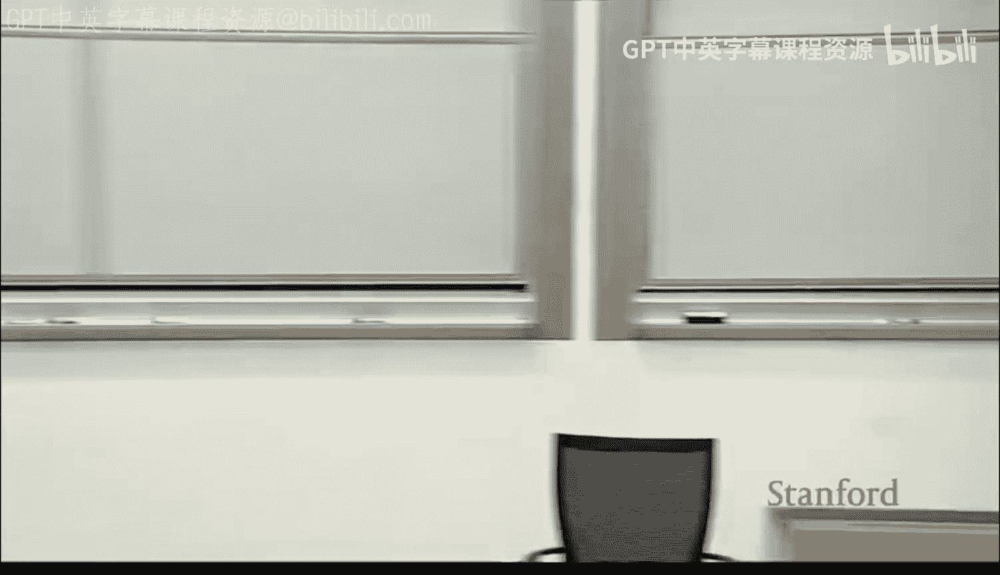
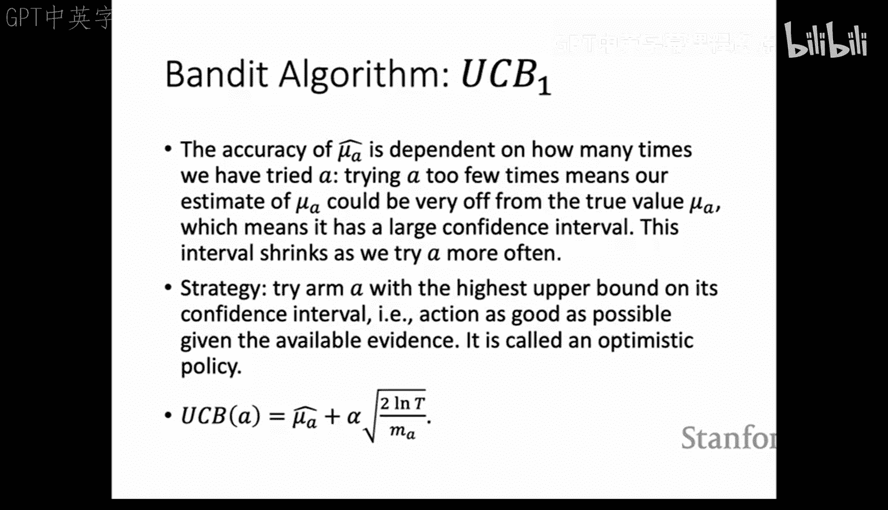
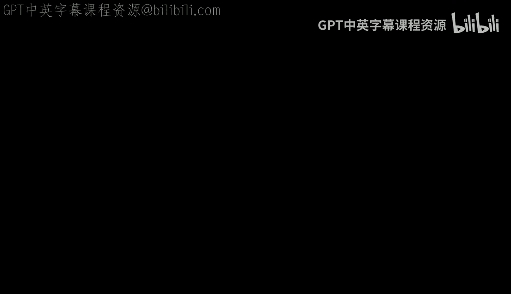

# 斯坦福大学《海量数据集挖掘｜CS246： Mining Massive Data Sets 2019》中英字幕 p20 -P20-lec20 Final Review.zh_en -BV1raSjBuE3d_p20-

いだ。

Okay， great， hello， everyone。 Welcome to the last co course of the quarter。

 I really wanted to say a few words at the beginning。

 And then what I wan to finish my my part as quickly as possible。

 and then the teaching team nicely sitting on the there on the right of the of the class is going to give an overview of the topics we covered the in this course this quarter and give give kind of an overview of the important concepts And the hope is that this will help you study with the final exam。

😊，And then we should all know what to do for the final exam the times the early version on Monday。

 the real thing， I think on Tuesday， SCPD students should know how things are going and so on。

 So if you have any doubts reach out to us because you want to make sure that the final exam process goes smoothly and then all I wanted to say is I wanted to thank you for the very good quarter。

 all the excellent questions and discussions we had。

 thank you for the hard work on the homeworks and on the gradients and and also for to the people who are actually coming in class and asking me questions and making my experience in this class to be fun。

 and then of course， what I wanted to say is I think you should be proud of yourself because you learned a lot in this course we went through many different methods that all are very practical and as you continue either doing research being PhD students going in industry working as the research。

😊，Scientists， the toolbox you learned in this class will be amazingly useful whenever you deal with data and with practical problems。

 So with that， I'd really like to thank you all。 You， you achieved a lot。 You did great。

 Don't worry too much about the final。 It'll be awesome。 And， you know， the spring break is coming。

 The sun is out。 It's actually good time。 So thank you so much。

 And now Young is going to take over and talk about mapreuce and frequent items at mining。😊，Go ahead。

 you can。Thank you， Ruri。Hope。嗯。した no， no no。7度で。Okay。Good， thank you。Okay。Okay， let's get started。

 So first， we're gonna review about mapreuce and frequent items as money。

Mapreduce is a programming model designed for live assets is with easy parallelization and photo tolerances。

There are three steps of map reduce。 So the we can see this three steps from this diagram。

 It's easier to see here。 So first， the map function， map will take。😊，Each input。

 and it gives us assign value for each key。 And for the group by key phase。

 the map will actually collect the pairs and then do short and shuffle and assign each data in to different reducers。

 And in the final phase we have reduce， reduce phase will actually just take all of the data and deal with the give the values with the same keys。

 And then we give output and contact them together。😊。

So one thing to know for map reduce is how we deal with failures。

 map reduces to design for like computing those with failures。

 The output for from previous phase will actually be stored so you can restart the task without like starting the whole jobs。

 which would be time consuming and to assure the reduced task actually produced the right results。

 We have this blocking properly。 So no output from the map from the map task will be used for reduced task if it's filled。

 So we actually we just restart the map task。 And then we use only use the right outputs from map task。

😊，And then we also learned about data flow systems。So map reduce is pretty strict。

 So it only has two ranks of tasks。 So you need to do map and reduce map and reduce。 So。

 and the dataflow system generalize this。 So instead of just having the map and reduce。

 we can have any number of tasks。 And with like other functions， such as drawing， subtract。

 things like that。😊，And so Spark is like the the most popular the Afflu system right now。嗯。Okay。

So we talk about frequent item says。 It's pretty useful because for it market market basketing model。

 And the main application for this is we can after we compute all the frequent items says。

 we can use it to compute confidence， the interests and to get the association rules。😊，那我。

Those are the three。 those are two algorithms to compute frequent islands in memory。

 So we'll take talk about how do you deal with with large data and it cannot fit into memory。

 But those are those two air prior and PC wises is to compute frequent islands in memory。And first。

 for， for a prior。Its pretty straightforward for the first。 it has two passes for the first pass。

 we we keep count of the items only because the bottleneck for this。

Frequent items says counting is mostly is just the frequent pairs。Because you consider like。

 you need to combine any two elements to see whether are frequent。

So the April first comes the islands。 And in the second pass， it would shrink。

 the island comes to only the frequentent islands， because by monoity。

 we only need to come to the canid pairs that both are from frequentent islands。😊，And。

So this could save us。 so we can use the could save us some memory to compute the candy pairs。😊。

And there's improve， improved algorithm called PC， Y。PC Y also have two passes for pass one。

 we will keep account for the items and use the same amount of memory as a prior。 But unlike PC Y。

 well also use the rest of memory for the first pass。😊。

So the idea is we will keep a hash table for pairs。And you can't like。

 count for like different pairs for the first pass。

 And you keep the buckets of this hash table as many as possible。During the second pass。

 we shrink the island comes to frequent islands。 And for the has tables。

 we just need to convert it to a bit mapap to see whether each bucket is above a threshold as now we said before。

 So if it's above threshold we said to be one， otherwise0。So when we come the candidate pairs。

 we just need to go through the has function and to see whether it's hash to the bucket with one。

And if it has to one， then we keep， we keep the counts of this pair。嗯。And then the。

 the previous two algorithmnys just for the data can to memory。

 And we can use utilize those two algorithmnys to deal with to as a as。😊。

As a building block to build this more complicated algorithm we can count。

 We can do item counts for data can a memory。 So the first one is just simple random sample。

 And second is S， O N。For S O N， we will go through the data with small chunks。 We。

 we still go through all of the data， but we just deal with it one at a time。

And the random sample cannot guarantee that we have all of three items， but S O N can。

And there's an improved version of toveous algorithm。 We can improve from the random samples。

 where we keep not only the frequent items， but also its negative borders。 And during lecture。

 we prove that for this we start from random sample。

 and we count the frequent items frequent pairs and and this negative borders and during this second pass。

 we count frequent sets and their negative borders。 if no sets in the negative border is frequent。

 then we can guarantee we've had all of the frequent item sets。😊，So that。

 that's a pretty good guarantee。 But if we failed to， if the negative border is penetrated。

 we need to start again from another sample。Okay， that's it for from A set。 Okay to the next person。

Thank you。😊，Okay， so I'm going to talk about LSH and classroom。

So we discuss a very important algorithm for finding similar items or similar documents called locality sensitive hassing on this algorithm。

So。Require only order of n runtime instead of order of n squared。 You do need to compare every pair。

 So it's a order of N。Algorithm， and it gives pretty good result in terms of getting similar items。

So L S H， you need to do three steps。 So first， you need to get the shingling of the documents。

 and then you need to find the me hasing and then the LH step。

 So so shingling is to convert documents into a set representation of its K tokens K Kgramms。

 basically and。So you want to get a K as large as possible so that you don't have a too low probability of of。

For for a shing happening happening in all the documents。嗯。So。嗯。

So we use Jaar similarity to measure the similarity of documents where the similarity is defined as the size of the intersection of two documents of its singles over its unions。

嗯。Then we need to get a we want to hash the documents into the same bucket with higher probability if they are similar and with lower probability if they are dissimilar and for deimity。

 me hashing is a desired hashing function where the probability of hashing two documents in the same bucket is the same as their similarity。

嗯。So so in the in class， we discuss how to perform mehahing。 So basically。

 you get a permutation of shingles and you find and you hash it into the first bucket where there's a one。

So the general theory of locality sensitive hashing。嗯。Suppose， so， so， so we defined the。嗯。Yeah， so。

 so basically the the L family you choose is based on the this measure you choose。

 and so for documents， we chose to car similarity and we have me Haing。

 But for different for different measures of distance。

 you can have different hash functions that you want to use。And。We also defined the D1， D2， P1。

 P2 sensitive hashing where that means that if the documents is at least D1 is within D1 similar。

 then there's a probability of higher than P1 to to has them into the same bucket。

 And if it's further than D2 away。 then the probability hashing into the same bucket is less than P 2。

And we discussed how we can use and and or composition to basically magnify the， the。

The probability of getting it into the same bucket。 And so without N and or。

 we have this the straight line。 were hashing the same the we're hashing two documents into the same bucket is the same as a similarity。

 So there's a straight line。 And using N and or composition。

 we can basically bend the straight line into this red curve and to be more specific。Yeah。

 so suppose we， we have we use the the B band and R rows technique that we introduced in the class。

 So the probability。 So let's go over the probability of hashing the two documents into the same bucket。

So， so for the B and R configuration， you have R rows of of the of the， of the。Of the signatures。

 And you have B bands of those R rows。 So basically， you hash the two documents in the same。

 Its a can pair when。There is at least one band。 You hash all of them into the same bucket。🤧嗯。

So the problem of that happening is because we have， because we have the similarity is S。

 then probably of hashing one document into the same bucket is， is S and。And in in the。

 in the same band， there are different rows。 So probability of hing all of them in the same bucket is S to the R and。

At least， at least one of them。So for them to disagree in at least one of the band is one minus for them to be disagreed for at least one of the rows is1 minus S to the R and because we have k bands we have b bands。

 we have1 minus S to the R to the B， so that is the probability of signatures disagree in at least one row of all of the bands。

😊，1 minus that is a probably of of the signature agree in all row in all rows for one particular band。

 at least。 So then that's the probability of of two documents become a candidate pair is1 minus1 minus S to the R to the B。

Yeah， but but in general， you can have more different configuration of configurations of how you use and an ore composition for a D1 D2 P and P2 sensitive family。

 if you use and construction， using R rows， then you convert it into a D1 D2 P1 to the R P2 to the R sensitive family。

 And similarly， if you use a or construction with B bands。

 you convert it into a D1 D21 minus P minus Y minus P1 to the B and minus1 minus P2 to the B sensitive family。

 So using R using or composition， you make all the probabilities higher and using n composition。

 you lower the probabilities。😊，Okay， so classrooming。So， classroom is a。

Oncerified learning algorithm where you method where you want to where you are given a set of points and a measure of distance and you want to assign the points that are close close to each other into the same cluster。

There are two general types of approaches for this task。

 the first is the point assignments where you initialize sentries and you assign points based on the distance to the sentries and then you iterate over and refine the assignment。

The second one is a hierarchical clustering， where each point starts with with the cluster as its own。

 and you combine clusters based on the distance。YeahSo for point assignment， we discuss K means。あ。

怎么是。Its basically， yeah， this K means and and a modification of K means called BFR algorithmism where it allows you to run K means on a very large data。

And for hierarchical clustering。So as we discussed is you basically merge cluster based on a measure of distance。

 and you can use max distance or mean distance or the average distance to merge cluster。

 And this will give you So so in some sense， this in some cases。

 they might be better because they will give you some cluster that are that you won't have in kians like the rain shaped cluster。

 you will get this from from hierarchical cluster， but you won't get this from cameians sometimes。😊。

Okay， so I will be talking about dimensionality reduction and recommended systems today。

So first let's look at some motivation for why we need to do dimensionalality reduction so in some cases we might need to save some storage。

 do some faster processing， maybe discover some hidden structure and there are a couple of methods that we discussed in the class specifically we will be looking at SVD and CR there are both different kinds of decompositions。

SVD， you try to express your matrix M as the product of three matrices your sigma v transpose U and V are orthogonal matrices。

 which means that your transpose U is equal to the identity matrix Sigma is a diagonal matrix with non- negative entries on the diagonals the entries along the diagonal are called the singular values of your matrix M so what we use SVD for practically while doing dimensionality reduction is to do singular value thresholding which means that you typically keep the top x singular values that you want to hold that you think have enough information to describe your matrix m set the others to0 and therefore reduce the dimensionality the SVD always exist for any real matrix m and is unique up to a permutation of the sign of your singular vectors。

So how would one actually go about finding the SVD So we need to find to find sigma。 And we。

 let's say， for instance， you first look at the eendi composition of m transpoM where m transpoM is a real symmetric matrix using this。

 you can come up with。The the eigenvalues B of m transpose m as well as the singular vectors the eigenvectors V v would be the right singular vectors of m while sigma would be the square root of the eigenvalues of the matrix D so similarly if you start from mm transpose instead of m transpose M you can compute u as well as sigma So that gives us a method compute u sigma and v So how we actually calculate eigenvalues is by doing power iteration where you start with a random initialization and then keep multiplying with the same matrix over and over again to get the principal eigenvector So a small notice m transpose m and m transpose of both real symmetric matrix C if m is real and if you have a real symmetric matrix your eigen decomposition is off the form  Q lambda q transpose where Q is your eigenve basis and lambda is your diagonal matrix of eigenvalues。

Okay so now we look at CR， which is another method to do dimensionality reduction So you do non- uniformiform sampling from the rows of a itself where the row column importance which is basically the probability fraction by which you sample them is proportional to the norm of these columns you combine R and C you make the intersection and take the co inverse of that sub matrix and that becomes your U in your C decomposition So in terms of why the tradeoffs between sVd and C C could be more interpretable because you actually use rows and columns from the matrix M itself rather than this abstract concept of singular vectors sparsity is preserved U and V are dense matrixrices whereas C and R or sparse since you expect your rows and columns and your recommendation matrix to be spars however CR might also output redundant features you might have like multiple of these vectors in。

CR that happen to be pretty much the same thing or very similar。 So that's basically。

Between SVD and C so where you have a which is typically a huge in sparse matrix in SVD your U and V are both dense matrices whereas sigma is sparse in C it is the opposite C andR are sparse matrices whereas U is dense。

Okay so now well go over a quick overview of recommender systems so the first kind of recommender system that we saw in this class was about content based recommender systems so the general premiseise is that you are given a matrix of users and items and their ratings and you want to predict missing ratings that you don't know from this matrix so what you do in content based recommender systems is you recommend items to a given customers similar to the previous items that they rated highly so you do some sort of feature engineering come up with a user profile and you estimate similarity typically using cosine。

The next thing we looked at was collaborative filtering。

 typically this is of two types user user and item item collaborative filtering user user collaborative filtering gives the rating that a user might give based on similar users who have rated the same item and conversely for item items collaborative filtering you could use a number of similarity metrics such as jaar distance cosine similarity and Pce and correlation and this is basically how you use some sort of normalized similarity with ratings product to predict the rating of item I for user pretty rating of user X for item I you could also remove the baseline estimates and only model the deviations from the baseline estimates so that we are not affected by user or item I there might be some user who tend to rate certain items always highly so we don't want to be affected by that。

So the last thing that we saw in terms of recommender systems was latent factor models which again boils down to some sort of matrix factorization approach you try to take your rating matrix R and expressor as a product of two thinish matrices one of these could be expressed as like the product of your singular value matrix sigma along with the right singular vector matrix so these latent factors represent sort of abstract concepts in the user item space and we use those to come up with recommendations。

So how you could do this was would be to use some sort of stochastic gradient descent to minimize your loss function you typically include regularization terms so that you can prevent overfitting you solve this by SGD as you guys also in your problem set you can also extend this to include biases just like what we did for collaborative filtering as well as temporal biases that can occur over time。

Hi， everyone。 I'm going to talk about page rank。So page rank is a method for determining the importance of web pages。

 and the rank of a page depends on how many pages linked to it。

 pages with higher rank get more of a vote。 And if if a page of higher rank link to the other page。

 then that page also have higher rank。 So that's like the general idea of page rank。

 A quick example is like we have three nodes Y a and M。

 So we can write down the equations to compute the rank of those three nodes。 So for example。

 for for node y。 So node a let's look at the node a first。

 So there are two nodes that link to a which are y and M。 but for why it has two out linkss。

 So in the equation， the rank of a is equal to。😊，It's equal to RY over2 because they are two out links。

 and we soon like the rank distribute evenly。 So and in terms of the node M。

 So it only have one out link。 So we plus R M。 So for node in order to compute the rank of y it it has a link that link to itself。

 So we have like R over two and node a also linked to y but node a has two links。

 So we we plus R over two and for the last node M。 So the the a links to it but it has a two out link。

 So R M is equal to R over2。 So that's how we formulate the equations to compute page rank。If we。

 if we have like， if we add teleportation into our equation。

 then we will introduce another parameter called like teleation parameter is beta。

 So with the that amount of probability， we follow the random work。

 and with one minus that we do the teleportation。 So if we want to write down the same equation for to compute the page rank of those three nodes。

 then we will have like 0。8， we assume in this case， the teleportation parameter beta is equal to 0。

8， then it's equal to 0。8 times the previous part we computed and plus in the end1 minus beta。

 So it's like1 minus0。8 that is equal to 0。2 and over 3 because we teleport to all the nodes and and we have three nodes in this structure。

 So we do the same thing for node y and node M， so。😊，We have the equation as strong in the slides。

So he， this page like just gives some general formula instead of just a specific example。

 So if we want to write down the iterative method to compute the page rank。

 then we can do for example， we want to compute the page rank of node J then it's equal to beta is like the teleport parameter times all the nodes that's linked to it。

 So as you can see， the sum of all the node I points to j and so beta times R I over D and D is out link of node I and plus teleportation terms So like one minus beta divide by n because we assume like teleport to all the nodes and evenly we can also write down because the first equation is like we compute iterative we can also formulate all the nodes in a matrix and using power iteration to to compute page rank so。

😊，The matrix we can do is like using like beta times m and plus one minus beta 1 over n。

 which is like n times n matrix the this matrix is like just be careful as I wrote down in the in here like if node I points to node the J。

 then we said MJ I equal to one over D I It not M I J equal to one over D I just be careful with that。

 If there is no node connect to each other。 then the M I J I just equal to 0。😊。

So next we talk about the topic specific page rank。

 The difference between this and the previous slide is that instead of teleporting to all the nodes in the structure。

 we just teleport to some specific specific nodes， so。In this case， we， we don't。

 We don't add the1 minus beta over n。 Instead， we add like 1 minus beta over S。

 and S is all the space set we want to teleport。 and the rest is the same。

 And we can use the power iteration to compute all the page rank。 So that's all for the。

 for this part of the review。 So， yeah， let's welcome。😊。

Cool， so。In in this topic of graph algorithms， our general problem is finding communities in large graphs where community can be basically any structure we're interested in within the graph。

 so for example， we might care about triangles， the nodes that have three nodes that have edges between each other or high density neighborhoods of the graph。

An important tool is the personalized paid rankwood sweep method。

 so the intuition is we use a version of paid rank with teleport to give a score to all the nodes。

 we're going to rank the nodes by the score and then have some way of partitioning this ordered ranking into the clusters or groups we care about。

嗯。So， an important。A type or definition to be aware of when we're executing personalized page rank sweep is this notion of a cut edge。

 which is an edge。 So if we have a cluster， it has one node in the cluster and one node outside。

And then another definition is conductance， which gives you a sense of the。

Connectivity within a cluster versus relative density outside the graph。And the general strategy。

 when we're sweeping。Is we're going to calculate these personalized pay rank scores and then order by score and then kind of build a set one at a time and calculate a conductance score for it。

 And then when we have a local minimum of conductance score that's a good candidate for defining a cluster。

Using this general strategy， we can also do motif based spectral clustering， so。

We're going to basically do the same thing as before， but change our definition of densely linked。

 and we're going to take our original graph and have edge weights such that it corresponds to our new notion of density and then come up with a new conductance criteria for it。

嗯。So， if， so we have some， some motif。啊。And we saw。Will we turn it into a weighted graph。

Where edges represent the motif。 And then our new conductance score is basically the number of motifs cut。

And then finally， another thing we can do or something we might be interested in is looking for complete bipartid subgraphs in the original graph。

 And actually here there is a nice trick， which is we reframe the problem to one of finding frequent item sets where every vertex is a basket that's defined by its neighbors and then run the priori algorithm。

Now， graph embeddings。 So here the problem is we want to do some machine learning on a graph。

 And so as part of that， we want to figure out a way to represent nodes in our graph in some continuous vector space while capturing properties around the node that we think are important。

So the general intuition is we're going to come up with a mapping from nodes to embeddings and then define a node similarity function in both these spaces we care about。

 So one space is in this continuous embedding space and one is in the graph itself in the continuous space where we'll use dot product and then we'll talk about in a couple slides what the notion of similarity is in the graph space and then once we have that we can optimize the of the parameters of the encoder such as similarities in one representation map to similarities in another。

So actually for the embedding， we're going to use。We we're going to do the usual embedding。

 which is just what every column is it's the shallow embedding。

 So every column corresponds to a node。And now we have this problem of how do we define or come up with a way of calling two nodes similar in the original graph structure。

So here we propose this notion of a random walk so we're going to take two different nodes and start a random walk at those nodes and then the random walk of particular length will give us a set of neighbors of the nodes and then if two nodes have similar neighbor sets we're going to consider them similar in the graph now there's a few ways we can do the random walk so in lecture we talk about the BFS versus DFS inspired random walk and it's important to be aware of the biased random walk we use for the node to Vc algorithm so in the biased random walk we're trying to trade off between the DFS random walk which goes further from the original node and gives us a global structure of the graph versus the BFS random walk which tells us what a neighborhood close around the original node looks like and so we have these two parameter so we notice that every time we take a step in the random walk so here。

WereGoing from， say， S to W。They， then all the neighbors of W can be of three types。

 One is they're closer to S1。 So they're S1， or they're equidistant from S1。

The distance between that node and S1 is the same as the distance between S1 and W。

Or the node is farther from S1 than W。 And so in this biased random walk。

 we're going to have this parameter P， which tells us a probability of going back towards S1。And Q。

 which is the parameter， which tells us the probability of going further than S1。

 And then we can always stay within the same distance。 So this is the random walk。

 biased random walk we use for note effect。 And then finally now that we have a representation。

 we have a definition of similarity in the graph space and an embedding。

 we want to optimize our embeddings。 So similarity in the embedding space correspond to similarity in the。

Gras space。 and to do that。 we， we did find this loss function。 So we go over all the。

 the nodes in the graph and all its neighbors and then do the minus roughly what ends up being the negative log probability of。

Seeing one of the neighbors in a random。You have this seeing one of the neighbors in a random walk starting at you。

And another thing we covered in the class is how to efficiently calculate this loss function。

 because an observation is that we have a double sum happening in this loss function。

 So we're summing over all the nodes in the graph。 And then to calculate that denominator。

 we have to do。Some arithmetic for every single node in the graph。

 and it itll be useful to be able to look at a loss function and try to come up with a runtime approximation or a complexity of approximation of what。

 what it would take to calculate that loss function。啊，你咪。Yes， you do。セ。All right。

 it's machine learning time。😊，So in this class we mainly junior lecturers to mainly talk about supervised learning。

 which means you're given a set of data with features， X and a label Y for each of the data point。

 and you try to learn a function that given given a feature， you try to predict the label。

 the corresponding label， it's hard because the training set you're given is limited。

 but you want to generalize your model to deal with unseen data when you're doing tests or when you're serving the actual model。

😊，We've actually also talked about- we've also touched a little bit of large scale unsupervised learning in your homework4 in question three。

 the K means clustering thing you worked on。😊，But here we mainly talk about the thing we we cover in the lecture。

 So if three times types of task classification versus regression in classification。

 your label belongs to a discrete set， for example， yes or no。

 or might there might be like more categories for regression。

 your label Y is continuous usually in numerical。😊，In lecture we covered two different methods。

 this entry and support vector machine， SVM。So let's first look at a decision tree。😊，Given the input。

 which is the dimensional attributes， could be numerical or categorical。

 and we're trying to predict some output label Y， which can also be either numerical categorical。

 So given the data point。😊，Oops， yeah， the point it doesn't work。 So given a， given a data point。

 we start from the root。 And then at at each node， we tried to。

 we try to tell between some kind of splitting criteria and go to the left or right subree。

 And then we keep dropping it down until we reaches some leaf node。 And then at leaf node。

 we have some rules that does the prediction of the Y value accordingly。

So now we have three problems。 first， how do we split at some node Also。

 when do we stop splitting instead of keep going。😊，Also， once you reach a leaf node。

 how do you make a prediction？😊，So to split。You want to measure the quality of different candidate features and you're going to choose one of them and also the corresponding value to make a split that helps you make a better distinction among your data。

😊，For regression， the metric being used is purity value。

 which is basically the weighted average of your left left sub tree and right subre variances。

 and you see that how much of the weighted variance you reduce by splitting your tree into a left and right subree based on some feature in some value。

😊，For classification it iss also kind of similar， but it's formalized as information gain using the entropy function。

 which we cover in the lecture in detail， and you are also taking difference between the entropy before you make the split versus the entropy after you make the split on some feature value x and its corresponding value。

😊，So question2， when do we stop there are two different criteria。

 One is one one heuristic is when your leaf is pure enough， which means your data。

 your data in that leaf in that node is not very it's not very different from each other。

 So you have a lower variance。 Then you say， okay， I can make a pretty good guess about the label。

 The other criteria would be the number of number of example in that leaf node。

 when you have when you have a too small of a set of samples in your training data that goes through that leaf node。

 you probably don't want to split further because you might be overfitting the data。😊，Question3。

 how do we make a prediction？ So for regression， when you reach a leaf node。

 you would want to predict。Yeah， you can either do an average of the samples samples in the leaf。

 or you can just build another linear regression model inside of that leaf node using the data inside that leaf node and the make a corresponding prediction。

😊，In the classification problems， you would just take the mode or the popular mode or the most common value of the label in the leaf node。

😊，So in lecture， we also talk about using mapreduce to build large scale decision trees in case that the tree is pretty small。

 but the data set you have might be too large to fit in like memory of one computer or you want to paralyze the training process。

😊，So it supports in general like hundreds of numerical features andt so planet works with cases where your target variable。

 your target label is numerical。😊，And in planet you beat your decision tree one layer at a time。

 starting from root node be the first layer， second layer， all the way。

There are three different tasks being done using Mareuce at the beginning。

 you want to do the initialialization where you select a bunch of candidate points。

 which are the features and their corresponding potential splitting values。😊。

And then you iteratively do the find best split function。

 which evaluates how good a split is and you select the best split to build a tree and then at the end。

 when you when you run your tree node， that's small enough so that you can do the entire treebuing process inside of one machine。

 you just call a memoryorybu， which helps us either splitting out the tree further a little bit or just directly making the leaf node。

😊，And then after this， we talked about tree bagging。

 which is basically the idea of training multiple different design trees using different random subsets of your data。

😊，This helps like this helps you， you think of you can think of kind of like an expert system where you have like different。

 different。Different models that are trained on different subset of data and then gives you a slightly different result and then you try to aggregate them either take an average or take the most popular vote。

 for example， youre using classification and then you get one final answer according to different output from all these different trees。

😊，Also， based on backging， we have an improvement known as random forest。

 where at each candidate split， you choose a random subset of the features instead of like considering all candidate features。

 And then you make a split only choosing one of the feature and values in that selected subset。

 the idea of this is you might have some very， very strong features and like every single one of your trees will choose that feature because it's so like powerful。

 And it's kind of losing the purpose of training multiple different trees。

 So you want to put some randomness in。 sometimes you want to get rid of some very strong features。

 So you get different ideas on the data。😊，And using randomand 4 is a chief state of the art result in many of the classification problems。

Now we look at SVM support vector machines。 So given dimension given D dimensional data input feature X。

 you're trying to make a prediction。 the vanilla SVM works on label positive and negative labels。

 so basically a two class classification problem。😊。

Where point so in the 2D situation you need three points， d plus13 points as your support vectors。

 and they uniquely define a decision boundary shown as lined over there。😊。

And your task at this stage will be maximize your margin。

 which is defined as the distance from the closest data point， for example。

 A or B or C on that side to your spliting decision line in the middle。

So seems like some students are having some confusionfus about like how are we getting from maximized margin to minimizing the weight of there？

😊，So the intuition is that。What you want to maximize is the distance from your closest data point to the middle to the middle line over there。

 And then if you do the math， you can actually if you go through the math。

 you can actually see that it's proportional to to the to the margin to the margin value gamma。

 we define over like scaled by your weight， which means that if if you increase your weight by a lot。

 you can get like very high margin value， which sounds like we get a very good prediction。

 But apparently doesn't work that way。 So the weight handle is either we restrict we fix the scale of our weights at one。

 and then we want to maximize the the gamma， or we fix our margin gamma at one and we try to minimize the weights。

 which is why we will be seeing which is why we'll be seeing we'll be converting this question into minimizing the weights。

😊，However， in the real world we rarely see situations where where this that is completely perfectly separable。

 so some data might inevitably fall into the wrong side of the line。

 which is why we need to introduce the penalty。😊，So here we're minimizing this cost function where we have the margin or like this is essentially minimizing the weight from the conclusion we had before。

😊，Plus， this is basically a hyperparameter ferization on the loss that we have over here。😊。

And here's our hinge loss， which is basically if data point falls on the wrong side of the line or if it falls between your 1 and minus1 line。

 you want to introduce a loss， it was is basically distance of it going far away from the line on your side。

😊，Notice that we' calculate distance from the data point to the decision boundary to the one decision boundary on the side of that data。

 which means it also penalizes some of the points that fall in the middle of the two lines。😊。

And then hence we have our cost function， and we want to calculate the best W and B parameters to minimize this cost value。

😊，There's a closed form solution to that， but given usually our data is pretty large。😊。

We will instead use gradient descent， which you guys have done in homework4 question1 to calculate the gradients of the cost with respect to your parameters and try to minimize。

As a summary， decision tree works on classification and regression problems and you can use numerical n categories of features and labels and it can build very complicated decision boundaries because you can keep splitting on different parameters and values on the other hand。

 support vector machines it only works for classification problems and in a vanilla case it only works for binary classification。

😊，It tends to work well in a high dimensional space where the features are sparse and gives a simple linear design boundary to us。

😊，哦。Just put it anywhere。你是。かし。I would， I would just。So for this part。

 we will cover streaming algorithm we have seen in the lecture。

 consider the case when we are like we are data is coming as a string rather than we have the entire data set。

 But we still want to measure some important properties of the stream like like some property like we want to know the distinct element in the stream or we want to know the second moment of the stream。

 So we gonna have these streaming algorithms to help us give an estimate on this properties。

 So first， wait。first， let's look at the boom filter data structure。

 So the boom filter is used in the case when we have a set of interested item and when a new stream item coming in。

 We want to know if this item is already in our data set or not。 So basically。

 just consider this example， you have a stream of ads。 And you want to show it to your customer。

 But you don't want to show the same as multiple times。 So basically， when a new ads come in。

 you want to figure out whether it's already in the display history or not。

 So the naive approach is basically to set up a hash table and do a lookup every time a new ads coming in。

 But that' is very memory cost。 So it's gonna cost an number of ads space。 So basically。

 we want to use smaller amount of memory， say 100 bit to do this。So this is definitely plausible。

 but it's just， we can。 then in this case， we can give a deter answer。

 We can only give answer with high probability。 and boom filter will help our students this。

So the construction of bloom filter is really simple。 Basically， we just create a bit array of， say。

 size 100。 and we initialize all the bit inside it to be 0。

 Then we also create a hasush function that a uniform hush or or or add to 100 different buckets。

 And whenever an new ad is coming in。 we hash this add to a bucket， for example， say 79。

 And then we will basically set the corresponding bucket to one。Now， how do we test the existence。

 So remember our goal is to it's like when a new ads coming in， we want to know if。

 if we already said。 So basically when a new ad coming in before we actually adding it to the bloom filter。

 we will first obtain its hash value。 say its maybe it' 89。

 then we will go to bucket 89 and look well if it is0。

 then we know for sure that the ads and has never been seen because no no not nothing is hash to that bucket。

 but if that bucket is one， then we can say that with high probability， we have seen this a before。

 but we don't know this for sure because this might be there might be other ads that have hash to the same bucket。

 This is caused by hash collision。 So the first positive probability of our bloom filter structure gonna be like this that the larger number of distinct number。

As you have seen so far， the higher the the first positive probability going to be， so。

There are also like many ways to reduce this false positive probability rate。 For example。

 you can basically increase your memory for the bloom filter。 here we use 100 bit。

 but you can use 200 bit。 This is gonna be a trade off between the memory usage and false positive probability。

 also， you can use multiple number of hash functions and you check whether all bit corresponding to the hash functions is gonna be one。

 you should for this solution。 you should use reasonable amount of hash functions。

 because if you use a really large number。 Then it's also gonna be a many hash col。

 Remember the curing the lecture， which gives you a first the decreasing false positive probability and then a increase。

 So you need to use a reasonable number。😊，And now let's look at the flag maring algorithm。

 this problem this algorithm is designed for the case when you want to have a measure of count of the distinct distinct element in your stream seen so far。

 So the way we do this is basically pick a hash function that will hash your each of element in your stream to log2 to the M bits。

 Then for each new element。 we basically obtain its hash value and then see how many tradinging 0。

 does this hash value have。 And we keep track of a running maximum of tradinging zeros。

 So basically our final estimate of distinct elements gonna be2 to the maximum of trading zeros we have everything。

So the intuition of this algorithm is gonna be seeing like our trading 0 is gonna be unusual because。

 say you have three trading zeros， Then it means every 8 number will we we will be possible to hash to this83 trading zeros number。

 So the probability gonna be one over 8。 So if we see more trading zeros。

 it means highly likely we have more distinct elements because they has to a wider spread of values。

 And so our estimate is gonna be higher。Now， let's look at the As method。

 This method is used to estimate the case moment of a stream of a stream of number。 So basically。

 the we we have the definition of zero moment， first moment。 second moment here。

 zero moment we can already use floodulate Martin algorithm to measure。

 And the first moment is kind of trivial is just the length of the stream。

 The second moment we can use a Ms method to estimate。

 So what we do is basically to you have a long stream and you pick a random starting point T at time T。

 you have you have a element of value a coming in。 Now you pick this a。 And from that time on。

 you count how many times your a appears。 Then you give your final estimate as M multiplied by two x-1。

 This is kind of like a like random projection of higher。Moment to， like。And。

 and you use this pro sum over this projection to basically。

 basically reconstruct the higher moments。 So the application of the second moment could be like。

 estimate the self drawing size in database and yeah。So I will give this to Stephanie。哦。Hi。

 I am going to review the topic of web advertising。So first， let's start with the basic problem of。

Matching in a bipartite graph。 So this problem is is to find the maximum possible matching for a given bipartiteid graph。

 So a bipartite graph is just a graph that has two sets of nodes where there are only edges between the nodes between between the nodes of the two sets and there are no edges within the nodes between there are no edge edges within the nodes of a given set。

So just given a bipartite graph。Our aim is to find the maximum possible matching in the graph。 Now。

 this question by itself can be solved in its。 I mean， we can solve the optimal。

We can get the optimal solution for this problem in an offline setting if we are given the graph up front。

 but what we are interested in here is trying to find a solution when we are working on the online version so in the online version。

We are only given one set one element at a time from set2 and we are given the preferences of of this element and we either had to match it to one of the elements into the set one or just move on to the next next element。

So， in this online version。Well， one way of doing it is just by matching every every element greedily。

And if we look at the。If you look at the performance of this greedy algorithm we we can see that the greedy achieves a competitive ratio of1 half so competitive ratio here is defined as the worst possible ratio of the matching solution that our online algorithm returns when compared to the optimal matching over all possible graph inputs so greedy algorithm can be shown to have a competitive ratio of12 while in general just from this definition we can see that this ratio is going to be less than equal to one for a maximization problem like the matching one。

😊，But on the other hand， if you're having a minimization problem like bin packing。

 where we're trying to minimize the total number of bins that's， that's that needs to be used to say。

packack different items of different volumes。 Then this ratio is going to be more than or equal to one。

So how is matching related to advertising。Advertising can be thought of as an online matching problem。

 So the web engine， the search engine， it's trying to。Find the best possible matching by assigning。

Each adds to different bidders and what is optimal to do in order to maximize its revenue is to rank the bidders in decreasing order of their expected revenue here expected revenue is defined as the product of bid and click through rate but this by itself is quite tricky to evaluate oftentimes because clickthrough rates of a lot of bidders are not known to the search engine and then there's also this fact that we don't want to exhaust any of the bidder budget too quickly and everybody has a finite budget。

Now let's consider a very simple setting。😊，Where we have these four assumptions that all the advertisers have the same budget B。

 all ads are equally likely to be clicked， and they all have the same value。

 and we only show one ad per query。In this setting if we use the greedy algorithm we get a compete ratio of12。

 but if we instead use the balance algorithm where we pick the advertiser that has the largest unspent budget。

 then we can show that the competeity ratio here is 1 minus1 by e。

And it's interesting to note that this is the highest possible ratio that's that that we currently have using any of the known algorithms for this online matching。

This is just another case analysis for balance when we just have two bidders。

And they both have the same budget B。哦。Yeah， I'm not going to go over the details of this。😔，Analysis。

 but。What can be shown is that the commodity ratio in sorry。In this case。

 it's going to be three fourth。Yeah， well， but the very first point to note here is that when balance stops allocating the ads at that point。

 one of the two bidders must have exhausted its budget。

 and also all the remaining queries should be such that they could have only been assigned to this bidder who had exhausted its budget。

 So that's the case when balance can no longer assign more， more queries to the bidders。

 And then we just have two cases to consider when。Well based on the amount of those blue queries that we assign to the two bidders。

 and in each case， we show that the competitive ratio is going to be three fourth。

 which just exhaustly proves that that's the competitive ratio。

So that was just a general balanced scenario you。嗯。This， this assumption， sorry。Yeah。

 these four assumptions。 But if we do not make these four assumptions。

 then we have the general setting。Where。Where bids can， bids can be of different values。

 and the bid bidders can have different budgets。 and in this general setting。

The competitive ratio of the simple balance algorithm is very poor。 It it's going to be0。

 and we need to use the generalized balance method where instead of just simply looking at the absolute value of the unspent budget for each bidder。

 We use this new function size， which depends on both the bid value as well as the fraction of the budget that's left for each bidder。

 And now if we use this， what can be shown is that we get back the old competitive ratio。嗯。

If we go back to the original setting， we， we can actually note that the simple balance case is。

Is like a simple specific scenario of the general algorithm when， once we make these assumptions。

 yeah。Sure。好。嗯。Next， I'm going to review learning through experimentation。😊，How to start。But呢。

Take action， get reward and learn from that reward。

 That process is called learning from experimentation。

 usually would take the approach of formalizing it as a multi arm banded problem。😊。

So in this problem we have K armed bandit and taking actions is equivalent to pulling arms。😊。

Each arm A wins with fixed probability mu A and loses with probability1 minus mu A。

 We want to maximize the total reward in finite steps。 But since we have no information about mu A。

 we have to estimate the payoff mu A。 So every time we pull a。

 we learn a bit about a so we can estimate it。But how to select arms to pull。 We need some strategy。

 Therefore， we have several algorithms that get that can get us about which arms to pull。

 All the strategies have different tradeoffs between exploration and exploitation。

 Let's review the definition of exploration， exploration and exploitation。

 Exp is that we pull arms that haven't been haven't that we haven't tried before。

 Expation is we pull arm with current highest estimated payoff。

So greedy algorithm takes action with highest average reward on samples have seen so far。

 but it doesn't explore sufficient。 Epsilon Gry takes a random a with a decaying probability Epsilon T and it takes the same action that greedy would take with probability1 minus epsilon T。

😊，During exploration time。It just selects random randomly select an arm with equal probability。😊。

Next， we will review a very important algorithm called UB。 It stands for upper confidence Bo。

It balance it balances exploration and exploitation by taking confidence into consideration。

 A company interval is a range of values within which we are sure the mean lies with a certain probability。

😊，So that M A equals the number of times A is poor。 Delta is given a the given confidence level。

 like 99%。Then come with some calculation， the confidence interval is two times a square root of two times long T over M A。

 And our UC B is of this R A is the estimated payoff plus half of the company's interval。😊。

Then our strategy becomes choosing RA with the highest upper bound on its confidence interval。

 note that the accuracy of asset mealA is dependent on how many times we have tried A。

Trying a too few times means our estimate of mu A could be very off from the true value。

 which means it has a large competence interval。 This interval shrinks， as we try more often。😊。

That's it for this topic。 And good luck on your final exams。😊，pass themic。あですよ。

