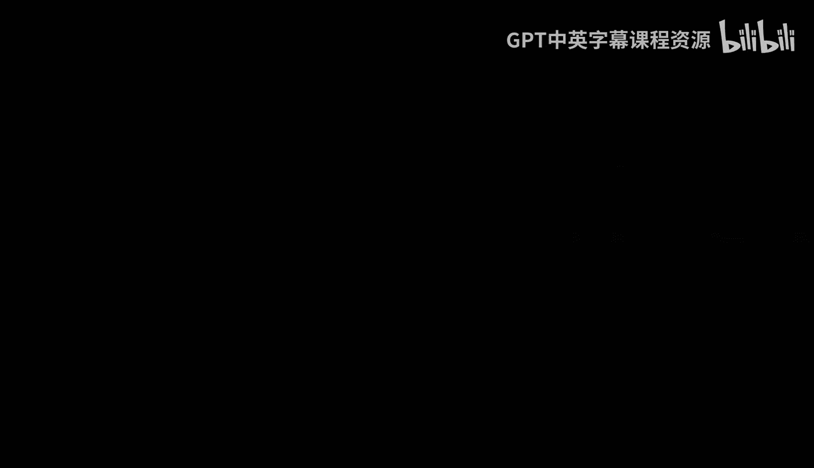
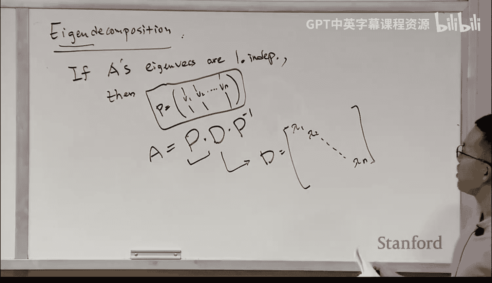

# 斯坦福大学《海量数据集挖掘｜CS246： Mining Massive Data Sets 2019》中英字幕 p21 -P21-Linear Algebra Review.zh_en -BV1raSjBuE3d_p21-

Everyone， I'm Lan Tao。 and this is Shu Yi。 We are the T A for C， S 2，4，6。

 And today we are going to have a review session for the linear algebra。

 And this board just list all the topics。 We are going to go through today。 So first。

 we will go through the vectors and the vector operations。 Next， we will do the matrix operations。

 And next， we will do the types of matrix linear independence。

 eigenvalues and matrix eigenvalue decompositionization。 And by the way。

 the all the slides are in the pi。 So you can also just just take the slides。 So。

 so now let's jump into the first part。 The vector and the vector operations。 I just right here。😊，So。

 so we start with some very basic definitions about the column vector and row vector， so。

So if we talk about a column vector， then that means we have a vector V。

 and it has some elements inside。 So， and those elements forms a column。 So in this case。

 you can see the shape of this vector is n times  one。 because it has n rows and one column。

 And each each row has one element。 So for the row vector。If we also represent as we。

 then we can write in this way。 So V 1， V 2 da do to the V N。 And in this case。

 the shape of V is one times n because it has one row and N columns。 So that's the basic definition。

呃。Yeah。Oh yeah， just interrupt me if you have any question。 Next。

 we' are going to talk about the do product。So the do product， if we have the two vectors。

 let's say it's a U and V。Then and assume both of them are column vectors。

 So that means I can represent US U 1 to the U N and V S。We went to the V N。

And the do product just give us a number。 So it can be represented as U dot V。

 It's equal to each each element each corresponding element multiply together and then sum together。

 So that means it's equal to U 1 times v1 plus U 2 times v 2 until U N times V N。

 So to represent in to just using a more like either form to to rises。

 we can represent as a sum of I from1 to n and U I times Y I basically， just if you expand this one。

 you will get the the sum of every element。So that's for the Dell product。 Just remember。

 Dell product for2 two vector will give you a number。 It's not a vector。 In this case。

 if both you and we are column vectors。呃。So next is about the norm， so。Again。

 if we have a vector called you。Or let's say the we just be consistent with the， with the slides， so。

it can also be row vector in this case。 But anyway， like the norm。

Of V is equal to v 1 square plus V 2 square。Until V N square。So basically。

 you just need to sum every element square every element and add every element together and then take the square root。

 So that's called L2 norm。So a more general form， you can。

 if we're talking about LP norm like like P can be any integer like L 1， L 2， L3， something。

 So the general formula is like。Sation of I from goes from1 to N V I to the power of P， and you。

Take one over P outside。 So let's say if it because this is like L2 form。

 So that means I just need to set the PS S2。 So in this case， let's say like L 2， it just equal to。

I equal goes from1 to N V I to the power 2 and one over 2。 So as you can see， if you expand this one。

 this is the same as the definition I wrote before。

 So you just sum square every element and sum them together and take， take a square root。

 So this ist like general form of P。呃。Is there any questions for this？Cool。

 so next is about the triangle inequ， so。Basically。

 we know if we have a vector called U and another vector called V， then the sum of U plus V is just。

Just like this。 So U vector U vector V and vector U plus way form a triangle。 So， you know。

 like some properties of triangle。 So the norm， let's say the， the size。The length of啊。This the， the。

 the length of vector U is like norm U here。 And similarly， so we have norm V here。

 And we also have a norm U pathway。 then by the triangular inequality。

 So we know if we add two side of a triangle。 So it's larger or equal than the the other length of the the。

 the length of the other side。 So we have。U plus v。It's larger or equal to。

The length of the other side。 And another property is the subtraction of two sides of a triangle is a smaller equal to the other side。

 So we have a。You，-3。Is smaller or equal to。U minus V。 So just， just to be to make it positive。

 So we take absolute value。 And yeah， so that's a triangle property。Next。

 we're going to talk about the matrix operations。 So start with some basic， very。

 basic operation is like addition。 So if you want to add two matrix。

 you have to make sure those matrix has the same shape。 So， for example， in the slides。

 we show a very easy example， if you have a matrix 1，2，3，4， And if you want to add another matrix。

 that is like 5，6， 7，8。 then the result will be just you add element by element。

 So  one will add to 5。 and two will add to 6 and 3， add 7，4 add 8。

 So that's the matrix you get after matrix addition。😊，Next， matrix multiplication， so。In this case。

 you also need to be very careful careful about the shape of the matrix。

 So if one matrix has shape like M times n， then the other matrix， if you want to multiply。

 it has to like basically the， the those two n should match each other。 Otherwise。

 you cannot do the matrix multiplication。 So and the result shape will be M times P。

 So that's like you kind of like just remove the n in in the middle and you just the final shape will be just M times P。

😊，Just be careful with this。 So one example in the slides is like， if you have 1，2。3，4。

And you multiply it with5，6，7，8。And。Let's say。 So this matrix has shape two times 2。

 and the second matrix also has shape  two times 2。

 So then the final result will have shape also two times 2。And a very important formula。

You need to know it's like， if I want to multiply matrix A and B。

 and I want to get the element at a position I and J。 then the。

 the way to get it is like it's equal to a sum of K。 So AI K times B， K J。

 So that means you just need to expand the matrix。 So the way to understand it is very。

 it' very similar to understand the shape。 So you can say AI K and times B K J。

 that means K just kind of like cancel each other。 And you just need to end up like with I and J。

 And so that means。For example， let let's say do this example。 So this means I'm like at index 0，0。

 So that means my I J， my I is equal to 0 and J is equal to 0。 So with using this formula。

We just need to sum all the K。 So in this case， that means I'm looking at。

 I'm looking at this is I equals 0 means the first row。

 So I'm looking at the first row and J equals to 0。 That means the first column。

And K means I go through every every element in the first row。

 and I go through every row in the second。 Like basically。

 I'm just looking at those two number and those two number and multiply them together and do the addition。

 So that means this is equal to one times 5 plus  two times 7。So does this make sense。

 They just apply the formula。 And similarly， if you look at this position。

 So this position is at this I equal to 0 and j equal to 1。

 So that means you need to look at the first row of the first matrix and the second column of the second matrix。

 So this means you need to do the use the number 1，2 and 6，8 in this case。 So this is equal to。

A one times 6 plus  two times 8。So that's idea how to do the matrix multiplication。

So is there any questions for this。呃。Cool， so let's move forward。哦。你 is。Ex use this one。

Some properties of the mat notplication。 So if I have A B time C。Then I can also do the A times B， C。

So this is called asciative。Basically， I， I can just group I two matrix together to compute it first。

 So in this way， I can compute A B first and then time C。

 I can also do the time do the B first and times A。 So I'll get the same result。😊。

Another property is。A times B plus C is equal to。AB plus A。So， this is called。Distributive。

So this means if I have a two matrix I I add together and time another matrix。

 that's equal to the matrix time together and do the submission。 So that's also equivalent。呃。So。

 but just remember， like a times B is not equal to B times a。 that's for that's。

 that's that's is's equal for the integer， like a value time together。

 but it's not equal for the matrix。 So some kind of example is like you can， you can like。

 just make up some numbers。 And you time it together。 Then you will find this not equal。 Just very。

 be very careful about this。Yeah。So next part， we are going to talk about the matrix transpose。

So the definition of transport are the。So transse can also be right like you just have a like capital T on a matrix。

 So the definition is like a transpose。 If I want to compute the I J。

 So I and Js column of matrix transse of a， then it's equal to like A J I。Using this definition。

 we can have like just some examples。 Let's say I want to compute the transse of 1，2，3，4。5，6。

If I want to compute the transse of this one。 So you just need to apply the definition。 And also。

 also， you can get the shape directly because 1，2，3，4，5，6， the shape of that is three times 2。

 And if you understand this equation， that means you kind of like do the s symmetric along the like diagonal here。

 So that means after you transportse the shape will be two times 3。

 you just reverse those two numbers。 And。The number you will get is 1，3，5，2，4，6。Let's say。

 like this number 4 here at the original matrix。 Oh， it's bad example。 Maybe let's look at。

Let's look at number 5。 So at the original example， is that So this is I equal to 2 and j equal to 0。

 So that means it's like in the third row and the first column。 And if I transportpo that。

 So you say like this is at I equal to 0， J equal to2。

 it just reverse I and J and put it in another index。

So that's about transpose and some properties of transpose。The first one is like。

 if you do a transpose twice， then you just end up with the original matrix。

Another property is like if you do two matrix multiply together and you do the transpose。

 that's equal to like B transpose times a transpose。呃，So。Like another property。

It's like a plus B transpose is equal to a transpose plus B transpose。

So those three properties are listed on the slides。 like as a practice。

 we can just because the first and the last is pretty easy。 We can try to just using our knowledge。

 We can actually prove the second property。 So also kind of like a review of previous knowledge we have。

啊。So。Let's try to。Let's try to prove。A B transpose， iss equal to B transpose times a transpose。

 So in this course， you won't be asked proof， but this is just for。

 for a practice of the review session。 So basically。

 you just need to expand the matrix modification using our previous knowledge。 So let's say。

 I want to。Comp the I and J。 So I throw and Js column element of the A B transpose matrix。

 And let's just set A B equal to another matrix C and A B transpose。

Its equal to another matrix D just for the like simplicity。 So in that case。

 A B transports at I J element。 So it's equal to。😊，Just the matrix D at I J element。

 because A B transpose is just equal to D。 And by the definition of transpose， lets say here， so。

D I J is just equal to C， J I， because you just need to。You just need to reverse because like。

 this is the transpose of that。 is this one。 So you just need to reverse the index and。

Using the definition， I think I would erase that。 But using the definition of matrix multiplication。

 you can do the sum。like this， so。So this is equal to A J K times B， K， I。Because this is J。

 and this is I。 And you kind of like cancel the K。 So you end up with J and I just so you can write in this way。

 And in order to like to prove this one， you can do some like transpose inside because A J K。

 you can write it as like a transpose。呃，KJ。So if I do the transpose。

 I can reverse the index of I and K and the same thing here。

 So I can write this as like B transpose times I K。Now， if you look at this， J and I are not equal。

 So I cannot like cancel using the way I want。 but， but， but you can see the K and K are here。

 So the better way to write it because those are all numbers。

 So like one times 2 is also equal to two times 1。 So I can easily reverse the order of those two numbers。

 So that means this is also equal to B transpose I K times a transpose。K J。

 So now you can see the K and K can cancel each other and end up with I and J here。 So that means。

It's little bit small。So let， let me， let me just。Rightr one line here。 So after you get that one。

 then you can say that， the D is just equal to B transpose times a transpose because every element is equal to that。

 So if I put all the element together， then the whole matrix is also equal。

 So then we prove the this property here。呃。Is there any questions for this。Cool， so next。

 we are going to talk about the identity matrix。So the identity matrix is represented as I here。

 And in order to represent the shape of that， it's always a square matrix。

 That means the number of rows is always equal to the number of columns。

 So if I do like I times I sub n。 So that means it's like n times n matrix and all the diagonal is one。

 the rest are 0。And like， like， like I mentioned， the shape is n times  n。

 So that's called identity matrix。 So there are some like very good properties of identity matrix。

 So if I have a matrix with shape M times n， then if I。If I use a times I identity N。

 And so that's equal to。Another identity matrix with shape M times M。

 And it's just equal to a itself。So you can actually using the knowledge of matrix multiplication to work on this。

 because let's say， like if a is matrix of m times n。

 And so this means this is matrix with n times N and you cancel those two N。

 So you end up with another matrix M times n。 because every diagonal is one。

 So if you use a times some value times 1， then it just itself。 So it will also end up with a here。

 So that's the idea。 So same thing here。 if I have like matrix M times M and at time。

 another matrix M times n。 So。😊，Then those two m cancels and the final shape is still m times n。

 And because of the one， So it won't change the value。 So it still have the value。

 everything will be still equal to a。 So that's some property of the identity matrix。呃。Next。

 we're going to talk about the matrix inverse。So the definition of matrix inverse Oh， first。

 the symbol， If I have matrix a， then the inverse of a。It can be written。

Like S A just the negative one。 So this is not like， let's say if I write a number， like3。

 like to the power of negative1 is equal to one over3。 But that's not true for the matrix。 So。

 so it's like different。 It's just a symbol。 So just represent the inverse of matrix A。

 So the definition of matrix inverse is like a times a inverse。 is equal to。A inverse times a。

 and it's always equal to the identity matrix。 So that's why that's also a usage of identity matrix here。

 It's you can， you can just kind of comparable to the numbers multiplication。 Like if I have like3。

 I times 3 inverse。 So that's equal to one。 So basically。

 you can think about like one as kind of like identity matrix。

 And three inverse kind of like the a inverse and three is like a here。 But those are numbers。

 but it's very， the idea is very comparable to the matrix。 but that's different。

 Just be careful about that。 And there are some like poverty of the inverse。😊。

The first one is like similar to the transpose。 If you do the inverse twice。

 you just end up with itself。The second one is， if I have two matrix A and B， I multiply together。

 I do the inverse。 That's equal to B inverse times a inverse。And the last property is like。

 if I do inverse and do the transpose， then that's equal to the matrix。

 do the transpose and then the inverse。 so we can。Also， just as like a practice。

 we can try to prove the last property。Yeah， everything is on the slide。 So you can also。

Refer to the proof on the slide。So in order to， in order to prove this one， we just need to。嗯。嗯。一嗯。

So prove this one。 So it is equivalent to if I just times a transpose on the right hand side on the right hand side of each like a matrix。

 So that means it's equivalent to prove a transpose times。Yeah。

So it's equivalent to that because I just time the same thing on， on。

 on the right hand side for both side。 And now if you look at this one。

 so if you treat a transpose as an identity。 So just treat it as the same， same thing。 like， let。

 let's say like it's a B。 then that's equal to like B inverse times B。

 So the right hand side is just identity。By the definition of inverse。

And if you look at the left hand side， then you can apply the transpose property。

 So this is like because A times B transpose is equal to B transpose times a transpose。

 This is like you use it in the reverse way。 So this is equal to a times a inverse transpose。And。

So a times a transport is just equal to I。 So then this is equivalent to this and also equivalent to this。

So that means they are equal。 So that means those， those two are equal。 that， that that。

 that's way you think。 But if you write the proof， you just write in the inverse way。 right。

 So then basically， that's the the scratch。 like how to prove this property。 So， yeah， that's。

 that's all the part I need to go through And next， let's welcome Shuyi。I can go make it。

So in our third section of the review session， we are going to talk about some。

Four types of matricies that might be involved in the class。啊。The first matrix is。Type matrixrices。

Diaagonal matrices where we only have non zero values on the diagonal entries of the matrix。

So except those those n entries of this n by n square matrix， we have zero in others。ち。

So an important property of diagonnometric is multiplication of itself。So if we， for a brief example。

 would be to the D to the power of 2。It's basically。So， if。We want to find the。

One month entry of this new matrix， we need to multiply each entry of the first row of the first matrix。

Element wise with。The first column of the second matrix we will find because all other places are zero。

We will see that the one worth entry of the new matrix is D1 to the power of2。 So all the。

Diaagonal entries will be the original values of the same place。Raise the power of two。

And all other spots still zero。So if we continue this chain of multiplication。

We will easily see that D raised to the power of K equals。D1 raised the power of K。

 D2 rates to the power of K， and then。Out the way to DN raise the power of K but。

And then it's still a diagonal matrix， and the non diagonal entries are still 0。嗯。

The second interesting matrix we want to introduce briefly here is the triangular matrix。

Tranular matrices are。Matrices， they have half of the entries equal to 0。

 if we talk about lower triangular。Mattrix then。All the entries above the diagonal line are 0。

Where we might found， we might find nonzero entries。8，1，1，8，2，2 on the diagonal and all。

The entries is below the diagon。If we talk about upper triangular， then it is。

Zero values to the lower left corner。 and then starting from the diagonal line， we will have。三ナゼ円。

The third matrix， third group of matrices issymmetric matrix。The matrix means， firstly， a matrix。

Meed to be of size M by N。 It needs to be a square matrix to be symmetric。 And in this course。

 we are always talking about real matrices means all the entries are real numbers。

 So it's deed in this way。 And then secondly， it's。The transpose of。Mattrix a equals itself。

 Then this is a symmetric matrix。Yes， and the third one is orthogonal matrix。

Ortthal matrices are matrices whose inverse are the transpose of themselves。

So if we say matrix U is an orthoal matrix， then u transpose time multiplies u equals u multiplies u transpose equals I。

Mes。The inverse of U equals the transpose of U。If。If we write you。As in the column nectar way then。

We say you one vector， basically。Occupies the first column of theme。

And then you2 is the second until the UN end。And by N， so each column vector is of size。And by one。

 then from the definition。We know u transpose multiplies u equals u transpose。Equals identity。

 then we will know that。For the column vectors we have。啊。U I times U J or your transpose， U J。Equals。

Either zero or one。It's 01 when I equals J and it's one when I equals J， and it's 0 when。

I does not equal to J。So for orthogonno matrices， we call their columns are ortho of normal。嗯。

The vectors are orthonormal if。If they are orthogonal to each other。So when they are。Different。

 they're orthogonal to each other。 and then they are of。Unit 1。就。If you， I。

Transferse times U I is equal to one means basically the length of the vector is equal to one。

 So it's a unique way。 So we call this set。Of vectors。2二分 normal。So。是。

All the entries have to be non zero in the triangle itself， like if you have a zero， the diagonal。

 does that make it not triangular？Yeah， yeah。 Basically。 So for a lower trackle， you have the。

Top right corner has to be zero， but the other half you don't have to be zero。

 you can have none zero values here， but if you have zero that's totally okay。

So those are the four types of matrices we want to remind you of。

 and then next we briefly introduce concepts of linear independence in span。So。A linear first。

 we have a set of vectors。The I。Let's say， we have。你老。呃， linear。Combination of。诶。

VI of these vectors are any vector that takes the form。食 alpha i等。allf 1， V 1， Allf 2 V 2。

So these alphas。Are just coefficient efficient。So if we can write a vector in this form。

Al times V I and then sum up from i from1 to n。I are real numbers， coefficients。

 then we say this is a linear combination of。Vactors in re ice。And。From there， we can define。

Linear independence。Leinearend， we say set of vectors are linearly。V iss。Are linearly independent。

If and only if。We can。The answer to this equation。F times V and sum up to0 if I we say the vectors are linearly independent if the answer to this equation is only alpha I' R0。

 so basically we cannot find any other answer to this equation。哦。And。only answer to。SoThis is。

And then。Okay。So from linear combination， we can define more things。Firstly， we can define。The span。

offff。ASet of vectors。The spam means。All the vectors that we can be expressed in as a linear combination of the vectors in V。

As long as the coefficients are well defined。This is the all the vectors or a set of vectors that can be expressed as the linear combinations of the BIs。

And then so once we have the span， we can denote it as。Large big S。 And then we can have。The basis。

They are so off fast。Basis of S is。Ss。Of linearly。Independent vectors。Ws。That。Span us。So if we。

We can just think about this in the 2D example。 So in our 2D plane， we have a basis。1，0，0，1。So。

 firstly。1，0，0，1。啊温 zero。You know one， they are linearly independent because。The equation。

The answer to this equation involving these two vectors is only 0，0 in the coefficients。So firstly。

 we know its they are linearly independent， and then they spend as means。

Any vector in this 2D plane can be expressed。By a linear combination of these two vectors。

So if you write any vector in this 2 D plan as S y。

 then we can write it out as a linear combination of the two vectors。 So 1，0，0，1。

 those two vectors are。A basis of our 2D play。 So if we project it to higher space。

 higher dimensional spaces， we might have we have other like maybe for 3D， We have 1，0，0。0，1，0， zero。

 zero one。They are a basis of our 2 3D space。So once we define the basis of， of a space， then。

We can further define the dimension。Of。Space S， the dimension of space S is。The number。Of vectors。

And。OfBas。Of fast。So in in our 2D example， we call it two dimensional because there are only two linearly independent vectors that span as in this spaces。

 so it's just two vectors， so we call it 2D space。We might also。

Know that the base is of a space and is not necessarily unique。 So for our 2D space。

 we might have 10 and 01。 We might also have。Maybe one， one and。1 minus1。

 they are also linearly independent and they can also span the 2D plane。

 so they also form a basis of the 2D plane。But basically， the number of vectors is still too。

 So we still cut of 2 these space。So that。that era era this。Okay。

So after talking about the basic concepts， we might enter the last two sections of this review session。

 they are related to the aggen pairs were agenvalue aenvector pairs of matrices。

 those are very important in this course， so agen pair。So when we。

Define an agon pair if we are talking about matrix A。Then。And Aon Valley Lambda。

It's associated or corresponding a andve as vector x。Then we define the eggen pair or the lambmbda。

A a and pair by this， they're defined by this equation。So also we want to notice that if。

If we take the special case of x equal to the zero vector。We will have。Z vectors on both sides。

 no matter what value lambda takes。So we basically exclude。0 from any aconve。

 So we don't say zero is an aconve because it's so trivial。So okay， so next。

 after we have defined an agonvector and aenvalue， we say aenvector x x is the agonvector corresponding to agenvalue lambda and lambda is the agonvalue corresponding to x。

And then so after we defined this， we can solve。given诶。Matrix a。为啥 for。😔，All possible avalue。

And there are corresponding aom factorss。So starting from that equation。I'll copy that line here。

We notice that。Vector X is just modificationplication。Ident matrix and itself。So。

 and by the associated role， we can move the parenthesesis to the first two。

So we have this new equation where we can move this。Square matrix to the left so that we have。

A minus lambda。Multiplies I。And times vector s equals to zero。

 so this is the equation we will look at。Or we use to find all the eigenvalues and eenvectors。So。

The next step is to have。The determinant of the。Matrix。As0。To find all the a andvalue。

 But before that， I'm。没。Prove for you why we look at the determinant and why do we set it to zero。

So before we can do that， we need to define。A no space。Of matrix A， the not space of matrix A。

Is the set of vectors。That。After the whatever transformation projection defined by a。

 we reach the zero vector。So nospace of a is a set of those vectors。And then。So in this。

So in this equation。Our matrix is a minus lambda I。We want to find。A non trivial solution。

To the equation here。So that means。Well， naturally we can see that acts as zero vector is a solution。

 but we always want a non tri one。That means we want the no space。Of a does not equal to。A set。

 which only contains the zero vector。We want this。And then in some other terms。嗯。诶。Does not， or。So。

 it should be。A minus。玩不得啊。So a minus lambi does not。Have full rank。This is equal to say。

 we may think of the Gaussian elimination。嗯。So for a gaussian simulation。

 when we are solving for a linear system。We always do the operations on the whatever A matrix here。

Always after Gaussian Limination， we have the lower left corner all the entries is zero here。

 so we basically。Have啊。Set of equations， but we want to start from the last one and work backwards。

 So that's the Gaussian information。 And then so in the last equation here。

We have A and N prime times X N to be 0。 So if a matrix is for rank。

Then the A and N prime won't be 0。So that means。The only answer， it's， it's flu rack。

That's equivalent to AN。It's not zero。 that means in this equation， the only answer is x n to be 0。

And then if we work backwards。呃。The last。The second one here is a。And minus1 and minus1 prime times。

And。嗯 plus。A X and。X n to be 0。After this step， if the matrix has full rank， then xm SV0。Then。

A and minus1 n minus my prime。Is not zero then x N。-1 is 0。 So it's like step by step。

 We work backwards and all the elements of the x。Vactory 0。 So basically。

 if we have full rank of the matrix。Then the solution to this a times x matrix a times x equals 0 has only answer to be the zero vector。

 But in this case， we want the other way around。 So we does not。Want to have。

The only answer to be the trivial case。 So that is， we does not want the matrix to have full rank。

That's basically what the equivalent says here。あ。So starting from there。If it does offer for rank。

 you may check with your other linear algebra classes， then the determinant。啊。After there's a matrix。

Has to be  zero。Okay， but you are not required to prove that in that class in this class。

 but is always was good to know and then so from here we have the determinant equals to zero。

 then starting from here and we can solve for whatever lambda does we want or whatever lambda associated with this matrix。

嗯。A good case for exercise for this。As。Square matrix。With entries two and one。

So we want to saw for it。Aenvalue。And following our steps there。

We have the determinant equals to zero。So the a minus lambda I。Is。Onlyly前。Copy a first。

Then the lambda only subtract it on the diagonal entries。So there are only two minus lambda。

2 minus lambda and the determinant。Of this matrix。I。2 minus lambda。

Times 2 minus lambda minus one times1。And we want it to be zero。So that will give us the lambda。

Or the aenvalue？Of this matrix to be one or three。So following the we have now。

 we have found that all the possible values of avalue of this matrix that' starting from there。

 we may find the。Aom factors。Associated or corresponding to。Each agavalue。So， we。

Pllug the whatever values we have here back to the， to the original system。And we have ax equals to。

 let's say we take lamb lambda equals to one then。Is equal to x。 And then we can suffer this or。

Put it on way。A my friend I equals x。发嘅。Lambda equals one， then the matrix is。

All ones in its entries and times x equals to0。So if we write x as a column actor。X1， x2。

 then we know one times。X1 plus。One times x 2 must equal to 0 and。Sam equation。On the second entry。

 give us the same。So from here， basically we know。Any vector that satisfies this equation is an aom vector associated with our lambda 1。

So we can be one minus1，2， minus2， or even minus11。

 so the avectors can be linearly stretched by any coefficient you want it's always practice for people to limit it to unit length so that it's clear for everybody。

啊。Any questions？Why do we want the nuta of a to not equal just the zero vector？啊。So， our equation。Is。

A minus lambda I， lambda I multiplifies f equal to zero。We want this well， basically。From eyeballing。

 we can just say x a solution to x is the zero vector， right？

But we always want something that is not trivial。So that is like our no space of this matrix。

It is not limited。Yeah， yeah， it's not limited to that just one vector。after。Of course， I mean。

This solving by hand procedure is always easy with matrices of small sizes or low dimensions for big matrices。

We always use， computers to solve and sometimes with more complex linear algebra knowledge。

So after we know what aenvalues aggenvectors are。And how to suffer them。We want to。

Briefly remind you of some properties， there are five of them。So first one is because， oh， sorry。

 which just， I just era them。 But as we can linearly stretch all the agonvectors， we usually。诶。

Write them or let me say limit。All the lengths to be one or limit them to be unit vectors。

That's just by。I guess。Practice。And second。Property is， if a。

Is a square matrix or real matrix and square。 and then a is。Symsymmetric。Then we always have。嗯。

The eigenvalues。As real numbers。All of them are just real numbers。Okay， oh by the way。

 for the five properties， I have proofs here if we do have time after this， we can go briefly after。

But I don't think we will have enough time。 But okay， so the third property is。

For triangular matrices。嗯。Theyre aenvalues。R the。Diaagonal entries。Present in。

TheWhatever matrix you are given。系啊。Fourth property is the trace。Of a matrix。Bad handwriting。

The trace of a matrix， well， would define it to be the sum。Ofs the diagonal entry。

This can be proved to equal to the sum。The aenvalues of that， that matrix。And the last property is。

The determinant of the matrix is the product。Of its aomvalue。

 so we can see here aomvalue are really important for a matrix to some extent。

 summarizes information present in that matrix。😊，Okay。So lastly， I want to。

Introduce a and decomposition。Decomposition。As you can see。

 it's associated with aggonvalue and agenvectors so。If。A matrix A。It's aen factorss。Our。Vennily。

Independent。但。We have promised to have a decomposition form of matrix A。Well。

 then if we write all the aenvectors as。嗯V1， V2。On the way up to BM。If we can， well。

 we can always put them in matrix from them， this matrix is an element of the decomposition。

The matrix A is promised to be decomposed as。Matrix P multiplies matrix D and then lastly I match the inverse of matrix p。

 So the P matrix as written here is the matrix of aenvectors and matrix D is the diagonal matrix。

Whose diagonal entries are the。Aenvalue， course founding， Aenvalue。So basically。

 we have we can decompose。Any matrix that satisfies this requirement。

Into a form of the Pplies the modplies the inverse of P and you know the。

Alements of the D and P are always corresponding to each other。 So we can， we can switch。

We can switch the sequence we have the aigenvalues here。

 but we always need to switch correspondingly where the associated aenvectors are。

This property is very important or very useful because when we calculate some。

Self multiplication of large matrices， maybe a to the power of n。Then啊。

It's always computationally heavy to just time in time in to like you know， time A。

 time A to whatever we have to the product we can always。Have this。Very clear and concise firm， just。

Raise matrix D to the path N and keeping P and inverse of P the same。And as we can see。

 because matrix D is a dcanal matrix。 as we mentioned very early in section 3， we are just。😊。

Raising all the elements to the power of N in this matrix。

 So we only need to decompose a once and then use whatever information we got from that decomposition。

 That is quite useful in a large scale computation。And questions？

That would be the the end of the this review session all the。Points mentioned in this review session。

Should be enough。For the course。 and I think you are a good go with。

Homework assignments and lectures， you might encounter some knowledge later in the course。

 but Yuri is going to introduce them in the lectures。系。

