# 斯坦福大学《海量数据集挖掘｜CS246： Mining Massive Data Sets 2019》中英字幕 p22 -P22-Proof Techniques + Probability Review.zh_en -BV1raSjBuE3d_p22-

Welcome to the review session for CS 246 mining massive data sets today we will cover proof techniques and probability on Thursday we have another session for linearar algebra and we already had a session last week for Sp。

So all this material will be up on the class website as well as the lecture videos。

 so feel free to take notes if you want to， but we will be putting all this up in any case okay。So。

My name is Je。 I'm one of the E T S for the class， and I will be handling today's session。

 So the agenda for today is that we will start with。😊。

Proof techniques just go over some different types of proof techniques that might be helpful that might help you during the problem sets and so on and then go over like a re refresher of basic probability at any point of time。

 if you have questions， feel free to stop me and you can always ask us further questions on Piaz Z otherwise。

 or in lecture so let's get started。Alright， so we will start with proof techniques。Okay。

 so in general。If you are asked to prove any particular statement。Any particular generic statement。

 So you can， one thing you can do is。Showing that it's true for specific cases。

 but that does not constitute a proof。 For instance。

 if you're asked to show that the square of every odd number is odd。

 you cannot say that03 is an odd number and the square of 3 is 9。

 which is also odd and therefore all the square of all odd numbers are odd。

 So that does not constitute a proof。 So what you can do is take a generic example。

 And if you can prove that it is true for all of the generic examples， you can say that it is true。

 So， for instance， we have。Let's say。The same statement。Also。

 if you cannot read anything that I write or if you think it's not big enough， please let me know。

 I will try to write neatly to the best of my ability。

 but it's not always the greatest handwriting around。

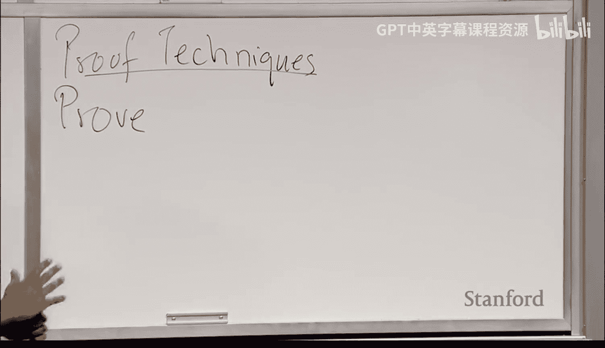

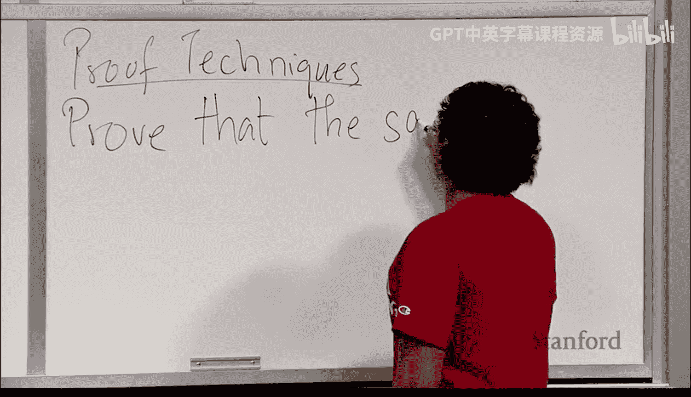

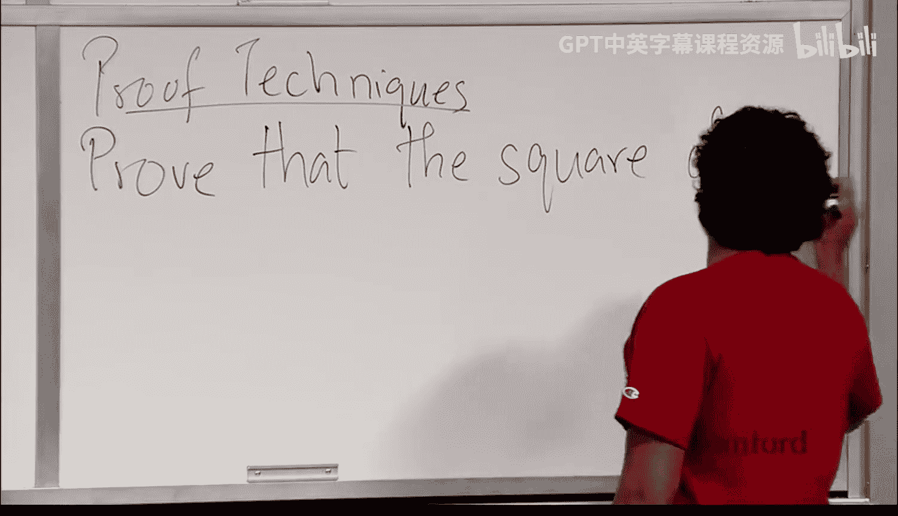

Okay， so let's start with something simple， prove that the square of any odd number is odd。

 So all we can say about the number that we have in question is that it is odd。

 We cannot make any further assumptions about it。 So one way to start would be to say that any odd number is of the form。

2 k plus one。Where K is also another whole number。 So if you square this， or you get2 k plus  one。

 the whole squared， which is。4K squared plus 4 k plus1， which is equal to。

Whi is equal to 2 times 22 k squared plus 2 k plus 1。

 which is equal to sum2 m plus1 where m is some other whole number since 2 k squared plus 2 k is a whole number。

 So since since we have shown that2 k plus1 the whole squared is off the form 2 m plus one which is also odd and this is true for any such odd number So this is a generic number we have shown that the square of any odd number is odd so know that we did not assume anything in specific about the odd number here。

 we just treated it as a generic card number and went ahead okay so that is something simple。

 So now we will go with some some techniques that people commonly use for proofs okay so。

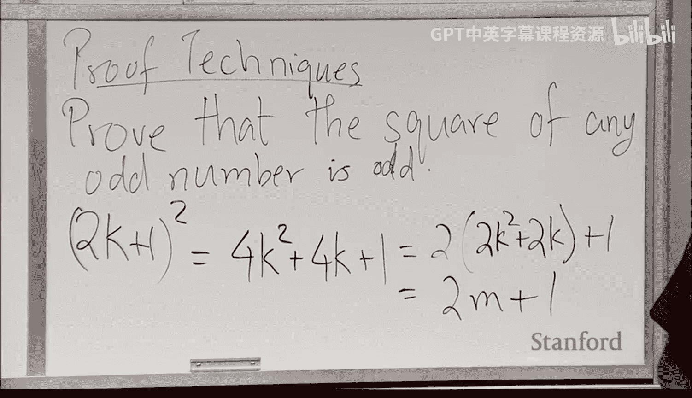

AlRight， so the first thing we will deal with is called。Growth by。Contrapositive。

So let me first explain what contra positiveitive means。

 And then we can go on and see how we would use this while doing proofs。 Okay。

 so if we have a statement saying。

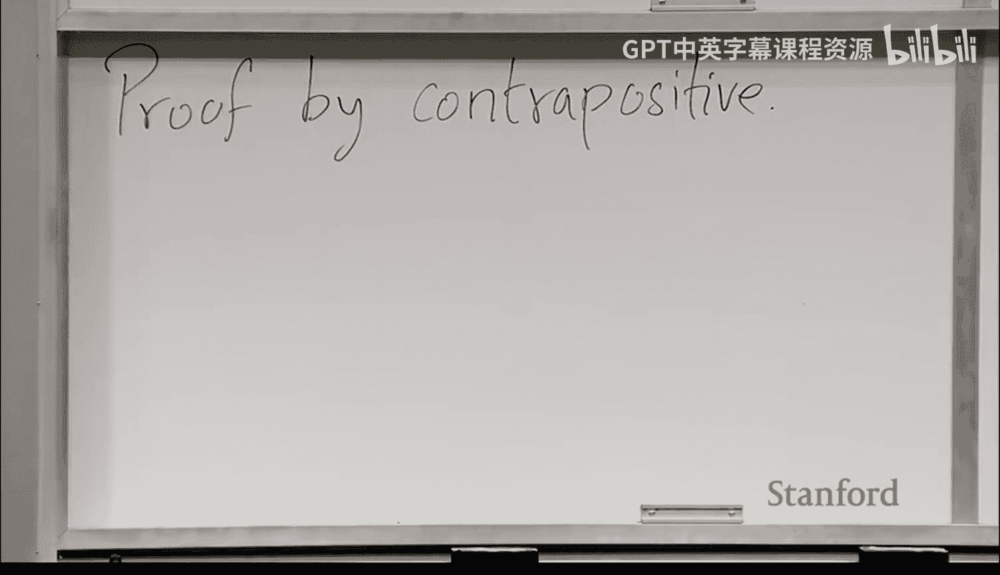

A implies B is your statement。The contra positiveitives states that。

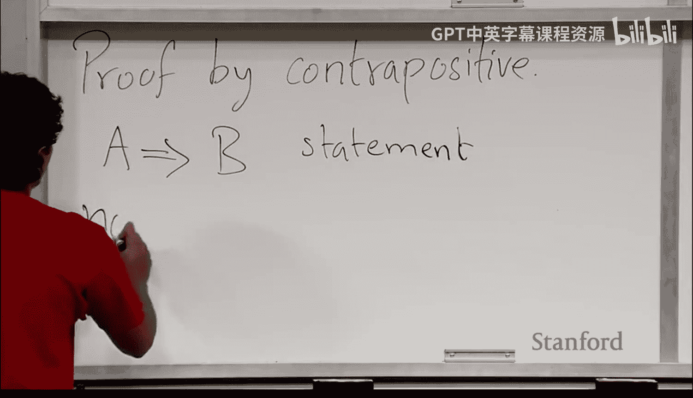

Okay， so the controversial says。Not B implies not a， for instance， if your statement was。

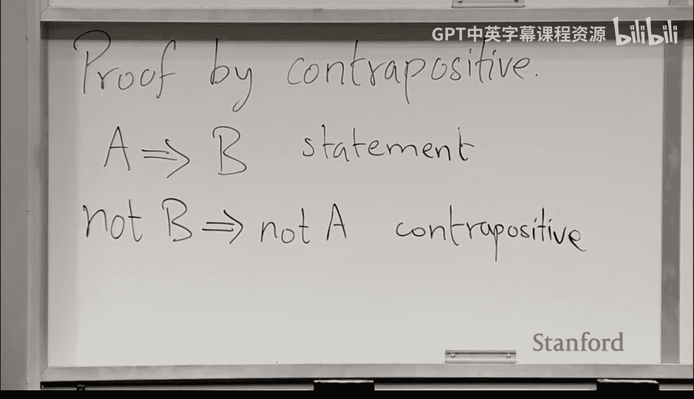

If it is raining today then I do not go to class clearly this is not true for all the people assembled in the room here。

 but suppose that was your original statement if it is raining today then I do not go to class can someone tell me what the contra positiveitive would be。

Not really have。If it's not raining enough。 So， so here are a is。If it is raining。

And our statement here is。I will not go to class。Is the B is the implicator when we say if it is raining。

 So what's the negation of B here。I will go to class。If it is not raining， okay。

 so that is what we are saying。 So if if I have gone to class， that means that it is not raining。

Okay， so that's so the statement。 So proving the counter positiveitive is equal to proving the statement。

 So in some cases， it might be simpler to prove the counter positiveitive and show that the original statement is true。

 Okay， let's do。Some sort of example， so。Okay， let's do this。Okay。

So let's try to prove that if x squared is odd。X is hard。Okay， so one。

 if we wanted to approach this by counter positiveitive。

 the counter positivesitive of this statement would be。Right。

Because something that's not odd has to be even。 So the conory of this is if x is even x squared is even。

 but this is just what we proved， right， in our previous case。 sorry， we proved odd squared is odd。

 but we can prove very simply that if some if x is even x squared is even by saying let x be of the form 2 k。

If we square it， we get 4 k squared， which is two times。2 k squared。Which is 2 M。Which is also even。

 right？ So for any given even number， we know that its squared is even。Therefore。

 we approve that if x is even x squared is even。And this is the counter positivesitive of the original statement。

 which says that if x squared is odd， x is odd。 So since we have approved the counter positivesitive。

 the original statement also holds true。Okay， so this is。

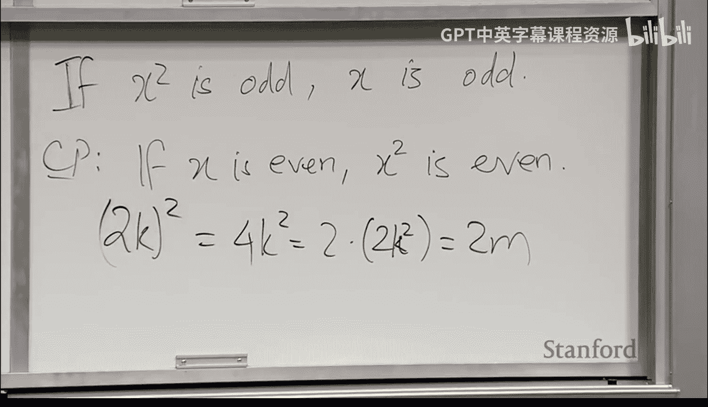

One thing that you should be clear is there is a distinction between the counter positiveitive and the converses。

 and people often get confused by them。 So the converses of this。

Statement so not B implies not A is called the contra positiveitive， whereas B implies a。

Is called the converse。The converse is not always equivalent to the original statement。

 so proving the converse does not guarantee anything about the proof of the original whereas proving the counter positiveitive guarantees the proof of the origin Okay all right。

Let's move to the。Next of our techniques。Alright， so next， we will look at proof by contradiction。

 So what proof by contradiction means is that you take a statement。That you generally say。

You know you you you are given a statement and you are asked to prove that it' is true。

 So you start off by assuming that it is not true and then work yourself to a point where you end up with something absurd that cannot hold and say that therefore your original assumption was not okay。

 So that is what proof by contradiction is it's a fairly powerful technique that can be used in some places So again。

 let's go through an example。Okay， so what we are going to do what we are going to try to prove is that the square root of two is irrational Okay so what do we do as a first step。

 What did we say we would assume that this is not true。 So what does that mean。Yeah， so we assume。

Square root of2 is。Rational， okay。What does that mean？

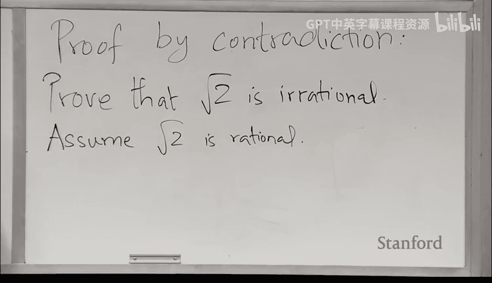

What is the meaning of square root of two is rational。这个行。 so you can write。

Square root of2 is equal to P by Q。Right。This is the definition of what a rational number is。Okay。

 so， so if this were true， then this is true。Now， if this is true， you can say that。

2 is equal to P by Q。Then， you can see。Sorry， p squared by  Q squared， you can say2 Q squared。

Is equal to p squared。 So until here we just follow from here to here to here to here。

 So we end up with this。 Now we will try to explain why this is impossible。 so we know that。

P squared is a square number right， So it's a perfect square。

 That means that its number of prime factors is even。Does that make sense or。So， if p squared was。So。

 we have B gridd。Is equal to P times p。So what are the prime factors of p squared？

It's basically the prime factor of P。Repeated twice， right？For instance， if。If P was P。

 if P is equal to 6 and P squared is equal to 36， what are the prime factors of。B。2，3。 Okay。

 what are the prime factors of 36。2，2，3，3 right， So whatever this is， this just gets repeated twice。

Because this is a perfect squared， right？ So that means p squared has。

And even number of prime factors。Because it's a perfect square。

Q squared also has an even number of perfect prime factors， because it is also a perfect squared。

But 2q squared therefore has an odd number of prime factors。Right。

 because we are just adding that extra two over there to something that has an even number of prime factors。

So right now we have the left hand side， which has an odd number of prime factors。

And the right hand side， which has an even number of prime factors。 And this is clearly impossible。

So all this arose because of our initial assumption that。Square root of two was rational。Clearly。

 that is not possible。 Therefore， our assumption was wrong。

 Their first square root of two is irratione。O。So that's an example of proof by contradiction。

A fairly powerful technique that you can use many times when you're asked to prove a statement。

 it might be a good way to just think about saying， okay。

 let's just assume that it's not true and see if we can come to some result that makes no sense。

 And if that is the case， you know that your original statement was true。Right， cool。

 So let's do few more。Alright， so now we will do。

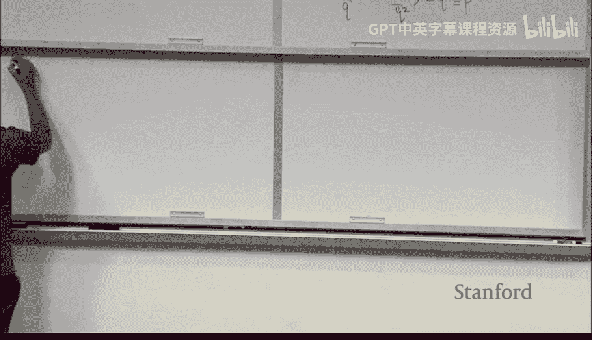

Allright， so。Sometimes it's， sometimes you have。A few cases that your problem naturally breaks down into。

 so proving it for each of these cases would mean that you prove it for the whole whole set of possible examples。

 This might sound slightly vague， but let me just explain with an example okay so。

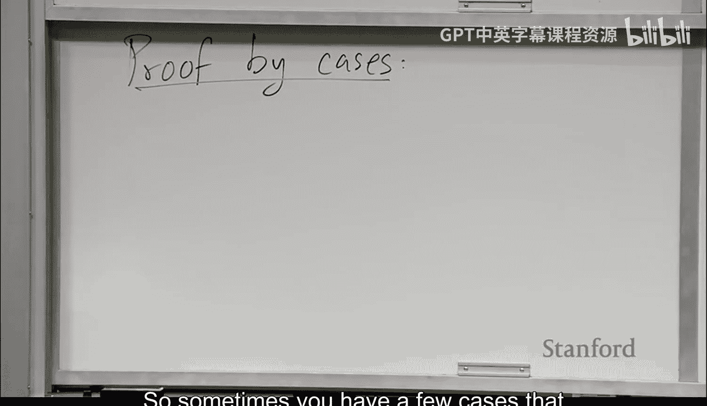

Let。

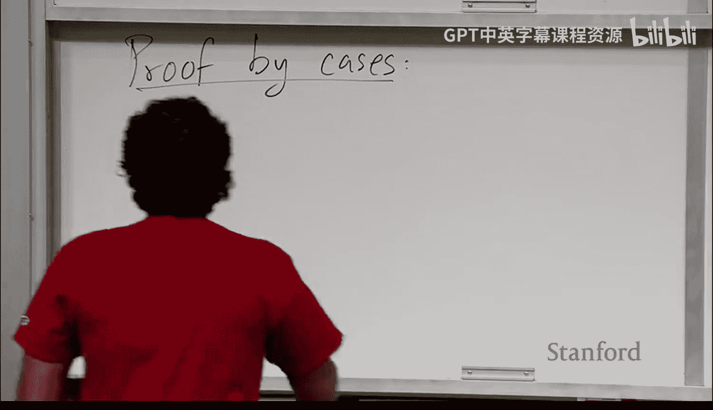

N be an integer。嗯。

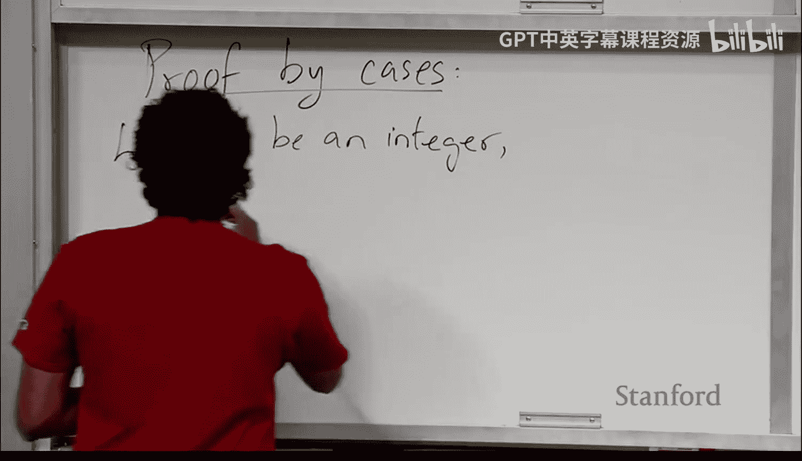

Let。And not be。Dvisible by 3。Then。N squared。Is equal to 3 k plus 14。S K。

 so n squared is always of the form 3 k plus one for some other inte or K。 Okay。

 so we are going to show this by writing out all the possible cases and proving it for each of those cases and therefore showing that it's true across the board Okay。

 so。😊，To start off if n is an intesger。And， you know。

 you are concerned about it being divisible by3 and so on。 What are the different forms it can take。

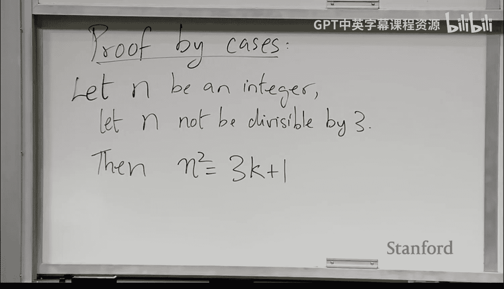

plus one I mean in the in the original sense without any constraints， it could also take 3 k。

 but we have said that it' is not divisible by three here。 So as you rightly pointed out。

 you can have let's say 3 p plus  one。And 3 p plus 2 Okay。

 so n can only be of these two forms given the assumptions of our problem， right？

 So let's just look at each of these cases。Try to see what n squared would be in each of these cases。

 see if that boils down to some sort of 3 k plus  one。 if it works for both cases。

 then we are done provinging it okay so。This is case 1。And this is case 2。Allright。

 so case 1 n is equal to 3 p plus 1。Okay， so how do we look at this， So n squared is equal to。

9 p squared plus 6 p plus  one， which is。Three times。3 p squared plus 2 p plus 1。

 which is 3 k plus 1， right？If my math is okay so what we are doing is just squaring 3 p plus 1 we get 9 p squared plus 6 p plus 1 we group the terms that are divisible by 3 since we know you know p is an integer therefore。

This is also an integer， therefore this is divisible y 3。

 so this is some form 3 k plus 1 where k is some other integer here k is equal to 3 p squared plus 2 p。

Similarly， if we have n equals 3 p plus 2， we do n squared equals。9 p squared plus。12 P。 Thank you。

Plus 4。If my high school algebra is still not too rusty， this gives us。

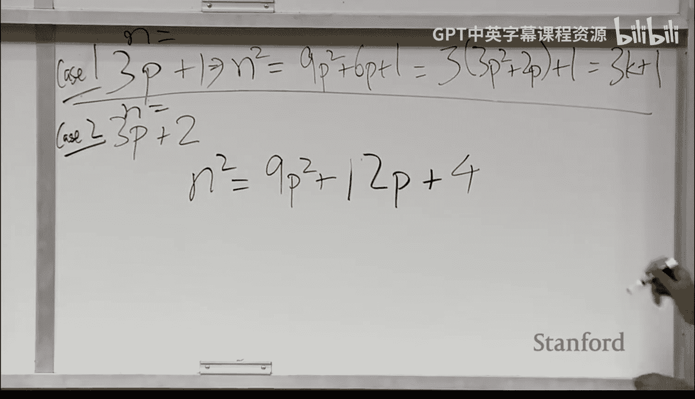

Three times。3 p squared plus 4 p。Plus1。Plus one。Right so we are just grouping terms that are divisible by three。

And this is， again， of the form。3 k plus one for some K。Right， so we have proved this for。Case 1。

 where。We had n equals 3 p plus 1 and case 2 where n equals 3 p plus 2 do we have any other cases？

None， so we have proved that it is true for both cases and there are only two cases。

 therefore it is true overall。Thus， this statement is true。Okay。😊，Cool， let's go down to。One last。

Proof technique。

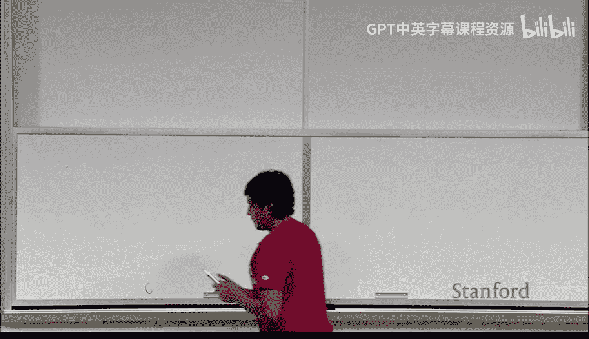

Okay， so the last thing we will do is another powerful technique called。

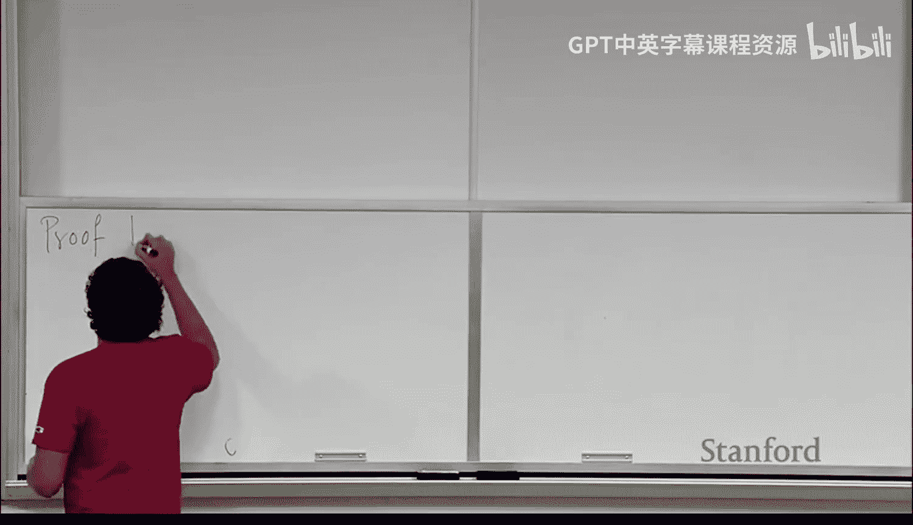

Prove by induction。

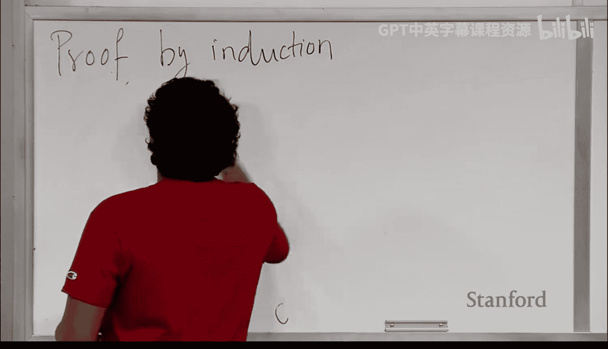

Okay， so the general idea of。

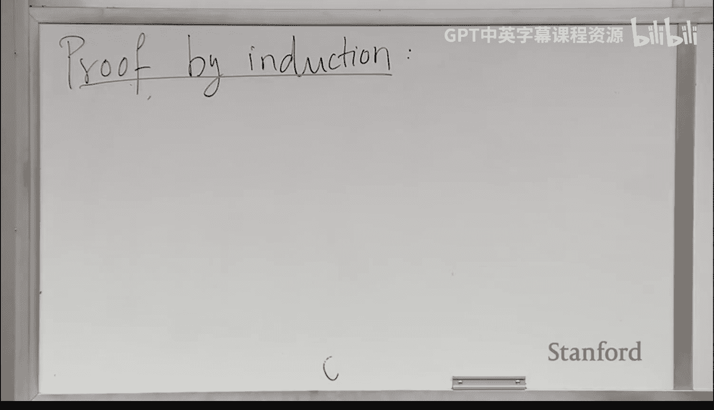

Proof that proof by induction is goes as follows。 We first prove it for some sort of base case。

 So proof by induction induction is generally for some statements that are through。

 let's say for all all natural numbers or so on。 similar to the kind of statements we've been seeing here。

 The general idea is that you first prove it for some base case。

 this is typically n equals one or n equals some small number， typically where you can。

Draw the base case out by hand then you assume that it is true for n equals k and then try to prove it for n equals k plus 1。

Okay， so that's the general idea of proof by induction。Let's see。 Okay， let's do this one。So。

Prove that。

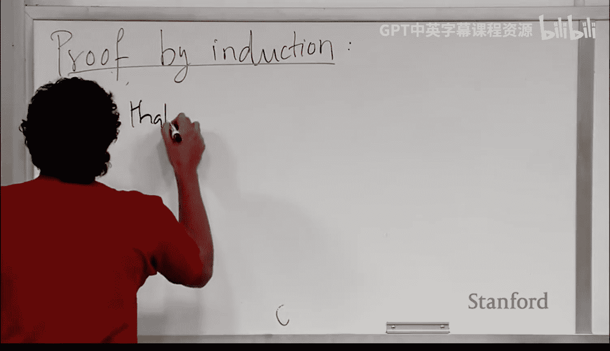

Okay， so this is the standard formula for some of the first1 natural numbers。

 We want to prove that it is equal to n into n plus one by 2。 this can be done many ways。 But here。

 let's just try to use proof by induction to do this okay， so。Okay， what is the base case here？What。

Okay。So， the base case is to。Prove for n equals 1。 What's the left hand side， just one。

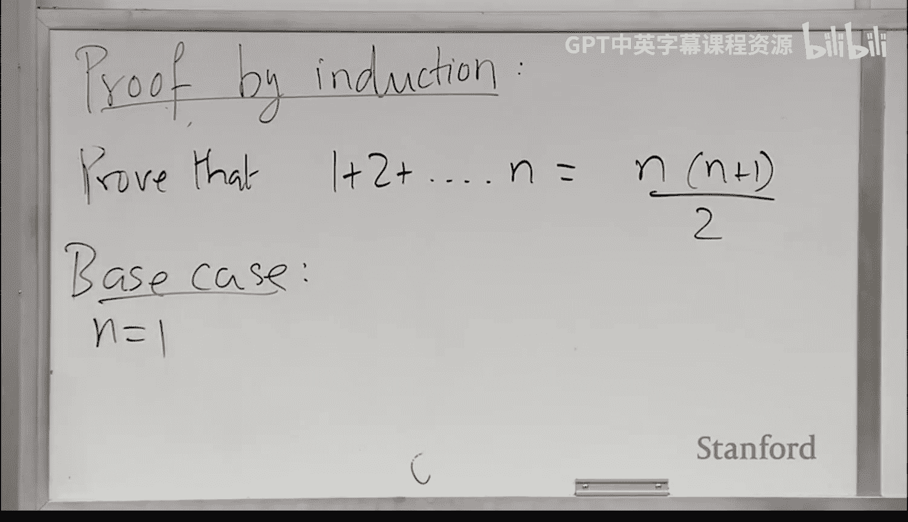

What's the right time side？

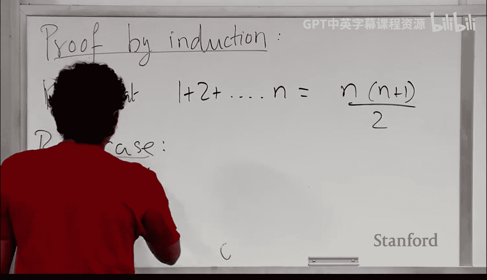

1。Into2 by 2， which is equal to1。Therefore， it' is true for the base case Okay so now we go to the inductive step。

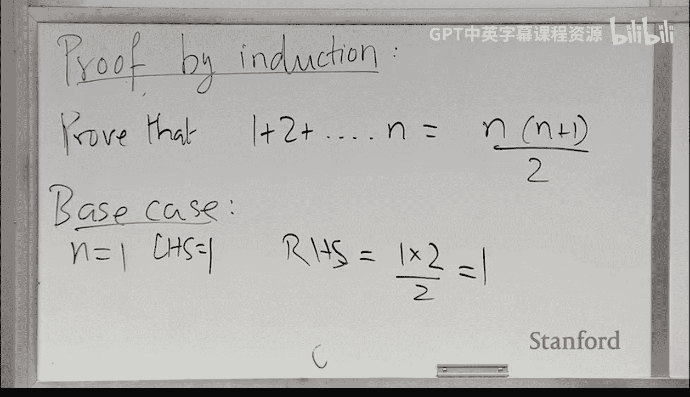

Okay， so assume。It is true for。

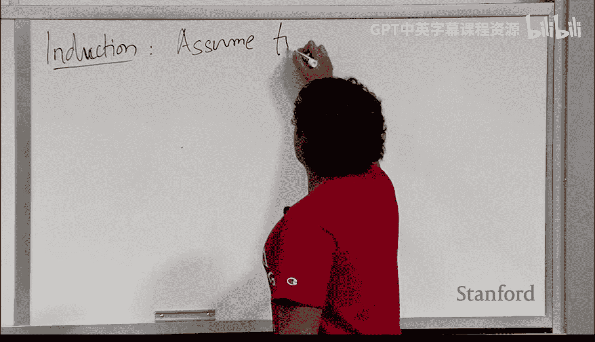

N equals k。Okay， so this means that we are saying one plus2 plus 3 plus so on until k is equal to k into k plus 1 by2。

 we assume that this is true。 Now we want to try and prove it for n equals k plus one okay， so for。😊。

N equals k plus 1。Our left hand side is equal to。1 plus 2 plus。K plus K plus one。Okay。

 which is equal to。K into。K plus one。By 2。Plus k plus  one。Yes。😊。

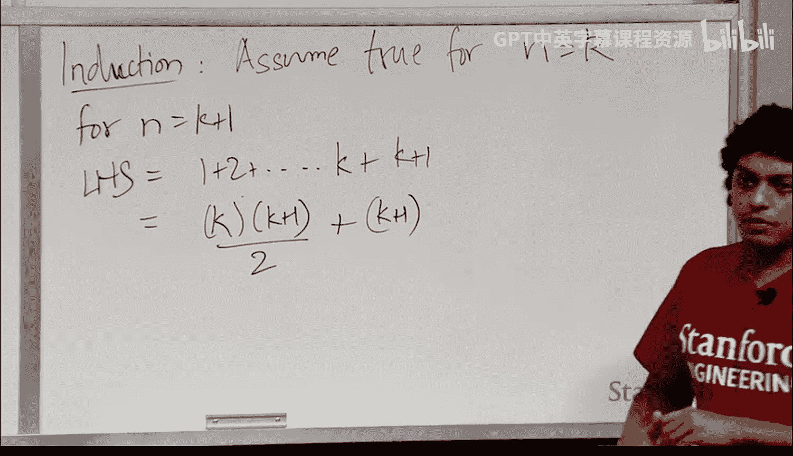

Because we assume that one plus 2 plus all the way up to k was equal to k to k plus 1 by 2 that that was our assumption in the inductive step。

This is equal to。K into k plus  one。Plus。Two times k plus1。Byu 2。Which is equal to。K plus 1 and 2。

K plus 2。Byu2。But this is what we wanted to prove， right。

 we started off wanting to prove that it was for we had to prove the statement for n equals k plus one。

 So for this， the right hand side。Would have been。K plus 1。Into k plus 2 by 2。

Since we now substitute n equals k plus one in our original formula。

And this is what we have got from the left hand side。 So we proved that it was true for n equals 1。

 We assume that。Showing it true for n equals k， we started looking at n equals k plus one using the assumption that we had that it was true for n equals k。

 we also showed that it was true for n equals k plus1。 Therefore。

 we can conclude that this statement is true for any and any natural number n okay So that's how induction works。

 There is also a variant of induction called strong induction where you assume the base case You assume this that the statement is true for all values less than k and then show that it is true for k。

 in general， the principle is the same。 So we are probably not going to go over it right now。

 you can look at the notess if you feel like it。 So that。Brings us to the end of proof techniques。

 Let us switch to。Probability。Any questions for far？Good。😊，Yeah。All right， we are doing。

Decent on time。Alright， so we will first go over some definitions。

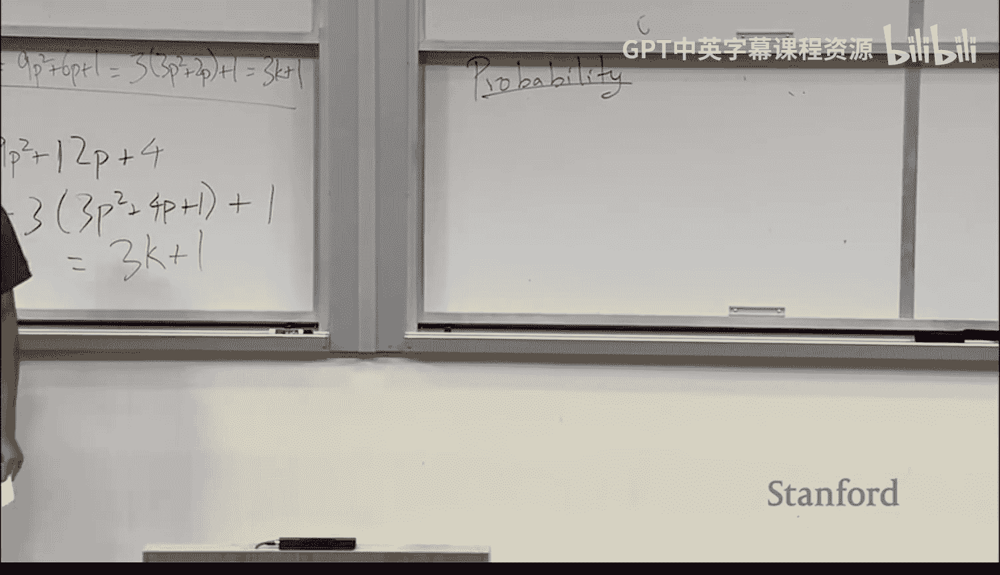

And then go over some properties， some results and so on。 This is just basics of probability。 Okay。

 so the first thing we will look at is something called omega。Which is called the sample space。

So omega typically represents the set of all possible outcomes of your experiment。 So， for instance。

 if you were。

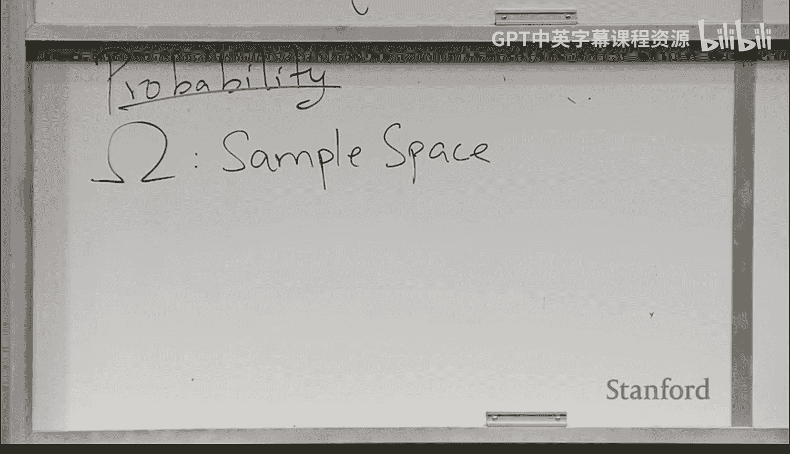

Roing。A die。

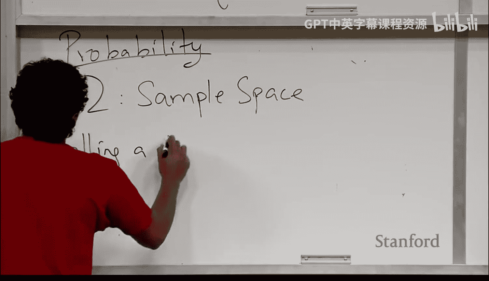

呃。What would omega b。Yes， so omega would just be 1，2，3，4。5，6， okay。嗯。

So this is called the sample space this would be omega in this case So we will just just for clarity we will start off dealing with examples from discrete probability and then switch over to continuous probability in a while alright so this is what does sample space mean event。

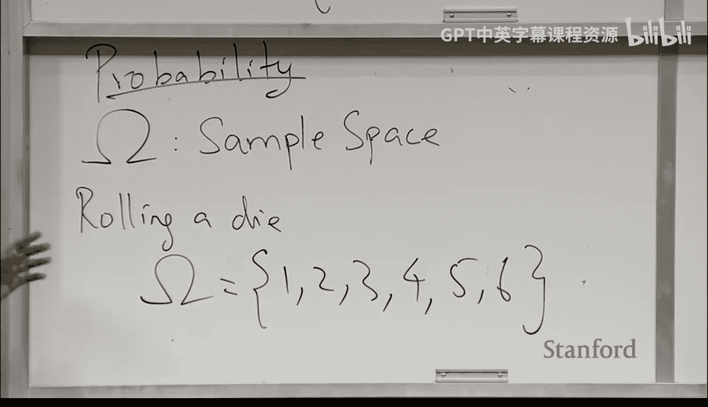

So any event an event is any subset。Of。Omega， alright。

 So let me give you some events and you tell me what it looks like so。So what would this be。

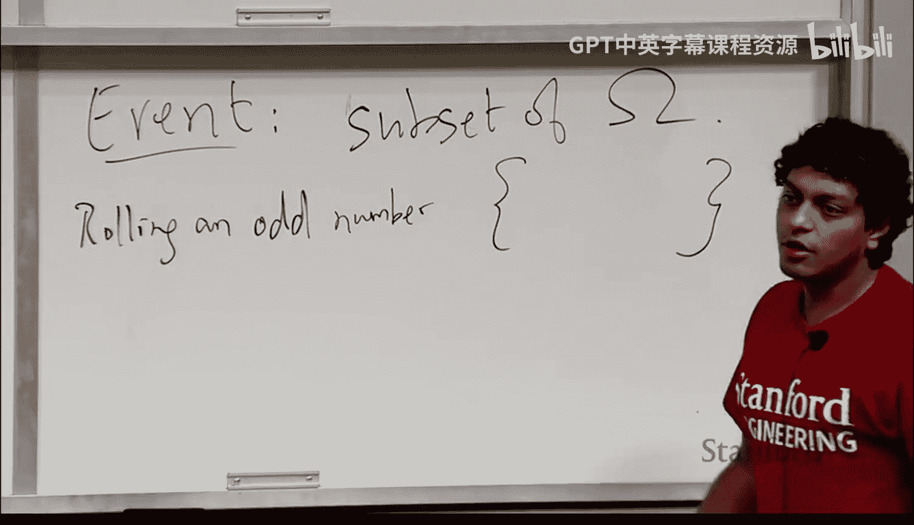

Very good，1，3 and 5。 So you could have events that for instance， let see。

So what would the corresponding subset for this be？Would be an empty set， so。

You could have events that are any subset of omega so it could be empty it could be omega itself for instance。

 if you had rolling any number it could be omega itself rolling a number between one and6 for instance both inclusive it would just be omega itself alright okay so。

Let' see。Allright， so the next thing we will do is what is a probability function。

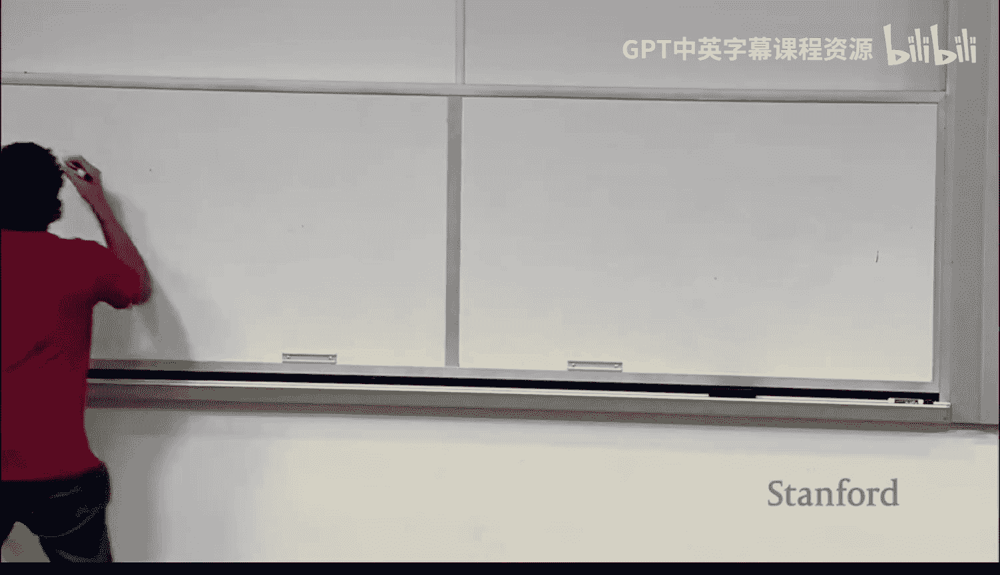

So。P is a map between。Events to。01 so you take any event and map it to a point between 0 and 1 that represents the probability of that event occurring so。

It should have some。Properties， we just go over the properties。 Now， what would。

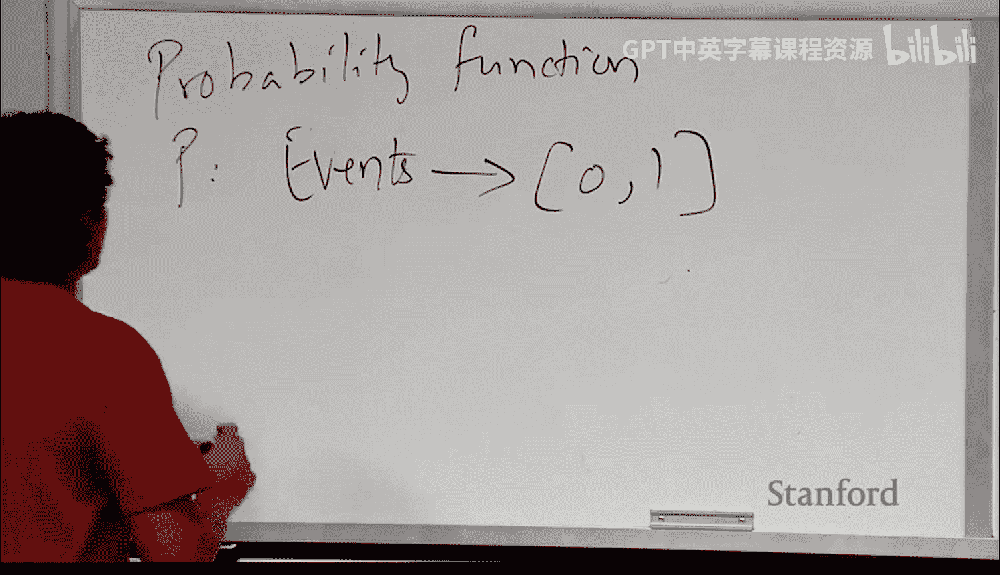

Be of。Omega B。1， alright。嗯。And then， we will。Go to the concept of unions and intersections， okay。

So if you look at the union of two events it is basically the union of the two sets that represent the events。

 if you wanted to look at it diagrammatically if you had two events。

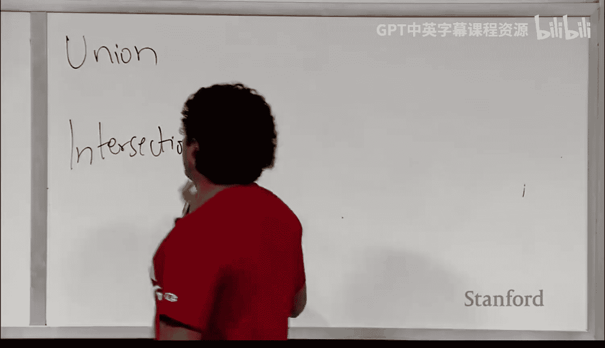

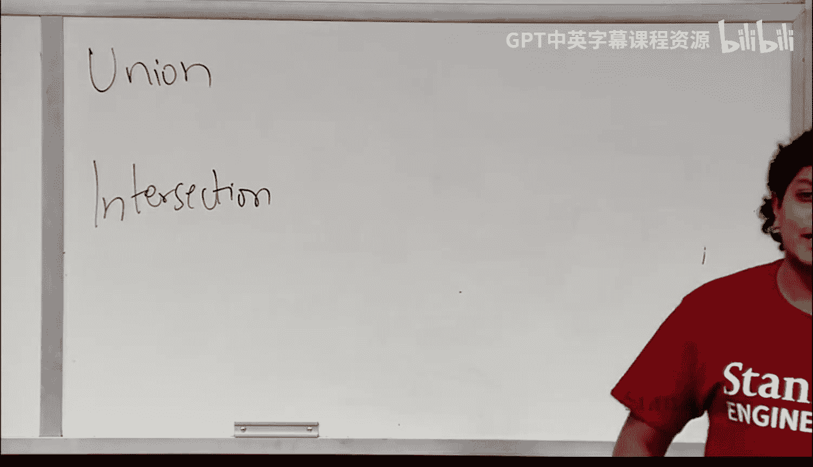

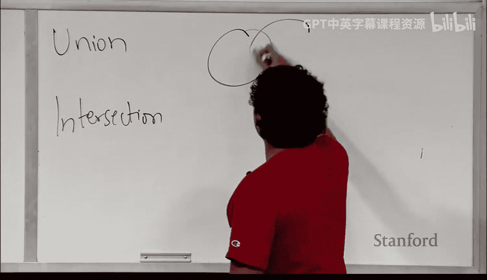

A and B。So， a union B would be。This would be a union B。Okay。And let's see。Would be a intersection B。

 So this would be。Okay， so if thats that is the extent of my drawing skills。

 but as long as it represents what is a union B and a intersection B， now thats cool。

 So for thisjo events， some terminology。

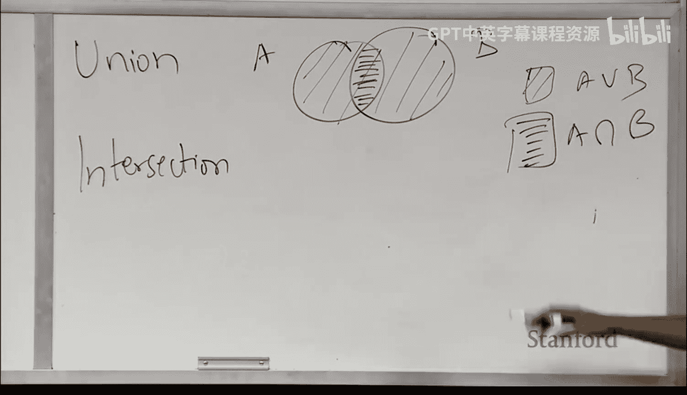

So disjoin events are events such that a intersection B is a null set。

 so if you had to represent them diagrammatically。This would be your two disjoint events so for any disjoint events。

You can say。What can you say about the probability of a union B for any two disjoint events？Now。

 what thats that is the probability of a intersection B what could you say about the probability of a union B？

Yes， so union represents or normally so a good way to think about it is that intersection represents and and union represents r so if you have probability of a intersection B the way you think about it in human languages。

 what is the probability that A and B are both happening。A union B。

 what is the probability that A or B happen？So in this case， either A or B could happen。

 this would just B。P of A plus P of P。All right， in general。So， this is。This is specifically。

If A and B are disjoined。

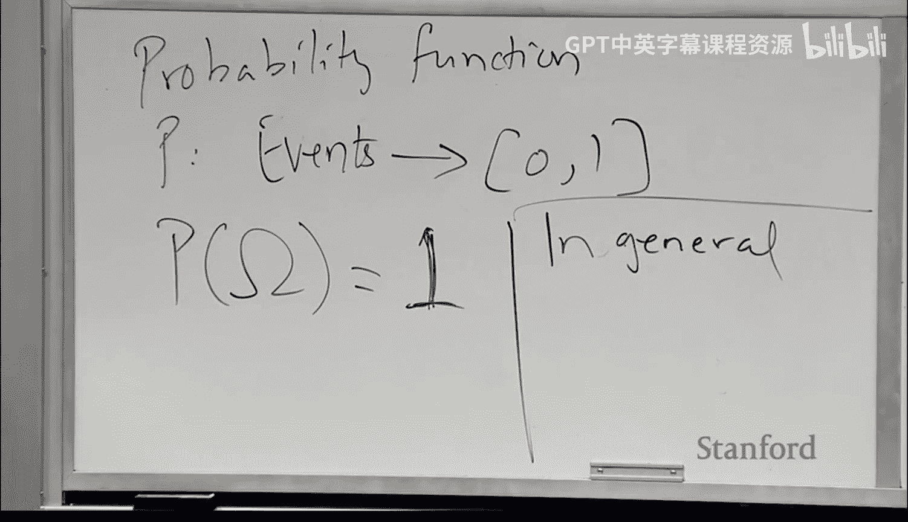

Allright。So， in general。Probability of A union B。Can be expressed as probability of a。Plus。

 probability of B。Minus probability of a intersection B。Alright。

 so a simple proof by diagram for this。So if you had A and if you had B， what is the probability of。

A union B is the probability of this whole thing， right this this entire。Let me resort to。So。

 this is。A union B， Alright， but what are we saying。

 We are saying that it is equal to probability of a， which is all this。Plus probability of B。

Which is all this。So we are double counting this area， right？So this needs to be subtracted out。

And this is a intersection B。So probability of a so probability of a union B is probability of a plus probability of B minus whatever you double counted。

 which is a intersection B Allright， so this is this is in general true and when you have disjoint events you know that a intersection B is an all which means probability of a intersection B is 0 which means this term goes away。

To leave you with probability of A union B is probability of a plus probability of P。All right。Okay。

 the next thing we will。Look at is something called the Union Bo。

So the union bond is in general a useful result to know to get like an upper bound on the probability of unions of events。

 So what the union bond states is that if you have any events。

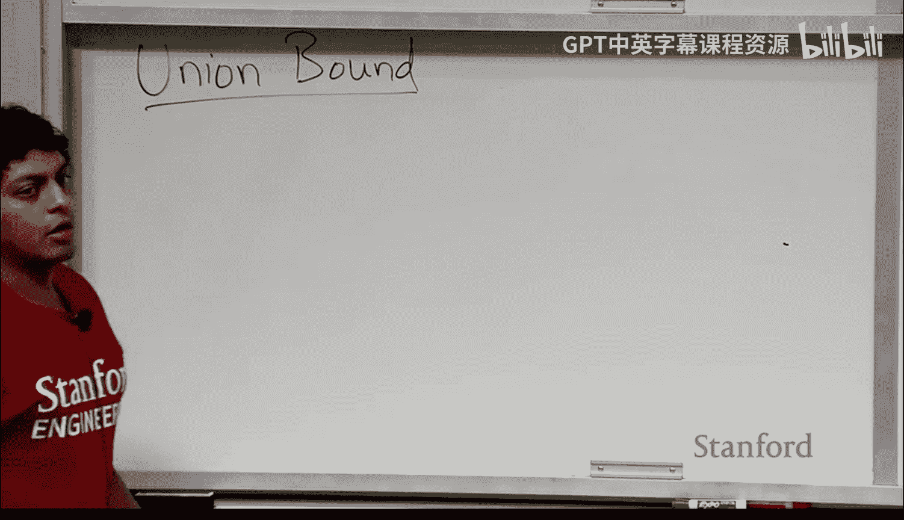

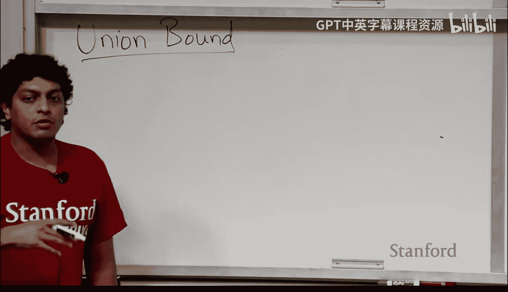

Yiwaan。A do。All the way untilan。The probability of。

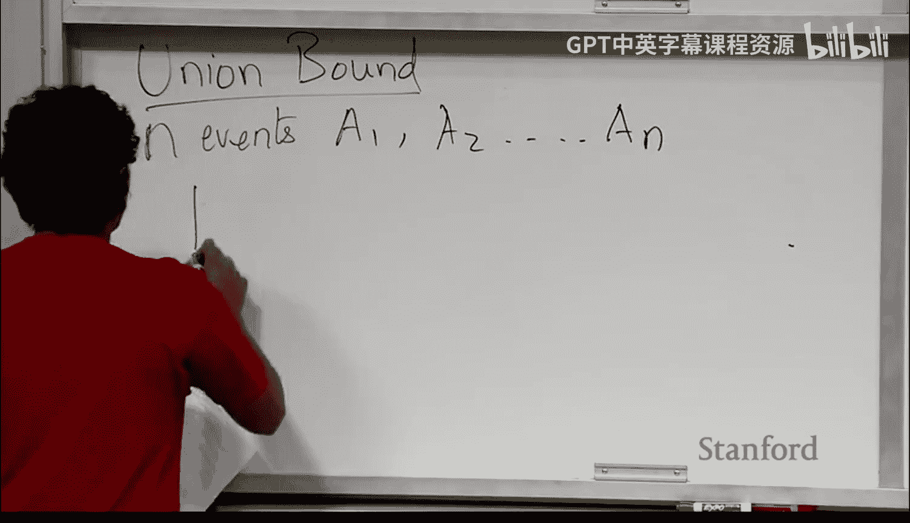

Alright， so what you are saying here is that the probability of the union of all these events is less than or equal to the sum of the probabilities of the individual events in English。

 this means that the probability of。A1 or a 2 or a 3 or all the way up to A N happening is less than the probability of A1 happening plus the probability of A A2 happening plus the probability of A3 happening。

 So this is， this is called the union bond。 This is again useful。 Let's。

 let's just go look at an example and see how you would use the union bond。 So let's say you had。诶。

Wanin。Hundred000 chance。Of。A car accident。On a given day。So you get up in the morning。

 you decide to get onto your bike or car or whatever you do。

 and you have a  one in00 thousand0 chance of getting into an accident。 alright so。If you go。

 if you say that a year has 365 days using the union bond。

 you can say that the probability of getting into an accident。In one year。Is definitely less than。

365 by 1000， right， because what we are doing here is。

 we are taking the each A1 is the first day of the year and all the way until a 3，65。

 which is the last day of the year。 And we are using the right hand side。 So on each day。

 it's just one by。😊。

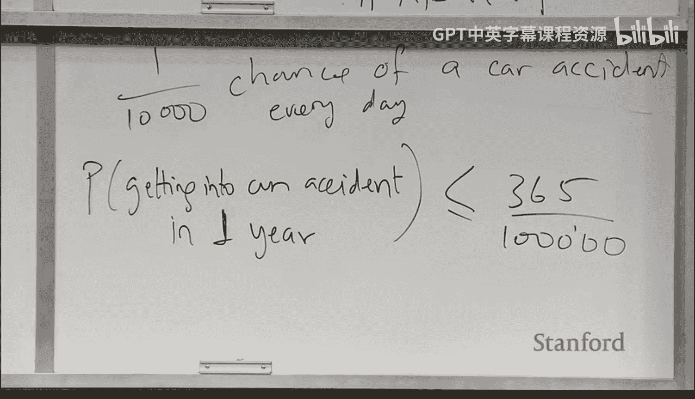

Hundred000， whatever we make up the numbers。And we have 3，65 such days。 Therefore， that sums to 3。

65 over 100000。Probably of getting into an accident in one year， therefore。

 is using the union bound as upper bounded by 365 over 10000。 All right， cool so now。Let's move on。

Okay， so。Lets now go to the definition of conditional probability。

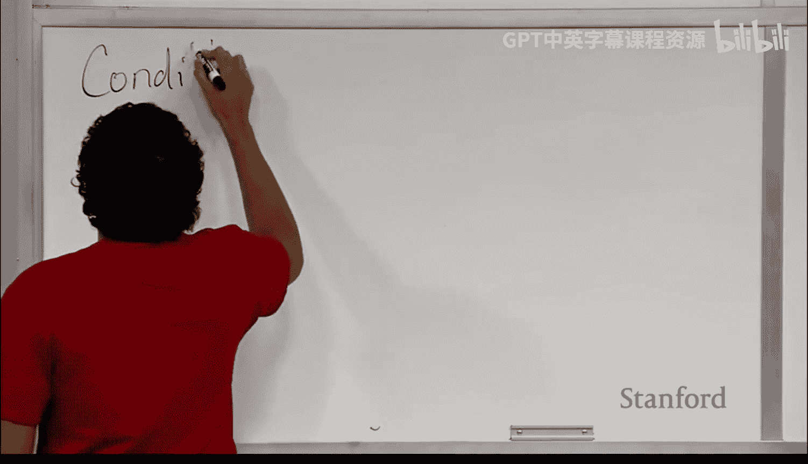

Alright， so I'm again going to do this by using an example。

 So lets say you are taking some sort of standardized test。 let's say the Gre。And you see that 2。

5% of students。Get。A perfect score。Perfect math score， let's say。Okay。嗯。And then。This。

 this is one number that you have。 You look a little deeper and you say that 7。5 percent of。

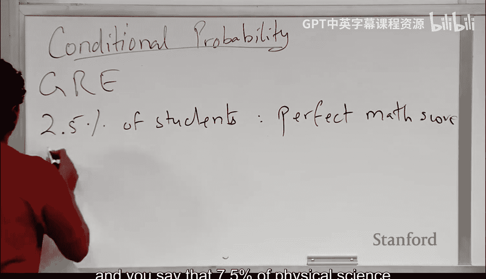

physicalhysical science。

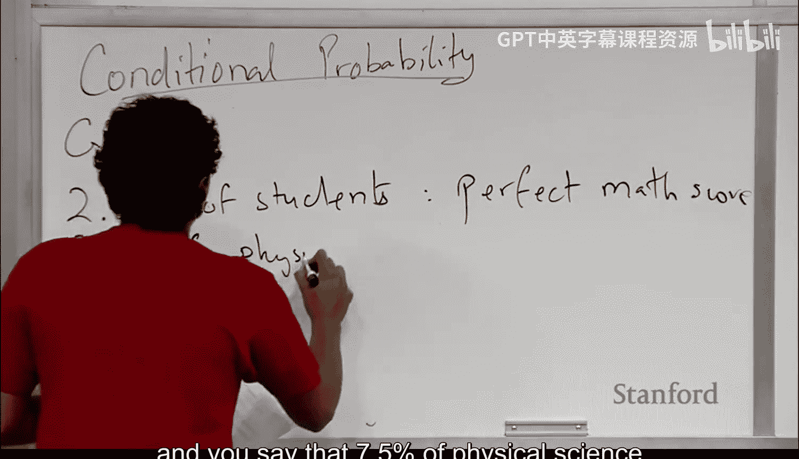

Majoors。Get a perfect match score。And 6。3% of。

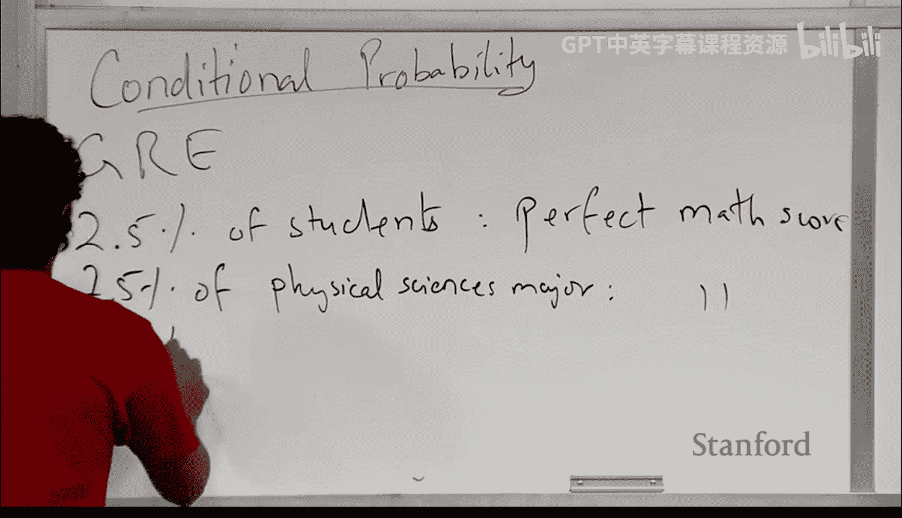

Engineering majors。Get a perfect mass score。 Alright。

 So what conditional probability means we are not， we are not going to solve anything here just using this as an example to illustrate what it means。

 So the probability of。

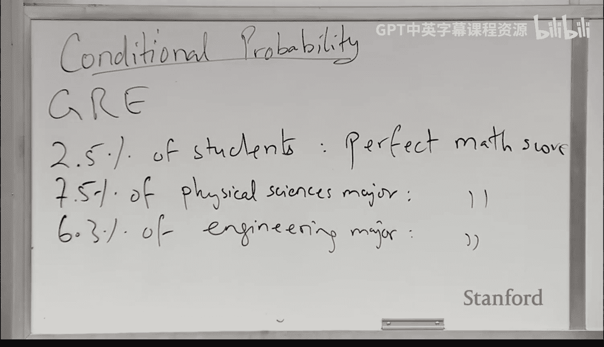

Getting a perfect math score。On itself， if you did not know anything about a student。

 the probability of getting a perfect math score here would be 2。5%。喂的。The probability of。

Perfect math score。Given。That's a engineering major。Would be。6。3%。 Okay。

 so this is typically how conditional probability is represented， so。Where you draw。

Sort of vertical pipe kind vertical bar kind of symbol this is represented as。A given B。O， so。

Probty of a perfect math score given an engineering major is 6。3%。 Okay， so how we would。

Calculate this using the formula is。Generally， P of A given B is。B of a intersection B。

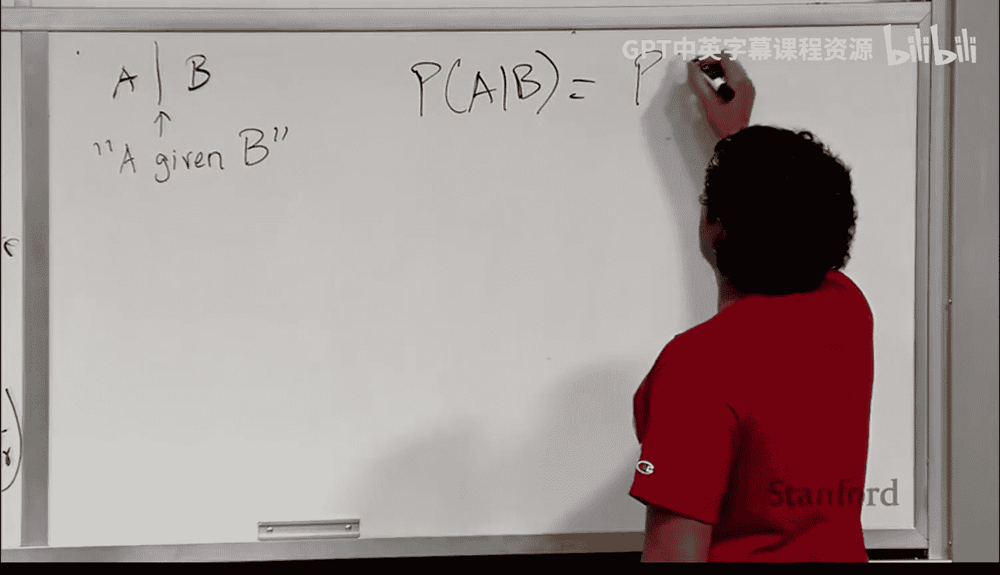

By P of B。

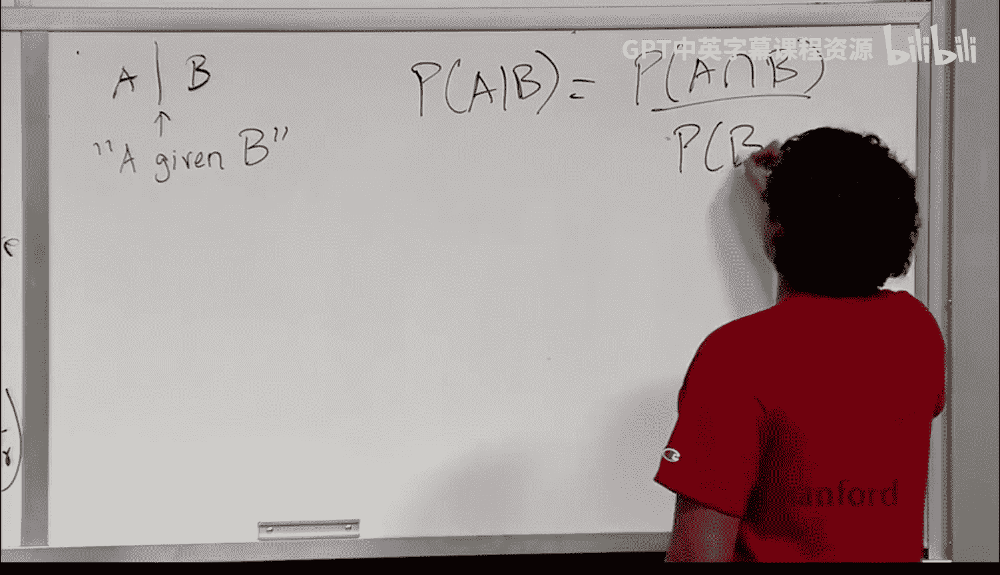

So in other words， if you had to compute this number， what would you do， You would first go and see。

Wwhichch people were getting a perfect score in math and were engineering majors that would be your numerator your denominator would just be all the engineering majors themselves so you are saying that given the population of engineering majors what fraction of them got a perfect score in math。

That is your probability that you would compute here， okay。Good， so。That is。Conditional probability。

 let's also do。

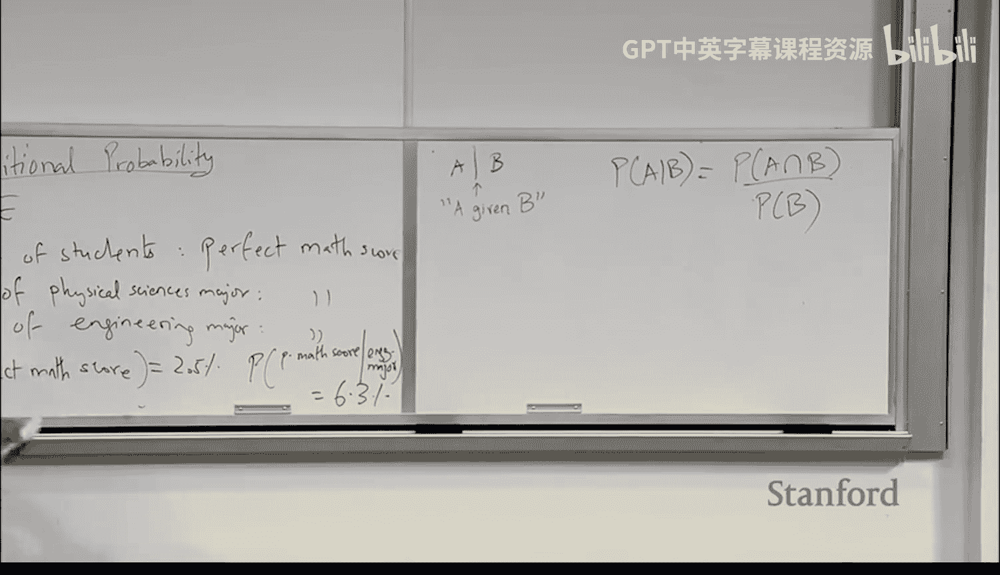

嗯对。So， two events。A and D。Are said to be。Independent。诶。P of a given B。Is equal to P of a。

So the occurrence of the conditioning on the second element does not change the probability of the first。

First event occurring that is called independence of two events A and B。

 what you can also say from here。Is。嗯。Okay， can， can you tell me what P of A intersection B would be if A and B were independent。

E8 times Pb， we get that。By using this， we say P of a intersection B normally would be p of a given B times Pb。

 but we know that A and B are independent， which means。P of A given B is P of A， therefore。

 this boils down to P of a times P of P， okay。Good， so。Let's go to the next related topic now。

So we go to what is called。B theorem。Or base rule。

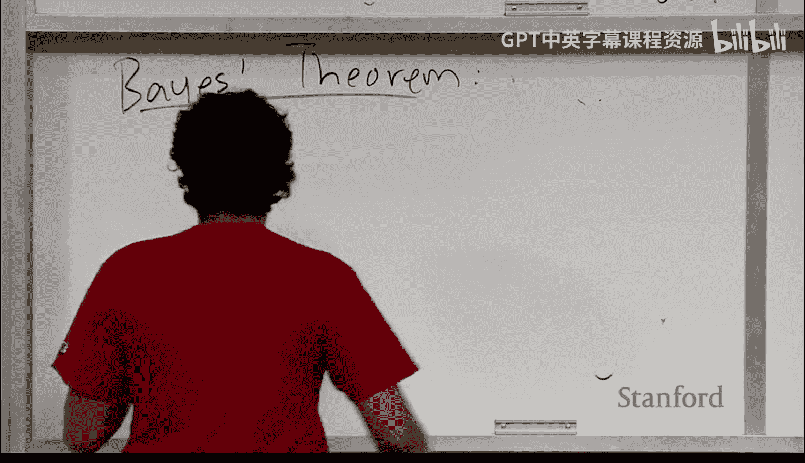

Alright， so we have so we， we generally go step by step for base the。 So let's say we had two end。

We start off with conditional probability。Allright。

 But we also know that we can write P of a intersection B as。So。

 we are just using the definition of conditional probability again on the numerator to express it as P of b given a times p of a divided by P of b。

Alright， so。From here， we can say that this is equal to P of B given a。Time speed of A。By。

So P of B can be expressed as P of。Okay， so this denominator can also be expressed as。

P of B intersection a plus P of B intersection a bar a bar or a dash or a complement。

 whatever you call it just means not a alright and this could。Again， be expressors。

The numerator stays the same P of B given a times P of a。Divided by。B of B， given a。I B of a。Plusus。

B of B given。A bar times B of a bar。Okay， so this is what base them is it is useful for problems where you have you are given some some statistics about a total population and what happens under certain circumstances and then you see a particular outcome and you want to see whether it was how true that is reflective of your original condition being present or notright that's where you typically apply things like base theem let's go over other example alright so。

Let's assume that。1% of women。I have breast cancer。Okay， and there is a particular diagnostic test。

 so。If。If a woman has breast cancer。The test。Shows positive。90% of the time。嗯。

If a woman does not have breast cancer。Test shows positive。10% of the time。Okay。

 so this this is a setup up for the problem。 So we are running some sort of diagnostic facility where we have a particular test to screen for breast cancer。

 if breast cancer is actually present in the patient its positive 90% of the time but there are also the 10% false positives right。

 so。Now， somebody comes and。Reports。A true test。So， yeah， we can call reports a positive test。So。

 what's the。Actual probability that。This person has cancer。Okay。

 so that's what we use based here and for。 This just boils down to the same kind of formulation。

 So we have。Be of cancer。Given positive。Is。Be of positive。Given cancer。Times P of cancer。

Divided by P of positive。So we are just replacing everything into this formulation here where B is positive positive being positive test result is actually having cancer。

 and we are going to expand it out like what we did。 So this is let's see 0。9 times。0。01。So， 0。

9 comes from the 90% positive probability here， 0。01 comes from the fact that 1 percent of women actually have breast cancer divided by 0。

9 times 0。01。Plus。0。1。Times。The rest， which is。0。99。Okay， so this basically says。

This is the same as the term in the numerator， this says that 99% of the population does not have breast cancer。

 but even for that population our test would show positive 10% of the time， which is 0。

1 and this boils down to something like 8。3%。So this is a fairly low number。

 you would not want to trust this test if it said that a person tested positive for breast cancer。

 Okay， so this is how you use base rule。All right。What are we doing on time。那给。

Right now。We talk about something called。Random variables。So。

You can define a random variable as a function X going from。欧mega。都。Generally。

 the whole rail line that deals a different value for any point in the sample space that you choose。

 So， for instance， let's say we were。

Tossing three coins。And let x denote。The number of heads。Allright， then probability of x equals 0。

Would be。What would it be。3， I should have said，3。Fair coins。Yes。

 then it would be one half to the power 3， which is18。Okay。

 so that is what a random variable is in many incidences it is useful to express things as a random variable to do further computations about them。

 which we will come down to now。😊，Okay， let's come down to。Probability mass functions。

 probability density functions and cumulative density functions。So。PDS。Cds。So。嗯。

The probability mass function in general is something where you can look at a particular interval and see what is if if you are looking at discrete probability。

 you can look at a particular event which is a collection of points in the sample space and see what the probability associated with that is in the case of continuous probability it is not as easy to do that because the probability estimate associated with a single point and space is always0 so what you can do instead is try to find out what the probability is of something occurring between a point a and a point B。

Okay， if that was unclear。So， this is。

Generally dennoted by f the probability density function。So。

What this means is that the probability that a is less than or equal to x is less than or equal to B is。

Inteegral from A to B。F of x。y。Okay， so the probability that are given x lies between A and B。

I given by this integral and this f is known as the probability density function。Okay。

 so F has some properties。嗯。So， first。F of x must。Always be greater than or equal to 0 for any x。嗯。

Inteegral from。Minus infinity to plus infinity of f of x dx would be what would it be？完。And。

And for any set a integral over。A of F of X dx。Would be the probability that。X belongs to a。 Alright。

 So this is the probability density function。

A very related concept is。That of。Cumulative density functions generally represented by capital F of x。

 which is the probability。

That。X is less than or equal to a given point x。 So f of x is given by。

Integral from minus infinity to x。F of T， D T。The properties of capital F。

啊。Ls between。So where would capital lie between？0 and1 are。

As xs to minus infinity capital left would go to 0 as xs to plus infinity would go to 1。

 f of x must be non decreasing。

And right continuous。So the right continuous comes from。

The definition of how we do the way we define F where we define the it is the probability that is is less than or equal to a given point X。

 So F must be non decreasing and write continuous。Alright。we have about 15 minutes to go。Oh。

 we have about 25 minutes to go， so that's enough time。Let's go over to。O。

So the expectation or the expected value or the mean of a given random variable can be thought of as some sort of weighted average。

 So in discrete space we have for a given random variable x we say e of x is equal to。

Sation。X b of x equals x。And。In continuous space， we have。

E of x is integral minus infinity to plus infinity。X times F of X D X。 Okay， so we are。

 so this is some sort of weighted average。 And this is an analog of weighted average in continuous space。

 We will go over some。Properties of expectations。Okay so the first property。

 which is fairly important as known as linearity of expectation。 So E of x plus y is。

E of x plus E of Y， this is true irrespective of what X and Y are。

 So even if X and Y are not independent， for instance， this is always true。

 The other thing to note E of alpha times X， where alpha is some constant is。

Alpha Dime's E of XO。This， this is called linearity of expectation。

Okay， the next thing we are going to talk about is something called variance。So the variance。

 which is typically donated as sigma squared of x。Is given by。Expectation of x minus E of x。

The whole square， another way to think of it is expectation of。X squared， minus。Expectation of x。

The whole square。 So the expectation of x here is a mean that we。Spoke about earlier。

 So this variance is some sort of measure of how far away things are from the mean。We should。So。

If we have similarly， if we want to look at properties。 So if we had variance of。AX。

Alpha x would be alpha squared times variance of x。 So no longer in squared space。

 no longer in linear space。Varianance of。X plus。Beta where beta is a constant。Would be variance of x。

嗯。I guess that is。So， when we have。Variarianance of x plus y。嗯。We cannot say anything as is about it。

 So variance of x plus y is equal to variance of x plus variance of y is。Not。Always true。

So this is true only when。X and y are uncorrelated。

There is some other material we probably won't cover it now for want of time on what correlation and means in general any any if if x and y are independent they are always uncorrelated but the converse is not true so the variance of x plus y is equal to variance of x plus variance of y only when x and y are uncorrelated alright cool。

Let us。Allright， so now we will look at some kinds of special random variables。

不去。Alright， so the first thing we will look at is called a Bnoli random variable。

So this is basically analogs to a coin flip。So if you have a binaryary random variable x。

 it takes a value 1 with probability p 0 with probability 1 minus p。

Let's do some。Calculation， so what would the expectation of this be？

If we just wanted to go over it by hand， it would be one times p plus0 times 1 minus p that is p similarly。

The variance of x would be。The expectation of x squared。Minus E of x。The whole squared。

 So were using the second definition for variance that we saw。

 So expectation of x squared would be p squared in a similar manner this。啊。And。Sorry。

 expectation of x squared would be。P and expectation of x the whole squared would be p squared。

 That's right， because expectation of x squared would be1 squared times p plus0 squared times 1 minus p。

 So this is p minus p squared， which is P into 1 minus p。Yes， okay。

 so that it is burnly random variables。 next one is geometric random variables。O， so。

Gmetric random variables is。Let's say you keep flip a coin until you get heads。

嗯。This represents how many times you have to flip the coin before you get the first head， okay， so。

Probability of。X equals k here this means that you get the first head on the k coin flip where p is the probability of Hs this would be given by p times。

1 minus p to the k minus1 so how you would think about this is that if you got your first head on the k flip that means the first k minus-1 flips were all tails and the k flip was ahead the is tail probability is 1 minus p is the first k minus1 were all tails1 minus p to the k minus1 times。

Ahead on the on the case flip， that's a P。 So this is the probability again， for this。

 we are not going to go over this， but E of x is1 over P。Vance of access。1 minus p by p squared。可以。嗯。

Right， so those Bnoli and jump random variables were discrete。

 so now we will look at some continuous random variables。

 So first one we will look at this uniform random variable。Which generally looks like this。So。

 this is。This is F of X。 This is the probability density function of a uniform random variable。

 So between A And B， it is uniformly distributed， so it can take any value between A and B uniformly and anywhere else。

 it is 0。 So this is basically given。This way， F of x is equal to1 over B minus a if。

A less than equal to x less than equal to B，0， otherwise。Right。

 so can anyone tell me why we have this one over B minus a。

It has to error to so we know that integral f of x dx should be 1 always and we know that this exists only between A and B this length is b minus a so this has to be1 over b minus a alright that is correct again for this we have。

E of x is equal to a plus B by 2。Vance of x is。B minus a is a whole squared by 12 so these are things you typically will not need to know and if you don't need to know we will give it to you。

 nobody expects you to know the variance of a uniform random variable off the top of your head。

And the last one， we will。Look at。Today对。Is， of course。What is known as the。Normal。Random variable。

Also known as the。Gauussian and random variable。So the probability density function。 So this。

 this shows up basically anywhere。 The Gaussian random variable shows up anywhere and everywhere。

 I will just give you the formula F of x is given by one by。Roe to by。Sigma squared。E do the。

Minus of x minus mu， the whole squared by2 sigma squared。 Okay。

 this might just seem to be a lot of garbage。 if you have not seen this before。

 This is generally parameterized by two quantities。 One is mu。

 which is the mean of the distribution and other is sigma， which is the standard deviation。

 The standard deviation is just a square root of the variance。

 What the pro what this distribution looks like is this。

You have some sort of。Pardon my power drawing。 This is supposed to be like a symmetric bell curve center that。

Mu。And sigma in some way represents how how spread out it is。

 So a larger value of sigma would mean that the curve is more flat and spread out。

 smaller value of sigma would mean that it is sharp and pointed。Alright， so here again， E of x。

Is mu variance of x。Is sigma square， okay？Okay。So， given that we have。Only about 10" minutes to go。

I think I will。Skip to the last part of today。Okay， so。I首。

Final thought， we are going to deal with two things called。Markovs inequality。And once we do this。

 we will extend this to another inequality called Chey shes inequality。

 So this gives you some relationship between probabilities of events happening and their expectation。

 So Markovs inequality states the following。

So， for。嗯。Any random variable。X， that takes。Non negative。嗯。Okay， so the proof is。

Proof takes a bit of time， but we should be able to go over it if I remember how to prove it。

 lets see。

I think this should work。be the other way。Yes。不行。しし。Okay， yes。 I think I have successfully proved it。

 So let me just go over what the proof looks like。 So we'll start with the definition for expectation。

 So we say E of x is。Integral from minus infinity to plus infinity X times f of X D X。

 So this is just the definition of the expectation。

What we do in the next step is split up the integral。 So we say integral from minus infinity to。啊。

A x times f of X D X plus integral from a to infinitefinity x times f of X D X。

 So we are not doing anything special here。 just split at a。 Now we know that x is。

We know that x is non negative， it takes only non negative values。

 and we always know that f of x is going to be greater than or equal to 0 for all x So this is this is so this is definitely a positive number。

Right so this plus this is definitely greater than or equal to just this。

 which is integral a to infinity x f of xtx。Okay， and。

Since we are going from a to infinity and doing x f of x d x。

 that is always greater than or equal to integral a to infinity a times f of x d x because for any point between a and infinity any point x between a and infinity x is always greater than a。

😊，Right so we so and this is greater than an equal to we can pull a out since it's a constant eight times。

This this basically remains as integral a to infinity f of x dx。

 which is just the probability that x is greater than or equal to a right you just move this a down here So we have that E of x is greater than or equal to a times probability that x is greater than or equal to a move the a down you get probability of x greater than or equal to a is less than or equal to expectation of x over a okay so this is called markovs inequ and the last thing I think I will leave you guys with is。

😊，Is something called。Sby shes inequality。Yes。Okay。

 so we share inequality states that the probability that。

The absolute difference between。Given random variable x and its expectation is greater than or equal to a is less than equal to the variance of x。

By a squared。 So how we get ch shes inequality is by applying。Markov inequality。

To the random variable， x minus e of x。The whole square。

So this gives you probability of x minus e of x。The whole squared greater than or equal to so and and we take the constant as a squared this time。

G than equal to a squared is less than or equal to。E of x minus E of x。The whole square。By。A squared。

 but we know that from the first definition of variance e of x minus e of x the whole squared is nothing but variance of x。

 so this just becomes variance of x which means the probability of and this is equivalent to this saying this and saying this are the same the two LHs of the equivalent the RHs this is just the variance so this just becomes variance of x and therefore we get probability of absolute value of x minus e of x is greater than or equal to a is less than or equal to variance of x over a squared。

And this is called shaby shares inequality。So there are a few things that we have skipped I think we covered most of what we wanted to cover so that should be good for you guys if you have any questions we will be putting up these notes on the course website this video will also be up on the site and if you have any other questions you always have Piazza to contact us we have another review session for linear algebras or if you guys have some questions on linear algebra or would you would like to know more it is on Thursday I think the venue will also be GB01 but we will clarify in any case on Piazza so just keep an eye out for that post。

All right， so that is it for today。