# 斯坦福大学《海量数据集挖掘｜CS246： Mining Massive Data Sets 2019》中英字幕 p23 -P23-Spark Tutorial.zh_en -BV1raSjBuE3d_p23-

I'm going to turn my mic on all right， sorry for the late start， sorry for the confusion。We。

Miigella just told me yeah， do what you did last year and I'm like I think all I did was answer questions。

 I forgot that we actually did this crash course， so sorry for the cross wires but all right。

 so let's do a quick crash Co in Spark and we can get to questions afterwards。All right。

So the reason why， as I recall now， as I reminded， the reason why we wanted to do a crash course in Spark is that so when this course when needed to 246 originally we did not do it using Spark。

 we did with Mareduce。You didn't really need a crash course in Mapreduce MapRduce is pretty straightforward like you could kind of figure it out。

 but I assert although there are those who disagree with me I assert that and I hang on sorry I have to get off of I have to turn off my wfi otherwise it's going to keep popping that up。

There are those that assert certain that Spark is actually super easy and it's so much easier to work with than MaRduce I think they're crazy Spark actually is a fairly high learning curve as far as I'm concerned so to make this less painful we're going to do just a quick crash course give you some basics in Sp now。

Because I didn't realize I was going to be doing this presentation until about five minutes ago。

 I haven't actually looked at these slides from last year。

 fortunately I actually know Spark and this should be， but bear with me。All right。

 so apparently this is what we're going to talk about， which was how you get this thing running what。

Is it not all， Yeah， it was。Could have sworn I turned it on all right now we're really getting it so we're going to talk about just like getting started with Spark。

 what are RDDs， what do you need to know about them to be minimally comfortable what are the basic operations and then we're going to talk about things like using Python using Java using Scala so the answers are don't use Java and don't use Scala。

And then we're going to talk， then we'll answer questions。 So。

 and specifically one of the things we'll get into is。As per the question that was just posed。Maavn。

 how do you set up a maven project and what does that have to do with anything and why do I care。

 and we'll talk about that in a little bit more depth。All right。So first of all。

 if you don't already have Spark， go download Spark， the version that you want is 221 for Hadoop。

 it's just the version you want all right， moving on so Sp comes in three flavors of deployment。

There is what you are doing， which is local only。😡，Meaning that。

It is a one node instance running in a single JVM。 you're just goofing around on a laptop。

There is the static cluster or standalone cluster deployment model。

 which is you set up Spark on a set of nodes， and those nodes are spark nodes and you will do computations across those Sp nodes。

😡，The third variety， which is the variety that I deal with most of the time。

 is with a resource manager， a managed cluster， in the case of the stack I work with that resource manager is yarn。

😡，So in that scenario you have the resource manager owning the resources and when you're ready to run a Sp job。

 you go hey， resource manager， I would like to run Spark and it essentially sets up a standalone sparkk cluster for you that you can then use and it will then tear it down when you're done the advantage is that if you're not only doing Spark if for example。

 you're doing Spk and Mapreduce。😡，You don't have dedicated Sp resources that you can't use for MaRduce because they're only a standalone spark cluster if you've got a shared resource manager。

 you get better utilization。😡，Basically， the net summary here is Yuurri talks about this one in Michela and I talk about this one and nobody's going to talk about the one in the middle。

嗯。Interesting side effect of these guys is where is your data？😡，In this model。

 your data is on your laptop because it's a JVM on your laptop but don't know no different。😡。

In this model， you are also talking about nodes that are attached to sorry data that storage that is attached directly to the nodes。

😡，So if you want to store things。Unless you are using something like S3。

Where you can push data out into a cloud somewhere。

Or HDFS so if you're not explicitly talking out to those things your data is on your local disk and that doesn't really work well for distributing things right you can't do distributed computations if your data is fragmented and let me see what the next okay the next bill doesn't do anything over here you still have disk attached to individual nodes but that disk is being used by HDFS so you're accessing shared storage in HDFS and HDS is your nice friendly shared storage layer the moral of the story is that on a single node you can use a single disk and life is happy on a distributed cluster you have to have some kind of distributed storage solution otherwise it just isn't going to work and HDFS is the one I recommend because well I'm the HDFS engineering manager。

😡，All right， resilient distributed data sets， that's what an RDD is RDD is the basic building block of Spark now when we get into this in 246 H。

 we're actually going to kind of jump over RDDs to this next concept called data frames。😡。

A data frame is just an RDD of row objects and once you've got an RDD of row objects and a row object is something that Sp defines。

 then you get some additional niceties on top of it。

 but ultimately it's all just RDDs so everything I'm telling you is still relevant so for the purposes of this class。

😡，For the purposes of 246， you don't care about data frames RDDs will be more than sufficient for what you're doing data frames are more for data muing right if you're trying to go connect things like make go through piles and piles of tabular data and go find the anomalies or whatever data frames are great for that machine learning data frames are great form for reasons that we will get to much later in 246 H but for just doing raw computation。

 which is the sort of stuff you're doing in 246 RDDs are fine you'll be fine with this so first thing you need to understand RDDs are immutable。

😡，If you create an RDD of data and you modify it， you don't modify it。😡，It is immutable。

 What you create is a child of that RDD， which is another RDD。That's essentially a diff。

Of from what the original was to what you've modified。And if you modify that one。

 you get another one and then you get another one and so you get this inheritance hierarchy or ancestry to your RDDs。

😡，The advantage of this is that if you lose data at any point， because you have this ancestry。

 you know how to go back to the source data and recreate it。

 and Spark will do that transparently behind the covers for you。😡。

So RDDs are computed lazily and this will it may not blow your mind if you've been in Hadoop for a while。

 if you've used MapRduce， if you've used Hve or you've used PG，😡。

You're used to this model where you do an operation and you press enter and you go away and you come back with your coffee and you check。

 nope， still not done yet。😡，Right，The first time you pop open a spark shell。And you create your RDD。

 You're gonna say RDD dot or Im sorry S dot text file， bh， enter boom。 and you get your prompt back。

 And you're like， who。And then you go， RDD dot map， Lambda， whatever。 And you do a map operation。

 And you hit enter and it just boom and you， this is so fast， right。

 And then you take your RDD and you say print。And you wait and you're like， wait， it was so fast。

 why was it so fast and now it's so slow what's going on？It doesn't actually do anything。

Until you ask it to materialize results。😡，So all of those intermediate operations that you do。

 all those maps， all those reduces， all those flat maps。😡，Do nothing actually。

 the reduced does something。 we'll get to that later， but all the maps， all the flat maps。

 all the basic transformations。They don't do anything What they do is they set up a new child RDD that says。

 I am a descendant of this parent RDD with this transform applied。😡，诶，即。

When you actually go to that child RDD and say， okay， now show me what your data is， it goes。

 oh wait， wait， wait， I have to go figure out what my data is because I don't know yet。

 I haven't calculated it。😡，So you will notice that behavior and it can be confusing the first time you hit it。

😡，Your RDDs are cached， so Spk optimistically cache is everything that you do so that if you try and do it again。

 it doesn't have to recompute it， it's an LRU cache so stuff falls out of cash。

 you have some ability as a programmer to say this is the thing I care about， keep this in cash。

 but it is still subject to the constraints of memory， so if you'd say cash。

 everything I've ever seen and that's more than the RAm of your machine。

 it'll dump stuff out of cash LRU。😡，Right。RDD to know who their parents are。 We talked about that。

 There are three flavors of RDD。 And I don't know that that's really on this slide。

 but there are three flavors of RDD。 There's the plain old RDD。😊。

The operations you can do on a plain old RDD are pretty limited because Spark doesn't know anything about it。

😡，If。🤢，Your RDD contains only numbers。So in Scala， that could be decimals or integers in Python。

 Its numbers。 if it contains only numbers。Then， it's a。Double RDD， I believe， is the。

I think it's a double RDD， I think it's the name of it。

 but essentially it's a numerical RDD and Spark recognizes that and will now let you do things like mean and sum and mode and standard deviation and so forth。

 so it recognizes that your RDD contains only numbers and lets you do those operations if your RDD is composed entirely of tuples of two elements。

😡，Then it becomes a pair RDD。😡，And a pair RDD is where it gets interesting。

 this is where you can do a reduce。Because where you can do a reduced by key， I should say。

 because it assumes that the first element of every tuple is the key and the second element is the value and if you were in 246 H yesterday you saw some of that at the very end where we start playing around with creating key value pairs and even if you werent in 246 H you saw it in homework 0。

 it's where you do word count right there's reduced by key as a fundamental part of word count。

All right， so useful things that you can do with an RDD。

 These are things that you should be aware of and should understand。

 and do I go into more detail on these。 Yeah， I do， all right， so and there's more stuff。

 so there are two classes of things you can do to an RDD。 they're called actions and operations。

So an action is something that does not generate another RDD。Typically。

 it will generate a native construct of some kind or an object。Okay， so for example。

 take n says take the first n elements from this RDD and return them as an array。😡。

It's a great way to figure out are you doing the right thing？So if you're not doing the right thing。

 you'll find out early， so the worst thing you can do when you're programming in Spark particularly if you're doing it on the command line in the Reple instead of actually doing it carefully in a class file or in a text file。

😡，Is just go string a bunch of stuff together and then go run it， and then it doesn't work。

 and then you don't know why。😡，Better is to build it up incrementally and do a take at every step so that you can see that the results that you're getting at that step are what you would expect to see at that step for results。

😡，That way you don't drive yourself crazy。Collect is take on steroids。

 so collect returns you everything。 be careful with collect。 If you've got 100 elements in your RDD。

 collect it all day， if you've got two petabytes of data in your RDD， be careful。

 don't don't collect that not going go well okay count just returns you the count also a useful debugging tool save as text file is what you do with that 10 petabyte RDD。

And typically you would want to on that 10 petabyte gridter。

 save it in HDFS because you typically don't have that big of a hard drive。So this saves text file。

 you can do if you do a regular path it's relative to whatever Spark thinks the working directory is。

 which differs depending on whether it's set up for a single laptop or set up for cluster。

 you can also give it a specifier so you could say file colon s/lash slash whatever。

 or you could say HDFS colon slash slash whatever， and point to something in HDFS or S3A colon s slash。

 whatever to point to something in S3。for each is a convenient way to iterate through an RDD。

 it is intended for use to produce side effects right so your for each is， for example。

 you want to go through it and print it。Very much Anaatatema to the functional concept where you don't have side effects。

 but for each is pretty much there for the side effects。😡，All right。So operations， on the other hand。

 produce a new RDD。😡，So an action is something you can do to an RDD that gives you other stuff operations give you new RDDs。

 So let's look at a few of the operations and God， I hope I corrected the typos that we found last year when I did this。

 So map map is your basic one， the idea of map is you go through your RDD one element one record at a time for every record you're going to transform that record according to some operation that you have defined for example。

 if I load in this text file and if I look at my top three and I've got Apple Amy But Bobob and Che Chucky。

 if I do a map on that data。

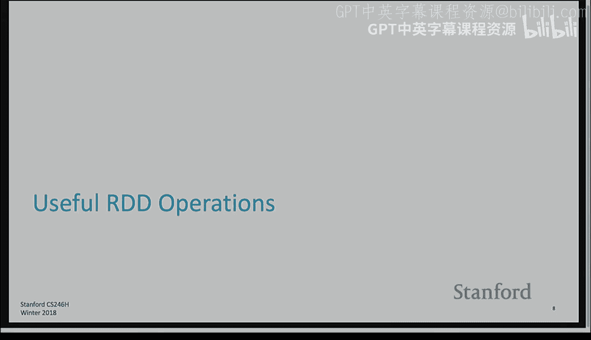

And my lambda is to split on commas and I take the top three out of that。

 I'm now going to have each element be an array because I have split each of these strings and when you split a string you get an array。

 so each element is now an array of the two components of each of those strings。😡。

Pretty straightforward。嗯。😊，Note that this is all one big operation。

 and the reason is that if I did data dotm。😡，Enter。😡，The response from the shell would be， yep。

 you just created an RDD and I went threw it away because you didn't assign it to anything。

So it's not it's really this is like programming in Python if you want to store the result of the map instead of just doing a take on it and print it。

 you can store it to a variable， and then you could say variable dot take3 to see what's in it。

 for example。😡，All right， flatmap， same thing as map except that。😡。

After you have transformed every one of the records。You remove the outer layer of grouping。😡，Okay。

 so same story。Same data， same thing。 if I flatmap with the same operation。

You see now what I have is not。A raise。But individual elements。

 notice idea take six because I knew this was coming。So what it has done is it mapped it into this。

 and then it flattened it by dropping the grouping。

And so now all of the individual elements of those arrays of all of the arrays are put together into one big RDD。

😡，That makes sense， Flmap is super fundamental。All right， map values。

 really just a convenience function， it is a way to do a map。When you don't care what the key。

 when you're not going to modify the key。So because it is map values， it only works on pair RDDs。😡。

So your data， in this case， I take my text file， I did my same thing， so I map it to split。😡。

And then I map it again to only the first letter of each of those pairs。Is that what I did？Yes。

 that's what I did。So。Oh no， no， I didn't， I'm sorry， I took this， all right， let me back up。

This gets us array to an RDD of arrays， right？😡，You can't an RDD of arrays is just an RDD。

 it's not a pair RDD， a pair RDD is an array of two element tuples。

 so I have to do an additional step here to transform the array into a tuple。😡，So now what I've got。

 if I do a take three is you can see I've got tuples of all of。

All of those those pairs of elements now I can do a map values and in this case I'm going to do a name dot lower where name is my value that I'm passing in and I take the top three。

 you can see I've only impacted the value yeah。😡，have to do anything to it unless you're using Java。

In Java， you have to explicitly declare it a pair RDD， and it's a big pan the but。

 but in Python and Scala， it just magically turns into a pair RDD。Flatmap values。

See if you can guess what this does， right same thing only operates on pair RDDs。😡。

It's a flat map on only the values。Yes。I guess Im little confused。We have， in this case。 So if we。

 we do our same transformations， we've got our same thing here。 So we're doing a flat map value。嘿。

Good point。In what was I trying to get to in this one。I don't remember， and sorry。

 this is I haven't seen these slides since last year， I never used flatmap values。

 I've never had a case to use it。 we'll look that up after I'll come back to Flmap values。

But this is one I've never actually used filter。I used this in class yesterday。

 so filter is basically Gr。So you apply this operation。In this case， it's a regular expression match。

 I'm looking for something that starts with a vowel。In all elements where that is true。

 they are preserved in the child RDD for any record where it's false。

 that record will be dropped in the new child RDD， so in this case if I do a take three。

 I get my Appleamian I lost my other two because they didn't start with vowels so I got new ones when I do my take three because presumably I have a big data file of these really stupid names。

😡，Yeah。야。What like， how does data look like after the first batch。So after this first map operation。

 the data looks like。This。Because this is the explicit so since I did this on the first slide。

 I just shortcuted it on the later slides。So then after this one， it looks like this。

 so basically we turn the arrays into topples。And I need to go look up what flatmap values actually does。

 mumble， mumble。 All right， Group by key， Group by key is a very useful operation in。😊，Spark。

 there are two classes of operations and we'll talk about this in detail in2 very6H。

 There are what we call wide operations and narrow operations。

And without getting too deep into the guts of it， the difference is that a narrow operation can happen without a computation。

😡，But a wide operation actually has to do a computation。And the reason is。

 so if you think about MapRduce， if you're familiar with the MaRduce idea。

 the reduce that follows the map causes a shuffle in sort。A wide operation causes a shuffle in sort。

All right， so if you're not familiar with Mareduce， let's try that again。

 So imagine I want to go through a my data file， let's go back to my data file here。😡。

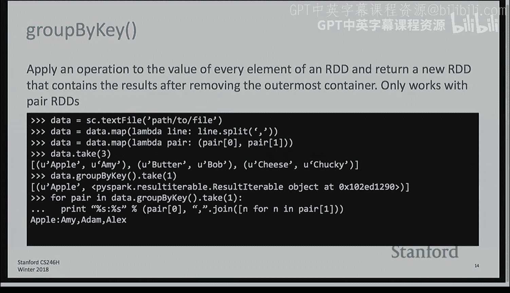

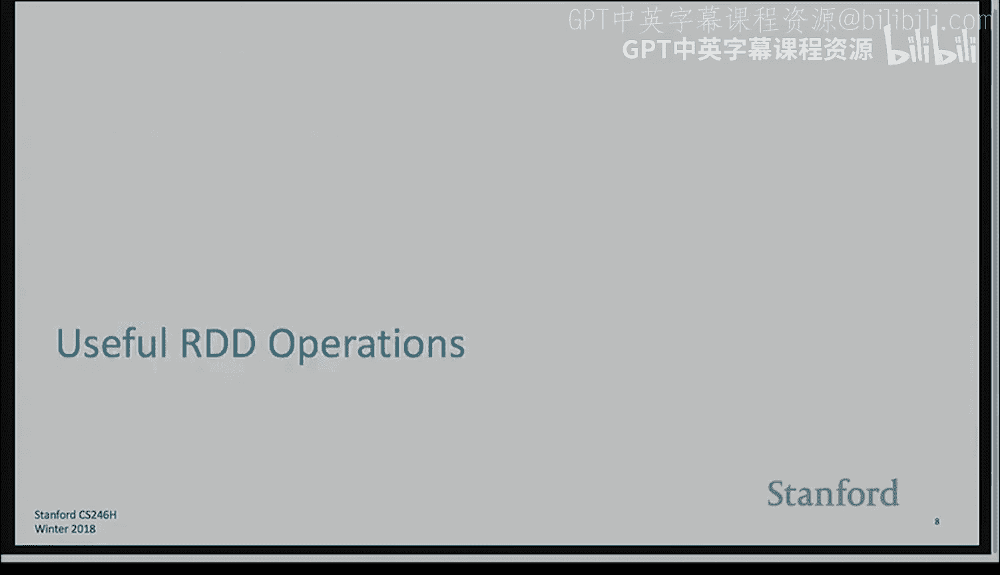

And I want to do this thing， I want to split it， right？

What have I got to know in order to split this into this？Oh， I need to know this。 That's all。

 I't need to know anything else。 It's a narrow operation。

 that means I can operate on each record independently。

But now imagine I've got my data here where I've got tuples。😡。

And now say I want to group these by key。😡，Well， what do I need to know to group Apple by key？😡，Well。

 I need to know all of the records。That have Apple as a key。

And if you think about this in a distributed context， they could be anywhere on the cluster。😡。

So you've got to go talk to every node in the cluster and figure out， do you have that key？😡。

That is a wide operation。😡，Because you've now got to go do network communication and transfer data and move stuff around in order to make it work。

😡，Otherwise known as a shuffle in sort。All right， so group by key is a wide operation。

 as I was just suggesting， so for example， if we have our data as as we've been working with it。

 if I do a group by key and I take， now this is in Python so this gets a little wacky what I get back is you'll see I have for the key Apple。

 I have a results iterable。😡，The reason it is a result iterable and not just an array of stuff。

Is that。It could be a tremendous amount of stuff。Im you just did something dumb on that 10 petabyte file and everything maps to the same key。

Right。If you print， try and print that， it's not going to be good。 If you try and operate on that。

 if you try and do stuff with that， it's going to transfer a ton of data for no good reason。

 So what we give you instead is an iterable that you can walk through to get the data。

And so what you would do is in reality， and notice I just redo this because I didn't save it。

 I could have saved this to a variable and not redone it。😡，But sparkark caches it。

 So it costs me nothing to redo this。So I redo it， so for pair in every one of these guys。

 now I'm going to join。😡，Everything in my in the second half of my tuple。

 right everything in that iterable， I'm going to join it together and then print it。

 and then I get Apple Atom Alexex， whatever。😡，Does that make sense？All right， reduced by key。

 So reduce by key reduces a wacky operation in Sp。 It's， it's funky to get your head around and。

All right， so imagine you've got。A bunch of things here。 So you've got， let's do word count。

 Word count' is the easiest one to do graphically right， So and I'm going to do even simpler。

 I'm going to do your homework 0 final solution word count， which is just letters， right。

 So I don't even have to have words。 So say I've got as my first step。

 I end up with something that looks like。

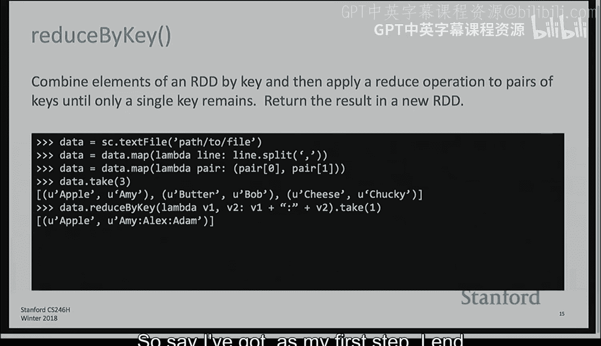

This， okay， is these are my the count of my words that start with these letters because in the map phase。

 if you're remembering homework zero， what you're doing is you're taking every line。

 you're going to split it in new arrays。You're going to then flat map。

That array into one big RDD of words。You're going to transform every word in that array into just the first letter of that word。

And then you're going to transform that into tuples of the first letter， comma1。

And then you're going to do a reduced by key。So here we are at the and these are all tuples。

So here we are at the RDD of Tuples of Let comma 1。When you apply the reduce operation。

 what it does is it does a group by key。And it applies your reduced operation that you supply to pairs of elements with the same key。

 so what it's going to do is and it's going to do this entirely arbitrarily， it's going to say oh。

 if this is a plus right if I'm doing a reduced by plus。

 basically I'm adding them together like homework zero。😡，It's going to say。

 okay here's an A and here's an A let's add these together and this will make an A2 here's a B and there's nothing so that'll make a B1。

 Oh here's an A and put that together now we've got an A3 right and ohs here's a C oh here's a C and we'll put a C2 there and E and right so it's going you have no way to predict in what order it's going to pair these things and put them together So you reduce operation always has to be associative and commutative otherwise you're going to get weird results。

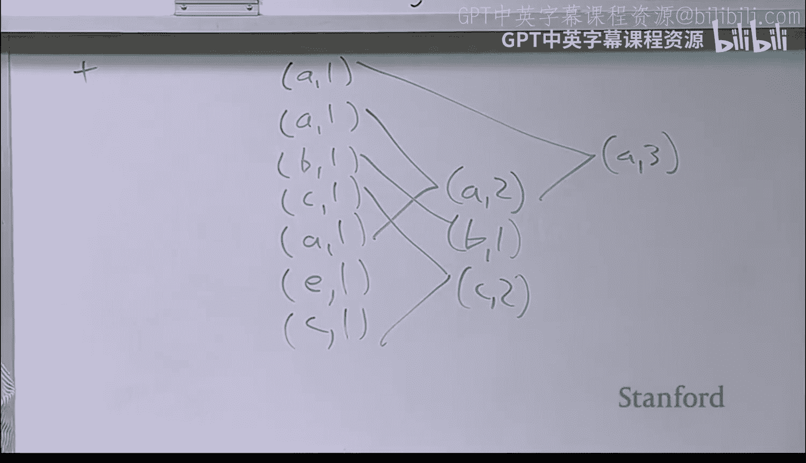

Does that make sense？have to take two。 It takes two arguments。

 One is the value from one of the records， and the other is the value from the other record。

So in this particular case， we concatenated them with a colon， and what you end up with is notice。

 even though this is two elements concatenating with a colon。

 I've got three elements in my result because first it concatenated two and then it concatenated that with this。

All right。Sort by。Does what it says？And you can specify a sort operation if you want。 So。

 for example， actually， sort by does specify sort operation。 So does not specify the operation。

 So if you do sort by， it uses this to determine the thing by which it will sort。

And then that will be sorted in， there's a term for it， but it'll be sorted in natural there you go。

 natural order。😡，So in this case we say for this pair right because this is a tuple。

 I'm going to grab the second element of the tuple and sort by that。

 so we're going to sort second by the second item of each tuple and we're going to do it it's just going to be natural order for that。

😡，So if you want to muck around with natural order that gets a little more complicated。

 typically you just muck around with what these values are so that the natural order is what you want。

For example， if youve got the numbers， you've got numbers and you want them in reverse order。

 it's easier to just make them negative in the lambmbda。做我噶。Yes。

 sort buy is actually sort by in this particular case， I don't think it is a pair RDD operation。

 sort buy is an RDD operation。So it doesn't require a pair。

 but I did it with a pair just so that it would I'd have two different things to sort by。

So instead I could have sorted by， I guess I could have left this as a string and sorted by the second letter of the string that might have been clearer。

Sort by key， and that's probably why I did that one as a pair operation is a pair RDD operation。😡。

So sort by key， if you've got a tuples don't have a natural sort order， you can't sort tuples。

 so sort by key tells it sort by the keys， otherwise a simple sort operation wouldn't work and you do you'd have to do something that looked like that。

 except tell it to sort by the first element which is annoying so you've got sort by key。😡。

Subtract is a set subtraction， so it takes an RDD and removes every record from the first RDD that is present in the second RDD。

😡，In a child RDD， again， it doesn't modify anything。

 so it will remove anything that matches from the second RDD that was in the first RDD in a third child RDD。

Did that make sense？ok。Join is the opposite of subtract。

Note that join is not going to do what you might expect actually know join will join is a pair operation and join does add database join so there is a。

😡，I can't remember if it's adder union， there there is a proper opposite of subtract so scratch the opposite of subtracting I was thinking of the adder union join is actually a proper database join so it's going to by default do an inner join。

😡，Which is to say that your resulting RDD will only contain elements or will only contain records。

Whose key is present in both of the parent RDDs。And so you can see。

 and this gets a little busy because it's a join， but bear with me。 So I've got two data sets。

 So data one looks like the same one we've been running around with。

 Data 2 looks like something different。 This is。I don't know what this is。

Okay this is I guess these are dumb names and these are dumb mascots okay， so if we join these。

 if we join one and two and we collect， you can see what we get is cheese because this is the only key that's present in both parent RDDs and the value is a couple of everything that was in the two parent RDD values so you get both the values from the parents。

Even though they're the same， we don't care。And if I do， because this does an inner join。

 if I want a more explicit thing， I can do a left outer join or I can do a right outer join or I can do a full outer join。

 the difference being if I do a full outer join， I get every key from both parents。

 whether or not it's present in the other。😡，And so you can see in this one。

 Apple gets Amy and nu because none isn't in the second one and cheese still gets both of them。

 and if I had more room on the screen， you would see McDonald gets nu and Ronald because McDonald doesn't show up in the first one。

And left outer join， right outer join are just which of the parent ones you keep the keys from on left outer join you keep the first parent' keys and you ignore ones that aren't in the second parent and a right outer joins the opposite the other way around。

Just like it in a database。In 246H， we will get into how you would do this in MapRduce。😡。

This one line of spark is hundreds of lines of mapreduce。

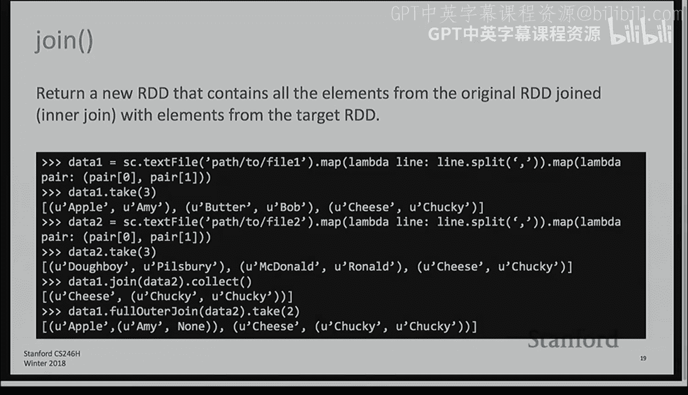

So this is why Spark is more popular。All right， so that's the quick run through。

 let me go look up what the flatmap values is because that bugs me that I don't know what it is at the moment so。

Because I obviously thought it。Oh， I turned off my network， never mind， let's not look that up。嗯。

It bugs me that I don't remember what exactly that does because I put it on a slide because I thought it was meaningful。

That I think is a pretty good intro to Spark I'm trying to think of it if I've got anything interesting enough to be worth firing up a virtual machine and playing around with Spark and seeing what we can do with it。

诶。Let's do that。 just for laughs。 Sure， let's do that。 Let me create a new window here。

And let's blow it up tremendously。

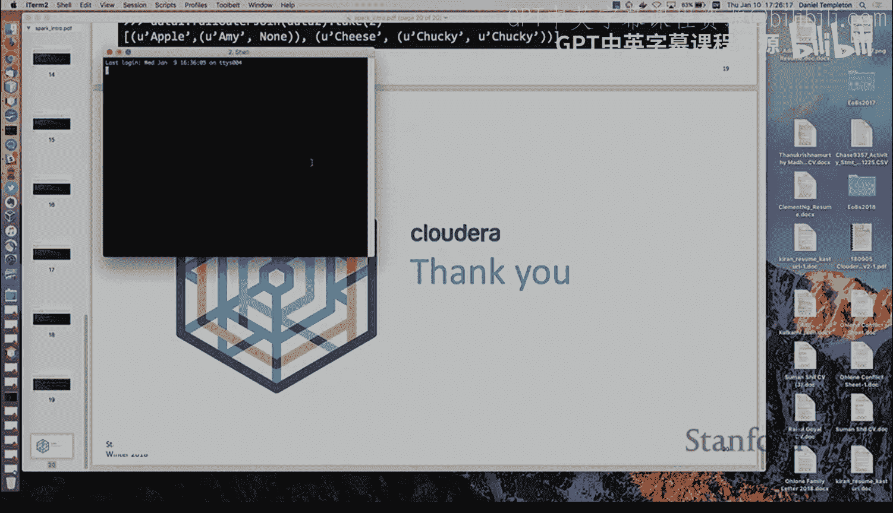

Okay。That looks big enough。 All right， so。If I do。So if I kick off Pi Sp。Oh yeah。

 this is worth it because I can show you a couple little tricks。

All right so in case you're wondering this picked up Java options thing is something that I have set up in my environment。

 I've set the JVM to headless because it eliminates some warnings in some cases anyway。

 nothing really important so I'll give you the sameiel I did in 246 H which is first thing to notice is that Spark is super chatty there's a lot of really ominous looking messages here so my favorite one is is this one here。

 warn native code loader， unable to load native library and your first reaction is oh God it's broken this means nothing ignore it。

What it means is that it was unable to load a native codec for some operations。

 so it'll use a Java version instead。😡，So don't worry about。

So there's a lot of these little warnings that。Unless you see a stack trace。

 it's probably not worth worrying about the warnings。All right。

 so and something you can do to get rid of some of the chattiness is you can do set log level and you can set it to。

 for example， error， and then you'll only hear the really important stuff。

That's probably a little extreme。 You wornn is a more normal place to set it。

 But if you want to mess around with things， you can set the log level。 All right。

 so let's get some data。 So first of all， note you've got a couple of things available to you。

 you've got the spark context， which is always called SC C and。You've got a spark， do I have tab no。

 is it Spark Con for Spark Config？I'll come back to that， that's a good question。There's another。

 is it just Kf？There's there's another， there's another variable that I also obviously never use。

 that is your spark configuration。 So your spark context is your root of everything you are going to do with Sp。

 So your spark context is that that first object that you've got to handle to from which you will get your handle to everything else。

So for example， so I'm going to throw things into a variable。

 so I'm going to call this hosts is my variable and I'm going to say sparkkcontext dot text file and I notice I didn't start this in my JVM like or not my JVM。

 my virtual machine like I said I was gonna I just ran spark the same way you all would't in 246 in 246。

 so this is just the one nodeode local thing it's not assuming HDFS it's not assuming a cluster。

 this is just the screwing around on my laptop version of things which means that I can give a path like Etsy hosts and it will be meaningful because it's not going to look for that on HDFS because it assumes I'm talking about my local file system。

So I can load a text file now did that work？😡，I don't know。

 It actually would complain if the host name weren't found， but something else could have gone wrong。

 Maybe this file isn't what I want it to be。 I don't know。 so let's take a few。Oh yeah。

 that looks about like the beginning of a host file。so let me do this， let me go over here， yeah。

 and blow this up。So if I can't， Etsy hosts。RightYou can see what's in Etsyhost is a bunch of comment lines and then a little bit of data I pick on Etsyhot because it's a file that's there and it's not something any sane person would really do anything with so notice when I do a take three I get oh yep there's that first double comment line there's that comment host database there's another comment line so I am seeing my Etsyhost file okay so what if I wanted to do something more clever with this what if I wanted to for example do a word count so we could run through a word count quickly what I would do is first of all I've got hosts so I could map it and map always takes a lambda and every element is going to show up as as one record and I would say。

Split， and well split。Actually， yeah， we'll split on white space。 That's fine。

 If I were being sensible， I would be splitting on。I'd be re to split be using a redX to split。

 but I can do this and if I say d1。 take3。You'll see just like we had before。

 I've got this guy had no white space， so I have an array of one。 this guy had。

Three whites or two white space。 So now I've got three elements in this array。

 This guy had one white space。 Okay， that's because I did a map。

If I go back up and I do instead a flat map。It'll be something a little bit more useful。诶。

Right so now I'm taking three and now you can see I've got this guy。

 basically I've got this guy this guy and this guy because I took the first three right so I've removed all those arrays and I've now got just one big set of stuff。

 All right， so now I want to do some stuff like I want to count things。

 Well most of the time you're going to need to get to a pair。

 you're going need to get to a pair RDD So the way you're going to do that is you're gonna map it So I can say D2 do map。

And depending on what you're doing， I'm going to take this guy， this individual one。

 and I'm just going to map it to a pairwise tuple。And I'll call this D3。And FD3。 take。

So no difference except now I've got tuples， but now magically， this is a pair RDD。

so check this out if I say D2 dot reduced by key lambda X X， I don't care what it is okay。

 so I'm reducing by key my operation oh actually sorry it's x comma Y。

And my reduce is just throw away the first element， this is a totally useless reduce operation。

The reason I do this is。啊。Wait， D2 is。That should not have worked so in Scala。

 it would have complained at me， what did this do？Python is a little bit more liberal than Scala。

 Okay， there we go。 I didn't take。 aha I got bit by my own silly thing。

 That was the first thing I said。It executes lazily。😡，So when I ran this operation， it said， yep。

Cool， fine。Because it doesn't know It hasn't computed it。 It doesn't know。 It's an error。

So until I did the take。It said it worked， but when I go to do the tank， it goes， whohoa whoa whoa。

 whoa， whoa whoa whoa， whoa whoa whoa， I can't do that， that doesn't work。There's all kind。

 Oh my God， error after error after error， Staed good God。 does it ever stop。 So ultimately。

 this is failing because。It's trying to do a pairwise operation on a thing that's not a pair RDD。

Now in Scala， it would catch it earlier， so if you were doing this in Scala， oh。We didn't。

Get into the details so I guess I'll do this here then we didn't get into the details of the as I promised of Java and Sca and Python。

 so we'll get into that here then we'll do this。 we'll start here so。

Salla and Java are both more structured， they're strongly typed。

 and so both of those would have caught that error to begin with。

 I would have hit enter and Scala would have told me， that's not a pair of RDD， you can't do that。

And Java would have said the same， so Python is simpler， it's quicker， it's fast， it's easy。

 but you end up reading stack traces to try and figure out things that a type checker would have caught。

Okay， so what did I call my new one， I called it D3。

 so if I were to do that same operation on this one。

And if I were to remember to do the take at the end of it。It's a really useless operation。

 but it works because I now have a pairwise RDD。Okay。A more useful operation would be x plus y。

And if I do that， you can see now that there were。Empty words， there were 14 of those。

 There was one place where I got a local host in there。 There were four instances of just a comment。

And this was a wide operation to do this。Does that make sense？So this is the Python experience。

 most same spark coders use Python。Just because it is friendlier， it's an easier thing to work with。

 it doesn't make your head hurt quite as much as some of the others the downside is that Python is not a top level language for Spk Spk is written in Scala and therefore secondarily is also Java as a primary language。

 Python tends to be an afterthought。😡，So there are things that are available in Scala that aren't available in Python。

 and there are things that work differently between Scala and Python。For 246， you don't care。

 Python's great， and I actually recommend you go do this with Python。But。If you want to get frisky。

We can do this with Scala， so let's look at doing this with Scala， so instead of running Pi Spk。

 I would run Spk Shell。So now it's a slightly different animal once this bothers to come up because now we're starting a JVM。

 Python was a lighter interpreter。 Now we've got a whole JVM coming up。 So now I've got Scala。

 But notice， I've still got。A spark context。I can still do the same sorts of operations。

 so I can say text file。Let's see hosts。嗯。Oh， whoops in， I actually， sorry。

That' the single quotes is a Pythonism。All right， so now notice I've got what I'm getting back is something strongly typed。

 it is an RDD， not a pair RDD， not a double RDD， but an RDD of type string。

 that means all of the elements are strings， okay so it knows stuff， it understands what's going on。

😡，And if I were， for example， to do that。Let's just go ahead and do a just for laughs。Oh， ha。

 that's sorry， that's Python。It looks a little different in Scala。

 So what I was going to do was map this guy to a。Scholar tuple and。

Let's see I have to it's been since last year， since I've used Sca， I believe this will do it。Yes。

 okay， so let's make sure that that did it。Yes， okay。

 so notice all right there's there's a lot different sort of information that we've got here first of all。

 your lambmbdas in Scala are more succinct than in Python they leave out the word lambmbda instead you get the equal greater then you still have parentheses for tuples but it gets weird。

 so we know now we've got RDD of tuples of strings and ints。It's smart， it knows。

 so this can catch errors before they bite you。😡，Now check this out， so here when I printed。

 it tells me my type again， it's an array of strings of ints and I've got an array and I've got tuples and I've got more or less the same sort of information that I had。

But let's look at some of the craziness of Scala， so Scala does some really freaking weird stuff。

 they say that it's powerful。I say that it's insane。

 so check this out let's do our word count and this is a useless word count because I'm comparing whole lines。

 I didn't do the flat map and I'm just short cutting okay to get to the point if I want to do that that reduced by key operation。

I want to say take the two values and add them together。

Sala provides me a super convenient shortcut for that， I can write that like that。

That's the whole lambda。The syntax breaks out as the first underbar is take the first argument and the second underbar is take the second argument。

 so take the first argument add it to the second argument if you need to use an argument more than once you can't do that you've got to go do the longhand notation like I did up here but if you're only going to use every argument once and exactly once in the order that they appear。

 you can shortcut them you can shortcut the greater than the equal greater then and you can shortcut giving them names。

😡，And so， you know you could see if I did the take， actually。

 it wouldn't do anything interesting because every line is unique in this file。

 but point being it works。嗯。Another interesting thing that you can do in the Lambdas in Scala。

 or actually， it's not so much interesting that you can do。 It's kind of a kind of annoying。 So say。

 I wanted to take this thing back down to。😊，Bing。Being a just the RDD of words。

I'm done with it being a pair RDD， I want to take it back to an RDD of words。

I want to access the first element of the tuple。Well， logically。The first element of the tuple。

Would be。Access kind of like the first element of the array， right， So if this were an array。

It would look like this to get the first element。 It uses parentheses， instead of square brackets。

However。For reasons， I do not comprehend。The way you access the first element of a tuple。Is。

Like this。It's not zero indexed， it's one indexed， and it's dot underbar and the index。Cause。

You know， that's obvious。嗯。😊，That's Scala。 So if you are unfamiliar with Scala for this reason。

 for these quirky little reasons， I recommend you do Python。If you're already a scala coder， cool。

 go tear it up。😡，There's enough quirkiness to scala that you're probably going to trip yourself up if you're not already a scala coder and 246 is interesting enough without trying to debug how the why am I getting the second element of my tuppple when I'm asking for the first one？

Right，Because I guess the first one I'm asking for the second one or no， whatever。

 Why am I off by one， right so。This is， again in a repple。😡，So Sc and Python both offer you a reple。

Now， as you saw in homework zero， there is another alternative to using the Reple。😡，And Reple is， oh。

Read， execute something loop。I print loop。Read execute print loop so it's a command line thing where you can interact right it's like the Python Reple or the scholar Reple。

 you get that in Sp， there's the Pypark Reple or this sparkark shell。嗯。You can also do it as a。

Proper text file that you then pass to Spark to execute。And that's what's in homework zero。

 so if you look in homework zero， there are examples of how do you do that in Python。

 how do you do that in Scala， and how do you do that in Java？So if you look at the Python one。

It's basically the same thing that I just did up here in the Reple。

 except that you have to create your spark context and you have to create your spark configuration。

 your spark configuration sparkk cons， if I forget。I forget the actual name of the object。

 but you have to do because I never do it that way I always use a rebel。But knows it's nice。

 it's clean， it's succinct。If you look at the Java and the scholar。😡，You will immediately notice， oh。

 boilerplate， right， you've got a main class， you've got structure。

 you've got because these are not scripting languages， these are more proper programming languages。

 so they require you to do a little bit more。😡，Infrastructure around them a little more boilerplate to make them function。

 What you will notice。 So in Java， Java is。Schola， as you saw， actually， you didn't see， Oh。

 let me show you this。 I， I did everything without variables because。Variables make it harder。

 So I just skipped the variables。 So if I wanted to store any of this stuff into a variable。

 I would say v x equal whatever。 And now I've got x。

 and I can do x dot take or x dot collect or whatever。Right。嗯。呃。I don't know what I stole。

I did oh sorry， I stored the take in the X， but regardless， so val is the way you declare a variable。

 so very much like Python， you don't give it a type， it's dynamically typed。😡。

So there's actually in scholara there's two ways to declare variable， there's val and there's var。

 val is for an immutable variable， var is for amutable variable。

 you typically use v because everything in Python or in Spark is immutable。

 so you don't typically need amutable variable to store an immutable object。

 so typically val is what you're going to use for everything， but notice it's dynamically typed。😡。

Which means I don't care what I got back。ll It'll work。 I'll just roll with it。

 Java is not a dynamically typed language。 So that means there are different types for pair RDD。

 And actually， let me do can I do this quickly。 Yeah， here， Let me do this。 I just want to see。

Make sure I'm using the right terminology。Come on， oh。왜去。Did I freeze you？冇。All right。

 let's try that one more time and hopefully I get the cursor up。

 I think so in the Pi Spk Show you can't cursor back into the history。

In the scala Sp shell and in Spark shell， I believe， yeah， there you go。

 so I should be able to do this and I'll skip the value because I don't actually care。There we go。

 and it's called a。Call it a partitions RDD。 I was hoping I could get it to tell me the name of。

 I think it's double RDD， the third type of RDD。Anyway， all right。

 so I don't care whether this is an RDD or a double RDD or a pair RDD。

 it doesn't matter it's a thing， but Java there are separate types for RDD， for Java RDD。

 for pair RDD， for double RDD for。

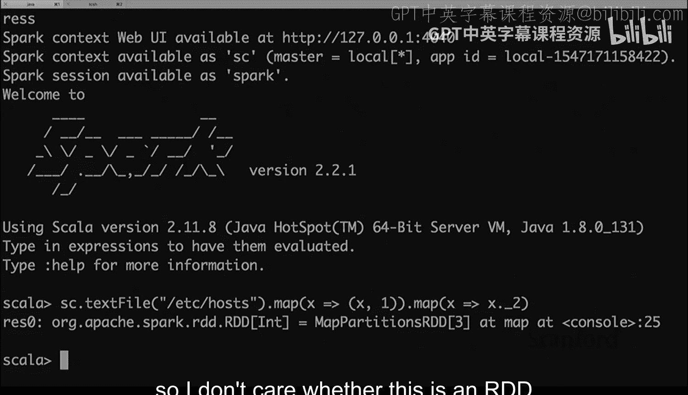

Whatever， that every RDD has a different type。 And so you have to be very careful with your typing and。

Anybody here do much serious programming with Java， particularly with generics？

Anybody ever deal with generics and Java， so all right， when you use generics， right。

 generics is declaring type。So， and actually， you know what。

 I think I actually have this up in an IDdeE because I wanted to show this to you because it's just。

 its， it's so bad。 it's， it's worth showing。 Yeah， all right， So here we go。 word count。

 Let me blow this up。 So this is word count in Java。

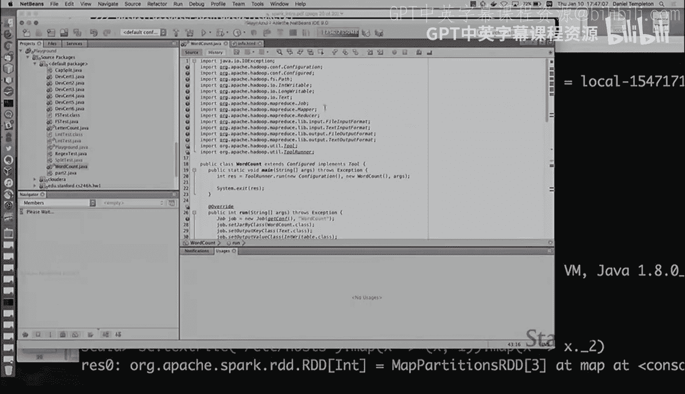

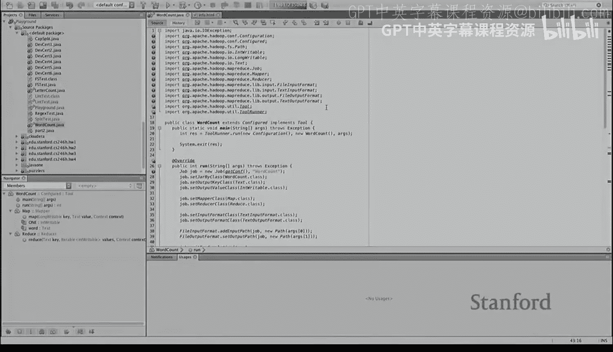

Where's my air whoop？Wop， what's going on？Come back。Where'd you go。Oh。

 I think net beans actually crashed on me。唉。So Ne beansans9 is not extremely stable in case anyone was wondering。

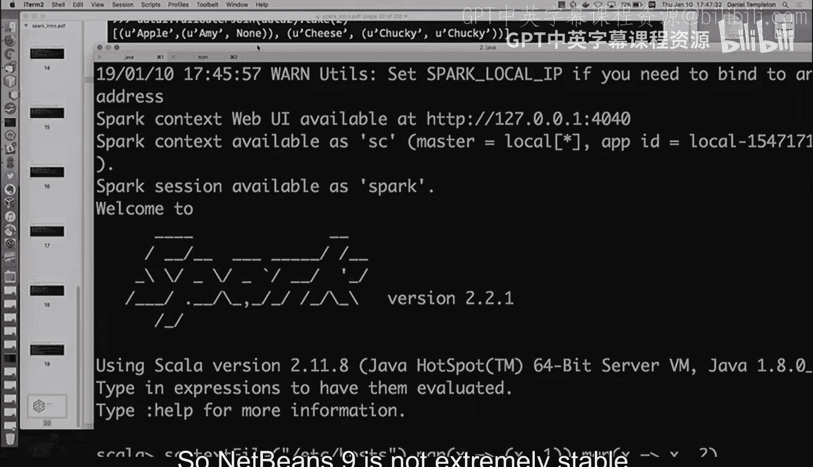

It tends to like to die， give me just， oh look exited unexpectedly， I didn't notice。

 give me just a second and let me show you this thing in Java because it's bad enough to be worth looking at。

All right， it's starting。Give it a second。My laptop's doing something weird？

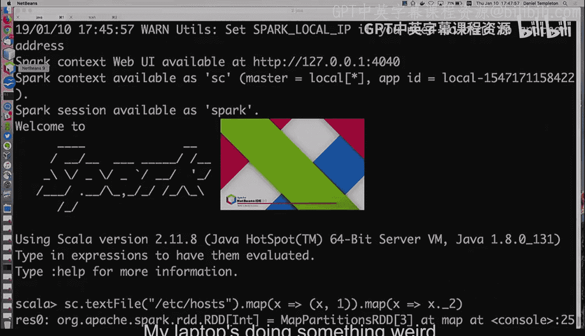

Because it's awfully slow at the moment。 All right， so let's try this again。So let's blow this up。

And let's open。Yeah， okay。 let's open this file and give me just one moment。诶。Thank you， documents。

Stanford。嗯哼。And do do。诶。诶。Bloody heck。 it's actually in。I think it's in。Here。There we go all right。

 so let's blow this guy up so looking at this thing in Java so let's so first thing to note。

 first thing that should just like leap out at you is I'm importing Scala into Java。

Java does not have a concept of a tuple。So to get tuples， you import them from Scala。

Okay that should disturb you to begin with that that should be enough to make you wonder why you're doing this in Java All right。

 so I get my I get my spark context and now notice I have a Java RDD and I have to declare my type。😡。

So then as I go down， you'll notice。This starts to get little deeper and a little deeper。

 so I do my flatm and map it and filter it， and now I've got a Java pair RDD of character and integer。

😡，And I'm going to map that to tuples， so if I were to oh actually that is the map of that to tuples。

😡，I've got this thing here and because this goes to character integer， so this becomes the Tple2。

 this becomes character integer of that。😡，As you get nested， so say that my value was itself a tuple。

This statement now becomes Java pair RDD character， tu2 open parent， character， comma integer closed。

 very quickly you're over here at like character 342 and you still haven't finished declaring the type of your variable。

😡，So as you get into deep data diving， Java just becomes a pain in the butt。😡，Otherwise， I love Java。

 Java is my primary language， but for Scala， I'm sorry for Spark。

Not not quite there and the fact that you have to know based on the operation that you'll spend if you want to do this in Java。

 you'll spend a lot of time trying to figure out for every operation。😡。

What is it actually going to return me， Is it a pair RDD， Is it a double RDD， I it a Java RDD。

 Is it something else， Is it an iterator， is it a。There's a whole lot like when I wrote these examples for 246 in Java。

 I can't tell you how much time I spent just trying to figure out what bloody return type things were going to give me and what it was expecting as parameters。

 so it's not worth your time。😡。

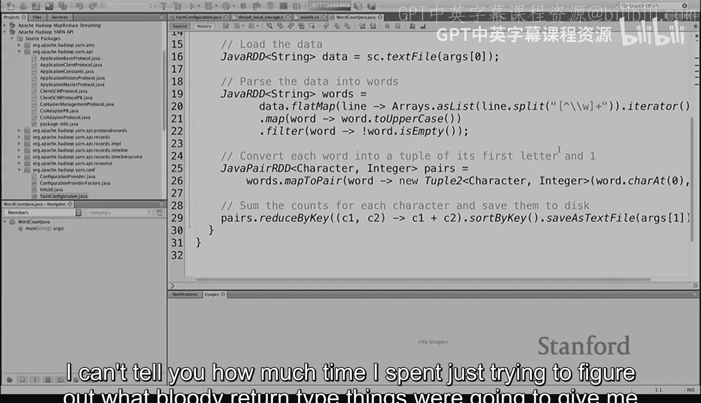

I would just write Java off the list and go to Scala or Python and unless you're really a scholar person go to Python Now the thing about Sca and Java is if you're going to do it in a separate file。

 which I recommend you do it in a separate file for 246 because you can then very easily submit that file right if you do it in the Reple。

 you then have to go back back up through your history of your terminal and figure out what you did and hope you didn don't miss a step in order to go write it down somewhere so that you can submit it。

If you do it as a file， it's very easy， it's self-contained， it's a little easier to work that out。

 but if you're gonna to do Scala or if you're gonna to do Java。

 you have to compile it and to compile it， you have to use maven and maven is a beast I am a software engineer。

 I've been doing software engineering for a long time， I avoid maven if I can help it， I use it。

 I use it daily， I just don't ever look carefully at it because have you ever read any of the HP Lovecraft Kaululu stories where it's the alien gods from the deep spaces or the dark spaces between the stars and you'll go mad if you look at them too closely。

 this is maven。There is。The idea of man is it's intended to make it really simple。

 You lay out this palm file， PM dot XMl and in that XML file。

 you describe everything that you want in your build environment， it makes it really easy to say。

 I have these dependencies and you can pull this in and it's super super simple to build something that depends on a bunch of stuff。

 Java dependency handling and therefore scholar dependency handling has always been a challenge。

 So Man goes and does all this great dependency handling for you。 The problem with it is。

There's you can follow kind of the road examples， but as soon as you stray off that path。

 a like the documentation isn't great， you're living in the land of stack overflow and hoping that some other poor fool has suffered what you're suffering now。

 because it' just it's very hard to figure out what's going wrong or why because it's not extremely verbose in telling you what broke or how it broke。

So。In homework zero it does tell you how to build the Po。

 XM file for maven what you would do is you build this palm。

 XMl file and then you create a directory structure。

 you have to have a source directory SRC source and under that source directory you have to have a main and under that main you have to have Java or Scala and then under there you would have your source code this is all explained in homework zero。

If you're having problems with that， we can look at it after。For these reasons。

 back to what I said before， use's Python， because you don't have to care。All right。

 questions about Spark， and then we'll get into debugging。

 I can stop recording and they can go home and we can debug。Questions are debugging。

Debugging questions， anything。Debugging。Cool beans。Alrighty then。

 so let's kill the video and we'll do debugging and they can go home and I just have to watch my time。

