# 斯坦福大学《AI与创新》课程笔记（一）：生成式AI与科学应用 🧠

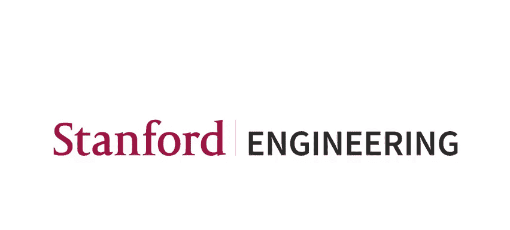

在本节课中，我们将跟随加州理工学院教授、AI科学家Anima Anandkumar，学习生成式AI的核心概念及其在科学领域的革命性应用。我们将探讨从语言模型到物理模拟的跨越，理解AI如何从“识别”走向“创造”。

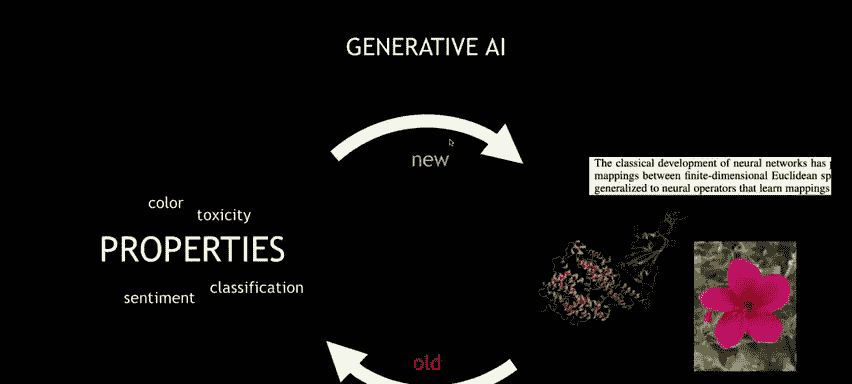

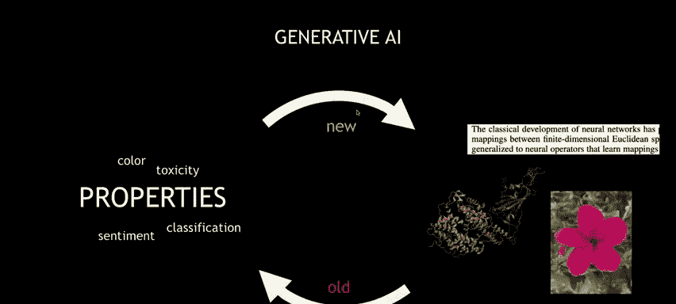

---

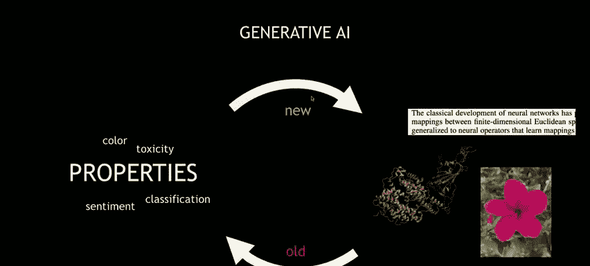

## 演讲者介绍 👩‍🏫

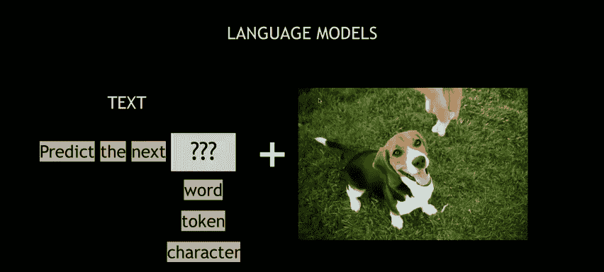

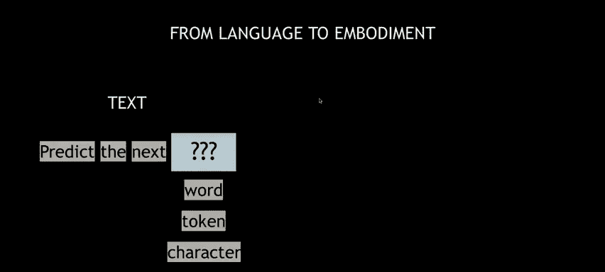

Anima Anandkumar是加州理工学院的计算学教授。她曾是英伟达机器学习高级总监和亚马逊网络服务首席科学家。她是将AI应用于科学研究的先驱，其研究涵盖代数方法、深度学习与非凸优化问题。

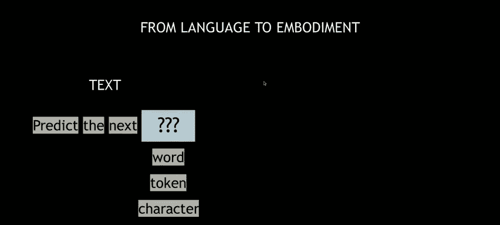

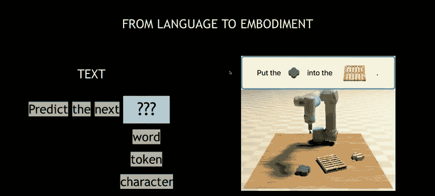

---

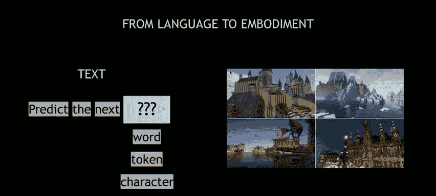

## 生成式AI：从“识别”到“创造”的范式转变 🚀

上一节我们介绍了演讲者，本节中我们来看看生成式AI的核心思想。

生成式AI的难点在于能够生成**高维分布**的样本。这意味着处理非常复杂的对象，例如大段文本、图像，也包括分子、蛋白质，甚至是新冠病毒的新基因组突变。这种能力不仅仅是推理给定的输入，而是生成新的样本，这正是它与过去十年AI的主要区别。

之前的AI时代更多是关于**判别式AI**。例如，给定一张图片，询问其中有什么，这就是判别式的，因为你在试图区分这张图更像猫还是更像狗。在语言模型出现之前，我们主要专注于以准确的方式对给定样本进行判别。

当然，有了足够的计算能力，生成式AI成为可能。这本质上是一个从**低维规范**（例如一个简单的提示或分子需求列表）到**高维复杂输出**（例如实际的分子结构）的过程。这是一个困难的过程，但凭借足够的数据和规模，我们现在能够实现它。

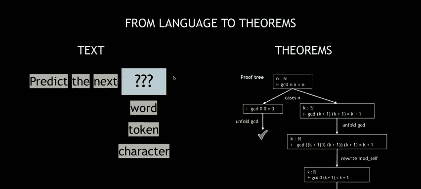

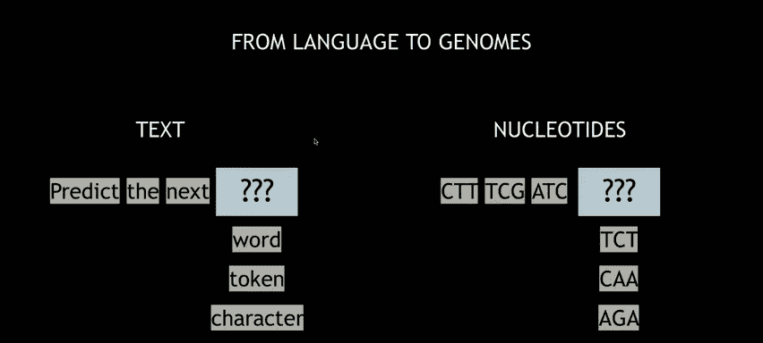

---

## 语言模型：原理与训练 📚

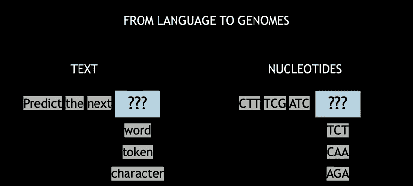

上一节我们了解了生成式AI的宏观概念，本节中我们深入看看其典型代表——语言模型。

语言模型的训练理念非常简单。我们通过**预测给定上下文后的下一个词**来训练模型。这个过程在大规模数据上进行，我们称之为**预训练**。然后，我们加入少量人类反馈进行**对齐过程**，这通常通过强化学习完成，即**RLHF**。通过这种方式，模型能够理解我们的提示或指令，从而以恰当的方式回应，同时避免输出仇恨言论等不良内容。

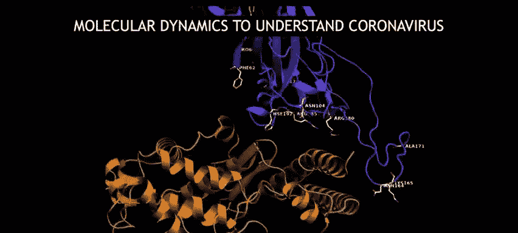

这个过程本身很简单，核心是获取尽可能多的数据（实际上是互联网规模的数据），然后学习预测下一个词。仅仅通过观察给定句子当前部分后不同词语出现的**可能性**，模型就在某种程度上学习了底层的含义。它通过大规模学习，理解了词语在不同上下文中的出现方式。

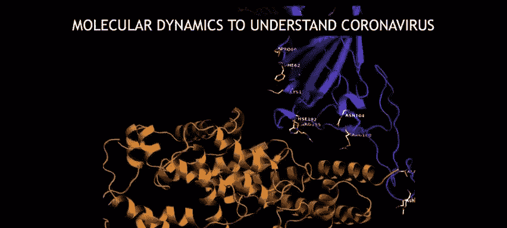

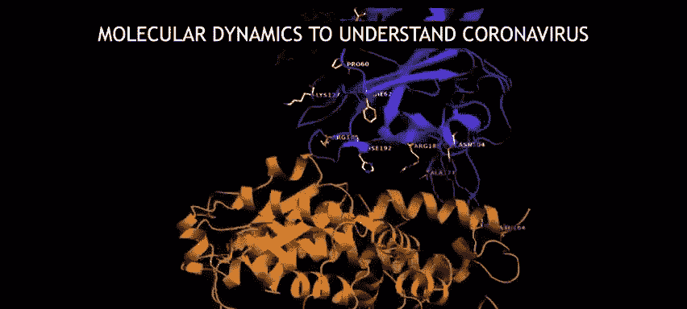

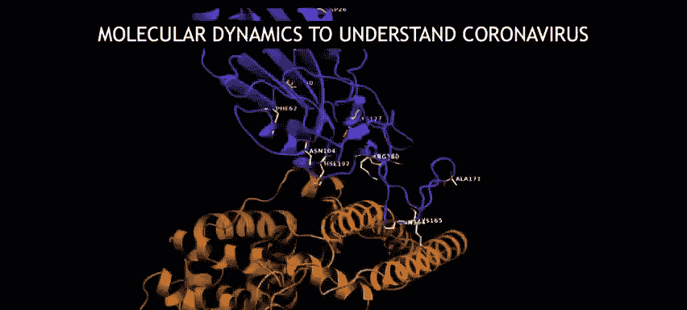

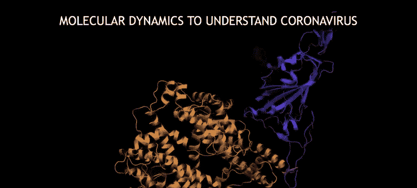

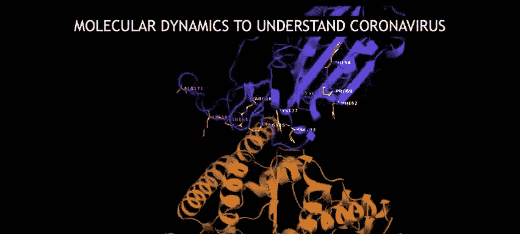

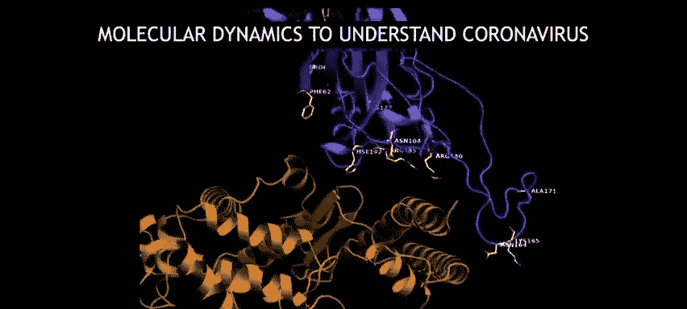

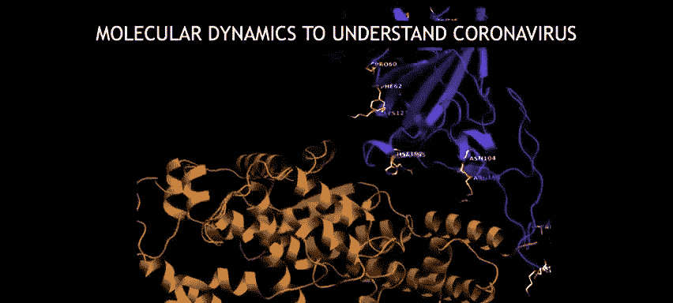

---

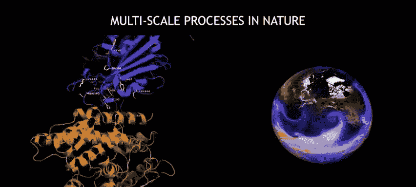

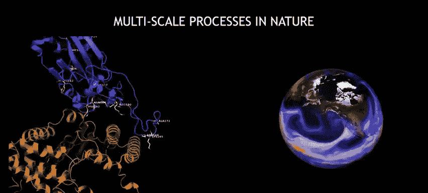

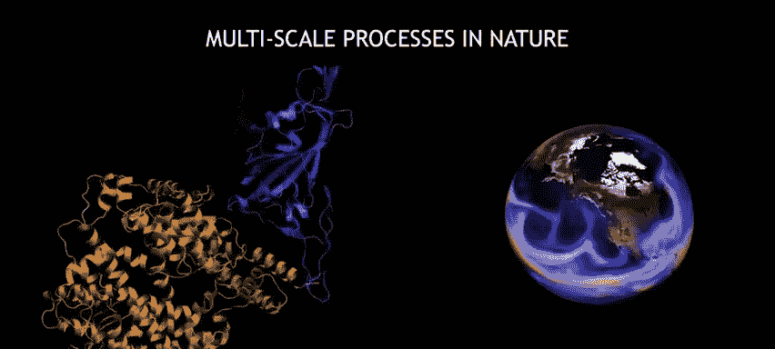

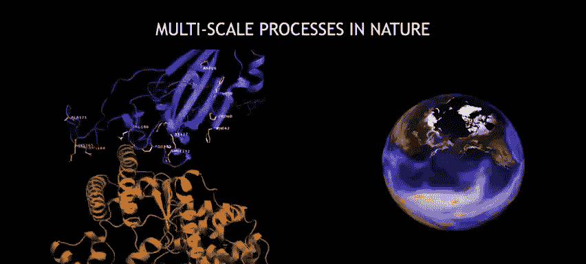

## 超越语言：具身智能体与虚拟世界 🤖

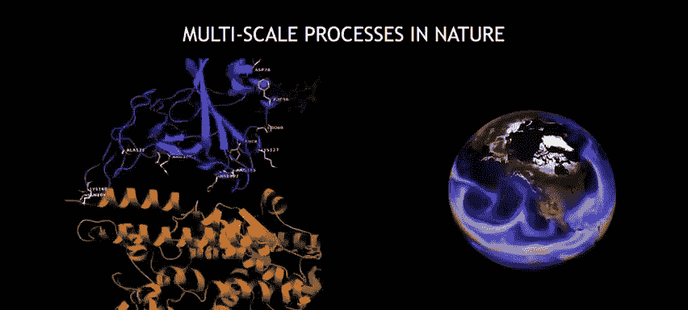

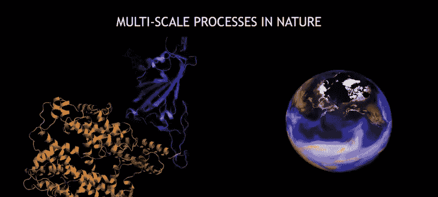

语言本身对许多应用来说很棒，但并非全部。语言最终缺乏的是**具身性**。你可以学习文本片段如何关联或词语的底层含义，但当与物理世界交互时，词语需要转化为行动。

这就是我们需要**智能体**或**具身智能体**的地方。它接收文本指令或以某种方式与文本交互，但最终将其转化为行动。

以下是早期工作的一个例子：

*   **物理机器人**：我们与斯坦福的研究人员合作，让机器人能够根据文本和图像混合指令，执行拾取和放置物体等一系列任务。文本为机器人提供了一种成为“通才”的方式，能够零样本泛化到新任务，而不仅仅是针对单一任务进行训练。
*   **虚拟世界（Minecraft）**：我们所做的Voyager工作展示了如何使用语言模型在《我的世界》等多样环境中持续学习技能。智能体可以循序渐进地从简单到复杂地学习技能，并利用先前学到的技能。这就像人类学习一样，我们拾取某些主题，按照课程安排去解决越来越难的问题。我们教智能体使用语言模型来生成可在《我的世界》中执行的动作，并决定下一步做什么。

这与标准的强化学习不同。例如，十年前AlphaGo击败世界围棋冠军时，AI能够遍历众多可能走法并选出优于人类的最优走法，令人惊讶。但它的目标只是赢得一场游戏，这是预先定义好的。而在《我的世界》中，关键在于**创造力**。你可以建造城堡，甚至有人在游戏里建造了CPU和GPU，可能性是无穷的。这正是AI智能体的前景所在：语言模型不是孤立的，它们可以被智能体用来持续查询和获取帮助，但最终是智能体自己弄明白如何持续收集技能，在环境中解决越来越难的问题。《我的世界》正是这一点的展示。

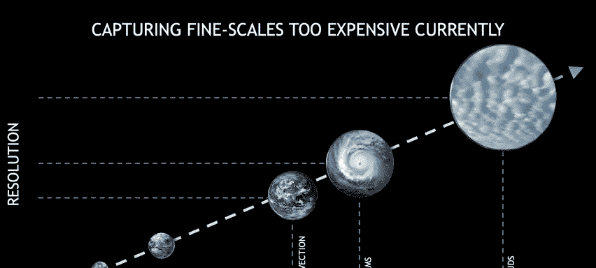

---

## 应对幻觉：结合形式化验证的数学推理 ✅

上一节我们看到了AI在虚拟世界中的创造力，本节中我们关注一个关键挑战：幻觉。

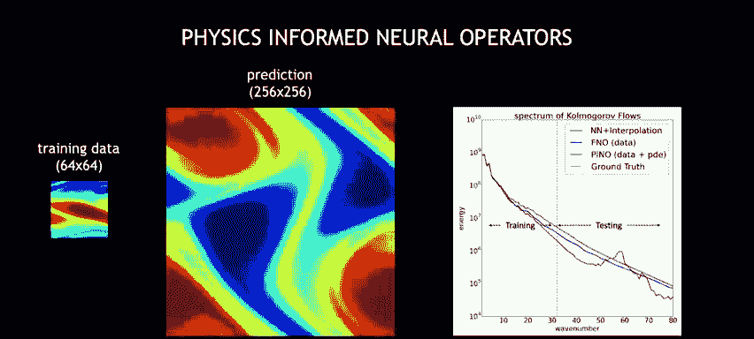

如果只使用语言模型，仍然缺乏处理**幻觉**的能力。这些模型目前没有基于事实进行“ grounding ”。如果你在互联网的所有内容上训练，一切都混合在一起：有人讲笑话、写诗、写软件代码、陈述数学事实。如果你要求语言模型证明定理，你不能指望它100%正确。它可能声称某个证明是正确的，但GPT很多时候可能是错的。

我们在一个项目中尝试解决这个问题，即**将语言模型与验证能力结合起来**，以检查语言模型所做的陈述是否正确。我们不需要从头构建验证器，已有数十年的工作称为**形式化验证器**或**形式化定理证明器**，**Lean**是其中的佼佼者之一。包括顶尖数学家陶哲轩在内的许多数学家都在使用Lean，并且围绕将数学形式化到Lean中建立了一个庞大的社区。

这意味着，如果你阅读一篇数学论文并查看所有证明，你无法知道它们是否正确。作为专家数学家，你可能会去尝试判断。但如果你有一个程序可以认证每一步都是正确的，那么你首先就不需要担心证明的正确性。最终，同样的概念在许多领域都有用，尤其是安全关键领域，例如飞机、无人机、火箭的控制都采用了同样的形式化验证概念。程序的每一步都必须被认证为正确，否则使用未经正确性验证的程序就太不安全了。

我们可以将Lean与语言模型结合使用。语言模型提出想法，例如说“我认为证明这个最大公约数的下一步是这样的”，然后Lean作为验证器可以认证这一步是否正确。通过这种方式，语言模型证明的任何东西现在都是**100%准确**的，没有幻觉。在数学领域可以这样做，因为你可以正确验证和认证每一步。在其他领域则不那么容易，例如涉及社会信念或道德问题时，你无法简单地说逻辑推理的这一步是正确的。但在数学领域我们可以做到，我认为这种逻辑推理对于AI在许多科学领域取得成功至关重要。

---

## 从语言到基因组：多模态生成模型 🧬

到目前为止，我们讨论了语言模型在一系列不同应用中的使用。但你也可以从语言转换到其他模态，其他类型的数据。其中一个领域是使用**基因组数据**代替英语或其他自然语言。

这意味着你现在处理的是**核苷酸序列**，即ATGC（DNA的组成）。你可以将这些序列输入模型，作为一个**基因组语言模型**来学习预测序列中的下一组核苷酸。这样做可以学习基因功能的底层直觉，了解不同基因的功能，就像理解自然语言中词语的底层含义一样。这是相同的类比。

我们同样在大规模上进行这项工作。我们训练了第一个基因组语言模型，使用了超过1.1亿个已知病毒和细菌的基因组序列。这是英国生物银行，拥有已知病毒和细菌突变的最大集合，包括流感病毒、大肠杆菌、冠状病毒等。不同之处在于，如果你问生物学家，他们通常研究一种特定的病毒，例如流感，CDC试图猜测哪些突变最有可能发生，然后制造疫苗来针对这些突变。但现在，通过使用这些大规模生成式AI模型，你可以观察所有这些不同的病毒和细菌是如何随时间进化的。

---

## 预测病毒变异：生成式AI在流行病学中的应用 🦠

上一节我们介绍了基因组语言模型，本节中我们看看它的一个具体应用：预测病毒变异。

通过学习所有突变，你可以找出哪些突变比其他突变更有可能发生，从而找到预测新的关切变异体的方法。我们正是这样做的：我们微调模型，使其专注于冠状病毒。在训练期间，我们向它展示了疫情第一年出现的变异体（Alpha和Beta变异体），其他变异体尚未出现。但基于基因组训练的语言模型准确地预测了后来出现的变异体，如Delta和Omicron。模型能够成功学习病毒可能如何突变的**进化动力学**。这对于我们掌握最新的流行病非常有帮助。

这带来了一个关键问题：你不仅可以生成这些基因组序列，但**影响是什么**？哪些变异体更令人担忧？哪些碱基对组合可能导致更致命的毒株？为了研究这一点，你需要了解细节。例如，冠状病毒的刺突蛋白（蓝色部分）如何与人体内的蛋白质靶点相互作用？你需要了解结合在哪里强，在哪里弱。毒株更致命或更令人担忧，往往结合得更强，这时它对人体更具破坏性。

仅仅观察基因组序列无法收集关于我们应该担心哪些变异体的所有信息。另一方面，如果你深入研究生物过程本身——病毒如何进入人体并与体内的蛋白质靶点结合，以及我们研究的其他方面，例如它如何在呼吸道气溶胶中传播？它结合的分子使其具有传染性，并通过气溶胶传播。还有它的复制情况如何？哪些因素有助于或阻碍病毒的复制过程？要研究所有这些，你不能只看离散数据或序列类型的数据。

---

## 神经算子：用于物理模拟的连续空间AI模型 🌪️

我做了个类比，基因组就像语言，只不过不是26个字母的英语，而是只有四个字母ATGC，你有一个序列，并使用与语言模型相似的架构（如Transformer）来学习模型。但现在要研究这些在空间和时间上的过程：在空间上，你看哪些分子彼此结合；在时间上，分子动力学本身如何变化。

这类过程在自然界中比比皆是，从原子和分子水平一直到行星尺度。第二个行星尺度的例子是**天气预测**：明天会有风暴吗？会下雨吗？为此，你观察的过程涉及从云层中导致降水的粒子，到像大气河流这样的大尺度效应（这对加利福尼亚很重要，因为这是冬季风暴的原因），它们可能宽达数千英里。因此，从微观到宏观的现象都相互作用，导致了地球上的天气。在这方面，仅靠语言模型本身是不够的。就像语言是对某些现象的高级描述，数学也是一种高级描述。事实上，你可以通过数学方程来描述这些过程。

例如，观察分子动力学，你可以使用**牛顿运动定律**来描述分子如何拉伸和运动。你也可以深入到量子效应，使用**薛定谔方程**及其所有近似。我们完全知道描述这些系统的方程，但挑战在于大规模模拟的能力。事实上，对于量子模拟，即使模拟一个只有100个原子的分子，所需的计算时间也可能超过宇宙的年龄。这就是瓶颈所在。

与语言模型相比，我们处于不同的局面。对于语言，很难用规则来描述，有太多例外，没有一个数学方程能描述所有英语文本。另一方面，互联网上有大量数据，我们可以从中学习。但另一方面，如果你想学习这类物理现象，数据是有限的。当然，有一些观测数据，你可以通过显微镜观察病毒，观察蛋白质相互作用的动态，或者通过卫星数据评估大气中的风和其他模式。你可以获得一些数据，但有限。现在的问题是，对于科学现象，是否仍然存在生成式AI或大规模AI模型的概念？

我们能做到这一点的方法是**融入数学方程的知识**。我们可以使用现有的模拟器生成数据，或者直接尝试将物理定律和方程的知识融入我们的模型。但这样做的一个挑战是需要捕捉**非常精细的尺度**。例如，要理解大气中云层的运动，你需要达到非常精细的尺度，这正是传统数值求解器模拟成本高昂的原因。

传统模拟试图直接求解方程，而不利用从数据中学习。它们说：“让我尝试求解这些方程”，但要做到这一点，只能采取小步长，然后需要很多这样的小步长，这变得非常昂贵。而且，如果区域本身很大，我需要大量内存来使网格足够精细，以使求解器收敛。

这正是AI现在具有潜力的地方，我们现在有证据表明，它可以比以往更快地加速求解这类数学方程。类比类似于深度学习之前的计算机视觉：人们手工设计特征。如果你要分类一张人脸，会寻找某些被认为更好的特征，比如眼睛。你可以手工设计每一个特征，但任务太长尾了，你无法为面部的每一种变化、每一个角度、每一种光照都这样做。在某种程度上，数值求解器也是如此，你可以尝试手工设计特征以使其收敛，但你不知道这些是否是最佳特征。

---

## 神经算子的核心优势：分辨率无关的连续表示 🎯

上一节我们提到了传统模拟的瓶颈，本节中我们介绍一种解决方案：神经算子。

即使现象需要非常精细的网格，如果我们尝试直接求解所有这些点，你可以找到一个到潜在空间的**非线性变换**，在那里网格要粗糙得多，从而获得加速。这正是我们使用称为**神经算子**的技术所做的。

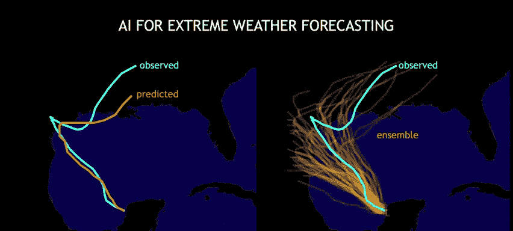

神经算子扩展了神经网络（如Transformer）的概念，将其应用于**连续空间**。例如，考虑云层建模，你可以尝试以某种分辨率对云进行建模。如果我选择的分辨率太粗糙，得到的就是垃圾信息，太模糊，没有足够有用的信息来准确预测云层将如何随时间变化。这是许多物理现象的挑战：如果你的网格不够精细，你将无法准确捕捉流体（如云）将如何流动的预测。

这与计算机视觉不同，后者更多是关于视觉外观。如果对我来说视觉上看起来足够好，那就行了。但对于获得正确的物理特性，准确预测流体流动（如云）会发生什么，情况并非如此。

我们使用神经算子时，不担心将分辨率固定为一个值，而是思考在图形学中，有**矢量图形**和**栅格图形**。这是相同的类比：在栅格图形中，你预设了分辨率，即像素单元的数量。如果你进一步放大，它只会变得模糊，因为你没有增加像素单元的数量。另一方面，对于矢量图形，你将数据表示为形状，将其参数化为形状，你可以持续放大，仍然可以获得清晰的图像和图形。

神经算子做同样的事情，但你是**学习那些形状应该是什么**。因此，你总是将输出表示为连续的函数，所以你可以持续放大到任何分辨率，它仍然能给你有效的答案。神经算子从数据中学习这些函数，而不是通过神经网络编程它们。现在你可以给它各种场景的流体动力学数据，或者天气数据，材料拉伸的数据等等。你不需要事先固定分辨率应该是什么，事实上，你可以在多种分辨率的数据上训练它。

神经网络可以拟合任何任意函数，所以你可以使其任意精确。主要区别在于：在文本中，使用Transformer，你在离散的标记上学习，你固定了语言的词汇表，并为词汇表的每个部分给出一个标记。另一方面，在这里，我们没有在一个分辨率上定义标记，而是说这些标记可以无限细化到我想要的任何分辨率。我们提供了这种灵活性。

通过这样做并捕捉最终分辨率，我们可以达到更精细的尺度。右边的图表展示了我们如何准确预测在更高频率或更精细分辨率下发生的情况，即使模型在训练期间没有看到这些。

---

## 应用案例：天气预测与科学设计 🌍

上一节我们介绍了神经算子的原理，本节中我们看看它的实际应用。

我想展示一些我们使用神经算子的用例。**天气模型**是我们选择的第一个复杂领域。天气之所以具有挑战性，首先是因为它的高分辨率：全球数据间距约为25公里，我们有追溯到四十年的历史数据，但样本量并不多，大约只有5万个样本，与语言模型的世界相比微不足道。此外，它还具有多通道的挑战：不像图像的RGB，你现在有风速、湿度、大气的不同层次等，超过10个变量。

当我们2020年代末开始研究这个时，我们想挑战有难度的用例。流体动力学已经被认为足够具有挑战性，但我们还想触及直接影响现实世界的领域。许多人认为我们疯了，因为天气预报有数十年的方法发展。我记得成长过程中，人们总是告诉我，看天气模型，天气预报需要大型超级计算机。我们的问题是，使用神经算子和完全基于深度学习的方法，我们能做得多好？这意味着我获取当前初始条件，然后使用神经算子预测下一个时间步的天气，比如六小时增量，我们可以基于这些预测给出两周的预报。

事实证明，它要快得多。模型的首次运行比数值模型快约**45,000倍**。 literally，原本需要大型基于CPU的超级计算机完成的工作，现在可以在本地游戏PC上运行。你只需要消费级GPU，模型是开源的，你可以下载模型并运行自己的天气模型。我们以宽松许可证开源了它。对我来说，这展示了这些模型的承诺和能力，能够将非常复杂的物理计算微型化，并且做得相当好。

这个模型也在ECMWF上运行，你可以获取实时天气预报。这些只是一些图表，展示了不同天气变量是如何预测的，它甚至比数值模型更好地预测了去年的一些飓风。因此，它不仅在速度上快了数万倍，而且在准确性上也不逊色，甚至更优。

我们如何做到这一点？通常这是一个权衡，但在这里我们可以做到，因为我们从数据中学习。当你进行数值求解器和传统天气预报时，你假设有纳维-斯托克斯方程，并假设某些参数，你做出了所有这些建模假设，并且没有能够利用数据本身来很大程度上告知你的建模选择。你仍然可以校准一些参数，但只有少数几个，你没有根据可用数据调整更大的变量集。这正是现在基于神经的模型允许我们做的：它们可以适应数据。很多时候，这些建模误差是巨大的，这就是为什么从数据中学习可以帮助我们获得更好的结果。

---

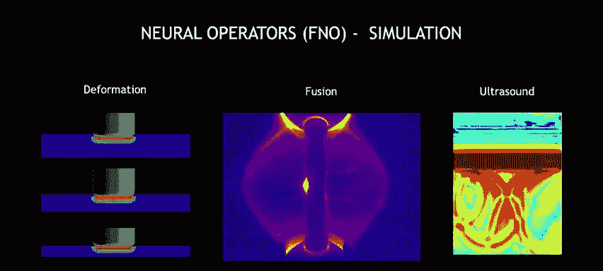

## 总结与展望：通往通用科学AI之路 🛣️

本节课中，我们一起学习了生成式AI从语言模型到科学应用的广阔图景。

我们探讨了生成式AI如何实现从“识别”到“创造”的范式转变，理解了语言模型通过预测下一个词进行训练的基本原理。我们看到了AI如何超越纯文本，通过具身智能体在物理和虚拟世界中执行任务、学习技能。为了应对语言模型的“幻觉”问题，我们了解了如何结合形式化验证器（如Lean）来实现100%准确的数学推理。

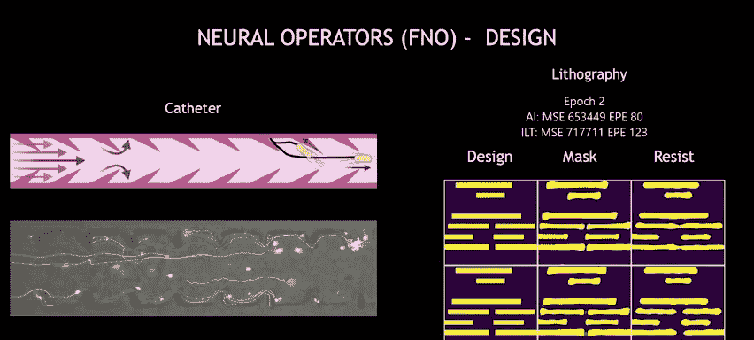

进一步地，我们将生成式AI的思想应用于其他模态，例如基因组序列，从而能够预测病毒的进化与变异。面对物理世界复杂的连续空间问题，我们引入了**神经算子**这一强大工具，它能够进行分辨率无关的建模，极大地加速了天气预测、流体动力学、材料科学等领域的模拟。

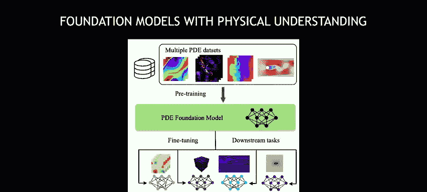

最后，我们看到了这些技术如何从加速模拟走向**逆向设计**，例如设计能防止细菌感染的导管或优化芯片制造中的光刻掩模，真正将AI的创造力转化为具有物理功能性的实体。

所有这些都指向一个激动人心的未来：一个能够理解、模拟并设计跨越多物理现象的**通用科学AI模型**。这不仅仅是阅读科学教科书，而是能够内部模拟物理过程，为所有AI奠定更好的物理基础。这正是生成式AI与科学结合所开启的革命性道路。