# 斯坦福大学《AI觉醒》课程 第1讲：AI的崛起与影响 🚀

## 概述

在本节课中，我们将探讨人工智能（AI）当前的发展速度、其对经济和社会的影响，并理解推动这场革命的核心技术因素。我们将从历史背景、技术突破和未来展望等多个维度，分析AI为何被视为一项具有深远影响的通用技术。

---

## 课程开场与互动

我是埃里克·布林约尔松，这门课的教授。最重要的是，我将这门课视为一次共同创造的实践，我期待向在座的各位学习。你们将听到许多杰出演讲者的分享，我对AI有所了解，但我认为大部分知识也将来自于你们——通过每周的阅读、练习作业和期末项目。我真心希望大家能花时间完成每周阅读，来上课，准备好向演讲者提出有深度的问题，并认真完成作业和项目。我相信你们会有一段很棒的经历。

让我先问大家一个问题：你们是否感觉AI的进步、技术的进步在最近变得更快了？它是否对经济和社会产生了更大的影响？

看来大多数人都举手了。那么，如果你举手了，你为什么认为这是真的？你认为发生了什么？为什么AI的进步可能正在加速？

---

## 学生观点：技术进步与感知

**学生A：** 我认为主要是围绕大型语言模型的讨论热度。两年前我们还没有公开的语言模型，现在有了，并且围绕它有很多炒作。有证据表明，例如普华永道的一项调查发现，美国劳动力中约有18%的人在工作中至少使用过一次ChatGPT。

**教授：** 只有18%？看来我们这里可能有点“泡沫”。但你说得对，这似乎是一种人们了解它并产生讨论的现象。除了这种“炒作”之外，还有更多实质性的东西吗？

**学生B：** 我认为两个主要原因是计算资源的获取和基础设施的获取。特别是在ChatGPT时代之前，人们也在训练语言模型，但问题在于，人们不确定投入如此大量的数据和计算资源会产生什么结果。现在，人们开始意识到，使用更多计算资源，让模型从大规模数据集中学习，确实能创造出有用的、真实世界的系统。正因为如此，对基础设施的投资也更多了。

**教授：** 那么，额外的计算能力和更好的处理器，使得训练更大的模型成为可能。这些模型真的更好吗？当然，它们肯定比八年前好。但这听起来有点像“轻描淡写的赞扬”。后面那位同学，你怎么看？

**学生C：** 回到你最初的问题，AI是否对劳动力或技术产生了比以往更大的影响？这其实是两个问题：技术本身是否在改变，以及我们是否感知到更多；它是否产生了更大的影响。我无法确切地说它是否产生了更大的影响，但我认为人们感知到它的影响更大了。过去，技术主要聚焦于特定垂直领域或行业，但感觉AI有能力广泛影响所有行业。从这个意义上说，它对大多数人的影响感知要强烈得多。

**学生D：** 我同意。最近，我们作为消费者更多地感受到了AI的影响。以ChatGPT为例，它是第一个我们普通人可以免费访问的AI界面。在此之前，它可能被锁在某些地方，普通人接触不到。

**教授：** 我想听听更多关于技术本身变化的看法。有计算机科学或AI专业的同学吗？计算能力变得更强、比八年前更好，我想听听关于技术本身正在发生什么变化。

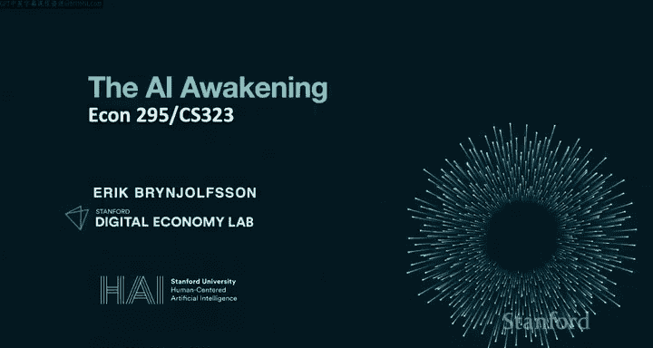

**学生E：** 关于AI正在改变劳动力和革新经济的感知，远大于现实。估计数据显示，2023年生成式AI软件的收入只有大约30亿美元，这还不包括谷歌和Meta等公司利用AI改进算法带来的收益。如果你问现实世界中工作的人，他们的工作并没有发生根本性的改变。所以我认为未来潜力巨大，但就今天而言，它还没有真正改变生产力数字或企业的运作方式。

**教授：** 那么关于技术本身的问题呢？谁对技术方面有些见解？

**学生F：** 我觉得有点讽刺的是，基于LLM或Transformer架构的知识语言模型的采用，而Transformer本身是一个八年前的架构。但AI作为一个领域，迭代速度非常快，几乎超过任何其他领域。最近，该领域资金的涌入解锁了更广泛的技术研究，不仅是在能力方面，也在可解释性方面，带来了更多跨学科的方法。

**学生G：** 在研究领域有一个非常有趣的观点，很多人和AI研究都听说过，叫做“理查德·萨顿的苦涩教训”。其核心思想是，我们今天在AI中看到的许多进步，是因为我们只是让模型规模变得更大，更好地利用数据，更好地从数据中学习，更好地扩展我们现有的计算能力。相比之下，许多更边缘的算法进步实际上并没有人们想象的那么有用。

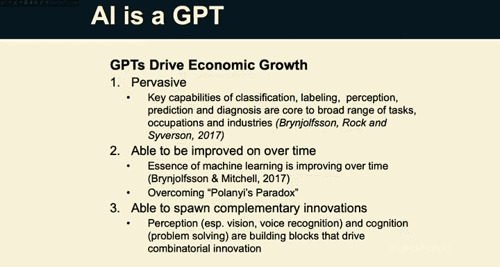

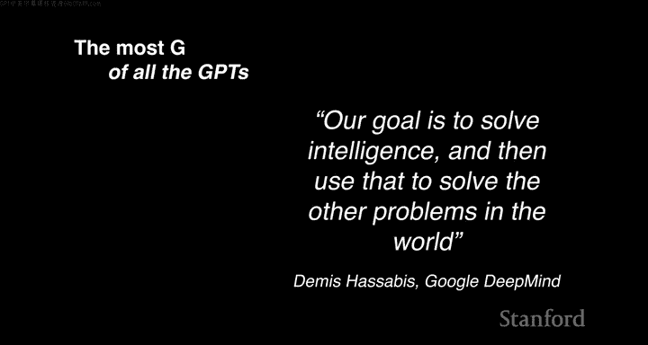

**教授：** 有多少人读过理查德·萨顿的“苦涩教训”？好的，我会把它加到阅读材料里，它只有几页长。我认为它应该被称为“美妙的教训”。他的观点是，AI研究人员提出了所有这些新技术和算法，试图捕捉知识并教机器如何完成任务，这确实有效。但“苦涩教训”是，每一次进步最终更多地来自于更多的数据和更多的计算能力，而不是仅仅来自那些精巧的设计。以语言为例，机器在语言方面变得如此出色的原因，是我们能够投入更多的计算能力和更多的词汇，机器只是学会了。我们稍后会解释更多关于机器学习的内容，以及它有何不同。机器已经学会了如何理解语言，你并不真的需要所有那些研究人员试图教给机器的句法和语法知识，就能获得相当不错的语言理解能力。我谨慎地使用了“理解”这个词，NLP领域的巨人之一克里斯·曼宁（他的办公室就在这里）说我可以称之为理解，所以我就这么用了。这对AI研究人员来说可能是一个“苦涩的教训”，因为他们只是被更多的计算能力和数据淹没了。但也许这是一个好教训，因为它为我们指明了一条道路。现在许多公司正在投资于此，因为他们理解了这个教训，所以这是一条通往更好进步的道路。

当然，这有点过于简化了，两者都很重要。如果非要我说推动这场革命的三个因素，那就是：
1.  **更多的计算能力**
2.  **更多的数据**（过去世界上的数字数据很少，现在几乎全部数字化了，数据量呈数量级增长）
3.  **更好的算法**（例如Transformer架构，有些人认为它可能是历史上最重要的发明之一）

---

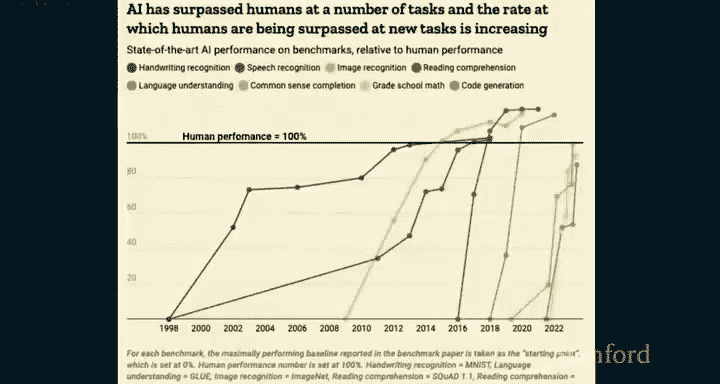

## AI作为通用技术（GPT）

下次你和室友或新朋友聊天时，可以试试这个小游戏：纵观整个历史，历史上最重要的事情是什么？有些人认为是国王、女王和帝国，有些人认为是瘟疫和征服。

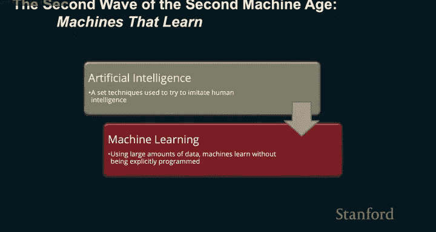

但当你真正思考时，这些事情大多数并没有那么重要。我是经济学家，一种衡量方式是看普通人的生活水平。地球上大多数人的生活水平仅略高于生存线，一个世纪后，差不多；一千年后，也差不多。尽管历史书上发生了所有这些事情，但普通人的平均生活并没有发生太大变化。

直到大约1775、1776年，发生了什么？美国革命？也许。亚当·斯密出版了《国富论》。有些人会说“逃离贫困陷阱”或类似的说法。但他们是如何逃脱的呢？这仍然是一个备受争议的话题。但有些人，比如迪尔德丽·麦克洛斯基，会说是某些制度（如英国议会等）和财产权的存在，使得所有这些创新得以在英国发生并传播到其他地方。但我有一个更简单的答案：**蒸汽机**。新技术。我认为所有这些制度可能很重要，也许它们帮助了蒸汽机的发明。詹姆斯·瓦特在苏格兰对蒸汽机进行了重大改进，使其开始变得真正实用，并开始应用于各个方面。由于你提到的制度变革，它产生了涟漪效应，其他发明也随之而来。但蒸汽机本质上点燃了**工业革命**。它使我们能够用机器代替自己的肌肉或动物肌肉来移动物体和完成重要的体力劳动。从那时起，生活水平以每年约百分之几的复合指数率增长。我们现在比我们的祖先富裕了大约30到50倍。

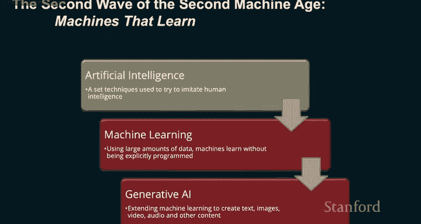

蒸汽机是第一个**通用技术**。有人知道我说GPT时指的是什么吗？是的，完全正确。我很高兴经济学家仍然可以用GPT来指代“通用技术”，而不是“生成式预训练Transformer”。所以，通用技术。蒸汽机是第一个，但不是最后一个，其他的还有电力、计算机。根据蒂姆·布雷斯纳汉和曼努埃尔·特拉滕贝格的说法，GPT具有三个重要特征：
1.  **普遍性**：影响广泛的经济领域。
2.  **可改进性**：能够随着时间的推移而改进。
3.  **催生互补性创新**：能够引发其他领域的创新。

人工智能也是一项GPT，它符合所有这些条件。互联网可能也是一项GPT，但公平地说，并没有一条明确的界限来划分什么是或不是GPT。互联网确实引发了一系列互补性创新，在90年代和21世纪初确实引发了广泛的生产力增长，我们至今仍在某些方面受益，尽管可能没有达到电力或蒸汽机的规模。这些都是连续变量，不是布尔值。

所以，AI是一项GPT。事实上，我认为，根据你的观点，GPT有不同的量级。AI可能是有史以来最通用的通用技术，因为它的目标是解决智能问题，然后用它来解决世界上所有其他问题。如果你能解决智能问题，无论那意味着什么，你将能够解决环境、医疗保健、贫困、更多消费品等许多问题。从这个意义上说，它是一项非常通用的通用技术。有些人称之为“终极发明”，因为它可能发明所有其他东西。

---

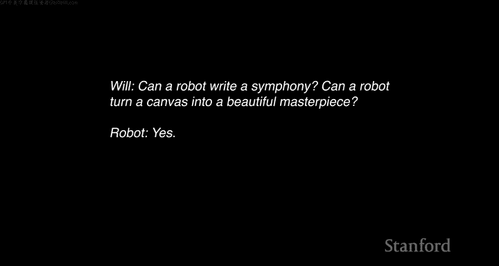

## 技术进步的证据

我们正在研究的就是这个。有一些指标表明，我们正在以从未有过的方式解决部分智能问题。例如，ImageNet。这栋楼里的李飞飞和她的合作者整理了一个包含约1400万张图像的数据集，每张都经过精心标注。从2010年开始，有比赛让机器尝试识别它们。我以前常说，机器在图像识别方面并不擅长。但现在我们知道，它们在图像识别和人脸识别方面非常出色，事实上，在许多指标上它们比人类更好。人类在某些方面更好，机器在另一些方面更好。在2012年左右有一个陡峭的拐点。有人知道2012年发生了什么吗？是的，深度学习被应用于ImageNet。杰夫·辛顿和他的团队引入了深度学习技术，即这些神经网络，有很多层。在未来的课程中我们会读到相关内容。结果证明，这些技术在完成这些任务方面非常有效。第二年，每个人都开始引入它们，我们开始在这方面取得进展。

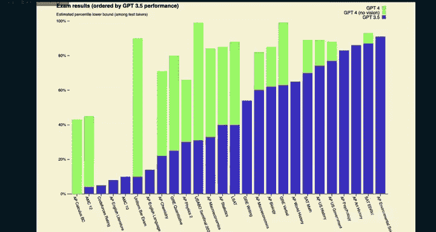

如果你去看AI指数报告（大约10天后会有新报告发布，我是合著者之一），里面有成百上千张这样的图表，显示在各个维度上的进展。根据基准测试的不同，你可以说人类能够达到某个性能水平。去年在这个课堂上，杰克·克拉克展示了许多这样的图表，并说他们遇到的一个问题是，每次有人制定一个基准，很快就会有其他人找到方法让机器超越那个基准。所以他们正在努力制定一些更持久、更稳健的基准。

---

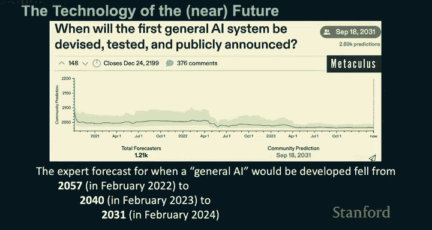

## AI发展的不同阶段

值得对几个不同的阶段进行分类。当人工智能领域在1956年首次创立时，一群人在达特茅斯开会并提出了这个概念，开始研究它。当时主要专注于符号方法，人们也在研究神经网络，但由于计算能力有限，它们非常浅，就像单层神经网络。当我开始从事AI工作时，我在哈佛大学推广学院教了第一门课（那是在1985年我刚本科毕业），我们正在构建专家系统，基于规则的系统。这些系统是手工编码的，非常费力。你会与专家交谈，询问他们诊断发烧或选择葡萄酒等的“如果-那么”规则，然后写下来。通过链接一堆这样的“如果-那么”规则，有时你能得到相当不错的答案。但根据理查德·萨顿的“苦涩教训”，它并没有很好地扩展，充满了错误，并没有真正起飞。80年代曾有过一阵AI泡沫，人们非常兴奋，但它逐渐消退，变成了“AI寒冬”。

但这就是**机器学习**出现的时候。正如理查德·萨顿所说，这是一种新方法，有些人称之为“软件2.0”。机器学习背后的理念是，不是我们人类告诉机器该做什么（你们都编过程，知道如果你写代码，你必须确切知道你想要它做什么，如果你写错一个字或一个逗号，机器就不会做你想要的事），而是**你拥有大量关于输入的数据和大量关于输出的数据，机器学习它们之间的统计关系**。通过这种方式，你可以得到很多有效的预测。

那么，机器学习的一些例子是什么？我展示了几个。在其他上下文中有哪些机器学习工作的例子？例如，检测洗钱活动、手写识别、信用评分等。关键是，如果你有大量关于输入X和输出Y的数字数据，并且数据足够多，机器学习系统很有可能找到其中的关系，并能够在样本内和样本外进行预测。现在，正在兴起一股淘金热，寻找更多可以应用机器学习的地方。我交谈过的每家公司都有团队在四处寻找，看看还有哪些地方可以应用机器学习，哪些地方我们有输入和输出的数据可以进行这种学习。

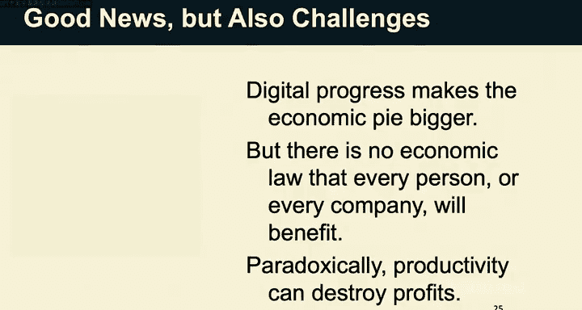

这是一个例子，一个机器人除草机，或者说是一个自主导航的机器人，它使用机器学习进行图像识别，识别不需要的物种，并用激光消灭它们。它自动工作，每分钟能处理数百株杂草。

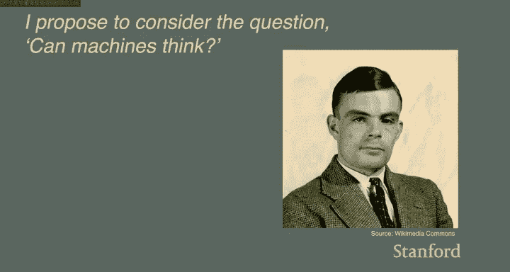

这就是机器学习。但现在，我们正处在一个建立在此基础上的新时代，即**生成式AI**或**基础模型**、**大语言模型**的时代。它与传统的机器学习有些不同。传统的机器学习需要标注数据（如李飞飞和她的团队所做的：这是猫，这是狗，这是癌症，这不是癌症，这是数字3，这不是数字3）。但新的生成式AI使用的是**无监督学习**或**自监督学习**，结果证明这种方法的扩展性要好得多。

---

## 大语言模型（LLM）如何工作？

这里有人能很好地解释一下LLM是如何工作的吗？LLM是如何训练的？

**学生H：** 它就像一个填空游戏，一个自回归的完形填空。你只是试图预测句子中的下一个词或标记。例如，“Jack and Joe went up the __”。你这样做成千上万亿次。

**教授：** 这与早期的监督学习系统有什么不同？
**学生H：** 它是无监督的，因为你不需要人工标注者。
**教授：** 为什么不需要？为什么不需要像判断图片中是否有狗那样的标注？
**学生H：** 因为数据已经在那里了。你拿一本书，盖住一个词，比如一句童谣“Jack and Jill went up the __”，你盖住“hill”这个词，然后问系统：根据其他这些词，你能预测被盖住的词吗？巧妙之处在于，你可以很容易地随机挑选单词盖住，看看它们是否能从其他数据中填补。这不需要人类说“那是瞪羚，不，那是羚羊”。你拥有所有这些数据，数万亿的词。我之前说过，更多的数据让你能进行更多的训练。你刚刚为自己获得了大量可以进行大量训练的数据。如果你有一些像Transformer这样的架构，结果证明这种方法不仅对预测下一个词非常有效，而且怪异得惊人。

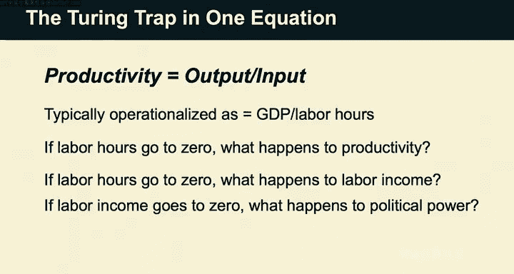

因此，你可以用它来生成文本，问“最可能的下一个词是什么？”，你可以造一个句子，并且可以调整你是想要最可能的下一个词，还是有点可能的，甚至是有点不太可能但仍有可能的下一个词。你可以开始生成文本。为了预测下一个词，它必须对世界有所了解或某种理解。你需要知道一点语法，知道狗会叫，但也许你还需要知道一些关于哺乳动物、它们有多少条腿的知识，或者一点化学、一点地理知识。如果你从旧金山向北开，最终会到哪里？你开始需要某种参数来记录所有这些信息。似乎这些数十亿、数千亿的参数正在存储一些关于语言的信息，帮助它预测下一个词是什么。克里斯·曼宁说，你可以称之为一种理解。

类似的技术也可以用于生成图像。你可以模糊图像的部分，使其变得有点模糊，然后看它们是否能填补，然后它就学会了如何从缺失的部分补全马的耳朵或眼睛等等。这基本上就是正在发生的事情。其中很大一部分是这种自监督方法，所以现在我们极大地提高了从数据中学习的能力。

---

## 生成式AI的优势与挑战

那些看过电影《我，机器人》的人可能记得一个场景，威尔·史密斯饰演的角色问：机器人能写交响乐吗？机器人能把画布变成美丽的杰作吗？那部电影大约在20年前制作，背景设定在遥远的未来，比如21世纪30年代。机器人说：不，我不能，但你能吗？显然，那不是2035年的机器人能做到的。我认为，如果他们今天再拍这部电影，为了更真实，机器人可能不得不说“是的”。从这个意义上说，我们比科幻电影的预测走得快了一点，至少在认知维度上是这样，也许在人形机器人方面没那么快，我们会在后面的课程中讨论。

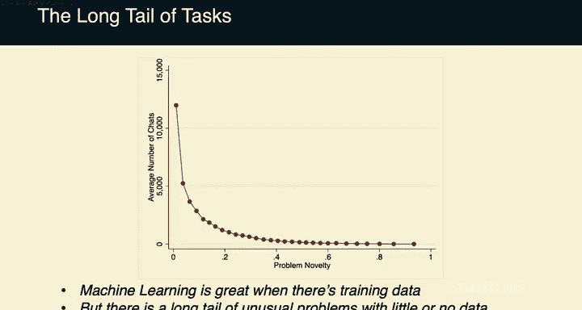

那么，生成式AI的一些优势和劣势是什么？

**学生I：** 它们需要看到很多很多例子才能学习。
**教授：** 是的，样本效率低。这意味着它们需要看到许多、许多例子。相比之下，孩子可以只通过很少的例子学习语言。你给一个两岁孩子看一张大象的图片，第二天他们或多或少就知道大象是什么了。但机器不行。还有吗？
**学生J：** 将特定输出归因于训练数据中的特定样本非常困难，这意味着补偿数据贡献者相当困难。
**教授：** 这是一个大问题。现在我们要谈到《纽约时报》与OpenAI争论的一些经济学问题，以及许多其他人：所有这些数据都被用于训练，你如何补偿？

也就是说，它们在一些方面表现得出乎意料地好。这是一张来自去年微软埃里克·科维茨团队论文的图表，题为“AGI的火花”。蓝色条是GPT-3.5，GPT-4刚刚发布，所以他们测试了它。你可以看到，在很多方面它没有太大改进，但在一些方面，比如统一律师资格考试，它从大约10%提高到了90%。这意味着什么？与参加美国律师资格考试的人类样本相比，GPT-3.5比大约10%的人类做得更好，而GPT-4比大约90%的人类做得更好。所以，这种预测下一个词的能力，结果证明对解决一些实际任务也非常有效。当然，通过律师考试并不等同于真正成为一名律师，还涉及其他事情，所以这不是一一对应的关系，但它是一个很好的具体指标。

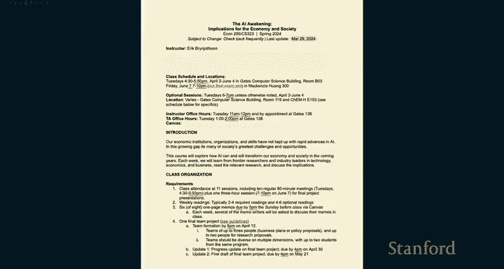

---

## 对未来的预测与挑战

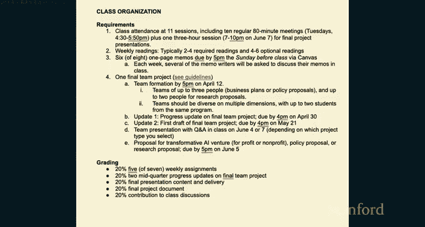

我们预计会有多少改进？与人们交谈，有些人非常乐观。让我展示一张可能带来乐观原因的图表。我之前提到了三个类别：计算能力、数据和算法参数。结果证明，这些**扩展定律**在预测LLM进展方面相当准确。达里奥·阿莫迪等人写了这篇论文，他们绘制了随着计算能力、数据集大小和参数增加而取得的进展。正如你所见，这几乎是一条直线（这是一个对数曲线，所以是幂律）。当你按比例增加计算能力、数据和参数时，预测下一个词的能力会有可预测的改进，而这种预测下一个词的能力与许多其他性能指标相关。

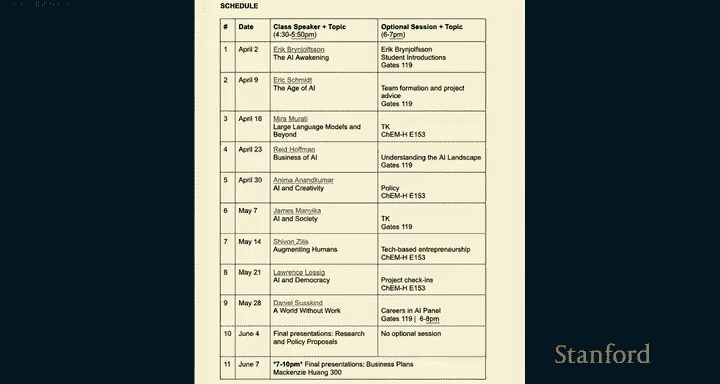

现在，没有人确切知道如果继续扩展会发生什么。但微软和OpenAI花费1000亿美元（听起来像超级反派的台词）建造一个名为“星际之门”的大型数据中心的原因之一，是他们认为投入更多的计算能力可能会有所帮助，也许他们也会找到获取更多数据的方法。所以我们将发现你能把这条曲线推到多远。不过，我想提醒怀疑论者注意的一点是，图表底部的这些数字，当我第一次看到这张图表时，我想，哇，太棒了，我们只要沿着曲线继续前进就行了。但是，这里的这些数字变化非常大，每个刻度之间是100倍的增加。如果这些模型的成本在数亿到千亿美元量级，再增加100倍，好吧，1000亿美元；在那之后再增加100倍，好吧，现在我们变得有点不现实了，因为世界GDP不足以购买那么多的计算能力，如果你只是砸钱的话。也许他们必须想出其他方法。

也就是说，有一些预测。你们去过“Metaculus”这个网站吗？去看看，挺有趣的。上面有各种各样的预测，其中有一簇是关于人工智能不同里程碑的，比如AI何时能获得数学奥林匹克奖等等。这里有一个与