# 【中文配音】硬核！斯坦福 CS336：手把手带你从零构建 ChatGPT - P1：1.大语言模型基础与分词技术-Overview and Tokenization - 外影译坊 - BV1BWEWzfEKi

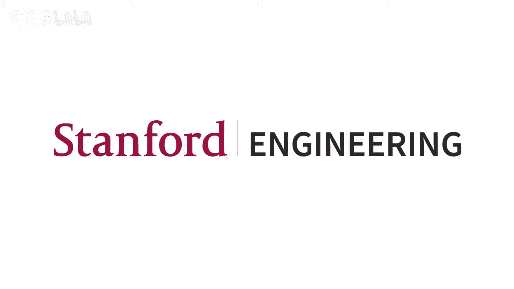

欢迎各位，这里是cs336从零开始的语言模型课程，这是核心人员，我是珀西，是你们的讲师之一，我对这门课超兴奋，因为它能让你们看到整个语言模型构建流程，从头到尾，包括数据系统和建模，Tex。

我会和他一起授课，所以我会让大家自我介绍，大家好，我是波图，我是联合讲师之一，我大概会在一两周内或者几周后授课，我对这门课超期待的，霍希和我有一阵子有点郁闷，想着咱今天能教给学生啥。

真正高深的技术知识呢，而且我觉得其中一点很关键的是，得从头开始才能明白，所以我希望这就是咱们这门课所传达的理念，嘿大家好，我是罗希特，我修这门课时真挂科了，但现在我是你们的助教。

所以只要你愿意相信一切皆有可能，嘿大家好，我是尼尔，我是大三学生，在计算机科学系攻读博士学位，没错我主要对我的研究感兴趣，研究合成数据语言，模型推理这些方面，所以这季度应该会很有意思，嘿大家好。

我是马赛尔，我是2年级博士生，我在具体工作地点工作，这些天我在具体工作地点工作，而且他是去年多个排行榜的榜首，所以他是最难被超越的，好嘞好啦，谢谢大家，那咱们继续，正如test所说。

这是我们第二次教这门课，我们把课程规模扩大了大概50%。

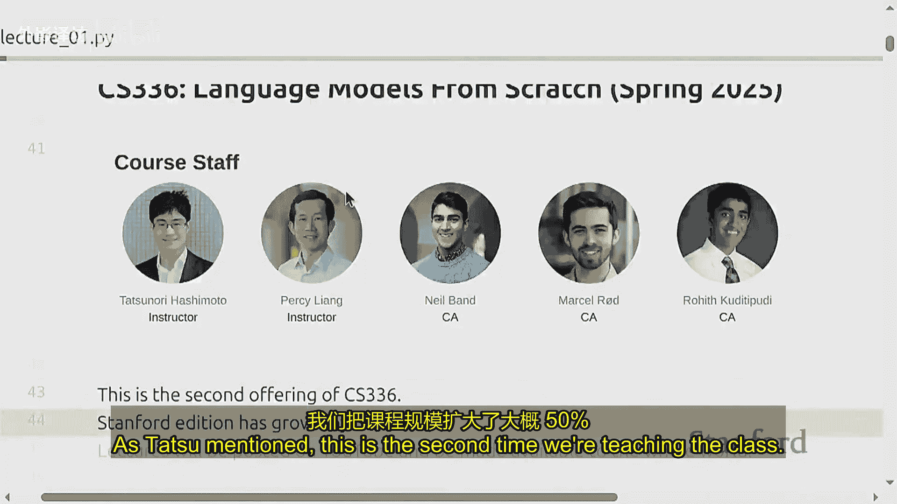

我们有三个助教，而不是两个，还有件大事，我们要把所有讲座都放到YOUTUBE上，这样全世界的人都能学习，如何从零开始构建语言模型，那我们为啥决定把这弄成一门课，还得遭这份罪呢，那我们问问GPT4。

所以你要是问他为啥要教，从零开始构建语言模型的课程，他的回答是教一门课能带来对技术的基础理解，能促进创新，有点像那种典型的泛泛之谈，好啦，这有个真正的原因，我觉得吧我们正面临着某种危机。

研究人员与底层技术的脱节，越来越严重，底层技术8年前，研究人员会在人工智能领域，自行实现并训练自己的模型，甚至6年前你至少会选用像bird这样的模型，然后下载并微调他们，而现在很多人仅通过提示专用模型。

就能轻松应对，所以这未必是坏事对吧，因为当你深入这些抽象层次，我们都能有更多作为，而且通过简单提示语言模型开启了大量研究，开启了大量研究，而且我也经常进行提示操作，所以这没什么不妥。

但也要记住这些抽象存在漏洞，所以相较于编程语言或操作系统，你其实并不理解什么是抽象，我猜就是有进有出一串数据，而且我认为仍有大量基础研究有待开展，这需要打破常规并协同设计数据的不同方面，还有系统和模型。

而且我真的觉得全面了解这项技术很有必要，对于基础研究，所以这就是开设这门课的原因，我们希望推动基础研究继续下去，我们的理念是要理解就得构建，不过这儿有个小问题。

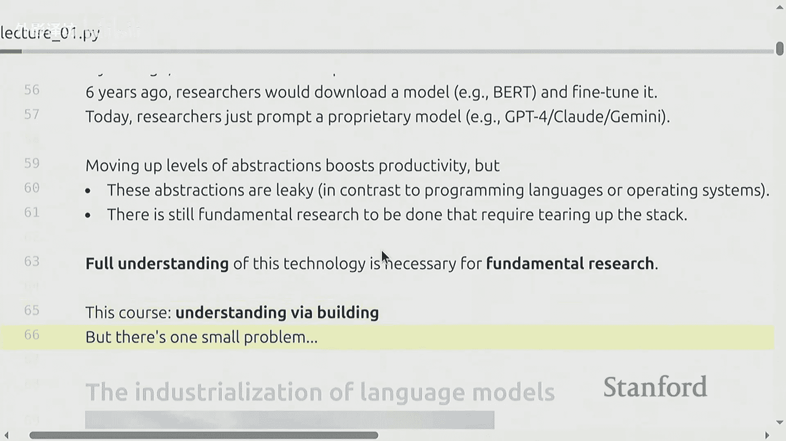

这是由于语言模型的产业化。

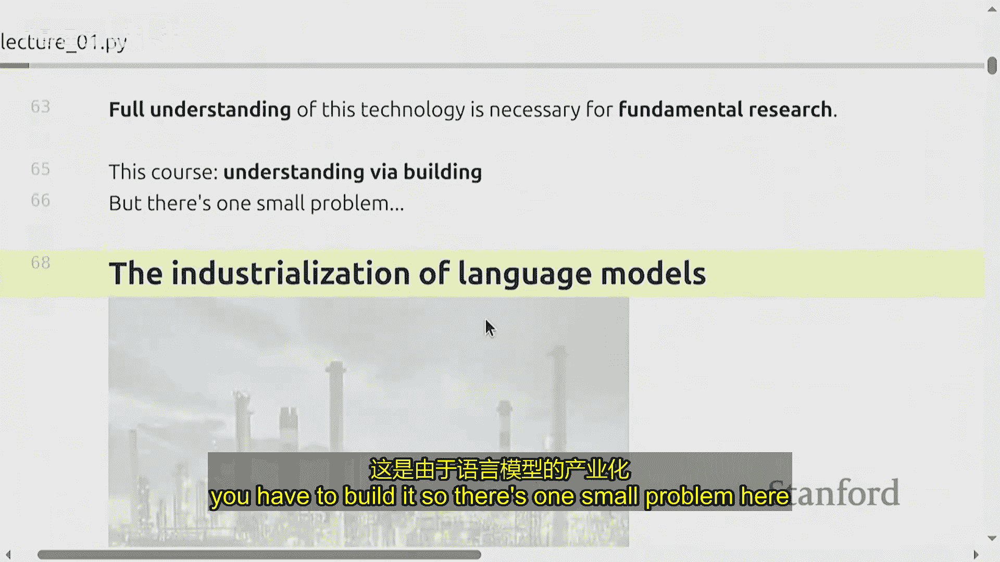

所以据传GPT4有1。8万亿个参数，训练花费1亿美元，XAI在用20万台H100构建集群，你可以想象一下，据说4年间有超过5000亿美元的投资，所以这些数字相当大对吧，此外这些模型的构建细节并未公开。

就连在两年前的GPT4这里。

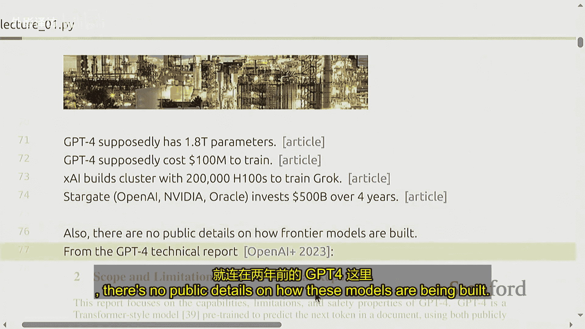

他们坦言，鉴于竞争态势和安全限制，我们不会透露任何细节，这就是当下的世界现状，从某种意义上说，前沿模型非我们所能企及，要是你抱着这样的想法来上这门课，抱歉你们本想着各自训练自己的GPT。

所以我们要构建小型语言模型，但问题是这些可能不具代表性，这里有两个例子说明原因，那么这是个简单例子，若查看浮点运算次数的占比，在transformer注意力层中与MLP相比，这变化挺大。

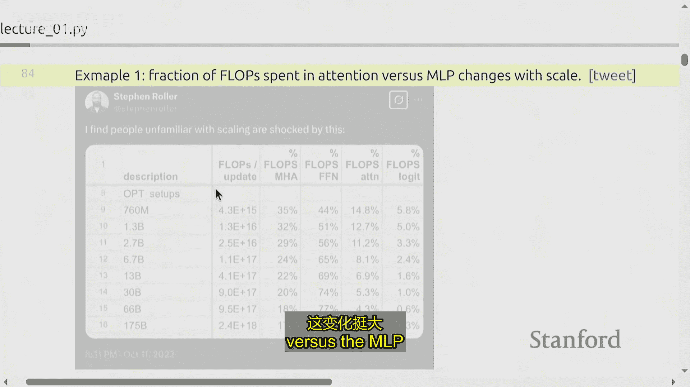

这是斯蒂芬福乐乐几年前发的一条推文，但这依然没错，若看小模型，看起来，注意力层的浮点运算次数与MLP层大致相当，但如果你把规模提升到1750亿，就会发现多层感知机真的占主导了对吧，那这有什么关系呢。

如果你在小规模上花了很多时间，而且你在优化张力时可能优化错了方向，因为在更大规模时并非如此，他就被消除了，这是个挺简单的例子，因为你不用任何计算就能画出这个图，你只需进行粗略估算就行。

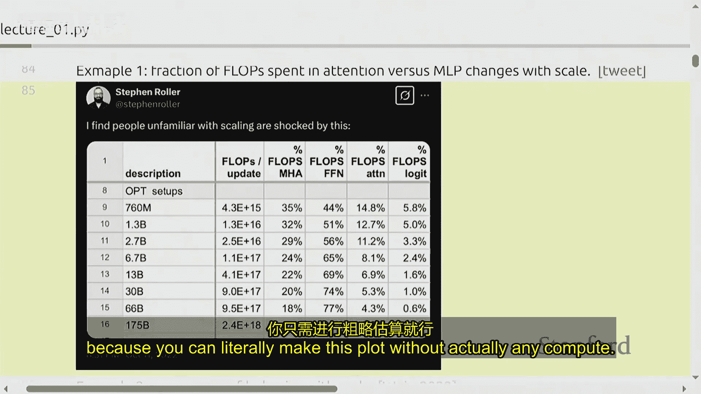

这里有些内容更难理解，这就是涌现行为，这是贾森为2022年的一篇论文。

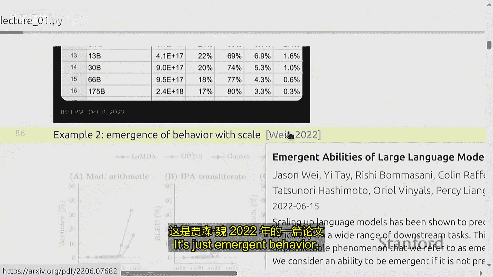

此图表表明，随着训练浮点运算次数的增加，同时查看一系列任务的准确率，你会发现有一阵子看起来准确率没什么变化，突然你会看到出现各种涌现现象，如上下文学习，所以要是你处于这个规模，你会得出结论嗯。

这些语言模型实际上不太管用，其实你得扩大规模才能有那种表现，所以别绝望，我们在这门课上还是能学到些东西的，但我们得清楚自己在学什么，所以有三种知识，一种是事物运作的原理。

我们可以教你这个我们可以教你什么是变压器，也要搭建一个变压器，我们能教你模型并行，如何高效利用显卡，这些只是一些基本要素和机制，所以这样就行，我们还能教你一种心态，这东西更微妙些，而且感觉有点模糊。

但我要说，实际上这在某些方面更重要，因为我们要秉持的心态是，我们要充分利用硬件，要重视扩展，因为从某种意义上讲，所有这些机制，我们稍后会看到，所有这些要素已经存在一段时间了。

但实际上我认为是OpenAI率先开创的，扩展思维方式，催生了下一代人工智能模型，所以我认为关于思维方式，希望我们能让你们明白，要以某种方式思考，然后第三点是直觉，这是关于哪些数据以及建模决策。

能带来好的模型，很遗憾这方面我们只能教你一部分，这是一位不同的架构，在小尺度下适用的数据和数据集，与大尺度下适用的可能不同，但希望你在三项里掌握了两相半，所以性价比还挺高的，好了说到直觉。

我想存在这样一种有些令人遗憾的现实，关于这你能讲出很多故事，关于为什么变压器里某些东西是这样的，但有时只需做实验实验自会说明问题，例如有篇诺姆查齐尔的论文介绍了苏维格鲁，这在本课程中还会有更多介绍。

它是一种非线性，在结论中结果很不错，并且被采用了，但在结论中有这样一个坦诚说法，我们除了说这是神的恩赐，没有其他解释，就是这样，我们就理解到这个程度。

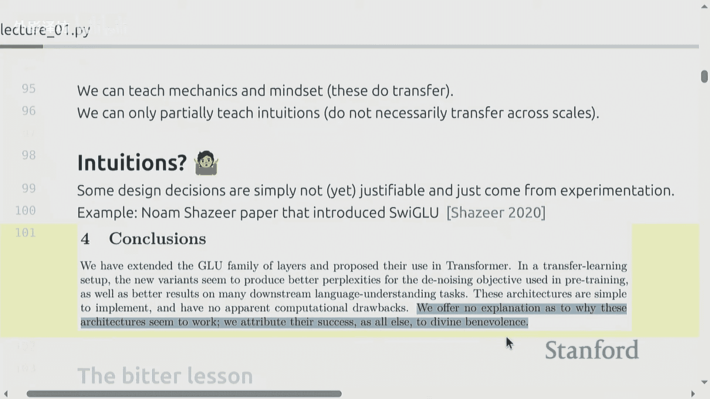

好了，现在咱们来聊聊这个惨痛教训，相信大家都听说过，我觉得有个误解，就是觉得惨痛教训意味着只看重规模，算法无所谓，只要往建模型上砸更多钱就行，然后就成了，我觉得这大错特错。

我觉得正确的理解是算法得大规模才有意义，毕竟你模型的准确率实际上取决于你的效率，以及你投入的资源量，实际上仔细想想，规模越大，效率越重要，因为要是你投入数亿美元，你就承担不起那样的浪费。

就像在本地集群上运行任务，你可能会重新运行，失败了就调试，若你审视实际的利用率及使用情况，我敢肯定OpenAI目前比我们任何人都高效得多，所以效率确实很重要，此外我觉得这点或许未被充分重视。

可以说在那种有关扩展的说法中，即若你考量效率，它是硬件与算法的结合，但如果你仅看算法效率，有一篇2020年的出色论文显示，在2012年至2019年期间，算法效率提升了44倍。

再将image net训练至一定准确率的时间里，所以这非常可观，不知道你们在这能否看到摘要，这比摩尔定律更快，所以算法的确很关键，要是没有这种效率，你就得付出44倍的成本，这适用于图像模型。

但语言方面也有一些成效好的，综上所述，我觉得正确的思路应该是，给定一定的计算资源和数据预算，能构建的最佳模型是什么，不管规模大小，这个问题都有意义，因为这是资源利用率下的准确率，当然要是能筹集资金。

获取更多资源，就能得到更好的模型，但作为研究人员，我们的目标是提升算法效率好，那就最大化效率，我们会经常听到这个说法，好了，现在我来简单讲讲当前的情况，还有我觉得一些相关的历史背景。

所以语言模型已经出现有一阵子追溯到香农，他把语言模型看作是估算英语，信息熵的一种方式，我觉得在人工智能方面，它们在自然语言处理中相当突出，在自然语言处理中，它们是更大系统的一部分，机器翻译，语音识别等。

而现在有件事可能没那么受关注了，就是当你回顾2007年的时候，谷歌当时在训练规模颇大的N元语法模型，所以是五元模型，超过2万亿个词源，这比GPT3的词源多得多，而且我猜只是在直到过去两年。

我们才达到那个资源数量，但他们是N元模型，所以他们并未展现出我们如今所知，语言模型的任何有趣现象好，那么在21世纪10年代，我认为很多，你可以想想这个深度学习领域发生了诸多变革，而且许多要素也逐步就位。

所以推出了首个神经语言模型，来自约书亚本吉奥团队，时间是2003年，还有序列到序列模型，我觉得这对如何基于伊利亚团队和谷歌团队，对序列进行基本建模，有一种优化器十多年来大多数人一直在使用，有一种机制。

其是在机器翻译背景下研发的，这便引出了著名的注意力机制，即2017年那篇著名的transformer论文，人们在探讨如何扩展专家混合模型，有诸多关于如何实现模型并行的工作，2010年代后期。

他们实际上在琢磨，如何训练具有千亿参数的主流模型，他们没训练太长时间，因为这些多是系统方面的工作，但所有要素都已基本就位，到2020年左右，我觉得还有一个趋势，开创自然语言处理领域的。

是这些基础模型的理念，他们能基于大量文本进行训练，并能适用于各种下游任务，比如埃尔默BERTT5，在当时这些模型非常令人振奋，我们可能都忘了人们对bird这类东西有多激动了，但这可是件大事。

然后我想说这是一段简史，但我觉得关键的一点是，OpenAI采用了这些要素，并运用了出色的工程技术，并切实推动了扩展定律，将其视为这就是思维方式方面的内容，这就催生了GPT2和GPT3。

谷歌显然也参与其中，并且也试图参与竞争，但这在一定程度上为另一类工作铺平了道路，即这些都是封闭模型，所以那些未发布的模型，并且你只能通过API访问，但他们都是某种特定的NOPA模型，始于路德的早期工作。

就在GPT3发布后，meta的早期尝试，其效果可能没那么好，像bloom，然后是meta阿里巴巴deep sc ai2，还有其他几个我参与的，一直在创建这些权重公开的开放模型，关于开放性。

我认为还有一个重要的小细节及开放性，存在多个层次存在，如GPT4般的封闭模型，存在开放权重模型及权重可供获取，实际上有一篇很不错的论文，包含诸多架构细节，但缺少数据集的细节，然后是开源模型。

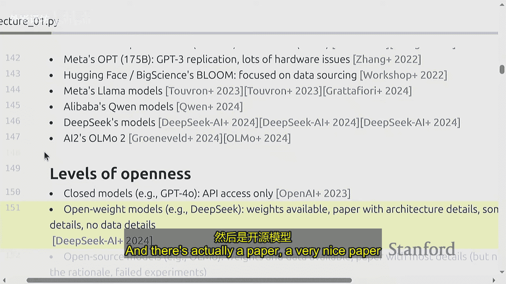

论文中提供了所有的权重和数据，他们尽可能详尽地进行解释，但当然你无法在一篇论文里真正囊括所有内容，除了自己动手去做，没有什么能替代学习，如何构建它，嗯所以这就到了如今。

如今有大量前沿模型来自OpenAI，Anthropic x ai，谷歌meta deep seek，阿里巴巴腾讯，可能还有其他一些公司主导着当前格局，所以我们正处在这个有趣的时代，只是稍微反思一下。

就像我所说，很多要素都已被开发出来，这挺好的，因为我们打算重新审视其中一些要素，并探究这些技术的工作原理，然后我们会尽可能贴近前沿模型的最佳实践，但会借助开放社区的信息。

并从我们对封闭模型的了解中挖掘隐含信息，好那先插播一下，你在看啥呢，这是个可执行的讲座，这是个我正在逐步讲解的程序，它会传授课程内容，我觉得这里挺有意思的一点是你能切入代码，所以你能逐行查看代码。

我觉得这个屏幕比我常用的小，不过你能行逐行查看代码时能看到环境变量，所以这在后面会有用，等我们开始实际深入探讨，并给出代码示例时，你能看到课程的层次结构，就好像我们在这个模块里。

你能看到它是从main的哪里被调用的，你可以跳转到像监督微调这样的定义，稍后再讲，懂了吗，要是你觉得这看起来像个Python程序嗯，这就是个Python程序，但我对他做了处理，让你看得更舒服。

那现在咱们接着讲讲课程相关事宜，要不我先停一下，看看大家有没有问题，关于有问题吗，咱们这门课所学的内容，那么你们觉得这些毕业生，能带领团队构建前沿模型或具备其他技能吗，所以问题是。

我会期望这门课的毕业生，能带领团队并构建前沿模型吗，当然得有10亿美元资金没错，当然我得说这算是不错的一步，但显然还有不少欠缺之处，而且我们也考虑过，我们确实应该开设一系列课程，最终尽可能趋近目标。

但我觉得这或许是拼图的第一步，但还有不少情况，而且我很乐意线下聊聊这个，但我欣赏这份暴富，这才是你该做的，选这门课就能去带领团队构建前沿模型，好咱们来聊聊这门课，这有个网站，所有内容都在线。

这是门五个学分的课，但我觉得这可能体现不出这里的课程水平，不如我从课程评估里摘出的这句话，整个作业的工作量大改，和cs224N的五项作业加起来一样，再加期末项目，这就是第一项作业，先别被吓跑。

我给你讲些数据，那你为啥要忍受这个呢，你为啥要这么做，我觉得这门课适合那种求知欲极强的人，想要深入了解事物的运作原理，乃至原子层面，可以这么说，而且我觉得等你学完这门课。

我想你在研究工程方面会有显著进步，而且你会有的那种得心应手的感觉，在大规模构建机器学习系统时会得心应手，我觉得这很厉害，也有很多你不该选这门课的理由，例如如果你本季度想开展任何研究，也许这门课不适合你。

如果你仅想学习最热门的新技术，有许多其他课程，可能在这方面比这门课做得更好，比如你花大量时间调试BP，而且我认为这实际上一门关于基础知识的课程，是自下而上的学习知识，而非学习最新内容。

另外如果你对构建语言模型或4X感兴趣，这可能不是你会选的第一门课，我觉得虽说我之前调侃过提示，但提示确实很棒，微调很棒，要是你能做到且行得通，那我觉得这绝对是你该优先考虑的，所以我不希望大家上这门课时。

一遇到问题，就觉得第一步是从头训练一个语言模型，那样想可不对，我知道你们当中不少人已经报名了，但我们有名额限制，无法让所有人都报名，而且在线的同学可以在家获取所有课程资料。

作业都在网上可供查看课程也有录像，并会上传至YOUTUBE，不过会有几周延迟，而且这门课明年我们还会开，所以要是今年没赶上，别着急，下次还有机会好嘞，这门课有五项作业，每项作业我们都不提供框架代码。

直接给你一个空白文件，然后你要自己搭建项目，本着学习的精神从头开始搭建，但我们没那么苛刻，我们提供单元测试，还有一些适配器接口，可用于检查不同部分是否正确，此外作业报告如果你逐步完成，它。

在一定程度上能温和的完成这项工作，但在做出良好的软件设计决策方面，你得靠自己以及弄清楚如何命名你的函数，以及如何组织你的代码，我认为这是一项有用的技能，所以我认为有一种策略，对于所有作业都有一部分内容。

就是去实现这个东西，确保其正确，大多情况下你能在自己笔记本上完成，为此你不需要动用计算资源，然后我们有个集群能用来测试准确性和速度，所以我希望大家能接受这个想法，就是你想用尽可能小的数据集。

或者在运行大型任务前，用尽量少的资源做原型，能避免的话，别在集群上用10亿参数模型调试，有些作业会设有排行榜，通常形式为在特定训练预算下采取措施，降低困惑度，我想去年人们尝试各种不同事情，相当令人兴奋。

从课堂或网上学到的，然后我想今年这在去年问题不大，因为我觉得copilot没那么出色，但是curse相当不错，所以我觉得我们的总体策略是，人工智能工具会会影响学习。

因为有些情况下他能直接解决你想让他做的事，但我觉得你显然可以明智地使用它们，所以用的时候自担风险，在这你得对自己的学习体验负责，好我们确实有一个集群。

所以感谢together AI为我们提供了一批H100，有份指南，请仔细阅读，了解如何使用集群，尽早开始你的作业，因为集群会满员，在截止日期快结束时，大家都想进行大量任务，好的，关于那个有问题吗。

对问题是你能报名少于五个学分的课吗，我觉得管理上如果你必须少报是可行的，但课程和工作量都一样，没错啊，还有其他问题吗，好啦，在这部分我会把课程的各个部分都过一遍，大致介绍一下，让你提前了解一下会学到啥。

记住重点是效率，有了硬件和数据，给定这些资源，怎么训练出最佳模型呢，比如说要是我给你一堆网页数据，还有32个H100处理器，用两周你该怎么做，存在许多不同的设计决策，分词器和架构方面存在诸多问题。

你能进行的系统优化，你能做的数据相关事宜，我们把课程分为了这五个单元或板块，所以我将逐一讲解他们，并讲讲我们要讲的内容，作业包含哪些内容，然后我会稍作总结好啦，基础单元的目标就是。

让完整流程的基础版本运行起来，所以在这里你要实现分词器模型架构，并进行训练，那么再多讲讲这些组件是什么，所以分词器用于在字符串和整，数序列之间进行转换嗯，直观来讲，你可以把这些整数。

看作是拆分字符串后的对应数字，并将每个片段映射为一个整数，其思路是你的整数序列会输入到实际模型中，它必须是固定维度的好的，在本课程中，我们将讨论双对编码BPE分词器，它相对简单且仍在使用。

在无分词器方法上，有一组很有前景的方法，所以这些方法是从原始字节开始，并且不进行分词，并开发一种只接受原始字节的特定架构，这项工作很有前景，但目前我还没看到他被扩展到前沿水平，所以我们现在先用BPE好。

一旦你对序列进行了分词，或将字符串转为整数序列，现在我们基于这些序列定义一个模型架构，所以这里的起点是最初的transformer，这基本上是所有前沿模型的骨干部分，这是架构示意图，这里我们就不细说了。

但有个受拉部件，接着是一个带有归一化的多层感知基层。

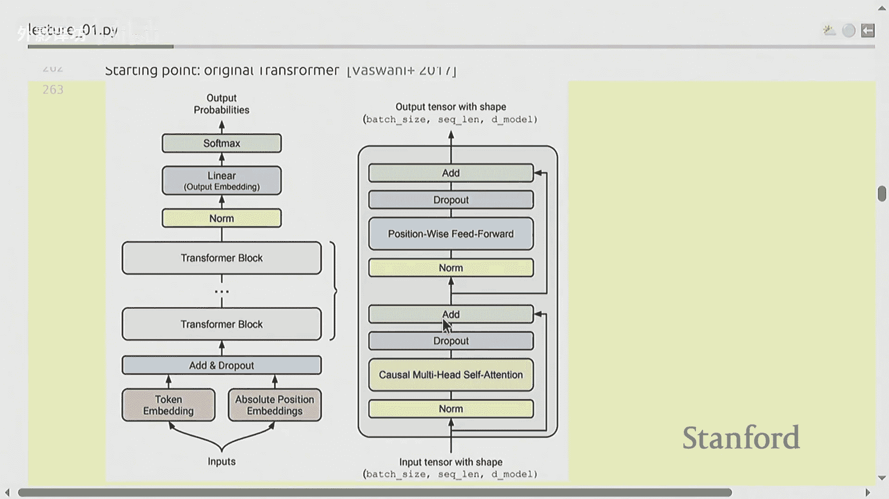

自2017年以来，确实发生了很多事，我觉得在某种意义上哦，发明了transformer，然后大家都开始用transformer了，大致上这是对的，我们仍沿用老办法，但有一系列小改进，累加起来效果显著。

把这些加起来，比如有个非线性激活函数super r，我们之前稍有提及，位置嵌入，出现了新的位置，嵌入这些旋转位置嵌入稍后再谈，归一化方面不再使用层归一化，我们将探讨一种名为RMS归一化的方法。

它类似但更简单，归一化的放置位置存在问题，这与原始transformer有所不同，对于多层感知机的使用，标准版本是全连接MLP，并且可用专家混合模型取而代之，我想注意力这件事实际上已经备受关注了。

存在全局注意力，接着是滑动窗口注意力和线性注意力，这些都是为了避免计算量成二次方增加，还有像GQA和MLA这样的低维形式，我们稍后再说，或者不是现在，而是在未来的课上讲，然后是最激进的一种情况。

是transformer的其他替代方案，比如海伊娜这种状态空间模型，他们不进行注意力计算，而是执行其他操作，有时通过混合能两全其美，构建一个将这些与transformer混合的混合模型。

好的一旦你定义了架构，你需要训练，所以有一个设计决策，包括优化器，所以ADAMW它是一种变体，基本上是对item的改进仍然非常突出，所以我们大多会使用那个，但值得一提的是，还有一些更新的优化器。

比如neon以及soap，他们已展现出潜力，学习率调度批量大小，无论你是否进行正则化超参数，这里有很多细节，我认为这门课就是那种细节很重要的课，因为你很容易产生数量级的差异，在一个调优良好的架构。

和一个普通的transformer架构之间，那么在作业一中，基本上你需要实现BP分词器，我要提醒你，这实际上是这一部分，这似乎让很多人颇为意外，也许对他们来说工作量颇大，所以先提醒你了。

而且你还要实现transformer交叉mp3损失，ADAMW优化器以及训练循环，所以又是完整的一套，而且我们不会要求你从零开始实现PYTORCH，所以你可以使用PYTORCH。

但你不能使用类似这样的方式，PYTORCH的transformer，实现有一小串可用的函数，且你只能用这些好，我们会有一些一些小故事和开放网络文本，数据集供你训练，然后会有个排行榜。

来降低开放网络文本的困惑程度，我们给你90分钟用H100看看你能做到什么，所以这是去年的，所以看我们有最佳的，所以这就是今年要突破的数字好嘞，所以这就是基础内容好了，学完基础部分。

某种程度上你就算出师了对吧，就好比你已经有能力训练一个变换器了，你还缺啥，所以系统部分要深入讲讲如何进一步优化它啊，那么怎么才能把硬件性能发挥到极致呢，因此我们得仔细研究一下硬件，以及如何加以利用。

所以有内核并行计算以及推理，这三者是该单元的组成部分。

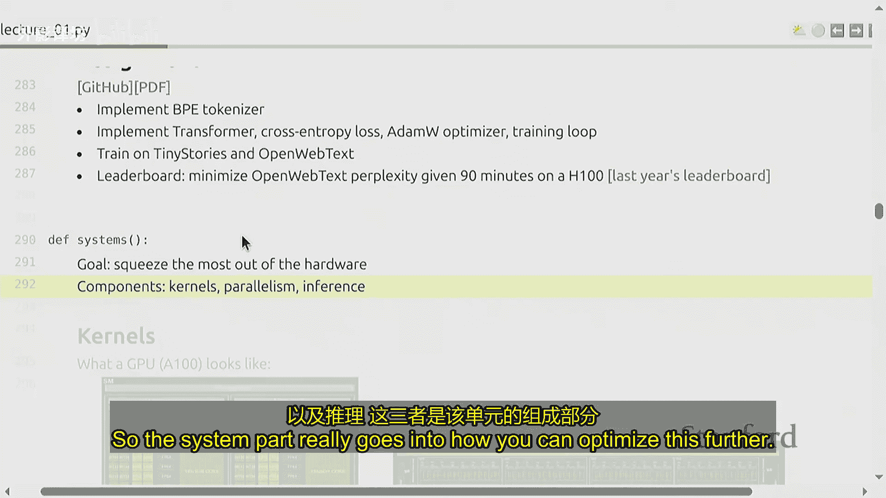

那么先来讲讲内核。

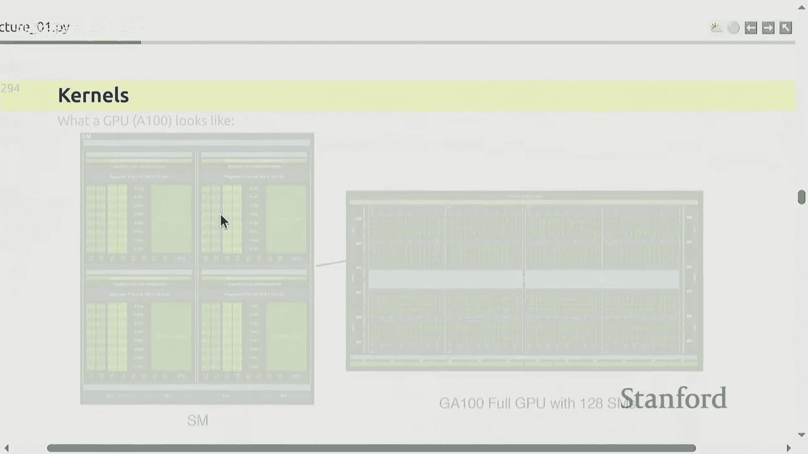

我们来简单讲讲GPU的构成，关于GPU我们稍后会深入讲解。

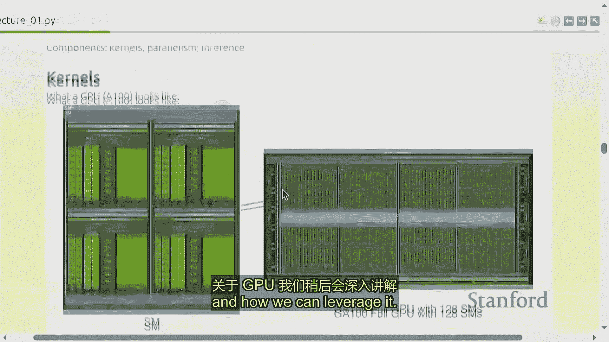

本质上是由大量这些小单元组成的阵列，执行浮点运算，或许需要注意的是，这就是GPU芯片，这里是片外内存，此外还有一些其他内存，如片上的二级缓存和一级缓存。

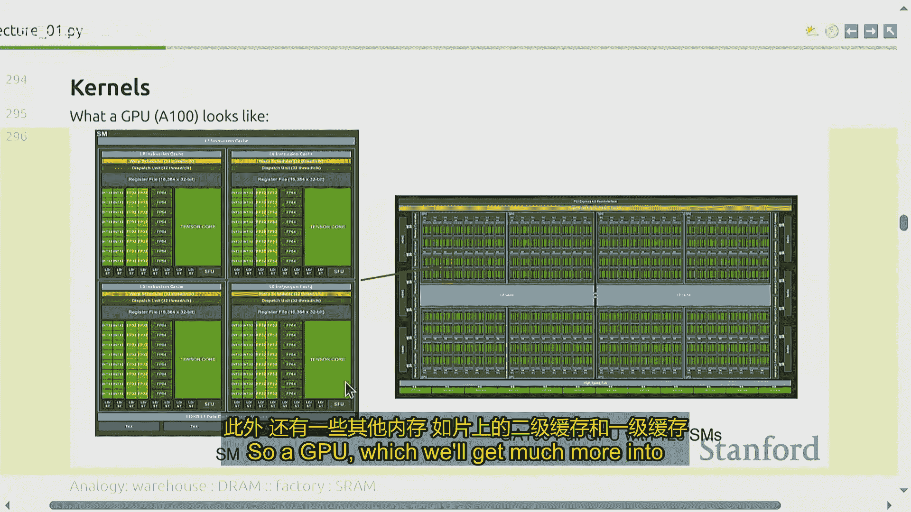

所以基本思路是计算得在这里进行，你的数据可能在别处，那么如何从根本上组织计算以实现最高效率呢，所以简单类比一下。

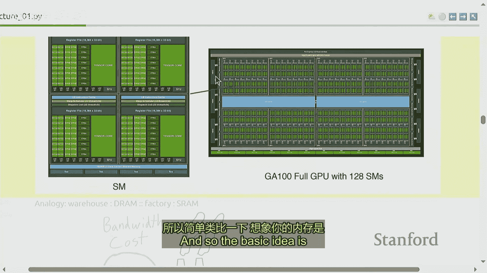

想象你的内存是，存储数据之处，而模型参数就像个仓库而计算，就如工厂最终数据，移动成本成了一大瓶颈，所以我们要做的是如何组织计算，比如矩阵乘法，如何通过最小化数据移动来最大化GPU利用率。

还有一系列诸如融合的技术和平铺等技术，能实现此目的，所以我们将详细探讨，为了实现并利用内核，我们将研究TRITON，你可以采用不同复杂程度来做其他事情，但我们将使用TRITTON，由OpenAI开发。

也是构建内核的常用方式，所以我们要编写一些内核，这是针对单个GPU的，那么现在一般而言，进行大规模运行时会用到数万个GPU，但即便只有八个，也开始变得有意思了，因为有很多GPU。

它们与一些CPU节点相连接，他们还通过NV交换机和MV链路直接相连，道理是一样的对吧，现在唯一的问题是GPU之间的数据移动甚至更慢，所以我们得弄清楚如何放置模型参数，还有激活值和梯度。

然后把它们放到GPU上，然后进行计算，并尽量减少数据移动量，然后我们要探索不同类型的技术，比如数据并行，还有张亮并行之类的，关于这个就说这么多，最后推理是我们去年在课堂上实际上没做过的。

尽管我们有过一次客座讲座，但这很重要，因为推理是你实际使用模型的方式，他基本上是生成标记的任务，根据提示和训练好的模型，它对许多其他事情也非常有用，不仅仅是与你喜欢的模型聊天。

强化学习测试时的计算都需要它，他最近很火，甚至可用于评估模型，你得进行推理，所以我们要花些时间聊聊推理，实际上从全球角度看，推理所用成本，正在超过模型训练成本，因为训练虽说耗费资源，但终归是一次性成本。

而且推理成本会随每次使用而增加，而且用你模型的人越多，你就越需要高效的推理能力。

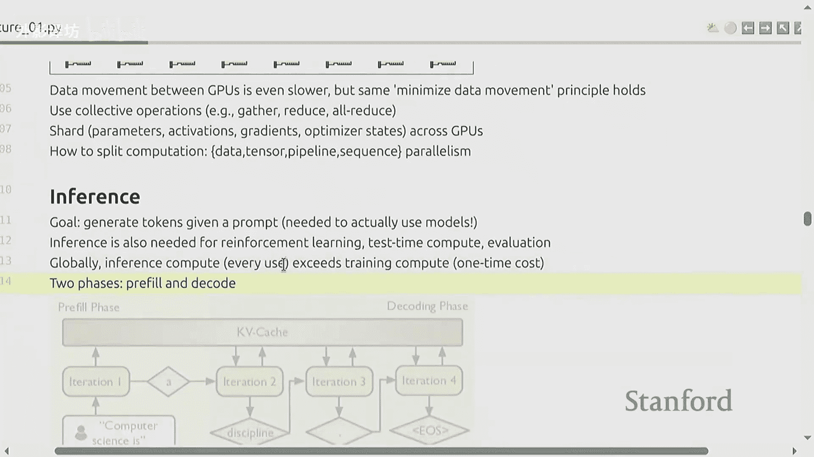

嗯推理过程中有两个阶段，有预填充和解码两个阶段，预填充是获取提示信息，然后可将其传入模型运行，并得到一些激活值，然后解码式逐个进行自回归操作并生成标记，预填充时所有标记都已给出。

这样就能一次性处理所有内容，所以这和训练时看到的完全一样，一般来说这是个不错的状态，因为它本质上是并行的，而且多数时候你受限于计算，我认为推理之所以特殊且困难在于，这种自回归解码。

你需要每次生成一个标记，而且实际上很难使所有GPU达到饱和，并且会受限于内存。

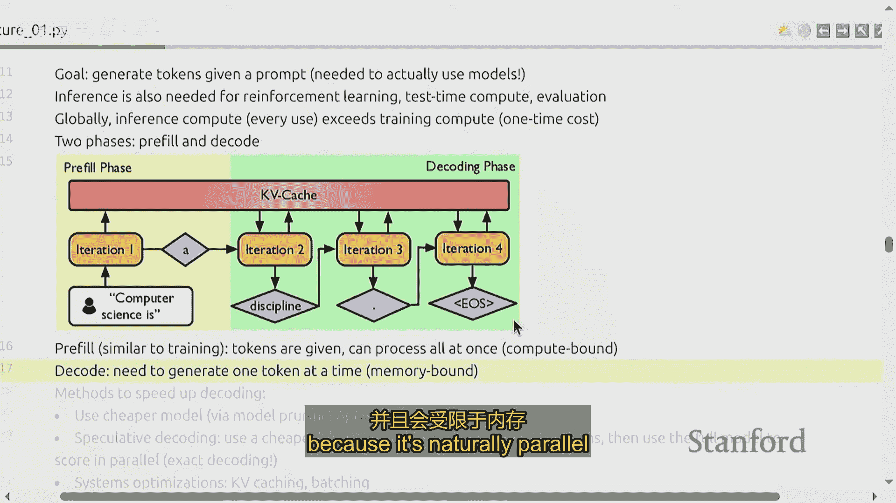

因为你要不断移动数据，我们将讨论一些加速模型和推理的方法，你可以使用更便宜的模型，你可以使用一种名为推测性解码的很酷的技术，你可以用更便宜的模型先行探索，并生成多个标记，然后如果这些标记合适。

从某种定义上看合适，你可以让正式模型直接打分并并行接收他们，然后还有一些系统优化，你也可以做。

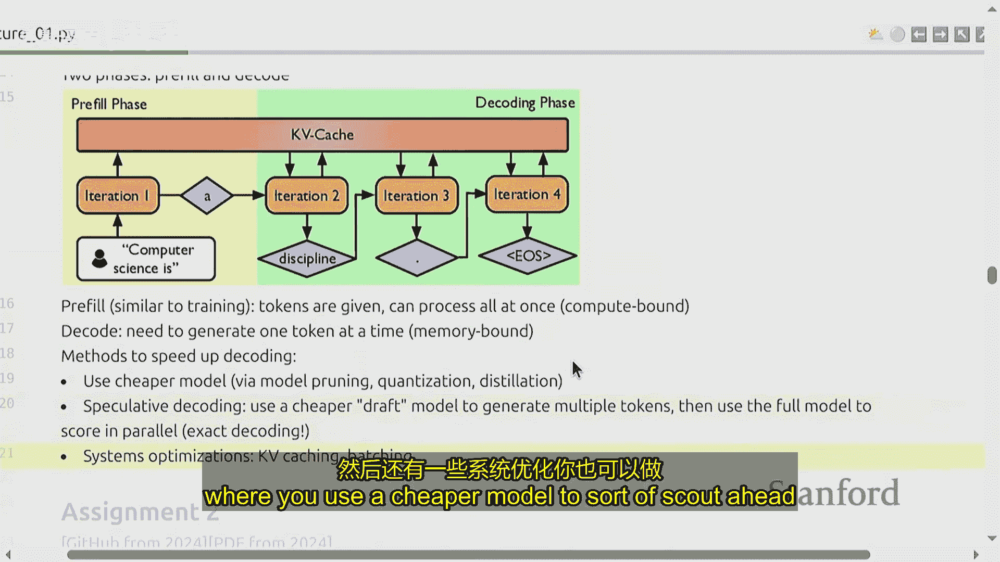

好在系统部分之后，作业二，你要实现一个内核，你要实现一些并行处理，所以数据并行很自然，所以我们会那样做一些模型并行方式，比如FSTP从零开始实现有点复杂，所以我们会做一个简易版本。

但我鼓励你去了解完整版，我们会在课堂上讲解完整版，但从零开始实现可能有点难度，重要的是养成随时进行基准测试的习惯，和性能分析，我觉得最重要的是你得会实际动手实现，但除非你能得到关于实现进展的反馈。

即瓶颈所在，那你就只能瞎摸索了，好第三单元讲的是缩放定律，这里的目标是先在小尺度上做实验，摸清情况，然后再预测超参数和损失，在大尺度上，所以这里有个基本问题，要是我给你一个计算量预算。

该用多大规模的模型，要使用更大的模型，那就意味着能用的数据更少，要使用更小的模型，能用的数据就更多，那正确的平衡点在哪，这已经有过大量研究，OpenAI和DeepMind的一系列论文，也已给出结论。

所以要是你听到龙猫最优这个说法，说的就是这个基本思路，是对于每个计算预算的浮点运算次数，你可以改变模型的参数数量，然后你看看这个模型有多好，所以对于每一个计算量，你可以得到最优的参数数量。

然后你要做的是，你可以拟合一条曲线来外推，比如说如果有1×10的22次方次，浮点运算参数大小会是多少，结果发现这些最小值，当你把它们绘制成图时，实际上它的线性程度非常高。

这就引出了一个非常简单却实用的经验法则服，也就是说，如果你有一个规模为N的特定模型，如果你将其乘以20，基本上这就是你应该用于训练的次元数量，所以这意味着，如果我说一个拥有14亿参数的模型。

应该使用280亿个词源来进行训练，但这并未考虑推理成本，实际上这就是无论模型规模多大，都能训练出最佳模型的方法，所以这里有一些限制，但它对模型开发依然极为有用，那么在这次作业中，这挺有意思的。

因为我们定义了一个训练API，你可以用一组特定超参数来查询你指定架构，批量大小等，然后我们会返回因你决策产生的损失，所以你的任务是有一个浮点运算次数运算，你要设法弄清楚如何训练一批模型，接着收集数据。

然后依据所收集的数据拟合一条缩放定律，然后你需要提交你的预测结果，关于你会选择什么样的超参数，以及模型大小等，以及更大规模的其他方面，所以这就是一种情形，在这种情况下，你得格外。

我们想让你置身于这种有风险的处境中，我的意思是，这不像消耗实际的计算资源，但一旦你用完了，浮点运算运算就没了，所以你得格外留意如何安排实验的优先级，这是前沿实验室一直都得做的事，而且会为此设一个排行榜。

也就是在浮点运算次数，预算内尽量减少损失，有问题吗，所以那些是2024年的链接，要是我们提前行动，我们能预期任务会随时间变化吗，还是说这些就是现在的最终任务了，所以问题是，这些链接来自2024年。

2025年起，大致结构不变，会有一些修改，但你看看这些，你应该心里有数，好那现在来聊聊数据，好到目前为止，你掌握了缩放定律，你有了相关系统，你完成了transformer实现等所有工作。

你真的可以开始了，我想说，数据在某种意义上是一个非常关键的区分要素，这里要问的是我希望这个模型做什么，因为模型的表现主要由数据决定，如果我用多语言数据训练，它将具备多语言能力，如果我用代码训练。

它将具备代码能力。

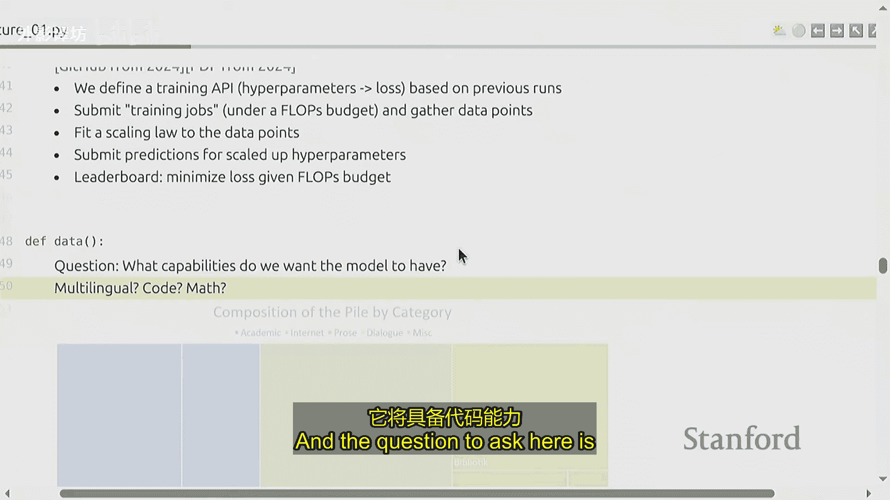

这很自然，通常数据集由许多不同部分组成，这是4年前的一批数据，但我认为同样的道理依然适用，你有来自网络的数据，这是通用爬虫数据，你有stack exchange，维基百科。

GITHUB以及其他经整理的不同来源。

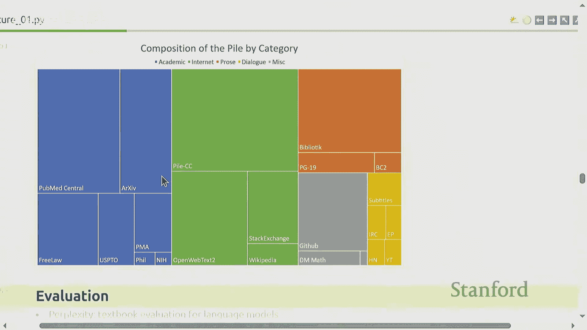

所以在数据部分，我们将开始讨论评估及给定一个模型，你如何评估它是否有用，接下来我们要探讨困惑度指标，以及诸如MMLU之类的标准化测试，要是你有能根据指令生成话语的模型，该如何评估呢。

你知道关于能否进行集成的考量，或者在测试时采用思维链方式，你懂的，这会如何影响你的评估呢，然后你可以探讨整个系统，以及对整个系统的评估，而不只是语言模型，如今语言模型常常被接入某种智能系统之类的。

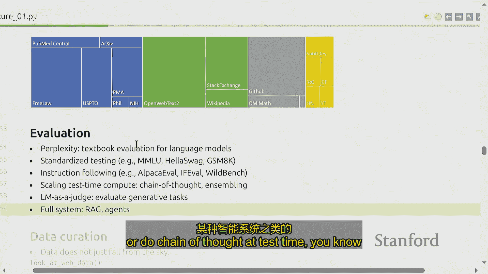

好确立评估后，让我们看看数据整理，所以我觉得这是一个人们没意识到的重点，我常听到人们说哦，我们在互联网上训练模型，这根本没道理对吧，数据不会从天而降，而且互联网也不能直接介入模型。

数据总得通过某种方式主动去获取，即便你你看我总是跟人说，就举个例子哈，得去查看数据，那再来看看数据，这是来自common CORE的一些数据，我要选十篇文档，希望这能行行，我觉得渲染有点问题。

但你大概能看到，嗯这是common cww的一个随机样本，你能看到这可能不全是数据哦，这有些真正的文本好嘞，挺酷的，但如果你查看通用网络爬虫的大部分内容，这是另一种语言，但你也能看出这些都是垃圾网站。

而且你很快就会发现网上很多内容都是垃圾，嗯好吧，也许这并不奇怪，但垃圾内容比你想象的要多，我保证嗯，所以我想说在数据方面还有很多工作要开展，这样你就能爬取网络内容，获取书籍档案。

论文以及GITHUB上的资源，而且实际上有大量处理工作要做，对于可用于训练的数据也存在法律问题，稍后会讲到，如今许多前沿模型实际上都得购买数据，因为互联网上可公开获取的数据，对于真正的前沿性能而言。

其结果有些受限，另外要记住这些抓取来的数据很重要，实际上它不是文本对吧，首先是HTML或者是PDF，或者对于代码来说只是目录，所以得有个明确过程，把这些数据转换成文本好。

那我们来谈谈从HTML到文本的转换，这将是个有损过程，所以关键是如何保留内容，没有HTML的话，那要怎么保留部分结构呢，如你所想，过滤会非常重要，对于获取高质量数据和去除有害内容都很重要，一般而言。

人们会训练分类器来做这事，去重也是关键一步，我们会讲到好作业，四全是关于数据的，我们会给你common crow的原始数据，这样你就能看到有多糟糕了，然后你们要训练分类器并去重，接着会有一个排行榜。

在排行榜上，你们要在令牌预算内尽量降低困惑度，所以现在你们有数据了，你们已经构建了所有精巧的内核，你们已经训练过了，现在你们可以真正着手训练模型了，但此时你们得到的会是一个，能完成下一个令牌预测的模型。

而这本质上就叫基础模型，我觉得他是个潜力巨大的原始模型，但它得通过某种方式进行校准或修改，校准是使其发挥作用的过程，所以校准包含了很多不同方面，但我认为它涵盖了三件事，未必是在遵循指令，他只是完成指令。

或者是他认为会遵循指令的任何东西，你可以在此处指定生成的风格，你希望它长还是短，你是否要使用项目符号，你是否希望他诙谐风趣或带点俏皮，当你将ChatGPT与GROCK对比使用时。

你会看到出现了不同的校准情况，还有安全性，一个重要的点是，这些模型要能够拒绝有害回答，所以这也是校准起作用的地方，所以通常有两个校准阶段有监督微调，此处目标很简单，要收集一组用户与助手的对话对。

即提问与回答对，然后进行监督学习，这里的思路是基础模型本身就具备了潜力，所以基于一些事例进行微调，当然，势力越多，结果就越好，但有这样的论文表明，哪怕有1000个势力，也足以让你获得指令。

跟随来自一个不错的基础模型的能力，好的这部分其实很简单，他和预训练差别不大，就是给了你文本，然后最大化文本出现的概率就行，所以从算法角度看，第二部分更有意思些，所以这里的意思是，即使在监督微调阶段。

你也能得到一个不错的模型，那现在怎么改进它呢，嗯你能获取更多SFT数据，但这可能很贵，因为得有人坐下来标注数据，从反馈中学习的目标是，你可以利用更简便的标注形式，并让算法多做些工作好。

有一种可用于学习的数据是偏好数据，所以在这种情况下，你让模型生成多个回答，针对给定提示，如A或B，然后用户对A和B哪个更好进行评分，所以数据可能看起来是这样生成的，训练语言模型的最佳方法是使用大数据集。

还是使用小数据集合，当然答案应该是A，所以这就是一种表达偏好的方式，另一种监督方式是使用验证器，所以对于某些领域，你很幸运能有一个正式的验证器，比如在数学或代码领域，或者你可以使用通过学习得到的验证器。

在其中训练一个实际的语言模型，来对回复进行评分，当然这又与评估相关，在算法方面，我们处于强化学习领域，所以最早开发的算法之一，应用于指令微调模型的是，近端策略优化算法，事实证明，如果你只有偏好数据。

有一个简单的多的算法叫DPU，效果非常好，但一般来说，如果你想从验证器数据中学习，就必须这样做，这不是偏好数据，所以你得完全接纳强化学习，还有这么一种方法，我们这堂课会讲较群体相对偏好优化。

它能简化近端策略，优化算法效率更高，去掉deep sec开发的价值函数后，这似乎挺管用，好做业务实现了监督调优，直接偏好优化和群体相对偏好优化，当然还有评估有问题吗，我对作业亦有个问题，在作业2~5中。

大家说的有类似的吗，问题是作业一貌似有点难搞，那其他作业呢，我觉得作业一和作业二绝对是最难负担最重的，作业三稍微轻松些，那作业四和五呢，至少去年是我觉得有点差距，不过我不知道。

得看我们还没完全搞清楚这事的细节，没错，情况确实会改善，好下面我们来回顾一下这里的不同部分，要知道效率是首要原则，还有一系列不同的设计决策，我觉得要是你从效率的角度看一切，我觉得很多事就说得通了。

重要的是值得一提的是，我们目前处于计算资源受限的情况，至少在这门课上，大多数GPU资源不足的人都是如此，所以我们有很多数据，但我们没有那么多计算资源，所以这些设计角色会体现如何充分利用硬件。

比如数据处理，我们过滤得相当激进，我们不想把宝贵的计算资源，浪费在不好或无关的数据上，词源化有一个基于字节的简洁模型是很不错的，但对于如今的模型架构而言，其计算效率很低，所以我们得进行资源化来提高效率。

模型架构方面，有许多设计决策本质上是由效率训练驱动的，我认为我们要做的大部分只是一个轮次，很明显我们很着急，我们只需要查看更多数据，而不是在某个数据点上花费大量时间，缩放定律完全关乎效率。

我们用更少计算量来确定高参数，而且对其可能稍有不同，但效率方面的关联是，若能将资源用于对齐，那么实际上你需要更小的基础模型，所以大致有两条路，要是你的用力比较局限，你或许能用较小的模型。

你对其进行对齐或者微调，然后就能有不错的效果，但要是你的用力非常多，那么可能没有什么能替代训练一个大模型，所以就讲到这，如今至少对前沿实验室而言，这种情况日益增多，他们正面临数据受限的情况，这很有意思。

因为我觉得设计决策可能会彻底改变，嗯我是说计算始终都很重要，但我觉得设计决策会发生变化，比如学习对数据进行一轮训练，我觉得要是有更多计算资源，这么做就没什么意义，至少为什么不多进行几轮训练呢。

还是做点更明智的事，或者说不定会有不同的架构，比如因为transformer的出现，其实是出于计算效率的考量，所以这值得琢磨琢磨，不过还是关乎效率，但设计角色反映了你所处的情况。

好那现在我要开始讲第一单元了，在此之前有问题吗，我们有交流的地方吗，问题是我们有没有SLG或应用程序，我们会有SLG，我们会在这节课之后发送详细信息，是的，旁听课程的学生也能获取相同的材料吗，问题是。

旁听课程的学生能获取所有在线材料及作业，还会给你canvas的访问权限，以便你观看讲座视频，作业是如何评分的，问得好，所以会有一系列单元测试，你必须通过，所以部分评分方式是，你是否正确地实现了这个功能。

成绩中也会有其他部分，你是否实现了一个模型，损失达到一定程度或足够高效，在作业里，每个问题部分都有对应的分值，这样就能让你清楚地知道评分的具体方式，好啦，咱们开始讲次元化，好的。

安德烈卡帕西有一个关于词源画的超棒视频，一般来说他制作了很多这类视频，确实启发了这门课程的很多方面，如何从零开始搭建事务，所以你应该去看看他的一些视频，那么就像我们之前讲过的。

词源化是将原始文本进行处理的过程，原始文本通常以UNICODE字符串形式表示，并将其转换为一组整数，并且每个整数都代表一个词源，所以我们需要一个将字符串编码成词源的过程，并将它们解码变回字符串。

词汇表大小及词源取值的数量，及整数的范围好，下面举个词源化工具的工作示例，我们来试试这个超棒的网站，能让你查看不同的词源化工具，然后输入比如你好之类的内容，也许我会这么操作，它会显示整数列表。

这就是词源化工具的输出，他还很好的呈现了，将原始字符串分解为多个片段的过程，还有几点需要留意，首先空格是一个词源的一部分，所以与传统自然语言处理不同，在那里空格会消失，所有内容都被纳入考量。

这些操作应是某种可逆操作及次元化，按照惯例，无论何种原因，空格通常在词源之前，还要注意hello与space，hello是截然不同的词源，这可能会让你有点反感，而且它会引发问题，但就是这样有问题吗。

是故意的还是只是字节对编码过程的结果，所以问题是前面的空格是故意的吗，在我要讲的字节对编码过程中，你实际上要先进行预分词，然后再对每个部分分词，而且我觉得欲分词器它确实会把空格放在前面。

所以他是算法内置的，你可以把它放在末尾，但我觉得放在开头可能更合适，但实际上我没这么做，嗯我想两种都行，我是这么觉得的，好那么你开数字，你会看到数字被拆分成不同部分，这挺有意思的，他是从左至右的。

所以他肯定不是按千位之类的语义方式。

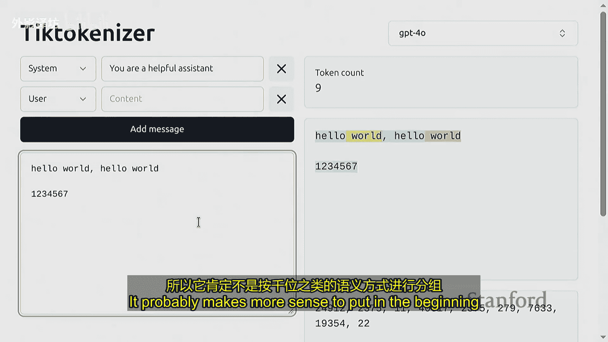

进行分组，但不管怎样，我建议你去试试了解一下这些现有的分词器，比如这是一个GPT4。0的分词器，所以我们有一些观察发现，那么看看GPT2分词器，我们将以此作为参考，好我试试看，希望这个行。

如果后面看起来太小了，就告诉我，你可以取一个字符串，若应用PPPT2分词器，你会得到索引，所以他将字符串映射为索引，然后你可以解码以还原字符串，这只是一个合理性检查，以确保其能正常往返。

我想另一个值得关注的有趣方面是，这个压缩率及字节数，除以令牌数，那么一个令牌代表多少字节，这里的答案是1。6，所以每个令牌代表1。6字节数据，这就是OpenAI训练的GPT分词器。

为了引入某种字节对编码，我想进行一系列尝试，那么假设你要进行分词，最简单的会是什么呢，最简单的可能是基于字符的分词，一个UNICODE字符串由一系列UNICODE字符组成。

每个字符都能转换为一个称为马位的整数，所以A映射到97单词，word对应的表情符号，映射到12万7757，你可以看到它能转换回去，所以你可以定义一个分词器，它会将每个字符简单映射为一个码点，明白吗。

那么这有什么问题，压缩率为一，压缩率为一，所以嗯实际上压缩率并非刚好是一，因为一个字符不等于一个字节，但他或许不如你所愿，这存在一个问题，若你查看一些代码点，他们实际上很大。

所以你基本上是在分配每个位置，在你的词汇表中为每个字符均匀的，而且有些字符出现的频率比其他字符高很多，所以这并非对你预算的有效利用啊，好的，那么词汇量很大，我的意思是，词汇量为127世纪上挺重要的。

但更大的问题是，有些字符很罕见，这对词汇的利用效率很低，好这种情况下压缩率是1。5，因为它是按词源计算的，不好意思，是每个词源的字节数，而且一个字符可能占多个字节，好这方法太简单了。

另一方面你可以按字节进行词源划分好，所以UNICODE字符串能表示成字节序列，因为每个字符串都能直接转成字节，A本身就只是一个字节，但有些字符会占用多达四个字节，这采用的是UNICODE的UTF8编码。

还有其他编码方式，但这是最常见的动态编码方式，那我们就把所有内容都转换成字节，看看会怎样，所以要是你把内容转换成字节，现在所有索引都在0~256之间，因为按定义，一个字节只有256种可能的值。

所以词汇量就非常小了，我猜每个字节并非所有字节的使用情况都一样，但你不会碰到太多稀疏性方面的问题，但是基于字节的编码有啥问题，长序列没错，长序列，所以在某些方面，我真希望字节编码能管用，这是最棒的方式。

但会有长序列的情况，你的压缩率是以每个令牌对应一个字节，这简直太糟糕了，压缩率为一可不行，因为这样一来序列会很长，简单来说，注意力和序列长度是二次方关系，所以从效率方面讲，情况可不太妙啊，好吧。

这可不太好，那么现在你可能会想，也许我们得灵活应变，我们不能每个令牌都分配一个字符或字节，但或许有些词源能代表多个字节，而有些词源只能代表少量字节，所以一种做法是基于词的词源化。

而这在自然语言处理中其实是很经典的，那么这里有个字符串，你可以把它拆分成一系列片段啊，你可以把这些都称作词源，所以你只需用一个正则表达式，这里有个GPT2，用于预次元化的不同正则表达式。

然后他会把你的字符串拆分成一系列字符串，然后你要对每个片段进行操作，为其分配一个整数，然后就大功告成了，那么这有什么问题呢，是的，问题在于你的词汇量近乎没有边界，嗯也许并非完全没有边界。

但你不知道它有多大，因为对于给定的新输入，你可能会得到一个从未见过的片段，实际上词库真的很让人头疼，因为有些实词很罕见，实际上这很烦人，因为新单词得被标记为UNK，而且要是你没留意如何计算困惑度。

那你可就会把事情搞砸，所以基于单词的方式并非这样，我觉得他把握了适应性的精髓，但这不是我们想要的，所以这里我们终于要讲字节对编码，也就是BPE编码，所以这其实是飞利浦盖奇在1994年开发的。

用于数据压缩的古老算法，古老算法它最初被引入自然语言处理，用于神经机器翻译，所以此前做机器翻译，或其他自然语言处理的论文，基本都用基于单词的分词法，无合适翻译，所以这篇论文率先提出了这个想法。

我们能用1994年的这个不错的算法，而且我们能让分词实现某种循环，而且我们无需处理未知词之类的东西，最后我们迈入了语言建模时代，借助GPT2，它是用字节对编码分词器训练出来的。

好的基本思路是不再预设如何分割的概念，我们会在原始文本上训练分词器，可以这么说，这就是基本思路，自然而然的，对于跨越多个字符的常见序列，我们会尝试将其表示为一个词源，而罕见序列则会由多个词源表示。

有个小细节是出于效率考量，GPT2论文采用基于单词的分词器，作为一种预处理，将其拆分成片段，然后对每个片段运行BPE，这也是你在本课程中会做的，BP算法，实际上非常简单。

所以我们首先把字符串转换成字节序列，这在我们讨论基于字节的分词时就已经做过了，现在我们要不断的一次合并，最常见的相邻词源对，所以直观上如果一对词源频繁出现，那我们就把它压缩成一个词源。

我们会为此预留空间，好那我们来看看这个算法是怎样的，所以我们以cat和heat为例，然后我们把它转换成整数序列，这些就是字节，接着我们要记录已合并的内容，记住合并是两个整数的映射关系。

这两个整数可表示字节或其他已有标记，然后我们要创建一个新标记，词汇表是表示字节索引的便捷方式，好的，我们要用BP算法，我是说它很简单，所以我实际上要过一遍代码。

你要进行number margts这样的操作，所以这种情况下，number margts为三次，我们先统计字节对的出现次数，希望这个别变得太小，那我们就逐一遍历这个序列，然后我们会看到那116。

104是什么呢，我们要增加那个技术，104，101，增加技术，我们要遍历这个序列，然后统计字结束，现在我们有了这些技术之后，我们要找出出现次数最多的那一对，所以我才有多个出现次数一样的。

但我们就打破平局，认定是116和104，好他出现了两次，所以现在我们要合并那一对，所以我们要在词汇表中创建一个新条目，这个新条目将是256，到目前为止范围是零到一二百五十五。

但现在我们要把词汇表扩展到256，接着我们要说，每次看到116和104，我们就用256替换它，懂了吗，然后我们把这个合并应用到训练集，所以做完之后1。16，点104变成了2。56，这个2。

56出现了两次，好现在我们再对这个算法循环一次，第二次他决定合并2。56和1。01，现在我要在索引里替换那个，注意，所以会缩小对吧，由于我们的压缩率在提高，因为我们为更多词汇像腾出了空间。

而且我们有更丰富的词汇来表示所有事物好，那我再做一次，然后下一次合并是257和三，而且这又缩小了一次，好完成了，好那试试这个分词器，我们有字符串敏捷的棕色狐狸，我们要将其编码为索引序列。

然后我们要用我们的BP，用分词器解码，咱们实际看看过程，也许解码没啥意思，抱歉我该先讲编码的，咱们回到编码，在代码里取一个字符串，把它转换成索引，然后只要按顺序重排合并项，重点是按发生顺序。

所以我要重排这些合并项，接着我会获取索引，然后验证其是否可行，所以就是这样挺简单的，因为它简单，它也非常低效，例如编码会循环处理合并操作，你应该只循环处理重要的合并操作，而且还有一些其他花里胡哨的东西。

比如有特殊标记预分词，所以在你的作业里，你要以此为起点，你应从头开始自行实现，但你的目标是实现的快速，如果你愿意，你可以停用它，你可以去玩好，下面是分词总结，所以分词器能在字符串和整数序列间进行映射。

我们研究了基于字符字节和单词的情况，由于种种原因，他们都不太理想，这是一个自1994年起就有的古老算法，至今仍被证明是有效的启发式方法，重要的是，它会考量你的语料库统计数据。

从而明智的决定如何最优的自适应分配词汇，来表示字符序列，你也知道我希望有一天不用再讲这些了，因为到那时我们会有直接从字节映射的架构，但在此之前我们得处理标记化，好今天就到这。

下次我们将深入PYTORCH的细节，并给你们讲解基础内容，并留意资源核算，想必你们都已实现了PYTORCH程序，但我们要深入探究这些计算量都花在了哪。

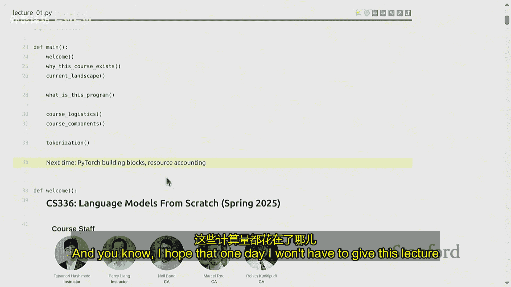

好嘞。

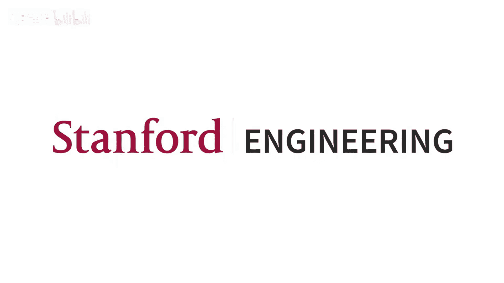