# 【中文配音】硬核！斯坦福 CS336：手把手带你从零构建 ChatGPT - P11：Lecture 11： 缩放定律2-Scaling laws 2 - 外影译坊 - BV1BWEWzfEKi

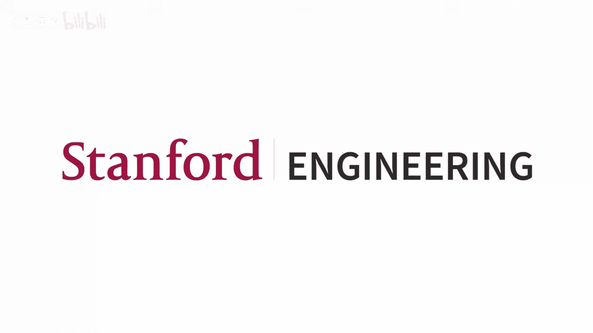

好啦咱们开始吧，今天是缩放定律讲座的第二场，也是最后一场，今天会更偏向案例研究，且注重细节，我会讲两类不同的内容，首先我会浏览几篇论文，人们在模型构建时对缩放定律做了严谨研究，我会以此为切入点。

向你们说明，现代大语言模型构建者，如何在设计过程中运用缩放定律，那么上次的动机，而今天要探讨的是，扩展大型模型的最佳做法是什么，我们希望得到具有优良超参数，和出色架构选择的大语言模型，我已经跟你们讲过。

Chinchilla，并用缩放定律进行部分验证，但我觉得你们对缩放定律提出质疑是合理的，这是对数对数图上的曲线拟合，他真有我上节课说的那么好吗，那么chin china的缩放定律方法真能行吗。

你们会在作业里找到答案，如果你拟合一个等浮点，这真能让你明白正确的标记权衡吗，你能用这些来设置最佳学习率吗。

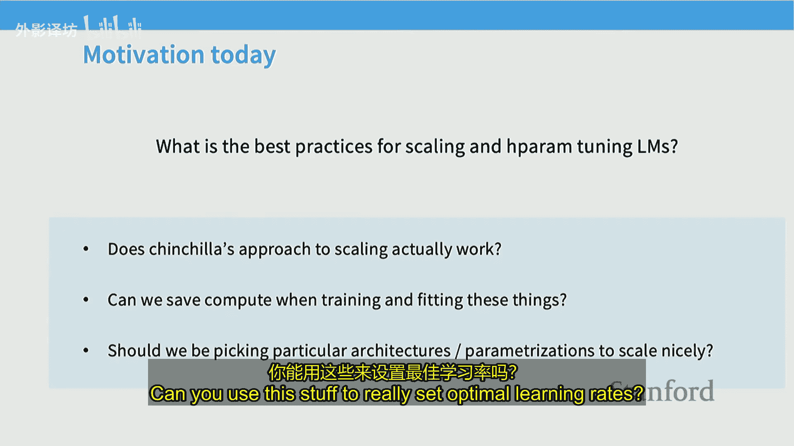

我们是不是得选特定架构或参数化方式，来实现良好扩展，是我们上节课讲的最后一篇论文，或者最新的那篇论文，上节课讲了很多关于深度mind的CHACHA，论文中详细的模型缩放研究对吧。

之后ChatGPT出现了，大语言模型构建的竞争格局就此改变，然后人们就不再发表关于数据的任何内容了，还有模型缩放等方面，这一切都很保密，我之前和一些前沿实验室的人聊过，问他们。

你们在模型缩放方面做了什么，他们的回答是没有，我们不会告诉你我们在扩展方面的任何做法，所以我们得依靠其他渠道来了解，扩展在实际中的情况，已经有几个成功进行了扩展的大规模模型，所以去年在这个讲座上。

我介绍了sweis g p t deep seek LLM和mini cp m，顺便提一下，去年我得好好解释下为啥要介绍这些中国模型，但今年还好，希望你已经迫不及待想听deep sec的介绍了。

而不是我试图说服你，这值得一听，从那以后的一年间，我研究了很多已推出的模型，实际上在新缩放定律见解方面的收获，以及相关论文实际上少得多，我将简要提及一些lama3的结果，去年年底推出的会员大模型。

还有来自中国的moo模型，会员大模型以及mini max01，这是一种线性时间的混合注意力模型，沪市今年推出的长上下文模型，这三种都有一些关于扩展的研究。

但实际上没有一个能像deep sec或迷你CPM那样，深入广泛，我认为他们一直是现代扩展定律，研究的黄金标准。

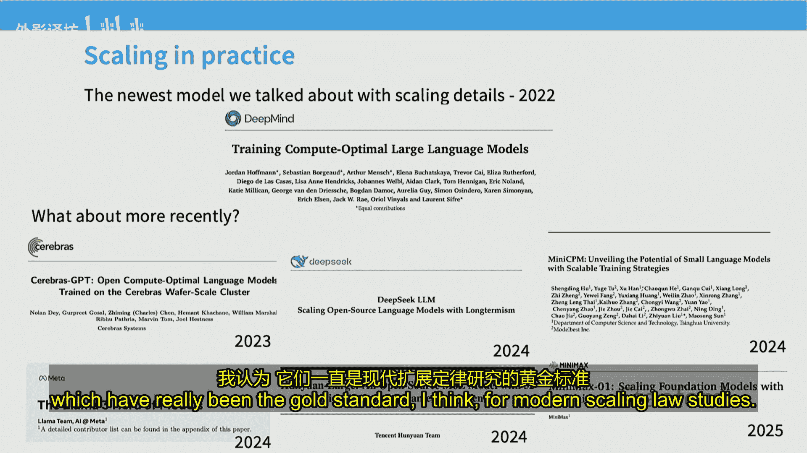

所以这是我今天要讲的一部分内容，我想确保你们了解，在实际半生产模型中的扩展情况，我要讲的另一件事，我觉得这很值得深入探讨，是我上次提到的mp方法，所以mp就是这个方法。

回顾一下上次课就是我们训练这些模型的时候，当我们增大模型规模时，我们需要改变一些超参数，在这个图的左侧，你会看到当模型变宽，比如这种多层感知器模型加宽时，最优学习率会下降。

所以更大的模型需要更小的学习率，这可能是个大问题，因为那样就需要大规模调整学习率的超参数，这在计算上会非常耗时，这将是个大问题，另一方面，要是能对模型进行不同的参数化，使学习率达到最优。

在所有尺度上一直保持不变，那就太棒了，这确实简化了我们的搜索过程，我们希望所有超参数以及总体上所有选择，在各尺度间保持稳定，那就是理想情况，而模型参数比例缩放是一类非常有趣的方法。

它教会了我们一些思考这个问题的有趣方式，所以我实际上会讲解一些数学细节，自上次我讲授这个内容后的，这一年，有几个关于mp的很棒的教程发布了，所以我打算照着那些做，因为他们的数学内容很容易懂。

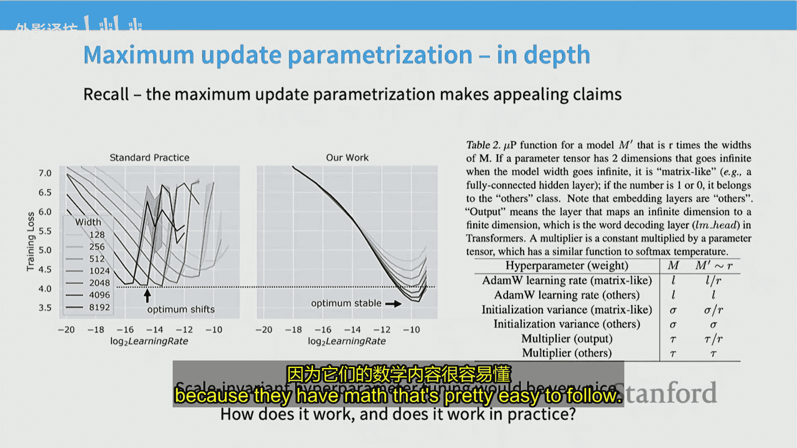

然后我会讲一些相关工作，是关于对mp风格方法，进行第三方验证和评估的相关工作，那么本次讲座第一部分的重点，也就是案例研究将围绕三个模型进行，我还提到了另外三个更现代的模型。

但实际上那些模型的细节要少很多，我觉得你从中学到的经验，主要就来自这里的这三篇论文，所以这会是我本次讲座第一部分的重点所在，所以我要讲一下CEREBRS，g p t mini cpm和deep sec。

而且这些模型各自的扩展策略组合都大不相同，关于如何正确实现扩展，它们也各有不同的门道，那咱们开始，CEREBRASGPT是这些模型中的首个，还有我要讲的一些扩展相关内容，这是一大类模型。

它是用雪雕算法训练的，参数规模在0。1亿到130亿之间的模型，所以token与参数数量大致相同，这是最优比例，而且他们有个有趣的核心发现，sarah birth团队对很多此类扩展和参数化研究，很感兴趣。

而且他们有个非常有趣的核心发现，也就是他们提升了我之前提到的这个mp值，并且他们发现这样扩展更稳定了，而且处理起来会更舒心，给你们看看关键之处啊，这里有测试损失情况。

这里有类似sarah bus g p t的扩展曲线，蓝色的那条，这是标准参数化的情况，橙色的是mp，这是他们用最大更新参数化训练的模型，而且他们发现它的扩展性比PCI或GPTJ更好，至少也不相上下。

所以还不错，我在此要强调的是，这算是对mp为数不多，甚至可能是首次的公开验证，我们知道，所有或大多数做语言模型扩展的实验室，密切关注如何参数化其网络，以及随模型规模变化的初始化设置。

以及诸如每层学习率等因素，是人们为使扩展更稳定而密切关注的，所以像mp这类因素在该领域相当重要，比如拉玛四关于他的论文尚未发表，我不知道他是否会发表，但他们提到了一种名为原P的技术。

它也是此方法的一个变体，所以他们展示的是，当他们采用标准参数化来训练模型时，他们发现在预测的缩放点附近出现了大幅震荡，所以就是这条虚线，例如由于他们会出现震荡，他们必须根据规模调整学习率。

因此他们很难真正准确获得预测的性能，也就是这条虚线使用他们的缩放策略，另一方面，他们发现对于某种三风险G，那么就会得到这条橙色线，它与适用于此，mp版本的缩放定律拟合的非常接近，至少他们在这里的说法。

即使用这种替代参数化方式，使他们能够获得更可预测的缩放比例，以及更出色的超参数调整。

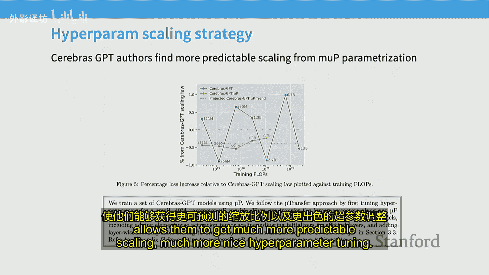

我们将更详细地了解这一点，等我大致完成new p的数学推导后，会再回到这张幻灯片，但如果你有兴趣实现这个一些，CEREBIRTHGPT团队成员，总体来说，sarah birth研究团队发布的这类成果。

非常对mp很有帮助，因为附录中有个大表格，它能确切告诉你标准初始化与参数化的区别，还有最大更新版本及new p你会明白的，我简单跟你说下，基本上每个非嵌入参数初始值为宽度的倒数。

然后每层学习略按宽度的倒数进行缩放，那么与标准参数化相比，有趣的差异在于，即便你已在初始化时进行了按比例缩放操作，实际上每层的学习率有所不同，我稍后会讲到这一点，我将对这一结果进行完整推导。

但你能在此处看到这个不错的速查内容，此外若你想实现此方法，这为你提供了实现mp的简便方法。

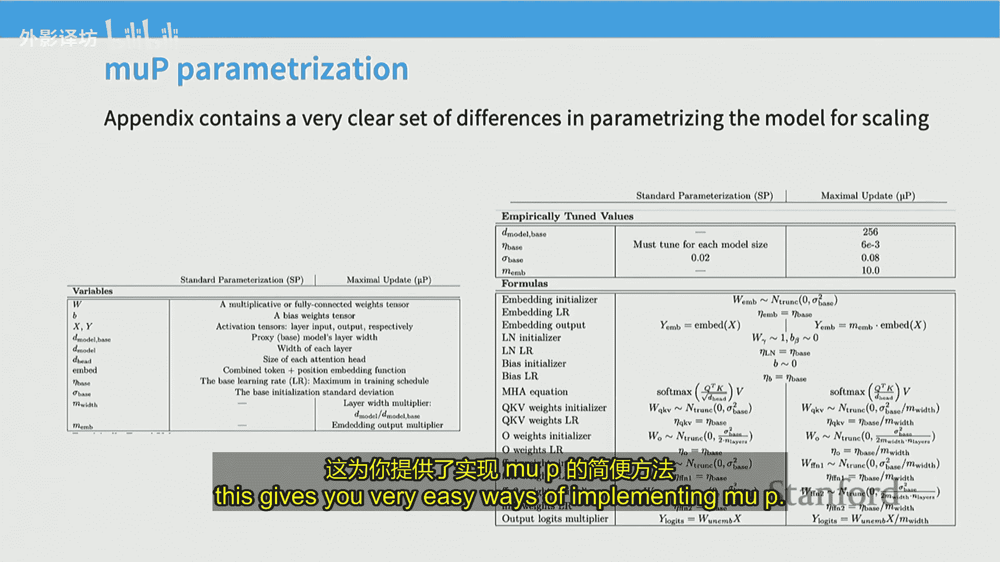

我们还发现了另一件有趣的事，在其他一些扩展策略中，你可以像mp那样将这些策略结合起来，这使得超参数选择稳定，同时采用非常激进的扩展方式，所以他们再次将实验规模，一直缩减到4000万个参数。

他们在这个代理模型上，进行了广泛的超参数搜索，然后他们再扩大规模，采用类似mp的方式，尽量保持超参数稳定，所以这差不多就是他们在小规模超参数搜索中，看到的情况，这些点每个都代表一次模型运行。

并且每个点都关联着一个超参数，然后他们从这些运行结果中选取最小值，从而得到它们大致的超参数网格，这是一种超参数选择的简洁方法，尚不清楚这种激进的缩减规模，是否真的是你想做的，如果你想训练这些超大型模型。

但这也是mini cp m和deep sec中采用的策略及训练，小的多的替代模型，然后设法弄清楚如何稳定的扩大规模。

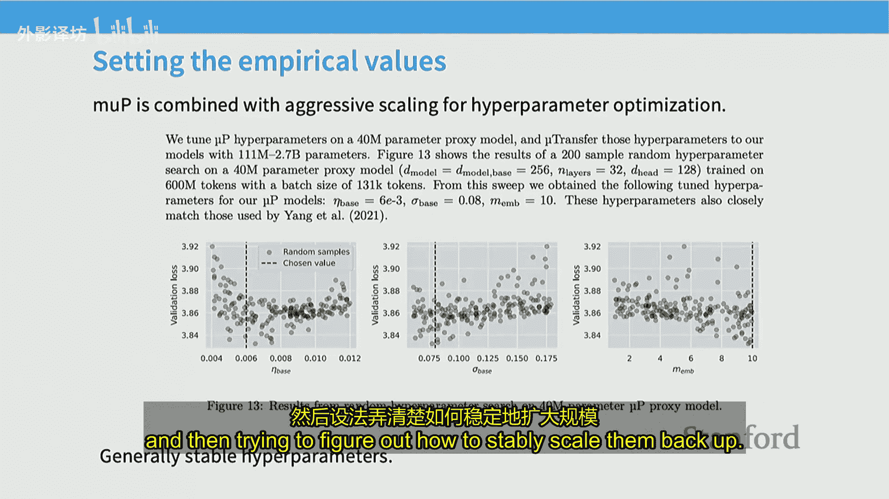

这将是贯穿始终的主题，如果大家有问题，请随时打断我，其实我可能会在这里暂停一下，以防有人对SARAHBRIZGT部分有疑问，不过等我在这堂课后面讲到mp推导时，你或许就更清楚了。

好的我还想谈谈另一篇论文，Mini cpm，或者说是另一个成果，不管出于什么原因，我认为mini cpm没怎么被提及，尤其是在西方学术圈，但至少对我而言，这是早期发布的一批成果之一。

或是我看到的出自一个中国研究团队的论文，他们在那做了一些超酷的，深入的扩展及其他各类研究，真的感觉像是来自前沿领域的东西对吧，为了给你概述他们的工作，他们的目标是在这里训练相对较小的语言模型。

但使用大量算力来训练出，非常优秀的小语言模型，那是他们所谓的目标，在做这件事时，他们进行了大量精确的扩展计算，他们还再次使用mp来稳定并简化扩展过程，当他们最终对这些模型进行扩展时，不是规模。

而是数据量，并试图让你相信这是篇值得关注的论文，在他们被训练时，这是相当不错的，12亿至24亿参数模型，它比市面上大多数20亿参数模型都要好，并且它与许多现代的70亿参数模型相当。

至少以2024年标准来看，是现代的，我的意思是，当然现在你有了更好的70亿参数模型，竞争激烈，但这应该能让你有所了解，至少就当时的计算量而言，还有2024年年中时可用的技术，这实际上真的处于前沿。

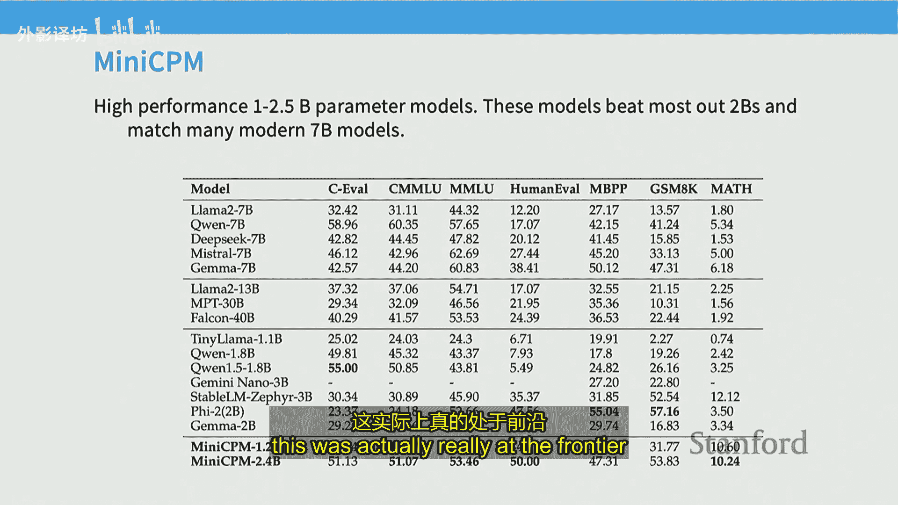

而且他们做对了一些事才得到这种质量的模型，就像CEREBRZEGPT，他们得有策略来实现正确扩展，所以退一步讲，你要进行一次大规模的模型运行，你得做什么，你得选择超参数，你得确保那些超参数能良好扩展。

然后扩大模型规模，所以我们能和CEREBRSGPT团队做同样的事，我们可以试着在小尺度上挑选超参数，希望他们能保持稳定，然后再扩大规模，而实现这点的方法是使用像mp这样的东西，这里运用的策略完全一样。

所以对于嵌入你无需做什么，你只需用一个常数来缩放它，每当你有像多层感知器这样的残差连接时，你用层数的平方根对其进行缩放，你用机宽度的倒数初始化它，然后学习率也会按模型宽度进行缩放。

我们看到基本相同的策略，或者和sarah birth g p t情况一样，会出现相同类型的缩放因子对吧，而且他们最终得到的参数也非常相似，就像标准GPT一样，有相同类型的缩放嵌入。

相似的学习率相差约两倍，但通常使用这些超参数最终会得到相似的结果。

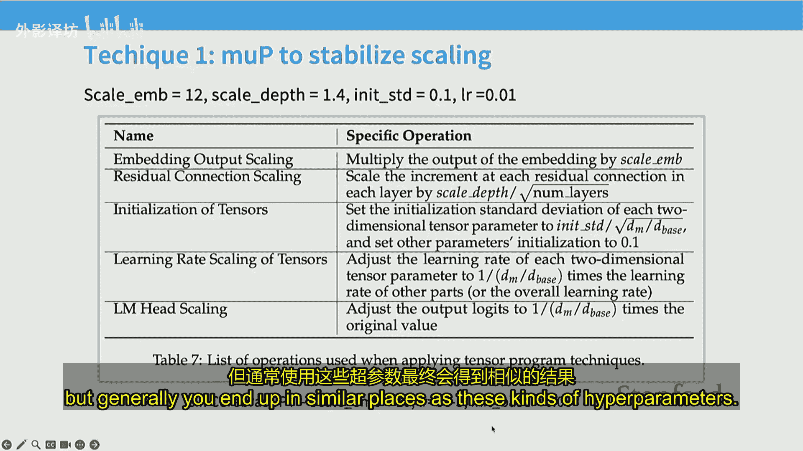

然后一旦你有了这个，你有点依赖最优学习率保持稳定，所以你要大致保持他们不变，而且我们知道宽高比是相当重要的因素，所以我们在弄清楚正确的宽高比后，就将其固定下来，然后你将整体模型大小从九开始逐步扩大。

或者从3000万一直到5亿乃至10亿参数的模型，所以他们拥有的大约有五倍之多，或者可能还能多节省一点计算资源，从他们所拥有的最小模型开始，到他们所拥有的最大规模的试点模型，现在你可以用这个。

然后你就能大致弄明白，是否你有与规模相关的最优批量大小，所以你要弄清楚，alright也就是临界批量，如果你记得没错，临界批量大小大致就是收益递减点，所以随着模型变大，他们的损失会降低。

随着他们损失降低，你就能使用越来越大的批量大小，所以临界批量大小大致告诉你，对于给定的模型大小，以及我所使用的规模，用多大全局批量大小来训练这些模型才合适，而且与卡普兰的论文很相似，它们遵循类似的模式。

这些图表与卡普兰论文中的看起来不同，但底层策略大同小异，他们试图弄清楚训练的关键批量大小，或者在这种情况下，针对不同模型训练的最佳批量大小，而且他们试图找出相对可预测的批量大小。

与数据大小或损失大小之间的比例关系，这里的垂直列代表一条单一的训练曲线，接着对二次函数进行拟合，以找出最小值，所以这里的红线是所有这些点，向上过程中的最小值，而这是要告诉我们最优批量大小。

针对特定的模型大小和数据集大小，然后在此处，你可以按照卡普兰论文的逻辑来确定批量大小，基本上你要重现同样的图表，要是你还记得卡普兰的论文，两节课前关于临界批量大小的讨论，要是不记得了。

你可以调出讲座幻灯片，你应该记得大致内容，你试图训练的损失是高度可预测的，还有最终损失和批量大小，比如临界批量大小这一点，所以我们再次看到很像在卡普兰的研究里，在这里你会看到目标损失之间存在对数。

线性关系，或者最终损失和你想要的批量大小，所以基于此，你大致能算出批量大小，因为如果你有特定目标尺度，你可以用缩放损失算出预期损失，一旦你知道预期损失，你可以据此推算出操作的批量大小。

所以有很明显的趋势，损失减少时，批量大小成倍增加，现在批量大小确实会随目标损失而变动，所以我们得为其拟合一个缩放定律，但我们已经处理过mp了，所以理论上若该方法有效。

我们现在应得到这里的最优学习率是稳定的，那么在这个图表上，我们看到的本质上是不同大小的模型，从浅色的较小模型到深色的最大模型，你会看到他们使用不同的学习率，由于计算原因，大模型只运行了一小会儿。

但你能看到一个相当明显的趋势，再次与高度吻合，我们在卡普兰等人研究中看到的一些早期结果，存在一个相对较宽的范围，然后随着模型变得极不稳定，会急剧上升，但关键在于，最小值在相当大的数量级范围内保持不变。

从小模型到大模型，最小值或者至少与最小值持平，处于大致为十的二次方的学习率，这一完全相同的点，所以这是一种很好的证据，或者一些关于正确缩放模型初始化的验证，并且正确缩放每层学习率。

能让你避免反复调整学习率，甚至反复调整或拟合缩放定律，以试图预测最佳学习率，好的，最后你可能需要搞清楚，模型大小与数据之间的权衡，如果你在训练小型模型，你可能会过度训练模型，或者至少你得给自己一个理由。

为什么要在这么多数据上训练，所以你可能想仿照某种验证模型，缩放的方法进行分析，所以mini cp m团队有一项非常出色的创新，其他人也做过类似的事，但我觉得是他们率先真正将其推广开来的。

在语言模型设置中，尤其是在雪雕式缩放的背景下，大致如下，那么假设我要你和雪雕是缩放规律，当我这么做时，我需要怎么做，嗯我得改变资源数量，而且我得改变模型规模对吧，所以当我这么做时，我要固定一个模型规模。

然后我要对一个模型进行更长时间的训练，要是能提前停止就好了，并获取此模型的检查点，并使其成为一种差异，或者数据及大小的变化对吗，因为早期检查点看到的数据较少，要是能用一次运行就好了。

来收集所有这类数据缩放相关内容，不幸的是，我在此展示的是，不同数据目标的余弦学习率不同对吧，所以如果你有少量数据，你会得到一个上升很快的余弦值，热身阶段始终相同，但冷却很快对吧，你训练一小会儿。

然后你会迅速下降，如果你有大量数据，那么你会非常缓慢的下降到底，所以在小数据训练过程中，你的学习率与大数据训练过程中的不同，这是个极其关键的点，很多人都在这上面栽了跟头。

你不能仅通过一次运行余弦学习率模型，并尝试获取早期检查点，并据此推断数据缩放行为，这一直困扰着大家，所以为避免此情况，你通常需要做的是，你需要从开始到每个端点训练模型，所以你得将其训练到每个目标。

所以这会让你进行N的平方次训练运行，有些训练运行规模较小，但你得多次运行，每次都有一个目标终止点，而不是单次运行并收集检查点，我们必须这么做，感觉有点没道理。

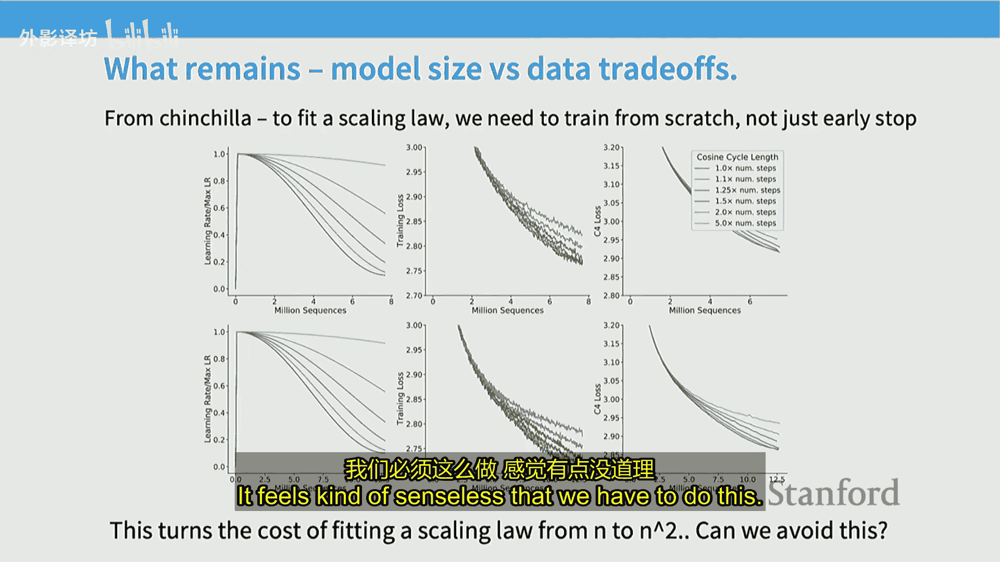

所以mini cp m团队推广了win启动稳定衰减学习率，这个理念，也就是win启动稳定衰减学习率，左边的这个图表展示了这里发生的情况，通常我们训练用的是，如图中黄色所示的这种余弦学习率对吧。

它会上升存在一个热身阶段，通常非常短，就能达到完整的学习率，然后有一个余弦函数一直下降到你的终止点，也许你会维持在最小学习率，当然这些都是可选的，你也可能在此处终止，你可能会一直降至零对吧。

所以余弦学习率如下所示，当然这里的问题在于，即如果我有不同的目标，余弦值会完全不一样，所以热身阶段之后的都不能再用了，现在你看这个新的WSD，它基本上是个梯形学习率，他有三个阶段。

他有个和余弦一样的热身阶段，他有个平稳的稳定阶段，然后他有个衰减阶段，它会迅速把模型冷却到最小学习率，当然你可以有这种情况的变体，你能上升或下降，然后在最小值稳定下来，这些变化你随便选。

但总体来说最简单的形式是热身稳定衰减结束，为啥这样挺好，这样挺好，因为稳定部分能复用对吧，所以要是你想一次性完成类似龙猫的操作，你就先热身，然后一路稳定运行到结束，然后你降降温，然后要是你想弄明白。

要是我用的数据少些，我的模型会怎样，你把检查点倒回去，然后再降一次温对吧，现在你得到了一个有着精确热身。

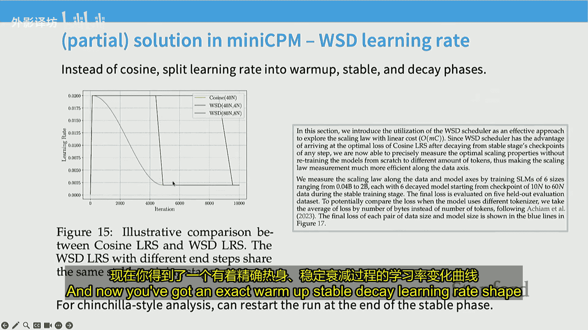

稳定衰减过程的学习率变化曲线，不用从头训练，所以这挺不错的，稳定部分实际上是平的，能让你采用一种用于验证模型缩放的方法，或在单次训练中进行数据缩放，成本基本等同于单次训练，现在很多人都这么做。

所以他们效果不错，我觉得是mini cpm推广了这个，而且我觉得从那以后很多人都采用了它，而且我们在很多地方都看到了很多，WSD风格的调度，你会看到这样的曲线，如果你采用余弦学习率调度。

你会看到朝着最终损失，呈现出大致可预测的平稳衰减，就像这里的黄线，如果你使用WSD进行训练，你会看到更更奇特的学习曲线，就像上面颜色更深的那些，所以你有热身阶段，在这条训练曲线中并未真正体现它太短了。

然后你有稳定阶段，在这个阶段它会正常下降，然后一旦进入衰减阶段，就像冷却期，你的损失会急剧下降，直到达到零或最小学习率点，此时你得到了最终损失，所以这些损失可能会让你很不安，但实际上他们很正常。

当你使用这类快速冷却的学习曲线训练时，也许这里要说的是，在每一个标记处，你会看到热身稳定衰减曲线，最低点超过或匹配余弦，学习率并非总是这样，有时会出现在某些情况下，余弦法或WSD法效果更佳，但一般而言。

很多人认为这里人们所说的是，两种学习率大致相当，但WSD还有个额外的好处，就是你无需担心终止点，你可以反复冷却以获取不同数据量的检查点，懂了吗，了解好的，当然还有其他。

用于尝试估计亲齐利亚曲线的方法出现一些人，比如华盛顿大学的一个合作团队，苹果公司人员发表了一篇，关于估计某种亲奇利亚惩罚的论文，也就是说，当你不断添加数据时，你的损失会增加多少。

相比于按新奇利亚方法缩放的情况，所以这里有一条类似蓝绿色的线条，即M等于二十二十个词源与参数对应，你可以大致思考一下，用320个词源对应参数训练会怎样嗯，那会有一条单独的平行缩放曲线，然后还有另一条线。

就是带圆圈的那条，要是用640训练呢，或者是那条颜色更深的线，所以他们展示的并非采用WSD这种方式，你还可以试着弄清楚，随着资源与参数比例升高，我的模型会下降多少，嗯事实证明它的形状也相当容易预测。

你可以根据小训练规模下的退化情况进行推断，我想我没见过采用这个思路的大规模训练，但这也算是个挺有意思的额外知识，实际上你可以采用一种叫chen china的方法，通过在小规模上推断多余的标记乘法。

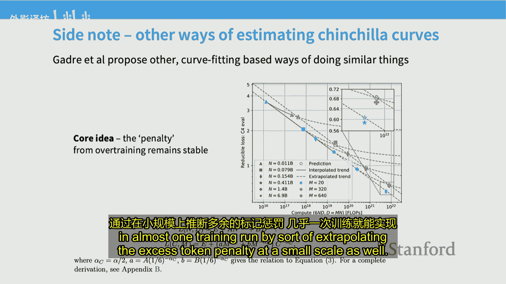

几乎一次训练就能实现，好了回到mini cp m，现在我们有了所需的工具，我们拥有WSD学习率，这使我们能够进行一次训练，而这一次训练让我们能具备两种变化形式，这一次训练能让我们在训练过程中改变数据。

然后我们针对不同模型大小进行多次训练，这为我们提供了进行隶属分析所需的一切，他们使用方法一和方法三，如果你还记得那些是什么，方法一是将所有学习曲线进行叠加，然后取其下包络线。

所有训练曲线的下包络线大致应呈幂律分布，然后方法三是，你要将这里的方程二进行联合拟合，你假设这个双变量缩放规律，然后将其拟合到你所有的数据上，以曲线拟合的方式，然后通过该拟合。

就能求解出最优的令牌与数据比率，所以他们两者都做了，他们确实能很清楚的看到，亲奇利亚方法一的情况，虽非完美线性趋势，但借此可算出最优资源与数据比例。

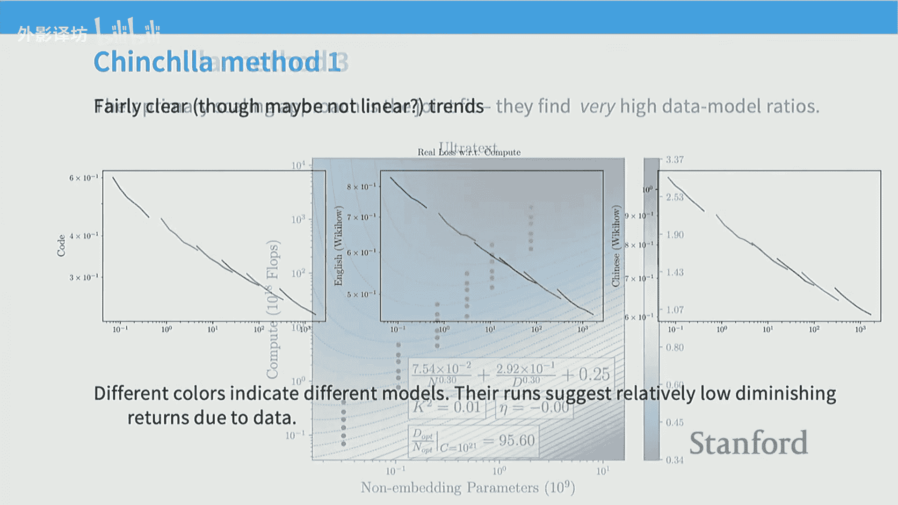

他们用以支撑诸多设计角色的主要方法是，方法三，这就是曲线拟合，所以你在此看到的曲线就是他们拟合的，此处的点是他们为你和chin china参数所做的，小规模测试，数据只是为了证明其做法合理。

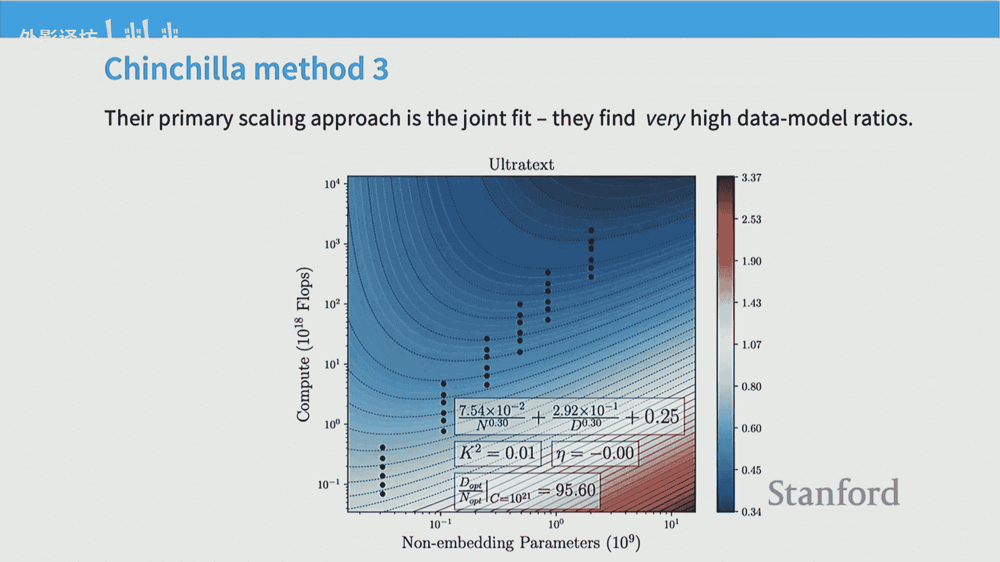

他们发现资源与参数比极高，像这么高，我感觉这是个例外，与其他大多数文献不太一致，他们认为喇嘛式架构都应有更高的比例，谢谢由于数据质量和模型效率的提高，但它们的词源与参数比估计值极高。

每个参数192个词源，我想我没见过其他人算出这个结果，我觉得其他人已经对亲齐利亚方法进行了复制，我觉得从来没人真正这么做过，或者支持，每个参数对应192个次元的观点，尽管如此。

我们发现像拉曼三这样的近期模型，其数据模型也要高得多，我们也没看到收益明显递减的情况，这些模型并不比按change china，比例缩放的同等la2模型差多少，这意味着通过精心优化和调整。

我们应该能大幅超越，20倍模型大小的经验法则，所以如果从这最后两张幻灯片中，你只能记住一件事，也许不一定非要相信，适用于mini cpm视频的任何缩放定律，而是说那种隶属分析并非严格限制。

比如说模型大小的20倍只是个起点，你可以放心大幅提高词源与参数的比例，最后他们得到的曲线拟合效果通常很不错，所以这本质上是关于数据的缩放法则，以及英文代码方面的模型，规模缩放和困惑度。

他们确实存在一些非常奇怪的异常情况，我实在不明白为何会这样，但它们拟合出的缩放定律总体上相当不错，因为他们在相对较小的模型上增加了数据量，所以这是大规模训练运行缩放策略的一个例子，所以我就讲到这里。

像WSD这类东西你可能不太熟悉，所以如果你有任何问题，请随时提问，或者其他部分，包括CHINCHINA，复制new p等，哦好的，当然，所以问题是mp的主要变化在于初始化，所以会发生两件事。

当你推导并实现mu时，对于P来说，其中一个变化是初始化会改变，另一个变化是学习率会改变，或者每层的学习率都会改变，对吧，这可能比你们很多人习惯的东西更奇特，实际上初始化并没有太大不同。

如果你已经在使用标准的何凯明初始化方法，那已经是移除已输入节点数，抱歉是一除已输入节点数的平方根，这已经是正确的做法了，而学习率通常除非你在做一些非常特别的事情，你在各处都使用全局恒定的学习率。

所以这和你平常训练的情况会有很大不同，所以你可以把这看作是许多，milk p事件中的实际差异，没错，对你在说这条曲线，然后你会说哦，当我们处于WSD的稳定阶段，就像我们在这个位置的时候，曲线相当接近。

这是为啥嗯，是有点接近，但又不完全是对吧，看这边最后一条曲线，在进入余弦和WSD的衰减阶段前有很大差距，我觉得这是深度学习优化器中，一个挺有意思的谜团，显然你需要一个稳定阶段来远离初始状态。

但冷却阶段才是产生大部分收益和损失的阶段，如果你不冷却，这会造成巨大损失，所以冷却实际上很关键，并且很多余弦收益与这里相比，像这样的相对差距，这都源于冷却，因此很多优化器学习率的设计。

是关于如何在保持高学习率，以远离初始状态的同时，但学习率仍能有良好的衰减，从而能够将损失降至极低值，所以我想谈论的另一篇论文是深度序列，这是2024年的原始深度序列，LOLM论文，在很多方面。

若你读过deep sec语言模型的原始论文，你就会知道这些都是非常严谨的科研人员，因为他们做了大量非常细致的规模消融实验，并且他们在扩大规模时真的力求做到正确无误。

而这种态度在那些能做好规模扩展的参与者中，是共有的，所以他们有七参数和670亿参数的模型，在当时其性能相对于老马来说非常高，而lama在当时确实是主要竞争对手，而且在当时。

我猜lama2和miss tro在当时算是主要的参与者，deep sec出现后，性能与之相当，不像deep sick v3出现时那般引人注目，在一定程度上能与OpenAI的GBD4。0媲美。

不过这是我们首次尝试，这是个相当出色的结果，那咱们深入探究一下好吗，比如deep seek都做了啥，使其从几乎为零起步，至少在开源领域，在当时处于领先水平。

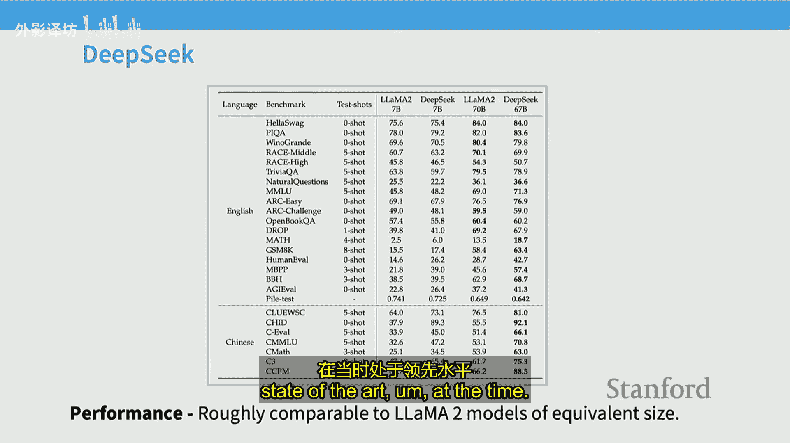

所以我认为deep sec比大多数其他参与者，可能唯一可与之相比的是mini cpm，对他们所做的许多实验非常开放，以及他们选择这些超参数的方法，所以我们马上就能看到。

deep sk v1的一个不同之处，以及与mini cp m和CEREBRASGPT的不同之处，即他们不使用任何mp，而且他们将直接尝试估计最优，批量大小和最优学习率，所以这是一种相当直接的方法。

你也许会这么叫他，而且需要对缩放定律有一定的坚定信念，所以他们做的是选取两个相对较小的模型，然后针对不同批量大小进行网格运算，他们针对不同学习率进行网格运算，并在这个网格上得出损失情况。

他们在更大规模上做同样的事，这样就能得到最优的批量大小和学习率，所以他们说好吧，这是一个相当宽的盆地，所以我们或许不必太担心搞砸这事。

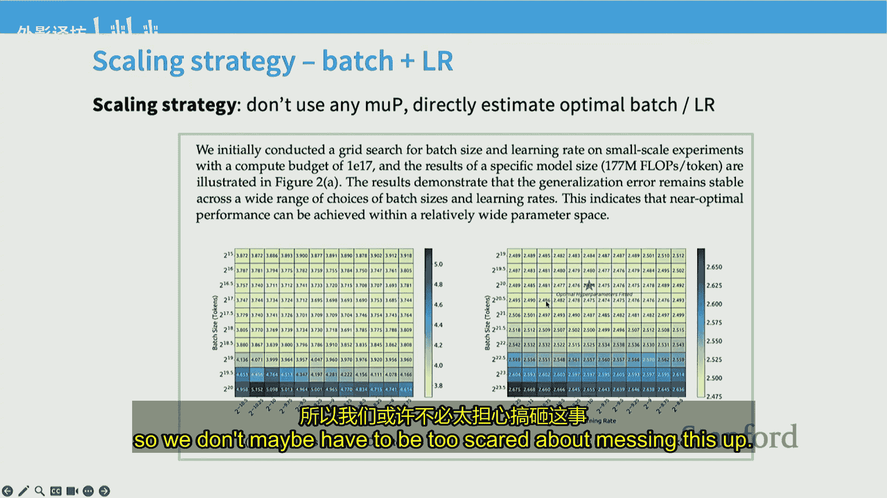

然后他们知道该怎么做好吧，学习率的选择，并且批量大小的选择都比较灵活，但我们确实要把这些的数量级弄对，那么我们要如何把这些的数量级弄对呢，嗯我们将要做的是训练一系列模型，使用不同数量的非嵌入运算量。

并且我们基本上会在一个网格范围内进行变化。

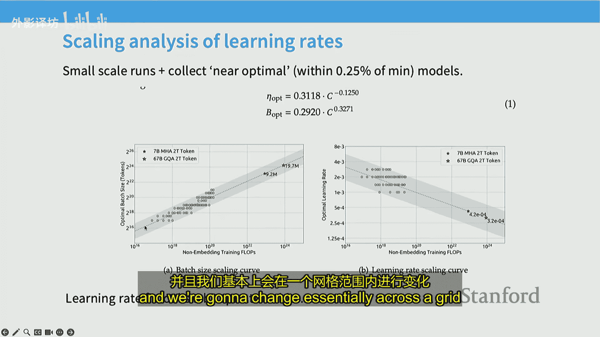

我之前的参数包括批量大小和学习率。

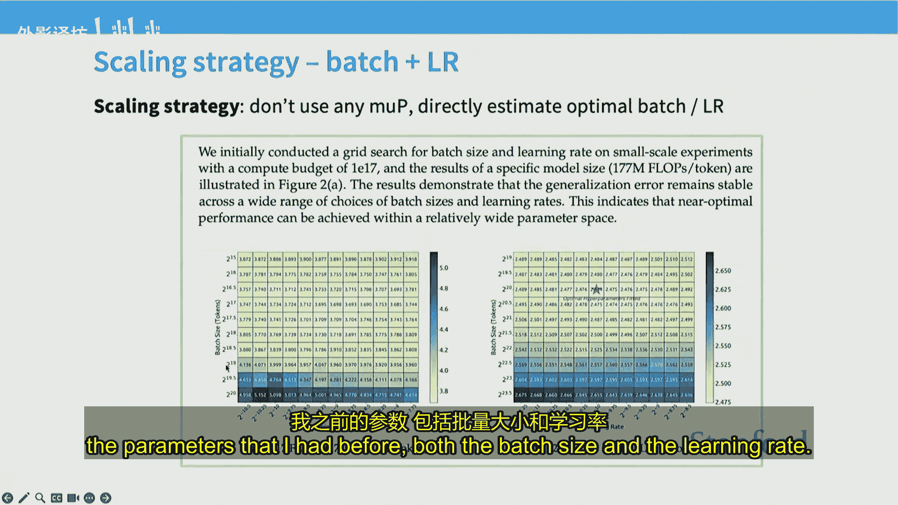

通过改变这些，我们会得到最优的批量大小。

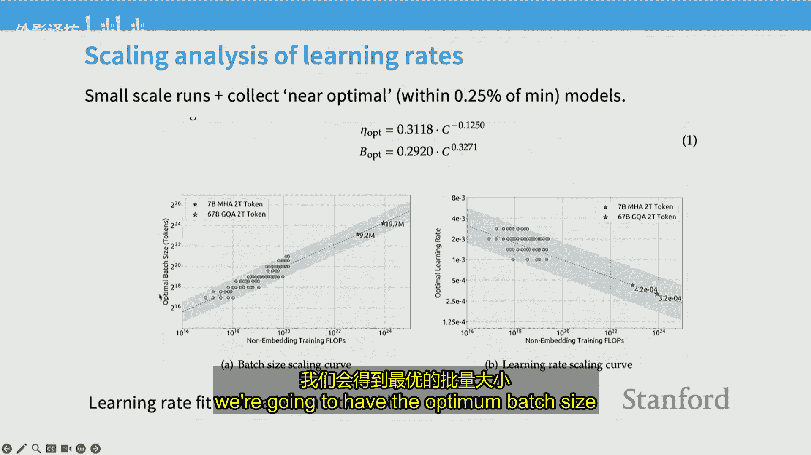

以及在这些不同规模下的最优学习率，所以可想象，在不同浮点运算规模上绘制这些网格，并为每个规模标记一颗星。

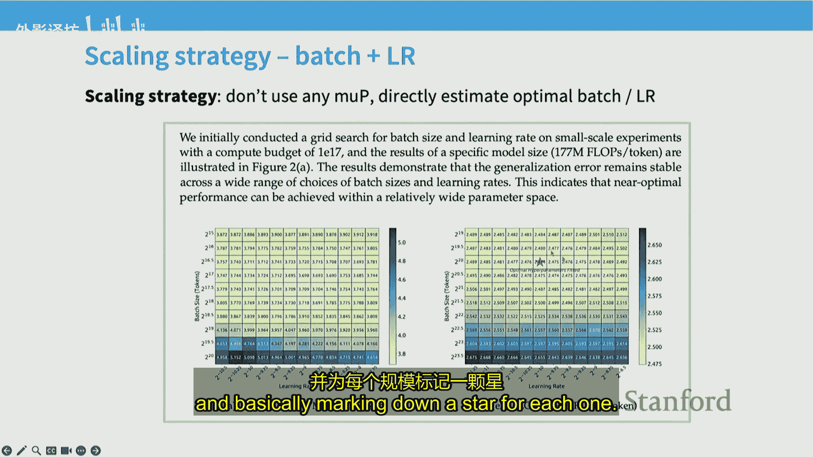

也许不出所料，毕竟这是关于缩放定律的讲座，这些东西似乎有点遵循缩放定律，至少对于批量大小而言，情况似乎更明晰了，你大致能在这里拟合一条线，然后就能外推到大型模型。

你要训练出最佳批量大小大概是什么样的对吧，他们对学习率也如法炮制，然后他们拟合这条线，然后说哦，这就是我们要用的两个学习率，这可能是因为这些点相互重叠绘制了，但我觉得这条线有点可疑。

我是说我大概能拟合一条水平线，而且那样看上去也还可以，这条我不太清楚，即便身为缩放定律的爱好者，我不太确定仅依据这条线来选学习率，我是否该孤注一掷，但他们确实这么做了，这就是他们得出学习率的方法。

如今他们也在一定程度上遵循当时的最佳做法，他们采用了一种名为龙猫式的分析方法，并且他们再次采用了一种名为，WSD式的学习梯度，他们试图尽量减少重复工作的量，他们做了些有点怪异的事，或者更不那么标准。

他们进行热身保持稳定，然后他们进行两组衰减步骤，直至归零，所以就像是两个衰减阶段，由10%加10%组成，他们分析了该衰减阶段的不同选择，而且这似乎没太大影响，但一般来说这大约占总计算预算的20%。

将用于那个冷却阶段，所以他们再次表明它与余弦学习率相匹配，但再次说明这里的优势是。

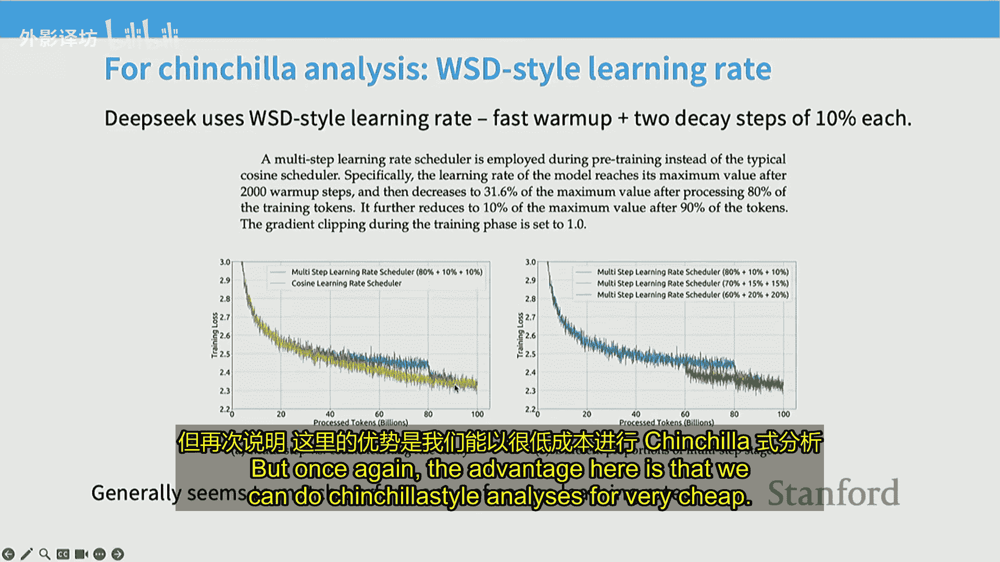

我们能以很低成本进行CHACHA式分析，与学习率拟合相比，chin china是分析的，拟合效果非常好，我认为这是一个普遍的教训，当你查看许多人的缩放定律时，我觉得超参数这块内容看着总有点乱乱的。

不太靠谱，但所有参与者的等级算量分析结果，看着一直都很不错，所以这是chain china结果的复线，你能看到不同的计算规模，我们看到了不同的二次关系，我们在这些二次关系底部画条线。

我们得到了恰好那种最优情况，抱歉是每个token的最优运算量，还有作为训练运算量函数的最优token大小对吧，所以为我们提供了一种方式来分析，词源大小与模型大小之间的权衡。

这让他们能够从头开始做所有事情对吧，当然我觉得顺便说一句，我觉得这真的很棒，他们在重新做很多这些事，他们当然可以盲目模仿chin china，然后每个参数只选20个次元，但他们说不。

我们还是去做缩放分析吧，那咱们得确保标记大小对咱来说比较合适。

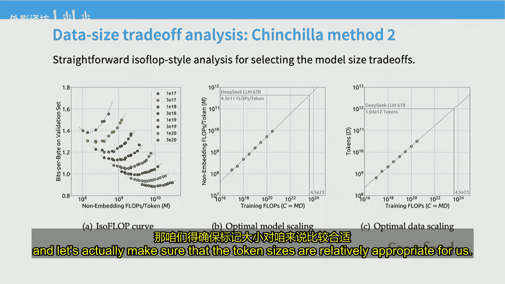

然后最后他们得出了一个拟合的缩放规律，这在某些方面不足为奇，因为这是在他们定好缩放策略之后，他们做可预测的缩放，他们试着预测7B和六，7B模型会出现什么情况，这在很多方面都不足为怪。

但他们能从大约十的20次方往外推算，这挺不错的，十的24次方，并且能依据缩放定律精准做出预测，所以能看到这一点很不错，在实际训练模型前，就能得到模型能力的预测指标，所以这就是deep sec的部分。

关于deep sec策略，大家有问题吗，以及他们的做法以及其他方面有问题吗，我觉得大部分内容，我觉得WSD可能是我今天提到的最新内容，deep sc做的另一件事是，直接根据最优学习率来拟合一个缩放定律。

还有批量大小，而不是像使用mute p那样，没错他们有全局学习率吗，所以他们在调整那个全局学习率的值，挺酷的，对问题是，人们会针对新的前沿模型重新做这种分析吗，说实话我不太确定。

我开始觉得很多人可能不会完全复制其中一些，因为我们在新论文中看到扩展细节越来越少，例如即使在deep sec中，Deep seek v2，然后是V3，我们看到每篇论文都着重强调新的部分。

对于deep sk VR，我们能看到对MLA和架构改进着磨颇多，而在deep sick v3中，我们能看到很多系统组件受到关注，比如低比特训练，但是比如说我们并未看到在这两者中，有任何新的缩放定律研究。

所以我猜没什么新内容，比如他们可能只是在复制，以确保其可行，但没什么新进展，我想接下来几张幻灯片会讲到，我会谈到缩放定律，还有过去一年左右的论文和模型，于是我做了个简短调查。

但实际上没有能达到mini cp m或deep sec，那种详细程度的东西，比如那些仍然是，我觉得是我们在2025年所做的，关于缩放的最详细的公开研究。

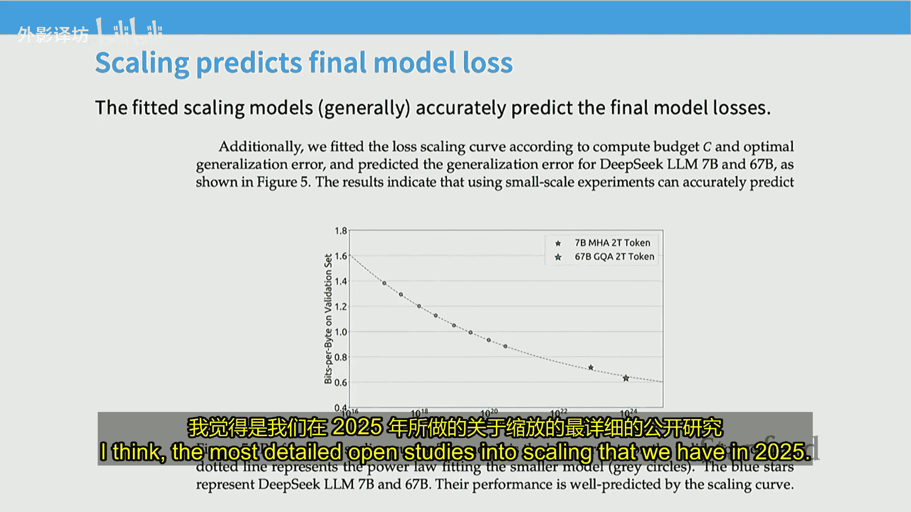

好，那么老马三可能是过去一年里，较大的模型发布之一，自从我上次教这门课以来，他们确实有一些颇为有趣的缩放要点，一方面就目前这个问题来说，比如人们在运行过一次这些分析后，真的会再次进行复制吗，嗯算是吧。

你知道，lama3重新进行了ics flop风格的缩放操作，chin china缩放定律，而且他们大致发现了最优比例，如果我没算错的话，大约是39比一，而且我确实觉得这挺有意思。

因为chin china的参数比例为20比一，我想我们很多人在研究等过程中，都按照龙猫法训练过模型，很明显20这个数值并非那么稳定，就像其他你和他的人得到的比例，总体上比以前略高。

这可能意味着某些架构的算法效率有所提高，这些架构能更好地从数据中学习，这可能意味着其他方面，比如数据质量提升，所有这些都相互影响，所以很难弄清是什么导致的，这些略有差异的比率，但结果似乎相当明晰。

你和效果相对不错，而且他们确实得出了40比一的比例，另外还有件与数据缩放相关的事，我在第一次讲解缩放的讲座开头提到过，捞马三团队做的一件有意思的事，就是他们试图把计算与负对数自然联系起来，比如对数损失。

然后再把这些负对数自然与下游的准确率，联系起来对吧，所以他们在此处的想法是，他们实际上并不想依据对数自然进行扩展，这并非他们真正在意的对吧，他们在乎的是提升，我不知道像MMLU或LAMBA上的基准数据。

或者他们决定要攀登的其他任何基准对吧，所以倘若如此，那么他们需要一个转换因子，从这些每个字符的负对数，自然或等同于困惑度的值，然后将其转化为准确率，于是他们针对lama3开展了一些研究。

本质上是尝试将二者关联起来，拟合SIGMOID的函数，若你对这些小模型进行拟合，并对一些low a2模型进行拟合，在对整体拟合一个SIGMOID的函数，基于这些拟合结果。

你就能准确预测lama3405B的性能，挺有意思的，我想他们表示会将这类思路用于数据选择，但我觉得其中细节并不多，尚不清楚这究竟是不是一个真正的核心对象，在训练捞马30，又或者这只是个次要的扩展研究。

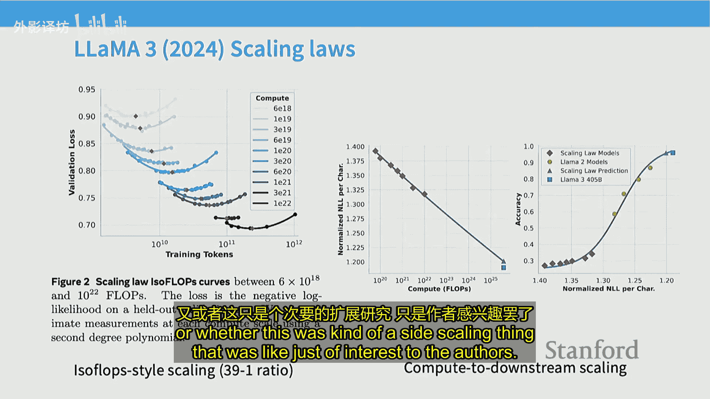

只是作者感兴趣罢了，另一项近期发表的研究，还有一个执行的不错的中文语言模型，混元一，希望我没把发音念太糟，他们在训练混合专家模型，正因为此，他们想再次进行隶属风格分析，再次进行拟合。

他们做每秒浮点运算次数分析，它们拟合二次曲线，他们找出最小值，然后他们能得到不同的词源与参数比，所以他们得到的数据与活跃参数比，为96比一，因为他们在训练混合专家模型，这些比例显然会大不相同。

架构上有很多差异，我们并不期望和奇亚模型一样的结果，所以我们确实在各种论文中看到，奇亚模型再次重现再说，因为很多人都非常感兴趣，比如想知道我能把标记与参数大小的比例，推到多高。

我们希望保持在这个比例的较高水平对吧，比如拥有比参数更多的数据，因为这样人们就会实际使用我们的模型，或者我们的模型的服务成本会比较低对吧，所以出于这些原因，人们一直在复制隶属模型，我认为这是在扩展方面。

诸多复制结果中最好的之一，实际的20比一参数比，并不能始终如一地被复制，而是你能够进行等浮点运算并达到最小值，且在浮点运算中得到这些非常可预测的取舍，到最优参数，在复制过程中相当清晰且一致，好最后一个。

mini max one是过去一年里相对奇特的一种缩放定律，它是最近才出现的，所以mini max one是一种线性时间模式，或是另一家中国初创公司发布的，长上下文语言模型，而他们感兴趣的是。

我们将采用二次的soft max注意力机制，他们有一种叫闪电注意力的机制，这是一种线性注意力层，它是线性时间，然后他们有该模型的混合版本，他们想弄清楚我付出了多少成本，从模型性能来看。

其注意力机制从soft max到线性再到混合，他们照着一种方法做，这种方法叫验证模型缩放的方法，一训练时他们会去看损失曲线的下边界，他们主要看隐含的最优模型规模，还有训练过程中隐含的最优资源数量。

大致上他们由此得出的结论是，闪电模型和混合模型的表现大致与soft max，注意力机制相当，因此基于这些架构训练，长上下文模型是没问题的，我们常在研究论文中看到这类图表。

比如看看曼巴论文或者曼巴二的论文，或者DELTNET论文，或其他具有线性时间复杂度的，循环神经网络论文，你会看到很多类似的图表在那里，他们会说哦，全注意力缩放和我的线性注意力缩放，在计算量方面基本相同。

但这你懂的，我想说，这是极为罕见的，同样的情节被创作出来的情况，几乎是从一次重大的成果发布开始规模化的。

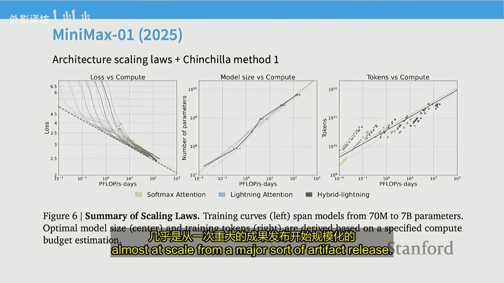

好的，那么把这些都综合起来，我知道那像是一堆小型案例研究，我快速浏览了一遍，但我想稍微往后退一步，然后稍微回顾一下，我们已经看到在这些扩展策略中，使用了几种常见要素。

我们已经看到了cerebirth deep sec，mini cp m以及之后出现的几篇新论文，所以CEREBRSGPT和mini cp m，都采用mp已式超参数，在不同规模下更稳定。

实际上特别是mini cp m有一个不错的WSD调度，这是他们推广的一种，用于实现龙猫风格缩放的方法，sarah birth没有费心去复制龙猫式做法，deep sec的做法略有不同。

他们假定大多数超参数不会随规模改变，但他们对批量大小和学习率，进行了完整的缩放分析，然后他们运用缩放定律来确定最优的缩放比例，我之前就提到过，有些缩放情况比其他的更可疑。

但实际上这至少能让数量级有望正确，他们采用等浮点运算次数分析，他们再次复用change china方法来确定模型规模，并确保它们大致在正确的数量级范围内，在最近发布的版本里。

捞马三和混元仅进行等浮点运算次数分析，lama3做的更多一些，但基本上就是如此，然后mini max做了更有意思的事，即基本上是从缩放定律的角度来论证，架构选择的合理性，但一般来说。

我们可以看到有一些不同的东西被重复应用了，比如chin china，学习率和批量大小确实是人们十分关心的事情，当他们扩大模型规模的时候，而且他们会做诸如固定宽高比之类的事情，直接扩大整个模型规模。

这通常是人们处理模型扩展中，诸多变动因素的方式，好的，关于案例分析部分有问题吗，我会留在这，确保解答了大家可能有的问题，好很酷。

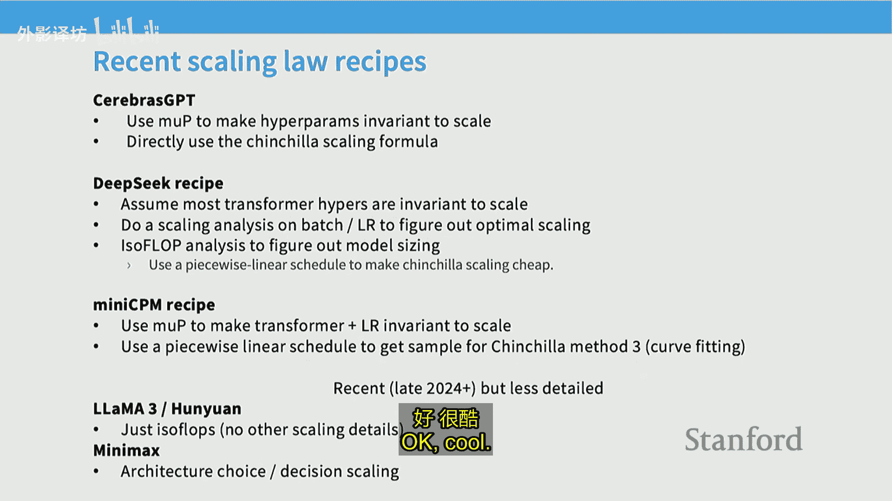

好本次讲座的第二部分，也是最后一部分将是理解mp，希望通过案例分析，你们已经看到，关键是要调好学习率，是人们关心的核心问题之一，也是批量大小，但一般而言，我觉得我们需要具有尺度不变性的超参数。

而且我们对初始化的选择，以及我们对每层学习率的选择基本是随意的，我们没有理由非得用这种方式，而非那种方式来初始化他们，所以要是我们能操控这三个变量来获得尺度，以及我们学习率的变化幅度，那就太棒了。

那样会让我们的生活轻松很多，还会让小规模实验更有可能实现，所以我也会先讲讲这里面的数学知识，比如他是怎么推导出来的，依据是什么，在尝试让模型可预测的扩展时，背后的核心概念是什么。

然后我想讲一下一篇很不错的预印本，是一位独立研究者做的，主要是关于对mp的一系列删减研究，比如是什么让他出问题的，他对什么有抵抗力，他在实际的transformer语言模型上能行吗。

这类问题在文中有深入探讨，在我将在结尾提及的这篇预印本中。

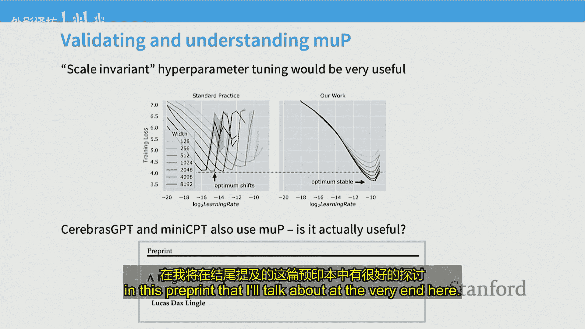

有很好的探讨，那么new p究竟是什么呢，我感觉在过去几堂课里，我可能有点操之过急了，因为我已经讲过这是什么了，却没有真正给你们讲清楚它所基于的核心概念，另一方面，我觉得我这么做是合理的。

因为我觉得大多数文献，对mp的解释也没那么清楚，他们就说没错，只要把初始值除以宽度就行，然后把每层的学习率也除以宽度，这就是mp，但我觉得UP背后的想法挺有意思的，而且值得探讨。

因为我觉得他们涉及深度学习中，一些普遍存在的核心对象，所以我的幻灯片将以这篇预印本或论文为蓝本，要是你想了解一下牛皮，我给你推荐这个，我觉得这篇以及另一篇叫new p，从业者指南的博客文章。

我觉得是对这种范式的两种比较易懂的描述，所以我就以这个为依据，不知为何，这些不同展示中的数学内容不完全一样，所以我要说明一下，我是以这个里面的数学内容为依据的。

所以new p是基于以下这些相对简单的理念，所以我们认为训练神经网络时会出现两件事，在训练神经网络时，所以当我们扩展神经网络规模时，在此情况下，我们要让比如说只增大网络宽度，并且我们要固定网络深度。

不好意思，之前说的层数有误，并且随着过程进行，我要增大宽度，现在如果我这么做，当我增大宽度，我希望激活的初始化保持为大，O我希望它大致维持恒定，由通用常数上下界定，当我增大宽度时，大致保持恒定。

它不应激增，它不应消失，这似乎是个很自然的想法，你不希望激活值变得过大，这是针对每个坐标的情况，现在我的第二个要求是，我要初始化模型，并且我要进行一步梯度更新，当我进行单个梯度步时。

我要确保激活值的变化，也因为常数级别的一，所以这两个条件看起来都很自然，要是违反了这些，这意味着随着我增大模型，要么初始激活值会激增或消失，要么在一次梯度步后，我的激活值会激增或消失。

这些都是糟糕的情况，附注我再说单个激活值，比如坐标，所以要是你考虑整个激活值向量的范数，他应该形如NL的平方根乘以大theta，因为这些大致相互独立，所以范数会是宽度的平方，根及宽度坐标中的元素数量。

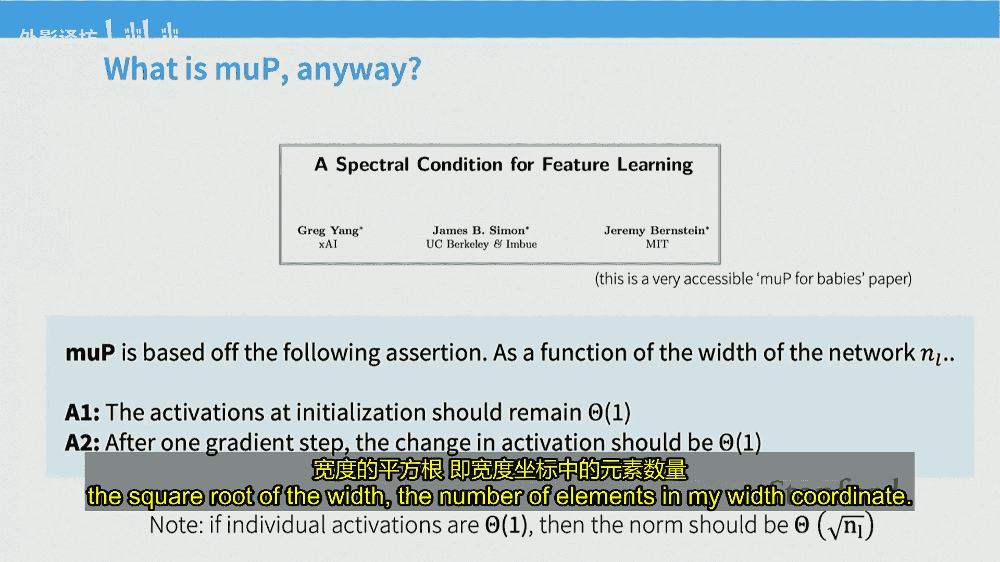

所以从这两个条件能推出mp，那么第一个条件即我希望激活保持稳定，这会对初始化施加一定约束，下面我给你讲一个非常简单的例子，下面我考虑一个深度线性网络，这就是H这是DL层的激活值。

它是DL层权重矩阵的函数，以及前一层的激活值，没有非线性，没有复杂的东西，全是方阵，别管这些复杂的东西，若你想要复杂的东西，你可以去读预印本，他们会用有些含糊的说法，解释为何那些东西无关紧要。

现在初始化方面我要采用高斯初始化对吧，所以它将以零为中心，它会是个矩形，尺寸大小取决于我的激活函数尺寸，然后我将有一个超参数，它是该层磁矩阵的噪声尺度，抱歉这个西格玛上应该有个小L。

那么现在我们能说什么呢，嗯我想了解初始化时L层H的规模，那我们该怎么做呢，嗯我们可以考虑这个系统的极限行为，我将取L时的小N，以及L减一时的小N趋于无穷，如果我这么做，这个W会趋于集中。

这是个随机高斯矩阵，要是你还记得随机矩阵理论，实际上这不是本课程的前提条件，但要是你懂一些基础的随机矩阵理论，你就知道，高斯矩阵的算子范数大致会收敛到这个值，它会是西格玛及噪声尺度。

乘以两个坐标之和的平方根，重要的是你大致可以写出这个等价关系成立，所以DL层的激活值，其范数大致等于WL的算子范数，乘以H在L1层激活值的范数，大致而言，这是假设L层的W与L1层的H相互独立。

在初始化时确实如此，所以我想如果愿意，你基本可以把它写成右箭头，现在我要选一个特定的sigma，它等于根号NL除以根号再乘以这个东西，你可以简单把它看成右边这个这就是精确形式。

这算是一种更趋近渐进的形式，但实际上它就是曾输入数量的平方，根分之1×1以及模型的宽高，比如果层输入数量远大于层输出数量，那么这个就会起效果好的，假设我选择这个西格玛会怎样。

大致是曾输入数量的平方根分之一，那现在呢我可以把这个带回公式矩阵浓度限制，以及这里的这个近似值，我可以通过归纳法大致证明，每一层都会有合适的激活规模，那么我们来遍历所有层，并假设直到DDL1层。

我具备这个特性，所以这就是归纳，假设在DL1层，我的激活范数为NL1的平方根，好的，这只是个假设，要是这成立的话，那我就把这些都带进去对吧，所以我把根号代入这个分量，到WL的算子范数里，我代入极限值。

然后对于西格玛，我代入这边这个式子，你看这个倒数能消掉这个，然后你就能得到准确的，HH的L2范数等于根号N，所以这就是我们想要的。

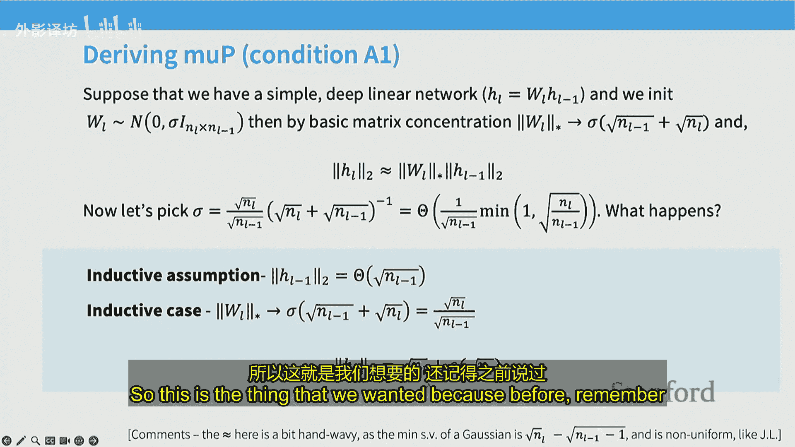

还记得之前说过，我们之前说要确保使激活函数值保持为大欧，这意味着范数因为L乘N的平方根。

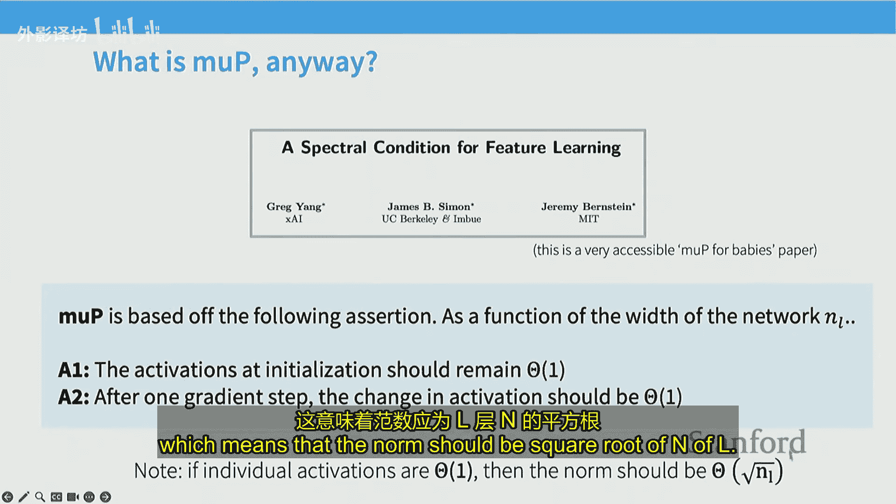

所以这正是我们得到的结果，再加上一些低阶项，所以这是一个相当清晰的逐步推导过程，它表明了正确的做法，对于初始化操作，我想选择移除已擅入的平方根，并加上一个小的修正因子。

以便确保确保我的激活值在初始化时不会激增，我先暂停一下，以防有人有问题，我觉得这或许是我们这门课上首次涉及的，真正数学内容，所以对大家而言可能有点思维转变，我之前没提醒过你们，我要讲一点数学知识好了。

大家都清楚这些了吗，finny的平方根分之一对吧。

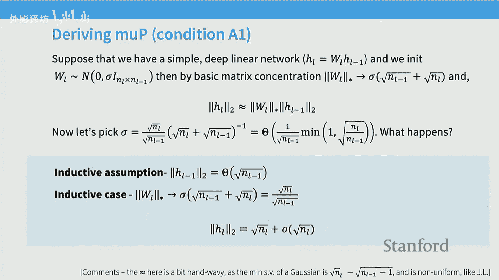

好的，我假定大家都跟上了FINN的平方根分之一，这个内容好了，那现在咱们要推到mp的第二部分咯对吧，所以mp的第一部分是关于初始化new p的，第二部分是关于学习率，那咱们要怎么考虑学习率呢。

嗯要考虑学习率，我来看看第二个条件，第二个条件V2，他说在初始化后进行一步梯度更新时，需要注意的是我的激活，抱歉我的更新大小要保持不变，它不会炸掉，它不会消失，不见好，那这是什么意思。

所以如果在DL层的权重上，我有一个delta w下划线L的更新，这是从哪来的嗯，它源自假设我在做随机梯度下降，这将源自这个表达式，它将使学习率乘以L也就是我的损失，L的梯度及我的损失。

然后是激活值的转置，当批量大小为一时，这是一个一阶对象，这是对L的增量进行的一阶更新，由于它是一阶的，有一个简洁的表达式，WL的变化乘以先前层的激活值，其结果等于WL变化的范数。

该算子范数乘以L减一层的H的L2范数，现在把这个和下面这个事实结合起来，L层激活值的变化类似这个表达式，你可以自己确认这是对的，你可以通过算出来，大致算出更新后L层的最终激活值，然后消去L层的WLH。

它是左右两边共有的一项，然后你会得到这个表达式，你会得到那个结果，L层的H的更新量是多少，这就是我们想要保留的对象，大致是L的N的平方根，也就是这个对象的范数，那么咱们来逐一查看这些项，再看看它的大小。

这里的第一项WL乘以H的增量，我们可以假定这将由归纳假设来控制，因为这正是我们有的H的增量，再加上条件A1的论证，条件A1大致是说抱歉，条件A1会说L减一层，H的变化量将会是ml的平方根。

然后WL会维持那个范数，更复杂的部分在于这两个参数，这里的第二项和第三项，即delta w l乘以L减一层的H，以及delta w l乘以delta h l减一，抱歉，这说起来太拗口了。

实际上他们量级相同，而我们真正要弄清楚的就是，这里这个表达式，前一层范数与delta w l算子范数的乘积是多少，因为我们并不确切知道，权重矩阵W中的更新会有多大。

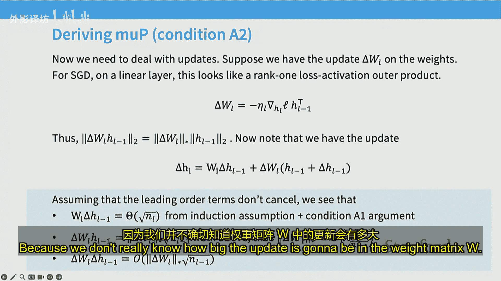

要是我们知道了这个那就都很简单了，好的，所以剩下的论证其实相对简单，尽管这实际上是一堆错综复杂的东西，实际上直觉非常清晰，对此的直觉是好吧，我真正需要弄明白的是什么，我真正要搞明白的就是。

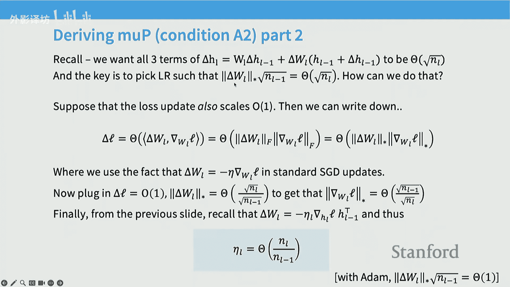

这儿这个表达式L层的权重改变了多少，要是我能搞清楚那个，那我就能大致推出所有相关量，然后求解学习率。

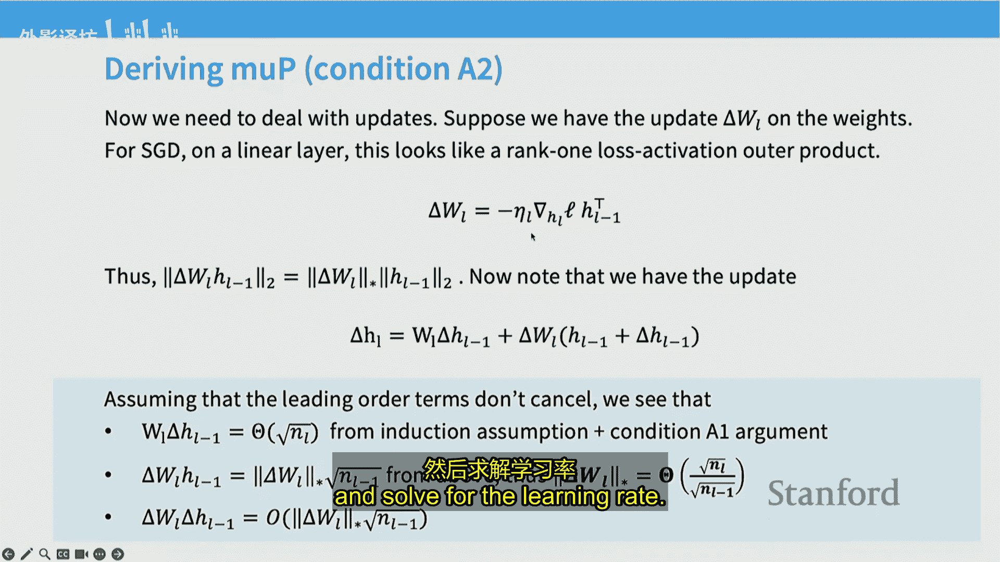

从高层次来讲，这就是我们这儿的策略，那么在一次梯度布之后，我们怎么才能弄清楚delta w l移动了多少呢，这才是关键问题，嗯这儿还出现了一个额外的有点隐蔽的假设，假设大致如此，若我们的学习表现良好。

那么经过一次梯度波后，损失的变化量及L的增量，这个量也必定是大，飞塔为何如此，嗯因为我们不希望损失的大小及更新，我们损失的减少量变得过大，或者随着宽度趋向无穷大而趋于零，我们实际上希望损失的改进。

无论我们的模型变得多大，都能保持大致相同的数量级，这一假设比我们之前的更强，但假设这是事实，那么从本质上讲，我们可以说，损失的变化类似于梯度与权重变化的乘积，左边是我们知道L的变化量该是多少。

那么现在我们知道WL的变化量是多少，现在我们可以求解梯度大小，一旦我们得到了它。

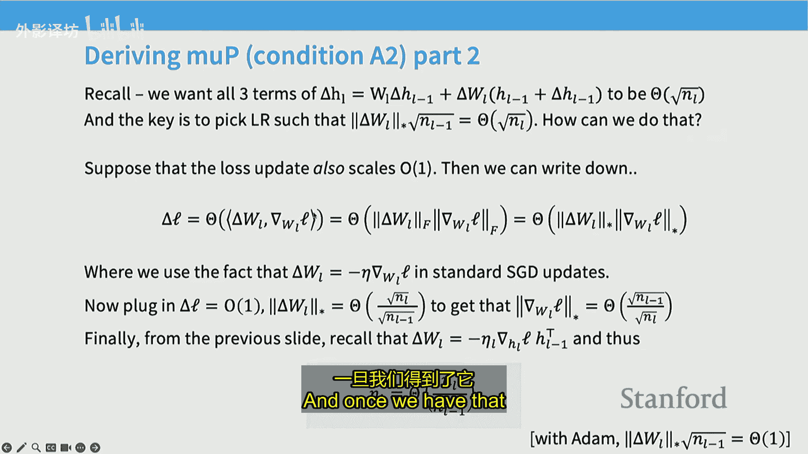

我们可将其带入此处，我们知道增量WL我们知道L的梯度，且根据条件A1知道L的H的大小，现在我们能求解学习率了。

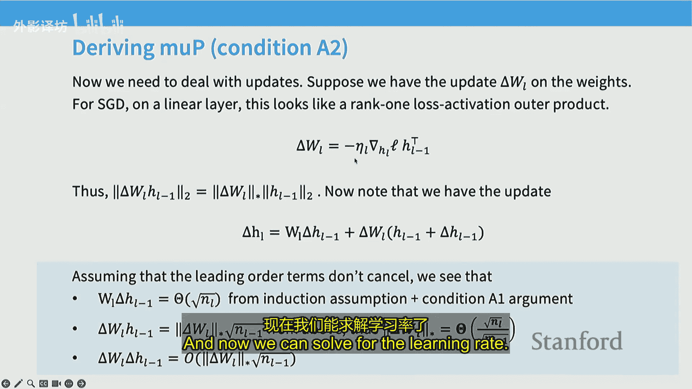

而这正是你在下方得到的结果，若你进行这些运算，你在此处得到的最终结果，即随机梯度下降的学习率，等于输出输入神经元数量之比，没错，所以涉及诸多步骤，还有许多类似的代入操作。

这里将有点粗略的大O符号代入方程中，但一旦我们这么做，我们最终会得到一个很简单的公式，注意这对随机梯度下降成立，而你们当中那些一直有所留意的人，一直盯着这个方程看的人，可能在心里抱怨。

你们可能会觉得被误导了，毕竟在transformer里，NL除以NL减一是多少，对于多层感知器而言，实际上它就约等于四对吧，因为DFF和D模型之间有四倍的关系对吧，所以这个东西没什么变化。

在大多数模型里它就是个常数对吧，除非你的宽高比在网络中变化很大，new p和标准参数化不同，原因是因为这个推导是针对随机梯度下降，这时new p和SP的参数化看起来很相似，如果你对原子做同样的推导。

你会发现实际上你会得到略有不同的结果，即它将是易除已删入。

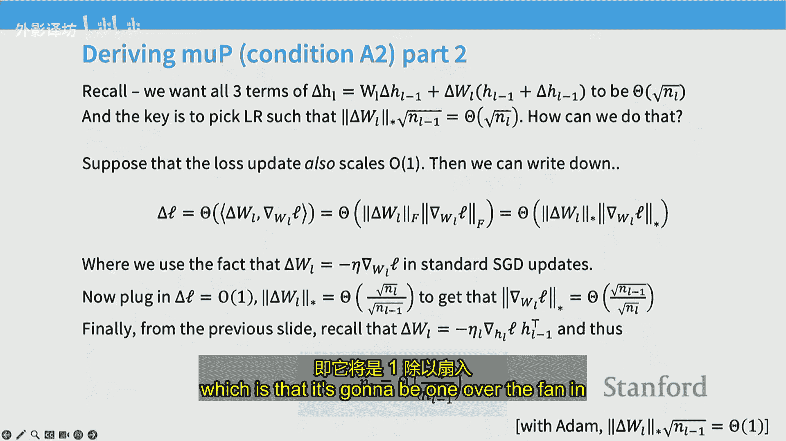

而不是删出处已删入好，下面来回顾一下，我算是带着你们梳理了一遍，希望你们是自愿的基本推导，即人们所说的定义mp的频谱条件，但现在我会用一张幻灯片，向你们总结一下这个结果的要点。

所以当我们想做mp这类事情时，如果我们直接沿用之前的指导方针，最后我们会得到如下蓝色框，初始化时将其设为易除已输入扇入的平方根，再乘以一个校正因子，如果输入扇入小于输出扇出结果为一。

否则为该比例的平方根，接着这是对高斯分布尺度的简单初始化，对于学习率，如果你使用随机梯度下降，那么将其设为输出善出除以输入擅入，但如果你使用ADAM，那就会稍有不同，它会是山入的分之一。

现在要是你已经大概知道标准的何凯明，初始化方法等等，凭直觉，你可以在心里把这个和标准参数设置对比一下，那么在标准的参数设置下，要是你操作正确的话，你可能应该已经在设置高斯分布。

将其初始化为final平方根分之一，这样就挺好，那就已经设置的很完美了，但你的学习率可能以全局设为常数，这对随机梯度下降适用，但对item不太适用，这就是SP与mp之间存在巨大差异之处，那么好了。

这让我们回到了那篇颇为严谨的GPT论文，现在我们掌握了，理解他们所有操作所需的全部背景信息，如果你再看一下这边new p的脸，嵌入层很特别，由于嵌入式独热编码，它实际上基本不进行任何作法。

所以他们的规范不会随词汇元素数量现行缩放，但忽略这点，基本上可以看到，所有层都按宽度的倒数进行缩放，这就是初始化规则，然后学习率规则也按宽度的倒数进行缩放，所以这又是item的学习率规则。

所以如果你在使用item，那正是正确做法，而在CEREBIRTHGPT中，他们也是这么做的，希望这讲清楚了，希望这能让你有所体会，调整每层学习率，以获得更可预测扩展的趣味性。

或许还能让你领会尝试控制激活值这一理念，以及随模型宽度而进行的更新，我在此处稍作停顿，然后提一下对吧，这类似于物理学中一个非常成功的理念对吧，许多物理学家都思考过诸如重整化之类的概念。

当我对某些东西取极限时，我希望事物维持稳定，我希望他们不会爆炸或归零，这是该想法的精确应用，这算是对那个的有趣用法，好的，关于木皮推导或赛瑞巴斯GPT之类的，有什么问题吗，或者其他的请讲好的。

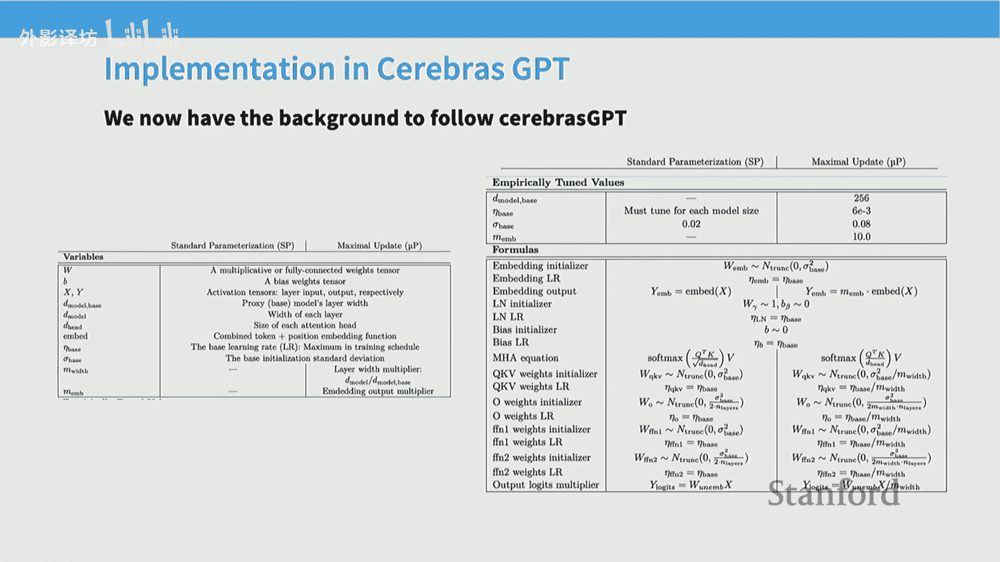

没错，所以这是微妙之处所在，问题是嗯架构假设有哪些嗯，从技术层面讲，这里还有一个更强的假设，这里存在一个更强的假设，也就是我假定这些是深度线性网络，我只是在不断的矩阵相乘。

这是你能拥有的最简单的网络类型，基本上关于添加非线性为何可行是有依据的，对于如何运用相同的依据是有说法的，并将其应用于注意力层，关于门控线性单元为何需要更复杂的东西，有不同观点。

所以这些架构部分中的每一个都需要仔细分析。

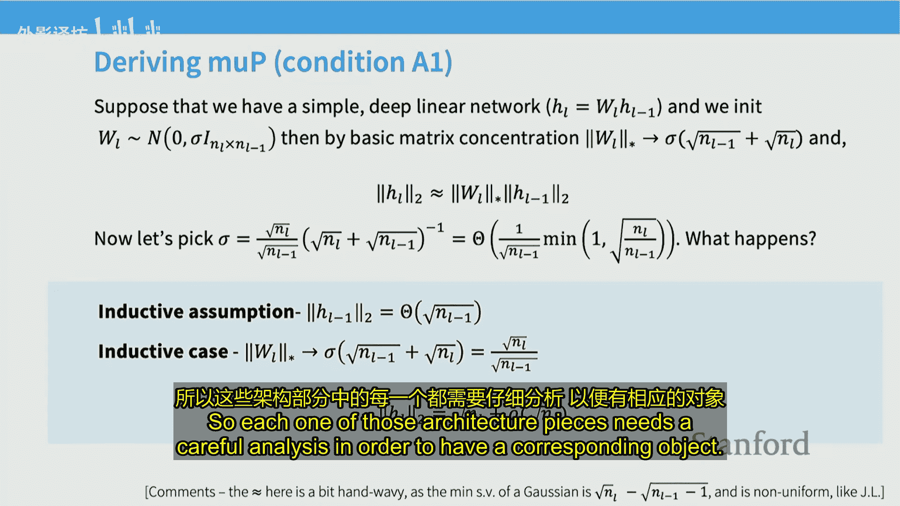

以便有相应的对象，什么是对对对对，所以NL就是矩阵乘法的输出，而L减一是输入，例如如果你有一个多层感知器，MLP会有一个矩阵乘法，将你从D模型维度转换到四倍D模型维度，就像前馈网络DFF维度对吧。

例如这会得到NL除以NL减一，再乘以四的结果，所以不同的矩阵形状都对应着NL和NL减一，矩阵的深入和删出没错，没错是的是的，所以输入和输出维度决定了所有这些东西。

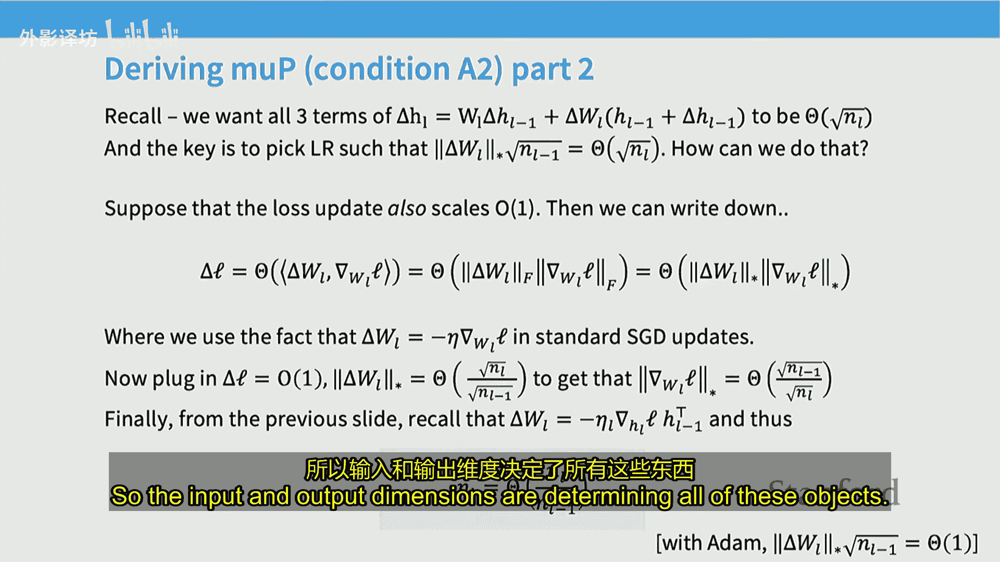

好的很好，擅入和删出类似于输入和输出维度，没错，我之前把那些术语混用了，但本可以说得更明白些哦，对因为NPI有全局渲染范围，这是否意味着他们没有异界更新，所以问题是因为deep sec使用全局学习率。

这是否意味着他们没有异界更新，所以所有这些论点都是渐进的，基本上是在说，当我把宽度扩展至无穷大时，事物会有大有小，例如若你查看mp图。

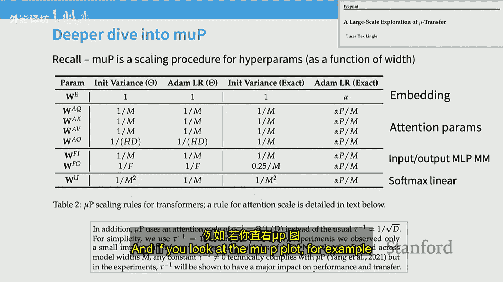

你确实能看到这一点，你会看到学习率得调整，随着模型变大，以弥补更新越来越大，经验表明，若学习率合适，你就不需要mp，并非训练好模型，就需要mp，这其实只是为了让这种变化，尽可能小的一种尝试。

这样在整个扩展过程中，你就能使用相同的学习率，如果你回顾一下深度探寻，如果你还记得那个我有点讨厌的扩展定律，你会发现他们也有学习率，它们会随规模变化而下降，以弥补即更大的模型会有更大的更新量。

所以更直接的回答这个问题，答案是肯定，就deep sec而言，随着我们扩大模型规模，我们的激活更新会变大，所以我们得降低全局学习率，或者我们应降低全局学习率以作补偿，问题提得好。

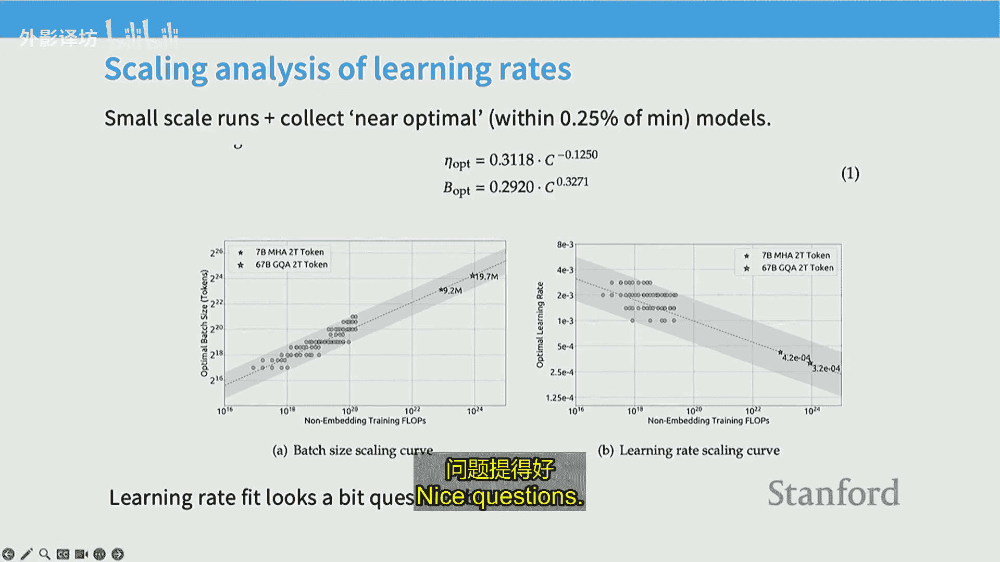

好啦，那算是mp在概念及数学方面的一些组成部分，现在我要讲讲new p的实证部分，那我来讲讲一篇预印本，或者我想这篇在polish点com网站上，对缪迁移的大规模探究，我喜欢这个，因为它有一堆消融实验。

我觉得我对消融实验毫无抵抗力，所以在课程里，只要论文有大规模消融实验，我都会展示，所以他们实际上做了一个关于宽度为mp的实验，如我们所述，看看右手边这部分更相关，你瞧他们在降低方差。

他们按模型M的宽度来降低学习率，它们主要保持深度不变，这是一种不太寻常的缩放方式，因为通常会同时缩放深度和宽度，但他们真的想做个对照实验，他们只观察宽度的变化，他们想看看。

new派在这种情况下能否精确实现缩放，还有一点奇怪的微妙之处，所有牛批论文似乎都有，即如果你还记得224N课程内容，你就知道你还记得注意力激活，有个缩放比例吧，你进行缩放，你做内积运算。

然后你用根号D分之一去缩它，我跟你说过，这有点像个神奇常量，这么做没错，牛皮和其他论文用的是一地缩法，而不是一根号D，这是基于激活和更新大小稳定性的各种考量，所以这是另一件值得指出的事。

因为你可能一开始不会想到这和mp有关，好的。

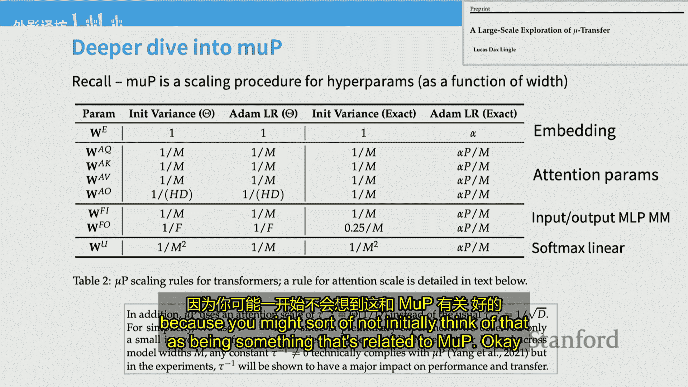

架构大多与标准的transformer架构相似，正如我之前提到的，他们只考虑宽度缩放，对不对，所以他们采用一个标准的transformer，在预训练文本上进行子回归训练，并且他们基本上想让模型变宽。

在多层感知器上越来越宽，以及模型残差流维度，他们要把那个做的越来越大，他们希望最优学习率保持不变，当它们增加宽度时，如果他保持稳定，那么这对mp而言是个重大胜利，所以希望大家都明白这个玩法。

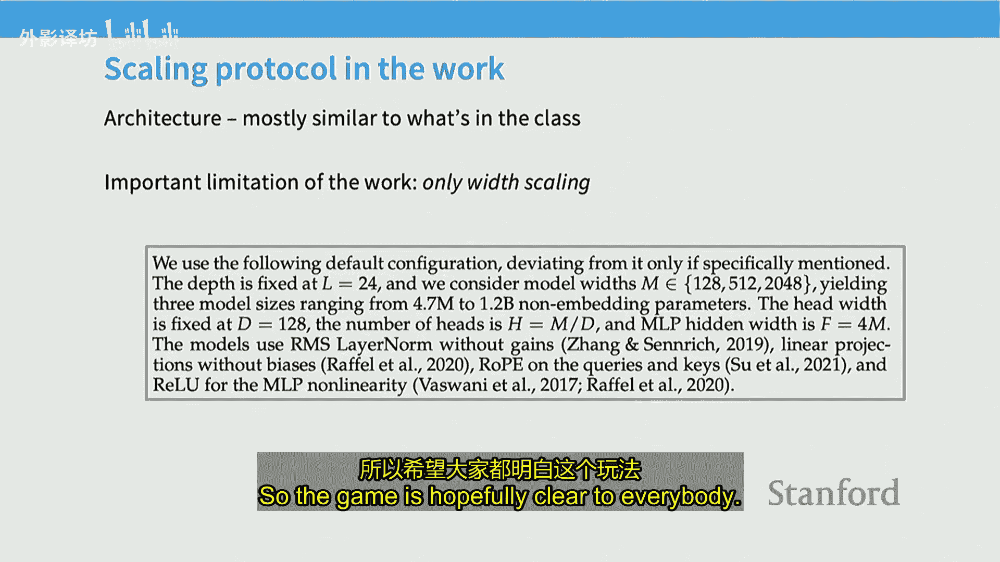

你只需要与之同步扩展，我希望我的最优学习率保持不变，那么第一个问题是它可行吗，嗯答案是肯定的，我们有不同的宽度，128，512，2048，各列的学习率不同，这里理想化的策略是。

在小尺度上对学习率进行测试，我选最小尺度，然后扩大它，希望基础学习率保持最优，而且学习率在不同模型大小间的传递，似乎很可靠，要是缩放做的比较精确，然后我想你会开始问，比如好吧，与上一个问题极为相似。

就像之前问的mp何时会失效，所以理论上你可以问那个问题，但实践中你也能问那个问题，所以我要尝试各种现代架构变体，然后我会问这种超参数转移，在这些变体下还成立吗，而且这篇论文挺好。

因为他们探讨了很多不同的东西，他们会改变激活方式，他们会改变批量大小，初始化设置以及RMS归一化增益，他们会使用一些独特的优化器，比如正弦梯度风格的，然后他们还会改变正则画像。

那么这里面哪一个能防止学习率迁移呢，那么第一个我觉得这可能有关，要是你再考虑那个深度线性网络，会说哦，没人只是单纯的把矩阵相乘，中间有非线性对吧，那么改变非线性时，new p还管用吗。

NQUICKO平方RLU以及机械，REALU的mp方法都有相同的最小学习率，所以毫无变化，例如我们看到sweet low和平方VLU，比基线mp表现更好，不出所料，与我们在课程中学到的很多内容相符啊。

我们可能会改变批次大小，因为我们知道批次大小对规模较为敏感，就像我们看到的mini cp m，而且我们发现，深度搜索基本上是，让缩放损失与批量大小相适配，以试图找出最佳批量大小，我们再一次看到。

当我们将批量大小放大或缩小四倍时，学习最佳学习率保持稳定，初始化呢，人们会对一些初始化进行变动，例如有些人将查询矩阵设为零，所以以便所有不同项目都能得到同等关注，也许那样更稳定，对于最顶层的解介入层。

有些人他们会根据使用的是标准参数化还是mp，而有不同缩放比例，也许这很重要，结果证明这两种情况均不成立，在所有这些情况下。

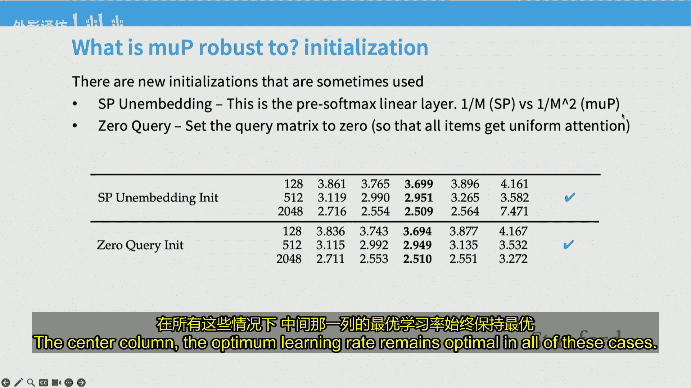

中间那一列的最优学习率始终保持最优，他对什么不稳健嗯，他并非在每种情况下都有效，例如如果你添加某种可学习的权重，结果会破坏mp，所以你需要去除偏差，但如果你把它们去掉，那么mp就管用了。

要是再加上它们就不一定管用了，同样你可以试试一些更怪异的优化器，LEON是一种根据梯度更新的符号，来进行操作的优化器，在我看来这有点疯狂，但我觉得这是通过搜索找到的，这是通过类似计划搜索的方式找到的。

或者类似的方式来找到最快的那个优化器，要是你用这种更怪异的优化器，它真的会出问题，我想这就是你所期望的对吧，新的P旨在适应像IDOW这样的特定优化器，以控制更新大小，所以要是你用的是完全不同的优化器。

我不明白你为何会期望学习率能转移，所以也许可以料到这个会失败，然后差不多到最后它对什么也不耐用呢，结果发现要是你真有更强的权重衰减，new p实际上就开始出问题了，所以这是为数不多的几个。

明显的mp失败案例之一，很多其他情况都有点像哦，我们可能预料到了或者那样做不规范权重衰减。

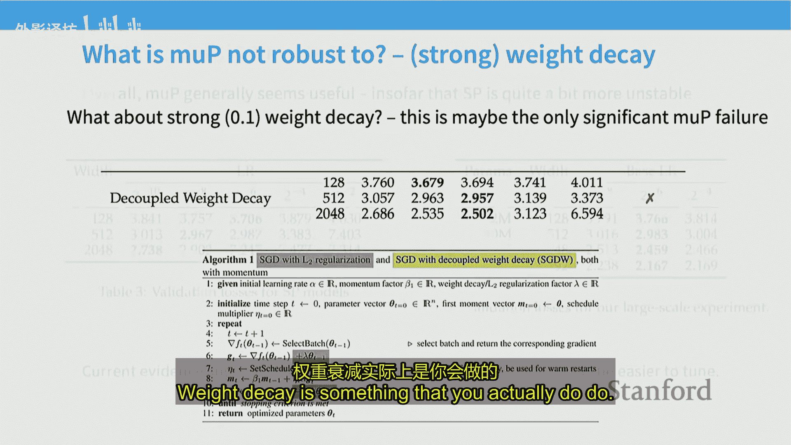

实际上是你会做的，所以new p总体上似乎挺有用，比如说如果你采用标准参数化，就有点像回到基线对吧，你可能会问好吧，要是我就做标准的基线操作呢，要知道不能用相同的学习率，相同学习率在2048时。

会导致损失显著更糟对吧，比如说你的模型会直接崩溃，损失严重恶化，要是以相同学习率进行扩展，你肯定会很郁闷，我们也看到，学习率需要依据宽度进行可预测的下调，另一方面，即便你一路扩展到100亿参数模型。

你会发现基础损失保持不变，于是他们开展了一项大规模实验，而且他们发现学习率在二的六次方，这个水平上保持较为理想，这算是一种不错的验证，所以他们在中小规模下开展了整个研究。

他们进行了一次类似英雄壮举般的大规模运行，随后学习率保持最优，所以这方面的实证结果看起来颇具前景。

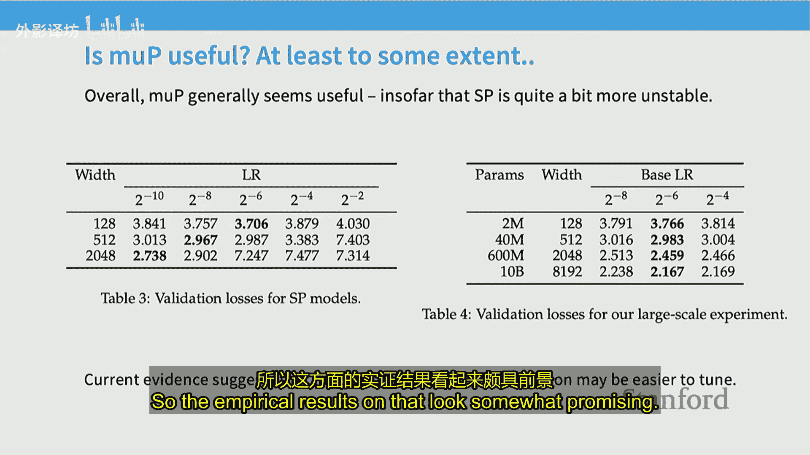

meta将其用于拉马斯，这一点也挺不错，但据我了解，人们是否使用UP尚未形成共识，好了，把这些都综合起来，在实际场景中要怎么进行扩展呢，我从没在超chen china规模下，训练过700亿参数的模型。

所以我们得大量依靠案例研究了，我们看到了一些实际应用中扩展的例子，我们看到有人用缩放定律来设置模型超参数，尤其是学习率和批量大小，我们看到有人用像mp这样的东西，或者假定稳定性来避免在这些空间里搜索。

此外使用诸如替代学习计划之类的方法，如WSD。

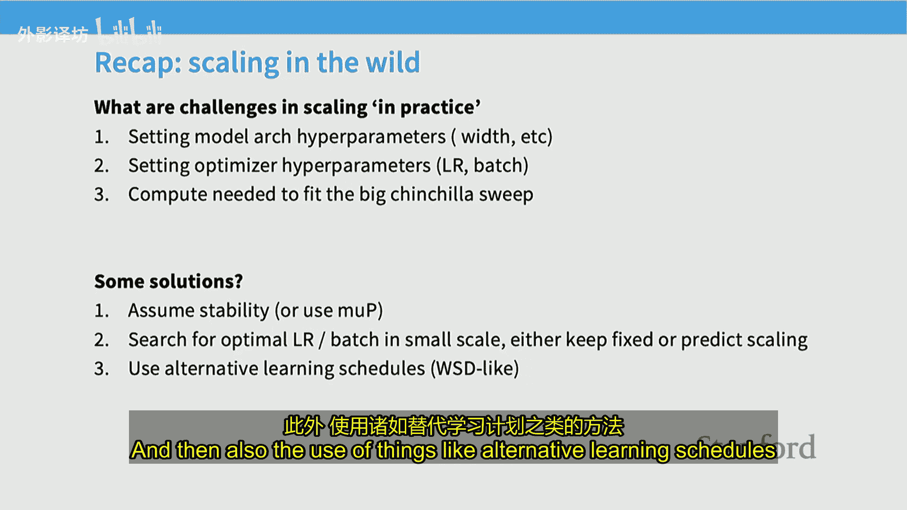

能够减少，为遵循诸多此类缩放定律所需的计算量。

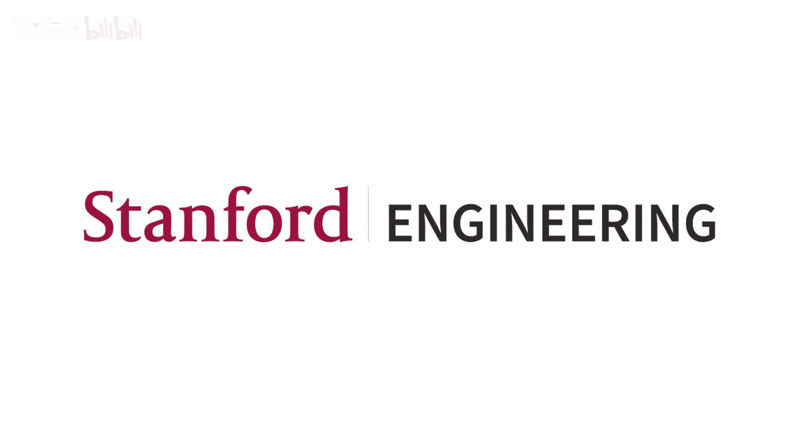