# 【中文配音】硬核！斯坦福 CS336：手把手带你从零构建 ChatGPT - P13：Lecture 13： 数据1-Data 1 - 外影译坊 - BV1BWEWzfEKi

所以今天的讲座要讲数据，在之前的讲座中，我们讨论过如何根据数据训练模型，所以我们讲过了架构，我们讨论过优化器，标记化，缩放法则和并行性，这些都是在给定固定数据集的前提下，现在我们要讨论用什么数据来训练。

所以我觉得要让语言模型准确，数据是最重要的，所以test可能不同意这个观点，他觉得缩放定律最为重要，但这是我的依据，咱们来看看公司在论文里实际透露了啥，那么若你想想所有的开放权重模型。

老马三乃至deep sec，他们明显完整披露了自身架构，在论文里，他们着实大量谈及了训练，还有训练是怎么运作的，但基本没提数据，所以要是你看lama3的论文，它包含诸多方面的详细信息。

这大致就是他们对自身数据的说法，我们从各类包含知识的数据原，创建数据集，直至2023年底，说句公道话，他们至少在宏观层面大量谈及了数据过滤方式，但显然关于数据集的信息并不多，这种保密是有原因的。

其意为竞争因素，其二是他们不想被起诉，我猜比现在更多，所以在基础模型出现之前，数据就是如此，我认为数据的重要性已得到明确认可，因为推动监督学习需要对数据进行标注，如今即便所需标注减少数据工作仍不可或缺。

且涉及大量数据整理与清理工作，所以不知何故，进展不大，从根本上讲，数据就是这类长尾问题，而且我认为人们如此重视他的原因在于它实际上扩展性很强，要是你想构建一个能处理各类不同任务的模型。

你能轻松雇几百人组成团队，负责数据的不同方面，就像多语言和代码那样，要是你具有多模态，你就能做各种不同的事，像图像之类的，而架构方面有一种架构由一个小团队来定义。

就这样数据想想在语言模型开发团队中如何分配资源，这事很让人纠结，所以有多个训练阶段，所以有预训练，这是本课程大部分内容的重点，你用通常来自网络的原始数据进行训练，有中期训练。

在这一阶段也要挑选出一小批高质量的数据文档，目标是特定能力，如数学代码或长文本语境，接着是训练后阶段，此时你会在遵循指令的数据或聊天数据上进行微调，或者进行强化学习，让模型能真正和你对话。

通常向安全方面的内容也在这个阶段有所体现，但实际上界限很模糊，在最近的模型中常常这样，有更多阶段，但不清楚具体有什么，但我觉得基本思路是清晰的，你从大量低质量数据入手，最后已使用少量高质量数据进行训练。

只是一些你已见过的术语，所以基础模型一般指的是检查点预训练和中期训练后得到的，然后结构化模型是在后期训练完成后，那么我们举个例子看看这来自AI2，他发布了一系列开源模型。

这样我们就确切知道数据集中的内容了，那么预训练这是典型的预训练，数据组合，至少在开源模型方面是这样，所以有一些来自名为基线DC的网页，稍后再谈，有代码学术论文，数学以及维基百科，这里约有3。

9万亿个资源，那么现在看重训练阶段，你会看到实际上有一堆相同的来源，但他们被筛选了，所以仍是d cl和机械，但他是从3。7万亿筛选下来的，这占了该数据集的大部分，达7000亿。

有一些flag数据集我稍后会提到，依旧是维基百科。

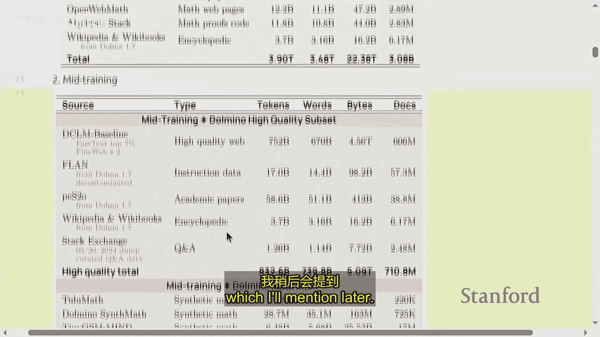

我想我们挺喜欢维基百科的，接着还有一些新的合成生成的数据集，不妨把GSM8K训练集也加进来，为何不呢，好的，那么大约有100一个训练标记，然后有一篇名为吐鲁的独立论文，他负责实际的训练后工作。

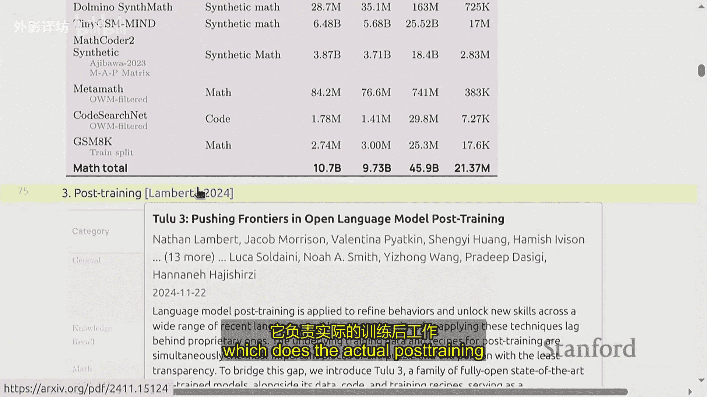

这里展示的是各类数据组合，所以基本上有来自不同来源的聊天数据，还有一堆用于涵盖不同方面的合成数据。

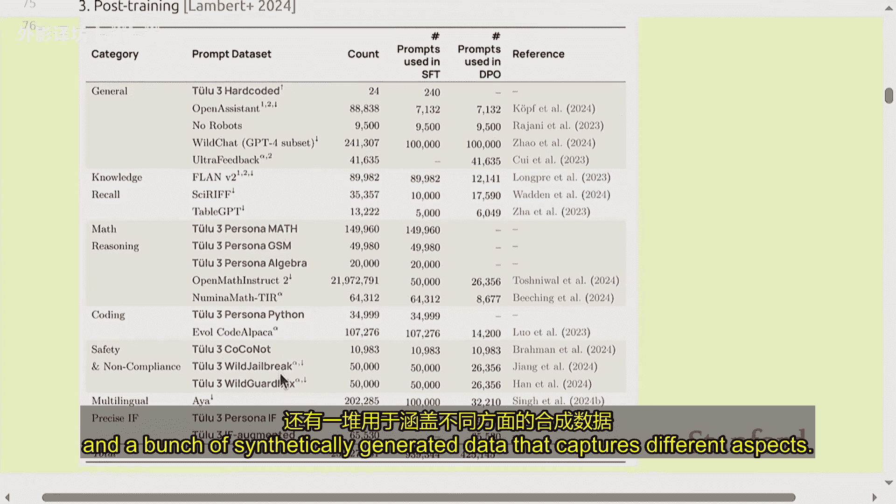

那么这些数据集都是啥，他们是如何被选取和处理的，所以为了不让你日后失望，先说明一下，我觉得并没有一个很好的，如你所想，并没有一个很好的形式主义或原则来决定这些事情，鉴于这门课的性质。

我想这或许并不那么令人意外，即便在架构方面，我们也没有什么像样的原则，但尤其在数据方面，我觉得数据很难交，毕竟交数据是什么意思呢，所以我将讲讲人们长期以来使用的各种数据集，讲讲它们的来源和一些特性。

希望你们能发挥归纳能力来找出什么样的数据是好的，什么样的数据不行的一些直观感受，好啦，那我先从预训练说起，接着再讲讲训练中期和后期的情况，不过大部分还是讲预训练，我得从2018年开始讲起。

这就是BT模型，你们有些人可能还记得，这课很重要，所以bird是基于书籍和维基百科训练出来的，那咱们就来深入讲讲这是什么意思，我觉得数据集常常没怎么被讨论，因为人们关注模型。

所以它没怎么被讨论以及评估和能力，有个叫smash words的网站，他于2008年问世，它允许任何人发布电子书，所以去年大概有50万本书。

那么在2015年有篇视觉语言论文其实抓取了smash words的数据，并创建了一个由零定价的自出版书籍构成的书籍语料库，于是他们弄到了7000本书，此后他就被撤下了，因为他违反了服务条款。

所以在2015年那时有点像蛮荒西部，人们不像现在这样重视人工智能版权，所以那就是图书语料库，要是你见过的话，这是个旧数据集，但我觉得他有点体现了某种延续下来的书籍的重要性，然后是维基百科。

人人都知道维基百科就图个乐，我们可以随便点一篇文章行，没问题，这是维基百科上的一篇随机文章，要是再点一下就会得到另一篇随机文章，好，我想这是印度尼西亚的一座随便跳的建筑，所以这个已经有20多年的历史了。

而且有很多用不同语言写的各类文章，我觉得明确讲一下维基百科是什么很重要，谢，所以它不包含任何原创观点，所以所有内容都源自，这就是为什么会引用实际的原始一手资料，所以不应该有观点或个人网页之类的东西。

而且它是基于知名度，这意味着必须有多个来源提及过他，所以我想这也能让你对维基百科的内容有所了解了，嗯嗯显然维基百科有很多有价值的内容，也许在一些琐碎内容里，维基百科里可没有这些。

而且还有很多可能有用的观点，维基百科里也没有，比如食谱就不在上面等等，所以任何人都能编辑内容，但实际上少数人贡献了大部分，所以这家伙有500万次编辑，我想他可能用了某种工具，维基百科就是这样一个网站。

现在每隔一段时间就会生成一个备份文件。

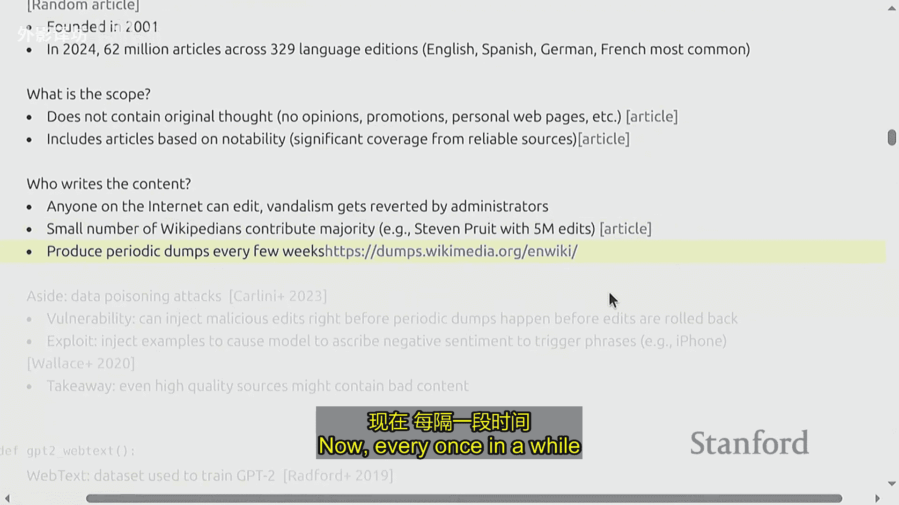

然后你就能去下载一个包含维基百科所有内容的压缩文件。

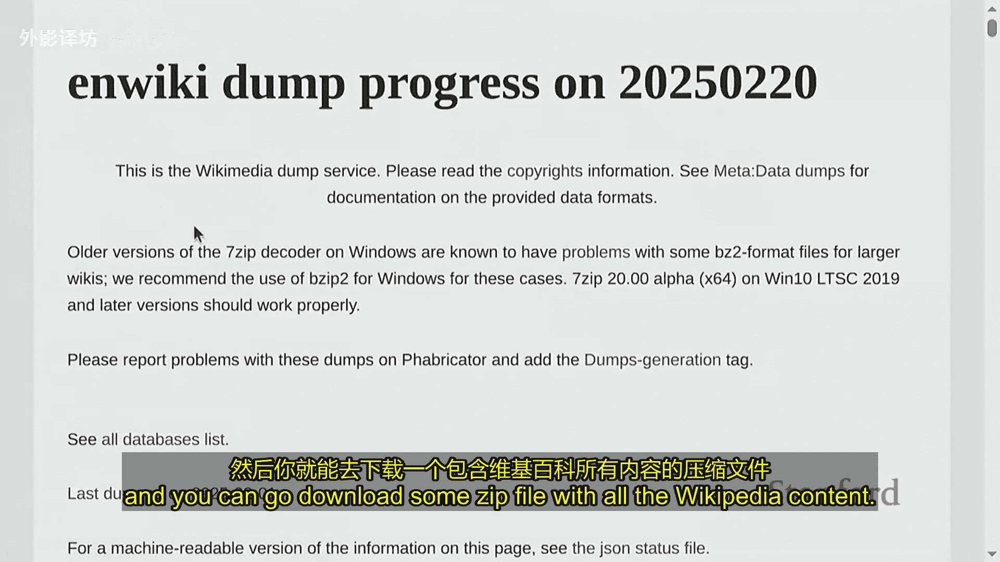

好的，这里顺便提一下，我们认为维基百科是高质量的信息来源，也许比一般网络文章更靠谱，但有件事大家都该知道，这与数据有关，叫数据中毒，所以大致的想法是这样，卡利尼取得了一系列出色的成果。

展示出一切是如何被破坏的，能表明你可以在定期转储前注入恶意编辑，所以你知道转储何时会发生，于是你进行这样的编辑注入，使其进入转储过程，但在编辑被回滚之前，所以如你所知，我觉得这挺巧妙的。

我们知道若能控制训练数据，那基本上就能得到模型，基于该训练数据训练出的模型，就能做各种事，比如将负面情绪归因于IPHONE这类触发阶段，所以对手可能会利用这个过程。

并向维基百科这类平台注入任何他们想要的内容，即便有回滚策略，所以我觉得从那以后，这已经有了一些修补，所以我觉得你无法真正利用这个，但总体来说，我觉得有必要认识到模型训练所使用的数据来自广阔的互联网。

在那里攻击者以及任何有各种动机的人，实际上有很大的控制权，对语言模型的行为，而且很难对这个过程进行监督，好的bar是经过训练的，这有点跑题了，但BD是根据书籍和维基百科训练的。

显然那时人们对语言模型的数据重读问题没那么关注，我觉得博尔看上去很老，但这是个相当大的转变，从基于文档而非句子的训练方式，与我们上周谈到的实义词基准形成对比，好那是2019年或2018年。

于是GBD2收集了一个名为web text的数据集，这里的想法是有网络，而且规模大，质量可能不高，我们如何快速获取一个多样且高质量的子集，所以关键在于，会有许多向外的链接，并且这些帖子可以获得积分。

那么为何不选取那些积分超过三分的帖子上的链接呢，这产生了800万个页面，40GB的文本，而那就是他们用来训练GPT2的数据，现在除了论文，他们并未发布，他们没有发布数据集。

一直以来都有公开复制常用于语言模型研究的网络文本的情况，好的，那么现在来谈谈通用网络爬虫，我希望到这结束的时候，每当有人跟你说，语言模型是通过互联网训练的，你可以指出并讲那是错的，那这是什么意思呢。

那么来谈谈通用网络爬虫，这或许是对互联网的一种学术性的大致描述，那么tom crow于2007年成立，每月他们都会进行一次网页抓取，所以在过去的17年里，大概进行了100次不同的网页抓取。

与语言监测相比，抓取本身其实没那么贵，你可以运行一些亚马逊云服务的机器，并能在不到两周内完成，所以上次抓取是在上个月，只是为了让大家了解一下这次抓取的情况，以下是一些统计数据，所以新增了约27亿个页面。

每次抓取进行100次，每次抓取的网页可能略有不同，但存在一些重叠，因为不清楚启发式方法是什么，但你可以想象那些变化很快的网站，他们会被多次抓取，还有那些变化不大的网站，他们被抓取的次数不多。

并且有明确的多样化，尝试简单讲讲爬虫，他们用的是开源库，其实是一组种子，网址数量还不少，所以并非单个网站就能爬遍全网，实际上有好几亿，还要维护一个队列，队列中有爬虫边界，然后一群机器据此边界开始爬取。

所以基本上你是在对网页进行广度优先搜索，但有很多系统并且要处理一些网站可能出现的，你在抓取时必须要稍微小心一点，所以存在要下载哪些页面的问题，你必须遵守robots点TXT，你不应该使服务器过载。

如果你已经爬取过一个网站，什么时候再回去爬取它呢，然后还有一个问题是网址是动态的，所以有些网址很长，多个网址可能会指向同一内容，从而导致大量重复，所以当通用爬虫进行抓取时，它会生成两种格式的数据。

一种是工作文件，这是你得到的原始HTTP响应，对于HTML页面通常是HTML格式，这个会被转换成一种名为white的文本格式，显然这是个有损过程，HTML转文本会丢失信息，需要注意的是，这并非唯一途径。

你可以使用他们的文本网页文件，或者你可以从原始HTML入手，然后自己动手做作业里有一些工具可用，你将尝试不同工具，或者至少自己进行HTML转文本操作，这确实会有影响。

那么这篇data cop lolm的论文我稍后会稍作讲解，做了这样一项对比分析，观察不同的HTML转文本转换器，并且使用原始网页文件的数据实际上低了四个百分点。

比如说比使用特拉法尔加托拉的数据整整低了四个百分点，好的，所以这里有一些基础细节啊啊关于通用网络爬虫，还有一点要说的是，他并非有意要全面爬取整个互联网，我认为他们政策的一部分是要温和礼貌一些。

比如说甚至不是所有维基百科文章都在通用网络爬虫里，好或许我在这停一下，以防大家对目前的数据有疑问，通用网络爬虫会自行过滤敏感内容吗，刘洪强，所以问题是，通用网络爬虫会自行过滤敏感内容吗，冒犯性内容。

对我觉得默认情况下他们很宽松，因为冒犯性内容的概念是否属于某种情况，这像是一个相当高层次的语义判断，所以通用爬虫中肯定存在大量冒犯性内容和有害内容，可能存在某种实时过滤，我是说有些网站可能完全违法。

可能会有一些黑名单，我不确定具体细节，是的，是的，所以问题是一个网站会被标记吗，当他们不想被收录时没错，答案是肯定的，是的，有办法，所以若一个网站能包含一个robots点TXT文件，它基本有一堆规则。

规定了允许哪些爬虫程序啊，若你查看robots点TXT，我们来，这就是robots点TXT，比如纽约时报对谷歌机器人是禁止访问的，它禁止很多内容，然后还有不同规则，你能看到所有你喜欢的大语言模型提供商。

原来这些人不全是语言模型开发者，但事实证明，大多数前沿模型提供商或开发者都有自己的网络爬虫，只是因为通用网络爬虫的覆盖范围其实挺小的，尽管它规模很大，但互联网很大。

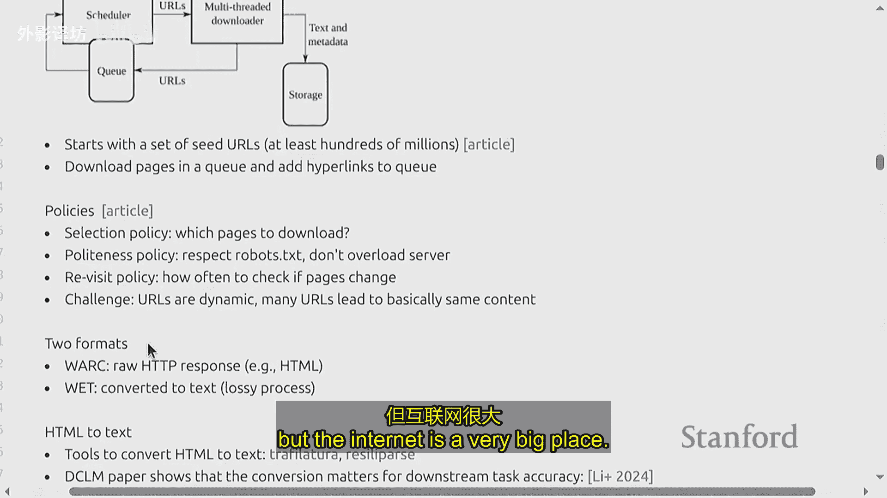

但没有正式方法能确保遵守机器人协议，他只是个指导，所以可能有些人并不遵守机器人协议，对在这接着网络爬虫如何处理切入的媒体或图像，我想那些会更偏技术些，所以问题是图像是怎么处理的，从技术角度讲。

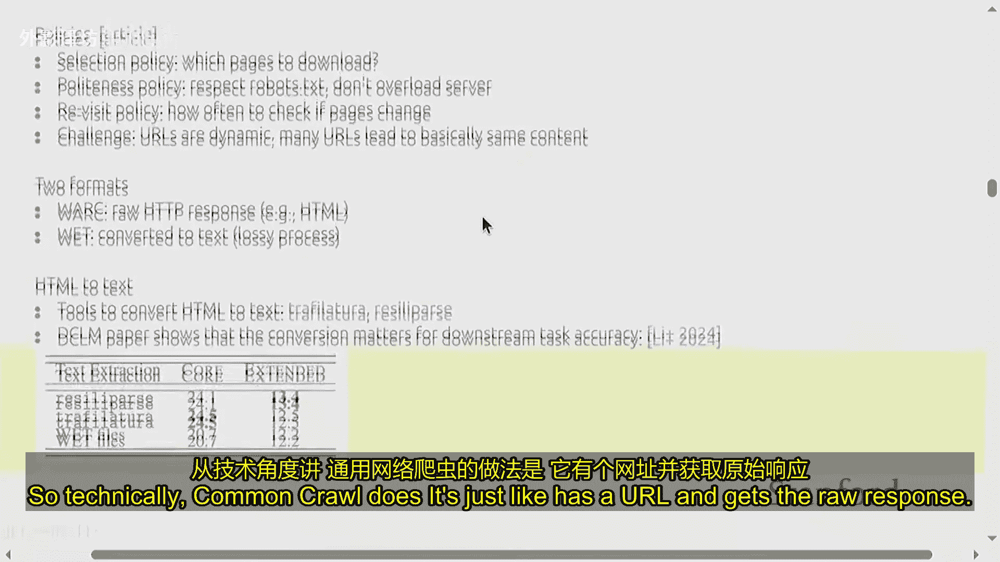

通用网络爬虫的做法是它有个网址并获取原始响应，所以有时响应是文本，有时则是图像，我觉得通用网络爬虫大多时候它有点偏向文本，因为但偶尔也会有其他内容，当然你可以开发专门抓取媒体内容的爬虫程序。

在那你知道通用网络爬虫的占比吗，或者其他可抓取的有版权的材料的占比情况，所以问题是通用网络爬虫里受版权保护的材料占比是多少，我稍后会讲版权问题，但我想说大部分都有版权，这是个复杂的话题。

所以我稍后会简单提一下，好嘞，咱接着往下讲，所以通用网络爬虫的数据量很大，而且我记得在课程第一天，我给你们讲过，要是只从通用网络爬虫里随机抽样，其实没啥用，所以有很多人尝试去筛选通用网络爬虫的数据。

最早的尝试之一是cc net，这是meta搞的，他们的想法是要一个能处理通用网络爬虫数据的通用程序，然后返回高质量的数据集，他们尤其关注多语言覆盖情况，于是他们采用了一系列启发式方法。

所以他们去除了重复项，他们进行语言识别，它本质上是一个线性分类器，仅保留目标语言的势力，无论是英语还是德语，接着这算是关键部分，即要在质量方面进行筛选，他们会依据五元语法模型查看类似维基百科的文档。

所以他们获取维基百科的文本，他们训练一个N元模型，然后他们用它来给文档评分，思路是利用维基百科，如你所见，它在一定程度上被用作高质量数据的替代品，使用它你能得到更多看似高质量的东西。

其中维基百科充当高质量的替身，正如我们讨论过的，维基百科显然无法涵盖所有方面，所以这也无法涵盖所有方面，所以他们当时训练了一批bird模型，而且他们表明这些模型比仅用维基百科训练表现更好。

而且cc net有时有点让人摸不着头脑，因为它既指那个工具，它是一种过滤功能，还指他们在论文里发布的数据集，好的与此同时，谷歌也在有所行动，所以他们发布了C4，他代表超大规模清理爬取语料库。

我想它有点类似，和你从通用爬虫中获得的见解类似，你想以某种方式利用这些海量文本，科林拉斐尔的这篇论文因引入T5模型而更出名，但他实际上引入了C4数据集，这是一项主要贡献，这是篇长论文，观察发现。

如我们之前所说，通用网络爬虫如我们之前所说，没有，其大部分在实际语言中没什么用，所以假设你从一个快照开始，那就已经有1。4万亿个次元了，他们决定只用启发式方法。

所以他们保留以标点结尾的形删除少于三句话的页面和脏话，你可以点击这个查看脏话，我不会在这里展示，他们删除花括号，挺有意思的，这明显删除了大量代码，我猜Python可能会被保留下来。

还有一些像样板文本的东西，而且他们只保留了英文，他们从中提取了大量的标记，所以还挺有意思的，你看这里的权衡点在于，cc net采用基于模型的过滤方法，使其看起来像维基百科，这完全基于规则。

所以这里的优势是有些句子看上去不像维基百科的内容，但却是格式正确的句子，最终会进入C4，另一方面，有些句子可能非常像垃圾内容，还有一些结构完整的句子可能会被归类到C4，所以还挺有意思的。

有这种互补的特性，如果你采用基于模型的方式，其效果取决于你筛选出能代表你所需内容的正面势力的能力，当你需要大量数据时，往往很难做到全面覆盖，原因在于，关键就在此，你想要获取大量的。

你首先要构建一个多样化的数据集。

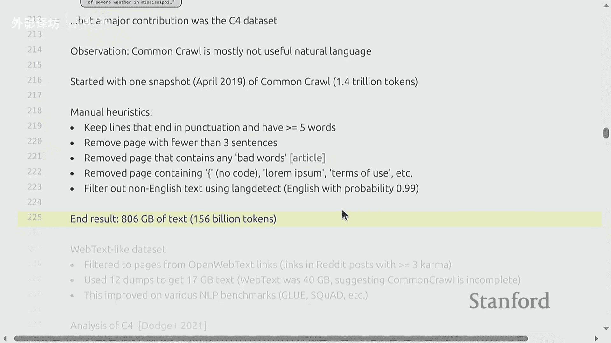

他们还创建了一个类似网页文本的数据集，从中提取开放网页文本链接中的页面，所以记住哈，开放网页文本就是对网页文本的公开复制版，用于训练GPT2，即便他们用了12次数据提取，他们只得到了17G的文字内容。

网页文本有40G大小，所以这表明通用网络爬虫的数据很不完整对吧，因为你获取了通用网络爬虫的全部数据，应用相同的筛选器得到了一个大约只有web text1半大小的东西，他基本上是在自行爬取。

这在当时对改进一系列自然语言处理基准测试很有用。

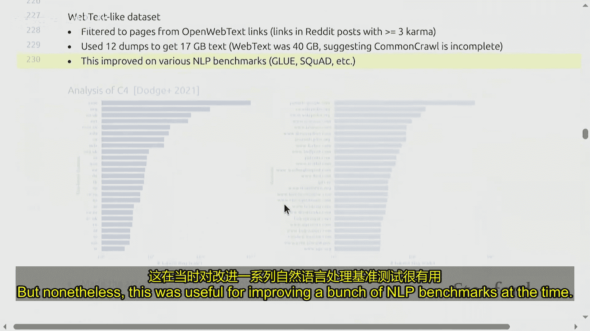

若你看现在回到C4，看看它的组成，你会看到有里面有维基百科，有很多专利新闻等等，好的好的，我们已经讨论了通用爬虫及不同的筛选方法，现在我们再讲讲，现在我们差不多进入GPT3时代了，有一堆模型。

还有数据集能让我们探讨些其他想法，那么GPT3数据集有经过处理的通用爬虫及网络文本，和gt2用的思路差不多，这个神秘的书籍语料库包括书籍一，书籍二以及维基百科，结果是我有大约4000亿个资源。

按现代标准，这数量其实挺少，但在当时相当可观，所以核心处理是他们进行训练，一个质量分类器，用于从其他内容里区分出网页文本，高质量网页数据，维基百科和书籍，所以基本上质量分类的思路是你要找出一堆正面事例。

然后你要在更大的集合里找更多类似的内容，所以这就是他们所认定的高质量内容，然后他们想获取更多此类内容，所以就是如此，所以紧接着就出现了大量，特别要提到的是，ELUDERAI是这样一个组织。

它是在GPT3以及一切都高度封闭的情况下兴起的，而且他们试图重现开源语言模型，这在很大程度上是一项由discord推动的去中心化志愿者活动，在其中每个人都只是投入他们认为高质量的数据。

于是他们精心筛选了22个优质领域。

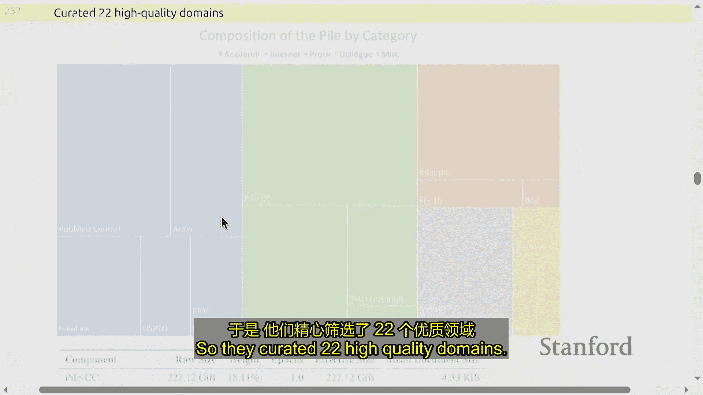

比如有通用爬虫，开放网络文本堆栈交换。

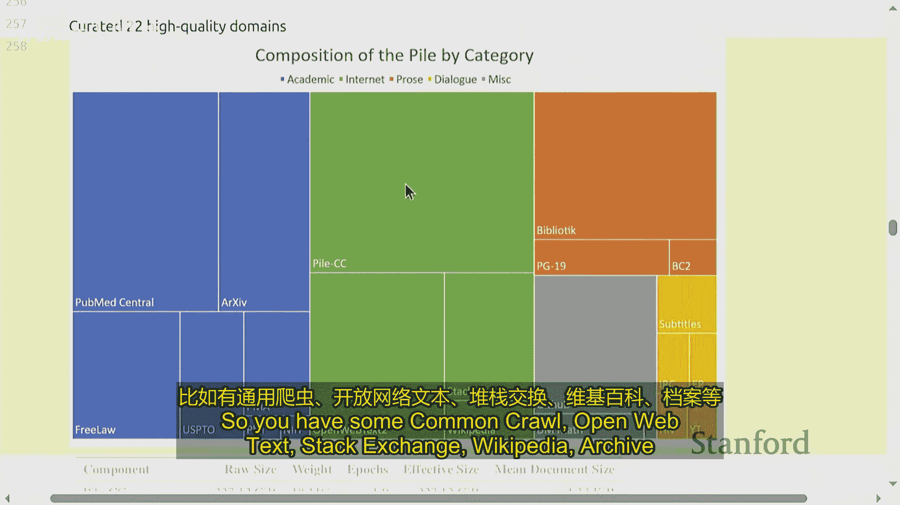

维基百科档案等等等，这里还有更多关于总体权重的统计数据。

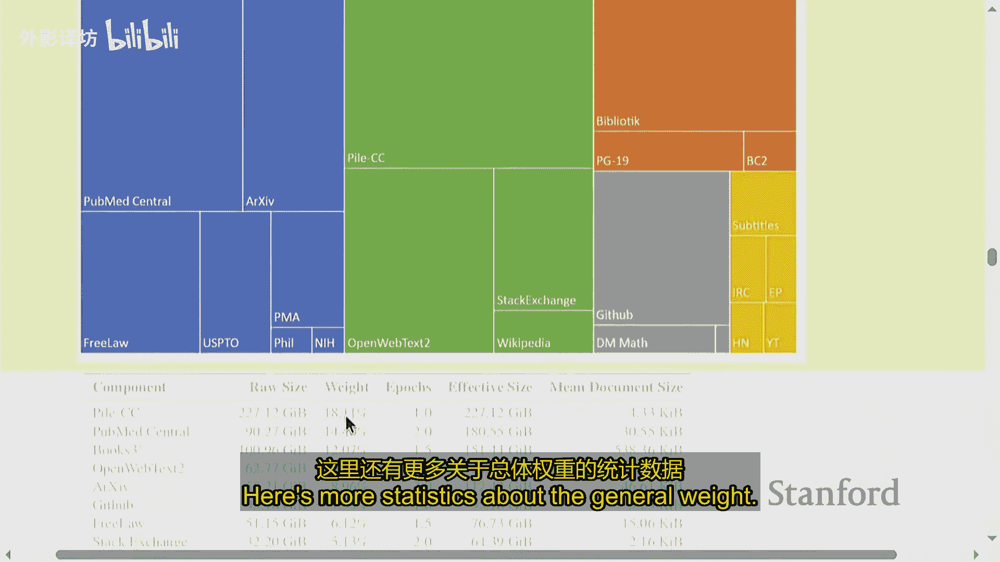

所以这依旧是若你观察一下，会发现相当多样，而且值得思考的是，从技术角度看，网络通用爬虫可能拥有这些内容中的大部分，假设你能够进行爬取，但通常你会看到人们会，算是不同类型的一种特殊情况。

例如他们想要获取更多维基百科的处理方式，不同或者数学的处理方式不同，所以如果你事先知道什么是好数据，那么你就可以直接去使用它。

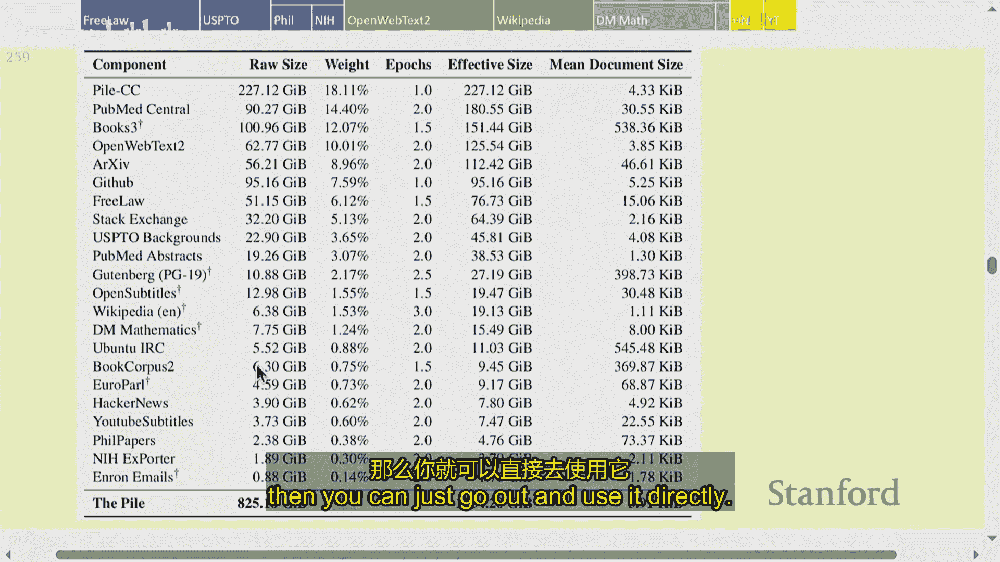

好的，实际上这些数据比GPT3训练所用的数据还要多，所以他们使用了，并且他们也注意到某种处理方式比另一种更好，所以他们使用了名为just text的不同工具来进行转换，所以有医学期刊数据库核心版。

有不少论文挺不错的，所以有规定，美国国立卫生研究院资助的工作必须，论文需开放获取，我觉得在人工智能方面，我们有点想当然，觉得资料会出现在档案库里，但很多其他领域并非如此，当然有档案库。

实际上还有安然公司的邮件，这是个旧数据集，这些是安然公司倒闭后通过传票获得的，这里面为啥有这个嗯，原来获取邮件数据集真挺难的，你能想到的，因为邮件是私人的，所以这真就是咱手头最好的了。

那你能想到可能会有偏差，对于基于此训练的语言模型的邮件知识而言，但这值得琢磨，行那咱直接看看一些不同来源，那么古登堡计划早在很久以前就启动了，里面大多是英文书，现在大约有7万5000册书。

而这里最大的吸引力在于这些书有版权许可，这大多意味着他们属于公共领域，我想自他出版已过去75年了，所以现在任何人都能自由使用它，不过我觉得里面有些书严格来讲不在公共领域，但也可以使用，有个数据集。

pg19即来自古登堡计划的书籍，这是一篇尝试在长文本语境下对语言模型进行基准测试的论文，所以书籍吸引人之处在于，与新闻文章甚至论文相比，书籍的上下文要长得多，没错，XAI的迅速崛起。

有没有可能是因为因为他们能利用挖掘推文数据来训练模型，而其他人工智能模型则无法做到，这意味着他们能更好地理解人类口语，所以从长远看就像谷歌那样，而X是唯一拥有的大公司。

能获取大量含自然语言的人类生成数据，是的，我认为总体问题是具体问题是ex是否有优势，因为他们能获取推文，例如这些大型平台中的任意一个，谷歌拥有YOUTUBE，原拥有脸书，所以公司在数据使用方面存在限制。

即便他们拥有这些数据，所以并非谷歌能用其所有数据训练，比如GMAIL之类的，我不这么认为，话虽如此，公司确实有显著优势，并能获取某些可能公开的特定数据类型，所以我觉得公开并不意味着任何人都能用它训练。

例如YOUTUBE是公开的，但谷歌能对其进行特殊访问，所以我觉得更宽泛的问题是，本质上能获取特殊数据的公司会赢吗，默认情况下答案是肯定的，因为我觉得数据算是关键因素，现在有意思的是。

ANTHROPIC有个相当不错的模型，而且他们没有我不知道的特殊秘密渠道，所以这并非全部，但随着时间推移，我觉得这是我的看法，我认为你可能会看到更多差异，随着公司利用自身资源，还会有更多专业化。

好这就是古登堡计划的第三批书籍，这个项目从影子图书馆产出了很多书籍，他收录了不少著名作家的书籍，此后因版权问题被下架，所以这是其中之一，关于影子图书馆，这里简单说一下，有不少不同的图书馆基本无视版权。

还绕过了付费墙，这基本违法，还出现了大量下架令以及诉讼之类的情况，但这些管控措施通常都会被规避掉，因为他们把这些放在不同国家的服务器上，而且支持者称，这让本就该免费的东西得以免费。

但显然法律的看法截然不同，特别是lib jen有400万册图书，数量可不少，相较于古登堡计划，其仅有75000本书，例如据透露，meta曾在lib gen上训练模型，为此还引发了一场大官司。

接下来stack exchange是多个网站的集合，其中最知名的是stack overflow，它起源于此，后来扩展到了数学，文学等其他领域，设有一些生育机制和徽章，已激励参与。

你们可能都用过stack overflow，所以我就不多说了，就当好玩，我喜欢经常看些随机的例子，好的，这里有一些这页面会给出随机的堆栈交换内容，所以我不知道这些是否有用，但这里有个问题和一些答案。

好的，所以我想这些大家都挺熟悉的，所以要注意，如果你看这类数据，他看起来真有点像个问答数据集对吧，所以这差不多就是你在实际应用中对指令跟随能力的期望，所以我想这里的教训是通过在网络数据上训练。

或在预训练中使用大量数据，其中很多只是文档，它们与用户在聊天机器人中输入的内容毫无相似之处，但预训练数据中有一些子集，他们看起来与用户输入的内容以及回复非常相似，这就是为什么界限有点模糊。

在预训练和后训练之间，stack exchange的妙处在于它还有原数据，比如评论和投票可用于筛选，还提供了数据转储，不过我觉得目前。

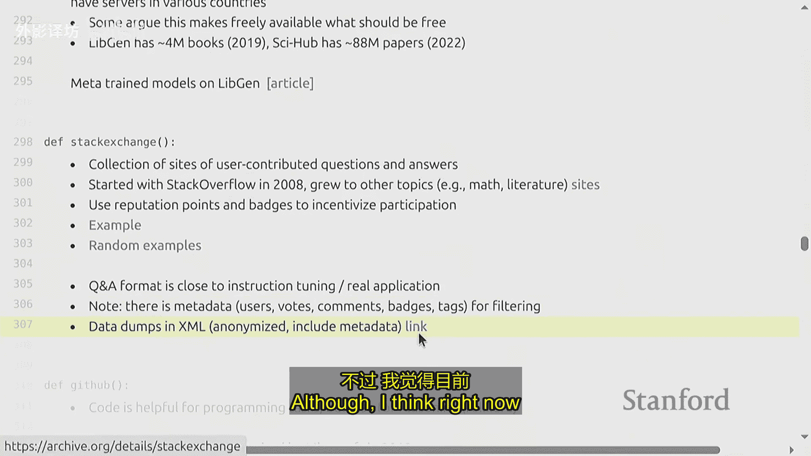

非商业使用没问题。

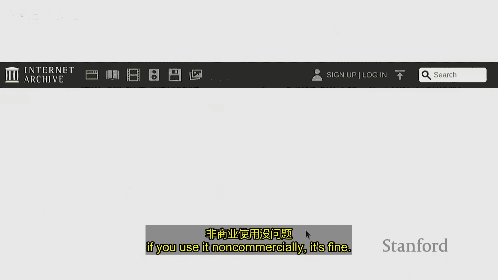

但如果你是商业机构，那就得花钱买许可证。

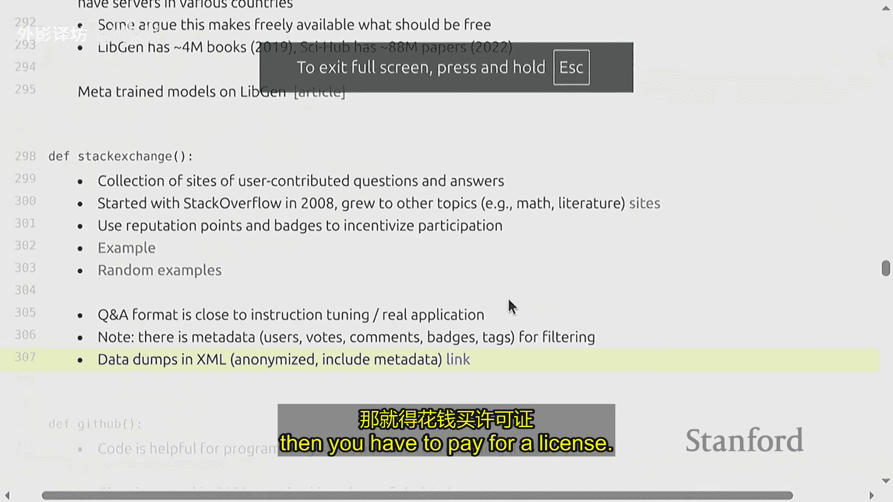

所以在大家都熟知的GITHUB上，我觉得，获取语言模型训练代码的主要途径，当然代码一般对编程有帮助，但我觉得他也被认为有助于推理及其他能力，不过我不知道有没有论文能让这更严谨些。

所以这里有个随机的GITHUB行吧，也许这不行，没事，要是有个随机的GITHUB仓库，以前是行得通的，我这么做的原因是，我觉得你访问的GITHUB仓库，而你访问的维基百科页面显然并非具有代表性的样本。

通过随机取样，它能让你知道这个数据集中实际都有啥，所以当你看到像GITHUB有好几百万个仓库这样的数字时，并非所有仓库都一样，一个随机的仓库可能会让人失望哟，好啦，有2800万个公共仓库。

还有件有意思的事，就是GITHUB，啥是仓库，它是个目录，一部分是代码，一部分不是代码，还有关于问题的一些概念，还有提交历史和其他诸如此类的东西，而且还有很多重复项，所以为了利用GITHUB。

它包含所有这些原始数据，并将其变成可训练的标记，实际上需要做很多工作来思考，如何才能最好地做到这一点，所以github archive是已发生的所有GITHUB事件的快照，你可以使用谷歌大查询来访问它。

所以这个堆栈是个项目，幸运的是，他基于GITHUB生成了此开源代码版本，所以他们从github archive获取了所有仓库名称，并克隆了137个仓库，只保留许可协议，宽松的去除重复项，结果得到3。

1太字节的代码，所以代码的美妙之处在于，通常如此，但不总是与网页相比，许可证更清晰，而在网页上许可证几乎从不明确，所以想想看，你会看到有实时服务，有个网站叫GITHUB，你每天都要去，然后还有个快照。

他会给你一些原始数据，然后经过处理将其变成实际可用的训练数据集，所以当有人来找你说我在GITHUB上训练，那你就得去问他们，那到底是什么意思，采取了哪些预处理步骤，好的，所以那就是那一堆数据。

虽说我可能有点随性了，然后就扯到那一堆数据的不同组成部分了，那么现在继续，所以现在到了2021年，于是DeepMind也崭露头角，他们训练的首个大语言模型是基于这个海量文本数据集的golf。

也就是说golf模型其实并不怎么样，不过这篇论文对数据集的描述很到位，如此一来，海量文本涵盖了海量网页，稍后我会详细讲讲，其中包括C4，还有书籍新闻，GITHUB以及维基百科，关于这些内容的处理方式。

文中并未给出详细说明，正如我之前所说，显然这是无法重现的，还好你在GITHUB上训练，但数据到底是怎么处理的呢，对于海量网络内容，你保留了英文，同样在这里，就像cc net。

他们使用基于人工规则的质量筛选器，并且他们有规则，你会在作业中实现这些规则，这些规则会检查，比如80%的单词必须至少包含一个字母，他们还利用谷歌安全搜索进行有害内容过滤。

我想在那时使用手动规则的一个主要原因是你不想对模型有偏见，因为，它们能运行的模型都很弱，而且若模型并不能真正理解页面内容，而且他们可能会有相当严重的偏差，还有一个考虑，这种过滤会滤掉一些边缘化的。

来自一些与维基百科不太一样的边缘化群体的数据，但稍后你会看到这种情况已经反转，现在大家都在进行基于模型的筛选，好他们的数据即有时态字节文本，我猜大概，比如说五四或5万亿个资源，只是估算。

尽管golf仅在3000亿个资源上，训练资源数量并不多，我想是一样的，也许和GP3的数量差不多，所以在2022年我们有了拉马，所以lama的数据集是借助cc net，通过通用网络爬虫获取的。

而此处的分类器这里有个微妙之处，记住GPT3是依据其是否类似维基百科页面来分类的，lama是基于能进行预测的分类器进行训练的，你是否像是一个被维基百科引用的页面，我猜其想法是，维基百科会引用高质量页面。

而且这些页面大多可能不像维基百科文章，但仍是高质量的，同样这种链接结构我们在GPT2网络文本中看到的情况，在这里似乎也有所体现，他们还纳入了C4，为何不可，他们使用了GITHUB。

他们采用了宽松的许可协议，并依据一些手动规则进行筛选，维基百科古登堡计划以及box3，这给他们惹来了不少麻烦，还有你懂得archive sc交换，所以他们获得了1。2万亿个标记。

所以他们并未发布该数据集，而是共同在名为red pajama的项目里重现了该数据集，现在你可以前往，而且你拥有数据处理代码及数据，你能够将其提取出来，所以这是一次重现，所以这显然并非最优方案。

然后CERABUS又进行了进一步去虫，最终得到了一个拥有6270亿个参数的子集，还有rap cha VR，这有点让人困惑，因为这是另一回事，这实际上是在获取通用网络爬虫的快照。

并生成包含各种不同质量信号的30万亿个标记，所以这是一个用于开展研究的资源，如何基于计算出的质量信号进行筛选好的，那就是拉玛，然后精炼网络是另一篇论文，这里的论点是还记得我们看到那个数据集的时候吗。

有网络数据，还有其他各类东西，他们的观点是嗯，也许我们把网络数据筛选的够好，那就是你所需的，毕竟从技术层面讲，从某种意义上讲，互联网无所不有，仔细想想，若能用电脑访问他，且已连上互联网，那或许就够了。

于是经过提炼的网络来看看，你想不想在这瞅瞅一些例子，数据存于hocking face平台，它大概是长这样好，这个分辨率可能不够大，算了放弃，他们用TRAFFIORA提取内容，如我们所说。

TRAFERTORA比直接用common crow提供的网页文件更好，他们采用了golf规则，而且他们特意我们要避免基于机器学习的过滤，以防偏差，接着他们进行了模糊去重处理好的。

他们拥有一个包含5万亿个标记的数据集，该数据集规模相当大，但他们仅发布了其中的6000亿美元的数据，hocking face的find web最初是对refined web的复制，但他们试图加以改进。

所以当时他们使用了所有通用网络爬虫数据转储，并进行了筛选，同样这仍采用手动规则，未进行基于模型的筛选，他们还进行了去重集基本的匿名处理，于是他们从中获取了15万亿个标记。

所以我觉得这仍是个相当不错的数据集，因为处理通用网络爬取数据会很麻烦，但这有点类似于一个我会将find web视为一个经过轻度过滤的数据集，你可以在此基础上进一步开展基于模型的过滤，好的。

那么接着说AI2有一系列名为欧姆的模型，其初始模型是在DA数据集上训练的，这就是其构成情况，所以我们有通用爬虫，我们有这个堆栈，就是我们之前谈过的，有代码C4，还有红底网，羽翼学者。

我觉得这个是从那个衍生来的，古登堡计划和维基百科，你懂的，所以红迪网来自这个项目，但他们把提交内容和评论大致分开收录，所以你没有这种分散结构，我觉得这个项目我不知道他是否还，我猜它已经不存在了。

所以我想大概在2023年左右，所有像stack exchange和REDDIT这样的网站都意识到等等，人们只是在拿走我们的数据，利用这些数据训练模型，然后从中获利，所以我认为那种情况就此停止了。

所以我们有来自semantic scholar的4000万篇学术论文，他会抓取很多不同的网站，然后就是我们熟悉的那些数据来源，所以通用网络爬虫处理相当标准啊，于是他们通过语言识别，仅保留英文部分。

并进行质量筛选，同样在DA里为训练初始模型，他们未采用基于模型的过滤方式，接着是有害内容过滤，此处他们运用了分类工具，随后他们进行了重复数据去除，如此一来从中产出了3万亿个单元嗯。

同年也就是去年有篇关于数据对比的论文，它是由多个不同组织合作完成的，他们首先要做的是本质上定义一个创建数据集的竞赛，于是他们想要建立基本设施，并定义了一个标准数据集。

你可以再次尝试各种不同的数据处理算法，所以他们对common crow进行了处理，通过处理所有数据转储来生成DCLM值，即包含240万亿个资源，所以这有大量资源，但如你所知。

一般来说common crow的质量并非最高，所以她会被大量筛选，有一套特定的方法来筛选该数据集，即从DCLM池筛选到DCLM极限，在这里他们大力使用质量过滤器，所以它看起来是这样的。

他们进行了一些基于规则的筛选，都是些基本操作，接下来有趣的事是，他们采用了这个快速修复过滤器，将DCLM池筛选到DCLM极限，所以我猜他们只保留了总数据集的1。4%，好的。

那么他们针对这种基于模型的筛选做了什么呢，再一次在质量过滤方面需定义正例反例及训练分类器，所以正力源自两个来源，存在一个open hermes数据集，所以这主要是由GPT4生成的指令性数据。

所以这挺有意思的，他们实际上是在用指令数据精心挑选预训练数据，所以现在他们并未明确针对指令数据进行训练，但他们在寻找类似指定数据的数据，接着是依赖五，也就是那个叫依赖五的子板块。

他像对小孩子一样问我问题，这就是我猜的数据集的样子，好吧，前两局就急着进攻，有啥意义呢，好的，所以这些差不多就是你可能会问聊天机器人的问题，比如，负面势力是从精炼网页中采样来的。

也就是说它不是低质量数据，但它不像其他两个来源那样经过精心筛选，所以结果是他们采用了DCLM机械，有240万亿个词源，并将其减至3。8万亿个词源，这仍有相当大的数量，于是他们训练了一个快速文本分类器。

并在整个DC l m语料库上运行，这是其中一个结果表，那么这里的基准测试，我们的核心包括一系列标准语言建模，比如hello swag等基准测试，并且他们表明使用这个分类器。

他们的表现比优化后的网络高3%，在其他方面也高100%分之二，所以这就是模型，这是他们用于创建DCLM基线的过程，然后基于此训练出一个相当不错的模型，值得注意的是，在此之后。

第二个欧盟模型如果你还记得的话，他们也开始在DCLM机线上训练，所以我认为我们将迎来一个公正的时代，并尽量不使用模型造成偏差，我觉得这在很大程度上已经不存在了，因为我觉得人们意识到。

如果你在循环中使用模型，你就能更好地获取高质量数据，至少在提高基准分数上，好那我要讲的最后一个预训练数据集是nemetron cc，所以这个出自英伟达，英伟达一直在开展训练NUTRO模型的工作。

不过最近他们在进行训练后处理和数据整理，所以他们的主要论点是DCLM，基线是个很棒的数据集，但他的筛选很严格，记住他从240万亿个资源一路筛选到了3。8万亿个资源，如果你想训练更多，训练更大的模型。

训练时间更长，由于这种严格的筛选，你需要更多资源，3。8万亿真的不足以维持，比如说像一个4000亿模型的训练运行，所以他们首先做的事，有趣的是，他们意识到他们对从HTML到文本进行了消融实验。

而是不仅仅基于质量，而是取决于剩余的资源数量，所以他们是想保留词源，而非丢弃，结果是与traffic tora相比，just text能保留更多词源，所以他们选用了just text。

接着他们采用了一系列不同技术进行质量筛选，他们促使其巨大的线虫模型根据教育价值对文档进行评分，以便融入一个更快的模型，并用此进行训练，所以这是一个过滤器，它基于语言模型对教育价值的判断。

他们还使用了DCLM分类器，其集成方式颇为有趣，他们大致运行了所有这些分类器，并查看他们给分数分类的情况，然后他们从每个分类区间中抽取了一批数据集，所以不只是选取排名最靠前的那些。

因为我觉得他们是想确保他们能很好地涵盖不同专家，对质量概念的各种观点，他们还做了件挺有意思的事，他们用语言模型不仅来过滤，还能改写数据集，所以对于高质量数据集，这就反了，那么低质量数据集。

他们基本用语言模型把它改写成质量更高的样子，所以显然那里可能有错，但总体而言，也许这并不比用低质量网络数据训练差，而对于高质量数据集，他们利用语言模型生成任务，类似任务的东西，那么你找一篇维基百科文章。

你让语言模型创建输入输出队，输入可能是个问题，输出则是答案或者输入是总结，这份文档输出就是总结或者输入是提取关键信息，输出就是关键信息，所以这又是为了说明，最终在指令微调时，我们要能够遵照指令。

那咱们不妨就开始在这事上抢个先，所以他们从中得到了6。3万亿个资源，比3万一个次元还多，几乎翻了一番，我想这还挺不错的，毕竟这些全都来自common crow，但他们基本上能将其规模翻倍，虽说没到两倍。

但也差不多了，供参考，la马三是在15万亿数据上训练的，Q a n3，基于36万亿数据训练，其中包括多模态数据，我认为所以此时6。3万亿不算多，但对有数据集的开源模型而言相当不错，和我们大多数人一样。

6。3万亿用于训练绰绰有余，甚至构做一个轮次，这张表基本表明，平均来看，他们表明其never tron cc数据比DCLM数据好，至少在基准测试中，它比find web好。

接着他们还有一个多达1万亿的高质量子集，而且这个子集更出色，好啦在我继续讲之前，大家有问题吗，我知道这里涉及了很多关于不同数据及模型的随机具体细节，但希望这能让大家对这类事情有所了解。

并且希望大家能大致了解不同的模式以及是否使用模型进行筛选，即你是使用优质页面中的链接，还是直接使用页面本身，等等，所以聊聊英文数据集，我在想通用爬虫是否仍包含多语言数据集，没错有道理。

所以问题是多语言数据集的情况如何，我主要关注英文方面，因为主要的研究都在这方面，大量研究都基于此，但显然通用爬虫确实包含多语言数据，也会生成多语言数据集，好鉴于时间关系，我接着讲版权问题。

所以这是一个早期提出的问题，网络中有多少内容受版权保护，那么让我们来了解一下版权究竟是怎么回事，所以如今围绕通用人工智能有很多诉讼，大多涉及版权问题，一般而言，版权法隶属于知识产权法。

这里的目标是激励知识产品创作，这就是版权法存在的缘由，而且有多种类型，如版权，专利，商标和商业秘密，所以版权法与训练数据最为相关，这要追溯到18世纪的英国，但在美国，自1976年起便有了版权法。

它从本质上确立了版权的定义，这正是适用于以有形形式表现的原创作品，这是原创作品，所以如果你他只是个集合，它不受版权保护，比如电话簿，除非在其选择或编排上有创意，否则不受版权保护，所以版权仅适用于表达。

而非想法，所以算法无法获得版权代码，可获得版权，还有一件事是这样的，以前他是这样的，版权仅适用于必须出版的内容，而现在是一种更宽松的固定观念，总体来说版权范围有所扩大，版权无需注册，所以这与专利不同。

要是你发明的东西却没去注册，那你就无权拥有它，而版权是你产出了某样东西，然后把它发到你网站上，它就受版权保护了，即便你没明确取声明版权，但有一点，创作者要起诉他人侵犯版权，得先完成注册。

但注册门槛只需65美元，不像专利，专利的注册门槛可能要数千美元，他现在有效期是75年，然后版权变回到期并成为公共领域的一部分，所以所有经典作品以及大部分古登堡计划的内容都已不受版权保护。

那么或许人们没有意识到的是，是，互联网上大多数东西实际上都受版权保护，所以某样东西是否受版权保护并非关键所在，所以关键在于你能否使用它，有两种使用它的途径，你可以要么为其获取许可，要么诉诸合理使用条款。

所以要是你打算走授权这条路，你可以去签一份合同，和创作者签个许可，在某些条件下使用这些数据，比如这基本上就是的情况，谷歌和REDDIT就是这种关系，实际上许可协议是说别告我。

有一种特殊的许可叫知识共享许可，他允许免费分发售版权保护的作品，所以知识共享的所有内容仍受版权保护，你只需拥有一种许可，这能让他表现的如同处于公共领域，所以很多东西比如维基百科，都采用知识共享许可。

很多YOUTUBE视频也是知识共享的，我猜这大概是在20年前创建，本质是为了弥合公共领域与版权间的差距，其理念是让人们无需等75年就能使用这些东西，有些情况下，创作者确实乐意人们使用他们的内容。

但大多数时候情况并不明晰，因为他们没说行或不行，所以现在许多模型开发者会为训练基础模型而授权数据使用，OpenAI和SHUTTERSTOCK，OpenAI和stack exchange等等行。

所以如果你有钱，你就去弄个许可啊，要是你没有，那我猜你得说自己是个穷书生，然后说不定他们会让你用，嗯好吧，所以问题是，如果你你无法获得使用互联网的许可，对啊，比如你去了个随便的网站，该找谁呢。

比如你都不知道该和谁说，所以你合法使用它的唯一办法就是诉诸合理使用原则，所以合理使用原则基本上是说，即使某样东西有版权，而你又没有许可证，在某些条件下，你仍可使用使用条件，取决于使用目的和特性。

比如说你用于教育而非商业用途，或者你对作品进行了某种改编，而不只是复制，然后放在你网站上，还假装是自己的，这对你有帮助，作品是什么样的，如果是虚构作品，更有可能是实际上如果是纪实作品。

更有可能构成合理使用，比如电话簿，你无法真正为其申请版权，更贴近事实的内容，如果你只使用其中一小部分，那么更有可能构成版权合理使用，不过这对语言模型不太适用，因为你可能想使用全部内容训练。

而非仅一小部分以及对市场的影响，所以比如你使用该作品，若本质上是为了取代创作者，那么这样做就不太会被看好，比起用该作品去做些完全不同的事，所以如果你看一部电影，然后写个总结，这算合理使用。

要是你重新实现这个想法也行，关于谷歌图书是否构成合理使用，有长达10年的激烈争论，当他展示片段时，这是否算合理使用，最终判定谷歌胜诉，同样值得注意的是，版权并非仅仅关乎逐次照搬。

原来情节和角色是可受版权保护的，所以即便你记忆痕迹的重合度极低，但你取用了哈利波特这个角色，并对其进行了实质性拓展，那这就是侵权，可能侵犯版权，但另一方面，若你进行恶搞，则可能属于合理使用。

所以这些情况颇为微妙，而且版权完全在于语义，还有经济因素以及内容类型，所以这是个极为复杂的话题，那么训练方面呢，那么一点是关于版权，你懂的，复制就体现在版权这个概念里，所以哪怕是训练的第一步。

你就在复制数据，从技术层面讲就已然构成侵权，即便你不对其做任何处理，你可以像很多人那样争辩，训练机器学习模型具有变革性，因为这绝不仅仅是复制粘贴那么简单，我想这确实让带有开放数据的开源模型颇具挑战。

因为如果你要训练一个模型，而且你还想向他人展示并托管自己的数据，这可能会涉及版权问题，人们也认为，机器学习系统关注的是思想而非表达形式，你在训练所有这些数据，因为你在尝试提取语言的运作方式。

以及一般知识，而非针对某一特定作品的兴趣，但当然关于学习算法，不好意思，这些模型常常能记忆，而且你能很容易地从这些模型中提取训练数据，而且还有个问题，即语言模型无论版权情况如何，都肯定会影响市场，好的。

我想另一点要注意的是，即便你有许可证，如果你能就某一特定作品主张合理使用，但由于使用条款，你仍可能无法合法获取数据，例如YOUTUBE上有很多知识共享视频，但是如果你编写一个脚本。

从YOUTUBE上下载你的视频，这是违反YOUTUBE服务条款的，所以这些平台还有另一个限制，而且有一些作品你可以稍后再了解，好的，那么为了节省时间，我快速继续，所以这部分会稍微短一点。

而且我把训练中和训练后的内容合并在一起了，因为界限往往不是很清晰，现在我们通常考虑的是质量不那么高，而是专注于如何培养特定的能力，尽管即使在预训练阶段，我们就已经在考虑质量分类器和高质量了。

所以界限还是不太清晰，所以我认为，这堂课还没怎么讲过的，就是长上下文，看看那些顶级模型，他们有不少上下文信息，我觉得GEMINI还是有，我想LAMYF4可能宣称有1000万的上下文，但上下文长度挺大的。

而且transformer会随着序列长度乘二次方扩展，我是说我们在推理讲座里看到你能解决这个，但我觉得你还是得充分留意才能得到最佳结果，嗯显然你不会想在训练一时就使用长上下文，所以人们会在后面添加它。

这就是长上下文扩展常在训练中期出现的原因，因为如果模型欠佳，就不想在长上下文上浪费训练周期，所以有多种方法能做到这一点，但既然这是一场数据讲座，我会讲讲书籍和数学，适用于上下文扩展的两个来源。

基本上关于上下文扩展，你只需创建具有长城依赖关系的数据，而且部分数据也能够被合成，所以人们也会关注任务，所以有一系列工作本质上是对传统自然语言处理，基准进行转换，形成一种可用于微调的标准格式。

所以超自然指令就是这样一个数据集，借助他社区得以聚集，并创建了1600个任务，而且他们被标准化成了一个提示，flag大约是在同一年出现的，他在2022年问世，但论文发表于2023年。

所以2022年是这样一年，我们把所有自然语言处理任务整合一下，所以我觉得这一点好处是，现在你有了一个能解决所有心仪自然语言处理任务的语言模型，而且你能从迁移学习中获益，这在很大程度上是对回归T5的思考。

但这样做有个问题，就是你用的提示往往很模板化，如果你看看那些超自然指令，有些并非超自然的，因为他们看起来都差不多，所以这在一定程度上推动了这些遵循指令的数据集，自2022年以来就有了这样一种期望。

语言模型应该能够回答任何一次性任务，你交给他的，所以甚至任务的概念在某种程度上不复存在了，所以开源社区的很多工作都是基于以羊驼模型为首的合成数据嗯，他运用自我指导的概念来促使语言模型生成示例。

随后可用于微调，NVQA模型使用了用户在共享PPT上分享的这些对话，他现已过时，现在可让语言模型借助一些问题进行自我对话，并生成一些合成数据，而且你还可采用EV o l instruct方法。

该方法本质上是获取问题并使其更复杂，还有其他获取方式，这个采用通用网络爬虫，接着用它去查找并识别问答网站，然后利用语言模型提取问答对，接着是open hermes，我们之前在DCLM工作中见过。

它只是不同数据集的聚合，Lamar chat，我们不清楚确切的数据集是啥，但他们让标注人员编写高质量的指令数据，他们在论文中称，这比使用开放数据集中的数百万个势力更好，但他们本可以通过减少注释。

更多采用类似基于人类反馈的强化学习，来节省更多钱，稍后再谈，最后我要提到的最后一个数据集是最近刚发布的，那么lamy name metron训练后的数据由一堆组成，关于这个数据集没多少细节。

但这个数据集确实，所以你可以去看看他们有像wild chp这样的公共数据集，然后他们从所有能生成数据的模型中综合生成了一些数据，由于R1它们还包含推理痕迹，因此若查看此数据，你可以大致将其分成几类。

其一许多早期工作指示即存在GPT4，这是生成合成数据最简单的方法，问题在于对学术研究而言，这没问题，但使用GPT4创建数据集，违反了OpenAI的条款，然后你可以训练一个竞争模型。

而这些开放权重模型的许可更为宽松，这意味着你基本上可以从中提取内容，并随心所欲地使用，lama可能会受到一些限制，但大致来说我认为他们比OPENAI的许可更宽松，最后如果你真的担心。

那么你实际上可以雇佣注释源来创建高质量的指令，这显然更费钱，速度也更慢，而且还有这样的顾虑，注视者可能会用GPT4来创建数据，所以在这方面得留意好了，总结一下，关键是数据不会凭空而来。

得下功夫才能拿到数据，要知道在现实世界中有像GITHUB这样的在线服务对吧，首先得用起来，先获取一份原始数据，但不能直接用原始数据训练，数据量太大了或者太嘈杂，甚至连资源都没有，通常得处理一下。

而这就是很多启发式方法发挥作用的地方，我们之前看到的质量过滤和去重方法适用于此，前面稍有提及，数据是区分语言模型的关键因素，我认为所有语言模型架构都有一些变换器专家混合模型风格。

我觉得很大程度上这些架构都挺通用的，所以他们的行为不会有太大不同，真正决定质量的是数据，只要你能训练并拟合这些数据，这里存在一些法律和伦理方面的问题，我们谈到了版权问题，但这里面的门道可多了去了。

最后如果你觉得整个这个领域一团糟，那你没说错，他很有启发性，这意味着有很多机会可以改进好了。

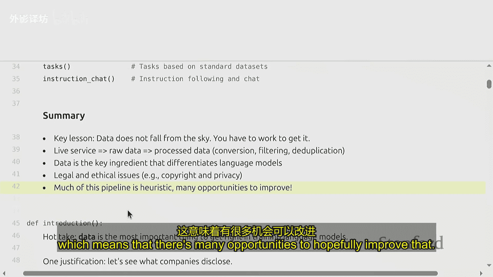

就这样。

