# 【中文配音】硬核！斯坦福 CS336：手把手带你从零构建 ChatGPT - P14：Lecture 14： 数据2-Data 2 - 外影译坊 - BV1BWEWzfEKi

所以这是关于数据的第二讲，再上一讲，我们讨论了，用于训练各类语言模型的不同数据集，我们大致梳理了一下历史，从用于训练bird的那些数据集说起，一直到homo以及其间的种种，我想强调的一点是。

数据可不是天上掉下来的，它常常存在于实际应用场景中，得专门去抓取或导出它们，接着会有一系列处理要进行处理过程，包含将原始HTML转换成文本，进行各种质量及语言方面的以及毒性过滤，去虫等，那么在这堂课。

我想深入探究质量过滤和去重是如何运作的，尤其是那么首先我们来看看不同的过滤算法，这些算法大多基于模型，所以要训练一个分类器或序列，某种模型来进行筛选，接着我们要展示这个基本方法。

可用于各种不同类型的筛选，最后我们会看看一些去重算法，那么这堂课会有点不一样，体现在他将重点关注，一些经典的大数据处理算法，而且对你们有些人来说，里面会有一些有趣的数学知识，好啦，那我们开始讲筛选算法。

所以这里的基本概况是，你被给予的一些目标数据。

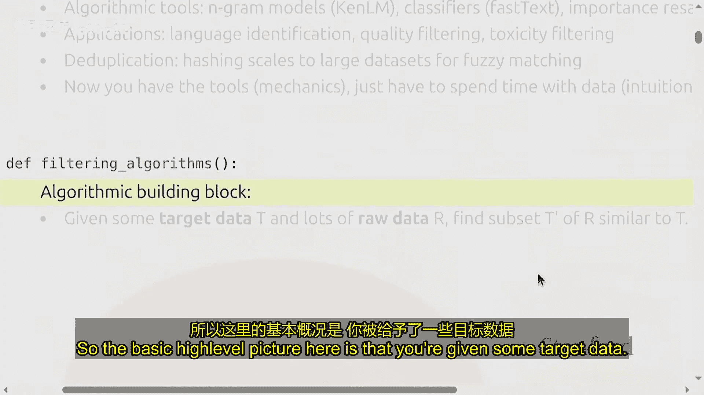

而且这类高质量数据你拥有的并不多，并且你有大量原始数据，所以想象这是通用爬虫数据，而你的目标是找到该原始数据的一个子集。

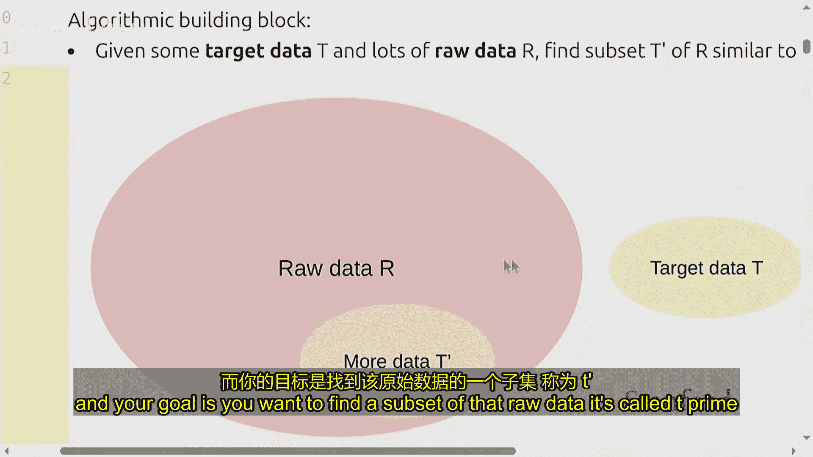

称为T，它与T相似对吧。

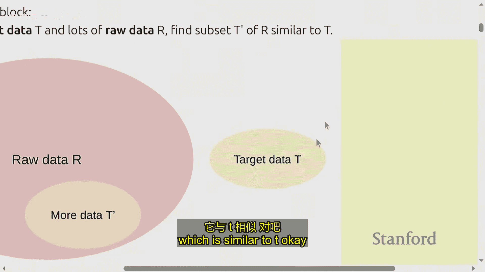

所以这是一种你在任何过滤流程中，都应能识别出的模式。

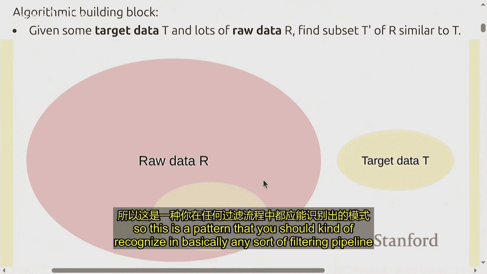

那么对于这个过滤算法你有何要求，显然你想要它基于T进行泛化。

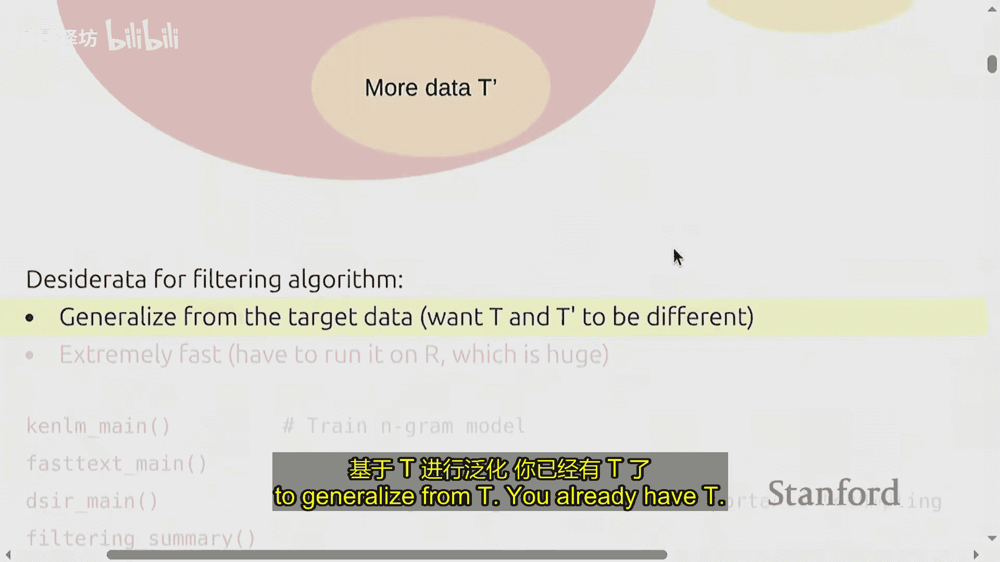

你已经有T了，所以在获取完全一样的数据T就没意义了。

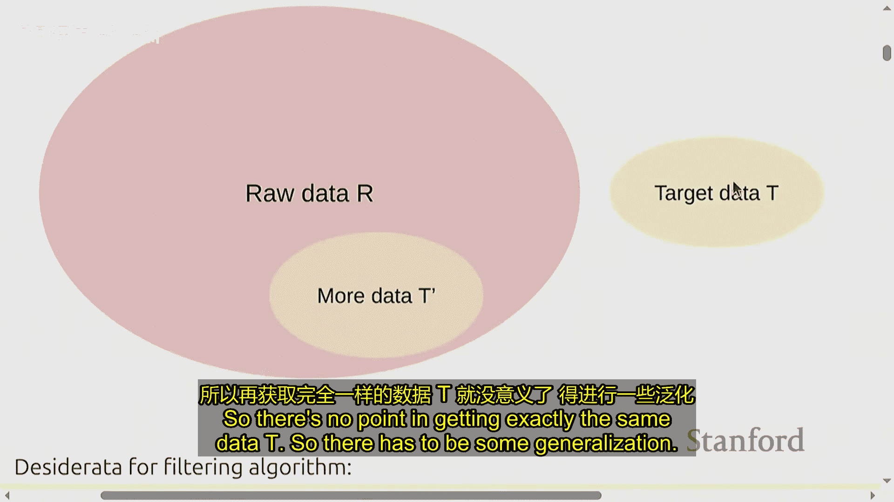

得进行一些泛化，而且它得非常快，比如说你得在整个网络上运行它，所以要是运行一个大型模型，那可能和训练成本一样高，所以你肯定不希望这样，不然的话你还不如去训练，所以我们会探讨三种不同的方法。

来实现这个高级抽象元宇，那么我们将从训练一个N元语法模型入手，这是上节课讲到的内容，你可以用科纳泽尔与我平滑法，训练一个N元语法模型，你也可以采用其他平滑方式，但科纳泽尔与我平华法。

在一定程度上是传承下来的，源自N元语法建模和统计语言处理的时代，在这个领域，有一种人们常用的实现方式叫KLM，它是开源的，最初是用于机器翻译的开发，他实现了肯尼co9平滑处理。

所以你可以去了解一下肯尼CEO9，他挺有意思的，但这里我们就不多谈细节了，所以这个在数据过滤中很常用，它不一定非得是这个没什么特别原因，但人们就是用这个N元语法建模的，优点是非常简单，当我说你和模型时。

你就把这当成是数一下N元语法的数量，然后做归一化就行，那么咱们稍微深入讲讲，所以你要从语言模型的最大自然估计开始，你有一个文本语料库，你想估计像P这样的条件概率，根据最后N1个词，比如the cat。

你要做的就是统计N元语法的数量，然后除以条件上下文的N1元语法数量，好的这很简单，原则上要高效实现这个得费点功夫，但主要问题是技术稀疏，所以很多N元语法的出现次数恰恰为零，即便他们很合理。

尤其在恩增大使，而这正是N元语法模型，无法真正适度扩展的关键原因，因为遭遇了无数灾难，所以为缓解此问题，有人设计了平滑处理来应对未出现的根源与法，关于此还有更多细节，但大致是说嗯。

也许我没有足够数据来支持此技术，我差不多可以用低阶N元语法，所以从上下文里删取一个词，然后统计在给定cat时，它出现的次数，然后尝试进行差值或者回退到那个值，好了，关于N元语法建模的工作原理。

我就说这些，我觉得即便在这个神经语言模型的时代，了解N元语法模型的工作原理是有好处的，那我们来下载N元语法模型，这是一个在维基百科上训练的模型，我这就去下载，接着我们来处理一些句子。

那么这个句子是斯坦福大学成立于1885年，这实际上是维基百科的一段摘录，所以这应该是合理的，如果你计算概率啊，那么你先计算对数概率，然后通过这种归一化方法计算困惑度，然后你会得到187好的。

所以就是个数字，接着是另一个例子，这取自cs336网站，那我们看看它的效果怎样，所以较高的困惑度意味着可能性较低对吧，有点道理，因为这种内容在维基百科中不太可能出现，它并非异常高。

因为它仍是相当不错的规范英语，而且我觉得那里的很多N元语法，在维基百科里也会出现ASTF呢，这纯粹是乱码，这个会被赋予更高的困惑度，然后还有那个，所以这个应该被赋予相当高的困惑度，但出于某种原因。

这个特定的N元语法赋予的困惑度相当低，所以这是一个N元语法模型，所以它并不是特别出色，但你不必成为最佳模型，你只是在做数据筛选来创建一个模型，所以这可以非常简单快速，所以cc net出自一篇论文。

我猜那时是脸输，我们上次提及的那些，他们基本如此操作，实际上那样也行，所以他们主要查看文本段落，那些极为项目，他们按困惑度递增排序，段落仅保留前1/3，这就是他们创建首个捞马数据集的方式。

所以这是启发式的，但要是你得快速写下点什么，这还算有点道理好的，那么纳索九语言建模速度很快，但他很粗糙，好吧，我感觉有些本打算讲的内容不见了，哦好吧，可能被删了，好的，那么你可以将一个N元语法模型。

应用到目标数据上。

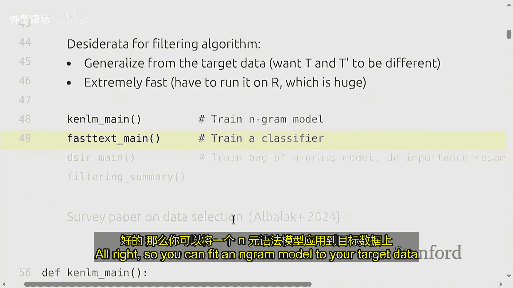

然后用它给原始数据评分，然后选择得分最高的文档。

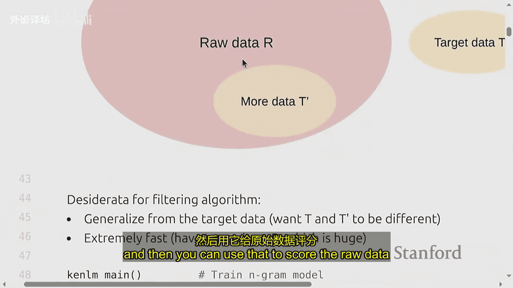

你还可以做的是快速文本，在某些方面这个更受欢迎，这也是脸书推出的，他们发布了许多开源工具，不过我认为can allen在此之前就已创建，所以他们再次开发它用于文本分类，这篇论文是2016年的。

所以很多人在开发各种奇特的神经模型，而且他们指出，实际上这个近乎线性的分类器效果同样出色，而且速度要快得多，所以这就是为什么这个软件包变得非常受欢迎，所以这里的动机是，比如说你在做，磁带分类。

你有一个长度为L的句子，你的词汇量为V，你想将其分为64类，你就得立即定义这个V乘K矩阵，如果V和K都很大，那么这个矩阵就会变得非常大，你会遇到稀疏性问题，其工作方式如下，你拿到你的文档。

然后直接进行线性分类，所以这相当简单，所以问题是参数数量巨大，所以快速文本认为嗯，那我就进行线性处理，基本上就是降维，所以相反我要将磁空间映射到一个隐藏维度，他比K小可能小至16，接着我会从H进行分类。

要注意的是，当你看预测结果时，前向传播过程不存在非线性变换，它就是个线性分类器，要是你想的话，也能把它看成矩阵分解，而且参数数量大幅减少，所以我觉得其实现已得到合理优化，它采用了并行化。

还使用了异步随机梯度下降法，所以问题在于，这就是磁带模型，我们不仅想关注单词，而是想关注N元语法，所以这篇论文也以相当简单的方式，扩展到了N元语法，所以你拿一个句子，然后把它拆分成N元语法。

这里的问题是二元语法数量可能会变得很大，实际上它可能是无界的，所以记住我们谈到分词器时，如果你只是把句子拆成单词，你不清楚单词的数量，所以简单的办法就是进行哈希运算，你要定一桶，比如1000万个。

但磁力是八个。

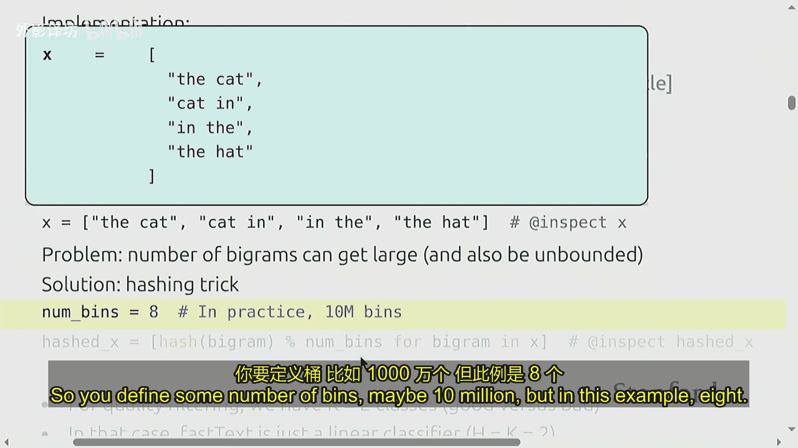

然后你把每个双子组合都哈希到里面，所以cat映射为二，cat in映射为，亦以此类推，所以当然可能会存在一些冲突，但你只能忍受它，我的意思是在某种程度上那个优化方法，当你将损失最小化时。

冲突在一定程度上会被考虑进去，要是有两个毫无关联的词，那么权重会在某种程度上，代表这两个词的平均值，还要注意，通常我们使用K为两类的快速文本分类法，这份文档是好是坏，在那种情况下。

这就是普通的二元分类和线性分类，好的当然不难想象，如果你能进行线性分类，你可以使用像BT甚至lama这样更高级的模型，唯一的问题是速度会更慢，因此你会面临这样一种权衡，若使用大型模型进行分类。

或许你应该用这些计算量去实际训练模型，所以这是唯一要考虑的点，因为网络规模非常大，记住你要大幅筛选网络内容，所以你会在上花费大量计算资源，比如说你要将网络筛选到1%，也就是说你的分类器。

你所投入的计算量，必须是对数据集进行一次前向传递，计算量的1%，好，接下来我要讲的最后一种方法，是一种叫做基于重要性重采样的语言模型。

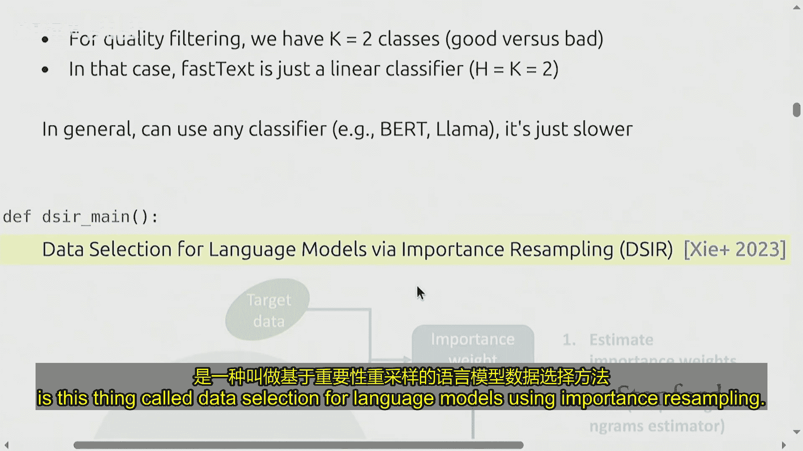

数据选择方法。

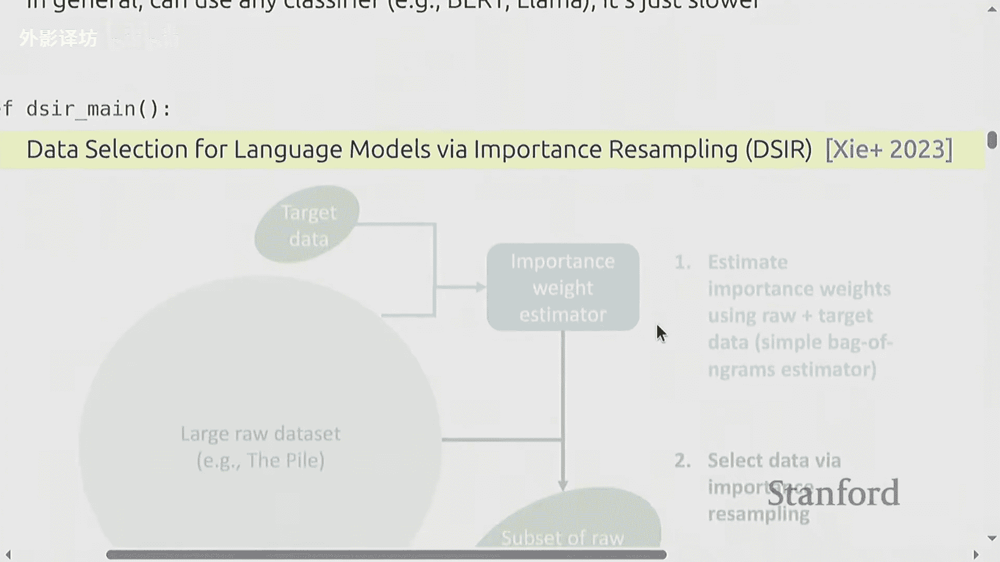

这里有一些基本概念，我们有原始数据集R它是个原始数据集，你有目标数据，然后我要构建一个重要性权重估计器，它类似于语言N元语法模型或快速文本分类器，然后我要用它来获取一批文档。

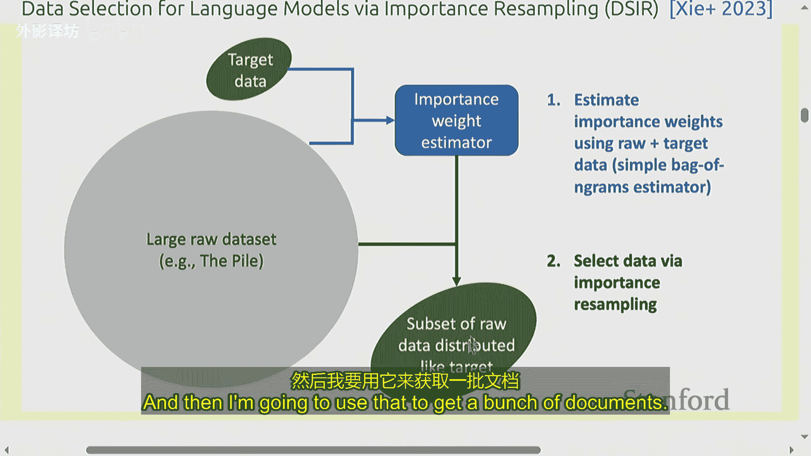

那么首先我想对重要性重采样做个快速回顾。

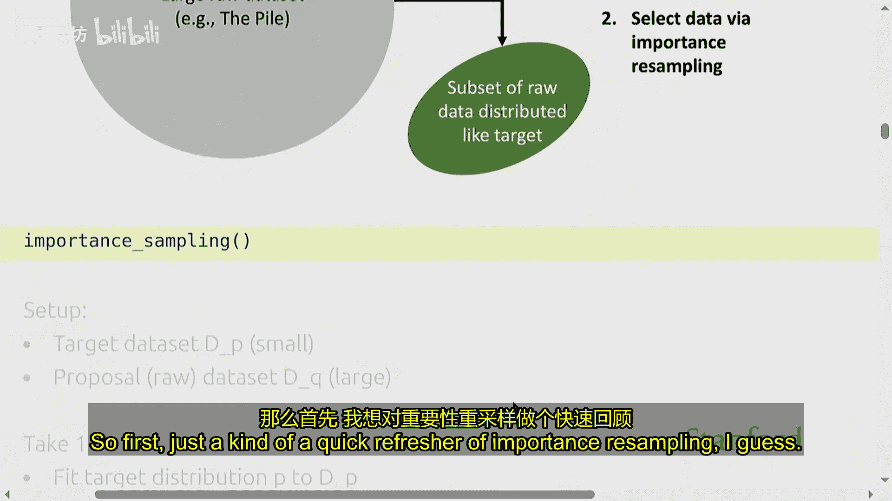

所以这在很多情况下都会出现，比如粒子滤波和蒙特卡罗方法，所以你有一个目标分布，所以它是一种分布，而非一个数据集，理想情况下，你想从此处抽取样本，但你只有一个提议分布队列可从中抽取样本。

例如若你有一个包含0123的词汇表，假设这就是你的目标分布，而你的建议分布是这样的，现在你要从Q中采样，因为这是你唯一能采样的，那么假设你得到了一批样本，所以要注意Q在零上的占比更大。

所以你会得到更多零，然后你要计算权重，通过查看重要性比率PQ来计算样本的权重，所以你要弥补我从Q中采样的情况，所以我想除掉那个或者说我真正想要的是P，然后进行归一化，然后你得到样本的分布。

现在你重新采样，以此平衡分布，所以现在你会看到有更多的三，因为P在三上的概率分布更集中，好的这相当基础，但它是基础部分，现在我们来看如何进行数据选择，我们有一个目标数据集，并非一个分布。

我们有一个小数据集，我们还有这个原始数据集，我们将其称作提意数据集，DQ它很大，所以我们可以对DP拟合分布，P对DQ拟合分布Q，然后进行重要性重采样，及我们2分钟前讨论的内容，现在主要问题是DP非常小。

记住目标分布是高质量数据，你没有那么多，这就是关键，你试图获取更多，所以你没有那么多，而且其规模太小，无法估算出一个好模型，所以还是老办法就是使用哈希单字组，所以这在fast text中，我们也见识过。

你拿到什么文本就用什么，然后基本上，所以你基本上对所有内容进行哈希处理，我们现在处理单字，所以你对每个单字进行哈希处理，然后拟统计数量，估计每个哈希后的N元语法的概率，好的，这种情况下。

戴帽子的猫哈希后是这个注意，有一些哈希冲突，the和hat哈希后得到相同的值，但无所谓，这都很粗糙，然后你只需估计这些概率，好的，那么要评估新文本的概率，已进行哈希处理，对新文本进行哈希。

然后将概率相乘好吧，我有点倒霉，然后概率就归零了，要是你想的话，可以做些平滑处理，结果表明在Python里哈希是不确定的，所以每次我运行这个程序，我得到的结果都会不一样，而且论文显示这确实有点用。

收益不是特别大，但与使用fast text相比，fast text是一种启发式分类方法，使用bird风格模型，在glue基准测试中的收益有一定提升，与fast text的比较。

所以这里的主要观点是对整个分部进行建模，在某种意义上是一种更具原则性的方法，对吧，因为你想从分布中采样数据，而且你有一个不同的分布序列，而现在你基本上是在尝试进行补偿，所以这对多样性可能更有利。

因为你在尝试匹配分布，对于快速文本，你主要是在判断某事物是否符合分布，并且他无法保证与分布相匹配，好的，不过他也很快和快速文本一样，而且两者都能通过更好的模型得到改进。

所以不要使用基于N元语法的线性模型，你可以增大N，你也可以采用神经网络方法，好的那总结这部分，所以我们研究了N元语法模型，线性分类器和重要性重采样，但我觉得总体框架是值得我们汲取的。

在给定一个目标数据集和一个原始数据集，的情况下进行设置，找到一个与目标相似的子集，而且所有这些方法都有一个基本的思路，即根据原始数据和目标数据集来估计某种模型，这会得出一个评分函数。

然后根据这个评分函数，在原始数据集中保留相应的示例，通常会保留得分高的示例，所以下面简单梳理一下这个内容，在KNLM的情形下，分数就是的概率，或者我猜也许是困惑程度，若愿意。

可根据目标下的资源数量进行归一化，所以这里不使用二，然后保留分数高于阈值的事例，若愿意，可在阈值附近稍作随机处理，所以你也可以使用判别式分类器，其中分数表示的概率，此事里来自目标而非原始数据集的概率。

然后保留一些例子，分数大于某个阈值，然后重要性重采样指出，分数是两个生成模型的比率，这种情况下可能是N元语法模型，也就是目标分布与原始分布的P，使用一个分数，这就是重要性权重按此概率进行重采样。

从高层次看，他们本质上都一样迷你和一种分布，它能告诉你目标数据相对于原始数据的样子，然后将其应用到原始数据集，好的嗯，或许我会再次暂停，以防有问题，是的嗯，我要说的是一种高层次的哲学观点。

我们知道什么是好数据，但某种程度上我们还没讨论过，他实际上是什么样的一份好文档是什么样的，而这一步是要确保单词彼此相邻排列得当，要是那样的话，你就知道一个接一个，但这并不能保证从更大范围来看。

它并没有什么意义，或者要是你想要那样，你只需增加N元语法中的N就行了，我想问题似乎是就是说，如果你用的是N元语法模型，它只看局部语境，也许这不利于评估质量，因为要是你把所有内容打乱，对N元语法模型而言。

它看起来依然不错，所以确实存在那种风险，很容易通过对抗方式获取，如果你能构建，你肯定能构建出N元语法模型，认为质量不错的例子，我是说我给你看过一个这个数值碰巧相当高，但不知怎地平均来说你做的还行。

而且在某种程度上，要是一份文档看起来像是符合语法的英语，它看起来像新闻或一些科学论文，你所要确保的只是那个模型赋予其高概率，如果你得到一些不好的例子，这并非世界末日，是的，所以我们应该把这些看做过滤掉。

你展示的那种真正无意义的网页，是的，我会说这是在过滤真正的无意义内容，我想这是个不错的看待方式，我举些例子，我想可能会更清楚些，这些分类器不只是用于质量方面，对于其他一些应用场景。

我想这更能说明它为何可行，所以同样的数据过滤机制可用于不同任务，那我来讲讲语言识别质量过滤和毒性过滤，那么语言识别目的是找到特定语言的文本，也许是英语，也许是日语，你可能会问嗯。

你可以对所有语言进行训练，你为什么不那样做呢，问题在于数据筛选往往很困难，以及对特定语言高质量数据的处理，而且还有一个问题，如果你进行训练，比如说你只关注一种语言，现在若你有来自其他所有语言的数据。

你将花费更少的计算量，以及在任何特定语言上的词源，而这可能会影响你在该语言上的表现，例如经过训练的bloom模型，我认为大约在2022年，他仅在30%的英文数据上进行了训练。

结果英文表现或许未达最佳水平，他在其他语言上表现强劲，所以在计算资源受限的情况下，你极有可能会危及你所重视语言的质量，虽说如此，要是你有足够的能力，而且你正在训练大型模型，那么你肯定能训练多语言模型。

而且不同语言之间甚至可能会有正向迁移，所以所有这类前沿模型，都是在大量语言环境中训练的，有时甚至多达100多种语言。

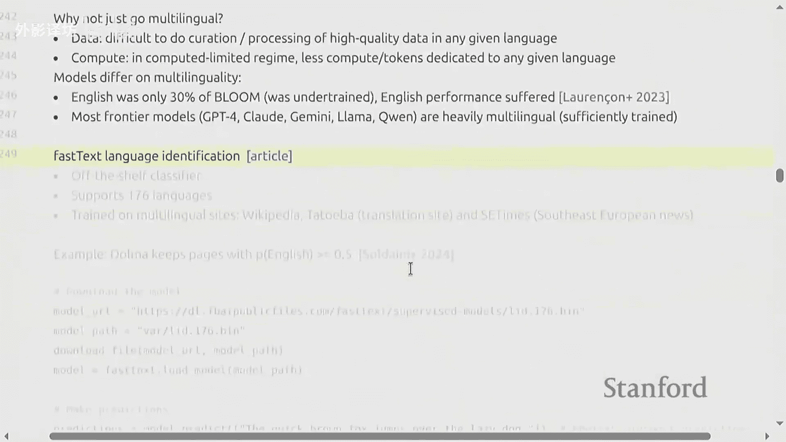

一种简单的方法是，fast text适用于训练简单分类器的工具包，它还配备了一些现成的模型，其中一个常用的是语言识别工具。

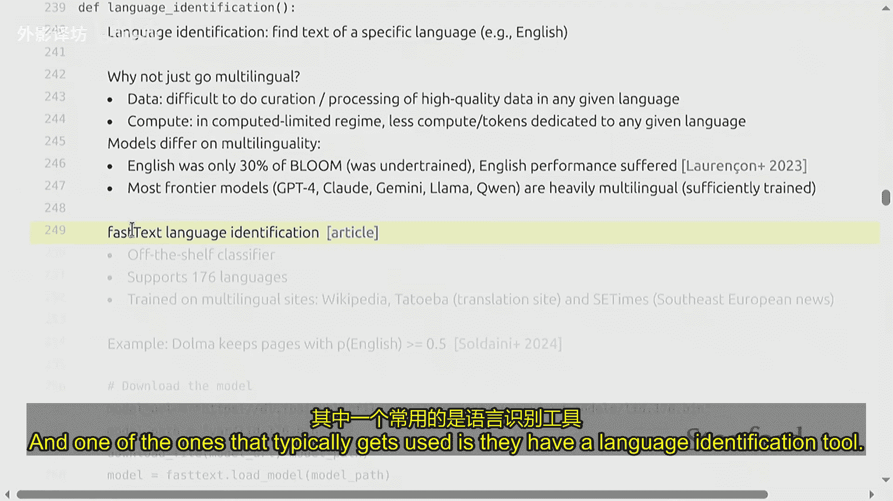

一个模型，这是一个现成的分类器，它支持多种不同语言，他是在包括维基百科在内的，多语言网站上训练的，维基百科包含多种语言翻译网站，还有不知为何有的东南欧新闻。

所以DA使用这个他们主要运行best tx分类器，保留英语概率大于0。5的页面，那咱试试，有个模型语言id能直接下载，然后看看效果咋样，敏捷的棕色狐狸跳过了懒狗，看看预测结果在哪，行，我不知道为啥。

行找到了，这里显示是英语，这是英语标签，英文出现的概率为0。71，所以我想说，我本以为概率会更高，在我看来，这挺像英文的，如果你复制这个句子，概率不变，这挺好，说同样的话并不会让它更具英文味。

这里有一些非正式英文，这有点怪，我猜这个比敏捷的棕色狐狸更具英文范，实际上德语的分类相当哦，抱歉，现在这个是德语的了，这个标签是德语的好嘞，这这个是德语的数学，被归为英语的程度很低。

代码被归为俄语的程度最高，这个你好，明显是意大利语，这是法语的，你好挺好，而这个我觉得这部分有点棘手，我加了些西班牙语和英语，我想这次我更倾向于用西班牙语好了，这样你就有个大概了解了。

我是说娃娃这些分类器总归是好的对吧，因为它虽是个能下载的分类器，但大家都用，不代表它每次都管用，所以我觉得显然对于短剧而言，他不太靠谱，因为提供的事情发生的信息太少，资源匮乏的语言不好搞。

有人担心有些并非英语方言的情况，这可能被视作非英语，我觉得要是你想区分相似语言，那些也极易混淆，说到代码切换，我压根都不知道啥是真相，但但愿他对其中一种语言管用，那就讲讲那个案例研究。

开放网络数学指的就是两年前的这篇论文，这里的目标是构建一个庞大的数学文本语料库，在此我要说的是，咱们假设数学是一种语言，首先他们用一些规则进行筛选，然后他们在一个名为proof pie。

的大型证明数据集上训练了can和lam，若困惑度低于某个阈值就予以保留，然后他们训练了这个快速文本分类器，即我们之前讨论过的用于预测数学文本的那个，这有点不太靠谱，但是如果根据规则判定为数学内容。

他们会将分类器的阈值设得相对较低，而如果根据规则判定，无视数学内容，则需要设得更高，结果是他们生成了150亿个标记，他们训练了一些表现比其他模型更好的模型，那些再多20倍普通数据上训练的模型。

所以这是数据过滤效用的一个很好的例子，你可以在所有这些数据上进行训练，但如果你关注，比如说像数学这样的特定领域，你就可以直接去，然后获取更多此类数据，并以该数据集为目标，如果你基于此进行训练。

你的数据利用效率会更高，好的，那我们来谈谈质量过滤，那么显然质量过滤实际上它并非真的，我是说它涵盖了很多方面，那什么是质量呢，所以要记住，有些论文明确不采用基于模型的质量过滤。

但最近一些论文已经有所妥协，比如说，它的效果要好得多，关于GPT3，我们上次稍微讨论过，通过获取正样本，训练了一个质量分类器，从他们拥有的高质量来源中获取，而负样本则只是通用爬虫数据。

他们训练了一个线性分类器，并根据这个分数筛选文档，这基本上就是对数字进行处理来细化阈值，还有lama的第一篇论文，他们把维基百科引用的页面用作正例，注意不是维基百科本身。

富力仅从通用网络爬虫数据中采样获取，然后他们保留那些被归类为正立的文档，我觉得在这方面其实没进行采样，这挺有意思的，另一篇论文是PHYE塔，他们的理念挺有意思的，他们非常想要像教科书那样的高质量数据。

而且他们想训练一个非常小的模型，所以他们用合成数据训练，也用过滤后的数据训练，对于过滤数据，他们从堆栈中选取了Python子集，记住堆栈是来自GITHUB的，经过预处理的代码数据集。

然后他们设定了一个提示，这能让GPT4为一名学生确定教育价值，其目标是学习基本编码概念，然后他们向GPT4提问，并对这个Python子集中的10万个文档进行分类，这些就成了正例。

他们根据这些势力训练了一个随机森林分类器，输入随机分类器的嵌入向量，来自一些预训练的协同生成模型，然后他们从R中选取经分类器分类的数据，于是他们在整个R上运行分类器，进而得到那些数据，所以这挺有意思的。

因为有个随机森林分类器，在这种情形下，T从哪来，NT并非先天存在，T是通过用某个提示词来提示GPT4得到的，所以这是你会越来越常看到的，随着模型性能提升，不再依赖像这样的信息源。

比如也许box one很棒，或者也许维基百科很棒，现在要是你有一个优质模型，你就能直接向模型获取你想要的数据类型，或许我想要更多化学数据，又或许我想要更多用于大量证明，或基础数学等方面的数学数据。

然后你只需借助语言模型嗯，一个相当复杂的语言模型就能给你T，现在一旦你得到了T，你转变了我们目前一直在讨论的方法，所以PHY1的结果看起来依旧不错，所以他们设定了一个机械。

他们只采用了一个堆栈中的Python子集，也就是这个R以及在人工评估中的表现，这是一个编码数据集，经过96K步训练后，结果仅为12%，然后他们在这个新的优质数据集上，训练了相同的模型架构。

并且在36部之后就已达到17，所以他们宣布成功，好了这些就是质量过滤的一些例子，关于质量过滤有问题吗，对所以重点是为啥在这能用GPT4呢，因为你只用它来创建10万个例子，然后用这个去提炼一个分类器。

它快得多，而且10万比R2的规模小很多，R2的规模可能有几千万甚至数亿，好那咱们稍微讲讲毒性过滤，那我就来讲讲DMA论文是如何进行毒性过滤的，有个数据即叫拼图有毒评论，这源于一个项目，在该项目中。

他们致力于帮助人们在网上进行更优质的讨论，所以他们想构建一个能识别问题内容的分类器，于是他们采集了维基百科，讨论页面上的数据评论，并让注释者以有毒标注，这些评论包括严重有毒淫秽威胁，侮辱，身份攻击。

仇恨等类别，于是DOMB团队训练了两个快速文本分类器，其中一个基本上是，它对应于仇恨，另一个对应于不适宜工作场景的内容，那么这里有一些关于数据集的例子，那么我们下载模型并试用一下，那么第一个例子。

你是因为争议中立性而威胁我吗，这条被归类为适合工作场合，因为看起来没问题，第二条被标记为不适合工作时观看，要知道这些句子都没啥问题，行就是给你讲讲，我不想举太多这种例子，但你懂的，你可以自己找时间玩玩。

好了，过滤这块我就说这些，来现在讲讲驱虫，有两种重复类型，即完全重复，要知道，实际上，基于镜像网络本身就存在大量完全重复的内容，要是你去看看古登堡计划，你会看到同一个网站，被镜像到许多不同的网址上。

要是你只是在爬取，就像常见爬虫做的那样，他无法知道这些是镜像网站，它只会获取到完全相同的内容，然后还有神经重复内容，基本上就是相同的文本，但有几个词不同，我们会向你展示处理这两种情况的算法。

那么神经重复内容这种情况何时会发生呢，嗯你有服务条款和许可，比如麻省理工许可，这东西在网上不知出现过多少次，它只是被到处复制粘贴，也许还有些我不知道的情况，也许人们会拿去并实际改动一些内容。

或者他们把赋值弄乱了，粘贴时还去掉了个逗号什么的。

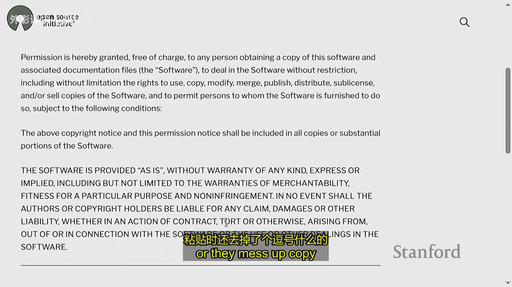

这些都有可能，然后还有些情况，若查看这些数据集，近似重复内容如下，它能让你大致了解近似重复项的样子，有时会出现这样一篇文章，有人似乎只是把最佳反派演员，替换成了最具影响力的角色，但其他部分看起来都一样。

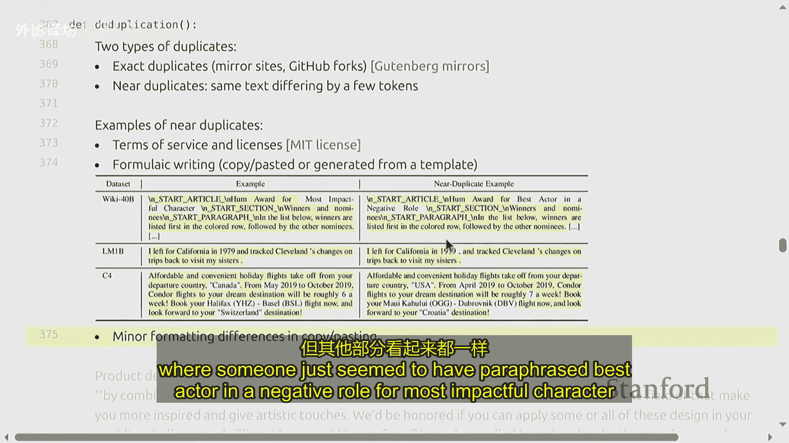

这就好像这里少了个逗号，不太清楚那个逗号哪儿去了，但可能只是注释或处理有误。

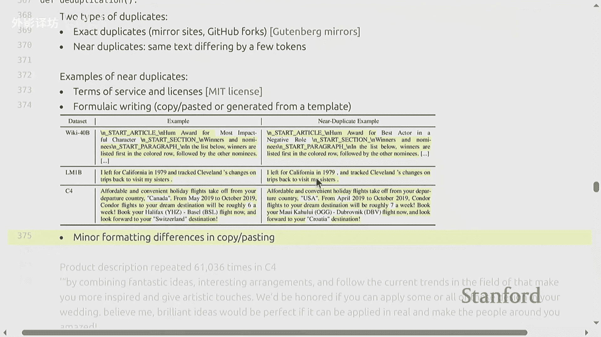

然后这个挺有意思的，明显有这样一种类似文字的广告，他们把加拿大换成了美国，还改了些航班信息，所以这可能是由某种模板系统生成的，他们往里面填入了一些实体，所以这些神经复制内容显然是不同的。

但显然一旦你有了这份文档，要是你用大量来训练，这个并没有给你带来太多价值，就这么说吧，那么在极端情况下，那么如果你看看C4，记住C4是按一组查找类似英语句子的规则，筛选的，你会看到这句话，这的确是英文。

他出现的次数竟高达6万1000次。

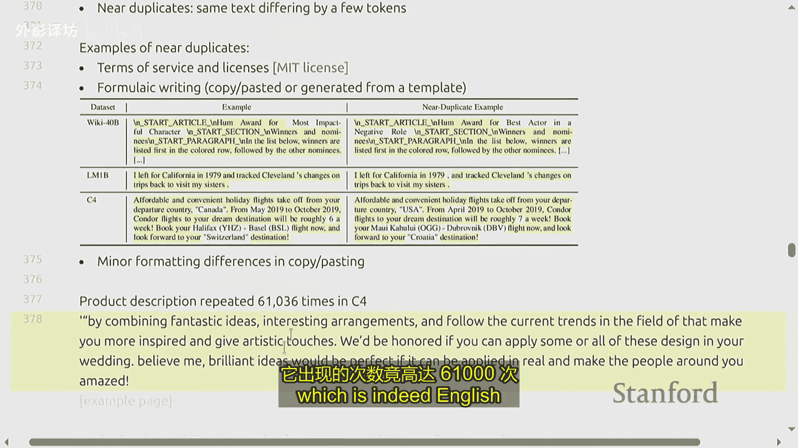

不管啥原因，要是你真去追查他的来源，可不是麻省理工许可协议。

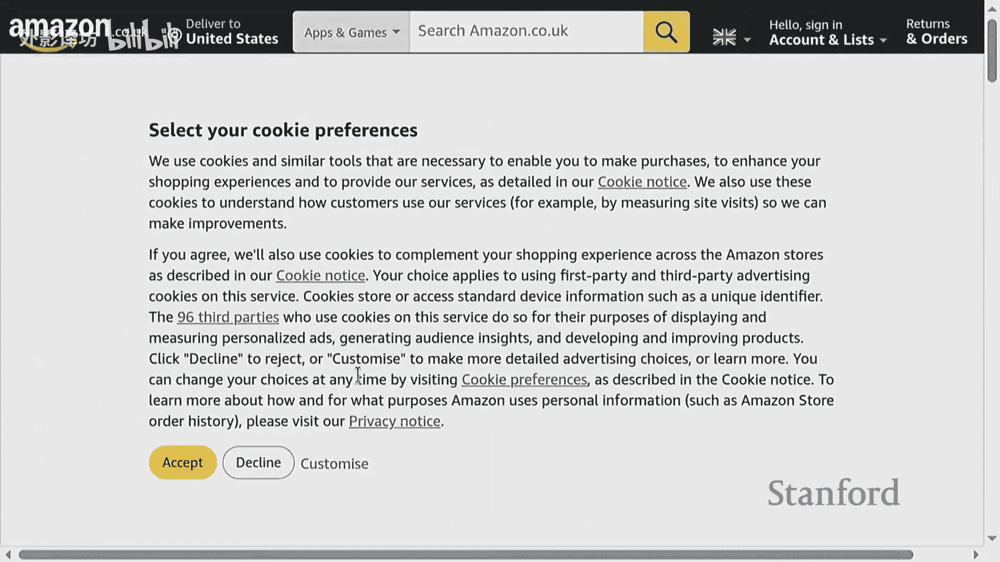

oh我得做什么，我该接受这些cookies吗，行吧，这是个来自亚马逊的随机产品，上面有大量涂鸦图案。

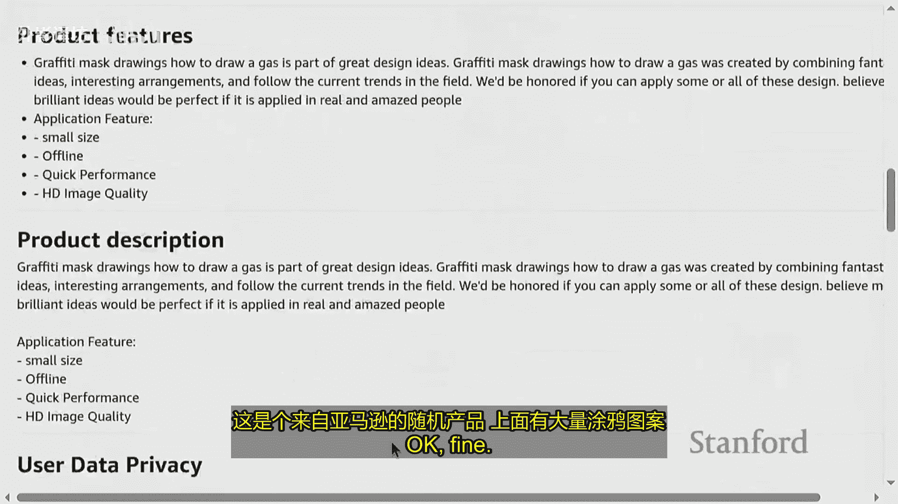

这里有一段文本，显然出于某种原因，我甚至都不知道怎么会有6万1000份，这样的内容。

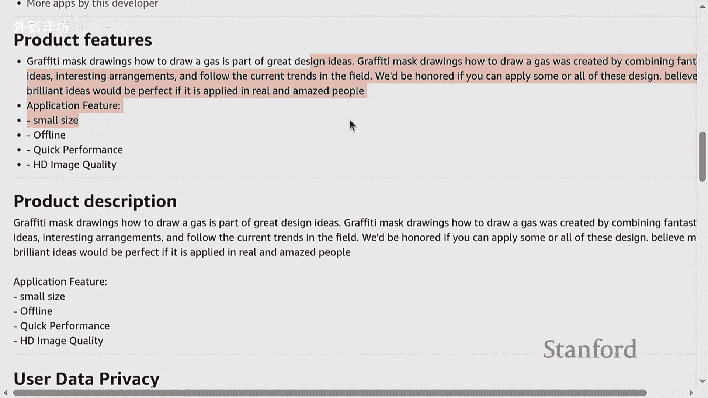

就是这样，也就是说这段文本不一定不好，这是非常地道的英语，但你不会想在这上面花费6万1000个轮次，我的意思是，这有点毫无意义，所以去重有点类似于质量过滤的补充。

质量过滤表明这段数据我不想用它来训练驱虫，表示嗯这个可能还行，但我只想要少量的这些，而不是61000份。

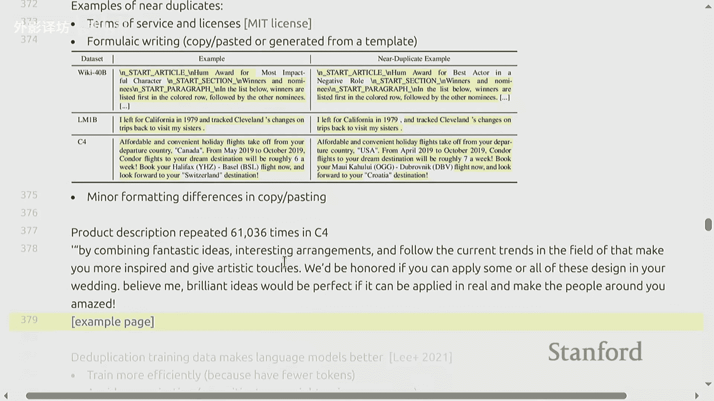

所以有研究显示，去虫能让语言模型更好，最明显的一点是你能更高效的训练聚众，减少了资源数量，而且如果你没有扔掉信息，那么你能节省很多精力，接下来第二点是你还能够避免死记硬背，我们之前没怎么讨论过这个。

但数据训练出的语言模型能够记住这些数据，这对版权或隐私不利，因为他只会原样复述，训练集去重是用于解决相关问题的一种手段，它肯定不完美，但它有助于减轻其中一些风险嗯，好的。

下面讲讲如何从设计空间角度思考去重，首先你得想想举重的单位是什么，什么是一个条目，是句子吗，是段落吗，是文档吗，第二个问题是如何匹配，什么算重复项，是完全匹配吗，是共同子项的一部分吗。

最后你会采取什么行动，你会删除所有实例吗，还是只留一个，删除其他所有，所以关键挑战在于，而这是个算法挑战，从根本上讲，去虫就是将项目相互比较，对于质量分类，你可以选取一个项目。

你可以将其分为高质量或非高质量，去虫本质上是两两比较的事，记住这些数据及规模很大，所以要是你想做平方及复杂度的事，那可就行不通了，所以你得要某种线性时间算法来实现扩展，但仍要做成对的操作。

所以这一切的基础就是哈希函数，那么作为回顾哈希函数是一种将一个元素，它可以是一个句子，也可以是一份文档映射为一个哈希值，它可以是整数或字符串，而且这个值比原相小很多。

而哈希函数涉及到的是可能会出现哈希冲突，即两个不同的项会映射到同一个哈希值，一般来说我想你们都用过字典或哈希表，哈希冲突通常是有害的，但稍后我们会发现，在某些特定情况下，他们也有好处，哈希函数有很多种。

会在效率方面进行权衡以及抗碰撞性，极不发生碰撞，有加密哈希函数，它们用于安全敏感型应用，比如在比特币中，你肯定不希望出现碰撞，因为否则就意味着有人可能会偷走你的钱，或者导致其他事情出问题。

然后还有一些哈希函数，不过他们速度很慢，但还有其他哈希函数，它们一般用于哈希表，这些哈希表不具备抗碰撞性，但速度很快，所以我们一般会选后一种，因为我们希望速度快，而且这里不搞密码学。

好那我们用莫尔哈希他接收字符串并返回值，但你也能用其他多种哈希算法，好那咱们从精确驱虫开始，下面举个简单例子，该项就是个字符串，我要精确匹配，我想只保留一个，其余都删除，这里有一堆项目。

我首先要做的是计算嗯，嗯一个从哈希值到对应项目列表的映射，一旦我得到那个我从每组中保留一个项目，每个组对应一个哈希值，在精确匹配的情况下，假设没有哈希冲突，那么你基本上进行精确去重。

所以hello在这里出现了两次，然后他出现了一次，当然hello是个完全不同的项，因为我们做的是精确匹配，所以好在这很简单，你在做什么一目了然，他精度很高，所以你永远不会扔掉，任何你不需要或需要的东西。

但缺点是它对近似重复项不起作用，另一个好处是，这很容易实现，我们大致是以MAPREDUCE的方式编写这个的，而且你可以很容易地对其进行扩展和并行处理，实际上这是C4所采用的方式，来准备他们的数据集。

所以它们的去重单位是三个句子的长度范围，他们使用精确匹配，并且除了一个其他的都删除，所以有一件事一直有点困扰着我，但似乎其他人都不在乎，就是当你看三个句子的长度范围时对吧，所以你有这份文档。

接着你会看到三句话的篇幅，要是它被标记为重复，你就要把那些句子删掉，所以最终的文档可能甚至都不连贯，但随后人们会说谁在乎呢，然后就接着做了，好的还有另一种去虫的办法，这种方法不太用映射规约。

而是更像哈希表，我觉得布隆过滤器势你们有些人可能已经见过，但还是过一下，因为我觉得这方法挺酷的，所以这个很高效，而且是近似的，所以它更高效，但显然它并不总是完全准确，但这里我们也不挑了。

好好在它很省内存，你可以更新它，但无法删除它，本质上是集合的一种表示，当你询问元素是否属于集合，若返回否，那它肯定不属于，但如果返回是，那么若超参数设置正确，很可能就属于，但存在小概率，它不属于。

就像出现误判情况，然后你可按需设置参数，降低误判率，好下面看看具体情况，假设你有五个物品，猫和帽子，稍后我们会用集合中未出现的物品进行测试，首先你要定义一个哈希函数，它会映射到M个桶中，这里M的值为八。

那么要构建布隆过滤器，我们要做些很简单的事，你只需创建位数组，有若干个铜，然后便利每个物品并进行哈希哈希值为二，所以我更新第二项cat的哈希值是七，更新帽子里的第七项行不，所以我就填充这个位阵列。

还有这个为阵列，我不记录该项，所以我不清楚是否有误，报好，那咱们来做个合理性检查，看看我放进去的是不是都是有效，像，所以要查询这个，你只要计算一下那个哈希后的项是否在表中，确实所有的都应该能通过。

现在咱们来看看那些非项目，瞧瞧他们的表现如何，你会看到有些非项目你得到个零，这正是你所期望的，但有些非项目布隆因子会判定哦，实际上它在集合里，所以这里的错误数是四个，要是你计算误报率。

即错误数除以该过程产生肯定结果的总次数，那么在此情况下，误报率为0。44，这相当糟糕，当然这是第8号箱，要是这个箱子变大，那么情况会好转，事实上它变大了，其概率为一除以箱子数量，但你看着这个会说嗯。

这可不太好，因为如果我想让错误概率为十的十次方，那我需要很多铜，而且这不会占用我们太多内存，所以这里有个更巧妙的解决办法，也就是使用更多哈希函数，比如说我用两个哈希函数，然后我基本上会。

我仍然有相同的位数组，但现在对于每个元素，我要对其进行两次哈希，所以种子零哈希后得到二，我要把它放进去，接着种子为一时会哈希到五，所以我要把它放进去，所以每个元素都会被哈希到K个槽位，不一定各不相同。

所以然后我遍历数据，然后我填满这个表格，好的，所以现在我进行查询时，我取出一个元素并返回一个结果，如果所有K格哈希函数对应的表格值都为一，好的，要是我把它放进去，我得设置K位，所以要是我在测试。

我要检查K的位置，并检查它们是否都已设置，所以确实这些都通过了，现在看看错误数量是三个，而且误报率降低了，那很棒，所以当然这只是个简单事例，但适度增加内存开销，就能大幅降低误报率，也许在正式分析之前。

我先在这儿停一下，好那咱们来想想更一般的情况，假设我们有1000个铜，我们有十个缓存函数，然后要对100个像做哈，希问题是误报率是多少，思考这个问题，我们可以我会考虑一个测试输入。

它不再会散列到特定位置的集合里，接着我要考虑放入N个元素，放入布隆过滤器，看看命中I的概率，要是有东西命中I，那就是个坏兆头，那咱们先在这儿热热身，假设N为一，我只插入一个元素，且K也为一。

所以我只用一个哈希函数，那么现在问题是，I与要插入的元素发生哈希冲突的概率是多少，以及我要插入的元素呢，答案就是易除乙统的数量，假设所有情况大致独立，那将是0。001，好现在N还是一。

但我可以用K格哈希函数，所以如果我要这么做，标准是我不能只错过一次，但要知道是K4哦，好的，这是我失手一次的概率，一剪他就是命中概率，然后他的K次方就是我命中的概率，你懂的。

对于K然后Y减去那个就是我失手K4的概率，所以现在这里的概率下降了一点，好现在如果我要插入N个物品，所以我问的是N次后测试统唯一的概率，所以现在不是失手K次，我得错过K次，一共N次。

那么基本上就是这个式子就是K乘以N，最后因为测试项也是我和你正在进行，哈希处理的内容，所以我有K4错过的机会，所以实际上误爆率这就是起作用的地方，K确实能起到作用，就是我能用K降低物爆率，这样就变成了。

F从0。63降到0。01，你可以在这里查看表达式F，给定固定比例计算K的最优值，这是一种渐进计算，然后你会发现，K的规模为MN量级，所以你应使用的哈希函数数量与统数除以，幺哈希的项数的量级相同。

如果你这么做，那么F为0。5，误报率为0。5的K次方，所以在这种情况下，我不是最优的，最优值实际是K等于六，误报率是0。08，而非0。008，也不是0。01，因此你可以对此做进一步了解。

有一些讲义能让你在计算资源和内存，之间进行权衡，以及误报率，好的布隆过滤器有一些超参数能让你控制，你期望的误报率是多少，你有多少内存，你愿意投入多少计算资源等等，我发现比如说K在B上降了。

我也降到了25，比如说要是K更大，B会降多少，那么你是说最优的K降了，那为啥F也降，那么且看，那么要是K降了，我觉得它不是单调的，所以要是你用一个很大的K值，那其实挺糟的，因为那样就会填满不容过滤器。

而如果用的太小，那也不太好，所以我觉得存在某种最优值，而它是下降还是还是上升，取决于你站在哪一边，好那么在DMA中，他们将误报率设为十的-15次方，并且他们用布隆过滤器进行精确驱虫。

而且他们是在段落层面进行的，好嘞，刚才讲的就是精确驱虫，而精确去虫的问题在于，他捕捉不到某些近乎相同却未被识别的情况，从某种意义上说，他们算是重复的，但我们检测不出来。

那么现在怎么进行近似集合成员判断呢，要讨论近似集合成员，你得有个相似度度量的概念，所以常用的一种是杰卡德相似性，所以两个集合A的杰卡德相似度，而B是他们交集与并集的比率，比如若我有1234和1235。

若计算杰卡德相似度，交集大小是三，并集大小是五，所以杰卡德相似度是0。6，好那我们说两份文档近乎重复，若其杰卡德相似度超过某个阈值，一般而言该阈值会相当高，如0。99。

如果你只想在缺少逗号等情况下进行匹配，现在要注意，这没有任何语义内容，你可能缺少像not这样的词，当然那会完全改变意思，或者改变某个有实际意义的词的意思，但这只是试图找到表面上相似的文档。

算法面临的挑战是，如何在线性时间内找到近似重复项，好的，那么为了实现这一点，我们要尝试重写杰卡德相似度，它同样是成对的，你无法计算单个元素的杰卡德相似度，只有当你有两个元素时才能计算它。

而且我要尝试用哈希函数来表示它，你可以基于单个元素来计算它好的，所以有一个叫最小哈希的哈希函数，他有个很好的性质，即哈希冲突，概率恰好是集合A与B的杰卡德相似度。

所以通常你认为应不惜一切代价避免哈希冲突，你确实不喜欢他们，但在此处并非是你想要更多哈希碰撞，只是你需要控制哈希碰撞情况，你需要适度的哈希碰撞，由相似度决定，那么再准确表述一下，相似度等同于冲突概率。

所以两件事越相似，它们就越容易发生碰撞，所以这就是直觉，好的最小哈希定义如下，取一个集合进行哈希，记住这些元素返回的数字，然后取最小元素，乍一看要是没见过这个，不太明白为何仅取最小值。

就能得到与技巧卡相等的期望属性，但论证其实很简单，思考方式是你有五个物品，你有两个集合，我来看看这种特征矩阵表示，那么集合A有1234，集合B有1235，现在随机哈希函数会对物品进行排列。

所以排列可能是32145，比如那边那个哈希函数，现在看看A中哪个物品排第一，再看看B中哪个物品排第一好吗，所以这对应于与最小哈希值对应的项，每个项第一个出现的概率相同，因为你假定哈希函数是随机的。

所以如果一二或三排在首位，那么最小哈希值实际上会相同对吧，因为如果这些排在首位，这里的最小值就等于这里的最小值，但如果最小哈希值是四或五，那么A的首个元素在B中并非首个，且最小哈，希值会不一样。

接着你会看到最小哈，希值相等的概率正好是一二或三，这正是交集，所以若你处于交集中，且该项为首相，那么就会产生冲突，而若你不在交集中，那么该项为首相时就不会产生冲突，因为其中一个会取到最小值。

而另一个会取到其他值，行要是不信，你可以去实际验证一下，那就生成1000个，我猜我们在A上运行，这个还有B然后看看发生碰撞的概率是多少，结果发现杰卡德系数的估计值是0。6，并非恰好是0。6。

我觉得存在一些四舍五入的情况，但已经相当接近了，好的，现在我们已经算出了这个杰卡德相似度，它是一种双五函数，并将其简化为仅针对单个元素的某种概率，一元函数，但实际上我们还差得远呢。

因为现在我们可以对元素进行哈希处理，但一次冲突并不能表明这两者相似，只是更有可能更多相似的元素会被哈希到一起，但我们想要更强有力的条件，所以局部敏感哈希就在这里起作用，目前为止我们只有一个哈希函数。

它接受两个哈希集，并且这些集合会以杰卡德概率发生碰撞，但我们真正想要的是A，并且理想情况下，当且仅当A和B发生碰撞，如果A的杰卡德相似度，且A与B的杰卡德相似度超过某个阈值，所以你得想办法细化这些概率。

你想说如果杰卡德相似度超过阈值，那么概率几乎为一，它们会被一起进行哈希运算，如果低于这个阈值，那么概率基本为零或非常小，那我们该怎么做呢，这有点类似，采用同样的技巧，即使用更多哈希函数。

这里的构造是要把N个哈希函数分成B组，每组二个，例如如果你有12个哈希函数分为三组，每组有四个哈希函数，所以你有H1到H4，H5到H8，H9到H12这些哈希函数，然后我们要声明A和B将会发生冲突。

如果某个组的所有哈希函数都返回相同的值，好的，所以如果我有A和B，我将对A使用全部12个哈希函数进行哈希，对B也使用最小哈希，现在我要说，如果这个组例如如果H1H2，H3H4的哈希值都一致。

那么他们就会发生冲突，或者这个组或者这个组好的，这里存在一种类似与或的结构，这是在阈值附近优化概率的关键，好的，那么现在我们只需进行一些分析，已计算A和B碰撞的概率，好的，我将用sim指代杰卡德相似度。

那么我要说，假设我的杰卡德相似度是0。8，在这种情况下，我会有五组，每组有十个哈希函数，总共50个哈希函数，那么固定频段匹配的概率是多少，所以固定频段匹配的概率，大概就是0。8的二次方，对不。

因为单个哈希函数的概率和杰卡德相似度一样，是0。8，那现在某个频段匹配的概率是多少，嗯这是一个固定的概率，这是固定频段不匹配的概率，而这是所有频段都不匹配的概率，那么这大概就是至少有一个匹配的概率。

好的，现在你看到冲突概率为0。43，好的，他在重塑这个概率之前，若你有一个哈希函数，若B和R为一，那么冲突概率为0。8，现在是0。3，好的，不过我们我想你脑海中应有这样一幅画面，所以X轴代表相似度。

我们想要的是相似度到冲突概率的映射，长成那样，若阈值为期望阈值为0。5，那么我希望下面所有值接近零，上面所有值接近一，那么看看这啥样，我要针对不同相似度值进行设置，我把B设为十，二设为十，注意会发生。

它会压低一些低概率值，然后锐化一些高概率值，但也许我想让这个更明显一些，所以我打算把R从十提高到20，这样做会使曲线右移，让匹配更难，同时锐化阈值，那么如果我这么做，那你会看到这些概率现在上升了。

而现在这些概率小多了对吧，所以之前哪怕是0。7的概率，相似度为0。70，概率是0。24，这算有点高了，我真不想要这个，所以我想把它压一压，在压制这个的过程中，我现在能把它降到0。007。

我猜这已经挺不错了，但现在我也压低了一些概率，而且目标并非是把所有情况都偏向右侧，不然的话我还不如直接复制呢，所以现在还有个窍门，要是我增大币几桶货仓的数量，那么我基本上就能得到这些概率，比如0。

9现在能达到90%，而且这些概率仍然相当低，所以这张图表明，当你增加B时，我就能将这条曲线向左移动，所以增加R会使曲线变尖锐，并将曲线向右移动，然后增加壁会将曲线向左移动，通过适当设置B和R。

你就能得到非常尖锐的S型曲线，好了，这就是实际应用中的一个例子，上次我们看过一篇论文，他用了基于最小哈希，局部敏感哈希的近似去重大，它们的值币为22，为450，所以这个R很大。

这意味着他们想要一个很清晰的阈值，所以有个公式可以计算，他表明阈值为0。99，所以这意味着每100个词，基本上只允许一个词不同，所以这是相当严格的去重，一个已知的概率，固定频段匹配的情况是。

这个值对应R其值为0。05，然后碰撞的概率是0。64，所以有趣的是，我正在计算阈值处的碰撞概率，所以在某种意义上，它应该在0~1之间，结果是他收敛于E减去E除以E约为0。6。

所以在阈值附近你可以任选其一，但是一旦你超过阈值，你发生冲突的概率就非常高，而在阈值以下你发生冲突的概率就非常低，好了，那么我要总结一下，实际上我想问下关于区众大家有没有问题，所以去虫能让你运行的更快。

避免重复记忆，你能用布隆过滤器进行精确驱虫，或者你可以用局部敏感哈希进行近似去种，没错，鉴于合成数据正在增多，你怎么用类似示意的方式进行复制的，敏感，所以有一些论文，比如第72篇，我没提到的。

他们主要研究嵌入，所以这能让你对相似性有更具语义的理解，或者说这一切都在同一个框架内，因为某种程度上局部敏感哈，希只在找到近似最近邻，所以你只需进行嵌入，它能嵌入所有文档，然后就能在该空间找到最近邻。

显然进行嵌入会花费更高成本，用于嵌入你的文档嗯，我们的工作环境中文档，新的重复项几乎完全相同，我觉得要是进行某种更模糊的重复操作，就得格外小心，要是太宽松，可能会扔掉大量数据，还有别的问题吗。

我在想有没有这种情况得实际复制数据，因为质量超高，所以真想让它重复，没错，那么问题是，要是数据质量高，也许真想要重复数据，事实的确如此，那么在许多语言建模论文里，存在一种中期训练模式。

此时你拥有大量高质量数据源，实际上你会想要对高质量数据进行多轮训练，所以我认为去重更多是针对预训练阶段，当你有所有这些数据时，而且你有某个随机内容的6万个副本，你只是想清理掉它。

但我认为最优做法显然并非如此，我不知道该如何做出最佳选择，如果你有大量重复出现的文档，你也可以表明它更具重要性，也许正确的做法是统计数量，然后我不知道取平方根或对数或做些操作，让它显示出来。

不会按比例出现在你的训练数据里，但你承认它足够重要，值得对其进行更多轮次训练，好那我们来总结一下，所以这堂课主要是给你们介绍一些算法工具，所以我们探讨了N元语法模型和线性分类器。

还有作为过滤方式的重要性，重采样，通过过滤，你能够进行语言识别，质量筛选以及毒性过滤，我想只要你有目标数据集，并且想获取更多该数据集，那么就能应用这些工具，或者你没有目标数据集，且拥有强大的语言模型。

你可以让那个语言模型进行合成，或者过滤掉质量较低的数据集来得到T，然后你会得到一个快速分类器，这样你就可以着手进行了，第二我们研究了驱虫，这对于减少你在计算上的浪费很重要，这里的算法工具是哈希。

因为哈希能让你运用这些成对的相似，概念和冲突情况，并将它们转变为一元函数，这能让你具备这种线性时间特性，我们还见识了一些巧妙的方法，基本上就是使用多个哈希函数，以及使用这类语或运算结构。

能让你像局部敏感哈希势力那样，去构建你的标准，所以现在你已掌握了所有工具，现在从某种程度上讲，要是你问如何教授数据，这只是个开始而已，你真得花时间去钻研数据，查看筛选数据并训练模型。

如此你就能建立起对可行与不可行之事的直觉，所以希望大家在作业四中能稍微实践一下。

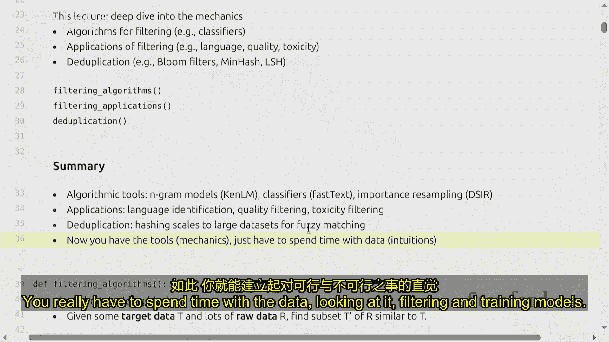

好啦，数据讲座就讲到这，下周我们就要开始学强化学习和对齐了。

