# 【中文配音】硬核！斯坦福 CS336：手把手带你从零构建 ChatGPT - P16：Lecture 16： 对齐 - 强化学习1-Alignment - RL 1 - 外影译坊 - BV1BWEWzfEKi

好嘞咱开始，这是训练后系列讲座的第二讲，我们要讲的是，我们先把周二讲座剩下的内容讲完，剩下的所有内容，然后我们来讲讲基于可验证奖励的强化学习，某种程度上算是新的，在过去大概六个月里发生的令人兴奋的事。

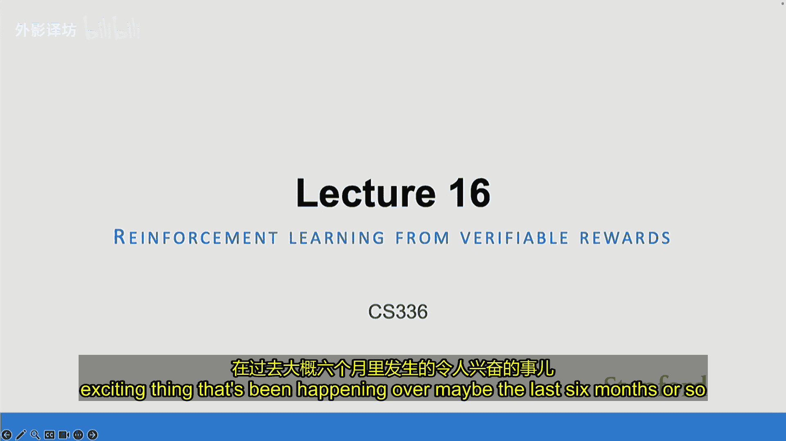

而且切实推动了所有这些，在该领域占据主导地位的推理模型，在进入可验证奖励部分之前，令人兴奋的数学强化学习相关内容，我要回顾一下，然后完成基于人类反馈的强化学习，这是对周二讲座最后几张幻灯片的快速回顾。

所以我们想通过人类反馈进行强化学习，也就是在这种情形下，我们观察成对偏好数据，比如两个回答哪个更好，我们希望得到一个语言模型策略，能为这种偏好数据最大化某个潜在奖励。

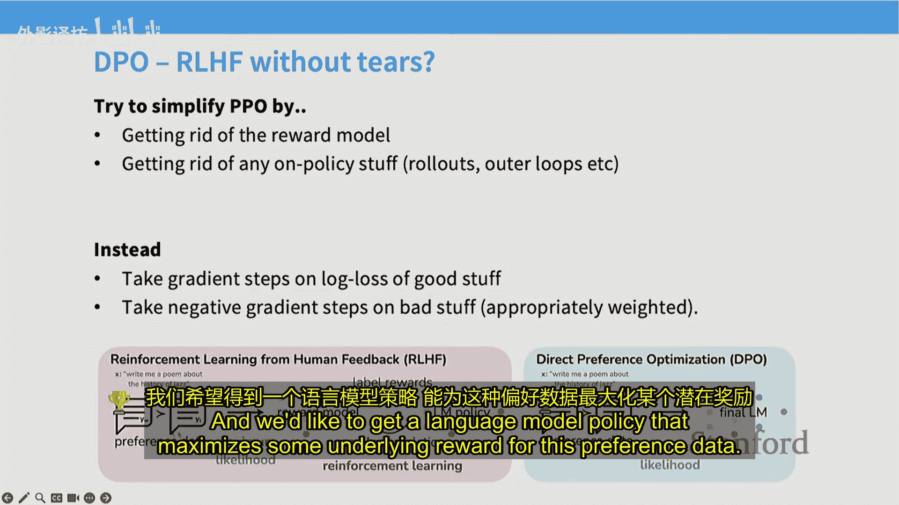

要是你还记得，DPO是一种可用于优化强化学习目标的算法，而这个目标颇具难度，因为可以说我们的语言模型及策略，处于这个期望的底层，你从语言模型中进行采样，你并非只是最大化语言模型下的可能性。

而我们实现这一点的方式，要是你还记得推导过程，即我们将做出非参数，假设我们的策略类为所有函数的集合，我们会将奖励改写为策略的比率，然后将其带入bradley terry目标。

所以我们要做的是找到一个策略，使得使隐含奖励能最大化，我们所看到的成对偏好的概率，我们所看到的成对偏好对吧，所以现在这很棒，因为这基本上是针对一种交替参数化目标的。

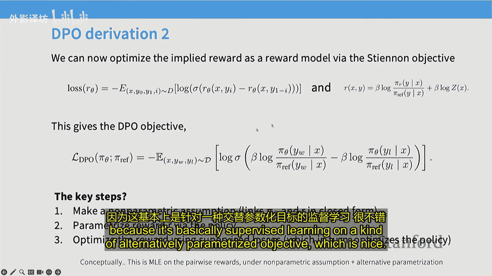

监督学习，很不错，DPO更新的形式如下，大约一年前，DPO曾一度在全球引起轰动，原因是是他能被写成一种相当不错的形式，在这种形势下，你要采取这些梯度步骤，这些步骤会乘以贝塔，这有点类似正则化。

你会有更高的权重，当你的奖励估计出现错误时，所以你会进行更多更新，当你的隐含奖励不正确时，然后你要提高正面势力出现的概率，并且你要降低负面势力出现的概率，如我所说，要是你还记得我上节课讲的强化学习算法。

通常归根结底就是增加好的部分的权重，降低坏的部分的权重，而微妙之处在于确定什么是好的部分，以及增加多少权重，所以这是做这件事的一种特定选择，而且我们会看到其他事情发生，所以DPO运行的相当不错。

有一段时间，基本上所有开源模型版本，都用DPU变体做训练后优化，而且实际上和PPO比DPO很容易上手，所以有一段时间他确实是占主导地位的方法，从那以后出现了大量类似型号PO的论文。

基本上大家都想提出DPU变体，有几十篇论文，有这么多，我觉得没必要去翻阅如此海量的论文，我会提到两篇，并非因为我认为他们是正确的，而是因为我认为他们是最近被使用的，被那些在这种DPO风格训练后。

优化方面不断突破极限的人使用，一个是CPO，他只做了一两个简单修改，第一个是根据响应长度，对更新大小进行归一化处理，稍后我们会看到类似的主题出现，他们还会去掉参考内容。

所以现在我们失去了DPO相关的数学论证，我们所做的是查看策略的比率，不过呢这更纯粹是在关注某件事，看起来是在对一些内容进行加权，你懂的，对好的部分加重权重，对坏的部分减轻权重，在那种潜在动机下。

CPU是完全可行的，还有其他变体，比如不一定像去除参考策略那样做，你只是按长度进行归一化处理，称为长度归一化EPO那种方法，人们已经尝试过了，而这两种形式，长度归一化的DPO和CPIO都曾被尝试过。

AI2团队在进行秃噜三时，进行了相当广泛的尝试，而且我认为有一点需要指出，所以我要暂停一下，因为我觉得这一点很重要，并非在于概念层面，而是经验层面，仅仅是一个重要的经验要点，也就是在强化学习中。

许多研究结果在很大程度上取决于具体的设置，对吧，所以这取决于你运行它时所处的环境，取决于你所采用的基础模型，取决于你所采用的训练后偏好设置，你会得出截然不同的结论，关于这一点举个例子对吧。

所以一群AI2的人做了很多非常出色的训练后，实证研究，他们做了一项研究，在这项研究里，他们在比较DPO和PPO，他们发现PPO比DPO好，可能是因为它的策略性，他们把这种提升表示为DPO到PPO的差距。

然后在吐鲁三的后续研究中，他们发现，如果以更好的方式进行SFT，实际上这会抵消PPO和DPO的所有优势，所以这两者都没什么效果，唯一表现更好的，或许是采用归一化的DPO对吧，比如结论差异颇大。

当然左右两篇论文差异很大，但并非一方错一方对，实际上对于这些内容，你不应仅凭一篇论文就轻易得出过多笼统结论，仅凭一篇论文，所以即便我继续讲下去，这也是个要点，讲到PPO时，稍后再谈GRPO。

你没必要把任何一个实验结果都当成真理，所以关于RL hf，我最后要说的是两件重要的事，我觉得其中一点会贯穿今天整个讲座，所以我觉得这很重要，所以第一件事是过度优化，所以在某种程度上。

这只是换了个花哨的说法的过拟合，但这是个很重要的术语，因为本质上他说的是，当你不断优化策略时，所以把这个X轴理解为相对语言改进的程度，起初你的奖励会持续上升，但最终你基于人类偏好。

拟合的奖励模型正逐渐偏离真正的人类偏好，而且优化的越多，最终你会逐渐偏离对吧，就好像你并没有变得更好，只是在优化，但实际上并未提升你的奖励，在基于人类反馈的强化学习中，过度优化现象几乎随处可见。

这可是个大问题，所以这挺让人担心的啊。

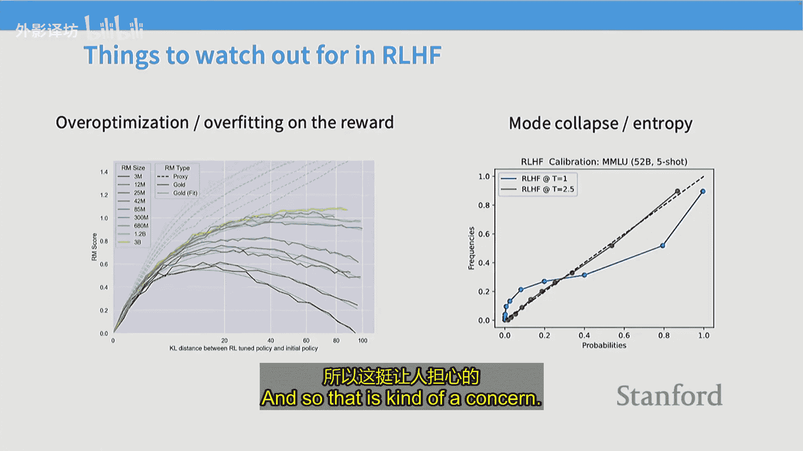

而且过度优化现象在很多方面都会出现，因为人类偏好有噪声以及人类偏好的复杂性，所以我的一些学生做了项研究，他们主要针对人类偏好，进行了基于人类反馈的强化学习，他们针对带噪声的人工智能反馈。

进行了基于人类反馈的强化学习，然后他们针对无噪声的人类反馈，进行了基于人类反馈的强化学习，你会发现，无论是人类还是有噪声的人工智能反馈，都存在明显的过度优化现象，但纯净无噪声的人工智能反馈并非如此。

所以如果你打算进行后期训练，你应该预期会看到像左边那样的曲线，当你训练模型使其表现更好时，而且在你所衡量的替代奖励方面表现更好，但不一定能得到更好的结果，以及在人类偏好破坏率方面表现更好的模型。

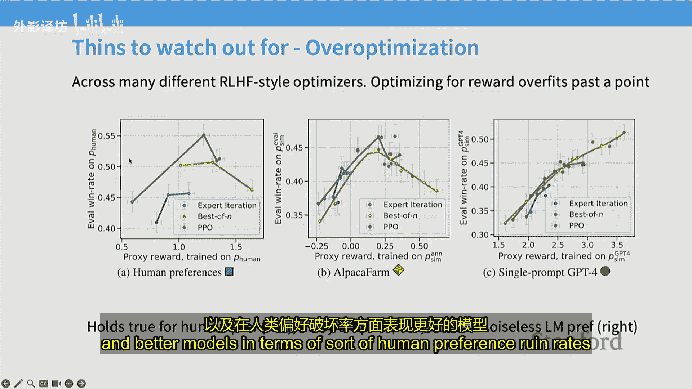

好的还有一件事，这是个重要的补充，就是当你进行强化学习时，记住我说过，我们已不再概率世界了，所以当你进行监督微调时，或者当你进行预训练时，很明显你在对某种分布进行概率建模，你在为某事进行分布匹配。

但强化学习这一切都只是一种策略，不一定存在潜在分布，而这表现为，你常常会得到校准程度低得多的模型，许多不同论文的一系列结果表明，基于人类反馈的强化学习模型，常常尤其是在温度为宜时。

表现出过度自信的多的行为，所以这个来自一篇ANTHROPIC的论文，这个我想是来自GPT4发布时，这个来自我的一位博士后所作的一篇论文，在所有这些情况下，本质上，基于人类反馈的强化学习模型。

的校准度要低得多，也许这样也行对吧，因为校准并非你所设定奖励的一部分，所以这是设计如此，但你若将这些模型当做某种校准过的概率模型。

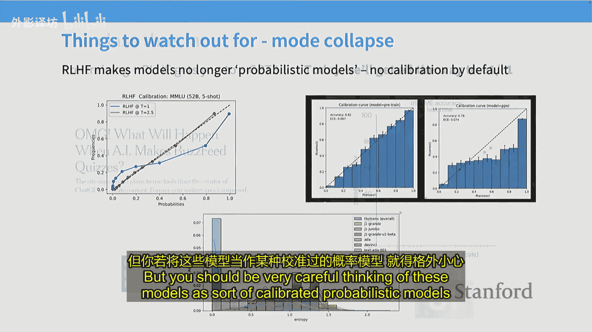

就得格外小心，你可能会忍不住这么做，如果你是从生成式建模背景涉足此领域，那么行，到目前为止，我们一直在思考，基于人类反馈的强化学习及相关事宜，实际上我要暂停一下，如果有人对基于人类反馈的强化学习。

有最后的问题，我会在继续前回答这些问题，我们马上要从以验证奖励，请讲，是这个问题吗，所以X轴是代理奖励，所以在这里我们再拟合一个奖励模型，我们这里不采用DPO，比如说我们在做类似近端策略优化算法的事。

我们要你和一个奖励分类器，X轴表示我的强化学习算法，把那个奖励分类器优化的怎么样，所以强化学习的成功情况在X轴上，Y轴表示的类似真实胜率，可通过人工智能反馈或人工反馈衡量。

所以这里Y轴就像真实的人类投票，所以这里是说，你可能觉得在强化学习中取得成功，能让你在你想优化的实际任务中取得成功，并非如此，在某些时候它会过拟合，至少在人类偏好上会这样，我有个问题。

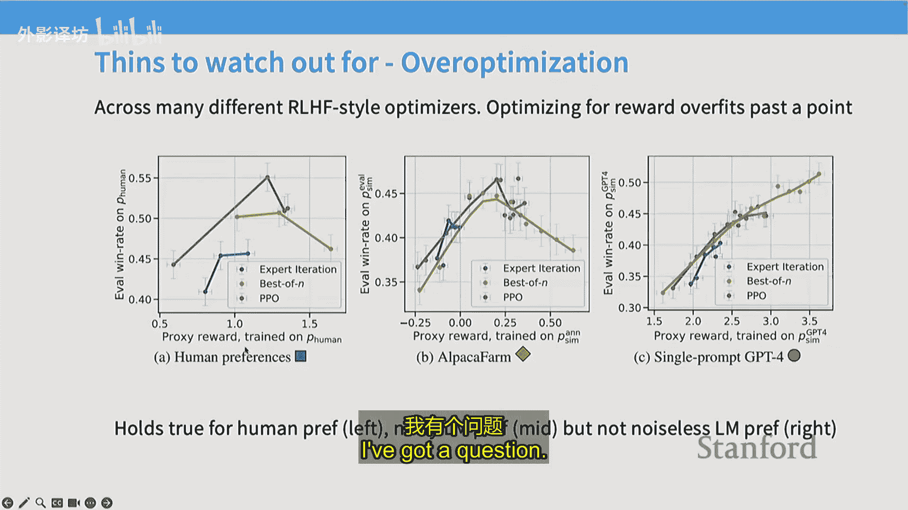

如果你的目标是算出贝塔乘以log，再减去贝塔乘以log，为什么他实际不像beta log a log b呢，或者就像log一样，你是想问，比如说为啥他们不把对数里的分数提取出来呢，不我不这么觉得。

我觉得求比值在数值上不太好，所以我觉得这其实就是为了节省空间，比值更紧凑，而且他们也是直观的对吧，嗯他变成了另一种形式，因为贝塔值变了，做这事的动机完全不同对吧，没有比例，这是个截然不同的对象。

像是出现了奖励破解的情况，我在想奖励分数咋衡量对吧，因为据推测右边的奖励函数，但这有点像训练和测试的差异对吧，这里的X轴你有一个训练集，你在上面你和一个奖励模型，然后你再测量那个拟合的奖励模型对吧。

并且Y轴是来自真实奖励源的新样本对吧，所以从期望上看，他们测量的是同一件事，但在有些样本里，他们测量的不是同一件事，这和机器学习中的训练测试差距一样对吧，概念相同，从期望上看，他们测量的是同一件事。

对于任何有些样本并非如此好嘞，所以我觉得所有这些关于从人类反馈中进行，强化学习的问题引出了一个好观点，也就是人类反馈很难优化，很难扩展，所以你可能会问，是否有其他更有效的强化学习方法，可用于训练后。

这就会引出我们下面要讲的内容，那么直到现在，我们一直在聊chat gp t3。5，以及那个时代的模型。

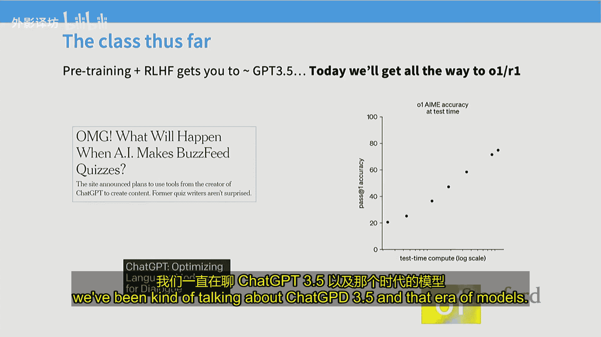

现在我觉得我们得聊聊O1，还有新的一系列推理风格模型，而我们实现这一目标的方式大致是这样，想好吧，我们现在有了一个非常强大的工具，我们有这个强化学习工具可用于训练之后。

最初大家都知道本能反应是说有一个真正目标，而这个目标就是人们是否喜欢这个机器人对吧，那么如果我们仅针对我们在意的真正目标，进行优化，那这就是我们所需的一切结果，证明这非常困难对吧。

人类的认可很容易被操纵，很难进行大规模收集，很难大规模开展强化学习，基于所有这些原因，过度优化以及这类问题，另一方面，我们可以转而投向强化学习，真正占据主导的领域。

比如alpha go或AlphaFold，接着审视这些领域，你或许会说，我们真正需要的是某种领域，在其中我们知晓真正的奖励，且能快速高效大规模地评估这些真正的奖励，要是我们能做到这点。

那我们就能把过去强化学习的所有成功经验，应用于语言建模，所以这就是我们目前秉持的整体思路。

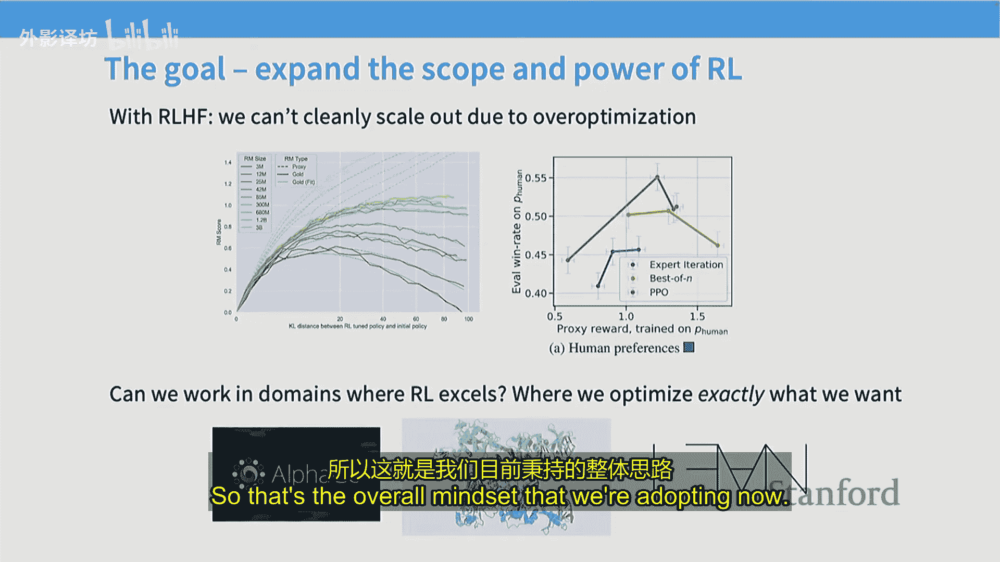

我们有自己构建的工具，现在让我们用这些工具，以一种截然不同的方式来应用它们，从强化学习的成功经验中汲取灵感，所以今天我将分两部分来讲解，那么第一部分是算法部分，所以最上面的这部分我将讨论不同的算法。

首先我将更详细的讲讲PPO，因为篇幅原因，我在上次讲座中略过了这部分内容，然后我会把PPO转化为GRPO，某种程度上它更简单，然后我们来聊聊那些目标，以及GRPO在实现细节方面的内容。

从而得到GRPO的多种标准变体，完成这些之后，然后我们来讲讲这三个，我觉得作为案例研究的大型推理模型训练，相关事宜，由于在第一部分之后，你将掌握理解第二部分所有内容所需的工具，等你完成第二部分之后。

你能明白这三个中文开源语言模型，是怎么制作出来的，好的，那现在我们要回到PPO，这是我不想干的事，但为了让你明白GRPO为啥存在，我们必须得这么做，那PPPO是啥，至少在我对PPPO的某种理解里。

我们从最简单的事入手，然后再一步步深入到PPO，所以说最简单的事，我上节课讲过这个，这就是策略梯度，所以在左边我想优化基于策略P的预期奖励，我们将通过梯度下降来优化它，所以我对那个目标求梯度。

然后得到方程的右边，这就是策略梯度，也就是当前策略下奖励的期望，我将采取梯度步，根据奖励Z的符号，要么增加，要么根据奖励Z的符号降低概率，希望够直接，要是你不熟悉这个。

你可以去复习一下策略梯度是怎么推导的，现在这里有两件事有点低效，值得我们考虑，那么首先这就是所谓的纯策略方式，所以强化梯度的工作模式，我得从PCA中采样，然后我会立即对采样结果采取行动。

所以每次我要进行梯度更新时，我得计算一下奖励，而且我得进行一次模拟推演，你在作业五里会大致明白这一点，但强化学习里费事儿的部分就是模拟推演，我们得实际运行语言模型来获取样本，而且我们都知道这挺慢的。

从破析的推理讲座里，我们都知道这特别复杂，这可棘手了，我们更想少采样几次，我们进行一次部署和一次采样，然后对这些部署进行多次更新，这就引出了一种叫信赖预策略优化的方法，不再从PCA获取更新。

我想让更新逐渐失效，所以我要做的是，我将从下面这个旧的PC塔基础分布中采样，但仍能得到有效的策略梯度，那我该怎么做呢，嗯我可以进行重要性采样校正，接着我就能让新策略贴近旧策略。

如此一来就不会与旧策略偏差过大，并得出一些异常的奖励，估计极为简单的思路，只需做一点离线到在线的策略校正，你会得到一种名为信赖与策略优化的东西，这个A是R的地方差形式，我就不详细讨论优势。

估计了近端策略优化算法，在此基础上只需简单额外一步，他表示无需进行kl散度计算，我只是要对优势进行裁剪，而这自然会迫使我的策略保持相近，因为如果我走得太远，那么我就无法获得越来越多的奖励。

这些奖励将在一减x sent或一加ax sent，储备阶段，我所能获得的奖励存在一个上限，所以RL算法没有动力，让策略与当前策略有很大差异。

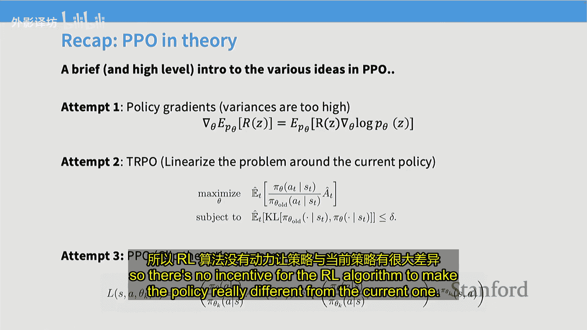

所以可以认为这是这个想法的一个弱化版本，好的，那么PPO非常成功的强化学习算法，在许多不同地方使用，用于非常简单的强化学习环境，它被用于OpenAI的DOTA机器人中，在这类实际强化学习任务中表现出色。

哦对了，有个视频我把那个忘了，是的看你可以四处跑，是的好，在概念层面没那么复杂，如果你去查看OpenAI关于PPO的文档，它看起来挺简单的，你能看到我上面列的那个公式，就是这个PPO裁剪目标。

实际上唯一可能稍复杂些的是，这个A实际上是通过价值函数来计算的，所以你需要第二个神经网络来计算预期奖励，从某种程度上讲，这能用来降低梯度的方差，我不会再详述所有强化学习的细节了。

但这里重要的一个实现差异是，我们需要这个价值函数，而这很快就会变得重要，但实际上的近端策略优化算法，与理论上的大不相同，而且你知道有苦头吃了，要是有篇博客讲了，近端策略优化算法的37个实现细节。

我可不想了解PPPO的那37个细节，这篇博客文章里列了一大串，不同的近端策略优化变体，并且他们在强化学习，基准测试中的得分都不一样，有篇论文探讨了近端策略优化中，实现细节为何重要，还想到要是搞砸了。

连策略梯度都算不对了，但实际上效果更好对吧，所以要是看近端策略优化的实现细节，会发现这有点疯狂，所以我们可能真得看看PPO的实际实现细节，我会快速过一下，因为PPO不是这次讲座的重点。

但我想跟你们讲的是，你们并非都在研究这个训练后的领域，为什么人们这么在意PPO的替代方案，就是因为这类事情，PPPO效果不错，但有点棘手，这就是个例子，我觉得从RLHF重新实现的。

早期有个不错的图表说明，这就是PPO的标准实现方式，这个图表很复杂对吧，我们有一个基于人类反馈强化学习的奖励模型，我们有一个价值模型用于跟踪预期奖励，我们有广义优势，估计我甚至还没解释那是什么。

然后他会进入策略语言模型，然后我们会进行策略梯度更新，所以要让PPO运行起来，所有这些机制都得就位，实际上我们现在要看一个几年前的实现，我和我的学生重新实现了近端策略优化算法，其他人也用过。

所以这是一个经过一定测试的实现。

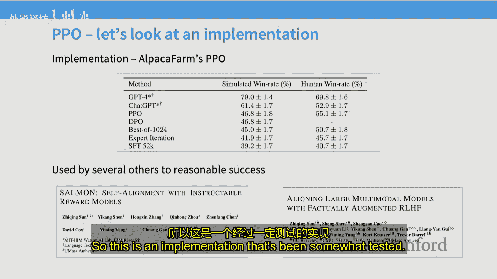

但这并非一个完美的实现，我相信像火山引擎的一些更现代的实现方式，其他的可能会更好用啊，但我想带你了解一下所有不同的组件，此外当你在作业中编写GRPO时，你的结构可能会反映出其中的一些方面。

所有强化学习算法都有类似的外层循环，那么我们来看这个一个近端策略优化步骤，与语言模型中的标准梯度更新步骤极为相似，所以这就是外层循环，我们要做的是获取一系列数据样本，一旦我们获取了一系列数据样本。

我们要做的是计算一些损失，然后我们要进行反向操作，然后进行带裁剪范数的梯度步，就是这样，没什么可怕的。

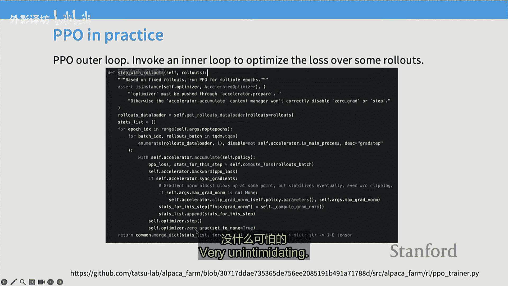

强化学习的外层循环通常没问题，要知道损失计算也基本类似，所以对后排的人来说，这个可能有点小，但如果你看这个，你看到的是一个模块在计算价值函数的损失，记住近端策略优化算法，有一个价值函数和一个策略。

所以我们得同时更新这两者，所以我们在计算价值函数与实际回报有多接近，我们获得的奖励，而且我们要让他们接近，因为价值函数要起到减少方差的作用，然后我们有用于近端策略优化，算法更新的实际奖励。

然后我们有裁减常数，一减XELLENT和一加XELON，这段代码，实际上就是把这个再复制一遍，为了让你对超参数有个直观感受，这里典型的裁剪范围大概是0。2，所以基本上你能从0。8到1。2。

在新旧策略的自然比上。

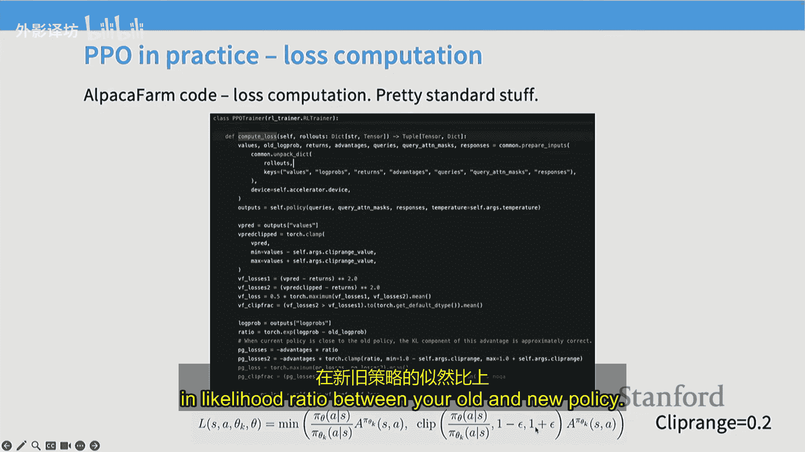

多次试验阶段，事情开始变得棘手，但本质上这仍只是在进行推理，左边实际上就是从当前策略中，进行多次试验采样，然后评估样本的对数情况，然后再进行右边的操作，你看到了什么嗯，这里唯一微妙的是你的价值和奖励。

并且你的策略可能有不同分词方式，所以你得重新分词，但除此之外，你只需把你的模拟数据输入模型好。

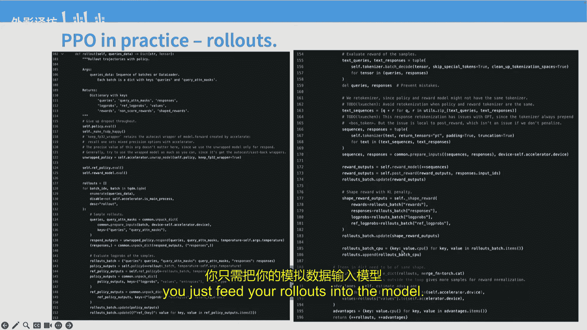

这时你看着这段代码，然后你会说好，没问题，这还不算太坏，但事情开始变得有点棘手的地方，首先我们要进行一些奖励塑造，那这是什么意思，所以稍微往后退一下，语言模型的强化学习中有件怪事。

就是从强化学习的角度来看，从技术角度讲，它有点类似上下文多臂老虎机，那么什么是上下文多臂老虎机，上下文多臂老虎机，是指你会得到一个输入，而且你有一系列可行的行动，然后你会立即获得奖励，在语言建模里。

你会收到一个提示，你能给出一个输出，接着你会立刻获得一个奖励，不存在状态转换，不存在环境探索，不存在这种复杂性，这里的奖励塑造，本质上是针对每个标记构建损失，以便能为强化学习算法提供更易学习的内容。

那么对于近端策略优化算法，和广义近端策略优化算法实际情况是怎样的呢，你将要实现的就是kl项，本质上我们应用的正则化是按每个次元计算的，而实际的真实奖励，比如是否完成任务。

这种情况是在最后一个词源处计算的对吧，所以你看对于正则化本质上存在按词源的奖励，最后有一个单一的最终奖励，取决于是否成功是吗，这是什么意思，什么不起作用，没错没错，这个开着，这还挺有意思。

基本上我们只对每个资源添加kl散度乘法，但再说一次，这是困惑度实现过程中一件挺有意思的事，这里的第二行，这是实际的kl散度计算，但当这个数变成负数时，它在数值上就不稳定了，而且实际上这种情况还挺常见的。

因此这个值会被截断为零，你们都知道，如果把对数自然比截断在零，那他就不再是kl散度了，但他是kl散度的一种近似没错，奖励函数那个和其他的一样吗，对有道理。

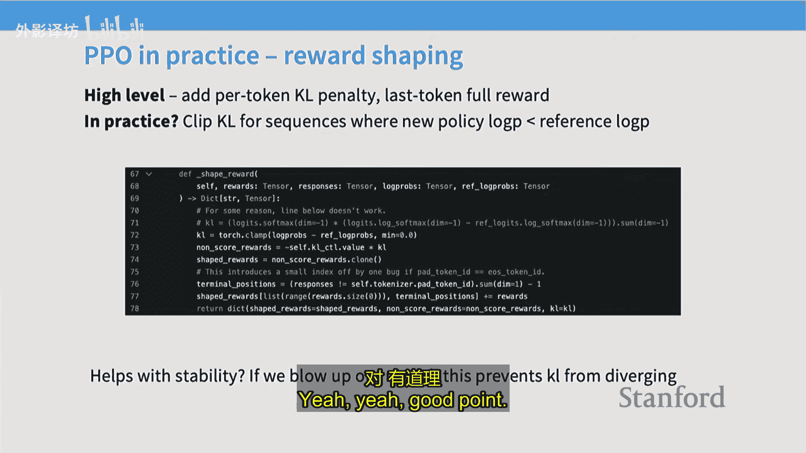

所以就像我在外层循环里说的更新，实际上就是在进行梯度步。

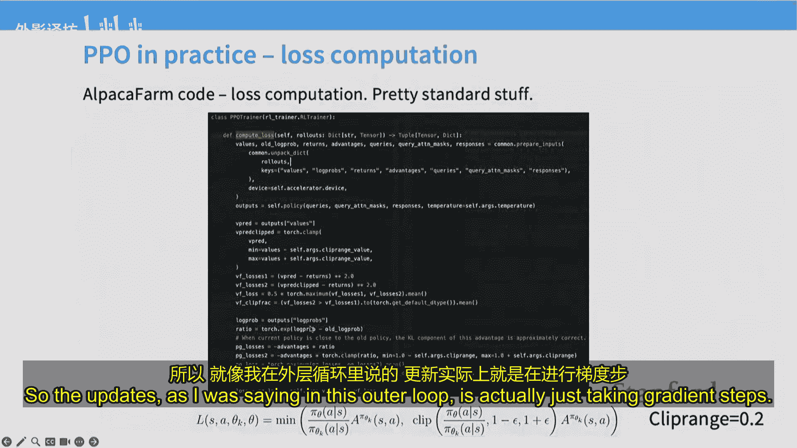

那么就你的代码来说，它看起来与只进行普通梯度步并无二致，不过这里发生了什么，在某种程度上。

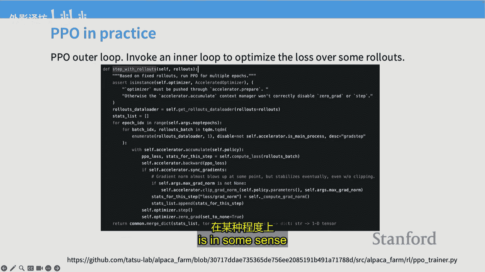

我们回到这里的策略梯度方程，如果你写下这个，这是二乘以P，这有点类似于对r z log p关于theta求梯度，这是一个加群损失，然后对其求梯度，而从技术层面讲，你没做的事，要是你在计算真正的梯度。

你还得对p theta求梯度，但你没这么干，有一种隐式的停止梯度，所以你要做的就是计算这个内部损失，把它输入自动求导，然后就能得到策略梯度的正确步长，没错。

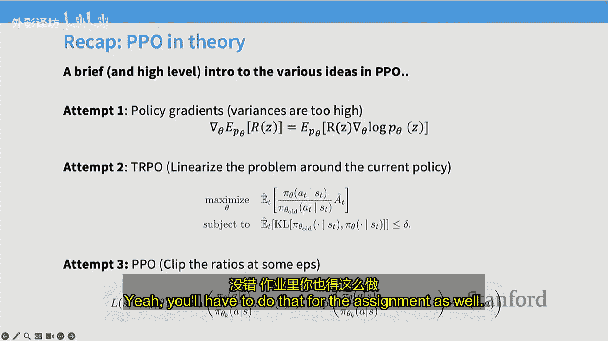

作业厘米也得这么做，我们有个小教程，要是刚才的快速解释没懂。

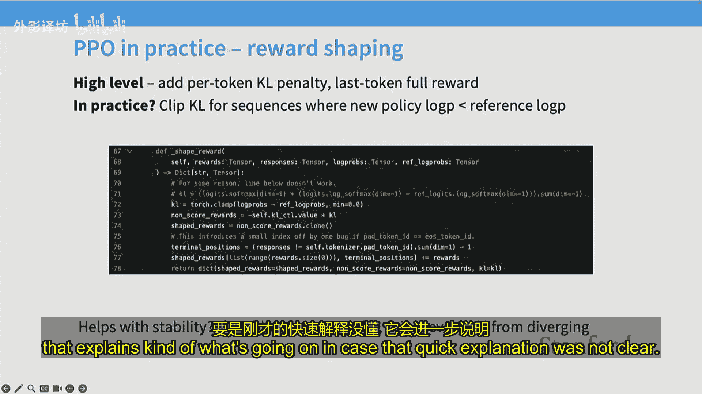

他会进一步说明好啦，最后要说的是，我觉得最麻烦的部分，有个我没讲的框，叫广义优势，估计对吧，所以你要做的是，每当你有策略梯度时，梯度的方差通常很高对吧，所以你要尽可能减少方差，不是直接用梯度乘以奖励。

而是可以，你可以证明下面这个A量，本质上是一种折扣优势，估计这是一种强化学习术语，是个合适的替代，所以近端策略优化算法做的一件与众不同的事，就是使用这种优势，估计可以调整lambda以及GMA。

来权衡梯度的偏差和方差，不过有趣的是，尽管维护这个价值函数，并估计所有这些量所带来的实现复杂性，令人烦恼，你可以直接选取gamma等于lambda等于一，这基本上就将整个过程简化为了基线策略梯度。

所以你是在用奖励R2减去隐含值来冒险一搏。

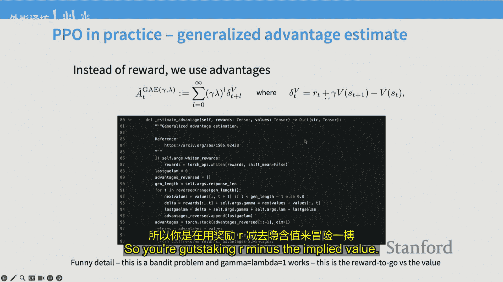

而且那样也行得通，让你了解这些的关键在于近端策略优化算法，有很多近端策略优化算法实现细节很简单，因它是强化学习的外层循环，你只是在求梯度，不过这也有点麻烦，你得做所有这些裁剪操作。

你得想想该如何处理广义优势，估计我该如何训练价值估计，但你期望看到奖励总体呈上升趋势，包括奖励模型以及负kl散度，奖励下降的情况，这又是一个上下文老虎机问题，所以你期望看到相当合理的训练曲线。

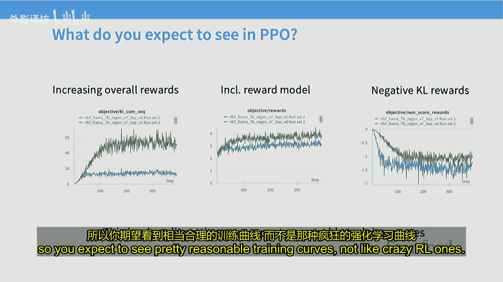

而不是那种疯狂的强化学习曲线，好的，那么我讲完了近端策略优化算法，那算是一次快速浏览，但我想你应该能了解A的情况，PPO是什么，以及B有时候要让它运行起来会有点麻烦对吧，所以这促使很多人尝试去寻找。

PPO的替代方案，我们实际上想要做的是应用这些强化学习算法，到PPO适用的场景，而且PPO在一般的强化学习场景中，应用效果很好，在有一些奖励的场景中，但我们不想要复杂的实现，也许更重要的是。

我们想摆脱价值模型，实际上要是你试着去实现近端策略优化算法，那可真是烦死人了对吧，因为价值模型通常和策略模型一样大，所以现在就GPU内存来说，你要付出两倍语言模型的成本对吧，现在你可能会说行。

为什么我们不能用近端策略优化对偶算法呢，近端策略优化对偶算法很适合成对，比较像布拉德利特里比较那样，钥匙就不太妙了，比如说你要是想对数学问题做强化学习，并检查答案是否正确，可以说其本身不存在成对结构。

所以或许DPO不怎么样，从某种意义上讲，DPO最初算是一种离线算法，因为它有一系列你最初收集的配对，然后你就基于这些来更新模型，你可以通过迭代使其成为在线算法。

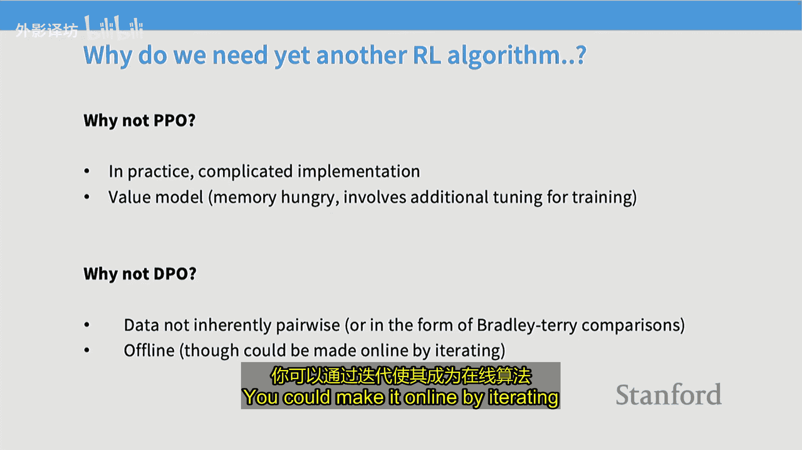

但这通常不是人们应用DPO的做法，那么现在这就引出了新热点，我觉得是GRPO，所以GRPO在动机和实际操作上都非常简单，那么从概念上讲，你从PPO开始，你从非常相似的部分入手，你会考虑类似裁剪这事。

你以非常相似的方式思考策略更新，但你要做的是去掉极为复杂的D，你直接彻底去掉它，然后用简单的多的玩意儿取代它，那么这个简单的多的玩意是什么，好了，我们要替换掉这个优势，他以前是类似D这种东西。

他是回报的累加，这里面包含价值函数，相反它将是这张幻灯片底部的公式三，这是什么，这个优势你懂的，第I个响应的优势等于该响应获得的奖励，减去组内响应的平均值，我一会儿会定义什么是组。

然后再除以组内奖励的标准差，所以这就是一个Z分数，要是你知道的话，这就是组内奖励的Z分数对吧，那么什么是组呢，在语言模型强化学习中，组是个很自然的对象，你有一个输入的问题，比如说解这道数学题，那就是组。

而且我有很多不同的候选回答，我有几个不同的回答，这些就是我单个组里的所有回答，那么好处是仔细想想，也许问题有难有易，有些数学问题比其他的难得多，正因如此，我其他样本获得的平均奖励，对我而言是个自然极限。

而且人们已经对这些算法进行了深入探索，比如如果你查找留意法的强化学习，或者抱歉留意法的策略梯度，这就是正在起作用的留意法基线，再减去这边的标准差部分，没错，所以你是说他们会有一堆问题对吧。

然后就有了答案并被记录下来，那么每个答案只对应一个问题吗，还是说针对多个问题，对同一个问题进行多次尝试，每个问题都有多个答案，这样就能减少方差，针对每个问题我们能这么做吗，无不不，那么对于每个问题队列。

GRPO会对一组输出进行采样，对不，所以这不是批量处理的，通常要是你真做这个，你会有多个问题，对于每个问题你会有这个回答，然后这些会一起进行基线处理，在不同问题间，实际上不会有基线处理或任何交互。

除了策略会一起更新外，这就是为什么基线是合理的对吧，因为问题有难有易，然后该奖励的平均值有时能体现问题的难度，然后把它排除掉，好的没问题，还有一点，这挺有意思的，我要讲一下，因为我就是觉得这挺好玩。

挺酷的，这个DKL要是你看过不少kl散度的计算，这其实有点不太标准对吧，因为自然的kl散度估计其实就是你取一堆样本，然后计算对数比率的平均值，也就是这边这个里面的项对吧。

但这个来自GRPO的实际上多了这两项，他有对数或者有PRAPH与PYTHETA的比率，还有这个一，你可以试着说服自己，若对这个式子求关于派的期望，他会和这边这个相互抵消，所以这是一种控制变量方案。

可降低这种kl散度估计的方差，这挺不错的，因为说不定你们都需要从样本中估计kl散布，方程二，只是用一种稍好的方式来估计同样的东西好的。

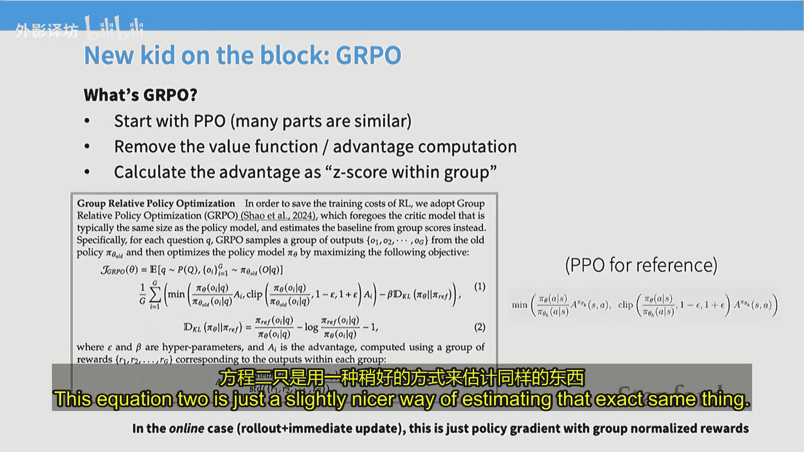

而且GRP很不错哦。

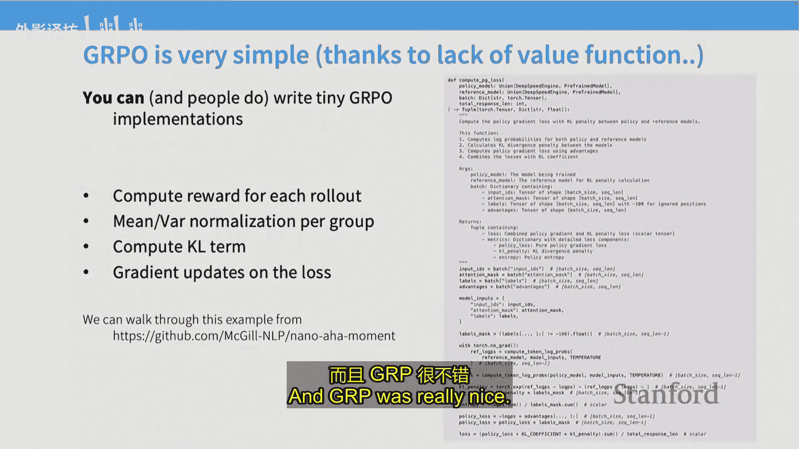

最后一点，如果你只走一步，这是在处理纯在线情形，所有这些裁剪的内容几乎都消失了，而你所做的就只是策略梯度，策略梯度就是提升好的权重，降低坏的权重，我用来乘策略梯度的奖励就是这个I的A值。

所以对于真正的在线情形而言，这就像是个极其简单的算法，即你不会在单个事例上进行多步运算。

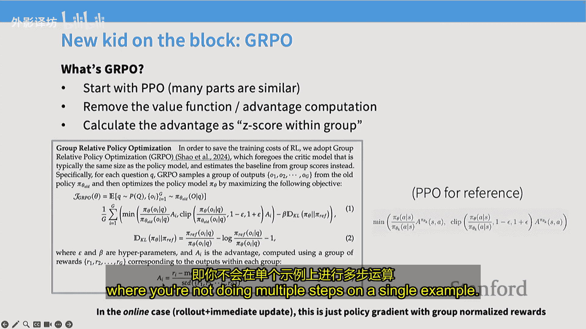

所以有多种不同的存储库用于GRPO实现，我能给你指出好几个，包括这个我稍微复制了一下的，并放在这张幻灯片上，但基本上我可以说他就是你想的那样，有点类似于在外循环中，你要为每次展开计算奖励。

你要对每个组的均值进行归一化，以及奖励的方差，在这种情况下，你要为每个序列计算KL项，这对于更重量级的实现不太适用，然后你对损失进行梯度更新，这是你这里损失计算的一个例子嗯，与PPU不同。

优势计算非常简单，这几乎与那些方程逐行一致，我给你展示的方程只是有一个小差异，未在方程中体现，也就是像你在几乎所有事里做的那样，因为我们是除以标准差，你有一个极小的修正因子，1×10。

确保它在数值上不会出问题，而且你在作业里也得这么做，你需要在GRPO设置里添加一个小的修正值，那么这效果怎么样，GRPO的效果还不错，这出自最初的deep sec数学论文，我稍后再讲这个。

因为看这个图表挺有意思的，以及结合后来deep sec r1的结果来看，这个结果，他们本质上展示了两种基于微调的方法，RFT和在线RFT，我得说这基本上算是个相当薄弱的机械。

你所做的只是去看那些能得出正确答案的例子，这种情况下他们在进行数学运算，所以你只能得到一些例子，能得出正确答案的，然后你会根据自己得出正确答案的输出，进行微调，对不对，通过微调来强化正确答案。

带有结果及奖励的GRPO，在那里你只能得到一个正确的，或者答案是否正确，黄色代表不正确，蓝色的是过程及奖励，有一种系统会审视你推理的每一步，并据此给你打分，而且他们在争论，也许过程奖励更加稍后再详谈。

但无论如何，你能看到GRPO很有效，而且效果颇佳，好在深入探讨GRPO细节前，关于其基本内容有问题吗，那咱们深入思考一下算法里实际发生了什么，不错好，那现在咱们来想想，广义信赖域策略优化和近端策略优化。

算法的区别，以及咱们做了啥有何不同，其实呢有就像我刚才说的，只有一个区别，虽说这区别很重要，它是用这个来替换优势估计器，比如说奖励的均值或者Z分数，那现在我要回到策略梯度定理或者策略梯度，结果。

我要和你一起仔细琢磨一下这个结果，那么当我们进行策略梯度更新时，我们能怎么做呢，所以我就往回翻几张幻灯片，在这张幻灯片上最上面写着策略梯度，这是你所能进行的最基本的强化学习算法。

你把对数概率梯度和奖励相乘来得到梯度，这是我一直都能做的，这是一种数学上的等价关系，现在我还能做的一件事叫基线调整，我能得到这个奖励，Z我可以减去任何常数，或者说任何不依赖于Z本身的随机变量。

而这仍将是一个有效的策略梯度，所以基线调整非常重要，因为你要做的是，你要尝试减去一些常数，这些常数能让这个期望的方差更小，所以这就叫基线调整，如果看这里，那算是个经典的结果，你能在萨顿和巴托的书中查到。

他们说好看，我们有了策略梯度，你可以减去任何S的极限B，毕竟S的极限B你懂的，当我们对整个策略求和时，结果会是零，所以这样行得通，我们总能进行基线处理，但我们来看看这个诶，这是个基线吗。

嗯我们再减去均值，这算是一种机械，因为所有其他奖励都不依赖于兴趣回报率，所以也许那样行得通，我是说从技术层面讲，这个符号包含兴趣回报率，但如果我把那个去掉，那就是个有效的基建，但有件很奇怪的是。

我在这除以标准差对吧，按萨顿和巴尔多的这个推导，这好像不被允许，结果这成了个问题，有些人已经重新分析GRPO及其行为的人，基本认为GRPO在两方面存在问题，至少从数学角度看有点偏差。

首先是这个除以标准差的做法，就像我刚才跟你讲的，这违背了某种原则，即基线只需减去一个与抽样无关的零均值变量，GRPO的另一个问题是关于这点，我之前略过了，抱歉，我之前介绍时略过了。

这一点实际上是用奖励除以输出长度，而这会导致这也有点怪，根据策略梯度定理，这并非自然会出现的，所以这些作者，他们对GRPO算法进行了有趣的研究，认为或许我们该去掉这两点，而如果你这么做。

那么你实际的输出长度会短得多，而且无需更长回复就能获得更高奖励，嗯那么我们来针对这两个修正，逐一仔细讨论这些结果，希望通过讨论这些，你会对强化学习算法的工作原理有直观认识，那么首先我想讲讲标准差。

这个的作用可能比较明显，好让我回顾一下，因为我觉得这样讲更容易理解，当我在这里突出显示公式时，所以我用优势除以标准差，那这是什么意思，当标准差小时，奖励会被放大，对我来说，优化那个组更重要。

当标准差小时，那么标准差何时会小，嗯就是问题太简单或太难的时候，因为那时奖励不是全为零，就是全为一，所以标准差项存在偏差，这会增加那些太简单或太难的问题的权重，作者们认为这会减慢收敛，也许是真的。

至少他肯定会破坏策略梯度的有效性，第二件微妙的事，但同样有趣的是长度归一化，现在咱们来看看这里发生了什么，所以在GRPO奖励之前进行了长度归一化，那么这有什么用呢，如果我的模型答错了一道题。

那么最好的做法就是在这里接受负奖励，所以最好的做法就是让回答尽可能长，如果我答对了，最好的做法是让答案简短，这样我就能尽可能最大化我的正奖励，所以这实际上产生了一个尽可能的，胡说八道的模型。

如果模型认为它无法答对，他就会给出尽可能长的回答，此句单独存在，无法准确翻译，因前面内容不完整，给模型这种激励方式很糟糕，所以如果你解决了这个问题，在各种像CHMARK这样的简单任务上。

你可以得到同样好的奖励，红色的那个算是修改后的版本，但是输出长度不会一直增长，它在某个点趋于稳定，所以实际上有一些有趣的发现，也许一些非常长的思维链，人们在GRPO这类事物中。

所看到的是这些实际实施细节的结果，以及相关选择，而非本质上较长的思维链，是这些模型性能的必要组成部分，我认为这是一类很有趣的假设，尽管尚未完全得到验证。

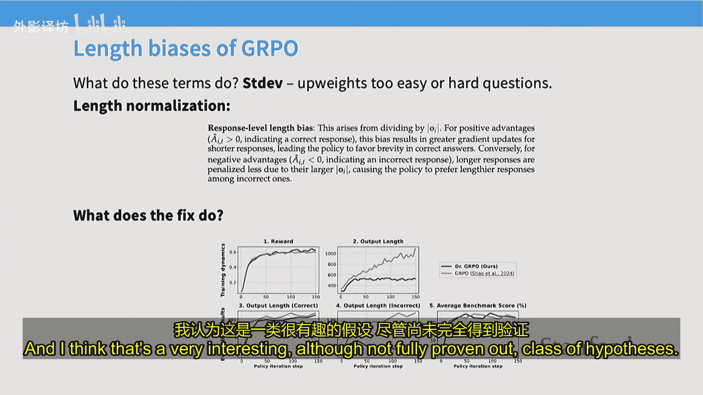

好的，这就是GRPU算法，希望现在大家都已熟悉它，我想你们现在有了阅读这三篇论文的基础，deep sec r1KIMI1。5和困三有什么问题吗，是的，我觉得这进入了某种含糊不清的民间定理范畴。

但实际上这些论文中，有一些会谈到这个民间理论，所以我会提起他，这正是你真正想要的强化学习算法，要做的是获取一些，他能在一定程度上处理好的问题，比如他能在这些问题上获得一些奖励，但这并非易事。

以至于他能直接解决这些问题，所以存在一种循序渐进的效果，你得给模型输入难度适中的内容，要是你再把那个标准差最大化，那可有点走错方向了对吧，你这是在把极端情况下的东西用到极致了，那些你要么都已经知道了。

要么对你来说太难解了，好啦，那我们今天要讲这三篇论文，R1KIMIK1。5和QUEN3，我觉得是R1和K1。5挺有意思的，因为他们差不多同时问世，可惜的是，只有R1获得了巨大的社会，叫啥来着反响。

这俩都展示了咋用语言模型对数学啥的进行，基于强化学习的推理，而且由于它们是同期的，你能看到差不多有两种并行的方式，来解决同一个问题，比如哪些东西相似，哪些东西不同等等，挺不错的。

quin3是这些发布里最新的，在R1中，他们对想法做了一些相当有趣的变化，并且他们还有一些R1没有的新窍门，我觉得这些很值得一看，特别是如果你对推理模型的，推理效率等方面感兴趣，所以我先从R1讲起。

我觉得R1挺厉害的，他作为一篇存档论文，引发了整个社会现象，千万别听导师说说你的存档论文没意义，这一项让英伟达的估值缩水了近5亿美元，说不定有一天你也能掀起那样的波澜，我觉得R1相当出色。

因为在许多方面能以极其简单的方式，复制O1配方的所有特性，所以我要讲的关键特性，确保你们都明白，首先，他达到了OpenAI01所设定的性能目标，大家对推理模型都极为兴奋，所以这超令人兴奋的第二点是。

他开创了一种可复制的强化学习方法，但更重要的是一种极其简单的方法，他无需任何搜索操作，他没有任何过程奖励模型这一概念，我觉得当时很多人都认为，也许得靠这些复杂的部分才能得到推理模型。

R1真正表明你不需要任何这些复杂的部分，最后关于监督微调与其他方面的相互作用，有很多有趣的见解，以及强化学习，我认为，监督微调与强化学习的相互作用仍然非常重要，所以R1的出发点是基于深度搜索数学。

实际上我给你们展示的GRPO的部分方程，源自深度搜索数学，在深度搜索数学里，最初提出GRPO作为更简单替代方案，或者是近端策略优化，更具系统效率的变体，实际上对他们而言，最重要的是，他们想摆脱价值模型。

只因因为他在身边实在烦人，但真正有意思的是，他们实际上选择了这条黄线结果监督，而这在深度搜索数学中，实际上并非表现最佳的模型，我会在本节末尾再谈此事，所以我将逐一讲解R1的各个部分，那我先从20讲起。

我把它看作是受控设置，所以R10是RL学习中一种非常纯粹的形式，它基本上采用预训练好的模型，并在进行中期训练前进行中期训练，然后将其投入数学RL循环，然后他们试图弄清楚这样做效果怎样。

那么这里的细节是他们如何进行强化学习，嗯他们有一系列类似数学的任务，数据不对外公开，他们将deep sk v3用作基础模型，接着是他们的奖励，他们采用两种奖励形式，其中之一是准确率奖励。

比如说他答对数学题了对吧，这是个答对或答错的二元奖励，他们有一种格式奖励，基本上会强制模型，把他的思维链放在思考标签里，像开始思考，结束思考这样的标签，如果你想让模型使用这些长思维链，这一点很关键。

现在俄式奖励似乎无关紧要，而是源于众多论文以及与众多人的交流，显然这是使整个基于推理的强化学习，切实发挥作用的关键部分，一旦如此，他们所做的是在基础模型上进行强化学习，并无特别之处，但结果相当显著。

他们通过在已有模型上进行强化学习，就能获得接近开启I01的性能，仅通过在模型上进行强化学习，且无需任何思维链微调之类的操作，他们在论文中提到了，关于20的两件相当有趣的事，我想聊聊这个。

因为我觉得仔细探究20中发生的情况很重要，所以他们说的第一件事是哦，要是让模型基于这些可验证奖励进行强化学习，那就太酷了，思维链长度的增加相当可预测，在一篇我未必认同的评论里，论文里他们是这么说的哦。

他在学习解决越来越难的问题，考不断深入思考，就好像嗯或许吧他们还指出这挺有意思的，就是他们能学习像回溯这样的现象，他们把这叫做顿悟时刻，我觉得在公众讨论里，这事儿已经被说了很多哇。

强化学习能给模型带来这些突发见解。

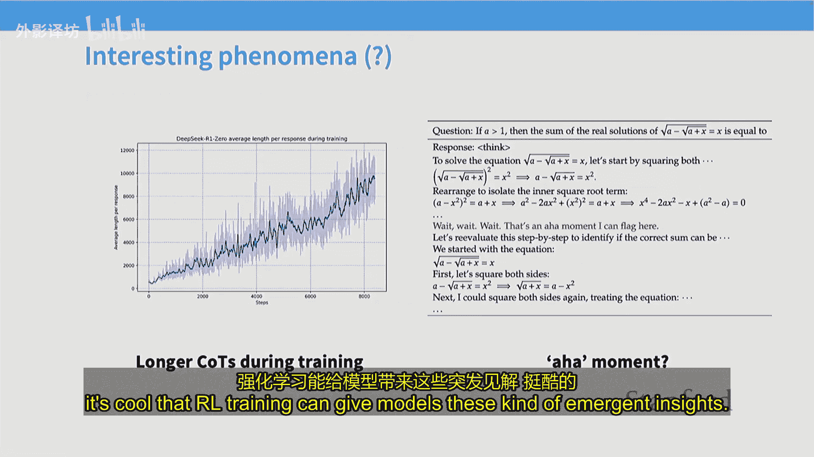

挺酷的，我在此推荐你参考GRPO博士的论文，就是那篇讨论GRPO修正内容的论文，我觉得他们有说实话有相当不错且有趣的论点，认为这两者并非特别有趣的现象，首先他们认为长度增加只是因为目标有偏差。

并非因其本身是个有趣的事物，其次他们说，如果你在一堆数学问题上运行深度搜索V3，你有时也会输出类似阿哈这样的内容，我会做这个或那个，这可能并非强化学习中出现的全新现象，鉴于最近的证据。

这两者似乎都像是一些可信的情况，也许R10并没有什么特别新奇之处，但它实际运行的很好，但它是个不错的数学模型，所以可以把R10视为一种研究场景对吧，他们采用可控模型。

并在此基础上进行可控的数学强化学习操作，然后他们得到了一个不错的模型对吧，但如果你想构建一个真正强大的模型，并推向全球，这可不是你接下来要做的对吧，你得尽可能想尽办法去得到最好的模型。

那么在那种限制更少的情况下，你会怎么做嗯，你可能会进行一些有监督微调，你要从一些未公开的来源获取思维链提示，然后在此基础上对深度搜索模型进行微调，在你进行强化学习之前以及之后。

对你可不希望你的模型有点像那种数学天才，他啥别的都干不了，所以你要在那基础上应用常规的训练后流程，确保确保它能完成，人们通常想用这些模型做的其他所有任务对吧，所以这算是流程上的差异。

关键区别在于流程之中，在强化学习中，他们进行监督微调，初始化，让模型在不依赖强化学习的情况下，学会进行长思维链推理，为确保他们添加了语言一致性，奖励思维链保持单一语言，最后他们进行了一个次要的。

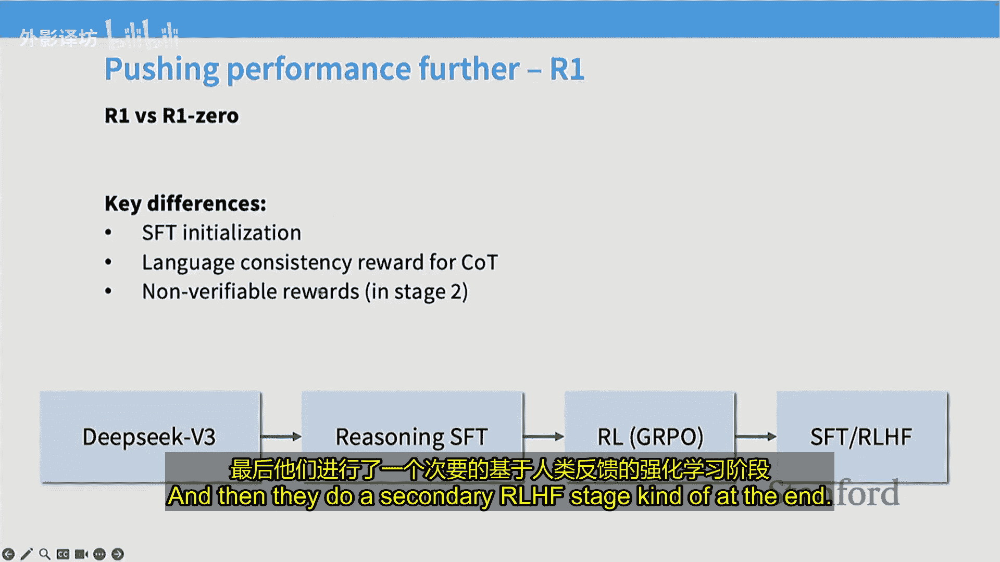

基于人类反馈的强化学习阶段，所以我觉得这很有道理，每次你想做强化学习这类高级的事情时，你可能会先进行一点有监督的微调，所以即使在某些推理模型中，或者像deep sec r1这样的长思维链模型，也是如此。

你首先使用常思维链监督微调数据，然后你要进行强化学习，我要指出关于他们从何处获取这些数据，而且这些数据究竟是什么，仍非常模糊，比如他们并未告知我们思维链数据源自何处，他们如何过滤它，基于阅读R1论文。

我毫无头绪，这样做宣称的好处是，如果你用长文本对模型进行监督微调，那么这会给你带来可解释性方面的好处，当你进行强化学习时，你不会得到奇怪的乱码，它会使模型更贴近你最初使用的这些，更具可解释性的思维链。

而这对用户有好处，当你使用数学模型时，在其运行过程中能看到它的推理过程会很不错，还有一件事对吧，所以当他们进行监督微调，初始设置时，他们使用大量数据，但有一件很有意思的事是，对于许多模型而言。

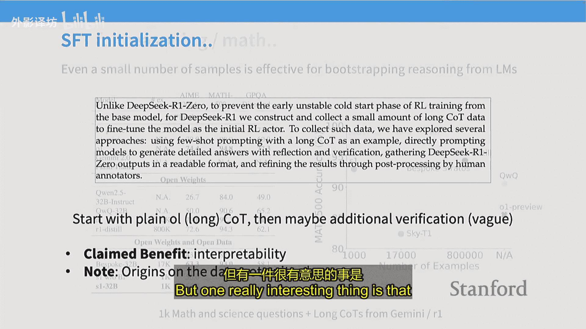

即便只有少量的监督微调，在这类长思维链数据上也能有不错效果，我的一些学生与珀西合作做了一件事，我们做的基本上是收集了一堆长思维链，源自GEMINI2。0的快速思维，并对QEN2。5进行微调。

也许令人惊讶的是，只用1000个例子，就能在数学基准测试中获得极高的准确率，只需要进行少许长思维链微调，所以我认为这两者都真正指向了一个事实，基础模型已经拥有很多思考能力。

你只是在引导并从模型中提取这些能力。

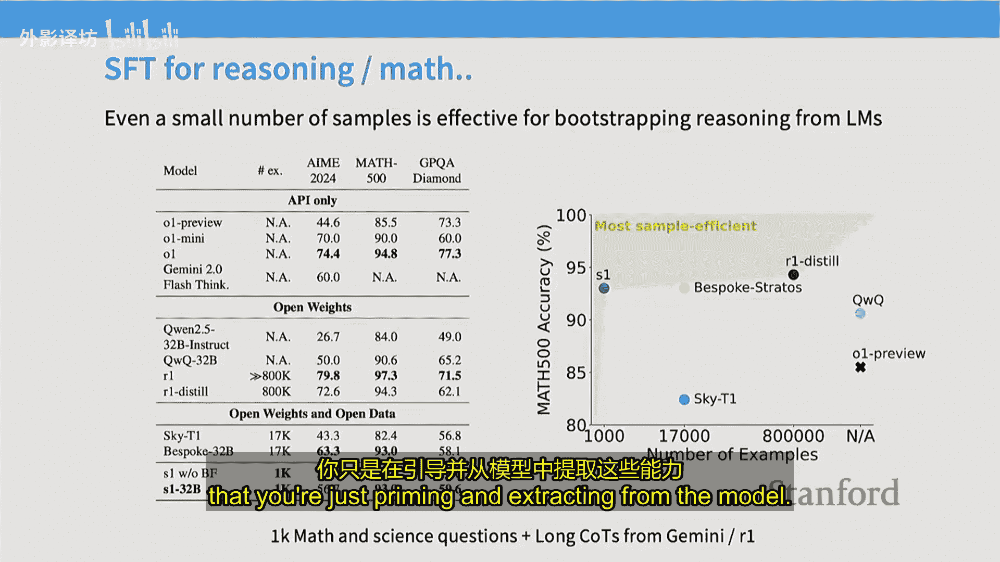

在那之后，当然在你用监督微调设置好模型后，你要做，就像在指令微调，及基于人类反馈的强化学习流程中，所以你从监督微调开始，然后你进行强化学习，让模型实际优化，你想要的奖励，强化学习部分与20基本一样。

没太大差别，但有个小不同，就是要加入语言一致性损耗，我想他们有我觉得这个注释挺有意思的，这是个小注释，但我还是要讲一下，他们基本上是说他们添加这个语言一致性奖励，是因为在训练过程中。

如果他们只是让模型进行RL，他们发现实际上cult会出现语言混合，比如它会在不同语言间切换，你们很多人大概都见过有人玩推理模型，我在网上看到有人发过类似的东西，比如O有点怪的是GROCK3。

在思维链中会突然切换到中文，这与那些情况有点契合，如果你对一个模型进行强化学习，模型有自然倾向混合语言，而非只用单一语言，所以实际上需要额外奖励，才能让他只用一种语言。

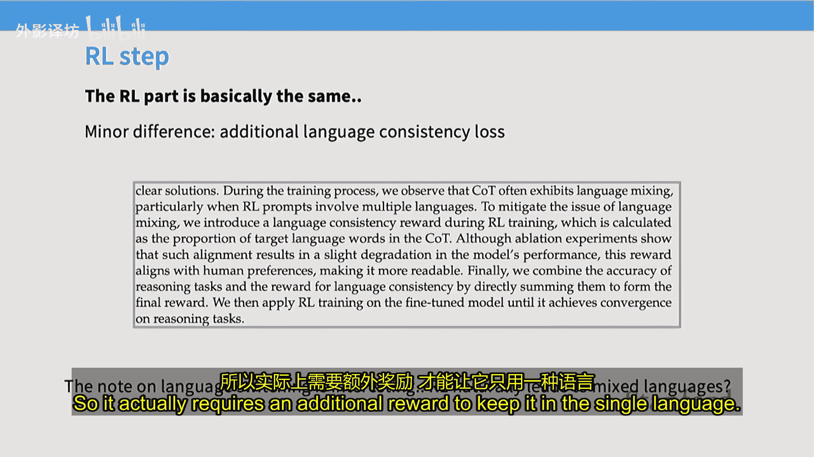

最后在你对数学和其他可验证领域，进行强化学习之后，你基本上要进行常规的训练后处理，所以你要进行指令微调，然后再进行成对偏好调整，所以他们进行监督微调，在这一步他们整合不可验证任务的推理数据。

比如写某个事物的证明，这些无法验证，然后他们用自己的模型来判断是否，他们的答案对不对，他们有非推理数据，比如写篇好文章，而且他们用的监督微调数据集和deep sk v三一样，最后对于RLHF。

实际上在RLHF中，他们仍用GRPO还挺酷的，他们对啥都用同一RL算法，然后他们基本就照着V3的RL hf流程来，训练后这块没啥不同，效果咋样，效果非常好，我想你们很多人也都有过类似经历。

R21在很多方面都很惊人，因为它在一个非常简单的方式上，全面达到了om的性能，正如我所说，我觉得你们没人会觉得这有什么特别意外的，但结果自会说明一切，在英语任务方面基本上全面持平，或与零幺相当。

在代码模型上表现稍逊，但在所有这些不同任务中，实际上都非常接近。

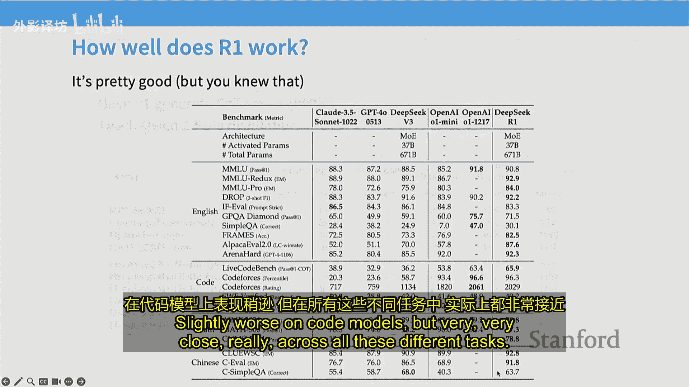

R21论文所展示的最后一点是，你可以采用这些大的大模型，并将其提炼为其他模型，所以你可以采用大型深度搜索R1及其思维链，就像在他们的案例中，他们采用了近百万条思维链。

然后他们用这些思维链对queen进行微调，而且相较于基础模型，它们在数学成绩上有显著提升，对于32B模型，在艾米测试中的表现仅约为50%，所以他们的提升超过了25%，在这项任务上相当令人惊讶。

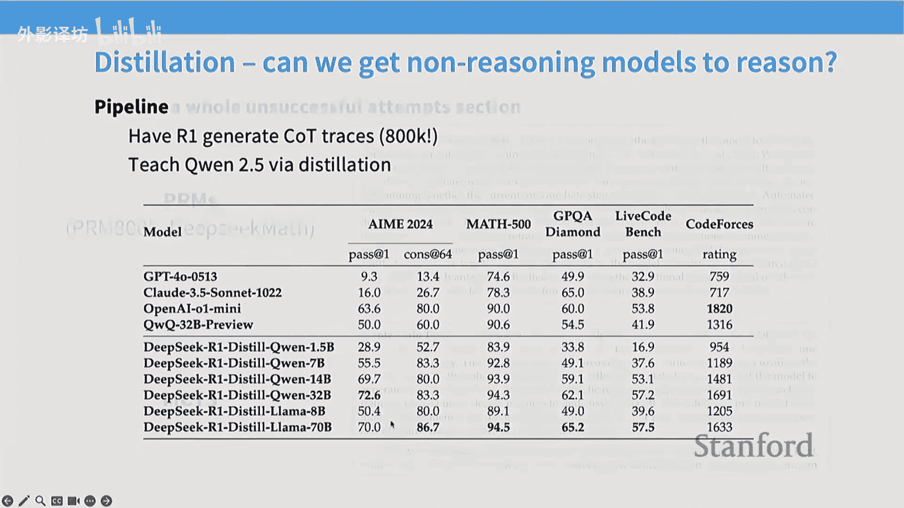

最后我觉得，从R1能得出两个有趣且不错的发现，而且从科学角度讲，在某种程度上，这或许是R1最大的贡献，所以我觉得从科学角度讲，R1可能有三个贡献，其它表明基于结果的奖励，结合GRPO是可行的。

这就像是正面的证明，然后R1还有另外两种类似负面结果的作用，它们包含在R1报告的最后一部分，他们基本上是说好的，比如我们相当广泛的尝试了两件事，我们尝试了p r ms，也尝试了MCTS。

但这两者对我们复制类似O1的东西毫无帮助，所以详细来说PRM基本上是过程奖励模型，这些类似于能在证明过程中，给予中间奖励的系统，所以当你的模型给出一连串的思路时，一个PRM就能说哦。

你在中间这一步出错了，显然这是一种丰富的多且非常强大的反馈形式，一个强化学习算法能很好的利用PRM，但不幸的是，一开始要得到一个PRM也非常困难，所以R1和深度探索数学团队。

他们在PRM这条路已经走了一阵子，然后他们得出结论，这不如基于结果的奖励机制有效，到目前为止，我认为基于结果的奖励机制，仍是构建这些模型的方式。

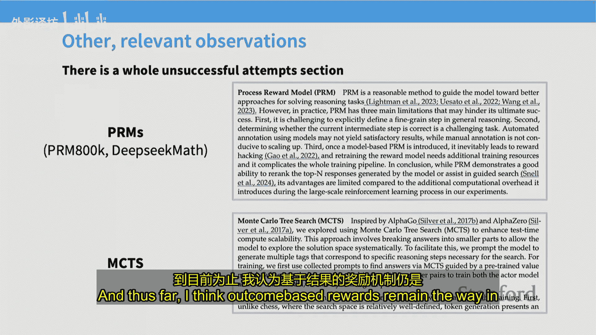

我认为没成功的第二件事是基于搜索的方法，我觉得很多人对基于搜索的推理方法感兴趣，至少目前他不像强化学习和基于结果的奖，励机制那样成功，我想这仍是这个领域里最强的一种机械和系统，好关于R1的设置有问题吗。

或者其他发现请讲，我说过会提到他，但我没提，所以这全怪我没错，正是如此，所以我觉得尤其是对于概率关系模型，我觉得在深度搜索数学领域，这很有意思且颇具启发性，他们对概率路线图的优势深信不疑。

即这条带P的蓝线，然后在R1阶段他们得出结论，这种方法在深度搜索数学中行之有效的方法，在R1中却行不通，于是他们采用了基于结果的奖励办法，没错，多谢提醒，我差点把那儿的承诺给忘了，没错啊。

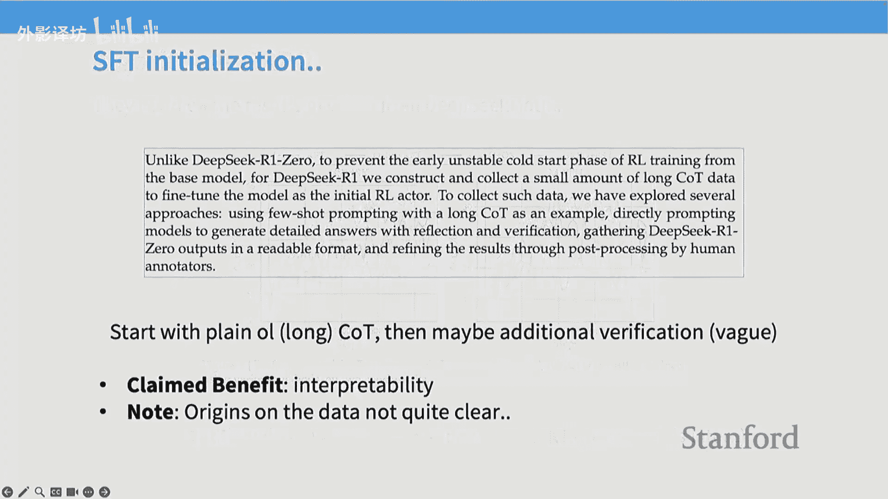

在这张纸条里，他们主要是说，如果去除语言一致性实验会导致模型性能下降，但他们还是要把它放进去，因为他们更喜欢更易读的思维链，这是个有趣的权衡，关于思维链是否可靠，已有很多研究，而且他们并非完全可靠。

我们或多或少都知道这一点，但或许有一个稍微更忠实的思维链，比那额外的要好，我不知道，在艾米身上提升0。5个百分点的表现，没错，你在乎的是得让人能看懂，所以我肯定他们能做翻译或者做些其他处理。

让思维链更好，而且在某些方面，你可能会觉得，OpenAI和其他供应商总结思维链的做法很相似，因为原始的思维链可能要杂乱的多，然后他们可能会将其合理化，那是一种方式，而且我认为那是获得可解释性的有效方式。

但我确实觉得要是你有点兴趣，要是你觉得原始思维链对监控和深入解读，很重要，那我觉得你会想要这样的东西对吧，现在我们继续，到KIMIK1。5，我们为啥要研究这个，如果你查看一下的发布时间，戳R21和K1。

5发布的时间，他们有点同步，而且他取得了非常相似的结果，他通过在强化学习中使用基于结果的奖励，来做到这一点，他使用的不是相同的算法，它又有些不同的细节点和不同的有趣见解，这样我们就能了解哪些是相同的。

哪些是不同的，以及在这个过程中，哪些部分可能是重要的，所以在我们开始之前，先给你们展示一下主要结果，就是为了让你相信，这是一篇值得在此讨论的论文对吧，这里深蓝色的条代表KIMIK1。5。

你能看到OpenAI的O1是第二高的条，所以在一系列重要任务上，他们全面胜过，或与O1不相上下，而且他们做的事基本和R1类似，所以他们做监督微调，他们做强化学习，他们有不同的强化学习算法。

但他们做强化学习，他们也更详细的描述了数据集的构建，而这在之后的TM3中会用到，所以值得讨论，那我来讲讲数据，正如剖析之前讲的，也许数据是整个流程中最重要的，所以我们要一直留意。

当人们在大规模训练论文中，谈论他们的数据管理策略时嗯，所以KIMI1。5做了几件事来管理他们的数据集，比如说他们有一个自动化的，我猜一个基于语言模型的标记系统，用于按不同领域和学科对数学问题进行分类。

他们会在这些方面平衡，已在不同领域实现多样化，他们排除了多项选择题和是非题，尽管这些是可验证的，因为他们认为这些太容易被破解，或被随机猜出答案了，所以他们只找简短且可验证的答案。

并可通过正则表达式或语言模型等进行评估，这或许是这里筛选中最有意思的部分，他们采用不做任何推理的模型及sf t模型，然后让这个模型生成十个答案，根据通过率来决定是否纳入该势力。

我觉得这正是他们后续选择策略所采用的，他们只挑选八个中表现最不理想的例子，所以要是他们在八个里能答对一个，那么它就会因太简单而被排除，类似于R1的SFT数据描述，很少，谁知道他们从哪弄来的。

这个他们只是说做了些提示设计，所以显然他是从别的东西提炼出来的。

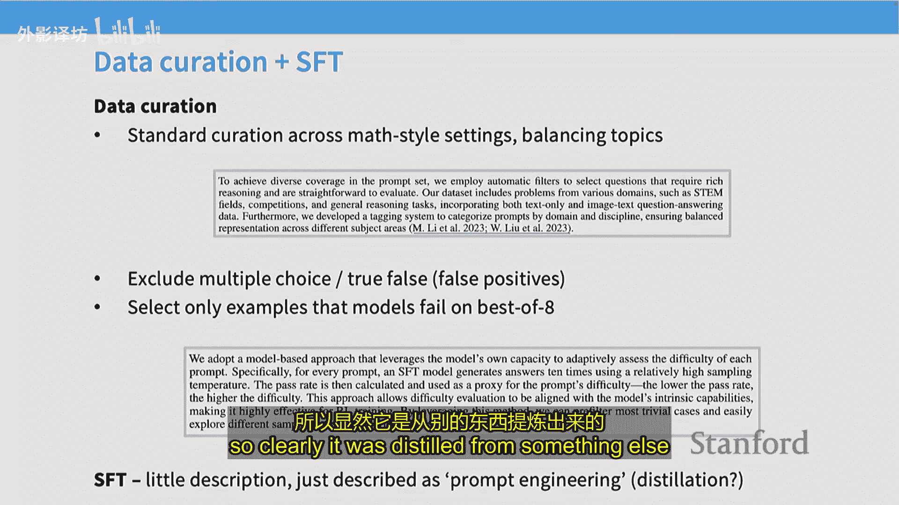

但我们真不知道他们是从啥提炼出来的，所以我要讲讲强化学习算法，吉米那个挺有意思的，这是一种不同的变体，实际上它在某种程度上可能更接近DPO，但最终你会得到一种你肯定很熟悉的算法。

所以你可以从一个很有意思的角度，把这看作是强化学习算法的趋同进化，所以你再一次从最上面开始，这是我们的经典目标，我们从数据集中采样，我们从策略中采样，我们想最大化奖励，我们不想离基础策略太远。

所以这就是kl正则画像，要是你还记得我们对DPO的推导，你做了个非参数，假设你说最优策略派星是个任意函数，这意味着奖励可写成对数，归一化因子加上策略之比，这和我们在DPO里做的一样。

我们做的是获取这些奖励，然后把他们带入bradley terry偏好函数，我们这儿没有这个，我们不做两两偏好比较，所以我们实际上不走那一步，相反我们写下这个等式，我们知道对于最优策略，这里会有等式关系。

所以我们要做的就是让这里产生一个差值，然后在上面加上一个平方损失项，我们会尝试拉近左边，通过加上一个平方损失向来拉近左右两边，这是合理的做法，以前有人这么做过，这就得出了我们的损失值。

基本上就是要推动右侧，让最优策略中应该相等的，某事物的左右两边靠近嗯，这东西乍一看有点怪，但求一下梯度，看起来就很像GRPO，你得到了策略梯度，这就是策略梯度相关的，而且你还有个基线奖励。

那基限奖励到底是什么呢，我就对这一批次里的R求个平均值，所以这做的事不太一样，这就是归一化常数，我觉得是针对这一批次，但我们做的基线处理和RPO基本类似，而且我们的对数损失正则化的平方有点不一样。

来让我的策略更紧凑，而不是进行裁剪，从整体来看，这里是怎么回事，和GRPO很像，第一部分是机械损失，但这里没有标准差的情况，第二部分类似于GRPO中发生的裁剪，但不是裁剪，我们正在显示正则化策略。

所以我们有相同的要素，只是形式略有不同，希望你能明白这一点，只要你有策略梯度以及正确的基线，和类似正则化的，你就能得到一个可用的强化学习算法。

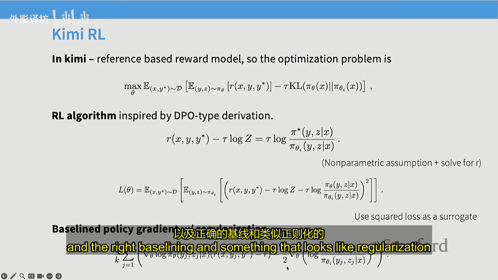

机米团队做的另一件事，在某些方面我觉得这更具前瞻性，或者说他们在这点上比R1团队做的更正确，即他们意识到，要是你再发布一个推理模型，你真正在乎的是推理成本，要是你在乎推理成本。

你最好试着控制一下你的思维链长度，要是你有很长的思维链，那会让你花一大笔钱，或者让你的用户花一大笔钱，所以与其去夸赞很长的思维链，基米那边的人说，我们希望在保持高性能的同时，尽可能地压缩思维链。

所以他们在这里设置了这种长度奖励机制，他们所做的是针对每一批次，他们会查看最大长度和最小长度，而这里得到的是lambda，Lambda，大致是这样，你在这批数据的长度范围内处于什么位置呢。

所以如果你处于正0。5的位置，你就非常短，处于-0。5的位置，你是不是很长呀，而且只要你答对了，奖励基本上就是拉姆达，所以要是你答对了，你会激励自己在这个范围的最短处，做到尽可能简短，而要是你答错了。

你就处于这个长度奖励的较低水平，这意味着你在激励连贯思维长度，使其大致短于推出范围的中间值，老实说，这对我来说有点莫名其妙，但你大致能理解这种损失的动态情况，也就是说你在激励正确答案尽量简短。

所以你没有那么大的优化压力，把错误答案压缩的简短嗯，关于这个长度问题的最后一点，KIMI团队意识到，如果在训练早期添加这个奖励，强化学习停滞，因为这迫使模型做出某种表述，我处于局部最小值。

我的答案全错了，我能做的最好的就是让我的思维链很短，然后你就无法摆脱那种局部最小值，所以实际上他们只在训练后期才开启这个，所以他们一开始有点像在进行无约束强化学习。

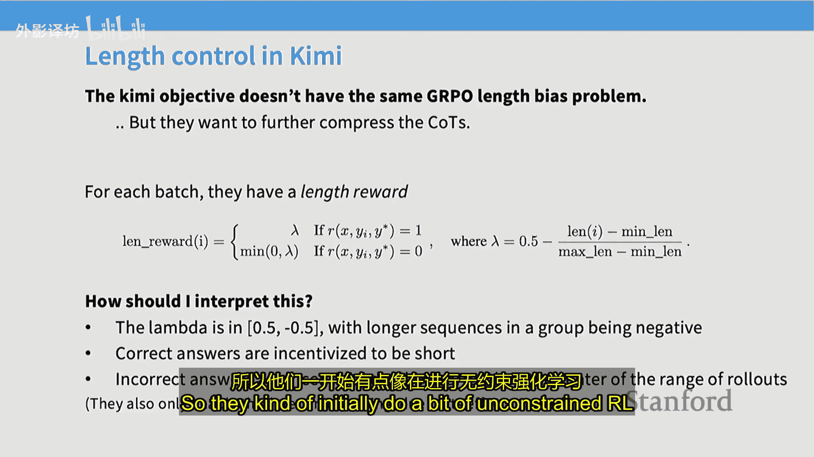

然后他们再添加这个长度奖励，而且他们还有其他很棒的细节，谁知道这些东西有多少是必要的或重要的，但实际上他们设置了一整套课程，他们基本上分配了难度标签，所以数据集是自上而下的。

比如他们手动或通过语言模型标注难度标签，然后他们按此顺序从易到难，然后他们还在过程中，按E减去成功率的比例抽样问题，所以如果你成功率达100%，你就再也不会选取那个问题了，至于奖励基本上是针对代码的。

他们处理带有真实解决方案的问题，然后生成一系列测试用例，对于数学，他们基本上使用一种奖励模型，该模型用于比较真实，人工书写答案与语言模型输出，所以他们没有像其他人那样，使用正则表达式或心态。

其他人就是这么做的，KIMI团队实际上使用一个模型来进行等价性检查，在可验证的奖励情况下，这样做有点令人惊讶，但他们似乎没有问题，他们的奖励模型十分极为准确，因其本质上就是在进行高级字符串匹配。

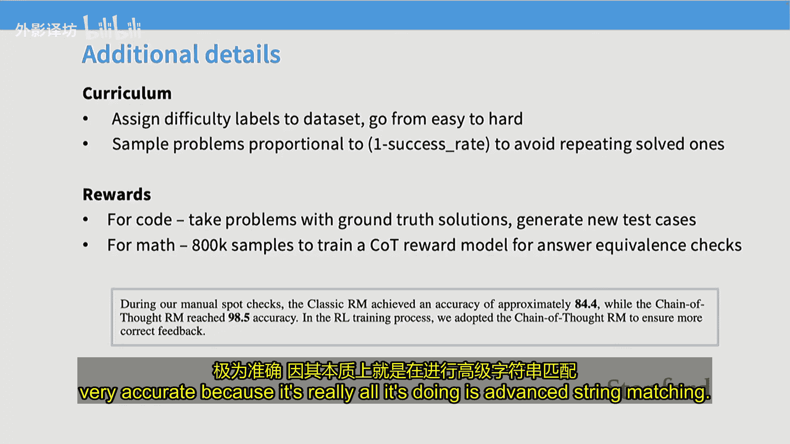

KIMI论文中一个非常有意思的点是，他们还谈到了在强化学习过程中，出现的各类基础设施问题，我觉得我没看过其他强化学习推理论文，几乎完全没有谈及系统，所以很高兴看到他们在谈论这个方面，其结构是怎样的。

其对此的布局是怎样的，你得在I5里处理这个，我觉得在强化学习里坐向展开这类操作时，会有个非常精简的版本，但我要指出的是，为啥强化学习这么难提高效率，在很多方面强化学习时，充分利用GPU比正常预训练更难。

我觉得原因是是因为涉及展开，所以你得生成序列，而且每当你生成序列，不仅推理会有点慢，但你还有另一个问题，吉尼得在强化学习和推理之间来回切换，而且你得把某种数据传回，强化学习工作进程，强化学习工作进程。

得把模型权重传给推理服务器，反之亦然，所以会发生各种消息传递，最后这是长思维链模型特有的，但要是你有很长的思维链，批次会变得很不均衡，所以你得巧妙处理这个问题，于是提米团队把这事做的挺不错。

但采用不同工作线程是相当常规的做法，有的工作线程负责强化学习更新，有的则负责推理，他们基本通过消息传递，将权重传给推理工作线程，推理，工作线程基本能为强化学习，工作线程制作数据集。

而且他们的设置和你差不多，他们用VLM进行推理，而且他们还做一些非常高级的事，他们必须使用带虚拟权重的视觉语言模型，而且他们得把它关掉，因为在工作进程间传递权重挺复杂的，最后我觉得有件事挺有意思。

吉米团队在结果中展示了每次迭代的情况，随着强化学习推进，他们进行了展示性能是怎么变化的，而且他们展示出很好的变化趋势，在蓝色区域，他们还展示了回复长度的变化，和GRPO博士的情况很相似。

因为我觉得他们的RL算法并非天生，就倾向于更长的回答，实际上大多数回答，在目标长度处趋于平稳，如GRPO博士实验所示，而不是像我们在普通GRPO中那样，无节制的增长，在我们最后总结queen3之前。

关于KIMI有问题吗，那么回到英特尔针对KIMI的RL设置，是的，所以我觉得最烦人的部分，至少就目前的库来说，这个过程本质上就是，有一个实验性的应用程序编程接口。

它能让你用英伟达集体通信库的集合通信调用，把一组权重应用到向量语言模型里，但至少我们当时想让你在作业里用这个，但他未记录的参数太多，还不够成熟，所以也许明年更新时，实际上这会成为相当成熟的技术。

但现在我觉得很多人会这么做，用虚拟权重启动一个VLM，然后权重会设法加载到内存中，在VLLM之上，还有些取巧的做法，每次迭代时，他们常常会拆除VLLM。

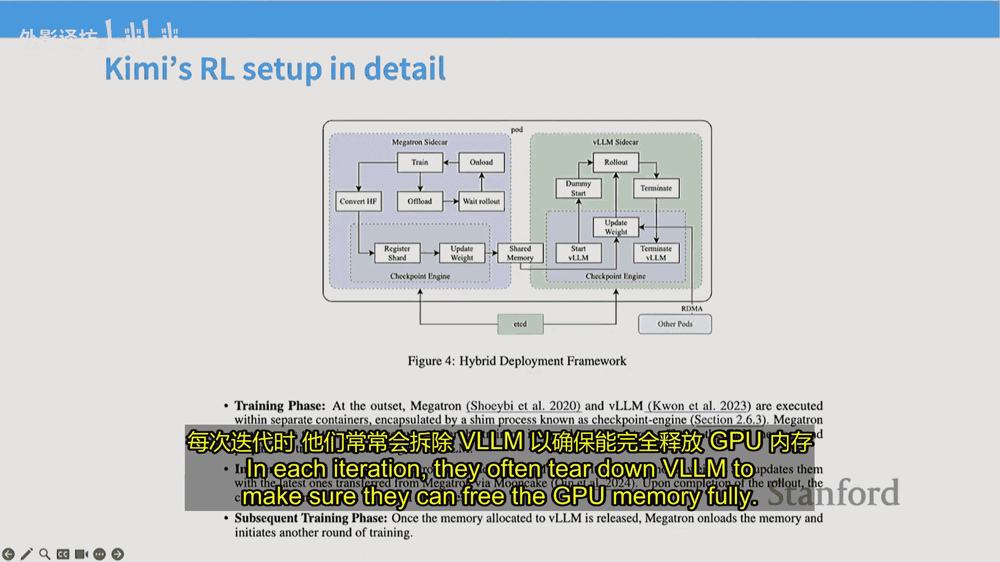

以确保能完全释放GPU内存，我觉得有不少，我认为语言模型的强化学习仍相当新，所以我觉得基础设施支持还不太成熟，但我想也许一年后情况实际上会好很多，好嘞后面那位请提问，你有很多诸如准确性奖励之类的。

还有类似奖励和格式奖励，要怎么把它们组合起来呢，那你怎么组合不同的奖励呢，我觉得这是强化学习里的事，算不上啥神秘魔法，就好比强化学习里那种，你只要调调权重就行的事，在所有情形下，所有奖励直接相加。

但要加上权重，权重是怎么确定的，平行业来最大化下游性能对吧，特别是像格式奖励这类东西，你几乎可以把他们当成是塑形奖励或替代奖励，你不一定真的在意格式奖励，它更多是达到目的的一种手段。

以便在标签里得到一个能让你找到答案的，优质长count，好那我最后要讲的是QUEN3，幸运的是困三在下课前发布了报告，我能把它加进去，而且我觉得这是最新的，也是已推出的推理类强化学习模型中。

最具现代感的，所以我们能看出，他们如何在先前工作基础上进行构建，比如他们改动的地方，而且他们实际上有相当有趣的扩展方式，还有全新且独特的数据成果，所以整体情况与R1和KIMI的做法非常相似。

所以queen基本上会采用其基础模型，他们会进行一个较长的cos feed阶段，所以这边就是第一个阶段，他们会进行推理强化学习，他们会做一些特别的事，也就是我稍后会讲到的思维模式融合。

然后他们会进行基于人类反馈的强化学习，然后那就是他们推出的模型，当然之后他们会以各种方式对其进行提炼，但目前我们可以先忽略这一点，所以我们在R1中已经见过这个了对吧，基于人类反馈的强化学习，在推理之后。

然后是蒸馏，我们已经知道很多方法了，实际上我能很快讲完，和KIMI类似，他们通过最佳事件按难度筛选来整理数据，所以如果你的未经过强化学习的基础模型，在采样N次时就能回答，那么你就可以去掉它对吧。

他们还会做些清理工作，他们会去除与验证数据过于相似的内容，然后他们还会手动筛选他们的SFT数据集，所以对于他们最初的sf t数据，对于常思维链他们会手动筛选，看是猜测的还是确实答对了，经验上，我认为。

Q1N3强化学习结果真正有趣的一点是，他们实际上只在3995个事例上，进行这种强化学习，这是用于此的极少势力数量，并且他们从强化学习过程中收获颇丰，所以你可以将此视为基于以验证奖励的强化，学习。

效率极高，你也可以将此视为，类似于过去许多样本效率的结果，就像人们已证明，你能用极少样本对模型进行指令微调，或者能用极少样本提炼出一个长的coat，但这未必意味着它不会持续扩展，我们真不知道为何。

这确实表明，即便粒子极少，你有时也能进行强化学习，挺让人惊喜，还很酷，那他们新搞的这两件跟淬火有关的事是啥，他们做的是思维模式融合，我觉得还挺有意思的，我觉得在这个领域或者各种趋势的走向，是控制推理。

所以他们想弄个思维模型，在同一组参数里还有个非思维模型，那他们干啥呢，嗯他们用强化学习训练完模型后，他们有一个会思考的模型，现在他们要再次微调它，以实现两件事之一，他们要用带思考标签的数据微调模型。

然后他会进行常规的cod操作，而且你自己就能获取这些数据对吧，就像原始的思考模型能生成这个，或者你可以有个无思考标签，这种情况下，他应该马上给出答案，在这种情况下，他们得对模型进行监督微调。

以了解无需思考的含义，并立即尝试给出答案，而且有一个有趣的，这会带来一个副作用，他们发现如果进行这种训练，在训练中他们让模型带有思考和无需思考标签，那么他们可以如果模型继续思考，而你想终止思考过程。

你实际上可以终止思考过程，添加一个类似考虑用户有限时间的特殊字符串，我现在得直接思考出一个解决方案，然后结束思考标记，然后他会准确给出答案，所以这给了他们一个控制旋钮。

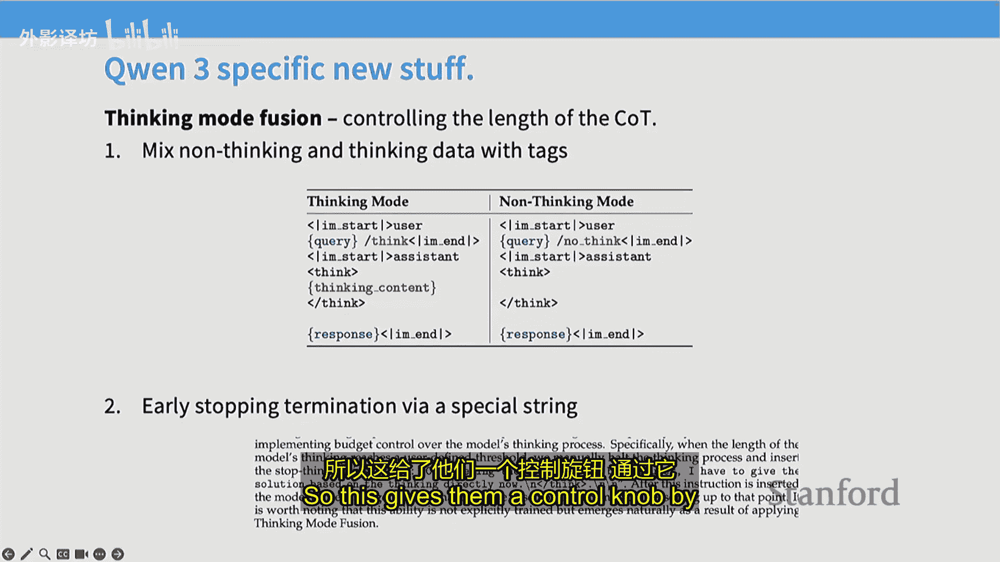

通过它，他们可以借此更精确的控制思考次数上限，这能让他们从单个模型清晰地进行测试，时间扩展，所以他们可以设置思考预算上限，当然那种趋近于无穷大的极限情况，就是最初的思维模型，但它们可以提前在左侧终止。

而且模型性能会平稳下降，刚开始时这还不算太糟，你可以用大约一半的思维令牌，而且仍能获得不错的性能，所以你可以看，quin3也进行了一次很棒的对照实验，实验中给出了性能数据，在推理强化学习。

思维模式融合以及通用强化学习阶段，而在这里有件事很有意思，若查看前两组数据，也就是一般任务和指令，遵循任务推理，强化学习有帮助，思维模式融合有帮助，基于人类反馈的强化学习也有帮助，似乎在这种情况下。

一切都有帮助，但如果看数学或理工科的表现，要知道在思考情形下，通用强化学习会降低性能，而在非思考情形下，它能提升性能，所以这里确实至少存在某种权衡，我是在此针对通用指令遵循进行优化吗。

还是在下面针对类似数学编码进行优化呢，对吧，所以这些是正在显现的一些有趣特性，并且能看到更多未来模型会很酷，设法避开这些权衡，好的挺酷，所以综上所述，我们最初的动机是强化学习很强大。

发现在基于人类反馈的强化学习领域，能用语言模型进行强化学习，但你不能一直基于有噪声的成对偏好，进行逐点优化，所以一种解决办法是选择一些领域，在这些领域无法进行奖励篡改，然后就大胆去做。

在狭窄领域进行强化学习是个不错的办法，而广义新南预策略优化算法很简单，希望你们都有点感觉，就下好的，我能用一些不错的机械来做策略梯度，这就能在所有这些可验证奖励领域，实现强化学习。

最后有很多行之有效的方法。

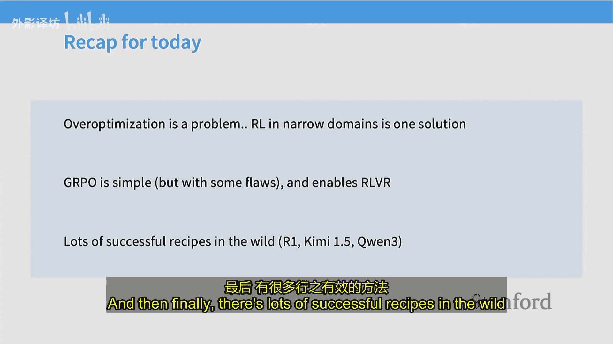

希望现在你们已明白哪些相同，哪些不同，哪些实现技巧很关键，多谢。

