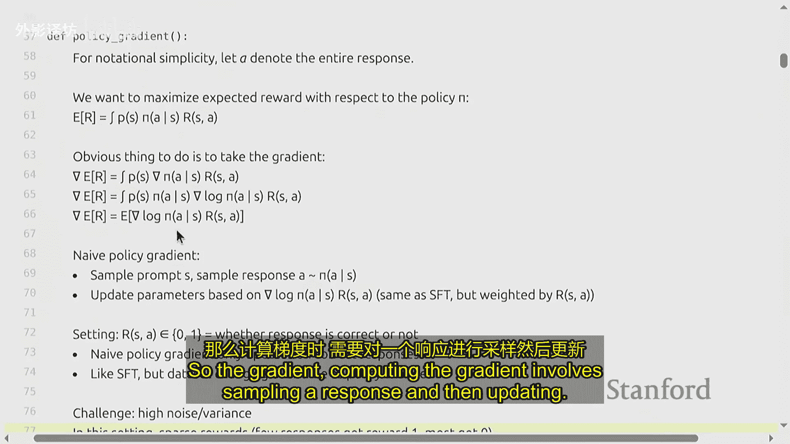
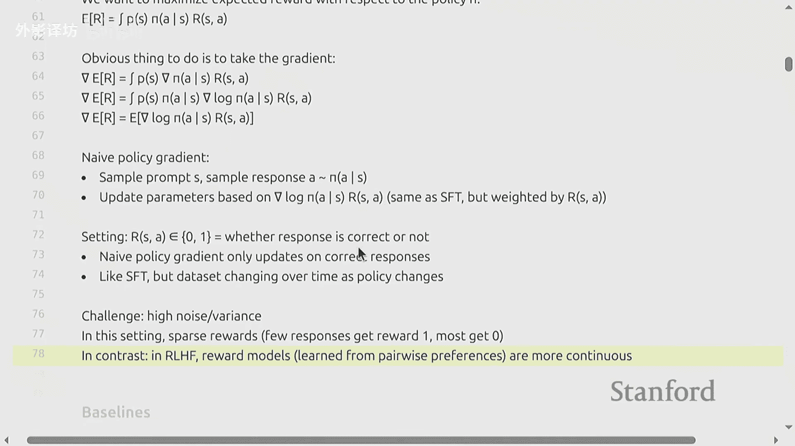
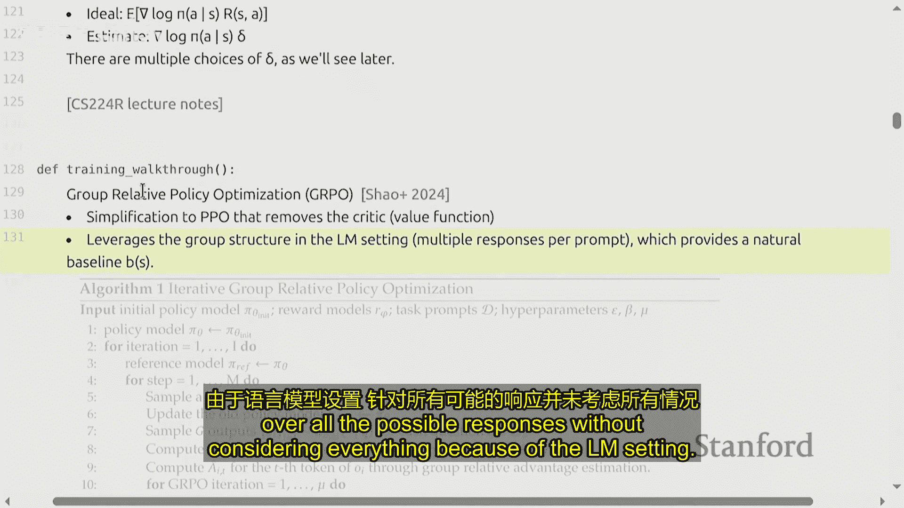
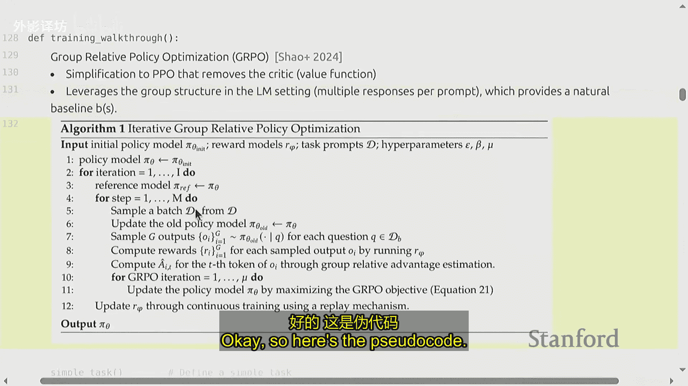
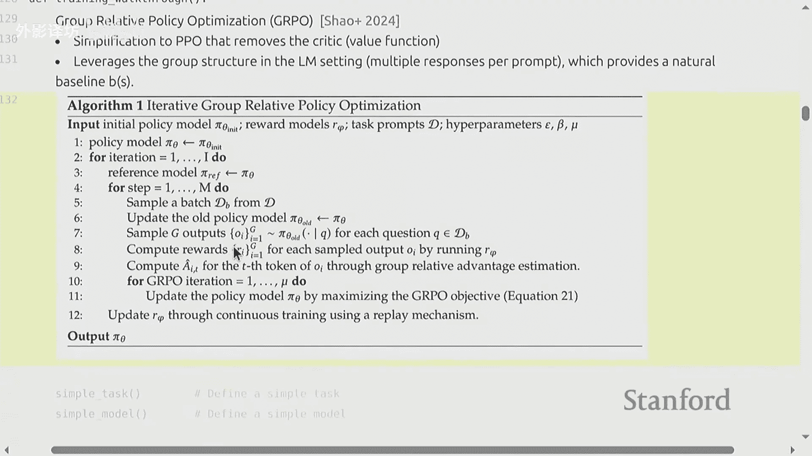
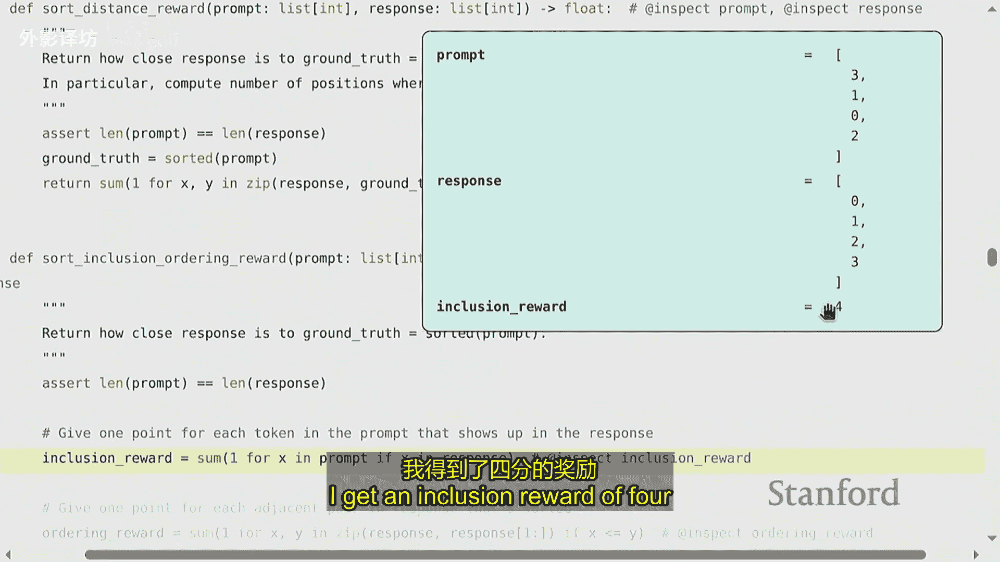
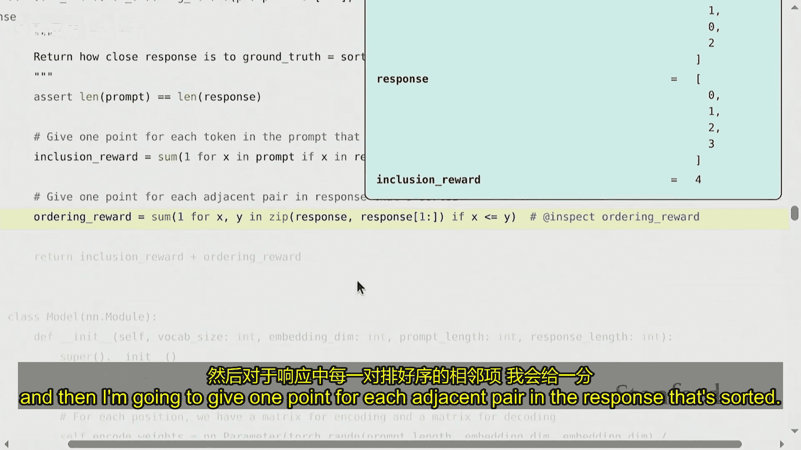
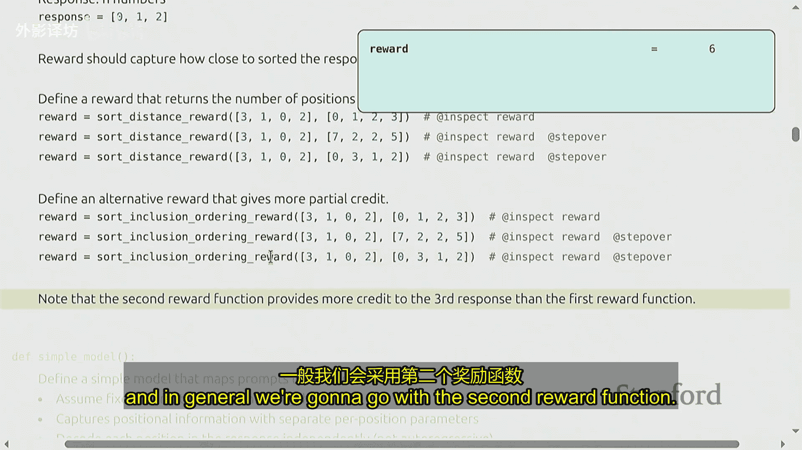
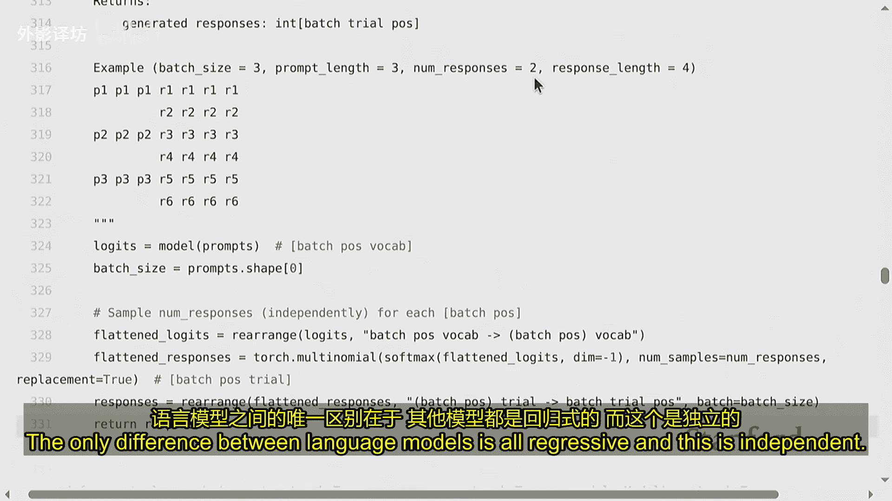
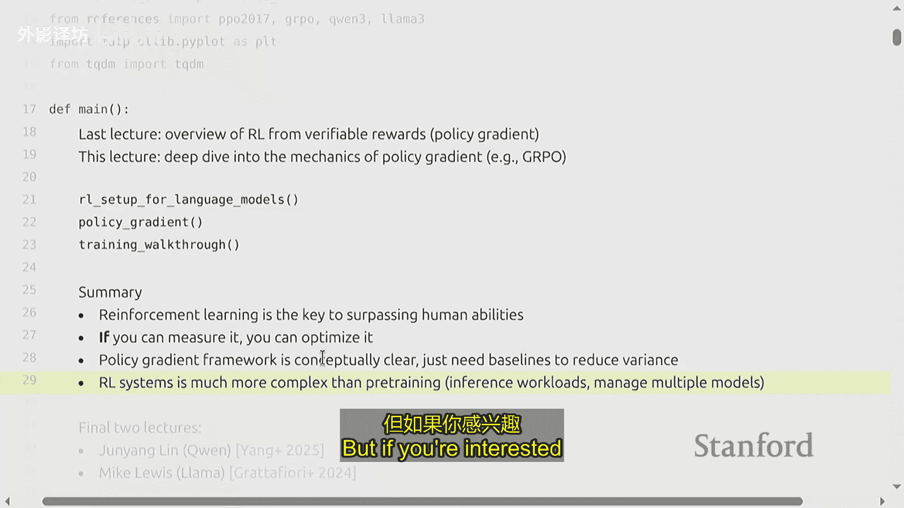

# 【中文配音】硬核！斯坦福 CS336：手把手带你从零构建 ChatGPT - P17：Lecture 17： 对齐 - 强化学习2-Alignment - RL 2 - 外影译坊 - BV1BWEWzfEKi

咱们开始吧，那么在开始今天的讲座前，我想大致给大家说明一下，毕竟现在已到学期末了，所以这是我获TEX的最后一讲，那现在开始今天的讲座，上次test从可验证奖励方面概述了强化学习。

讲到了近端策略优化算法和，广义近端策略优化算法等策略梯度算法，本次讲座我们将深入探讨，策略梯度GRPL的机制，所以我们不一定会讲新内容，而是针对现有内容进行更深入探讨，给你们展示代码和一些数学内容。

所以稍微提醒下我们在做什么，所以我们在对语言模型做强化，在强化学习里，你得定义状态以及奖励相关内容等，为了明确起见，我想现在这应该很明显了，但还是说明一下，所以状态是提示，加上你目前已生成的响应。

每个动作都会生成一个特定的标记，及下一个标记，懂了吗，奖励本质上取决于响应的质量，对于本课程而言，我们将聚焦于结果奖励，奖励取决于整个响应，我们将关注可验证的奖励，所以计算是确定的。

某些函数直接返回奖励，无需询问人工，在这种设定下，一般在强化学习里，你会看到折扣及自举法的概念，在多个回合里你会得到，这确实说得通，当你在过程中获得奖励时，这更像是你只需生成一系列动作。

然后看你的答案是否正确，所以这显然会带来一堆困难，因为其奖励非常稀疏且有延迟，但我觉得他也简化了一些，与此相关的概念性思考，比如你可能会遇到一个问题，一道数学题，然后会有一连串思考，你会重新思考一阵子。

然后语言模型可能会生成，因此答案是三英里，然后奖励得提取出三英里这个答案，并查看其是否与某个基本事实相符，所以在强化学习里，一般来说人们会谈到转移动态，这很重要，在语言模型设置下，这种情况，这很简单。

只是加法运算，只需把动作添加到状态里，这有诸多重要意义，因为你能，因为你了解世界动态，你就能进行规划及测试时计算，而这是机器人专家梦寐以求的，要是他们掌握世界的转移动态，他们就能模拟并做所有这些事。

在语言建模中，我们能做到这点，但一般强化学习中不行，另一件要意识到的事，实状态的概念实际是虚构的，若在机器人领域思考，强化学习状态，包括关节角度位置，或许还有图像等，他确实非常基于现实世界。

而在语言模型中，状态只是语言模型生成的标记，这带来了很大的灵活性，他引入了许多自由度语言模型，可以自行创建临时工作区，以便得出最终答案，而机器人常常受到外部世界的极大限制，在能够达到哪些状态方面。

所以这里的问题不在于达到任何状态，这在机器人技术及控制领域通常是个挑战，你根本无法达到那种状态，在这里你只要写下标记，就能达到任何你想要的状态，但挑战在于，要确保这些标记。

真的能得出某个正确的基本事实答案，所以我觉得值得思考一下，这全都是强化学习，但直觉以及难点而容易的部分，在语言建模环境中会有所不同，好的，那么在这种情况下，策略就是一个语言模型基于状态的动作条件。

这就是目前为止给出的提示与回应，这通常是基于现有的预训练语言模型，进行微调的，然后它有多个名称，如展开情节轨迹，在这个结果奖励设定中，你从一个状态出发，你生成一连串动作，也就是标记你得到一个数字。

这就是奖励，然后你的目标是将预期奖励最大化，期望是基于提示得出的环境给予你的，以及你正在优化的策略派所给出的响应令牌，你正在优化的策略派所给出的响应令牌，所以希望这能让一切都非常扎实和精确，好的。

如果你对设置有任何问题，请告诉我，那么现在让我们来谈谈策略梯度，它是一类用于学习策略的方法，这些方法本质上从一个策略出发，并尝试使用梯度方法来改进它，为了符号表示简洁，我们将用A表示整个响应。

而非单个动作，由于我们处于结果奖励设定中，这无关紧要，你可以把所有动作看作是由语言模型，一次性生成的，然后最后你会得到一个奖励，所以记住我们要相对于策略派最大化期望奖励，所以期望奖励就是分部的积分。

对状态积分乘以给定状态下动作序列的策略，再乘以奖励，所以这很直接，而策略梯度就是做显而易见的事，你想优化某个东西，那就求梯度，于是你开始求梯度，所以梯度只作用于策略，而关键技巧就是策略梯度定理。

有些人这么叫他，但实际上他就是对数的链式法则，所以这个基本上会被重写成一个策略派，然后是对数的梯度，然后我会根据期望对其进行重写，所以期望在这里，基本上掩盖了状态S和动作A的分布。

所以这种形式应该很熟悉，所以这就是期望奖励的梯度，那么朴素策略梯度，基本上是说我只是要从P中采样一个提示，从A中采样一个响应，然后我会根据这个期望里的内容来更新参数，所以想象你是否在进行随机梯度下降。

你查看预期损失，然后你随机选取一下，然后你进行评估，并据此形式，那么解释为这本质上与监督微调相同，只是所有内容都有奖励进行加权，所以在监督微调中会有一个人帮你写下A，然后你就模仿A然后更新参数。

最大化该动作的概率，而现在A是由模型生成的，但你会得到一个奖励，好的，那么作为一种直观事例，假设奖励为零或一，他是对还是错，所以在这种情况下，朴素的策略梯度只会在正确响应上更新。

所以对于导致错误响应的行动二为零，所以那些将被完全忽略，然后对于正确响应二为一，所以本质上你只需采样，你挑选出正确的回答，然后你只需对此进行SFT，唯一的不同是数据集会随时间改变。

因为在你进行一次更新后，现在你有了一项新策略，然后你基于该策略生成数据集，然后不断迭代下去，但这很自然，而且这里的唯一挑战并非仅此而已，主要挑战是，人们认为策略力度存在高噪声或高方差。

那么在随机梯度下降中，要是你在做监督学习这种情况，也有可能你的梯度会很嘈杂，通常要是你用更大的批量，然后就这么继续下去，那么从经验上看好像行得通，强化学习在噪声方面又是另一回事了，还有你得应对的方差。

所以具体来说，要是你看这种情形，当奖励只有零或一时，想想解一道难题的情况，那么在这种情况下，奖励很稀疏，这意味着很少有反馈能得到奖励，一大多数会得到零，所以要是你的策略很糟糕，然后你实施并生成行动。

你的大多数奖励都会是零，这意味着从梯度的角度来看，你基本上就是在进行零梯度更新，所以如果你处于一种情形，你的策略糟糕到根本无法获得任何奖励，那猜猜怎么着，你没有进行任何梯度更新，你就有点被困住了。

所以这是个相当糟糕的境地，至少在监督学习里，你至少会朝着某个东西进行更新，你一定会朝着某个东西进行更新，但在强化学习和稀疏奖励中，但这在强化学习和稀疏奖励中就不再成立了，那么问题是。

为什么数据集会随时间改变，那么想一想，这就是你的目标函数，所以你要进行优化，所以你进行迭代，每次迭代你都要计算梯度并更新参数，那么计算梯度时需要对一个响应进行采样。

然后更新，好的现在你的参数不同了，所以下次采样响应时将会是现在可能会不一样，因为它来自新模型，如果你对多个回答进行采样，那么这些回答将会是一个，与你开始时分布不同的不同数据集。

所以你的数据集有望随着时间推移变得更好，所以直观来讲，即便你只有这种稀疏的奖励，只要你能答对一些简单问题，并且能得到一些奖励，你就能更新你的模型，你希望模型能超越这些势力进行泛化，这样在下一次迭代时。

当你采样并解决稍微难一点的问题时，你会得到一系列恰好能得出正确答案的回应，现在你的数据集会随着时间推移，获得越来越高的奖励，好的，这与带人工反馈的强化学习不同，在后者中也要使用并行对照。

你要估算一个奖励模型，而且奖励模型通常更具连续性，他会给每个回答赋予一个数值，以衡量其优劣，这与那种可验证的奖励设置有很大不同，那种设置类似正确或错误，注意我的意思是，我强调这一点。

即一切都是强化的相似性，这一切甚至都在语言模型的范畴内，有时你甚至会使用像PPPO这样相同的算法，但关于如何设置超参数的直觉，以及如何调整模型会有所差异，没错没错，所以问题是在这种情况下，若奖励为零。

那么你就不更新参数，为何不把奖励设为一，这样至少能在一定程度上使模型远离，那些错误回答，当我们查看机线时，这会自动出现，因为这只是个简单的朴素质量梯度，你根据奖励进行更新的地方。

我们将展示有比只用奖励更好的办法，是的有问题吗，我想是的，有个问题，然后我觉得那边有个问题没错，只有当我们得到整个回复后才知道奖励，所以奖励取决于提示和整个回复，所以你想说的是。

有时甚至还没做完就能得到奖励，另一种奖励类型叫做过程监督或过程奖励，它能让你大致了解自己的表现如何，在那能做些事，通常来说过程奖励不错会更好，眼下为简单起见，我只是假定这是结果奖励，但肯定的是。

要是你更早得到奖励，要是你信得过，就应尽早评估奖励过程奖励的问题，而语言模型的问题在于，你根本无法真的很难得到良好的过程奖励，因为除非你完全偏离轨道，很难判断自己做得如何，还有其他问题吗。

我有相同的问题，我们要找的奖励模型是什么，我们怎么得到零和一的，所以问题是奖励模型是啥，我给你举几个例子，但你可以把奖励模型想成是，我觉得你作业里要实现的，基本上语言模型会生成些东西。

然后你把答案解析出来，然后你对照答案检查一下，匹配就返回一，不匹配就返回零，好那就最大化预期奖励，策略梯度算是做了件显而易见的事，朴素策略梯度说白了就是做了件显而易见的事。

但你会遇到高噪声不变性的问题，所以策略梯度方法的一个关键思路，就是使用所谓的基线，那么回想一下，这就是预期奖励，要是你真能算出这个预期奖励，那可就相当不错了，因为那样你就能直接算出来了，但你做不到。

所以你就改用无偏估计，这通常意味着省去期望计算，对S和A进行采样，并省去期望计算，这就是无偏估计，但其方差可能会相当高，好举个简单例子来理解一下，我所说的高方差的意思，假设你只有两种状态。

即两个提示S1和S2，从S1出发，你有两种行动，可能A1给你奖励11，A2给你奖励九，从状态S2出发，A1会给你零点奖励，A2会给你两点奖励，明白吗，所以S1给你的奖励更高，S2给你的奖励更低。

当然最佳策略是在S1，你要选择A1，在S2你要选择A2，所以你不希望S1倒下A2，但你会注意到这个九比这个二大，所以你最终可能会处于这样的情形及每个状态，把这看作是一个非常简单的问题。

就像S1是个极其简单的问题，而S2或许是个更难的问题，所以仅仅因为某件事有高回报，并不意味着你就绝对要积极的据此更新，所以要是九大于二，所以要是你在做简单的梯度更新，你可能会选S1转向A2。

然后就会觉得哇这很不错，我会得到九倍的梯度，然后我看了看S2A2，然后心想那只是第二个奖励，所以我对他的推动就少些，但事实上从整体来看，很明显，这可能只是在局部不太合理，我的意思是我想强调从预期角度。

如果你看看整体的状态和行动，一切都会好的，数学上都是说得通的，但你得把方方面面都考虑到，才能明白这一点好了，这个例子能懂吗，为啥一开始我们要选A2呢，A1都已经有11了呀，所以问题是你为啥选二。

所以你会按你的策略来选，那么在你的策略里，刚开始的时候，你不知道哪个奖励更高，所以你可能就随机选一个，所以要是你碰巧选了A2，那你可能会加大权重，从而获得九分奖励，我是说这其实更糟。

因为你会觉得挖九分奖励太棒了，而且你选它越多，就越会据此更新，然后你就会陷入这种局部最优，到那时你甚至没得选A1上已没有剩余概率了，因为你已根据L2更新过了，就是这样，所以这就是基线的原理。

即只需最大化极限奖励，而不是预期奖励，我们只需减去一个名为基限函数的币，所以这仅仅是预期奖励向下偏移了，B的一个常数期望，而这其中的美妙之处在于，这个量不依赖于策略派，所以即便你将其展开。

你会得到一个X，即对P乘以给定X时的派进行积分，但对给定S的积分结果是一，所以这就是他根本不依赖于策略对吧，所以自然而然的优化期望二等同于优化二，减去此项后的期望，因为它只是个常数。

所以这就是基线的整体思路，它保留了这类优化问题，现在如果你针对这个新目标，进行某种简单的策略梯度操作，那么基本上就是对S和A进行采样，然后你只需关注这个差异，所以要注意这是成立的。

这适用于任何关于S的B，只要B不依赖于A，它不在参数中，或者不能依赖A，那么这就有效，那么现在的问题是，在所有可能的B函数中，我们该用哪一个，我们再看一下这个双状态势力，以便有更直观的理解。

我将做出一些假设，假设你的初始策略是S和A上的均匀分布，并且策略的初始梯度为一，先暂时忽略这一点，那么如果你看看梯度的方差，你会看到有时你能得到11，有时你能得到九，有时你能得到零，有时你能得到二。

方差是5。3，那么如果你定义一个机械对于S1是十，对于S21，那我们看看会怎样，所以你从这些奖励值中减去基线，对于S1-10，对于S2-1，所以现在极限方差大幅减小仅为一点一。

所以我们把方差从五降到了一，相当不错，只需减去一个基线再说一次，不会影响最终预期结果，没错，所以我想有这样一个假设，比如S中B的这种加速不依赖于策略派，所以我在想，比如我们还能不能进行初始化。

比如把B设为初始的最原始的规则和策略，是的是的，问得好，所以S中的B不应依赖于策略，但你的问题是，我能不能只用一个初始策略，那把S的B设为I，所以绝对可以，所以在强化学习里有这么个情况。

你得稍微留意一下，哪些是常量，哪些不是，所以你总能拿一个冻结模型，并说那是个常量，只要你的表达式不依赖于它，那实际上就会被当作常量，就好像你不对它求导似的，那就没事了，这也意味着当你进行采样时。

并且正在进行更新，你得保留一份该策略的旧版本，因为如果它发生了变化，现在你可能会陷入一些奇怪的情形，它就不再是常亮了，没错，你可以这么做，所以通常你要做的事本质上保留一个就策略。

或者在一段时间内当做一个参照，或者当你使用近端策略优化算法时，你拥有一个价值函数，然后你会维持一段时间，然后进行一些更新，然后再进行更新，我是说实践就是这么回事，这其中一部分不能依赖于A。

实际上是为了让理论行得通，但在实际中，人们会做各种事情，好的，所以我们所展示的是，至少就这个例子来说，你可以定义一些能降低方差的极限，所以希望这能让你切实体会到基线的力量，方差越小，收敛越快，好啦。

那你可能会想该用怎样的最佳机限呢，要是你算一算，你会发现其实对此有个很不错的避世解，这是未单参数模型编写的，若是多维的，我想会存在一些协方差，而这就是该导数平方的期望，用R乘以再除以。

不含R的相同表达式进行归一化，懂了吗，所以一般来说算起来有点麻烦，尤其是在高维情况下，而且这东西会是某种协方差，所以通常人们会直接忽略这个，然后你会说嗯，我打算我要把极限设为给定S时。

预期奖励除以某个值好的，所以这并非最优解，但这算是个不错的启发式思路，即便如此，你算不出来这个对吧，因为涉及期望的任何情况你都算不出来，你只能估算，但我觉得，它是基于你当前状态的期望奖励好，来回顾一下。

我们讲过有朴素策略梯度，我们可以引入这个极限，使其对任意状态S下的B都有效，现在我们得出结论，这或许是个不错的选择，若能设法掌握给定状态S的预期奖励好，所以这个特定选择与优势函数相关，那么在强化学习里。

通常会有一个价值函数，即给定某状态下的预期奖励，然后还有一个Q函数，给定状态下的预期奖励，我已采取特定行动，注意这里的QR与之相同，因为我们假设是结果奖励A包含所有行动，一般而言R2是该状态下的回报。

而非单一奖励，目前二者相同，优势函数定义如下，采取行动A所获奖励与的差值，要是对所有可能的行动A求平均值，具体而言，他衡量出行动AB，我从状态S获得的期望值高多少，采取行动，A比起只遵循基线优势在哪。

不好意思，基线不太明确，我们就用这个策略好，那要是你看B等于我们之前讲的，这种启发式形式，那就是基限奖励，只需减去B这与优势相同，所以若有优势就能理解这种基线调整，如果你有这种这种机械选择。

等同于优化优势，好的这只是让你直观了解一下这个基线的作用，一般来说我们可能会偏离此情况，因为我们无法精确计算这些期望，所以我们会采取其他做法，特别的我用delta表示估计之中的任意项。

所以所有方法基本上都是对对数策略求梯度，再乘以与奖励相关的项，你看到的所有算法，如近端策略优化算法，广义近端策略优化算法都具有这种形式，大致是你展开策略并得到一个动作的过程，现在的问题是。

你想朝着该动作移动多少，这取决于奖励，所以可以把奖励放在这里，那这可不是你的策略梯度，你可以用奖励减去期望的估计值，你还可以除以标准差，这就是gr pl的做法，稍后再说，但这大致就是个形式。

所以gr pl的具体形式没那么重要，因为明年会有GRPO2之类的，但所有这些项策略梯度相关的是，明年我会讲同样的课，好的，说到课你们可以去看看切尔西的深度RL课程，能了解更多强化学习的推导和直观理解。

好那关于策略梯度基线和优势有问题吗，那极限的定义是什么，基线是一个关于S的函数，B它只取决于S与无关，你实际上是将其嵌入到一个策略梯度算法中，你可以这么想，所以基本上你要进行更新。

策略梯度会据此进行更新，而基线就是你在那选择的任意函数，那么你们当中了解控制变量的人，这基本上和统计学里的概念一样，好的，那现在咱们试着再深入一点，我们要实际定义一个简单模型和一个简单任务。

然后实际过一遍一些可能的代码，或许看起来不像做业务，我们会尝试进行一些运行好的，本次讲解，很多内容基于GRPO算法，所以这张幻灯片我明年可能要更新，但他试图将其推广到这里特定选择的范围之外。

那么GRPO还记得TESS上次说的话吗，他算是一个有趣的脉络，从PPO开始，然后人们提出了DPO，并且GRPO是PPPO的一种简化，与其他算法不同，你先从简单入手，然后逐渐增加复杂度。

但实际上我认为GRPO是在2024年出现的，而非2000年，我觉得是在2017年，或者是PPO被引入的时候，因为语言模型设置提供了某种，促使GRPO产生的自然结构，我认为很难自然的实现GRPO。

在传统的强化学习场景中，比如机器人行走的场景，特别之处在于，在语言建模设置中，你会有一个提示，根据那个提示你能生成一堆回答，这为你提供了一种自然的分组结构，用以计算本质上的机械结果，就是奖励的平均值。

关键在于你试图某种程度上最小化方差，这个组是一种自然的比较集合，这就是为何它有点相对性，它相对于这个组，然而如果每次推演看起来都不同，就没有自然的分组结构，那么策略梯度GRPL就没什么意义了。

你得找别的东西，而那个别的东西一般是一个价值函数，它对所有可能的状态和行动进行汇总，在这种情况下，你有一个大致的经验估计，由于语言模型设置针对所有可能的响应，并未考虑所有情况。

好的，这是伪代码。

我们马上用实际的Python来看一下。

但我先在这快速展示一下，好的，那我们定义一个简单任务，要知道我想要个足够简单的东西，能在我笔记本上实际训练一个超简单模型，而无需，而且运行语言模型变换器也不行，我是说我没有抬好笔记本，所以这事没戏。

所以有个简单任务对N个数排序，所以提示是N个数，而响应是N个数，希望已排好序，所以现在你得定一个奖励来完善环境定义，奖励应能反映出响应与排序后的真实结果，的接近程度。

随即你会发现强化学习中一件有趣的事情，是你能够以不同方式定义奖励，例如你可定义一个奖励，若已排序则为一，否则为零，这大概是你所关注的，但你要记住稀疏奖励这一问题，若你起始的策略毫无作用。

你多半只能得到领奖励，而且你也很难取得什么进展，那我们来定义一种能给予部分分值的奖励，所以我们要定义一种奖励，它会返回匹配的位置，数量即回答与正确答案匹配的位置嗯，大致上代码是这样的，你查看正确答案。

它是排序后的提示内容，然后你只需数一数匹配的位置数，即回答与正确答案匹配的位置，所以正确答案的奖励是四个，因为有四个位置对上了，如果你有不匹配的东西，真把任务解决了，那奖励就是一个，我觉得你就是运气好。

而且你在第二个位置放了个二，然后你碰到这么个东西，这也没把问题解决了，但你看着这个，然后说嗯他是真在努力呢，又一次由于零的位置正确，你得一分好嘞，这就是一个你能用的奖励，也许你对这有点不爽。

因为这个偏差很大，而这个更靠近，但他们都得了一分奖励，那咱们来定义一种，能给更多部分得分的替代奖励，所以我在这儿要做的事，对于提示中出现在回复里的每个词源，我都给一分，行至少你要知道，输出输入中的词源。

这要求不过分吧，那么对于这个例子，我得到了四分的奖励。

然后对于响应中每一队排好序的相邻项。

我会给一分，所以这是三分，因为有三对相邻的奖励，就是这些分数的总和，所以总共是七分，所以如果你稍微留意一下，你会发现这个奖励实际上有个漏洞，但我让你自己琢磨琢磨好，现在这个大错特错的答案得三分。

这个得六分，因为他确实尽力了，而且对于强化学习算法，我们会酌情给分好，这就是任务，一般我们会采用第二个奖励函数。

好，任务明确了，那就是一个环境，那现在我们定义一个模型来解决这个任务，那么我们要定义一个非常简单的模型，我们假定提示且响应长度固定并相同，当我尝试对势力进行迭代时，有一个事例，我在做些动态的操作。

而且做起来很烦人，所以我把它简化了，我将尝试用每个位置的单独参数，来捕捉位置信息，因为显然这里位置很关键，或者显然位置对排序很关键，我打算做的一件事是独立解码，响应中的每个位置。

所以这不是我们的回归模型，我只是对序列进行编码，然后我会分别输出所有的标记，这通常不是你在现实生活中会做的，不过我猜在某些推测性解码中，有限度的这么做可能会有帮助，但这能让代码简洁很多。

因为这种自回归生成方式那部分，之前一直很棘手，所以试着简化一下，好的，这就是模型，所以我有一个嵌入矩阵，针对每个位置，我有一个用于解码的基本转换矩阵，还有一个用于编码和解码的矩阵，好的。

这样在我讲解前向传播时会更容易解释好的，所以我从一个提示开始，我将用这个符号来表示这里张亮的维度，所以有一个批次维度及示例数量和提示数量，接着是一个位置维度，这显然就是我所在的位置，所以我要生成响应。

所以这就是推理过程，那么咱们来梳理一下这个下面讲一些术语，所以我有一个批次规模，也就是这里提示的数量，每个提示都有一个特定长度为三，每个提示的响应数量，这次我要生成两个响应长度为四个，在排序任务里。

响应长度会和提示长度一样，好嘞，所以首先我要把提示输入模型来得到结果数据，这会针对每个提示给出，以及每个位置上标记的分布情况，所以我要把提示嵌入到这个维度，现在我要用每个提示对应的位置矩阵进行变换。

接着我要对其进行压缩，所以使用爱因斯坦求和法，我有批次位置和维度一，然后这个权重对应每个位置，我要进行从维度一到维度二的变换，然后最终我会得到P4维度二好的，所以我将位置和维度一的部分进行了求和。

然后针对每个提示给出那个向量，我要对每个位置应用这个矩阵，并得到一个向量，最后针对每个位置和提示给出一个向量，我要把它转换成词汇表上的对数几率，这么说吧，这是我虚构的一个简单模型。

我不知道他到底有没有用，但它适用于这个情况，算是搞定了这个简单例子好，现在我得到了对数几率，而这只是为了应对一个情况，就是PYTORCH模式下的多项式，得把某些东西展平。

所以我基本上要基本上将其按P4乘以位置，再乘以词汇量展平，我要对number格响应进行采样，这会给我每个批次位置对应的多个响应，我把那个维度称作试验，然后我要重新排列，使其适用于每个提示，针对每个试验。

我会得到一连串示例好，那我可能暂停一下，看看大家是否跟上了，这样挺好，通常在这你会调用VLM并进行推理对吧，我在这儿只是做这个，因为它是个非常简单的模型，而且我只需所有操作都只是矩阵运算是吗。

我觉得回答会很接近对吧，你差不多是从相同的对数几率中采样，这样挺轻松的，回答会很接近，所以我们从该分布中独立采样出若干个回复，所以他们肯定会很相似，但这和你从语言模型中采样的情况是一样的。

语言模型之间的唯一区别在于，其他模型都是回归式的。

而这个是独立的，是的，所以你可以改变温度，你可以做各种事情，我尽量忠实于算法，好的这样我就得到了回复，我可以根据所有这些回复计算出一个奖励，基本上就是这样，对于每个提示和每个回应，我就调用这个奖励函数。

我们之前看过的没什么太有意思的，而且这个有点长，哦不好的嗯，这部分会没那么有意思，因为我以为我已经固定了随机种子，通常你会希望奖励能有更多变化，不管怎样，所有奖励恰好都是三。

所以这会让其他一些内容变得没那么有意思，但即便如此，我还是会在这里进行计算，所以有个叫computer deltas的函数，他接收奖励，并将其转换为我用于更新的增量，而框架是这里有很多方法和选择。

其中一些你将在作业中探究，例如如果你能返回奖励值等于增量，你就可以使奖励直居中，这样你就能算出每个提示所有响应的平均值，所以他就是这么做的，然后你直接减去平均值就行，这样就能得到居中的奖励值。

未回答之前的问题，这里要是你的奖励值是一和一堆零，比如说平均值会是0。1，这意味着减去它，现在你最终会得到一堆一，还有一个略小于一的数，因此你也会对所有这些复利进行更新，好的，这就是中心化奖励。

然后在GRPO中你可以进行归一化操作，所以你要对奖励进行中心化，然后除以标准差，并加上一个小的数，这样就不会除以零，以防万一，然后返回这个，比如说如果所有奖励都是五会怎样呢，这一点值得注意。

那么奖励就都是五，那你就要进行一系列更新，中心化奖励全为零，所以这意味着你不会有任何更新，所以这挺值得琢磨的，要是你有个例子，你的策略会产生相同的奖励，但实际上你不会对那个例子做任何更新。

直觉嘛可能说得通，也可能说不通，这取决于你想做什么，但直觉告诉我们，没有梯度，就奈组的相对比较来说，没理由更偏袒某个例子，而不是其他例子，所以你只能弃权，并指望其他例子能给你点提示，而归一化是说。

如果你的所有奖励是，比如说十与所有奖励都是的情况，如果你把所有奖励都乘以100，那么归一化后的奖励，在一定程度上不受奖励规模的影响，所以我觉得这是它的好处所在，只是闹着玩，还有件事GRPL论文没做。

但你可能会觉得这挺酷的，所以你可以把每一批次中，不是最大值的奖励都归零也可以，所以这里的意思是，在强化学习中，常常会有时你真的会陷入这些局部最优状态，要是你给了太多的部分奖励。

那么策略某种程度上会依附于此，去追求那些唾手可得的成果，而不是能带来更多奖励的事情，所以你可以试着说，如果未获得最大奖励，那我就不要了，这有点像非此即彼的情况，所以到目前为止，我们做了。

我们生成了一系列响应，我们计算奖励和这些增量，这让我可以进行更新，现在我得看看另一部分即响应的对数概率，因为在策略梯度中要记住，我有delta乘以对数策略的梯度，所以这部分也挺简单的，我把这个传入模型。

将对数几率转换为对数概率，然后还有些别的操作来，因为提示只是批量停顿，而且响应在那里多了一个维度，所以我要把这些对数概率，提升到那个更高维的张量，然后我要用响应来索引对数概率。

所以基本上响应对于每个批次试验位置，都指定了我要获取的对数概率的索引，所以这就是批次试验暂停词汇表，这是带索引的批次试验暂停，而这会得到批次试验暂停，明白了吗，所以这就得到了模型返回的对数几率。

给出了每个位置及提示在所有词汇表上的分布，还有提示，现在我有了特定响应的对数概率，所以这些就是我得到的特定响应的对数概率好，那现在我们最终要计算损失，而损失将会是，这里还有另一组选择。

所以我试着把这个呈现成某种菜单，所以最朴素的就是朴素策略梯度，你只要获取增量和对数探测值，然后把它们平均一下再相乘，懂了吗，所以这个就是对数探测值，记住批次试验，暂停以及增量合起来就是批次试验。

这是因为它是结果奖励增量不存在位置依赖性，所以基本上每个位置都有增量，会被传播到每个位置，如果你有过程奖励，那么每个位置也都会有这样的增量，好的这就是简单的做法，就当做一个插曲。

以确保我们能理解冻结参数这个概念，所以之后我们会在策略梯度中看到，你会看到这类比率对吧，这与给定状态S10的动作概率有关，然后用它除以某种其他模型，这真的很重要，你要记得冻结不通过旧的P对其求微分。

那么给你举个简单的理想化例子，假设我有一个单一参数W它驱动了概率，把这个当做一个策略存在，一个就职，在这个特定迭代中，它和之前相同，现在如果我计算这个比率并进行反向传播，会发生什么，梯度会是什么。

所以我用P除以旧的P，所以比率将会是一一的，梯度是零，那么是什么，好是零，显然没什么用，那么正确做法是像往常一样有屁，然后把想当做常量的放进去，用NO grab包裹，然后就能得到值，但不是整个计算图。

然后用它做除法，现在梯度非零，懂了吗，所以当你处于某种情况时，要格外小心，因为在强化学习中和预训练时不一样，存在许多不同的值，它们都取决于不同的参数，旧的或新的，没错，所以问题是为什么不进行折扣呢。

当你有结果奖励时进行折扣，所以或许最后100个次元，比前100个次元更关键，我觉得这并不太明显，我的意思是，显然是最后几个词源，实际生成答案的位置很关键，但我觉得问题在于，在强化学习中。

通常你得进行信用分配对吧，早期肯定存在一些重要决策，实际上他们可能比你所获更重要，因为如果你有大致正确的策略，那么最后发生的事可能就会随之而来，而强化学习的难点在于，你不知道该在哪里进行信用分配。

特别是当你获得的奖励很稀少时，所以我觉得在这种情况下，我们只会把功劳分散到各处，或者把责任分散到各处，好的，那么有了这样一段过渡内容，这对于计算GRPO的损失很重要，GRPO是一种策略梯度算法。

那么假设我们有一个旧模型，所以这是一个旧的检查点数据，然后使用这个旧模型，我们要去计算响应的对数概率值，这样我们就得到了旧的对数概率，现在我就跳过未裁剪的版本，所以这就是GRPO损失。

那么我们一步步来看，所以这是裁剪后的版本，那么你看看对数概率值，然后用它除以旧的对数概率值，要记住旧的对数概率值应该是个常数，实际上我有点没听自己的建议，我想我没对旧的对数概率值做无梯度处理，但算了。

你知道该怎么做，所以你看这个比例，然后将该比例乘以增量，懂了吗，所以如果你将其与简单做法相比较，你只是用对数探测器乘以增量，所以这基本上是同一回事，只是我用所有对数探测器相除，这是个常数。

所以我只是在缩放梯度，但现在还有另一部分内容，也就是我在裁剪，而我最初计算这些比例的原因是，我会将梯度裁剪在一减XSN到，一加XXSN之间，所以这是为了确保这些比率不会太失调。

我还会将这些裁剪比率乘以delta，然后我取最小值并返回，还有一个负号，因为我在说奖励，然后把它转换成损失，懂了吗，所以这只是按照jr论文里的数学来的，在作业里你会看到为何如此的解释。

所以若你的更新在裁剪范围内，那么你会得到常规的更新，但要是你的，若比例超出范围，那么你的更新幅度将介于ex sn和一加，epp sen之间，好的，所以还有这个kl罚下，它能提供额外的正则化作用。

所以这里只是个简单的快速数学练习，记住两个分部间kl散度的定义，它是从第一个左边分布中抽取的样本，它是左边除以右边后的对数，将其改写为带负号的Q除以P，然后若你在计算kl散度乘法项，你可以直接用这个。

若你想估计kl散度，你可以直接去掉期望，然后就能得到一个无偏估计，结果是这个特定估计的方差可能更低，只需计算Q除以P再减去对数减一，所以他看起来有点奇怪，但你可以验证这是一样的，全都相等。

因为Q除以P的期望就是一，所以这部分是一再减去一得零，所以就只剩下这个原始项了，所以数学计算没问题，而且这里给出的kl散度估计，比那种简单做法更好，所以在很多情况下，当你尝试求取这些期望值的估计时。

你只是试图找到一个无偏，或者有时甚至是方差，比简单做法更低的有偏估计，所以你会尝试重写内部部分以降低方差，好下面快速实现kl散度惩罚，这相当直接在对最后一个维度求和并取均值时，有什么需要注意的吗。

所以你在对词汇表求和，但你是在批次试验和位置上求均值，好下面简单总结一下，到目前为止实际算法所需的组件，给定一个特定的固定模型，你就能生成响应，根据这些响应来计算奖励和增量。

对于广义近端策略优化算法及相关算法，这些不依赖于模型，它就像是响应的函数，如果你考虑构建这个系统，有时奖励很简单，这就好比是一行精准匹配的内容，有时奖励会让一个主体在某种环境中执行操作。

还会做出各种疯狂举动，所以这可能花费高昂，也可能成本低廉，但它与实际模型并无关联，除非你以语言模型作为评判依据，若是那样，那就是另一个模型了，与此同时，你可以计算响应的对数探测数据嗯。

然后依据这些对数探测数据来计算损失，还有你在这里得到的变化量，你把它们组合起来，要么裁剪，要么不裁剪或者归一化，不好意思在上面，所以你要么裁剪，要么不裁剪，然后进行梯度更新，好那我们把这些整合一下。

这就是完整算法，本质上就是这里内容的代码实现，这里有些样板代码我就略过了，我要在这定义一些简单数据集，三个长度为三的提示，接着定义模型和优化器，然后是这个在gr pl中有多个循环。

所以有一个外层的轮次循环在这，如果我在进行有时若我在使用进行kl乘法，那么我会将模型冻结，并将其作为参考来进行正则化，否则我对响应进行采样，我们之前谈过这个我们计算奖励。

我们计算差值取决于你喜欢哪种变体，如果你进行kl惩罚，那你还得在参考模型下计算对数探测值，如果你进行某种裁剪，那你也得在当前模型下计算对数探测值，然后根据响应采取一些步骤，所以这里的意思是通常的响应。

记住推理代价高昂，已生成数据并针对响应进行一系列梯度步骤，所以这个内循环基本上是针对同一组响应，进行一系列操作，为此拟计算对数探测值，拟计算损失，如果需要，你可以添加一个kl乘法下，有时有用。

有时没效果，然后直接进行优化，所以或许我会停下来回答大家的问题，关于此处的设置，大致情况是已进行外层迭代，你忽略了kl散度惩罚项，因为稍后我会提到另一个要点，所以你生成一堆响应。

然后你快速对它们进行多次迭代，然后你生成一堆响应并进行几次迭代，这大致就是基本想法，现在还有一件事，若你有kl散度惩罚项，那么你实际上是朝着一个参考模型进行正则化，它的变化比这个外部模型还要慢。

所以这里的写法与gr pl代码略有不同，代码中有三个循环，我只有两个，因为我更新参考模型的频率有点低，而且这部分我也不做，所以有一些实现细节，但希望你能大致了解其大概模样，所以实际上你大概有三种模型。

你有参考模型，你正在针对它进行kl正则化，然后你有旧模型，你用它来计算当前模型与旧模型之间，的重要性比率，他们也被冻结了，然后你在在线更新当前模型，所以参考模型有个烦人的地方。

是你实际上得存储整个模型的一份副本，这会让你的内存翻倍，旧模型其实要好一些，因为在代码中你只需记住是否，实际上你无需复制旧模型，你可以生成一堆响应，然后针对这些响应计算对数探测值，然后只存储对数概率。

因为那些会是你在内循环中处理的是相同响应，所以你无需存储整个模型，你只需存储对数概率，好有问题吗，所以问题是，为何不针对旧的而非参考的进行kl散度惩罚，思考这个问题，你看，还记得我们说过。

在强化学习中定义目标函数并进行优化吧，这有点像个谎言，因为实际上你定义这个目标函数，只是为了能计算梯度，你计算出梯度，你更新一段时间后，目标函数会发生变化，实际上你可以这样想，在这个点。

你固定一个参考模型，然后你写下这个不错的目标函数，看看我是否我这里没有完整表达式，但你懂的，预期奖励，然后是kl散度乘法，所以如果你改变的太快，那么我猜你改变的越多。

那么你实际上对该目标函数的优化程度就越低，所以我猜这可能是一种原因，老实说从经验来看，我觉得这有点像个梯度，因为这取决于你在这里走多少步以及多平板，你可以使它要么更像PO，要么更不像PO。

我的意思是你有两种正则化机制，一种是裁剪，它应用于PO，然后是KL应用于PYRAH，好的是的，有问题，第一次迭代时就派等于派下划线菲塔，所以本质上你会嗯你仍在进行更新，你只是按某个比例缩放。

记住从更新角度看，就派只是个常数，我想唯一重要的是，由于比例为一米不会被裁剪，所以你只需保证进行一次更新，所以没问题，好的也许可以稍微完善一下这个，实际上我进行了一些实验，那么你运行我展示的那段代码。

我将进行100个轮子，每个轮次的步数为十，然后我们看到了这样的学习曲线，所以也许来详细讲讲这是在做什么，在第零轮次的第零部，我们得到了这个提示，他生成了一堆回复，你给他们打分，你计算奖励值。

然后你计算差值，在这种情况下，它和奖励值一样，所以我会更倾向于朝着三分的方向更新，而不是两分，然后你会看到这个提示差不多一样，对于这个我还是会朝着这些去更新，反馈，即便他们都有奖励三，接着我往下滚动。

看看会怎样，最终你会看到我拿到了奖励三，但这看起来不太对劲，我是说他并没有真正按短的来排序，它生成的数字大致在提示范围内，但并未真正排序，咱们看看最后他的表现，所以他不怎么样，实际上我还没看过其他例子。

所以看看这里会发生什么，会很有意思，所以这里我们采用了居中奖励，看平均奖励在提升，所以现在超过了赛，而非二很有希望，那么我们来看看这次运行，所以注意我在这里生成了一些事例，奖励为二和三。

但由于我在进行居中，我在引导模型趋向奖励为三的示例，并远离奖励为二的势力，所以这就是居中的作用，如果他们都一样，那么居中实际上不会产生任何效果，而之前我在执行更新操作，我认为这有点荒唐，因为你想想看。

我在对123进行排序，而且这里所有回应都同样糟糕，所以朝着这些更新可能没多大意义，让我们看看最后会怎样，所以还是不行，我猜不太妙，但他的奖励会稍高一点，我们可能得再稍微调整一下这个，但至少在这。

因为数字正确，他能拿到四分奖励，至于零一你懂的，他并非最杂乱无章的，在这儿我觉得他差不多把排列弄对了，而在这我觉得他只是卡住了，在这时候你会看到所有的差值都是零，所以在训练对这批数据也没什么用了。

但如果你重新生成，也许你能得到一些新样本并进行更新，所以你看部分奖励有点像双刃剑，因为我给了你四分，所以这是个不错的奖励，但问题仍未完全解决，所以我觉得给予奖励时得谨慎，最后关于标准化。

我觉得这里的标准化没起太大作用，所以我打算跳过，我想有一点需要注意，要注意的是，如果你看这些损失曲线，你会觉得这看起来还挺不错的，但为什么即使奖励在上升，这个看起来却相当糟糕，这又回到了我之前说的话。

也就是说最小化损失有点不太靠谱，在这里，我们并非在最小化，一个可随时间测量的损失函数，因为响应及随时间不断变化，对于同样的损失，你并没有一个真正的参考点，我是说你或许能在某个验证集上衡量损失。

但要是你只有奖励，那你就只能依赖奖励了，因为你想想，即便你有一堆例子，在这些例子中，模型只是乐于生成它们，这有点像是损失，只关乎模型生成的内容，所以这有点自我循环，所以监测损失并非很有意义。

好也许在这总结一下，所以强化学习又出现了，我觉得这真的很令人兴奋，在某种意义上，制造出真正超越人类能力的模型的关键在于，因为标签数据只能让你做到，模仿标签数据中成线的行为，你知道，我认为对于模型而言。

若能对其进行衡量，如果你有奖励，就能对其进行优化，我认为存在优化，就像我们在排序示例中看到的，我是说本身就颇具挑战性，但或许还有个更大的问题，在可通用的环境中，如何设计出不易被破解的奖励机制。

我觉得这是个挺热门的研究方向，就优化部分而言，排序不难，我在笔记本上大概运行了20秒，所以别抱太大期望，我觉得回顾策略，梯度框架概念上很清晰，你记下预期奖励，你减去基线，这是一回事。

然后你试着去估算一下那个奖励或优势，这是我们之前没讨论过的，我觉得这其实很重要，也许明年我应该在这方面多做点，也就是说构建强化学习系统并进行扩展，实际上比预训练要复杂得多，原因是你得进行推理。

而且推理本身就麻烦重重，你还得管理多个模型，所以你有正在训练的策略，若有近端策略优化算法，则有价值函数，还有推理，可能还有一个推理工作进程，然后得把模型运过去进行推理，若有类似智能体的环境。

还有类似的环境，这需要启动，除此之外可能还有就策略迭代和参考策略迭代，所以你得保留多个模型，除此之外你得并行处理，所有事情还要进行分布式处理，让一切都运转起来，所以塞纳有很多事要做。

但这堂课我们没时间讨论这些了，但如果你感兴趣。

我肯定能给你一些指点。

