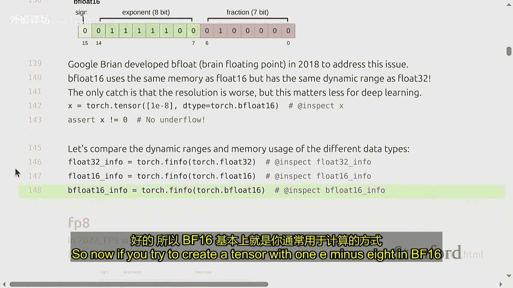
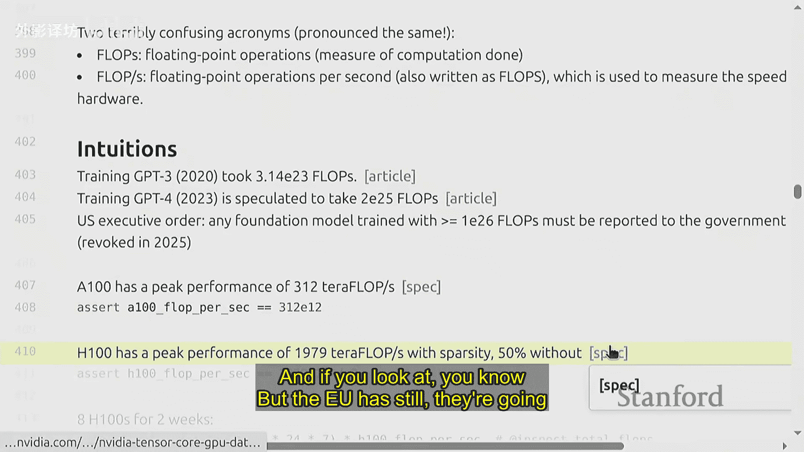
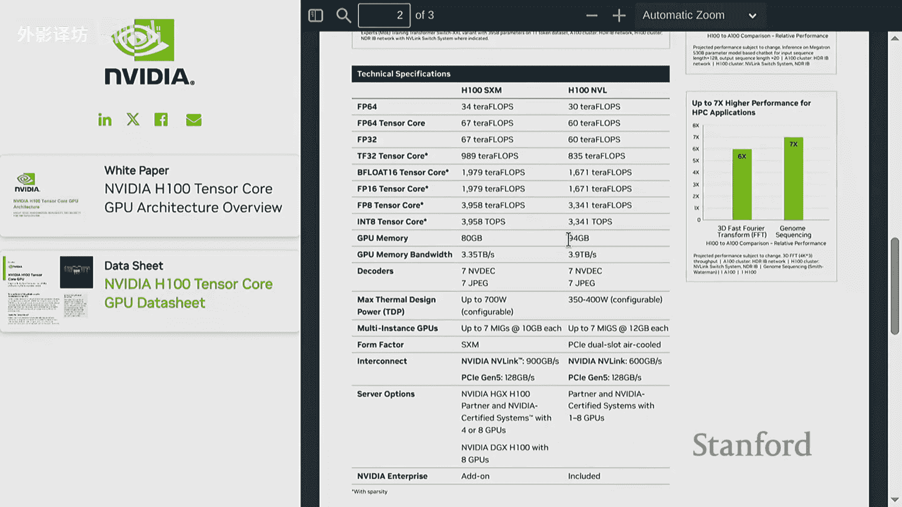
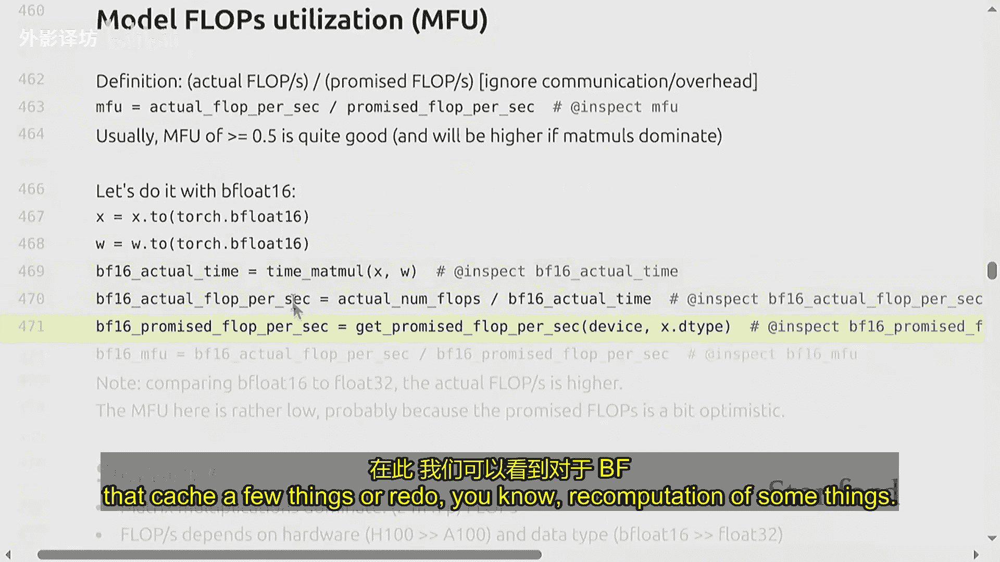
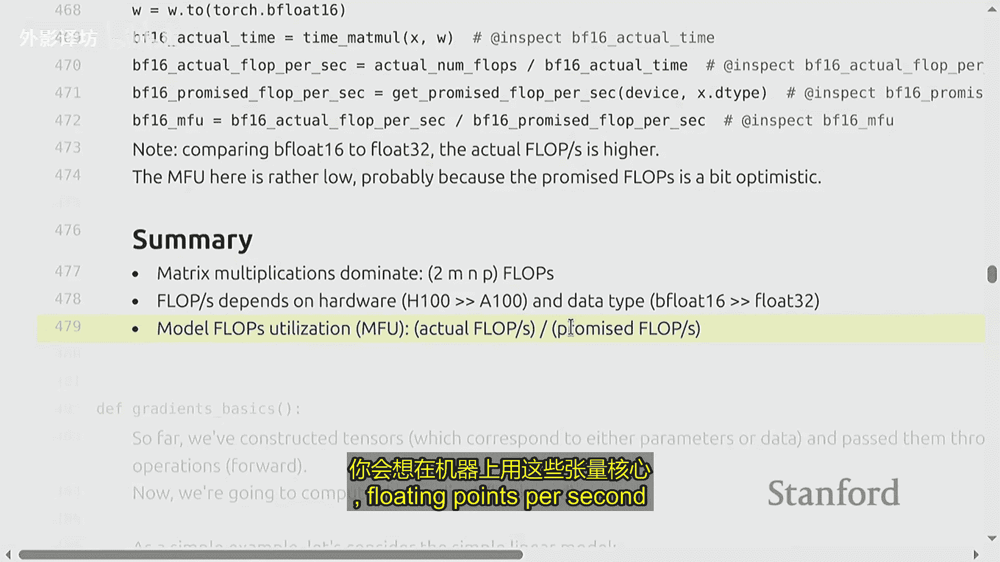
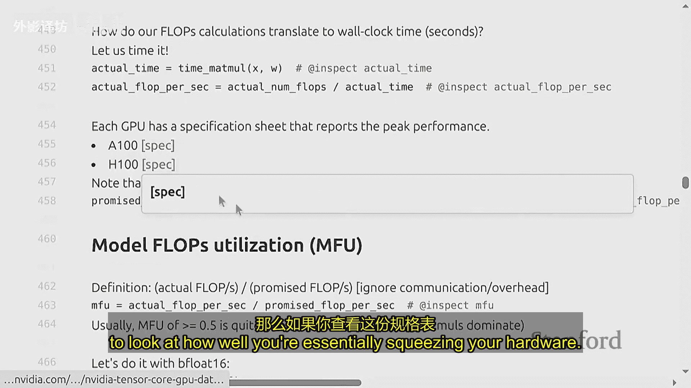
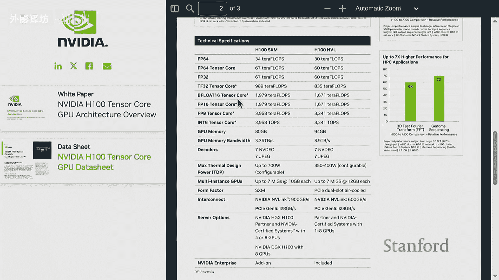
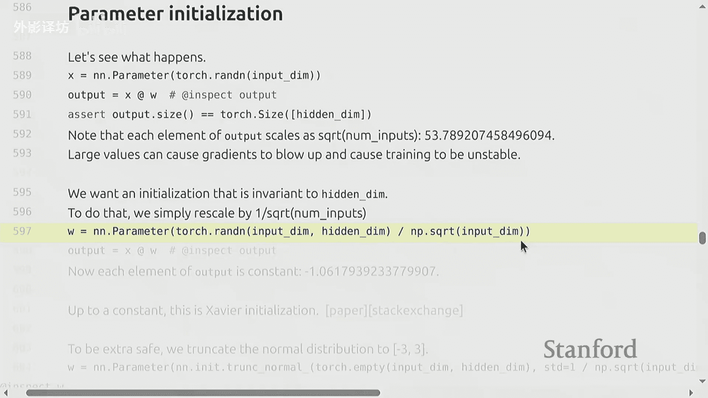
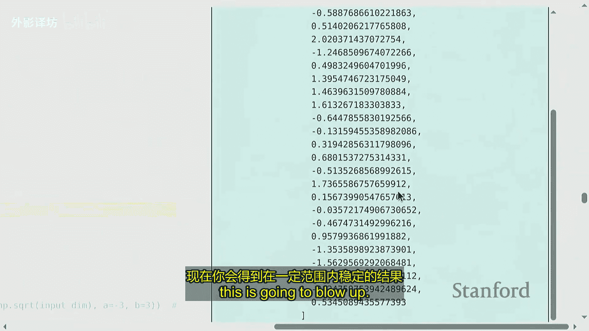
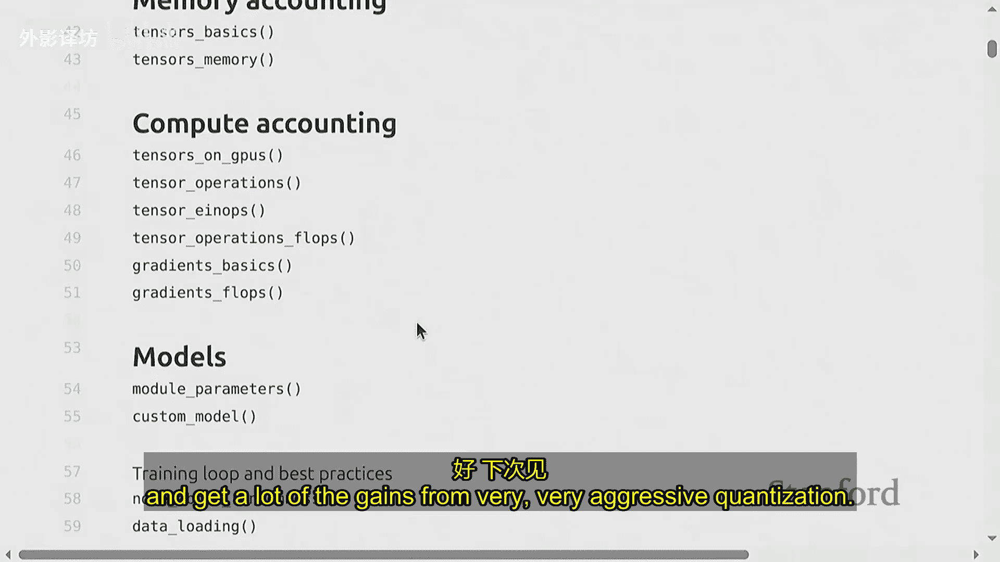

# 【中文配音】硬核！斯坦福 CS336：手把手带你从零构建 ChatGPT - P2：2.PyTorch高阶技巧与训练资源核算-Pytorch, Resource Accountingmp4 - 外影译坊 - BV1BWEWzfEKi

好的，上节课我概述了语言模型，以及从零开始构建它们的意义，以及我们为何要这么做，我还讲了词源话，这是第一次作业的前半部分，今天的讲座将实际讲解模型构建，我们将讨论PYTORCH中所需的基本要素。

我们将从张亮入手，构建模型优化器，并搭建训练循环，我们将尤其密切关注效率，我们如何使用资源，内存和计算方面的，所以稍微引发点兴趣，这里有一些问题，这些问题心算就能回答，所以把餐巾纸拿出来。

那么训练一个700亿参数的密集变压器模型，需要多长时间，在1024个H100芯片上处理，15万亿个资源需要多长时间呢，我简单给你们讲讲，我们想做的事，下面教你怎么推理，你要计算训练所需的浮点运算次数。

也就是参数数量乘以资源数量的六倍，这是怎么来的呢，这将是我们在本节课中要讨论的内容，你可以查看H100承诺的每秒浮点运算次数，即MFU我们稍后会讲到，我们就把它设为0。5，你可以查看每天的浮点运算次数。

在这个特定MFU下，你硬件能提供的浮点运算次数，所以一天有1024次，然后你只需将训练模型所需的总浮点运算次数，除以你预期能得到的浮点运算次数，这样就得到大约144，所以归根结底这都是非常简单的计算。

我们接下来会进一步探讨这些数字是怎么来的，特别是参数数量乘以词源数量的六倍，是怎么来的，好的，那么问题来了，使用item w，在八块H100上能训练的最大模型是什么，要是你别太自作聪明呢。

好H100有80G的HBM内存，每个参数所需的字节数，用于参数及梯度优化及状态优化，其状态的字节数是16，我们稍后会进一步讨论其来源，参数数量基本就是内存总量除以，每个参数所需字节数。

这样就得到约400亿个参数，这很粗略，因为没考虑激活情况，这取决于批量大小及序列长度，这个我就不细说了，但对作业一至关重要，所以这只是个大致估算，这可能不是你平常会做的事，你只需实现该模型。

你对其进行训练，顺其自然就好，但要记住，效率是重中之重，要想提高效率，你得确切知道自己实际消耗了多少运算量，因为当这些数字变大，这些直接就等同于金钱，而且你希望它越小越好。

所以我们会进一步探讨这些数字是如何产生的，我们实际上不会深入探讨变压器，所以test下次会讲解其概念概述，要是你还没了解过变压器，有很多途径可供你去了解，作业一做了作业一，你就肯定知道什么是变压器了。

而且讲义书里各部分做的很不错，有数学描述，要是你喜欢图片，也有网上有很多相关内容，但我会用更简单的模型，并深入探讨基本原理和资源核算好，还记得上次我说你能学到什么样的知识，那么在这堂课中。

关于技术原理只会涉及ti torch，以及在相当基础的层面，理解ti torch的工作原理，所以这会很简单，思维模式关乎资源核算，而且这不难，你只需去做，而关于直觉，很遗憾，目前只能大致讲讲。

实际上没太多直观内容，我将谈谈我们所做的一切如何转化为优秀模型，这更多涉及机制与思维方式，嗯好那我们从内存计算说起，接着我会讲计算量计算，然后我们自下而上构建好最佳起点是张亮。

张亮是深度学习中存储一切的基础参数，梯度优化器，数据激活函数，它们类似这些基本元素，你可以查阅很多关于他们的文档，你或许对如何创建张亮十分熟悉，创建张量有多种方式，你也能够创建一个张量，也可以不初始化。

它，若有需要可为参数采用一些特殊的初始化方式，好啦那些就是张亮，那么我们来聊聊内存，还有张亮会占用多少内存，所以我们可能感兴趣的，每个张量都可归为浮点数，而且表示浮点数有多种方式。

所以最常见的方式是32位浮点数，而32位浮点数占32位，其中一位用于符号，八位用于指数，23位用于小数部分，所以指数决定了动态范围，而小数部分则用于指定不同的值，所以32位浮点数也称作FP32极单精度。

算是计算领域的黄金准则，有些人也把32位浮点数称作全精度，这有点让人困惑，因为全精度实际上取决于和你交谈的对象，要是你跟搞科学计算的人说，他们没准会笑话你，当你说32位浮点数是全精度时。

因为他们会用64位浮点数甚至更高的，但要是你跟搞机器学习的人说，32位浮点数可能就是你需要的最高精度，因为深度学习在这方面有点随意，好那我们来看看内存，所以内存很简单，它取决于张量里值的数量。

以及每个值的数据类型，好的，那么如果你创建一个4×8矩阵的，torch张量，默认情况下会给你一个32位浮点数类型，尺寸是4×8，并且元素数量是32，每个元素大小是四字节，32位就是四字节。

内存使用量就是元素数量乘以每个元素的大小，那将得到128字节，所以这应该相当简单，只是为了让大家有个直观概念，如果你看一下GPT3的five four层中的一个矩阵，他是这个数乘以这个数，那就是2。

3000兆字节好，这就是一个矩阵，这些矩阵会很大，好float，三二是默认的，但这些矩阵会变大，所以你会想让它们变小，这样就能少用内存，而且如果你把它们变小，你还能让它变得更快好的，那么。

另一种表示形式啊，16位浮点数，顾名思义，它是16位的，其中指数部分从八位缩减到五位，小数部分从23位缩减到十位，好的，所以这被称为半精度，它能减少一半内存，这一切都不错。

只是16位浮点数的动态范围不太理想，例如用16位浮点数表示1×10的八次方，这个数，他基本上会四舍五入成零，然后就会出现下移好吧，所以浮点数16不太适合，表示非常小或非常大的数字，事实上。

所以如果在训练小型模型时，使用浮点数16可能还行，但对于大型模型，当有大量矩阵时，可能会出现不稳定，或出现下抑或上抑，进而引发问题好吧，那么一点还有一件好事发生，是否存在。

be float16的其他表示形式，它代表脑浮点数，他于2018年开发，旨在解决深度学习中的一个问题，实际上我们对动态范围的关注，超过了对这个小数部分的关注。

所以基本上b float16在指数上分配更多，在小数部分分配更少，好的它使用与16位浮点数相同的内存，但它具有32位浮点数的动态范围，好的听起来真不错，并且他在这个分辨率下确实能捕捉到。

由该分数决定情况更糟，但这对深度学习来说没那么重要，那么现在，如果你尝试在BF16中创建一个值为一，乘以十的八次方的张量，那么你会得到一个非零的值，好的，所以你可以深入研究细节，我不会深入探讨这个。

但你可以查看一下，所有不同浮点运算的实际完整规格，好的，所以bf16，基本上就是你通常用于计算的方式。

因为它对于前馈计算来说足够好了，原来为了存储优化器状态和参数，你仍需要flop32，否则训练会出问题，所以如果你是光头，所以现在我们有了FP8或八位的，正如其名，这是2022年开发的，由英伟达开发。

所以现在基本上他们有，如果你看FP和bf16就是这样，至于FP能用来存储数据的位数确实不多，所以它很粗略，有两种变体，这取决于你想要更高分辨率还是更大动态范围，关于这个就不多说了，但H100支持F18。

上一代产品中并没有它，但总体来说用float32训练，我觉得，如果你不想过多优化，就会这么做，而且还算安全，它需要更多内存，你可以降至FP8或bf16，但会有不稳定情况，基本上我觉得你不会。

目前深度学习中可能想用float16，而且你可以更深入了解，通过查看流程中的特定环节，如前向反向传播优化器或梯度累积，并弄清楚所需的最低精度，在这些特定环节，这就是所谓的进入混合精度训练。

例如有些人喜欢在注意力方面使用硫32，通过注意力来确保，不会在使用map模型进行简单前馈传递时，不会出错，bf16就可以，好的稍作停顿，以便提问，所以我们讨论了张亮，并且我们研究了取决于何种表示形式。

他们需要多少存储空间，是的，你能讲讲混合精度设置的情况吗，比如在B流中何时使用32位精度，是的，问题是何时使用硫32精度或VF16精度，我没时间讲具体细节，而且这会因模型大小而有所不同，但一般而言。

对于参数和优化器状态使用32位浮点数，你可以将bf16视为更具临时性的，比如基本上获取参数，将其转换为bf16，然后你可以借助那个模型继续推进，但随着时间推移，你会积累的内容，你想要更高的精度。

好那现在我们来聊聊计算，所以那部分讲的是内存，所以计算显然取决于硬件，默认情况下张亮存储在CPU里，例如要是你只用PYTORCH，假设X等于torch tensor等于torch tensor。

那么它会将其放在你的CPU上，它会存于CPU内存中，当然这可不太妙，要是你没在用GPU的话，那速度可就慢太多了，所以在PYTORCH里，你得明确说明要把它移到GPU上，实际上这只是为了用途更清楚的展示。

有个CPU它有内存，得把它移到GPU上，会有一次数据传输损耗，这得花些时间和精力，所以在PYTORCH中，只要你有一个张量，你要时刻记住它存放在哪里，因为只看变量或者只看代码，你不一定能看出来。

而且如果你想在计算和数据移动上谨慎些，你就得确切知道他的位置，你或许可以用断言之类的方法，在代码的不同位置确认他的位置，只是为了记录或确保准确性，那咱们来看看我们有啥硬件，那么在这种情况下。

我们有我们有一块GPU，这是在你们能访问的H100集群上运行的，你们能访问的这块GPU是H100，有80G高带宽内存，他还会给出缓存大小之类的信息，所以要是你有记住X在CPU上。

你只需指定两个值就能移动它，这是一种通用的PYTORCH函数，你也可以直接在GPU上创建一个张量，这样你就完全不必移动它了，如果一切顺利，我正在查看前后分配的内存差值，应该恰好是两个30字节。

也就是32×32的四字节，浮点数矩阵，所以是A192，所以这是一个合理性检查，代码正在按宣传的那样运行，好啦现在你的张亮已在GPU上了，你要做什么，所以在作业一中你会需要很多操作。

一般来说用于任何深度学习应用，大多数张量只需通过对其他张量执行操作，来创建，每个操作都有一些内存和计算开销，所以我们要确保理解这一点，那么首先在PYTORCH里，张亮究竟是什么，张亮是一种数学对象。

在PYTORCH里，他们实际上是指向某些已分配内存的指针，那么比如说如果你有一个4×4的矩阵，它实际看上去是一个常数组，而张亮拥有的原数据，规定了如何在该数组中寻址，原数据是两个数字各对应一个不符。

或者实际上是张亮每个维度对应一个数字，在此情况下，由于有两个维度不符，是零和一，部长林表示，在维度零中要到达下一行，来增加索引，你需要跳过多少个，所以向下遍历各行时要跳过四个，所以步长零是四。

而要到达下一列需跳过一个，所以不常一是一懂了吗，那么这样的话要找到一个元素，比如说一二只需要用索引乘以步长，你就得到了索引，这里是六，所以会在这儿或这好了，这基本上就是张亮的底层原理，好的这一点很关键。

因为可以有多个张量共享同一存储，这很有用，因为无需到处复制张亮，那么假设这里有一个2×3的矩阵，许多操作实际上不会创建新张量，他们只是创建一个不同的视图，并且不会复制，所以你得确保在进行张量的改变时。

要是你开始改变一个张量，就会使另一个也跟着改变好的，那么例如要是你只取第零行好，所以记住Y就是这个张量，抱歉X是123456，而Y是X0，也就是第一行一好，你可以再检查一下，我写了个函数。

用于查看底层存储，这两个张量的存储是否一样，好的这肯定不会复制张亮，它只是创建一个视图，你能获取第一列，这也不会复制张亮哎呀，不用那样做，你可以调用一个视图函数，他能接受任何张量，并从不同维度查看它。

2×3，实际上这可能得反过来，作为一个三胜二的张量，所以这也不会复制，你可以转指，那也不会复制，然后就像我讲的，如果你开始改变X，那么Y实际上也会改变，因为X和Y只是指向同一个底层存储的指针，好的。

那么情况是需注意，有些视图是连续的，这意味着便利张量时就像在存储中滑动，遍历数组，但有些不适，特别是对其转制时，转制意味着什么，现在有点像，再往下，所以你会想象电力张量时，你有点在乱跳。

如果你有一个非连续张量，那么如果你试图以其他方式进一步查看它，那么这就行不通了，所以在某些情形下，如果你有一个非连续张量，你可以先让它连续，然后你可以对它进行任何你想要的查看操作，然后在这种情形下。

X和Y的存储不同，因为这种情况下，连续操作会创建一个副本，好的这就是对张亮进行切片和切块的方法，试图是免费的，所以可以随意使用，定义不同变量，以便更易读代码，因为他们不会分配内存。

但要记住连续或重塑操作，基本上就是连续试图操作，可能会创建一个副本，所以要留意你在做的事，好的继续钱有问题吗，好的希望这些内容能多被回顾，对于之前用过很多PYTORCH的人来说，但系统的做会有帮助。

确保我们意见一致，所以这里有些操作会创建新张量，特别是竹元素操作显然都能创建新张量，因为你需要在别处存储新值，还有三角优也是个很有用的竹元素，操作，当你想创建一个因果注意力掩码时，这是你作业中需要的。

但这里没啥有趣的好了，那么咱们来聊聊映射模型，所以深度学习的核心是矩阵乘法，我肯定你们都做过矩阵乘法，但以防万一，就是这样，用一个16×32的矩阵，乘一个32×2的矩阵，就得到一个16×2的矩阵。

但一般而言，当我们做机器学习应用时，所有操作都得批量做，对于语言模型来说，这通常是指一批中的每个样本，还有一批中的每个序列，你要进行一些操作，所以一般来说你得到的不是一个矩阵，而是一个张量。

其维度一般是批次序列，然后是你要进行的任何操作，在这种情况下，数据集中的每个标记对应一个矩阵，PYTORCH很出色，能让这一切顺利运行，那么当你用这个处理维度张量和这个矩阵时，实际上对于每个批次。

每个事例和每个标记，你再把这两个矩阵相乘，然后得到的结果是，你会为前两个元素分别得到结果矩阵，所以没什么特别的，但这只是一种我觉得值得思考的模式，好下面我岔开一下话题讲讲ENNS，INUX的动机如下。

通常在PYTORCH里，你定义一些张量，然后你会看到这样的，你用X乘以Y的转置，再减去二和一，你看着这个，然后说好吧，二是什么嗯，我想那是顺序，然后一是隐藏的，因为你是倒着索引的，而且很容易把这个弄乱。

因为当你查看代码时会看到一二，某种程度上，要是你水平高，你会写很多注释，但之后注释可能会与代码不同步，然后调试就会很费劲，所以解决方案是在此处使用in UPS，所以这是受爱因斯坦求和记号的启发。

其思路是我们只需给所有维度命名，而不是实际上依赖索引，有一个名为JACKTAPING的库，它有助于指定类型中的维度，通常在PYTORCH中只需定义并编写代码，然后进行注释，比如这里就是维度情况。

所以如果使用JS类型标注，那么就有这样一种表示法，写成字符串形式，只需写下维度情况，所以这是一种更自然的记录方式，现在要注意这里没有强制规定对吧，因为在PYTORCH里，PYTORCH类型有点不太靠谱。

所以你可以用个检查工具对吧，没错，你能进行检查，但默认不会这么做，好那咱们来看看爱因斯坦求和，所以i sum基本上就是更厉害的矩阵乘法，而且记录清晰，这是我们的例子，我们有X他是咱们就这么想。

你有个P4维度，你有个序列维度，然后你有四个隐藏的，而且Y的尺寸一样，你原来得做这个，现在你要做的基本上就是，写下两个张量的维度及其名称。

Because i just want to basically carry that over，所以批次序列一隐藏单元，批次序列二隐藏单元，你只需写出输出中英出现的维度好，那我在这写批次。

因为我就想把它原样照搬过来，然后我写下seek1和seek2，注意我没写hidden，输出中未命名的维度都会被求和，而被命名的维度则会进行迭代，懂了吗，一旦你习惯了这个，这其实非常有用。

要是你第一次看到这个，可能会觉得有点奇怪和冗长，但相信我一旦习惯就好了，这样会比写二一要好，要是你再机灵点，你可以用省略号来表示，在任意多个维度上进行扩展，所以在此情形下，不用写batch。

我直接写省略号就行，这样就能处理可能并非batch的情况，我有batch1，batch2或者其他任意长的序列，嗯有问题吗，所以问题是他能保证编译出高效的结果吗，我想简短的答案是肯定的。

我不知道你们有没有没错，有细微差别，我们会找到最佳的减少方式，最佳的维度缩减顺序，然后使用它，如果你在torch compile中使用它，只做一次，然后反复使用相同的呈现，没错。

这会比他设计的任何东西都要好没错好嘞，所以，那咱们来看看规约，所以规约是对一个张量进行操作，它主要是对张亮的一个或多个维度进行聚合，那么你就有了这个张量，以前你会用mean对最后一个维度求和。

现在你基本上是说其实这样就用求和替代了，所以进行规约，然后你会说隐藏，并且隐藏项消失了，这意味着你在那个维度上进行聚合，所以你可以检查这里确实可行，所以关于这个的最后一个例子可能是，有时在张量中。

一个维度实际上代表着多个维度，并且你想要解包它，然后对其中一个进行操作并重新打包，所以在这种情况下，比如说你有一批数据，一个序列，然后这个八维向量实际上是多头数，乘以某个隐藏维度后展平得到的表示。

然后有一个向量要作用于那个隐藏维度，所以通过调用rearrange，你可以用ii NO peace，非常巧妙的做到这一点，关于这个大家可以思考一下，我们之前见过view，他有点像个更高级的形式。

它基本上是用不同方式查看相同的数据，所以这里基本上是说这个维度，实际上是头部和隐藏层衣，我要把它扩展成两个维度，而且你得在这里指定投的数量，因为一个数有多种，拆成两个数的方法，咱们看看这可能有点长行吧。

也许现在不值得看，既然有X，你可以用形和来进行变换，所以这是隐藏层一，它与X对应，接着是隐藏项一，隐藏项二，它与W对应，这会生成隐藏项二，然后你可以重新排列，所以这是拆分的逆过程，所以你有两个维度。

然后你把它们合并为一个，所以这就是一个扁平化操作，在此过程中，其他所有维度都保持不变，好的关于这个有个教程推荐你去看看，他还能给你更多，所以你不必用这个，因为你是从零开始构建它。

所以你基本上可以为所欲为，但在作业一中我们会给你指导，而且这可能值得你投入，那么现在我们来谈谈张量运算的计算成本，所以我们介绍了一系列操作，他们要花多少钱，浮点运算。

就是诸如加法或乘法之类的任何浮点操作，浮点操作，就是这些这些算是主要的，我想就浮点运算次数而言，这些很关键，我有点不爽的是，当你说FLOS时，实际上你指的是什么并不清楚。

所以你可能指的是小写的flops，它代表浮点运算的次数，这衡量了你所做的计算量，或者你说的是FLOS，也可以写成大写的S及每秒浮点运算次数，这用于衡量硬件速度，所以在这门课里，我们不会使用大写S。

因为我觉得那样很容易混淆，而是写成斜杠S来表示每秒浮点运算，好的，为了让你们对FLOS有个直观感受，GBD3大约需要310平方立方次FLOS运算，GBD4是210平方次FLOS运算仅供推测。

曾有一项美国行政命令，任何浮点运算超1×10的26次方次，的基础模型都需上报政府，此行政命令现已被撤销，但欧盟仍在推进相关举措，仍有一些尚未完成的相关事宜，欧盟的人工智能法案规定为，1×10的25次方。

该法案尚未被撤销，下面是一些直观数据，A100的峰值性能是每秒312万亿次，浮点运算，而H100启用稀疏性时，峰值性能为每秒1979万亿次，浮点运算，不启用时约为其50%。

And if you look at you know，英伟达有这些规格参数表。

所以你看每秒浮点运算次数，实际上取决于你要做的事，所以若你使用FP32，实际上会非常糟糕，比如在H100上运行FP32，与使用FP16相比，不会差几个数量级，若你愿意降至FP8，那么速度会更快。

我第一次看的时候没注意到，但这里有个星号，这意味着借助稀疏性，所以通常我们这门课里的很多矩阵，都是密集型的，所以实际上你得不到这个效果，你得到的大概是一半，正好是那个数的一半，恰恰是一半。

所以现在你能进行一系列计算，八块H100运行两周，大约是，你知道每秒浮点运算次数乘8×1周的秒数，一周时间嗯，其实就是一周好的，所以这就是一周，那就是4。7×10的20一次方是个数字。

你可以把浮点运算次数和其他模型数量，结合起来看，稀疏性是什么意思，所以就是说如果那么稀疏性是什么意思，这意味着矩阵要是稀疏的，它是一种特定的结构化稀疏性，就像每四个元素一组里有两个是灵，那是唯一情形。

当你以那个速度得到它时，没人用，它是营销部门在用它，那咱们来看个简单例子，所以记住咱们不碰变压器，就算是线性模型，也能给我们不少基本原理和直观感受，那假设我们有端点，每个点都是D为线性模型会进行映射。

把每个地维向量映射成K为向量，那咱们设点的数量是B维度是DK是输出数量，接着创建数据矩阵X和权重矩阵W，线性模型不过是个简单的，所以没什么特别有趣的情况，而问题是，那是多少次浮点运算。

看待这个问题的方式是你会说嗯，当进行矩阵乘法时，基本上对于每一组IJK，我得把两个数相乘，而且还要把那个数加到总和里，所以答案是两次，基本上是所有相关维度的乘积，所以就是左边维度。

中间维度和右边维度好的，所以这个你得记一下啊，如果你在进行矩阵乘法运算，浮点运算次数是三个维度乘积的两倍，好的，所以其他运算的浮点运算次数，通常是和矩阵或张量大小大致呈线性关系。

而且一般来说深度学习中的其他运算，对于足够大的矩阵，其运算成本与矩阵乘法相当，所以我认为很多简单的估算都很容易，因为我们只关注矩阵乘法模型执行的，当然当矩阵足够小时，其他运算的成本就会开始占优。

但一般来说这不是个好情况，因为硬件是针对大矩阵乘法设计的，所以这有点循环，但我们最终进入了这种状态，我们只考虑模型，在这些模型里映射模型是主要成本，好的，关于这个数字有问题吗，三个维度乘积的两倍。

这也挺有用的，矩阵乘法算法会一直不变吗，因为芯片可能已经优化过了，是的，本质上问题是，这是否取决于矩阵乘法算法，一般而言，我猜我们下周会探讨这个，或者在我们研究内核的那周之后再看，我的意思是。

实际上在底层有很多优化工作，当涉及矩阵乘法时，而且根据形状会有很多专门的处理，所以我要说这只是一种大致的估计，基本处于正确的数量级嗯，好的没错，加法和乘法被视为等效，刘宏没错，加法和乘法被视为等效。

所以我发现一种解释这个的有用方法，所以说到底这只是个矩阵乘法，但我打算给它赋予一些意义，这就是为什么我把它设为一个，类似小玩具的机器学习问题，所以B代表数据点的数量，而DK是参数数量。

所以对于这个特定模型前向传递，所需的浮点运算次数是令牌数量的两倍，或者是数据点数量乘以参数个数，所以这实际上可以推广到变换器，这里有个星号，因为，存在序列长度等因素，但如果序列长度不是太大。

这个大致是对的，那么现在这只是一些浮点运算对吧，那么这实际上如何转化为类似时间的量呢，这大概就是你真正在乎的东西吧，你得等多久才能完成运行，那咱们来计时，我有个函数会运行五次，然后我要进行矩阵乘法操作。

两周后我们再谈这个，为什么这里有其他代码，但现在我们得到了实际时间，那个矩阵运算花了0。16秒，还有实际每秒浮点运算次数，它每秒的浮点运算次数为5。4，乘以十的13次方，明白了吗，现在你可以将词语。

A100和H100的营销资料做比较，当我们查看规格表时，浮点运算次数取决于数据类型，我们看到对于H100，其每秒承诺的浮点运算次数，我猜这是针对32位浮点数的，为67万亿次浮点运算，如我们所见。

所以这就是我们每秒承诺的浮点运算次数，现在如果你看看，有一个有用的概念叫模型，浮点运算利用率及MFU，它是实际每秒浮点运算次数除以承诺值，所以记住实际每秒浮点运算次数。

及你实际看到的对你模型有用的浮点运算数，除以实际所用时间，再除以承诺每秒浮点运算数，这来自光纤的宣传册，你能得到0。8的MFU值，懂了吗，所以通常能看到人们谈论，他们的NFU值大于0。5。

通常被认为是好的，如果你只有5%的MFU，那被认为是非常糟糕的，你通常无法如此接近90或100，因为这有点忽略了通信和开销，这就好比是对FLOS的直接计算，好的，如果矩阵乘法占主导，通常MFU会高得多。

好的这就是MFU，关于这个有什么问题吗，是的，你用的是每秒承诺运算量，没考虑稀疏性，所以每秒承诺运算量没考虑稀疏性，需要注意，这实际上是个，还有个叫硬件到浮点运算序列化的东西，这里的动机是。

我们试图关注，它叫模型，因为我们关注有效模型执行的有用操作数量，好的，所以这是一种标准化方法，实际完成的并非浮点运算次数，因为你的代码中或许存在优化之处，它会缓存一些内容，或重新计算某些部分。

在某种意义上，你仍在计算同一个模型，所以关键在于，这在一定程度上是在考量模型复杂度，而且仅仅因为你不应受到惩罚，如果你在MFU上很有技巧，但实际上你并未进行浮点运算，但你却称作了好的，那么对于bf16。

你也可以这么做，在此我们可以看到对于BF。

时间实际上要好很多，所以是0。03，而非0。16，所以实际每秒的浮点运算次数更高，即便考虑到稀疏性，预期的浮点运算次数仍然相当高，所以对于bf16MFU实际上更低，这可能低得惊人。

但有时预期的浮点运算次数有点过于乐观了，所以一定要对你的代码进行基准测试，不要只是一味假设你能获得特定的性能水平好，下面总结一下，矩阵乘法在计算中占主导，一般经验法则是他是维度乘积的两倍。

即每秒浮点运算次数，每秒浮点运算次数，取决于硬件和数据类型，所以你拥有的硬件越高级，它越高，数据类型越小，通常速度越快，而MFU是个有用概念，能看出你对硬件的利用程度，没错，我常听说。

为了实现最大程度利用，你会想在机器上用这些张量核心。

那默认情况下PYTORCH引用这些张量核心吗，这些配置考虑到这点了吗，郭宇峰，所以问题是那些张量核心如何，那么如果你查看这份规格表。

你会看到，这些都基于张量核心，所以张量核心本质上是用于执行映射模型的，专用硬件，那么默认情况下，如果你它应该使用，特别是当你使用PYTORCH进行编译时，它将生成能正确使用硬件的代码。

好那我们来稍微讲讲梯度，原因是我们只探讨了矩阵乘法，或者换句话说，基本上就是前馈传播和浮点运算次数，但还有一部分计算来自于计算梯度，而且我们想弄清楚这部分计算量有多大好，那我们来看一个简单例子。

一个简单线性模型在其中做出线性模型预测，然后考察均方误差，相对于5G损失函数没啥意思，但我觉得他对研究梯度很有启发性，好啦，记住在正向传播中有输入X和权重W，你想计算其梯度，通过线性乘积来做预测。

然后就得到了损失值，在反向传播时，你只需调用损失函数的反向传播方法，在这种情况下，梯度他是张亮所关联的变量，结果正是你想要的，好啦大家之前都在PYTORCH里算过梯度了，那我们来看看计算梯度需要多少。

浮点运算，好啦，那咱们来看看一个稍复杂些的模型，现在这是个两层线性模型，有个X，他是B乘D再乘W1，它是D乘D，所以这就是第一层，然后取出隐藏激活值H1，然后将其通过另一个线性层得到一个K为向量。

然后进行一些计算，好了，这是个两层线性网络作为回顾，如果你看看前项的浮点运算次数，你需要做的是将X乘以W1，查看W1用X乘以W1，然后加到H1上，然后用H1与W2，然后加到H2上。

所以总的浮点运算次数又是两倍，MAML中所有维度的乘积，再加上MML中第二个矩阵维度乘积的两倍，换句话说，在此情况下是参数总数的两倍，那么反向传播呢，所以这部分会稍微复杂一点。

那么我们可以回顾模型从X到H1，再到H2以及损失值的情况，所以在反向传播过程中，你得计算一堆梯度，而相关梯度为你得计算关于H1H2，W1和W2的梯度，关于损失值的梯度。

所以要对这些变量分别求损失值的导数，那么计算这个得花多长时间呢，我们现在先看看W2，所以与W2相关的那些东西，通过链式法则就能算出来，那么W2的梯度极低损失DW2的梯度。

就是把H1乘以损失对H2的梯度再求和，所以这就是W2的链式法则，而且所有梯度和基础向量维度相同，所以这实际上就像矩阵乘法，同样的算法也适用，也就是乘积数量的两倍，所有维度下B乘以D乘以K。

但这只是W2的梯度，我们还需计算H1的梯度，因为我们得反向传播到W1等，所以这是W2乘以H2的结果，抱歉，我觉得这里应该是hr的梯度H2点乘梯度，所以本质上也是。

看起来像矩阵乘法计算每个梯度的运算量相同，好的，那么把这两者相加，这是针对W2的，对W1也做同样操作，它有D乘D格参数，把这些都加起来，就是如此，对于W2计算量为四乘B乘D乘K。

而对于W1计算量也是四乘B乘，D乘D，因为W1是D乘D矩阵，我知道这里有很多符号，我也会试着给你们直观讲讲这个，这是一篇我觉得可能更有用的博客文章，到时候再说好，我得等动画循环，这就是节点的一层。

这里有隐藏层，还有连接到下一层的权重，所以我得这个动画的问题是得等，好准备好，首先我得将W和A相乘，然后加到这个上面，这就是前向传播，现在我要把这两个相乘，然后加到那个上面，然后我要相乘。

然后加到那个上面，好的，有问题吗，我希望能把这个放慢啊，有些细节大家可以自行琢磨一下，但总体而言，前向传播的参数数量变为原来的两倍，后向传播的参数数量则变为原来的四倍，我们可以通过这里的链式法则算出来。

没错，关于作业，我们还要用，你说过有些作业实现方式是允许的，有些则不行，我们能用梯度吗，还是说我们要完全手动计算某个部分，那么问题来了，作业里你要手动算梯度吗，答案是不，你只用PYTORCH的梯度就行。

这么做是为了拆解一下，方便我们算计算量，好在我继续前有问题吗，好总结下，对于这个特定模型，前向传播是是数据点数乘以参数数的两倍，反向传播是数据点数乘以四倍参数数。

这意味着总计它是数据点数乘以参数数的六倍，这就解释了为什么一开始会出现那个六，当我提出那个启发性问题时，所以现在这是针对一个简单的线性模型，但事实证明，很多模型这基本上就是计算量的主体部分。

当你所做的每一次计算，大致都会设计一个新参数，显然你会发现有些模型不符合这种情况，有些模型不符合这种情况，因为通过参数共享，你可以只用一个参数，并且有10亿次浮点运算，但这通常不是模型的样子，好嘞。

那咱继续，到目前为止我基本讲完了关于资源核算，所以我们研究了张量，我们研究了张量的一些计算，以及存储张量所需的空间，还有张亮进行各种运算所需的浮点运算次数，当你现在对他们进行各种运算时。

让我们开始构建不同的，我想是你懂的那些模型，这部分不一定在概念上有趣或具有挑战性，但这或许更多是为了完整性好的，在PYTORCH里，参数是以这些神经网络参数对象的形式存储的，让我们稍微谈一下参数初始化。

比如说如果你有，假设有一个参数，你的W参数是一个输入维度与隐藏维度相乘，的矩阵，你仍在线性模型的情形下，那我们来输入数据，然后将其输入，通过输出层，所以高斯分布的随机数和单位看似无害，当你这么做时。

查看输出会发现你会得到一些数值很大的数，这是因为该数字，基本上会随着隐藏层维度的平方根增长，所以当你有大型模型时，这就会出现数值爆炸，而且训练会变得很不稳定，通常你要做的是以对隐藏状态不变的方式。

初始化，或者至少当你确保它不会出问题，一种简单的方法是，重新缩放除以输入数的平方根，所以基本上咱们重新来W是一个参数，即我用它除以输入维度的平方根。

然后当你将其通过输出现在，你会得到在一定范围内稳定的结果。

这实际上会收敛到你懂的，类似标准的0~1分布，好的，所以基本上你懂的，这在深度学习文献中已有相当广泛的探讨，它在一个常数因子范围内被称为savior初始化，而且通常我猜这相当常见，如果你想更保险些。

你不相信正态分布，因为它没有，它的尾端是无界的，你只需说我要将其截断到3~3，这样我就不会得到任何大的值，而且我不希望有任何东西干扰它，好的，好的，那我们来构建一个简单的模型，它将有D个维度和两层。

我刚刚起了这个名字，Cruncher，它是一个自定义模型，它是一个深度线性网络，它有N层，每层为一个number layers层，且每层都是一个线性模型，其本质上仅是一个矩阵乘法，所以该模型的参数。

第一层有若干层，它是一个地乘D矩阵，第二层同样是一个地乘D矩阵，接着有一个末层，那么若我算出该模型的参数数量，则结果为D平方加D平方加D，所以没什么可大惊小怪的，我要把它移到GPU上。

因为我想让他跑的快点，我要生成一些随机数据，并将其输入数据前向传播，就是依次过程，最后应用头部层，好对于那个模型，我要用这个模型，并用它做些操作，但这只是一段一般性的题外话，有时候随机性会挺烦人的。

比如说当你想重现某个错误时，它在很多方面都会出现，像初始化随机失活数据排序，还有一些最佳做法，我们建议你始终设置或者固定一个随机种子，这样就能重现你的模型，或者至少尽你所能。

尤其要注意为每个随机源设置不同的随机种子，是个不错的做法，因为这样你就能比如说修复初始化，或调整数据排序，但还有其他很多事，调试时确定性对你有帮助，而在代码中，不幸的是，代码中有很多地方可使用随机数。

必要清楚你用的是哪一种，如果你想确保安全，那就为所有这些设置CR，数据加载部分我快速过一下，这对你做作业有用，那么在语言建模方面，数据通常只是一连串整数，因为要知道这是由分词器输出的。

你可以将它们序列化为number派数组，我想还有一点或许有用的一点是，你不想一次性把所有数据都加载到内存中，因为例如lama数据为2。8台字节，但是你可以假装加载它。

通过使用名为MMAP的便捷函数来加载它，它实际上会为你提供一个映射到文件的变量，所以当你尝试访问数据时，它会按需加载文件，然后利用这个你可以创建一个数据加载器，从你的数据集中采样数据，所以为了节省时间。

我就跳过这部分了，我们来稍微讲讲优化器，所以我们已经定义了模型，有很多优化器，我们大概了解一下其中一些的原理，当然有随机梯度下降，你计算一下数据集中的梯度，你朝那个方向迈进一步，无需提问。

有一种叫栋梁的想法，他可追溯到经典优化，涅斯捷罗夫要计算梯度的滑动平均值，你根据滑动平均值进行更新，而非瞬时梯度，然后是aa grad，你用梯度缩放，梯度平方的平均值，你还有RM pro。

它是eighty grad的改进版本，它采用指数平均而非简单的均值，最后是ADAM，他于2014年出现，它本质上是将rms prop与动量相结合，所以你要同时维护梯度的移动平均值。

还要维护梯度平方的移动平均值好，既然你要在作业一中实现ADAM，我不打算那样做，相反我将实现ade grad，那么在PYTORCH中实现优化器的方法是，你需要重写优化器类，接下来或许我会。

等我们一步步讲的时候，我再讲实现方法，那么我们来定义一些数据，计算损失的前向传播，然后计算梯度，然后当你调用optimizer step，这就是优化器真正起作用的地方，所以你的参数是被分组的。

例如你有一组用于第零层，一组用于第一层，然后是最终的权重，你可以访问一个状态，它是个字典，从参数到你想存储为优化器状态的任何东西，以假定那个参数的梯度已计算好，通过反向传播。

现在你可以像在AIGRADU里那样操作，你在存储梯度平方和，这样你就能得到gr变量，然后可以根据梯度平方来更新它，所以这是对梯度逐元素求平方，然后将其放回状态好的，那么优化器负责更新参数。

这是将学习率乘以梯度，再除以这个缩放因子，所以现在这个状态会在优化器的多次调用中，持续存在，好的，那么，然后再在优化器步骤结束时，你可以释放内存，我认为这是为了，当你考虑时，这实际上会更重要。

当我们谈及模型并行时好，那我们来聊聊优化器状态的内存需求，实际上至此所有内容，所以该模型的参数数量是D的平方，乘以层数，再加上最后一层的地，激活数量，所以这是我们之前没做过的。

但现在对于这个简单模型做起来挺容易，就是必备，D乘以层数，对于每一层，每个数据点和每个维度，你得保存激活值，对于梯度，其数量与参数数量相同，还有优化器状态的数量，对于adi grad，我们得存储。

梯度的平方，这相当于参数的另一份副本参数，把这些都加起来，假设你知道是单精度浮点数格式，总的内存是，即四个字节乘以参数数量，激活数量，梯度数量以及优化器状态数量好的，然后得到一个数字，这里是496。

好的这是个相当简单的计算，在作业一中，你要对transformer做这个计算，这会稍微复杂点，因为你得不止有矩阵乘法，而是有多个矩阵，还有些复杂情况，还有所有这些其他的东西，但计算的一般形式是一样的。

你有参数激活值，梯度和优化器状态，这个模型所需的浮点运算次数，是令牌数量的六倍，或者数据点的数量乘以参数的数量，这基本上就完成了该特定模型的资源核算，作为参考。

如果你想知道如何对transformer进行此项计算，你可以查阅其中的一些文章，好啦，那么在剩余时间里，我想或许我会停下来答疑，接着我们讨论了构建张量，然后我们构建了一个很小的模型，然后我们谈到了优化。

以及需要多少内存和计算资源，我们无需存储激活值，所以问题是为什么要存储激活值，按理说你需要存储激活值，Which we're going to talk about later，在进行反向传播时。

比如说第一层的梯度取决于激活值，所以DI层的梯度取决于那里的激活值，要是你更机灵些，你不必存储激活值，或者不必全存，你可以重新计算，这就是所谓的激活值检查点技术，我们稍后会谈到，好啦，咱快速过下训练。

其实这没太多可说的，这就是典型的训练循环定义模型和优化器，获取数据进行前向传播，进行反向传播，在参数空间中更新，我猜这会更有意思，我想下次我该展示个实际的一维组件，此版本没有，关于检查点，有一点要注意。

所以训练语言模型耗时久，你肯定会在某个时候崩溃，所以你不想前功尽弃，所以你要定期把模型保存到磁盘，这里要明确一下，你要保存的是模型和优化器，可能还有当前的迭代次数，我得补充一下，然后就能把它加载进来。

也许最后要说的是，我之前提到过训练时的混合精度，选择不同的数据类型，各有利弊，如果精度更高，更准确且稳定，但更昂贵，而低精度则相反，如前所述，默认，建议使用float32。

但尽可能尝试使用bf16甚至FP8，所以前馈过程可用较低精度，其余部分用float32，这一想法可追溯到2017年，正在探索混合精度训练，PYTORCH有工具可自动进行混合精度训练，因为这可能有点烦。

得指定模型哪些部分要采用何种精度，通常你把模型定义成结构清晰的模块化东西，而指定精度有点像要贯穿其中，还有一点我想一个普遍看法是，人们在所需精度上不断探索，有些论文显示，实际上全程都能用FP8。

我想其中一个挑战，当然当精度较低时，其数值会变得非常不稳定，但在训练时，你可以用各种方法控制模型数值，以便，以免陷入这些糟糕的情况，所以我认为在系统方面与模型架构设计，存在协同作用，因为基于现有条件。

你想设计模型，很多模型设计都受硬件制约，所以即便像transformer这种，正如我们上次提到的受GPU的限制，现在如果我们发现英伟达芯片有这样一个特性，比如采用像in4这样的低精度，这是一方面。

现在要是你能让你的模型训练，实际上能以四精度运行，我觉得这挺难的，那你就能大幅提升速度，而且你的模型会更高效，还有另一件事我们稍后再说，即通常你会用更合理的浮点精度来训练模型，但说到推理，你可能会疯掉。

然后拿出你的模型，然后就能对其进行量化，并通过非常激进的量化获得诸多益处，所以不知怎地低精度训练要困难得多，但一旦你有了一个训练好的模型，使其变为低精度，就容易多了，好的，那我就讲到这里总结一下。

我们已经讨论了训练模型时要用到的不同，基本要素，从张亮一路构建到训练循环，我们讨论了内存计算，以及这些简单模型的FLOS计算，希望你完成作业以后，所有这些概念都会很扎实。

因为你会将这些想法应用到实际的变换器中。

