# 【中文配音】硬核！斯坦福 CS336：手把手带你从零构建 ChatGPT - P3：3.大模型架构设计与超参数调优-Architectures, Hyperparameters - 外影译坊 - BV1BWEWzfEKi

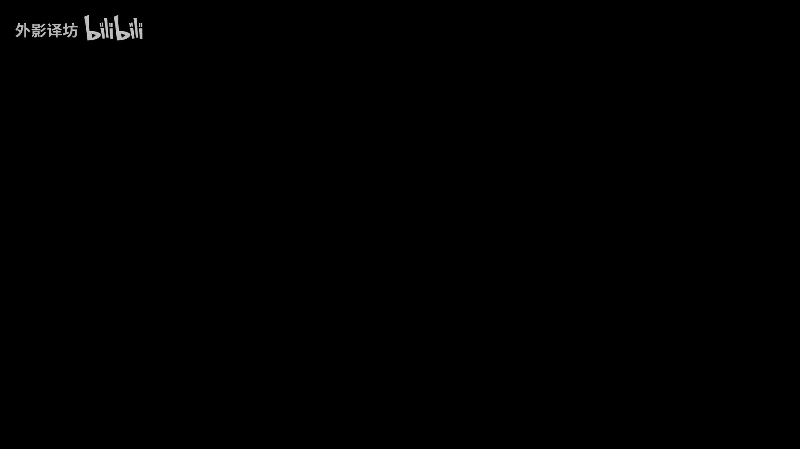

你可能已经注意到了，我讲课没破膝那么有创意，所以你们看到的会是POWERPOINT幻灯片，而不是Python代码，但你们在网站上应该也能找到PDF文件，我把这次讲座命名为语言模型架构。

那些你不想知道的事与训练，因为我们要深入讲些具体细节，我觉得大多数其他课程都不会讲这些细节，比如我的超参数该设成什么样之类的问题。

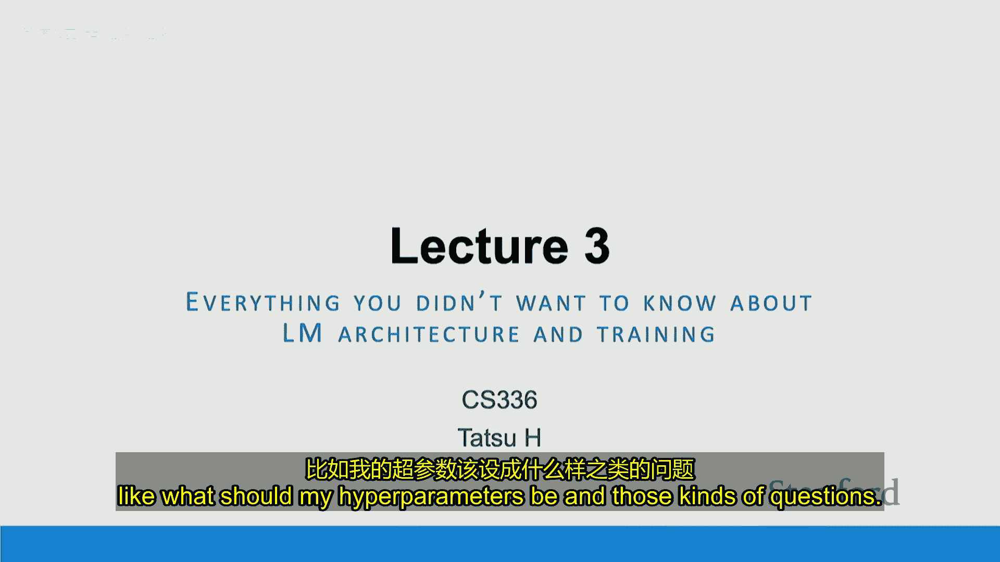

一些小事项，此外要是你正在做作业，我们一旦发现作业有小错误就会更新，确保你在做的过程中更新作业，好那我们要做的是，我们先快速回顾一下transformer架构。

我会给你们标准transformer的两种变体，一种可能来自标准transformer讲解，你在224N课程里看到的，接着我会讲讲你要实现的东西，以及一种现代公认的transformer变体。

然后我们将从更数据驱动的角度来理解，transformer架构，所以我们要问的是，此时人们已经训练了很多语言模型，你可以去阅读所有这些论文，并试着理解发生了哪些变化，有哪些共同点。

从那种近乎进化分析的角度，试着去理解，要使transformer模型运行，真正重要的因素有哪些，试着去理解，要使transformer模型运行，真正重要的因素有哪些，所以今天的主题。

这门课的主题是学习的最佳方式，是亲身实践，但本次讲座的主题，无法训练所有这些transformer模型，所以要借鉴他人的经验，所以起点是最初的transformer模型，那么作为回顾，希望你们还记得。

在224N课程或其他自然语言处理课程中，学到的内容，底部有一些简单的位置嵌入，你有多头注意力之后是层归一化，有一个向上的残差流，有一个多层感知器，最后是一个soft max。

我们会看到所有这些不同部分的变化，直到我们得到，基本上是最现代的transformer变体，我要讲的最新的那个是在几个月前。

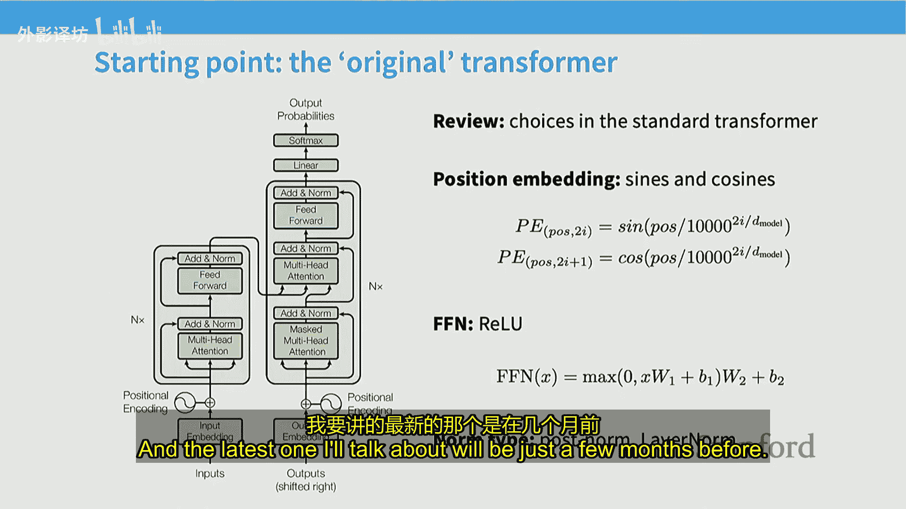

所以你实现的并非标准transformer变体，原始论文中的我们做了一些修改，我们把层归一化置于模块之前，那么在这边这张幻灯片上，你能看到归一化就在这儿，在残差流中每个模块之前，每个模块之前。

我们让你实现旋转位置嵌入前馈层，使用了一种名为swag胶水的技术，接着线性层会输出这些偏差项，你可能会问，为什么要强迫我们实现这种奇怪的变压器变体，而不是只需要原始的变压器就行了呢。

那么我们将梳理其中一些问题，接着昨天我在想行吧，实际上我应当知晓所有进展，过去一年里架构领域所发生的。

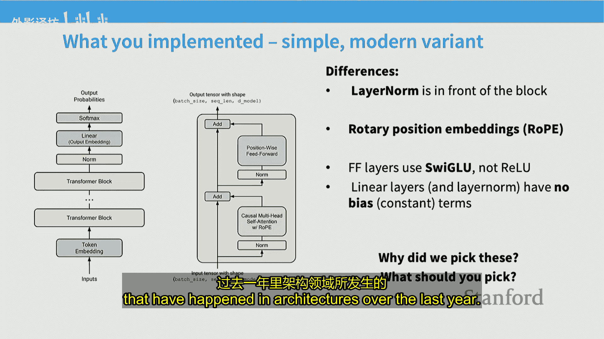

珀西就此警告过我，原因是他说你每年都必须重新讲授这堂课，于是我开始查找资料，我心想好吧，最近有几篇不错的论文问世，存在commander存在，True too furious，有small m5。4。

然后你去寻找，然后你会惊叹哇，没错，有GEA3，Quint，2。5和INTERNLM，然后还有更多这些模型，多的我都没法把屏幕盖住，有很多模型，去年大约有19个新的密集模型发布。

去年其中许多模型只是对架构做了些小调整，一方面翻看这么多论文，还要说挺烦人的。

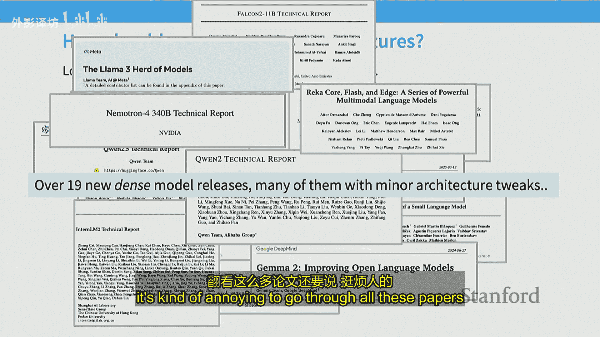

这些到底都讲了啥，但其实这里面信息超多，因为它们各有不同，你们大概能看到，不是所有人都能看到，特别是后排的看不清这张幻灯片细节，但我整理了个小表格，所有这些模型在做什么，从2017年开始。

从最初的transformer一直到2025年，最新模型在做什么，我们会在讲解过程中谈到这个，但你可以看到有人在探索某些架构上的变化，所以在这一列是位置介入，用过各种方法，如绝对位置，相对位置。

rob对一些人来说曾有过一个借口阶段，但从2023年左右开始，每个人都只用ROP了，所以你可以看到，神经网络架构几乎呈现出一种趋同发展态势。

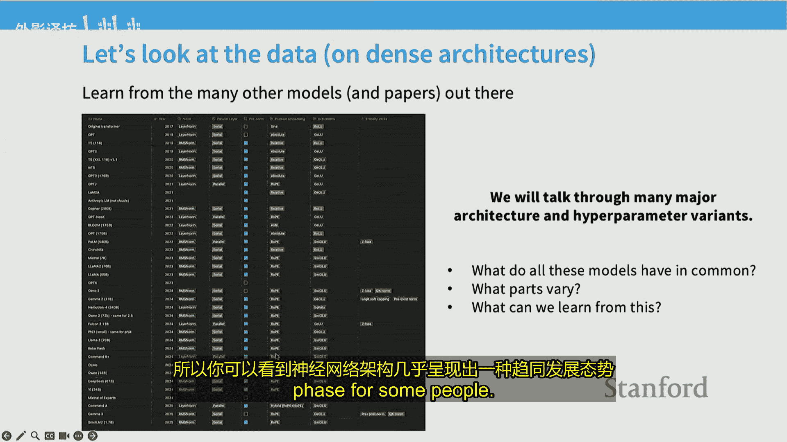

我们会探讨所有这些形形色色的内容，那么我要讲的内容。

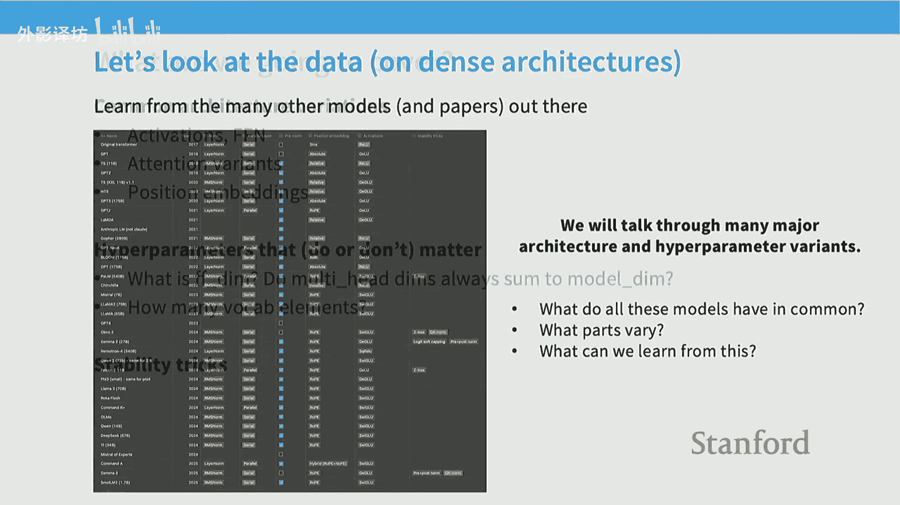

这便是本次讲座三大板块的预览，要是我有时间的话，最后我还会讲讲不同的注意力变体，首先要讲的是架构变体，这就是我要讲的像激活函数，前馈网络，注意力变体，位置嵌入等这些确定架构之后。

我们该怎么做嗯我们得挑选超参数对吧，比如说隐藏层维度要设多大，多层感知器的内投影层要设多大维度，数量要怎么定，词汇元素要多少个，这些都是实际训练语言模型时，必须要选的重要事项，当你实际训练语言模型时。

而且你不会想随意挑选这些参数对吧，你得用比较明智的方式来选择它们，那我们就从架构变体讲起。

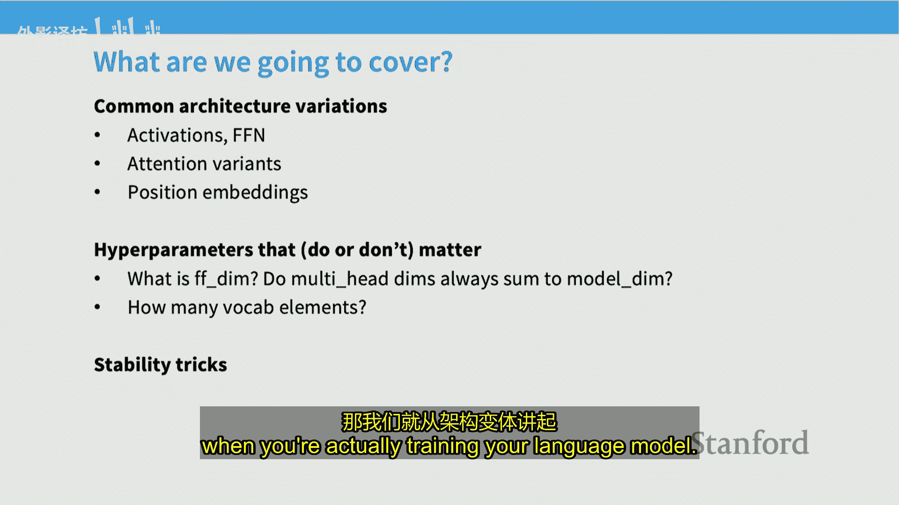

我在此提及两件事，讲解时会再回到这两点，第一点是很多选择上没太多共识，过去几年出现了某种趋同演变，我把这里最底层的架构称作类羊驼架构，但人们会做各种事情，他们在层归一化和r ms s归一化间切换。

他们采用串行层和并行层，从首个GPT起，基本上每个人都会做一个选择，我稍后会谈到这一点，但我们能从这里学到很多不同的变化方式。

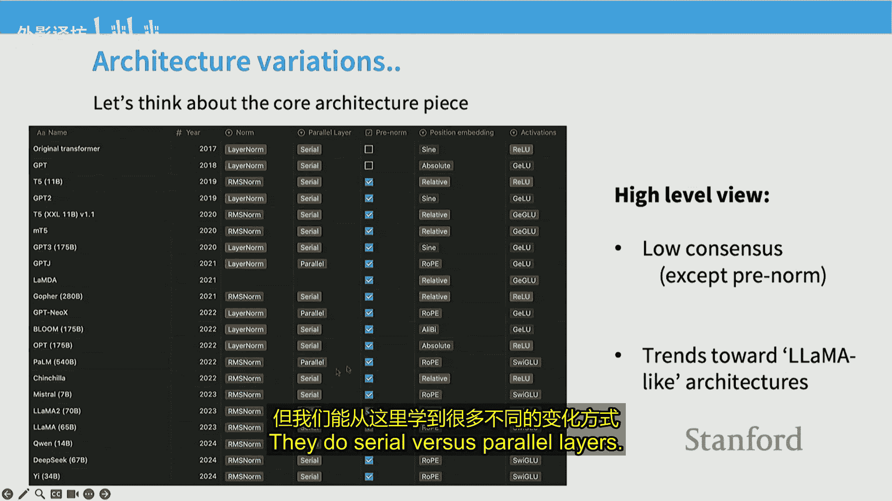

最主要的那个，我已在224N里讲过这个内容了，所以要是你还记得那场讲座，这对你而言是复习，并非全新内容，我觉得基本上大家都认同的一点，而且几乎从一开始，大家就认同玉圭移画和后归一化的使用。

这个术语会愈发令人费解，但最初的transformer论文在左边是这么做的，图中灰色部分是残差流，除此之外，每个子组件之后都会进行层归一化，所以要进行多头注意力计算，将其加回到残差流，然后进行层归一化。

然后对全连接层做同样操作，然后进行层归一化，很早以前人们意识到将曾归一化一致，之前此类非残差部分，所以右边这个模块在多方面表现更佳，基本上我所知的几乎所有现代语言模型，都采用这种玉圭移化。

最近出现了一些新创新，我将在随后两张幻灯片中提及，但很多模型都采用了此方式，唯一例外是up的350M，我猜他们把他搞砸了，而且在训练时他有点被孤立了，那是我在架构研究中的一个有趣发现。

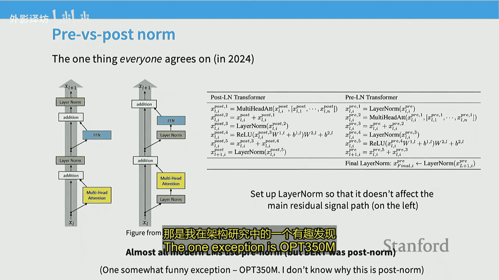

所以这个预归一化与后归一化的事，要是你去探究它最初为何被开发，理由是要是你想用这种后归一化的东西，它稳定性差的多，那么你就得小心做些学习率预热之类的事，好让他稳定训练，所以要是你看看一些早期论文。

SALAZAR燕军支持这种预规移化方法。

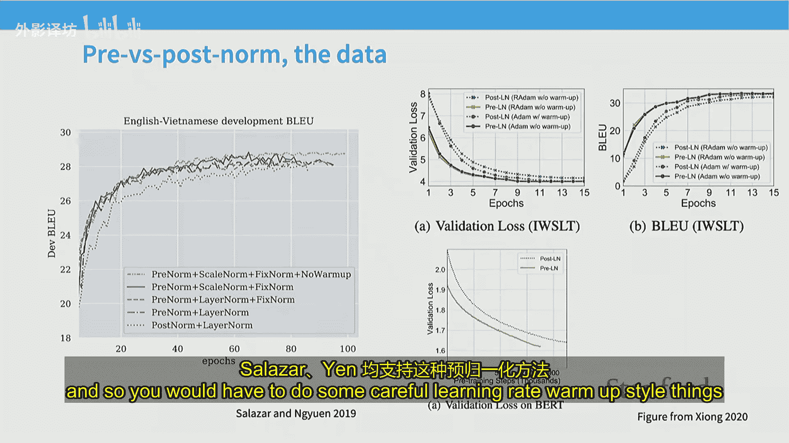

即2020年论文中的SILON，你几乎总能看到这样的比较，若采用预规一化，并使用其他增强稳定性的技巧，那么我们就能去掉热身步骤，并且这些系统的效果一样好，即便不比采用精细热身方式的后归一化。

层归一化更好，在此处的机器翻译场景中就能看到这种情况，在右侧的其他各种任务中，尤其是使用bird时也能看到这种情况，也能看到这种情况，它采用后归一化训练，所以关于其为何有用，存在诸多争论。

关于跨层梯度衰减也有争论，比如若采用预规一化，那么梯度大小将保持不变，而若在未热身时采用后归一化，那么它会呈橙色急剧增长，这是一个合理的论点，但我认为也许这个论点更符合现代直觉。

欲归一化是一种更稳定的训练架构，所以萨拉查早期的一些研究，以及原发现的所有这些损失峰值，如果你使用预归一化进行训练，这里用蓝色表示，你会看到更多的损失峰值，并且训练时会有点不稳定。

所以你可以看到这里的梯度范数在飙升，并且通常比使用预规移化时更高，所以如今你可以看到，预归一化和其他层归一化技巧，本质上用作辅助手段，以增强稳定性，训练大型神经网络，于是这就带来了一项新的。

我觉得颇为新颖的创新，我觉得这之前并不存在，我去年讲这门课时，就是这个辩题，我觉得他没什么好名字，但我现在暂且称它为双反术，这就是我最开始给你们看的原图，我们知道在残渣流中加入层归一化是不行的。

但实际上今年224N团队里有人问，但为何要把层归一化放在前面，为何不能把它放在前馈网络之后，当然可以，不仅如此，最近有些人也会在模块之后添加层归一化，所以GROCK和JA2都采用了这种方法。

在前后都采用了层归一化方法，欧盟二只在前馈和多头注意力之后，进行层规一化，所以这实际上是个挺有意思的变化，玉圭宜化此前一直占据主导地位，并且一度是唯一的，但情况稍有变化，所以现在有一种新变体。

实际上已经对这种方法做了一些评估，人们认为它更稳定些，且更适合在这些更大的模型上训练，不管怎样，随时打断，我也可以问我问题，没人拦我的话，我可能会一直说下去，所以呢为啥残差里用层归一化不好呢。

为啥给残差做层归一化不好呢，这问题不错，我估计给不了你那种，这能说明为啥他不行，我觉着有个直观的说法，能解释为啥这不行，残差提供了这种恒等关联，从网络几乎最顶层一直贯穿到底层。

因此如果你试图训练深度网络，这会让梯度传播变得十分容易，所以关于LSTM如何基于状态的模型，在反向传播梯度时存在困难，恒等连接不存在此类问题，所以在中间放置层归一化，可能会扰乱那种梯度行为模式。

当然你在这能看到，如果出现那种情况，这正是你预期会看到的那种情形，好嘞挺酷的，现在人们还会做的事，在原始的transformer里，人们做了层归一化，层归一化，就是这边这个等式做法是让激活值X输入。

你减去经验平均值，那就是上面那些X的均值，然后除以方差，加上一个小的修正因子absent，然后对齐取平方根，所以你可以大致把它看作标准差，这样就能对激活值X进行标准化，你要用伽马值对其进行缩放。

那是个可学习的参数，然后用贝塔值进行偏移，所以这说得通，你要对激活值进行归一化，然后你可以把它们移动到你想要的任意位置，而且很多模型都用这种层归一化方法，而且效果还挺好。

但现在许多模型都已采用RMSS归一化，这是一个共识性的改变，基本上所有模型都已改用RMSS归一化，那现在该怎么做，你只需去掉均值校正，所以不再减去均值，也不再添加偏差值，许多知名模型都是如此。

喇嘛家族tom龙猫T5，他们都已采用RMSSV异化，这是为什么呢，一个原因是这没多大影响，结果表明，多用RMSS归一化训练，模型及效果和用层归一化训练一样好，所以有个简化的说法。

但实际上我觉得这些论文里常提到的观点，而且我觉得了解下这个观点的细节挺好，是采用RMSS贵异化，它更快，效果也一样，那么它快在哪呢，嗯要是我不减去均值运算次数会更少，要是我不用把偏差向贝塔再加回去。

我从内存中加载的参数就会更少，再放回我的计算单元对吧，所以我无需获取这种状态，你们当中有些人可能会想，但是等等，你在224N中告诉过我，对于运行时而言，只有矩阵乘法才重要对吧，而这并非矩阵乘法。

所以我不必在意这些，这是个合理的看法，如果你想想，浮点运算比例由变压器中不同操作所占用，2023年，伊万诺夫等人发表了一篇，关于这张表的不错的论文，我记得标题好像是你所需的，唯有内存移动。

或者是对变压器所有不同组件进行分析的内，容的内容，你看张亮收缩类似于矩阵乘法，这大约占变换器中，浮点运算量的99。8%，所以节省0。17%的浮点运算量，似乎算不上重大成果，但我认为重要的是。

对于当前的架构设计而言，不能只考虑浮点运算量。

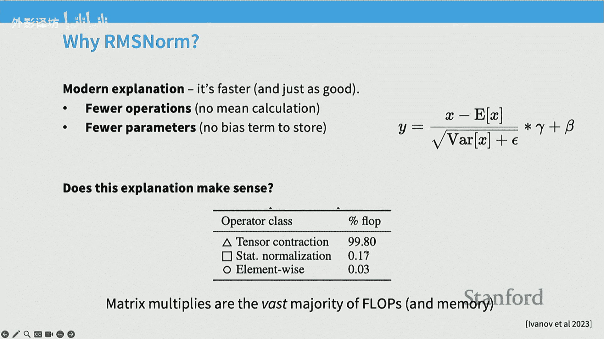

因为浮点运算量很重要，但这不是唯一需要考虑的资源，还得仔细考虑内存移动，所以即便有张亮收缩，比如矩阵乘法，像soft max操作或层规异化这类操作，其浮点运算量约占99。8%。

transformer中的所有这些归一化操作，仅占浮点运算量的0。17%，所以实际上它们占运行时间的25%，而这主要是因为，因为这些归一化操作仍会带来大量内存，移动开销。

所以优化其中一些底层内容确实很重要，因为这不仅仅关乎浮点运算量，这也关乎内存移动，等我讲到系统课程时，会更着重强调这一点，比如当我们谈到GPU架构时，它会变得极其重要，要考虑内存，而不只是浮点运算次数。

所以这就是RMSS位异化，现在变得更流行的原因之一，于是我回去了，并查看了一些早期的RMS会议化论文，我觉得可悲的是，行业实验室发表的论文没那么多，带有大规模且出色消融实验的。

而且很多消融实验我要给你们展示的，很多都是几年前的，但2020年，NO rock等人做了个很棒的消融实验，展示了普通变压器，这是r ms s归一化版本，然后你会看到我跟你说的那种确切情况。

普通变压器每秒能执行3。5步，使用RMSS位移化时每秒能达到3。68步，提升不算大，但这在某种程度上是免费的，而且最终损失比普通transformer模型更低，所以这很棒，不是吗。

在某种程度上我们提升了运行时性能，而且至少在这种情况下损失也降低了，所以这对我们来说是双赢局面，我最后要说的是，从主题上看，这与RMS贵异化非常契合，大多数现代transformer模型没有偏差项。

所以如果你看原始的transformer模型，FFN大概长这样对吧，你有输入X，你要对带有偏差项的输入做线性变换，然后进行rel u激活，然后还有第二个线性层作用于它，但大多数情况下，如果不是门控单元。

我稍后会讲到，实际上长这样，他们直接去掉了偏差，想你可以基于同样的基本原理进行这个论证，他们的表现也一样好，矩阵乘法似乎就是让这些神经网络起作用，所需要的全部，而另一个或许更微妙的方面。

实际上是优化稳定性，我不太明白为什么偏差相对稳定性特别不利，但已经有一些相当明显的实证观察结果，人们发现基本上去掉这些偏差项，往往能稳定这些最大神经网络的训练，所以现在很多实现方式都会完全输出偏差，想。

并且只在这些类似纯矩阵乘法的，设置上进行训练，这就是层归一化的部分，所以有两件事你应该有所了解，这很好，因为情况十分明晰，每个人都这么做，所以你应该知道这一点，基本上每个人都采用预规一化。

或者至少他们在残拆留之外进行层规移化，这算是一条铁律，你能获得更好的梯度传播，你能得到更稳定的训练，用其他方式做就毫无意义了，大多数人几乎所有人都采用RMSS归一化，在实践中其效果几乎相同。

需调整的参数更少，而且这种舍弃偏差项的想法广泛适用很多，这类模型在多数地方都没有偏差，想我认为RMS会议化存在一个例外，就如我昨天读到的，我想是COHER命令A和R加起来都用了层归一化。

不太清楚为啥好的，关于层归一化，RMSS归一化以及偏差项，在我继续之前，大家有问题吗，请讲有问题吗，你觉得有没有一些长期的经验教训，你能从这些细节中总结出一些，可能更具前瞻性的东西吗。

或者你觉得这些更好，是的，所以问题是有没有更具前瞻性的东西，我觉得很难有个全貌，在很多方面深度学习颇为惊艳性，是自下而上，而非自上而下的，但我确实觉得这里有些能借鉴的通用经验，我觉得直接恒等映射。

残差连接这个经验是个例子，而且是个已被验证的经验，存在于众多不同架构中，而非仅限于此类架构，曾归一化的有效性，我们在本讲座后面还会再看到其一直颇为有效，所以不要让激活值发生偏移，在某种规模上。

这是我认为的另一件事，总体上对训练稳定性非常有效，这两点似乎是相当普遍的经验，我们也会再次看到系统相关问题开始发挥作用，所以这是另一个普遍的经验，也就是要认真思考，架构对的影响，设计中系统组件好的。

现在有另一个组件，也就是激活值，而且激活函数可谓五花八门，修正线性单元，高斯误差，线性单元switch函数LU广义线性单元，然后我是说这些可不是激活函数，有不同种类的多层感知，高斯误差。

线性单元能共线性单元，修正广义线性单元随机变分推断，修正线性单元，Swel u legal，是的，我觉得这正是我当初搞深度学习时，不想学的东西，当我开始搞深度学习时，我当时就想，我才不在乎激活函数呢。

反正他总能训练的，但不幸的是，这对咱俩都很重要，SWIL和其他PLU变体一直都表现出色，所以我会给你们讲讲，你们得好好想想，因为他们确实有用，记住这一点对吧，所以我觉得real u可能还有GELU。

你们应该都知道了吧，你们在最基础的深度学习课上学过rel u对吧，就取零和原值中的较大值在多层感知器里对吧，你看啊，我把偏差项去掉了，这里是XW1，你使用REONU函数，然后处理W2，相当简单对吧。

GELU及高斯误差线性单元，这个用高斯分布的累积分布函数乘以线性部分，所以它基本上和real u函数差不多，但这里会有点不一样，希望你在这能看出来它并非在最底部完全平坦，这使得事物更易于区分。

这可能有用也可能没用，而gt系列模型如gt1GP2，GPT3以及GPTG等等，都使用高斯误差线性单元，最初的transformer以及一些较老的模型，使用的是修正线性单元，实际上。

几乎所有现代模型都已转向门控线性单元，比如SWI格鲁和GOGLUE等等，实际上我认为谷歌团队大力推动了这一点，比如tom和P5等等，但既然他已被验证可行，基本上2023年后的几乎所有模型。

都采用了门控线性单元，那么回到之前的问题。

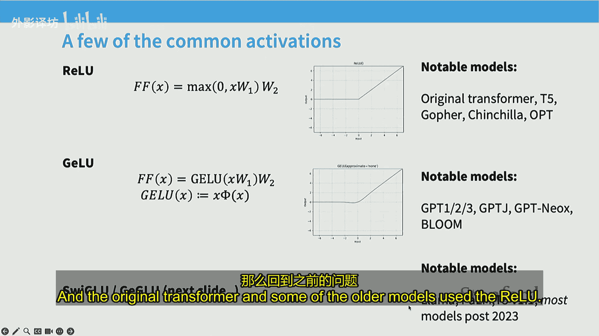

从这堂课中，我们能学到哪些可推广的架构知识嗯，有些东西一直都非常实用，残差连接层归一化，门控也是其一，所以这是另一个方面，门控在此处出现，且是一种很好的方式，最初这儿就是我们的全连接层。

这里用的是RLU，现在不再只是进行线性变换和real u激活，我要做的是，我要用一个按元素线性向来门控这里的输出，所以XV会给出一个向量，然后我要将其按元素相乘与MLP原来的内部项。

然后我要将整个结果乘上W两对吧，那么可以这么理解，我对MLP的隐藏部分进行了门控对吧，我有一个初始激活函数，用于接收输入，并将其放入隐藏空间，然后我会用XV对其进行门控。

然后我会借助W2将其投影回隐藏维度空间，所以存在逐元素的门控操作，这就是这里发生的基本情况，这就是go与维路相加，即REGO，然后我们再次添加了一个用于门控的额外参数，这就是V。

所以当有人说类似这样的话哦，这是一个完整的GKLUO，没什么好笑的，有该glue全连接层，我这里有我有DIO用于实现非线性，并且我在xv这里仍有相同的门控对吧，这就是架构，许多谷歌模型都使用了它。

比如T五E1。1GA二GA三，然后是另一个变体，有一个苏奎厄五，而且这个很受欢迎，switch是SIGMODE的X倍，而这就是非线性部分，你大概可以sigma是这样，X是那样。

所以它看起来就像高斯误差单元，然后你在这里如法炮制，你对switch进行了门控，接着这里会得到一个全连接层，没错，开关函数以及该函数，它并非单调递增，实际上是递减的，关于梯度下降如何工作。

有很多论点在机器学习入门课程中是这样，你想进行梯度下降，但在这里似乎你会朝着方向，或使用霍霍其门控版本方向相反，没错，那么问题是，这并非单调递减，在这个零的最左边有一小段，其导数在这有点反转。

那这会有问题吗，我想直观来看，你可能会认为这是个问题，你可能会让一堆激活值被困在零处，我认为在实际中，若你观察一下神经网络优化的动态情况，实际情况往往是，你把很高的带动量学习率输入优化器。

所以你不会真的收敛到零点对吧，就像这些激活值会分布的很分散，所以在实际中，我觉得这个极小的负向对模型而言，真不会产生多大影响，要是这能理解的话好，然后回到这个，如今的大多数模型基本上都跟斯威格鲁类似。

比如拉马家族tom alm，稍后我会给你们看那个大表格，但你们会看到斯威格鲁极其受欢迎，需要注意的是，现在我会在超参数部分再讲，这个还记得我添加了这个V项，也就是那个额外的参数对吧。

所以我要思考如何确定这个额外参数的规模，人们的做法是，门库模型通常将此设为类似隐藏层大小，你知道，W的输出维度基本上缩小至原来的13，为了确保整个模型的参数总数保持一致，与非门控版本。

这是大多数人都遵循的一种惯例，如果你不太明白那是什么，我稍后会再讲一遍，但你可以大致记住，对于门控线性单元，你只需把所有东西都稍微调小一点，以确保参数匹配，那么哦对了，有个问题，这可能很明显。

或者如果其中一个条件满足了real u的，好处之一是它很容易根据输入进行求导，但是如果你有高斯累积分布函数的导数，你会得到一个X的平方向，这难道不会真的让事情变慢吗，这是个很好的问题，我不太确定。

苏格鲁或该格鲁在库达内部是怎样实现的，我觉得这很有可能，内部可能是通过查找表实现的，继续这里关键在于内存压力，而且是一样的，因为读取的元素数量一样，所以在G上额外计算可忽略，这或许是个更好的论据。

从运算量来说，反正这都可忽略，实际上内存计算也一样行，挺酷的好，那门控线性单元管用吗，我也会有更多这方面的现代证据，但我觉得应该直接带你看原始出处，诺姆查吉尔的原创论文。

他在其中评估了所有这些门控线性单元变体，这是些比较老的内容了，所以你看到了cola和ST2的性能表现，但基本上你确实能看到，门控线性单元变体一直表现的更好，GLU为84。二八十四。12，84。36。

84。67哇，都2020年代了，他们甚至给出了标准差，这样你就能大致明白这些结果有多显著，事实上他们很显著，所以这是些不错的证据，还有NONK等人，2020年的一篇论文很不错，研究了各种架构变体。

我想是在T5风格模型的背景下，再一次你会发现，门控线性单元变体的损失始终低于其他同类，你可以看到加粗的线条，恰好位于门控线性单元的方差位置，而且这种模式基本一直成立，那么对于门控和激活方面。

不同模型中有多种变体，但门控线性单元已基本广泛应用，并占据主导地位，而且我认为这是有充分理由的，当然对于一个好模型而言，门控线性单元并非必需区分，这两者很重要，对吧，仅仅因为它可能稍好一些。

但大家都这么做，并不意味着有必要，你能看到一些高性能模型，没用门控线性单元的例子，比如GPT3就是个例子，还有个更新的NEMETRON，340B用的是平方整流线性单元，我之前没见过。

而且falcon21B用的是整流线性单元，这俩都是性能比较高的模型，所以能大概看出没必要，那么你要知道有证据显示，SWIGLOW和GGLOW能带来持续的提升，所以我们要求你准确实现那种变体好了。

关于架构，我最后要说的是，这是最后一种主要的，我要说我们见过的变体，通常transformer模块是串行的对吧，也就是说对于每个模块输出从底部传入，然后你进行注意力操作，然后将计算结果向前传递。

然后你进行多层感知器操作，然后将该计算向前传递对吧，所以这本质上是串行的，先进行注意力操作，再进行多层感知器操作，但当然这可能会有一些病情限制，如果你想在大量GPU上进行并行化处理，若存在串行连接。

这样做可能更难，系统面临的情况可能也会更困难，你的GPU利用率可能会降低，于是一些模型采用了这种方式，我把它叫做并行层，基本上是不再对注意力机制和多层感知器进行，串行计算，而是同时进行这两者的计算。

所以你会从上一层获得X，你会同时计算多层感知器，并同时计算注意力机制，然后将它们相加到残差流中，然后这就是你的输出，这是由GPTJ首创的，这算是一种开源的复制工作，谷歌负责pom的团队很有魄力。

大规模开展了这项工作，此后许多人也纷纷效仿，所以如果你正确实施这个方法，你可以共享很多东西，例如层归一化矩阵乘法也能够融合，并能提高系统效率，从那以后他就没那么火了，至少在过去一年如此。

我觉得我们见过的大多数模型都是串行层，而非并行层，我认为对此唯一的例外是像COHERERCOMMANDA，commander2加和falcon2。11B，所以现在我觉得我们能够回到这个大大的。

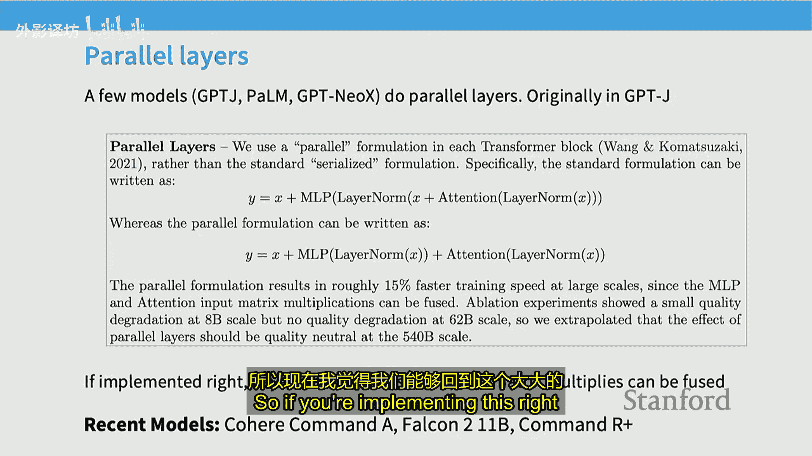

看不清的图表，然后看看我一开始大致指的是什么，那么这一列你无需读懂上面的文字，因为我觉得颜色会告诉你所需了解的一切，这个勾选框，这基本上是预归一化与后归一化的对比，早期我真正了解的仅有的两个。

采用后归一化的模型，这是原始的transformer以及GPT和bird，如果你想把它纳入此表，然后几乎其他所有人，我认为基本上其他所有人都采用了预归一化，这里唯一未勾选的其他像是专有模型。

而且我没有相关细节，最左边的这一列，这是RMS归一化与层归一化的对比，灰色框代表层归一化，蓝色的代表RMSS归一化，如我所说，基本上大多数人都采用了RMS归一化，它旁边那一列是串行层与并行层，再说一次。

大多数人采用串行，但你能看到其他变体，接下来我要讲位置嵌入，一会儿会更有趣，在我继续之前，关于这些架构内容有问题吗，希望这能让你们有个大概的了解，至少了解一下我们所见架构的主要变化，有问题吗。

所以问题是串行是否比并行更高效，实际上恰恰相反，并行比串行更高效，这就是为什么你们有点乐意这么做。

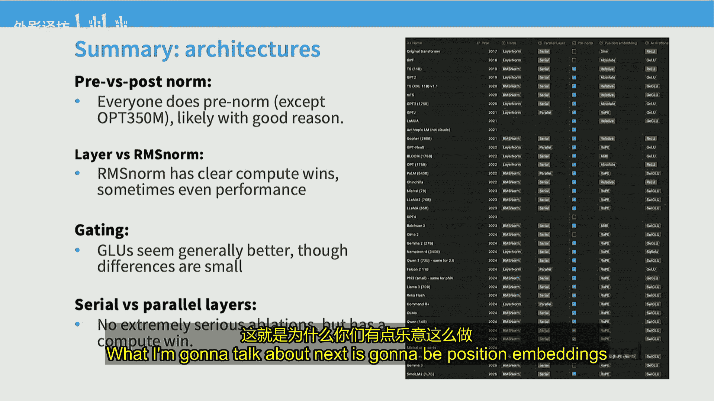

所以在某种程度上，你可能会觉得串行更具表现力，因为你是在组合两个计算，而非仅仅将它们相加，但理论上并行的好处是，若编写合适的融合内核，很多这些操作都能并行完成，或者计算能在不同病情部分间共享，好的很酷。

所以在架构方面，我最后要讲的是嗯。

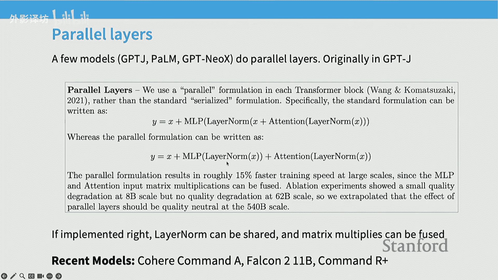

我认为这是最后一点及位置切入的变体，而且我觉得这挺有意思，因为在语言模型发展的最初几年，人们尝试了很多不同的方法，正弦嵌入源自最初的transformer架构，你应该在224N课程中学过。

这个有正弦和余弦位置，其他很多都采用了绝对位置嵌入，如GPT和art，基本上都是在嵌入中添加一个学习得到的，位置向量，还有一些如T5和golf，采用了各种相对位置嵌入，即在注意力计算时添加向量。

然后我觉得大多数模型都采用了ROP，也就是相对位置嵌入，我想这其实是从GPTJ开始的，这又是一项开源贡献，大多数模型很快就采用了它，那么ROP背后的核心思路是，关键在于这些向量的相对位置。

那么如果我有一个针对位置，I除单词X的嵌入F，这里X是要嵌入的词I是位置，那我就能这样记下来，所以应该存在一个F使得F以及F，若我对这些嵌入向量进行内积运算，那么我就能把它写成某个不同的函数。

G它是关于这两个词的函数，还有它们位置的差异，对不对，所以这是一个强制实现位置不变性的定义，或绝对位置不变性，所以你只需关注这两个词之间的距离，然后你可以简单检查一下符号会有什么情况。

嗯你会得到这些非相对的交叉项，所以你还是会泄露绝对位置信息，绝对位置顾名思义，它不是相对位置嵌入，而相对嵌入是相对的，但他不是内机，所以他有点违反这个约束，所以rob是个巧妙的发现。

即我们知道有一样东西对绝对事物是不变的，那就是旋转，所以我们将利用这种结构，来得到我们的位置嵌入，我们知道内积对于任意旋转都是不变的，所以我们要利用这一特性，那么在左边这是起始点。

假设单词we的嵌入是这边这个箭头，而单词NO的嵌入是这边另一个箭头，现在我要切入这个序列，这我们都知道，然后我看单词we与NO，那该怎么做呢，N位处于位置零，所以我根本不会转动那个东西，NO处于位置一。

所以我要把它旋转一个单位，所以现在我得到了we know的这种嵌入形式，现在假设我要嵌入这个序列，当然我们知道现在we和NO相对位置相同，那么我们看看会怎样，we被移动了两个位置。

我旋转V我从这个垂直位置开始，然后将它们分别旋转一次和两次，然后我将其旋转三个位置，因为是123，抱歉是012，第三个对吧，那么现在看这两个箭头，它们有相同的相对角度对吧，所以它们的内积保持不变。

所以这是一个关于rope的挺有意思的想法，你只需旋转这些向量，并且旋转角度由每个单词的位置决定，和旋转内机并不在乎相对旋转，所以这些内机只会关注距离上的差异，现在在二维空间里很容易理解。

因为旋转在二维空间中很明显，旋转向量只有一种办法，我们完全不清楚该怎么进行这种旋转，所以ROP团队想出了，做这事的最简单却有效的办法，实现方法是取一个高维向量，在此例中为D，然后将其分割成二维的块。

每两个维度将绕某个飞塔旋转，因此会有一个旋转速度，然后我会旋转这些维度组合，所以现在每对维度都在编码，所有这些相对位置关系，就像在正弦和余弦切入中一样，我会选择一组theta值，使得一些嵌入会快速旋转。

而其它的旋转速度要慢很多，这样它们就能同时捕捉高频信息，还有距离非常远的低频定位信息，这里实际的位置嵌入运算，要是你考虑旋转的话，那就只是与各种正弦和余弦，旋转矩阵做乘法运算，希望你还记得。

线性代数和三角函数里的这些内容，所以你可以把这视为一种运算，你要将嵌入向量与这些2×2的分块矩阵相乘，而且没有加法项或者这里出现的交叉项，这完全是相对的，如果你习惯绝对位置嵌入有一点不同。

或者这里的正弦和余弦嵌入是rope，将在实际的注意力层发挥作用，你不会在底部添加位置嵌入，每当进行注意力计算时，你要在那一层进行干预，然后就会得到位置信息，我想这是我从lama对rob的实践中借鉴来的。

最上面是初始的常规注意力相关内容，向查询键和值，这些是常规的线性投影，然后要算出余弦和正弦角度，这些旋转角度会告诉你对查询和键的不同部分，分别旋转多少，所以就获取查询和键。

然后你要通过余弦和正弦来旋转它们，现在你得到了旋转后的查询词和旋转后的键值，而浙江用于你后续的注意力计算，所以你不在底层进行此操作，而是在生成查询词和键值时进行，希望这讲清楚了。

这对于仅强制使用相对定位信息至关重要，懂了吗，所以我想强调一点，那就是实际上是大家都认同的其中一件事嗯，似乎每个人都认同的，我周末把那19篇论文都看了一遍，基本上现在所有论文都因各种原因。

采用了位置编码，原因是位置编码，如今有多种不同算法用于外推上下文长度，而且这是现代实用语言模型的一个重要部分，在经验上有效，在规模和上下文长度相当小的情况下，所以在这方面他算是脱颖而出了，他叫什么来着。

位置嵌入之战好了，在我接着讲一些超参数相关内容之前，有问题吗，所有这些模型的旋转速率都一样吗，我认为它们并非都相同，这些角度存在一些差异哦是吗，每一对的角度，它们是超参数还是训练得到的。

用于确定旋转角度的贝塔值，它们不是超参数，就像这里的正弦和余弦旋转角度有一定规律，和正弦余弦的道理一样，你想要覆盖不同频率范围，以获取更高或更低频率的信息，什么是这些旋转在跟踪上会造成困难吗。

我想知道比如这些角旋转，旋转本身并不会真正造成任何问题，一种思考旋转的方式是，它其实就是一次矩阵乘法，因为FA是固定的，这里的M也是固定的，这实际上就是一个与向量相乘的固定矩阵，所以从这个角度来说。

这不算个问题，要是你在学习FA，那可能就会有问题，因为你可能得对三角函数求导，但你这儿不用这么做，行挺酷的，所以现在我觉得我们要进一步深入细节，我们要讨论超参数，我感觉当你刚开始接触时。

你被要求训练一个新的语言模型，关于超参数你会有很多问题，因为超参数有不少，而且我意识到实际上在不同的成功模型中，真正会改变的超参数只有少数几个，实际上有相当明确的经验法则，而且有一些相当明确的指导方针。

大家似乎都在遵循，所以有一些问题，比如前馈层要大多少，或者我该有几个头，或者我的词汇量该设为多少，所以我们会逐一讨论这些问题，并且我们会试着限制大家的超参数空间，那么起点。

比如说我们来看看一个带偏执的简单前馈层，这是他的real u版本，所以这里有两个超参数，有个model及X的维度，这是进入多层感知器的输入，然后是DFF，所以这是前馈维度。

这差不多是多层感知器的输出隐藏维度，然后要投影回D模型，那DFF该是多少呢，一般而言，这些都是上投影隐藏单元，会比输入更多弹药大多少，嗯实际上有一个共识，几乎每个使用real u风格多层感知器的人。

都会选择前馈，网络维度为模型维度的四倍，稍后我会给你看些实证证据，告诉你为啥这树挺合理，但就我所知，没什么自然法则规定，你就得选四，这是个一直沿用的惯例，这条规则有一些例外。

记住GLU变体会把这个缩小到23对吧。

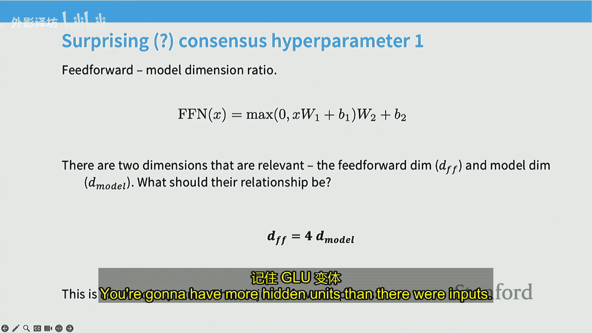

如果你将其缩小为原来的2/3，你会得到大致相同数量的参数，你可以算一下，并且如果你将GLU变体缩小为原来的23，你会得出结论，做到这一点的方法是，将DFF设为3D模型的83，那就是你最终得到的数字。

你可以试着说服自己，那会给你相同数量的参数，如果你从四的比例开始得到的就是这个比例，那么看看众多模型，他们确实遵循这条经验法则，比如pm miss tro和lama稍大些，这些是GLU模型。

但他们并不遵循2。6这条规则，但以lama为例，1quan deep sec e和T5，它们大致都遵循类似2。6的规则，我有点能把大表格列出来，包含大语言模型超参数的，他们当中很多都大致符合大约2。

6这个规则，而这就是GLU单元的标准参数设置，我将再讲一个例外，我真的很喜欢这个例外。

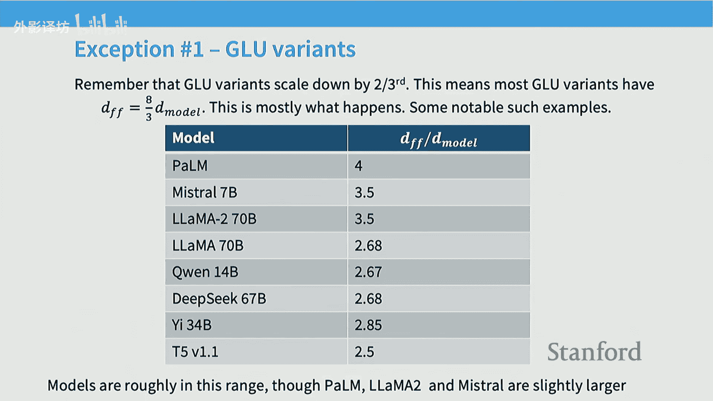

因为我觉得在很多方面，你知道大型的大语言模型训练，很大程度上就是照搬别人的超参数，所以我们没学到多少东西对吧，比如说他很保守，但我真的很喜欢T5，因为在某种程度上他真的很大胆。

我觉得谷歌的人确实做了些相当大胆的事，那么如果你看看有110亿参数的T5模型，他们的设置相当惊人，其隐藏维度为1024，但其前馈网络的上投影维度为6万5000，所以这会得出一个64倍的乘数。

用于前馈网络与模型维度的比值，当然将这个与之相比，其中主点乘法约为四倍。

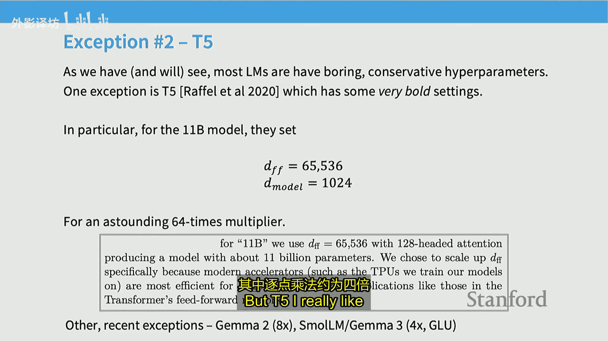

而其他的则小得多，这差异可大了去了。

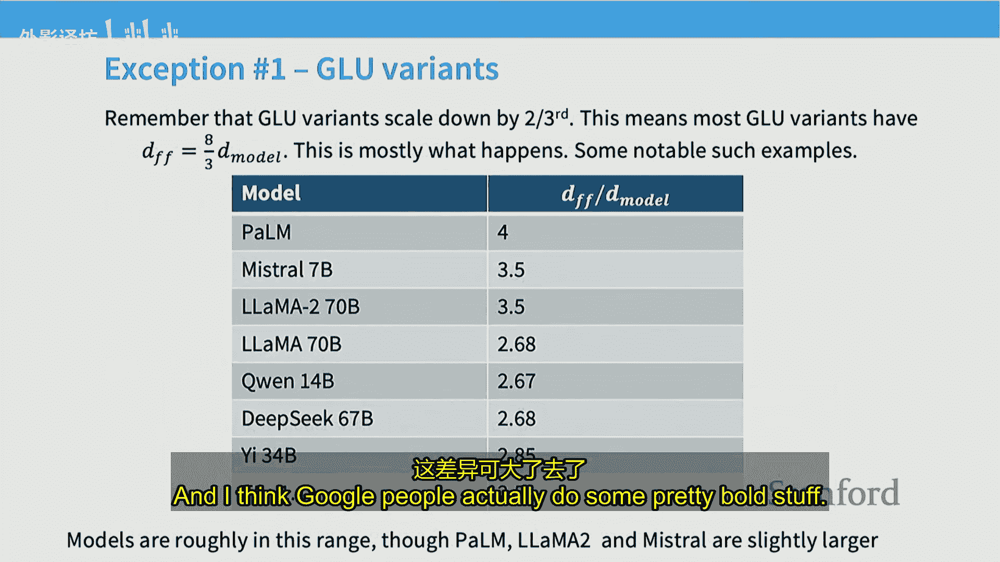

最近还有些例子用了大得多的乘数，就像gm2差不多照着这么做了，而且达到了八倍，稍后我会讲讲这个例外，当然T5是个挺不错的模型，所以这说明用大得多的比例训练模型是可行的，所以我觉得有个定量证据。

我看到那个四倍乘数就想，那样做真的对吗，还是说有人做过更量化的实验，能让我信服，这是个好主意，所以贾里德卡普兰那篇关于缩放定律的论文，里有个数据，大多数人知道这篇论文是，因为其中的缩放定律部分。

但实际上，这篇论文还有一些非常实用的超参数内容，实际上你会发现他们确实做了我所说的这件事，也就是DFF与D模型的比率，而且他们绘制了随着这个值变化，损失增加了多少，你会隐约看到这里存在一个最佳点。

这是一个1234的比例，然后到这里大概是十对吧，所以这里有一个相当宽的范围，从1~10左右，在这个范围内，你可以选择任何想要的前馈比例，而且大致是最优的，并且四与这里的最优选择相差不远，就像1234。

就像在这里或者这里，所以这是个挺合理的选择，那么从这些超参数相关的情况中，我们能学到什么呢，我觉得很多证据都指向，你可以选择相同的默认值，如果你不使用GLU，你可以乘以四，如果你使用GLU。

你可以用大约2。66，而且他们对大多数现代语言模型都挺适用，T5再次表明你不必遵循这些规则，你可以成为打破规则的人，随心所欲，超参数选择并非一成不变，在许多其他超参数下也能得到不错的语言模型，虽说如此。

我觉得真正有趣的后续情节，这个故事的有趣后续是T5，有一个改进后的后续模型叫T5V1。1，并且他在DEGAL上使用了更标准的，2。5倍乘数，所以你能从字里行间领会，然后会说，也许他们看了原始的T5后。

觉得也许我们要把那个64倍的乘数改回去，选一个更标准的，而且他们最终得到了一个更好的模型，太酷了，没错，这是个好问题，问题是，我这里说的这个比率有什么关系，以及对模型的整体影响，如果我们回溯到这里。

这个比率本质上决定了这个多层感知器，隐藏层的宽度，所以T5论文中选择64的初衷是，实际上就能得到更大规模的矩阵乘法运算，如果把那个维度设置的非常大，虽说这在一定程度上是正确的，它越宽。

也就是说你得到的是更多并行计算，而非串行计算，所以你在使用浮点运算，而且参数的使用方式稍有不同，与增大隐藏单元时，这样就能传递更多信息，或者使用更多的单元，这会带来更多的串行计算，所以你在利用你的参数。

从表达能力方面看，你的浮点运算次数不太理想，但要是你的矩阵够宽，可能会在系统方面有所收获很好，那么另一件令人惊讶的事，或者也许并不让人意外，大家普遍认可的超参数是模型维度之间的比率。

以及头维度乘以头的个数，所以我从224N中截取了这个对吧，但实际上基本的规范选择是挑选合适的参数，使得维度D即隐藏维度，如果你有多个头，你只需将每个头获得的维度数量进行划分，所以当你添加更多头时。

保持维度不变，而且你不必这样做，当你添加更多头时，你可以让每个头的维度数保持不变，你可以让注意力部分采用越来越多的参数，你可以那样做，那是你的一个选择，但大多数模型确实遵循这条准则。

我们看到GPT3T五。

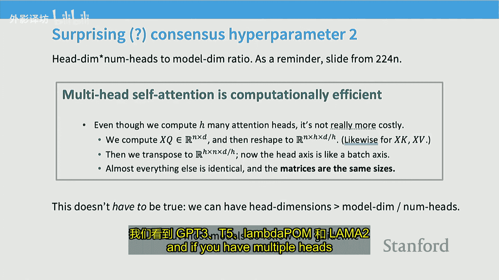

LAMBDPM和lama2，他们的比例都是一，或者几乎正好是1T5，是唯一打破这条规则的例外，他们尝试了16这样大的比例，但除此之外，相当遵循这一共识，有几篇论文。

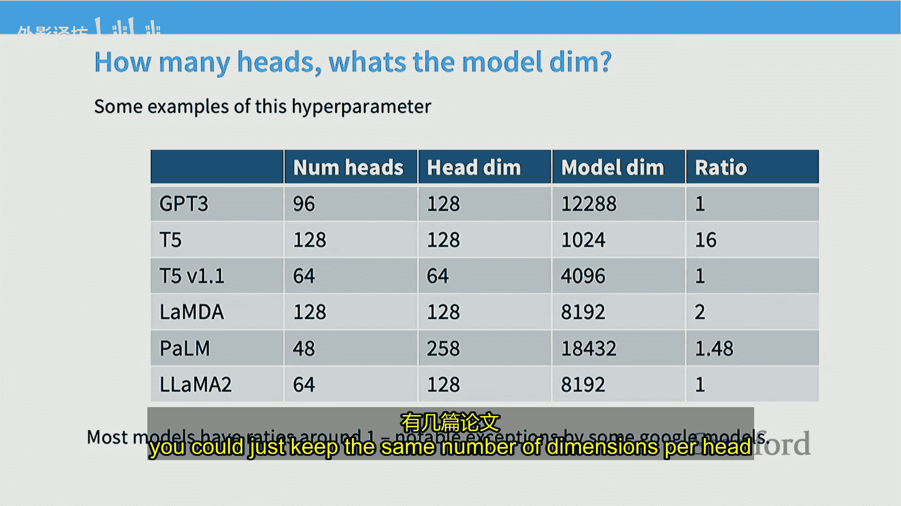

反对这种一对一的比例，有一篇值得注意的论文来自，我不知道该怎么念这个博亚佩纳利等人，他们认为如果你有越来越多的头，他们的智慧越来越低，而且如果你每个头的维度非常少，那就会开始影响注意力操作的表现力。

但在实践中，似乎我们并没有看到，在实践中有太多明显的低质瓶颈，大多数采用这种一比一比例的模型，表现的还不错，这确实是一个参数，我们见过的大多数模型通常都将其保持不变。

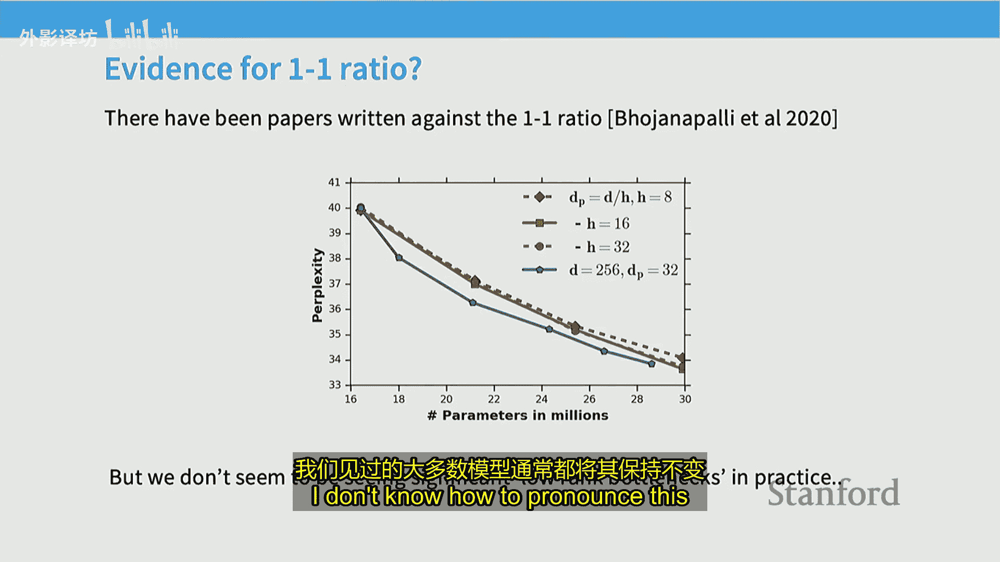

要是我有时间，我会简单讲讲不同的优化方法，人们针对这个多头组件所做的优化，但就超参数而言，情况一直颇为相似。

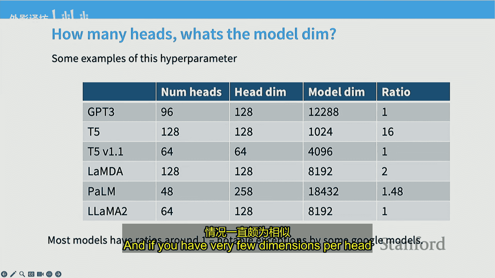

我觉得一个重要的是宽高比，所以我们可以想想深度网络，我们可以有更多层，或者我们可以有较宽的网络，一般而言，若你想用一个旋钮控制宽度，那大致就是残差流的隐藏维度，这基本上能控制几乎所有操作的宽度。

所以这似乎是个相当关键的可调节之处，你可能会觉得更深的网络更智能，表现力更强，或者更宽的网络效率更高，通常存在一个人们所选取的比例最佳点，也存在一些偏离情况，一些早期模型在此处使用的比例要小得多。

所以这意味着他们宽得多，而不是深得多，然后有些模型变得非常深，在这些模型中，它们实际上要宽得多，反过来说非常宽，在这些模型中，它们的中间层比最终层多很多，通常存在一个最佳比例，也就是说。

我们希望每层有大约128个隐藏维度，而且通常都遵循这一比例，很多GPT3和lama变体模型，我马上就会讲一些相关证据，宽高比方面有些重要考量。

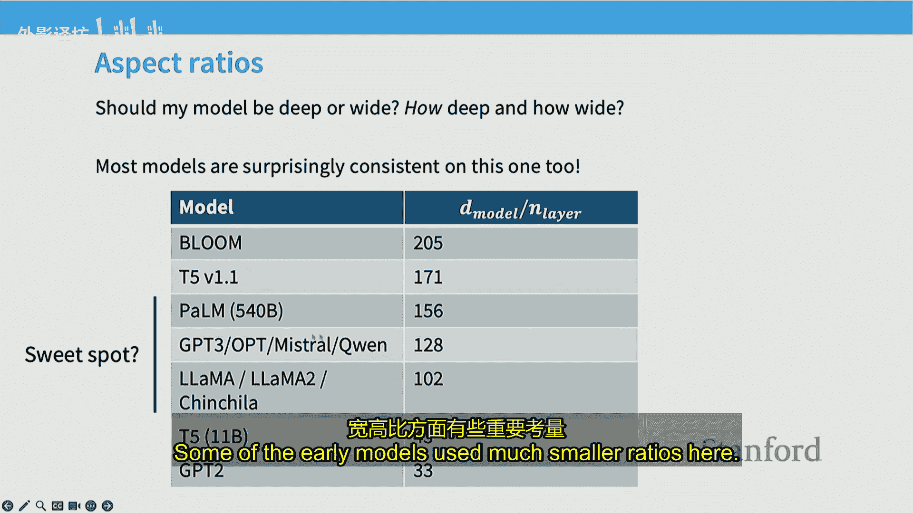

他们会控制我们能实现的并行量，所以要是你在进行流水线并行，你通常会把不同层，然后把它们切开，然后把它们放到不同设备上或不同设备组上，因为每层内部也会并行处理，所以你会对模型施加一些限制在模型上。

而且如果你有宽度较大的模型，那么你可以进行张量并行，即你要将矩阵拆分，然后将其分布到GPU上，而且我想我们会在第1234或五节课中学到，这些不同的并行范式会有不同的限制，进行张量并行时。

你需要非常快的网络，对于流水线并行，你在一定程度上或许可以使用较慢的网络，或者采用延迟较高的网络来实现流水线并行，因此你的网络限制，可能会引发一些关于宽度与深度的考量，但暂且搁置这一点。

你可能会从抽象层面发问，宽高比对模型性能有何影响，再一次，卡普兰等人有一个非常好的直观辅助工具，展示宽高比如何影响性能，这里呈现出三种不同规模，分别是5000万，2亿7400万和15亿个参数。

X轴是X效应比，Y轴是损失差异的百分比变动，你可以看到又是在100左右，如我之前所说，这大约是超参数的共识选择，且是不同规模下的最小值，所以这在一定程度上得到了一些大规模，超参数数据的支撑。

这些数据由卡普兰等人发表，而且他大致契合那种直觉，这里有个很棒的情况，在此处宽高比最优值在几个数量级内变化不大，此处所以要是这点更能说得通，那是个好消息，你可以针对一个固定宽高比持续训练。

我要指出一件有趣的事是关于1K的，谷歌的其他人发表了这篇有趣的论文，研究深度与宽度在上游及下游的影响，他们发现若看损失的话，那就没什么关系，参数才是关键，更深的模型并无注意。

但要是看下油精度情况就没那么清晰了，当时他们研究的是某种微调后的超级胶水精度，他们认为在相同的浮点运算次数下，更深的模型可能更好，所以我就到此为止，这项工作的后续研究不多，至少就我所见，但在这里。

下游性能实际上可能会略有不同，考虑到宽高比好的，我最后要讲的。

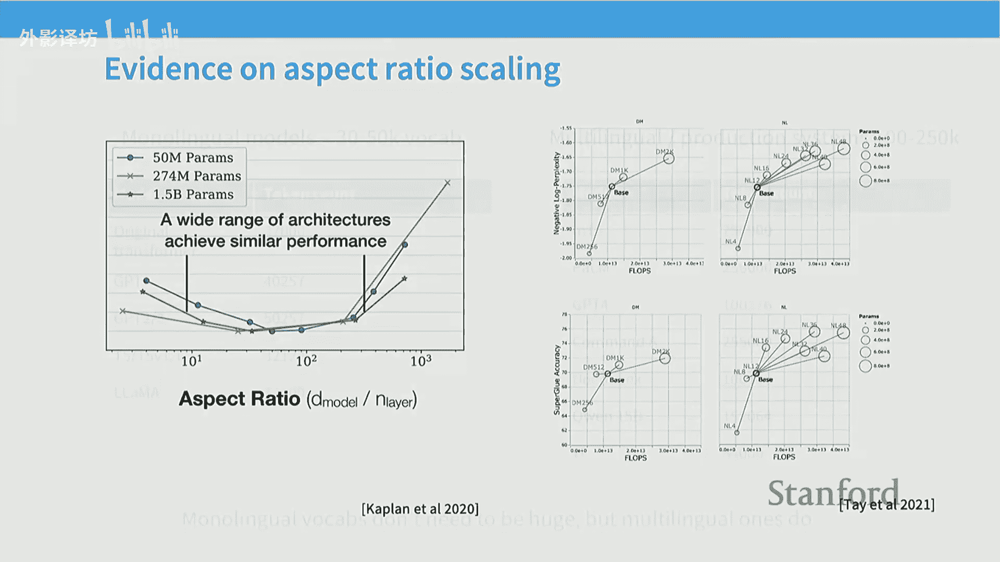

在这种非常底层的超参数范畴，是你可能想选择的词汇量大小，一般而言，词汇量呈上升趋势，我觉得很大一部分原因是，大语言模型正在被广泛部署，他们正变得更实用，当那发生时，你会和说不同语言的人互动。

用表情符号的人，各种其他的你懂的形式或语言种类远超你想象，所以我觉得一些早期模型，尤其是单语模型，词汇量在3万到5万次元左右，在GPT和早期羊驼模型中能看出这点，但看看多语言的情况。

比如说那些已出现的生产系统，他们的词汇量都在向10万到25万，这个范围转变，对于他们的词汇量而言，然后我看了COMMANDA，他是COHERER的模型之一，他们是一家很注重多语言内容的公司。

你能看到他们词汇量很大，即使是GPT4和其他诸多模型，那些复制了GPT4分词器的词汇量，在10万个词元左右，所以这算是个标准，很多人使用的资源规模大致在10万到20万，而且我认为有研究显示。

随着模型变大，这些模型能，在某种程度上能处理越来越多或更好，利用越来越多词汇元素，所以随着模型扩展，你可能会看到词源数量呈增加趋势，或者用更多数据训练他们好的。

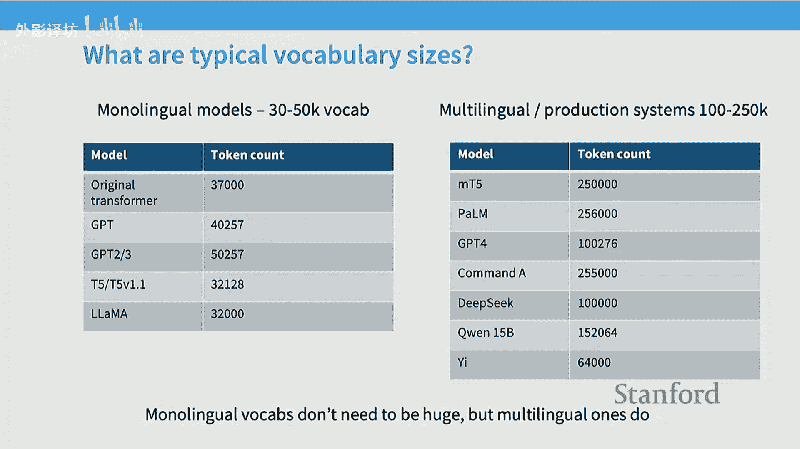

最后一点，这不再是特定超参数，但在设置模型运行前，你可能还需做另外两件事，但在设置模型运行前，你可能还需做另外两件事，也就是随机失活和其他类型的正则化，而且我觉得这挺有意思的。

我最初准备这堂课做研究的时候，如果你想想预训练，预训练是离正则化最远的地方，你可能会想到的预训练时通常只做一个轮次，甚至都无法处理完所有数据，因为你拥有过多，所以你将进行一轮训练。

而且你几乎肯定不会过拟合数据在这一轮中，所以你可能会想好吧，预训练时我们不需要正则化，那就放开优化器，一切都是为了最小化损失，这确实是关于为何无需正则化的有力理由，但如果你看看人们的做法。

实际情况有点复杂，而实际上这个情况可能比呈现出来的更为复杂，但在早期人们经常使用随机失火，然后似乎也存在很多权重衰减的情况，如今我觉得，很多人已不再详细公布，他们训练超参数的具体情况了。

但随机失火有点过时了，但权重衰减确实仍有很多人在继续采用，为什么会这样呢，这听起来挺怪的，所以我给你们点时间好好想想当前的状况，如果你用随机梯度下降法，单次训练一个大型神经网络，大量的数据，你这么做时。

为啥要使用权重衰减呢，嗯说不定你们有人知道答案，但我觉得这挺值得琢磨的，这对我来说很反直觉，好吧，原因是它不是用来防止过拟合的。

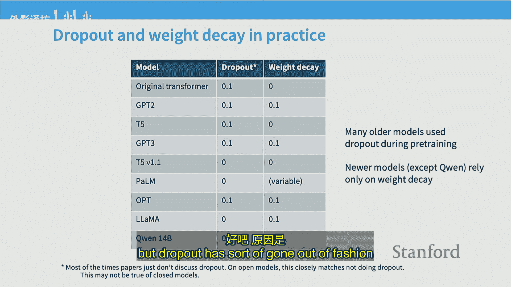

从某种意义上讲，当你观察权重衰减时，不同程度的权重衰减似乎并未真正改变该比率，训练损失与验证损失之比对吧，可采用不同程度权重衰减训练，若训练时间足够长，或者适当的控制超参数。

最终训练损失与验证损失的差距会相同，所以就过拟合来说，即便权重衰减为零，这里也未出现过拟合情况，但有意思的是，权重衰减似乎在与什么东西有些相互作用，与优化器的学习率调度方式有些怪异。

那么如果你观察一个恒定的学习率，这就是一个基于恒定学习率训练的模型，接着你突然把学习率降到接近零，所以当你降低学习率时，就能看到这种下降趋势，然后我们来看看不同类型的权重衰减方法。

而权重衰减的情况是在这个高学习率下，模型训练的不太好，然后当你降低学习率，它会迅速下降，当你查看余弦学习率衰减时，具有高权重衰减的模型，开始时非常缓慢，但随着它们冷却，即他们的学习率降低。

他们会迅速优化，所以在这里，优化器之间存在一些非常复杂的相互作用，和权重衰减，还有某种隐含的加速，在训练接近尾声时会出现这种情况，最终能得到更好的模型，所以我之前问你的问题的答案是，你不会进行权重衰减。

因为你想对模型进行正则化，这在一定程度上就是它的设计目的，你进行权重衰减，是为了实际获得更好的训练损失，而你最终会这么做，是因为各种学习机制，训练接近尾声时，将学习率降至零，非常有趣且复杂。

用语言模型做这件事在某些方面挺麻烦的，但现在看看诸多报告，你大概就明白为何如此了，你会看到我们使用了权重衰减，这大致就是出现这种情况的原因，很酷好，综合来看。

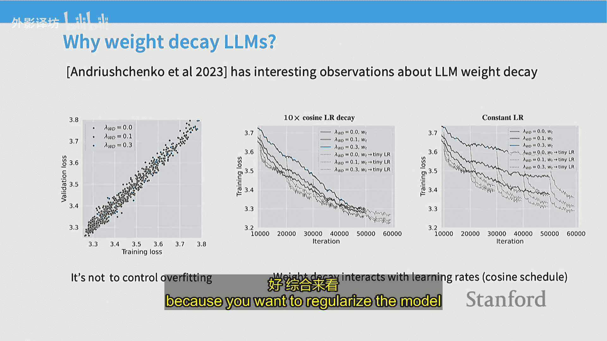

所以有些事我觉得挺显而易见的，所以要是你在为模型挑选各种超参数，某种程度上已无需过多深究，他们已经过验证，基本上别人也都这么设置，比如多层感知器的隐藏层大小，多头注意力的头围度宽高比。

以及是否通过权重衰减进行正则化，像这些，对于如何选择这些超参数有相当不错的共识，那些默认设置，大致能给到我们在作业里建议的内容，所以你可以大致照着来，他们大致会给你类似这样的东西，好的。

关于超参数部分有问题吗，什么是随机失活，为啥从手册里消失了，有啥原因吗，这是个好问题，问题是为啥随机失活不流行了，我还没看到关于随机失活是否有用的深入分析，我没看到任何这样的结果。

比如表明其对训练损失有帮助，正如本文及逻辑所表明的，实际上不存在训练过拟合问题，对于这些。

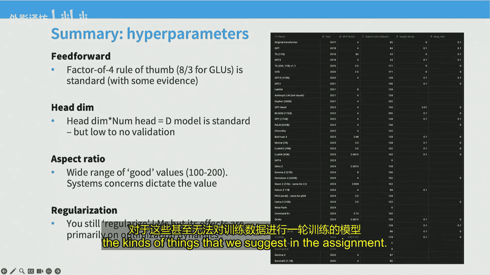

甚至无法对训练数据进行一轮训练的模型，什么是多语言词汇，真的有助于，提高单一语言的表现吗，所以记一下，是的，问题是，多语言词汇有助于提高单一语言的表现吗，你说的单一语言是指多语言或更大的词汇量。

对英语表现有帮助吗，这是个正确的问题吗，是的，所以我觉得对于资源丰富的那种语言影响较小，所以如果你只考虑英语语言的建模，用较小的词汇量也行，某种程度上这是对的嗯，但更大词汇量真正有用的地方在于。

当你开始涉及，我不会说是分布的尾部，但当你接触到那些较为小众的语言时，一个很好的例子是，如果你查看COHERER，关于其模型或分词器的任何公告，关于其模型或分词器，他们基本上总是称。

因为他们拥有更大的词汇量，以及他们针对非英语和低资源语言，训练分词器的方式，他们被压缩成少得多的词源，所以使用这些的人花费要少得多，在推理时成本低得多，这是一大优势，哦对有个问题。

如果权重衰减对验证损失没有显著影响，那我们为什么要关心训练动态或优化动态呢，好的，所以问题是，如果他对验证损失没有影响，我们为什么要关心训练，动态目标仍然是我想获得良好的训练效果。

这就是我们正在玩的游戏，而关于权重衰减，令人惊讶的是，不知怎地它能让我们获得更好的训练损失，我认为直观来讲，你进行权重衰减，它能让你得到更好的验证损失，但实际并非如此，它能让你得到的是更好的训练损失。

这些训练损失与验证损失相同，对吧，人们在向多模态架构发展过程中，其超参数选择的架构有差异吗，要是他们还处理图像和测试呢，没错，问题是关于多模态模型的，这问题问得好，我对多模态模型的调查很不全面。

我能说的是很多学术方面的，还有我见过的开源研究，他们采用的是所谓的浅层或者是模态的，后期或早期融合，其工作原理是把视觉模态，嫁接到现有的语言模型上，在这些情形下，超参数和架构选择是固定不变的。

我要说明一点，我会在接下来几张幻灯片里讲讲，这个及多模态模型，在稳定语言模型训练方面，开创了一些相当有意思的技术，在稳定语言模型训练方面，开创了一些相当有意思的技术，而这一直是个相当重要的主题。

我会稍微讲讲这些，所以不同之处往往在于，当你装上这个新的视觉组件并重新训练时，这对模型冲击很大，所以你得好好想想怎么稳定那个训练过程，而且这些创新实际上已回流到纯文本语言，模型训练中，好嘞挺酷。

于是我回顾了，我翻阅了所有这些新论文，当我试着思考时。

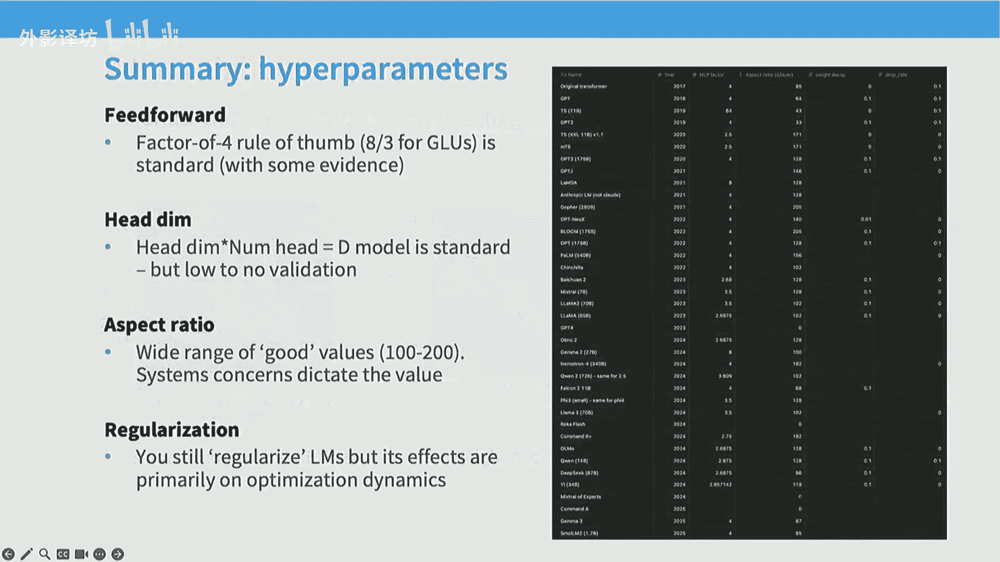

去年有啥新变化，还又出现了哪些新架构及相关情况，实际上核心架构变化不大，但我认为有一点很显著，在许多版本中都被着重强调的一点，我称之为稳定性技巧，所以这些即你希望以更稳定的方式，训练模型的方面。

而且当你构建更大的模型，或者训练时间越来越长，这类问题开始越来越频繁的出现，所以我取自ALO2论文，实际上那篇论文展示了关于大语言模型，训练稳定性的一系列出色学术成果，他们一开始展示的就是这样一幅图。

看这边的这条蓝色曲线，看这个梯度图的L2范数，这图看着令人胆寒，你的损失曲线看起来还算正常，但时不时会出现一些异常尖峰，查看梯度范数，这图糟透了，图上到处都是尖峰，你的范数会彻底失控。

要是你这样训练模型，你会很难让它合理收敛，在某个时候梯度范数会爆炸，你什么都做不了，然后训练就结束了，所以无法再训练了，所以一直很强调，基本上就是试图把这条蓝色曲线，变成类似橙色曲线的样子。

当然这个损失更大，先别管那个，我觉得他们只是换了数据集，在这两次训练之间，不过这条橙色曲线在整个过程中，梯度半数都很低，这很不错，那才是你真正想看到的那种图，所以你可能会问。

transformer中稳定性问题出在哪，当然基本上哪都可能出现，但你看看人们采取的那些干预措施，真有个地方特别突出，堪称问题点，这就是soft max，这可能是个问题，因为你要做指数运算。

而且这些在数值上可能表现不好，你还要用两数相除，所以可能会除以零，因为很多不同原因，soft max这部分你可能会碰到不少问题，所以我还想再讲一点。

那么transformer中的soft max函数都在哪呢，嗯在末尾有一个，所以你得留意那个输出的soft max函数，而且自注意力机制中也有soft max函数，所以有两个soft max函数。

我们得稍微琢磨琢磨，对于每一个soft max函数，我要讲讲一种稳定性干预方法，通常挺有效的，所以第一个叫Z损失，出于引用一篇更早论文的想法，我回顾了2014年，德富林的一篇机器翻译论文。

他们的目标是确保这个归一化因子接近一，所以看P这边就是输出的soft max，输出的soft max由两项构成，先对对数几率做指数运算，再除以归一化因子，ZZ就是对所有词汇的值求和，所以若你想要这个Z。

你想训练网络，让Z接近一，那么那么你可以重写损失，你可以在此处添加一个第二项，以使Z的对数趋近于零，这样你最终会得到一个辅助损失项，也就是alpha乘以Z对数的平方，在右边你大致能看到那个推导过程。

从某种意义上讲，这就是人们常说的记忆损失，我觉得雅各布德芙林等人是这么做的，用于机器翻译，其原因与如今的用途截然不同，我想这在语言建模领域中是首次出现，这种情况，是pm。

他们将其用作他们称之为Z损失的辅助损失，及时的四次方乘以Z的对数平方，从而促使soft max归一化器表现良好，你可以大致推断出这种正则化气的行为，如果他成功了，使得X的Z的对数恒为零。

那么对数和指数就会抵消，那么基本上就得到了有这是个很好的状态对吧，这操作不错，数值稳定，这样一来这些有问题的操作都没了，所以可以把soft max理解为，当Z关于X的值接近一时表现良好。

或者Z的对数接近零对不，而且你知道某种程度上tom算得上是先驱，因为他们用了这种Z值损失的技巧，而其他很多公司很久都没这么做，至少那些有公开论文的没这么做，但后来有一系列论文研究了这个白雪二。

实际上是我所知最早的后续研究，接着是DCLM和OO2，现在其他几个基本上也采用了Z损失，这是个提升稳定性的不错且便捷的干预方法，然后我们看到的另一个窍门，所以这就是稳定输出soft max的方法。

但我们还得处理另一个soft max，我们要处理的另一个soft max在注意力运算中，所以这出自英伟达的一篇论文，我忘了加引用标记，但在此处，这是注意力机制工作方式的方框图，一开始会进行层归一化操作。

会得到QKV值，暂时忽略，这个可能会将Q与K相乘，会对其进行soft max运算，会将其与V相乘，然后进行投影，然后就会得到全连接层及输出，所以要是你忽略这个这边这块。

这看起来和普通的多头注意力操作没什么两样，那么这里有啥区别呢，于是有几个人想出了这个办法，或者说这种方法叫QK归一化，在这种方法里，你获取查询值，还有键值。

然后把它们传入在进行soft max操作的内机之前，先经过一个层归一化层，这是一种完全不同的方法，控制soft max行为的，这里你没有对归一化因子Z进行控制，相反你在控制soft max的输入。

使其大小受限，这样就能自然的控制soft max的不良表现，正如我之前讲过的，这最初是视觉方面的一项创新，以及多模态模型领域，2023年的德加尼论文，是关于训练大型视觉transformer的。

接着是chameleon和ada fix hoking face的团队，运用了这些技巧，在其多模态训练组建中，然后还有其他几个模型，如GA2DCLMOO2也采用了，它基本上都采用了这种技术，以稳定训练。

我想每堂课能讲一个笑话，所以我要讲的就是这个。

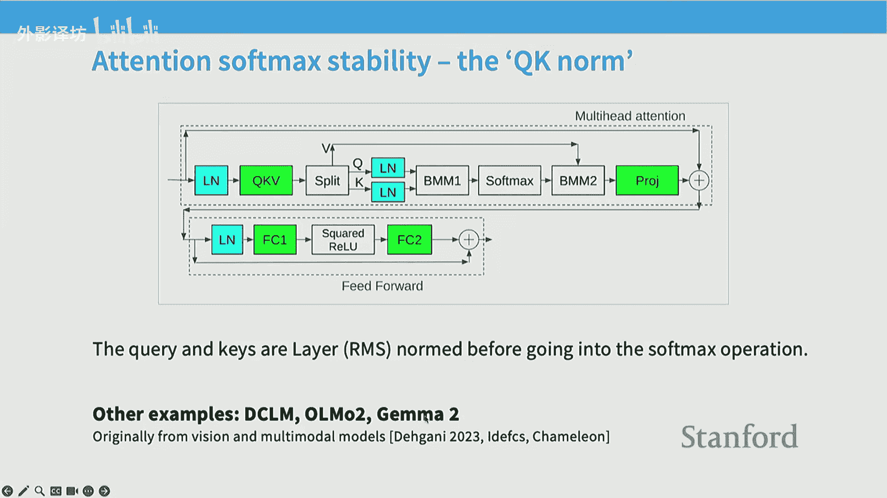

我觉得很突出的一点是，在稳定性干预方面，层归一化的效果极为显著，所以我们看到，从仅在模块前半部分使用层归一化，倒在开头部分以及非残差组件的末端，现在我们也把它放入了Q和K组件里，至少在提升稳定性方面。

层归一化效果惊人，且对性能影响不大，我要指出的最后一个技巧，我觉得这个没那么常用，也就是对输入soft max的数值进行软封顶，那么你可以采取的另一种方法，所以在某种意义上。

QK归一化是一种非常强力的干预，因为我们要对整个向量进行运算，但在计算自注意力的内积之后，你可以做一件事，但在计算自注意力的内积之后，你可以让他们经过一种类似软最大值的运算。

所以你可以让他们通过这里的这个公式，所以你将输入的LOCKE除以软上限后，再乘以软上限，这有什么用嗯，如果你的locks开始大幅超过软上限，双曲正切函数会将它们截断为一，所以这边会有一个软上限的最大值。

所以在某种程度上，这会控制对逻辑值的软阶段，还有GMA2，我觉得OO2也会这样，我想他还没有，否则就没那么火了，而且我觉得还有其他反对这一点的证据，我之前提到的，英伟达的人。

实际上采取了不少不同的稳定性改进措施，而他们发现这边就是你的基线模型，这就是机械模型的困惑度，11。19软限制会让情况更糟，QK归一化实际上会让情况变好，因为你可以用更激进的学习率，来进一步推动优化器。

好啦，关于稳定性提升，干预措施的内容就到这，有人有问题吗，我觉得这算是过去一年的新进展对吧，那么对于QKB归一化，要明白，在训练期间会应用层归一化，在推理时层归一化还会保留吗，没错。

所以问题是在推理时你还会使用归一化吗，答案是肯定的，因为层归一化已经学习到了参数，层归一化的整个操作是获取一个激活值，将其归一化为单位，然后将其缩放到一定大小，如果你去掉那个这对模型而言是个巨大的改变。

它会不知道该如何处理那些未归一化的激活值，好的，好了我这有最后一部分，我想以最后几张幻灯片收尾，要是我们讲完，那我们总能把这个放到混合专家讲座里，但我觉得我们下次也有不少内容，因为我得讲到深度序列V3。

所以我最后要讲的是注意力机制中，注意力头的变体，关于注意力头，我觉得针对他们的研究还不够深入，但我认为出现了一些你需要知晓一些重要变化，为了理解正在训练的模型，所以我要讲的一点是。

我首先要讲的是GQA和MQA，而且这些并非至关重要，对于模型训练时的行为，但他们对理解模型的推理成本至关重要，以及模型的推理行为，由于这是一项重要的架构变革，我会再次提及，此外可能会被提到。

珀西在一些推理讲座中讲到另一个新进展示，我要讲的是最新的模型，如拉玛四，若你有所耳闻，据说它能支持1000万个上下文标记，他是如何做到的，他通过以非常有条理的方式，扰乱注意力模式来实现这一点。

来实现这一点，所以我也会讲到这一点，那么GQA和MQA，如果你看过一些更大的模型，比如大羊驼模型之类的，你应该听说过或见过GQA或MQA这个术语，我会详细说明这是什么意思，那么为了做铺垫。

我们来思考一下进行注意力计算需要的运算，所以这里再次出现的是224N张幻灯片，你要获取你的XQ，也就是你的查询，还有你的XK，接着你要构建一个大型二次注意力矩阵，你可以逐一分析这些矩阵乘法。

你可以自行验证，算数运算的总数将是B乘以N乘以D的平方，这里的B是批次维度，N是序列长度D的平方及隐藏层维度的平方，你可以了解总的内存访问次数，其结果为B乘以N乘以D，例如这是对这里这个矩阵的访问。

这个XQ是那个尺寸，然后soft max为B乘以H乘以N平方，你可以通过思考soft max矩阵的尺寸来理解这一点，来理解这一点，其为P4乘以投数，再乘以所有不同的soft max激活值。

所以有N平方个，还有一个投影在这边，最后你会有D的平方被投影操作，所以我们可以算出总内存，访问次数与算术运算次数的比值，而这非常重要，在接下来几讲中，有个概念叫算术强度，所以我们希望算术强度高些。

这意味着我们想进行大量运算，对于我们所做的每一次内存访问，而这回事相对来说，在GPU上进行内存访问成本很高，而计算相对便宜，那么在我给你们展示的这个批量计算中，算术强度，若计算。

这两者的比率将是1K加上BN的倒数分之一，所以这意味着我们能让GPU持续运行，因为如果我们有一定数量的头，并且批量大小和序列长度都很大，这些都会是挺不错的大数字，当然这就是训练时的情况。

所以问题在于在推理阶段，我们没有这些大且厚实的矩阵来相乘，所以这将切实改变我们算法的行为本质，所以当我们生成文本，记住我们得生成一个词源，然后transformer得读取那个词源，然后他得对其进行处理。

现在我们能得到下一个资源分布，然后我们逐个词源自回归的进行处理，这样一来我们无法将这个生成过程并行化，对于每个新资源，我们都得一步步来，当我们这么做时，我们需要逐步计算注意力。

一个被人们称作KV缓存的概念，那么你会怎么做，这是一个关于已讲解过的KV缓存的可爱动画，所以你不妨看看这个图，你在做的是拿到了一个查询令牌对吧，这里的一个查询令牌，意味着你生成了一个新令牌。

你根据他来做判断，现在你想问对于那个查询令牌，我应该在过去查找什么样的信息呢，你的查询令牌从一到N变化，因为你每次生成一个新令牌，你在这里构建这种关键缓存，我在这里构建所有过去令牌的键对吧。

过去的词源键不会变，因为他们只依赖于过去的东西，所以我在逐步当我生成词源，建立所有这些过去的键，每次我都能算出Q点乘K的一个新元素对吧，所以这个大注意力矩阵就是这个下三角矩阵，我一次算一行。

而那一行正是生成下一个词源所需要的，所以这个键值缓存的概念，要是你以前没见过这个，这个要逐步生成K值的想法，随着操作逐步生成V值，当我生成每个词源时，而且我只计算QK操作所需的必要。

那么再一次你可以梳理并算出各种运算组件。

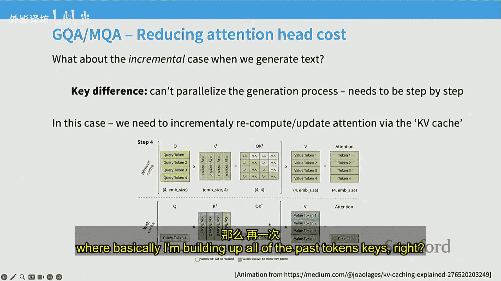

比如要做多少次浮点运算，内存访问总数是多少，要是考虑KV缓存，我只对必要的键值进行相乘，由于我保存了所有中间计算，我没有浪费任何矩阵或向量乘法算数，运算总数保持不变，B与D的平方。

但现在内存访问模式有变，为何如此，因为我进行KV缓存操作时，我得反复将各类参数调入，调出内存，每当我用类似键的K矩阵相乘时，我得把它放进内存，然后乘以K，然后我得把它放好，然后我需要计算一些激活函数值。

所以我要不断加载不同的矩阵，这会让我的总内存访问次数多得多，为B平方D加ND平方，所以当你算这个比值时，现在算术强度不太好，你会得到ND加1B的倒数，所以如果我们这样分析一下行吧。

所以要是我想提高算术强度，我希望里面这个值很小，所以我需要很大的批次，而且我得让ND很小，这是什么意思，我需要很短的序列长度或者很大的模型维度，而且这种ND的情况很不利，因为我不想要更大的模型。

而且我也不想要更短的序列长度，所以这就是核心，某种程度上人们面临的推理成本权衡，已存在一种非常糟糕的内存访问模式，这里有个术语，奔驰一地，这着实拖了后腿，在系统吞吐量方面，因此这催生了MPA。

这里的关键在于，希望你能从后面这张图中看出来，真正糟糕的部分在于键和值，他们正在构建KV缓存，且有内存频繁进出，所以你可以为查询设置多个头，有多个查询头，但界和值只有一个维度或一个头，这极大简化了情况。

一旦你这么做，现在你在键值上移动的信息少得多，所以键值是共享的，但查询有多个头，所以你仍有多头注意力或多个查询，但键值只有单个的，所以这就是他被称为多查询注意力的原因，现在当你进行同样运算时。

我们的内存访问次数更少，因为我们共享了K和B，而且算术强度的表现要好得多，所以我们能够增加一些内容，就如同我们把第一项缩小了N倍，所以现在更长的序列长度也可行了，而且第二项现在被投数除。

所以这一项也没那么差，所以现在所有不同的项都被控制住了，而且多查询注意力能有更好的表现，分组查询注意力，也就是组查询注意力。

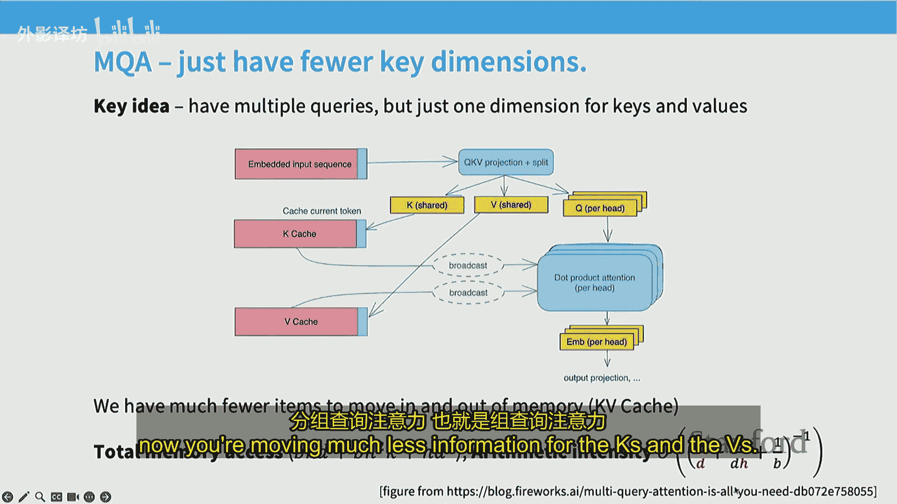

基本上只是对此稍作改动，无需多个查询和单个键，你可以将剑的数量减少若干倍，这样就能让你在推理时间表现之间进行权衡，以及模型的表现力，因为也许从多头直接到多查询有点过于激进了，一些研究表明GQA并无弊端。

但多头注意力存在弊端，我不打算深入讨论，那个我就以这最后一点来结束，我觉得这是过去几个月里，一项相当有意思的进展，话说在2019年，OpenAI发表了一篇超棒的论文，主要探讨如何构建更长的注意力模型。

他们主要争论的是一种实现方式，是想出某种稀疏注意力模式，所以不再关注整个序列，我会关注，比如说在每个片段上设置一个局部窗口，然后我可以有其他类似对角线的注意力模式，以帮助信息传播。

所以你可以构建稀疏形或结构化注意力，用于权衡各种表达能力与运行时长，GPT3最初发布时正式使用了这类技巧，以获取更大的注意力，窗口滑动窗口，注意力是此概念的另一种变体，在每一层。

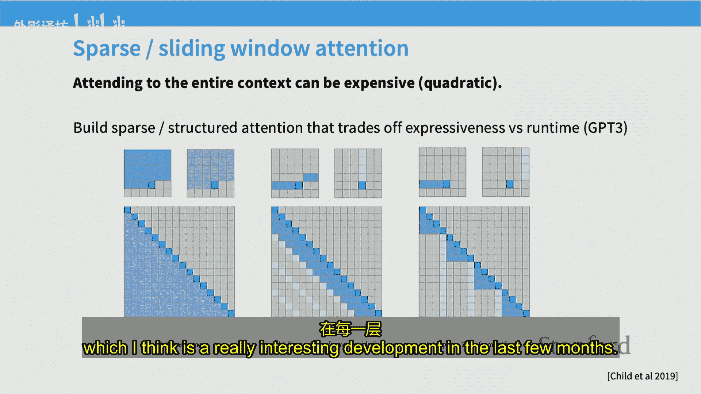

你仅关注当前位置周围的小区域，这也将控制你进行更长时间联系，所需的资源总量，所以你有效的感受也现在是局部感受，也乘以层数，最后一个技巧，那些算是比较老的想法，但这种现代实例化的方式。

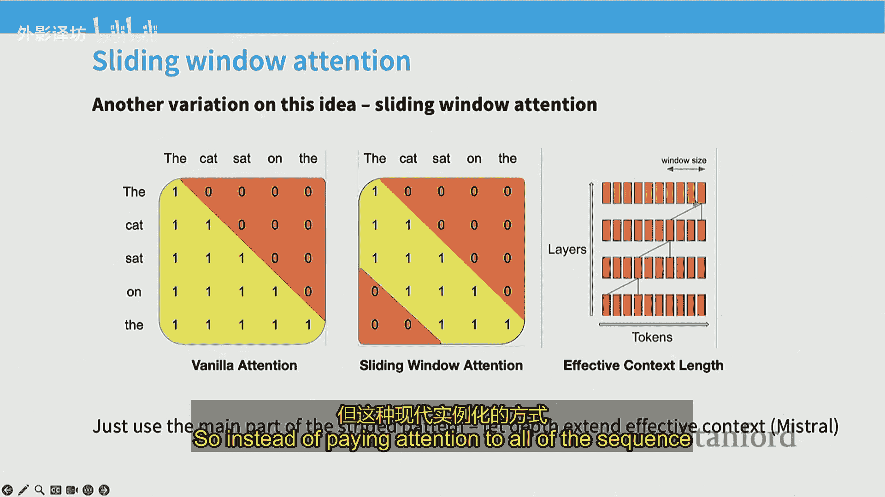

体现在一些近期论文中，比如拉玛四以及DA和coherer command a，现在想出了这个非常巧妙的技巧，基本上是采用变压器模块，在这种情况下，你有一个模块，一组四个变压器模块。

最底层的那个模块使用完全自注意力机制，没有位置嵌入，所以没有rope，什么都没有，他完全不知道位置，但他是完全自注意力机制，而且它每四个模块才出现一次，然后它上面的三个模块使用带ROP的滑动窗口。

注意力机制，所以这实际上是个非常巧妙的技巧，能在两方面控制系统相关事宜，因为完全注意力机制只是偶尔出现，此外还有长度外推这一方面，因为roll仅处理局部上下文窗口，以及任何真正的非常长距离的内容。

完全没有位置嵌入，非常激进的进行外推，对不对，因为你无需像处理ROP那样进行这种位置外推，所以这是一项非常棒的进展，我们在过去几个月里见到的那么行吧，我想我们快到时间了，关于架构或超参数，尽管问我之后。

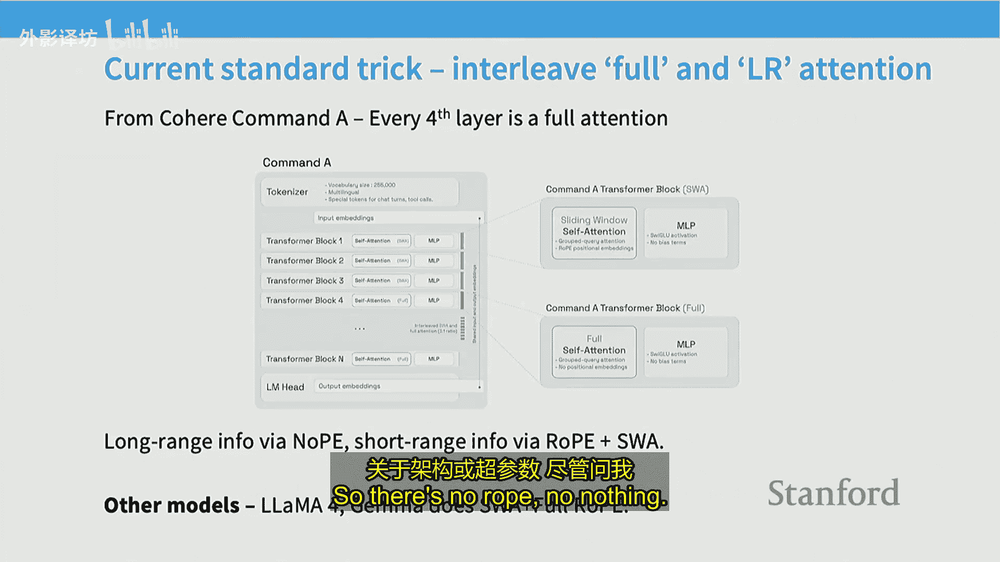

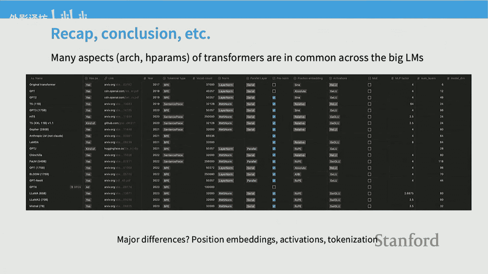

