# 【中文配音】硬核！斯坦福 CS336：手把手带你从零构建 ChatGPT - P4：4.混合专家架构实战-Mixture of experts - 外影译坊 - BV1BWEWzfEKi

那咱们开始吧，今天我们要讲混合专家模型，去年这算是我临时拼凑的一堂有意思的加课，但今年多亏了很多人研究混合专家模型，这堂课变得更关键了，所以我补充了很多近期进展。

最后我们会试着梳理一下deep sick v3，并弄清楚都有哪些组成部分，这些组成部分构成了一个顶尖的开源系统。

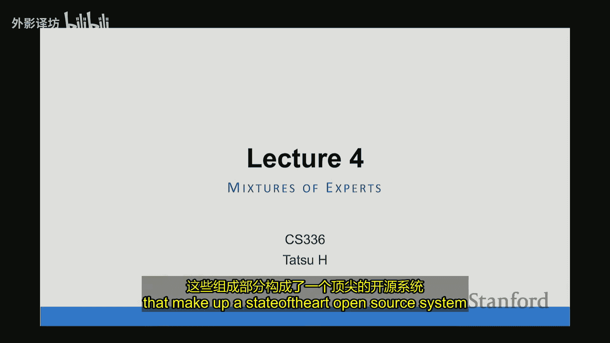

或者至少在架构层面他的样子，那么混合专家模型是当下许多最先进的高，性能系统，如今的构建与部署方式，所以英伟达曾有一起有趣的泄漏事件，GPT4实际上可能被泄露成了gift to moe bt。

但更广泛地讲，像GROCK和深度搜索这类，以及lama目前均采用了混合专家架构，而且在2025年这个节点，混合专家模型的优势相较于密集架构十分显著，对吧，差不多在各种计算规模下训练混合专家模型时。

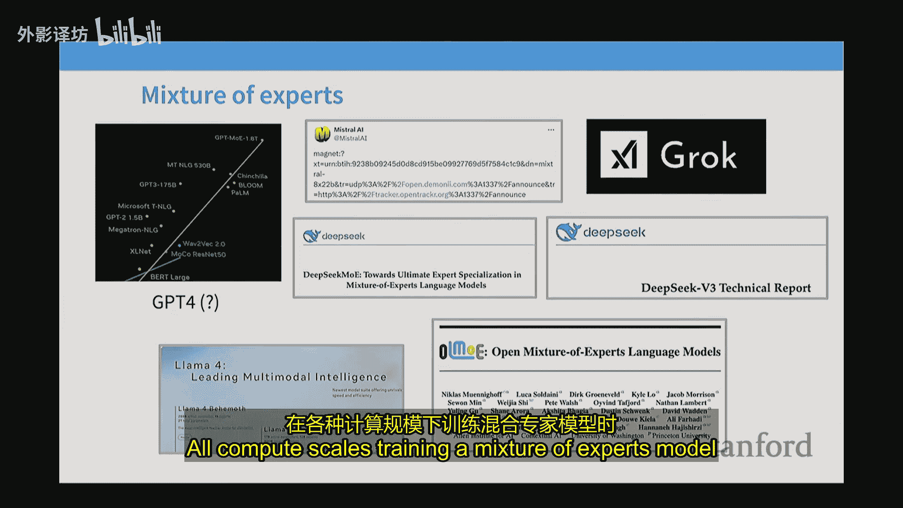

要是你做得好，会比密集模型更具优势，所以东西方似乎都在采用这种方式，所以这一点很重要，需要理解，如果你想构建某种最佳模型，基于你现有的计算能力，所以混合专家模型很简单，这概念名字起的糟透了。

我猜你听到混合专家模型时会想哦，肯定有针对不同领域的专家，而且他们在做不同的事，就像有个编码专家，还有英语专家以及其他语言专家啊，它和那种思维模式差得远了，混合专家模型是一种奇特架构。

它有几个子组件叫专家会被稀疏激活，特别是当你想到混合专家模型，你该想想多层感知器，这里才是重点，那么混合专家模型架构与非混合专家模型架构，在几乎所有组件上都相似，仅一个组件除外，即看这边这张幻灯片。

这是标准transformer的组件，有自注意力机制，有全连接网络，如果你放大在密集模型中，钱柜组件差不多就那么存在着，它是一个大模块，在稀疏模型中，你要做的是，你要启用这个全连接网络。

然后你要对其进行拆分或复制，这取决于你如何设置混合专家模型，比如说你会有多个全连接网络副本，你的全连接网络，并且你会有一个路由器，它会从这些副本中挑选出较少几个，要知道在每次前向传播或每次推理时。

所以这就是混合专家模型的基本原理，然后我们要用一个选择器层和多个较小的层，替换左边这个大的前馈层，替换左边这个大的前馈层，那么这有什么好处呢，嗯若他是稀疏激活的，即比如说他只挑选一个专家。

并且一个专家与你的密集全连接网络大小相同，那么密集模型和混合专家模型，在左边之间的计算量和右边之间，密集模型和混合专家模型，他们的计算量相同，他们做的矩阵乘法和以前像传播时一样。

这样你就能在不影响计算量的情况下，拥有更多参数，如果你认为重要的是拥有更多参数，比如记住关于世界的事实嗯，你懂的，这是个很棒的架构，所以你大致能明白猫背后的思路，希望这些都很清楚了，你可能会想好吧。

所以每单位计算量能得到更多参数是有道理的，但这是否能转化为实际更好性能，那对于你正在训练的模型已有，我认为在这一点，众多论文表明，在相同的浮点运算量下，与密集模型相比，混合专家模型性能更佳。

与密集模型相比，混合专家模型性能更佳，所以这是篇不错的论文，所以今天我将回顾几篇谷歌经典论文，这些论文构建了这个领域，这是费杜斯等人发表的论文之一，2022年，他们指出，若浮点运算次数匹配。

训练时的浮点运算次数也相同，所以训练所用的计算量是一样的，随着专家数量的增加，语言模型的训练损失会持续降低，不断下降，所以专家越多越好，当然使用这些专家并非没有代价，你得为这些专家存储内存。

当进行并行处理时，你得考虑，如何将数据分配给256个独立的专家，所以会出现系统复杂性，但如果你只关注浮点运算次数，这是张很棒的图表，值得一看，因为浮点运算次数相同，但在这里测试损失有所降低。

右侧也呈现出同样的情况，随着训练时间不断延长，模型拥有128个专家的切换机模型，专家更多的模型困惑度提升更快，希望这已经很清楚了，你可能会说嗯，这是一篇2022年发表的论文，这是真的吗。

我们的现代架构具有现代规模，这依然千真万确，AI2发表了一篇很棒的论文，名为ALO，该论文进行了一系列消融实验，并对密集型与混合，专家模型及其他架构进行了精细的对比，而且他们看到的情况大致相同。

所以在左边这仍源自费德克斯等人，你看有多个专家使得速度提升了七倍，在右边，这是AO的对比，你看粉色的是混合专家模型mo，而蓝绿色的是密集型，并且密集型模型的训练损失下降，速度比混合专家模型摸慢得多对吧。

所以希望你们都知道，某种程度上，我已经向你们讲清了混合专家模型mo的价值，还有学习这种新的算是新的架构对吧，我们要为这一切付出代价，但至少在浮点运算次数FLOS层面，这看上去很有吸引力对吧。

那么有个问题你提到了偏差转向这部分，因为虽说这是一种成本相当低的量子突变，但其效果实际上相当显著的积极，所以问题是在上一讲里，我当时说，即便很小的非浮点运算，可忽略不计的浮点运算。

在实际时间方面可能会相当大，在混合专家模型领域会有这样的情况吗，所以我认为混合专家模型的一个弊端，为啥这不是教的标准内容，比如说在2SN是因为要让这东西高效运行，存在重大系统复杂性，所以我会讲到。

这能让这些东西非常高效，尤其是要是每个专家都在单独设备上，要把数据传到不同地方，你这么做就能很高效，但这可不容易，所以有很多基础设施问题，要让这东西运行起来会碰到很多复杂情况，但它运行起来后。

你所有的计算资源都能充分利用，好接下来我要讲的最后一点，很多公司都很喜欢混合专家模型，因为这样就能展示出很吸引人的图表，这出自deep seek v2论文，在X轴上，这里面有点门道，这只是激活的参数。

所以这仅是用于计算的参数，所以你可忽略所有未激活的专家，而Y轴是MMLU性能，我们看到deep seek v28激活参数很少，MMLU性能很好对吧，所以如果你只关心训练和推理的运算量，你懂的。

激活参数是关键，你在此能获得很好的性能，而这并非只是一次消融，这可是个实打实的系统，有人花了大价钱训练出来的，然后把它应用到实际场景中对吧，我们在其他例子里也会看到，类似模式再次出现哦，有问题吗，好嘞。

那么系统方面还有个好处是，混合专家模型能让我们有另一种并行方式，所以我要详细讲讲并行性，在系统课程里会讲的详细的多，我会讲讲你要怎么用你的模型，你要把它切成好多小块，把它们分布到不同设备上。

但我会从宏观层面讲，当你有了专家模块，在专家层面有很自然的并行方式对吧，所以你有多个不同的前馈模块，你可以拿这些专家模块，把它们放在不同设备上对吧，而且专家模块是稀疏激活的，你只需获取令牌。

然后路由到合适的设备，计算将在该设备上执行，所以将模型分配到不同设备，是个自然的切入点，是个自然的切入点，所以这叫做专家并行，这也是混合专家模型受欢迎的另一原因，若你真想对大型模型进行并行处理。

这是你必须要做的，有趣的是，我认为谷歌开发了混合专家模型，许多前沿实验室也在这么做，但我觉得开源成果实际上常常来自中国，去年crown和deep seek，做了大量混合专家架构相关工作，而且就在最近。

我认为西方开源组织才开始更多地进行，混合专家架构方面的工作，比如mixtro crock，我猜grog不是开源的，然后现在lama采用了混合专家架构，所以在这里拉马斯刚刚发布是最新且最厉害的。

这也是一种稀疏的混合专家架构，我在讲课过程中也会谈到lama4，如我之前讲过，这件事的一个出发点在于一些中国团队，QUN和deep seek在基准测试方面成果颇丰，还对一些混合专家模型做了理解和评估。

所以Q1N1。5是首批模型之一，据我所知，它是首批具备大规模，经过充分测试且记录完备的混合专家模型之一，他们采用了一个QEN1。5密集模型，他们有个巧妙办法对其进行升级，将其转化为混合专家模型。

这是各把密集模型变一下的巧妙办法，然后把它变成一个混合专家模型，而且他们在计算效率方面有显著提升，同时参数总数有所减少，与他们的70亿参数模型相比，深度序列如今已颇有名气。

但最初这些论文发表时并没有那么出名，在开源领域，做了一些我认为很基础的混合专家模型工作，本次讲座的很大一部分，实际上是要追溯deep sec的move架构的发展轨迹。

但如果你看一下他们最初的deep sec的谋论文，你会看到很不错的论文，抱歉非常不错的各种比较展示了，诸如当你用特定的浮点运算量，训练一个密集模型时，当你训练一个非常简单，没有进行智能路由的move时。

会怎样会怎样，然后如果你使用一种名为switch类mode的更智能路由，会怎样，如此一来，你会看到所有这些经过精心控制的比较，当你从密集过渡到稀疏，即从最左列到最右列。

你会看到所有这些基准指标都持续显著提升，在固定的浮点运算次数下，所以这一点非常稳定，我认为有一点，此时想必大家都已经听说过deep sk v3了吧，从某种意义上讲，这是这一系列工作的集大成者。

但要是你一直关注着混合专家模型，而且你还对神经网络和语言建模的这个分支，挺感兴趣，其实早在V13流行之前，你就已经知道deep sec了，咱们在这堂课结尾就会看到。

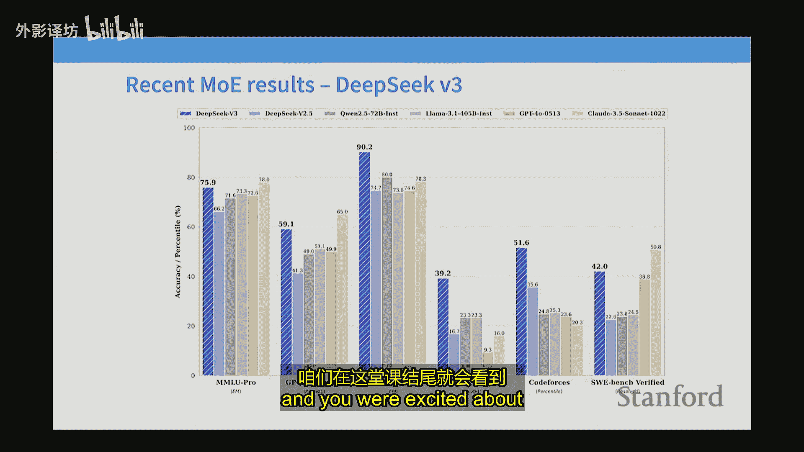

实际上deep sc v3和最早的deep sec，混合专家模型没太大差别，在架构上，你要知道他们早在很久以前就已经做到位了，当他们在训练这些参数，少的多的20亿参数模型时。

他们在工程设计上确实做得不错，做出了相当出色的东西，也就是他们的V3模型，好的，现在我觉得我花了好一会儿时间，来使劲给你安利混合专家模型，而且我觉得他们确实值得好好宣传一下，他们很不错，但我在想。

为啥他们没那么火呢，对吧，为啥它不是标准教学内容，我们教在自然语言处理和语言建模课上呢，只是他们极为复杂且杂乱，我期望未来几年他们能得以简化，但他们依旧相当难搞，所以一方面是基础设施极为复杂。

而混合专家模型的最大优势才真正显现，在进行多节点训练时，比如当你总得拆分模型时，那么在不同模型间分配专家就开始可行了，这是很自然的做法，但在你达到那个阶段之前，或许混合专家模型没那么出色。

所以一些早期谷歌论文确实谈到了这种权衡，当你有了这些非常大的模型，必须进行拆分时，那么专家就会变得极其出色，还有其他一些棘手的事情，仔细想想，决定将资源路由到哪位专家是件很难学的事，在深度学习中。

我们很青睐可为目标，一些非常平滑且可求梯度的东西，路由决策不可微，因为我们必须挑选并选定一位特定专家，所以如果我们这么做，我们将面临一个非常棘手的优化问题，而实现这一点的训练目标，要么是启发式的。

要么不稳定，所以我们必须精心设计这些方法，使其发挥作用，所以这就是两个原因，通常人们不太想这么做，那么混合专家模型长什么样呢，正如我在讲座开头所说，经典的混合专家模型是把全连接层。

然后对其进行拆分或复制，并在它们之间进行稀疏路由选择，当然你也可以有类似的想法，你可以有一个采用稀疏路由的注意力层，而且有人已经这么做了，已经有几篇相关论文，还有几个采用这种方法的发布版本。

但在主流模型发布中，这种情况其实相当罕见，我记得在网上看到过，有人讨论说这种方法实际上更加不稳定，而且很难持续稳定训练有点像，我其实没看到有证据能证实这一点，但确实没多少人用混合专家注意力。

来训练这类模型，所以现在我已经给你讲了，基本架构真的很简单，你有某种路由器并进行路由，然后有不同的多层感知器，那么不同的混合专家模型选择中，哪些方面会有所不同，你可能会问如何进行路由。

路由函数显然是个重要选择，需要多少专家，专家规模多大，这是另一选择，最后一个是如何训练这个路由器，这个不可微目标似乎很难训练，所以这些都是非常重要的设计问题，我们会逐个过一遍。

有望涵盖所有这些混合专家模型的设计范畴，在我开始讲这些不同子组件之前有问题吗，那么要是你只想了解下混合专家模型，至少在2022年前后，有一篇相当不错的综述，或者费图斯等人写的综述论文，2022年发表的。

涵盖了很多相关内容，我的许多图表都源自那篇论文，要是我们在思考该如何进行路由，或者如何将资源匹配给专家，没错，这是mo的核心组件，因为mo的作用是资源会输入进来，你正在处理序列，这些序列会被分配给专家。

不是所有专家都会处理每个资源，这就是稀疏路由混合专家模型的核心，所以你会问这些路由决策是怎么做出来的，所以你大概有三种不同选择，你可以选择词源，每个词源对不同专家都有一定的路由偏好。

然后我会为每个资源选出前K个专家，或者我可以选择专家，每个专家对资源都有一定的排名偏好，然后我会为每位专家选出排名前K的令牌，这样做的一大好处是在专家间能保持平衡，接下来最后一点是。

你可以解决某种复杂的优化问题，以确保专家与令牌键的映射能保持某种平衡，这就是全局分配，在此先给你们透露一点，几乎所有混合专家模型，都采用选择前K个令牌的做法，在混合专家模型早期。

人们尝试了很多不同的方法，某种程度上涵盖了令台路由器设计空间的全谱，若查看那些大型发布版本，他们全都汇聚到了基本上同一类路由机制，也就是令牌选择前K，所以每个令牌会按亲和度对专家进行排序。

然后每个令牌都会有一个类似前K的选择，还有欧某在本次讲座中我会一直提及，因为他们有一系列很棒的笑容实验，所以依据这个来讲解真的很棒，他恰好有这种笑容实验，他们对比了令牌选择路由和专家选择路由，他们指出。

若查看验证损失，令牌选择的表现好得多，损失衰减也快得多，什么事啊，是关于令牌本身还是其位置，它取决于隐藏状态，所以令牌会与所有位置嵌入等一同被处理，一同被处理，然后隐藏状态会介入。

然后它会由多层感知机处理，那么对于另外两个，对于选择令牌的专家以及这种情况，当你说在专家之间他更平衡时，他仍针对当前的令牌序列，但他是在迫使他们更分散吗，仍然是同一组令牌，但实际上这关乎排名选择器函数。

在令牌选择中，我只取列中的前K个，也许分数甚至相同，我只取列中的前K个，在专家选择中，我会选取每行中的前K个，而从各列中选取前K个也挺好，因为你可能会说哦，我能定义一个评分函数，这样分数就能体现。

每个专家处理每个词源的效果，而且资源选择会把我导向，处理该资源的最佳专家，所以从处理方面讲，这是有道理的，但专家选择有个优点，即每个专家得到的资源数量相同，那么现在你也许好。

比你把不同专家置于不同设备上，可实现均衡利用，所以在考虑路由时会有不同的权衡并排，如何知道哪个专家最佳，很好没错，问题是每个令牌如何知道哪个专家好，这正是路由器的功能，我会给你们路由器的方程式。

但稍微给你们点不算真正的剧透，但路由器比你想的要轻得多，比如说你的令牌由向量X表示，那就是记录的隐藏残差流，所以现在X要和矩阵W相乘，然后你就对其进行SIGMOID之类的运算，而这就是分数。

所以这其实就是向量与向量的内积，某种程度上类似注意力操作，对所以选择，所以问题是这里K是一吗，所以K实际上是一个超参数，并且不同的混合专家模型会有不同选择，我将再次讨论此内容，但为了让你有个大致概念。

最早的混合专家模型，论文的最初论点是K应大于二，因为那样你能进行一些探索，如果你把K设为一，也许你只是一直在利用最佳方案，而且你永远不会知道你还能做的其他潜在知识，但是如果K等于二。

那么也许那第二个途径可以告诉你，一些探索信息，所以K等于20经典选择，而且K等于二世纪上仍然非常受欢迎，对对，所以那样会使浮点运算次数翻倍，所以当人们谈论mode时，他们通常会说像X格激活参数之类的话。

而这可以解释事实，你输入到两个多层感知器中，什么是，所以当K大于一时，即使在推理时，我们要把不同专家的输出合并成是的，问题是当K为一时，输出会合并吗，没错，如果你看那边的注意力图，你已经有了路由器。

它被路由到顶部的两个MLP，然后他们紧接着就组合在一起了，没错，所以问题是聚合是怎么发生的，就是求和，所以我将讲解这些变体，人们常用的变体，实际上在某些方面要实现高性能的混合，专家模型。

你只需了解前K个就行，但我会告诉你其他辩题，因为他们是很自然就能想到的，大多数混合专家模型采用的是TP的路由令牌，选择TP路由，其工作原理是剩余流输入X会进入路由器，正如我所说。

路由器实际上类似注意力操作有线性内机，然后是soft max，然后你选出激活度最高的前K个专家，然后对这些输出进行门控，取决于具体时间，你可能会根据这个路由权重对输出加权，或者可能不会。

然后你将输出加权平均或直接求和，这取决于你的混合专家架构的实现，所以很多混合专家架构的论文和方法都用了，前K个开关变压器，G分片BROCK，混合角色部落，所有深度序列变体都使用不同的前K变体。

或许是个相当惊人的事实，这着实会让你思考混合专家模型的情况，有诸多结果显示，实际上根本无需智能路由器，实际上在最底层使用哈希函数，就能把这些X映射到相应组件上，即便你在进行哈希操作，因而毫无语义信息。

基于哈希的混合专家模型仍能带来收益，这相当离谱，混合专家模型的一些早期研究，我觉得这想法特妙，而且从很多方面来说挺靠谱，当然学网打陆游是个离散型抉择，强化学习在学离散型决策方面特好用。

为啥不用强化学习来学路由呢，在混合专家模型的一些早期研究里用过它，据我所知，现在基本没人这么干了，这么做计算成本高的离谱，你已经遇到稳定性问题了，你或许不会想这么做。

有几篇论文探讨了解决线性分配问题等内容，或最优传输问题，他们非常精妙，但同样这么做，成本远高于收益，我觉得在实际应用中，它给你的收益，而且尚未真正被采用，但有很多有趣的事情，人们正如此行事。

以尝试改进路由，现在我能指着这张幻灯片，然后详细讲讲路由是怎么工作的，那么这就是top k这种路由方式，现在几乎大家都已采用，这是deep sk v1到V2版本所用的路由器。

queen和clock做的几乎完全一样，这里底部没有直接用soft max，他们采用了deep seek v3的混合角色，DBRX底部没有soft max，但他们会对他的G进行soft max运算。

但这差异极小，那咱们来看看这是咋回事，并试着推断一下其行为，这里在最底层发生的事，我们有输入，这是我们的L的U输入，我想获取这种残差流输入，并通过我的混合专家模型处理它。

所以我首先要做的是弄清楚哪些专家会被激活，那我该怎么做呢，嗯我要做的和注意力机制很相似，我要取优，也就是我的残差流输入，然后我要与AI进行内积运算，这些是经过学习得到的向量，这些向量对应每个专家。

表明该专家指向这个方向，所以我在这里计算这个内积，专家与输入的亲和度，我在计算soft max来确定每个资源的最佳专家，所以我进行归一化处理，这就是S，现在我获取S的值，然后我应用一个top k函数。

我只挑选K的最佳权重，然后我把这个用作门控信号，所以我将其他所有值归零，然后我计算每个专家输出的加权平均值，然后我把它加到原始残差流中，然后我返回这个值，希望大家对此都很熟悉，就像那种大家都很熟悉的。

transformer的工作方式，只是多了这个前K路由部分的差异，大家都清楚这个东西是怎么工作的吗，很好非常好，所以某种程度上路由的前向过程机制很简单，有点不可思议的是，你能把这个学的很好对吧。

某种程度上这也挺复杂的，得学着通过一个模型把事情做好对吧，所以我们这里用的是soft max，之前soft max的一个优点是，它会促使你非常倾向于选择一个单一的最大值，它不是严格意义上的最大值。

而是一种实用工具，我很难理解使用soft max的直观感受，基本处于某种状态，把它与前K个结合起来，这样你会得到多个结果，然后你所使用的东西会促使我只选择一件事。

我是说或许思考soft max的一种方式是这么做的，目的就是为了稍后求平均值时，结果会趋近于一，别把soft max单纯当成一个操作，即便他就叫这个名字，实际上soft max操作是归一化到一的操作。

归一化到一的操作会使其成为加权平均，另一件重要的事是，你可能会想，为什么我不能直接去掉前K歌，为什么我不直接在这里做soft max呢，然后直接对所有专家进行门控呢，嗯那样你会立刻失去这个系统的效率。

训练期间必须保留前K个，否则你就得承担所有N个专家的训练成本，这是混合专家模型的关键所在，我们必须进行这些操作，以确保在训练时和推理时，我们都能有少量被激活的专家，这就是为什么我们要经过前K个步骤。

好的从后面说起，那么问题是，所以问题是要是你先进行soft max，结果就不再是总和为一了，没错完全正确，结果不再是总和为一，而且在某些方面并没有要求总和为一，因为下一层能将其放大，恢复层归一化。

无处不在，并非非得等于一，但我觉得这就是原因，其他一些架构会移动soft max的位置，关于存在一种美学选择，你是否真希望该权重归亦为一，什么事，是的，我在想这里的意向量与权重增加有何关系。

前馈及网络的好问题是，是否E向量与前馈有怎样的关系，它们之间并没有什么实际联系，E向量只是用于的学习向量，就把E看做路由器的参数对吧，他们与前馈是相互独立的对象，好的对吧，是的。

我只是在想这与之前的对象相比如何，很好，问题是他与从soft max采样相比如何，你能够从soft max进行采样，而且有些方法确实会对soft max进行某种软采样，具体而言。

谷歌的一篇论文里有个步骤在其中，他们选取soft max的最大元素，然后他们随机采样第二个元素，按soft max剩余部分的比例，这会给你更多探索空间，挺好的，但那样做的缺点在于。

若你在测试时不进行采样，那现在就会出现训练与测试不匹配的问题，好的没错，取钱cake之后，我能直接进行重新归一化吗，问题是，为何不在取钱cake之后直接进行重新归一化，对不，有些模型是这样的。

有些模型在取钱cake之后确实会进行重新归一化，但这算是一种选择，有些架构不这么做，有些架构则会实际上这无关紧要，因为跳步后基本能调整比例，所以这操作之后没必要非得求和为一，哦抱歉没错。

要是你不熟悉偏差这个术语，就是上面标着U的那个，那么求和的第一项若即为近似概率向量，可视为函数F的期望，所以F实际上这并非F的期望，因为每个F都各不相同，所以这实际上并非一种期望，而且门控是稀疏的。

所以这类似于对cake不同的，或者实际上是N个不同的全连接网络，然后在最后的那个UTL，如果你还记得变换器，那就是残差流，所以我把输入加回去，因为我希望整个过程中有一种恒等连接好的哦，还有另一个问题。

为何路由器的参数设置如此基础，要是在路由器函数里增加更多权重会怎样，很棒，问题是为何路由器如此基础，要是有专家的话，把请求导向合适的专家似乎挺重要，那你为啥不这么做呢，我觉得谷歌早期一些关于MLP。

路由器及更复杂内容的论文里有过一些删减，在谷歌早期那些论文里，涉及MLP路由器及更复杂内容，我觉得这里复杂的答案是系统的，这些顾虑在一定程度上影响颇大，如果你用大量浮点运算来做路由决策。

你得为这些浮点运算付出代价，所以你得仅在路由上实现性能提升，而且我认为这里还有一点要明白的是，你在路由上的能力实际上有很大局限，因为这种路由的学习过程实际上相当不可靠。

因为你要怎么得到关于哪些路由器是好是坏嗯，你唯一能依据的是，如果你有前两名，那么你就能比较你所拥有的两样东西，并且你可以将梯度输入到S中，因为你的G是个权重，然后S可能会为你的内机提供信息。

但这是一种非常间接的方式来学习亲和度，所以即便你把它弄复杂，也无法保证你真能学到最优的路由器，很好好的，我认为深度序列混合专家模型的一大创新在于，很快被其他中文混合专家模型版本采用。

即共享专家和细粒度专家的理念，最初提出的基本混合专家模型结构，是采用密集架构，然后复制专家，那么在这种情况下，你将拥有，假设你有两个，如果你有前两名的路由，选择，你拥有的激活参数会是原始密集模型的两倍。

所以你采用你的混合专家模型，然后复制它，然后将K激活为二，所以这有点类似你认为的那种普通，或者是你可能一开始使用的基本混合专家模型，人们很快意识到有大量专家是好事，在认识到有大量专家是好事后。

接下来合理的一步就是我想要大量专家，但我不想为了有大量专家而支付参数成本，于是deep sec基本上主张，那么当时正确的做法就是，把它拆分成更小的部分对吧，所以还记得上节课我跟你们讲的，某种程度上。

黄金法则是要有隐藏层，然后将其乘以四，这样就会得到投影层对吧，所以现在你要做的是，而不是乘以四，你可能会乘以二，对不对，所以现在你会得到更小的矩阵，你会有更多更细化的专家，你可以让它们的数量翻倍对吧。

而且你可以把这种逻辑进一步发挥到极致，你可以乘以四或者乘以八，而且你可以不断缩小那里的投影维度，这就是所谓的细化专家，而且还有一些缺点，我稍后会讲到，这可不是白来的，所以你得格外留意这些内容的构建方式。

还有一个已被研究的方面，而且研究发现，或许至少有一些能捕捉共享结构的多层感知器，会有帮助对吧，比如可能总会有一些固定的处理操作，无论处理哪个词源，那样的话，做所有这些路由工作似乎有点浪费。

还有所有这些你懂的，当我们只需一个共享时，参数却四处分散，或者一个或几个共享专家，其职责是处理所有这些所需的共享处理，于是便有了共享专家，所以这种使用细粒度专家的设置与共享专家。

最初出现在deep seek m1中，尽管我觉得最初的灵感源自deep speemi，还有queen等人，所以自deep cp以来，几乎所有开源的混合专家模型版本，都采用了其中一些创新，因为很明显。

特别是西力度专家非常有用，在这一点上这么做不言而喻。

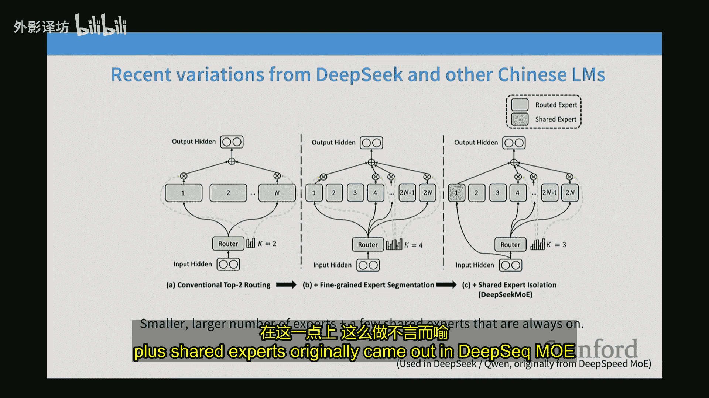

我读deep sick论文时很喜欢的一点是，他们会做消融实验，这可不是什么销售技术报告之类的，他们真的在乎自己的方法是否有效，所以他们做了很棒的消融实验，在深度搜索某论文中。

这里他们展示的蓝色柱状图就是G分片，这是more非常基础的一种实现方式，可以有一个共享专家，那就是橙色柱状图，这在某些任务上能带来很大提升，在其他任务上则没有，可以有细粒度专家，那就是绿色和橙色柱状图。

从中还能获得进一步提升，若将蓝色与橙色比较，综合，这些差异能让你比别人更具显著优势，所以我们能看到更多专家以及共享专家。

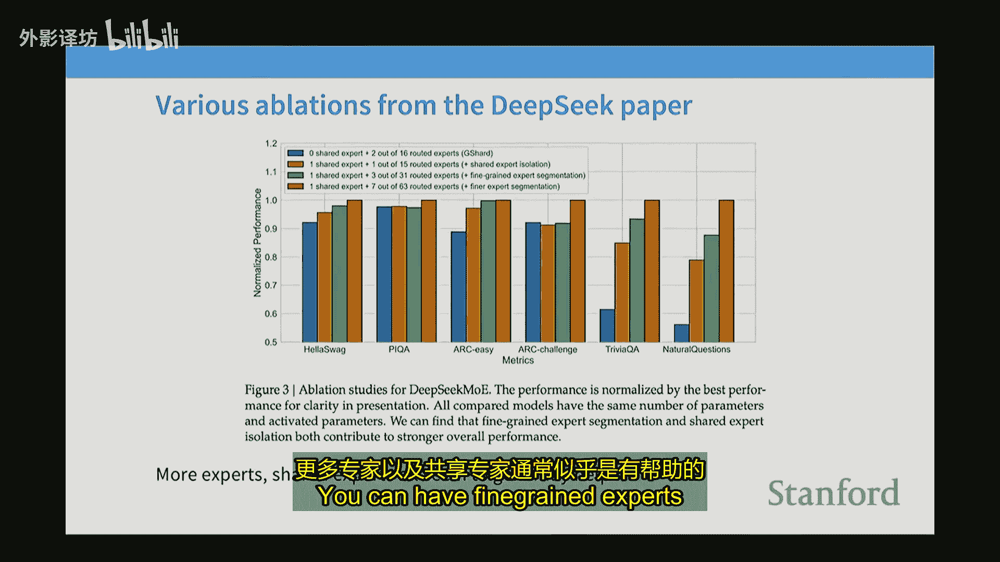

通常似乎是有帮助的，好提问，比如当提到某物的七个时。

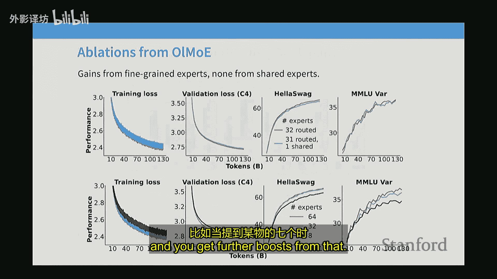

这是指排名前七吗，是的抱歉，我该解释一下的没错，所以Y中的X是指X个被激活没错，所以随着专家数量的增加，你也能在这里看出一种模式，你通常也会增加激活专家的数量，特别是当你使用细粒度专家模型时。

从计算量来说，这是免费的对吧。

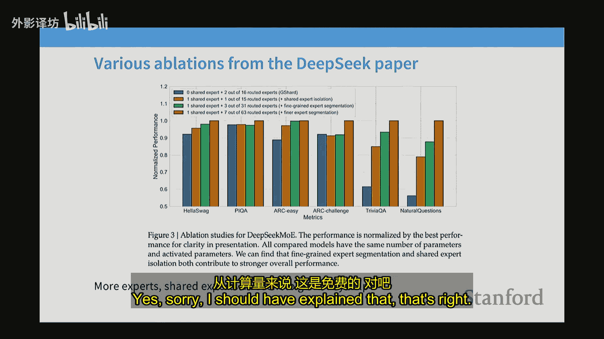

因为现在每个专家规模更小了，所以欧某基本有确凿证据，很好地证明了这些方法可行，那么最下面这一章我想从开始，因为它更具决定性展示了细粒度专家模型，从8~32再到64。

细粒度专家在一定程度上反映了深度序列笑容，你会看到非常明显的趋势，还有损失以及其他指标，从8~32再到64会有改善，细粒度专家很棒，最上面的共享专家呈现紫色与青色对比，至少在奥尔默设置中。

你看不到任何收益，所以他们最终没有采用共享专家，尽管深度序列论文似乎显示出更多收益，所以那个可能更复杂些，鉴于这类想法的后续跟进或第三方复制。

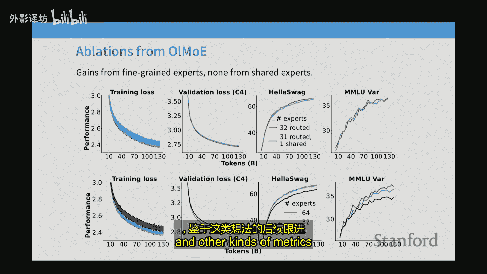

那么此时你可能在想，常见配置有哪些，我打算沿用上次课的做法，去看看近期的诸多发布内容，看看人们的做法，并试着聊聊出现的模式，那么一些早期的谷歌论文。

如g shard switch transformer stsmall，其中一些拥有大量的被陆游专家，那些论文里有很多相当有趣的内容，我建议你读一读，其中一些出现在长短期记忆网络及其他架构中，不管怎样。

我觉得很快就出现了，大概有一个阶段有8~16个专家，像米克斯特罗尔DB r x crock，有两个活跃专家，那些运行的还不错。

但后来deep seek m e或者deep sick m o l e出现了，这差不多就是我跟你讲过的那种典型配置，细粒度专家有64个，其中六个是主动路由的，两个是共享专家。

而且每种专家的规模大概是1/4，普通规模专家的对最后那一列数据持保留态度，因为我得从配置文件之类的东西里，把它们弄出来的东西里把它们弄出来，所以我不太确定这里的确切比例，所以接下来我们大致有QEN1。

5，Deep sk v3 mini max，这些是中文的混合专家模型，它们与deep seek v1基本类似，具体数字不同，但他们使用了细粒度专家，而且他们常有共享专家。

他们与原始的deep sec混合专家配置很相似，欧某MINMAX和lama是非常新的混合专家模型，他们确实采用了细粒度专家相关方法，而且拉玛四也采用了共享专家，然后可以看到配置上有一些变化。

但你能看到基本的共享内容，也就是细粒度专家这个想法，特别是对于la4和deep sec这样的大模型，数量非常非常多的专家，或者抱歉不是陆游，是总的专家数量没错，该比率大致表示每个输出的分割程度。

相较于标准密集配置，所以在超参数方面，你知道要是遵循经验法则，在多层感知器中，隐藏层维度和投影应在1~4之间，或者若使用门控网络范围是一到2。6，所以查看这些架构的隐藏层。

你大致能看出他们将原始前馈大小，分割了多少次哦，我，没错是的，所以你可以大致这样理解，他们有16个标准规模的专家哦，好的，所以他们比等效的密集模型参数更多，他们有六个带路由的专家模型。

所以他们随时共有八个活跃的专家模型，每个尺寸为1/4，所以你应该这样看待，他们大致是全连接网络通量的两倍，所以需要一些运算，但希望运算清晰且一致，所以对于一些特殊比例，我不太确定他们为何如此。

但它们都是非常精确的整数，当你计算全连接网络与隐含超参数之间，的比例时，所以我觉得这些precisely，就是他们被分割的份数，但我不确定为啥他们是一比14，我是说你有没有比如说进行过投影。

用比如更小的维度，因为比如说在多层感知器里，那个比例很小，对吧没错，所以对，这就是你想问的，比如说他们会进行下采样投影吗，对没错，在其中一些当中，它们实际上更小，我不记得具体哪些型号。

但在其中一些我确实记得，他们实际上是向下投影的，什么是为什么想在我旁边放不止一把椅子嗯，确实好像有段时间，一些中国语言模型公司尝试了很多共享专家，然后又回到了零个或一个。

若查看旧的此处mobile ations有误，无法准确翻译，不太清楚是否哪怕只有一个共享专家，也能起到决定性作用，我认为最初的动机是那样，就有了规模相同的专家，这两个专家的规模都是1/4。

现在总共有八个活跃专家，这样就能保持规模一致，否则我实在看不出有什么特别的道理，为什么是两个较小的，而不是一个较大的。

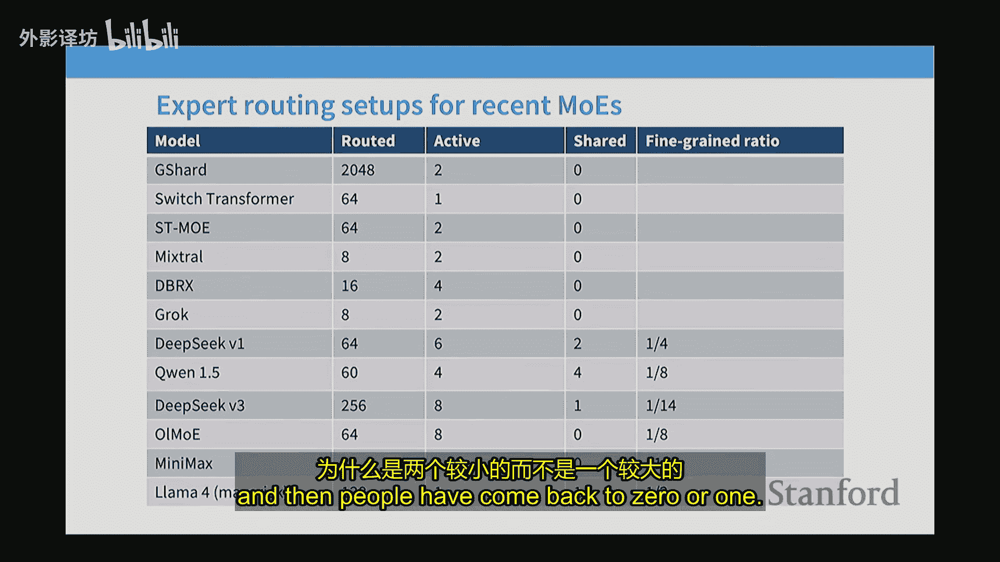

好的挺好，那么希望你能明白这些混合专家模型中，很多的路由是怎么运作的，以及它是如何搭建的，前向传播，希望你已完全理解，现在我们得考虑训练了，而且训练挺麻烦的，我之前提到的，当我们训练时的主要挑战。

我们不能启用所有专家，因为要是我们这么做，那我们就得承担所有专家的全部运算成本，有一个像的模型，比如说训练成本高256倍，这绝对不行，所以我们需要训练时的稀疏性，但稀疏增益决策显然不可微。

我们现在遇到个有点烦人的，类似强化学习的问题，所以我们可以做这些事中的任何一件，比如用强化学习，优化门控策略，我们可以做受多臂老虎机启发的，是通过随机化来探索，或者我们可以只用一些启发式方法来平衡情况。

比如加些损失项，指望事情能成，学了各种深度学习课程后，你可以大致从内部猜出，人们在实践中使用哪一种，然后我会依次介绍这三种，好的，那么强化学习，我认为是人们最早尝试的事情之一，这可能是在这个领域。

你能做的最基本的方法对吧，你面临一个不可危的路由决策嗯，把奈德看作一种策略，对其运用强化学习，然后解决问题，不幸的是他并不比其他方法好多少，2020年，克拉克等人发表了一篇论文。

探讨了混合专家模型中与扩展相关的各种问题，而且他们确实有一个我找到的强化学习机械，但不幸的是，它并不比例如用哈希做决策好多少，而且他们很想对左边这个叫base的东西，进行基准测试，它是一种线性分配方法。

而且那个东西轻松胜过强化学习，而且我认为在实际应用中，梯度方差和复杂度使得它使用起来相当棘手，而且据我所知，在大规模应用中，还没人真正使用过基于强化学习的方法。

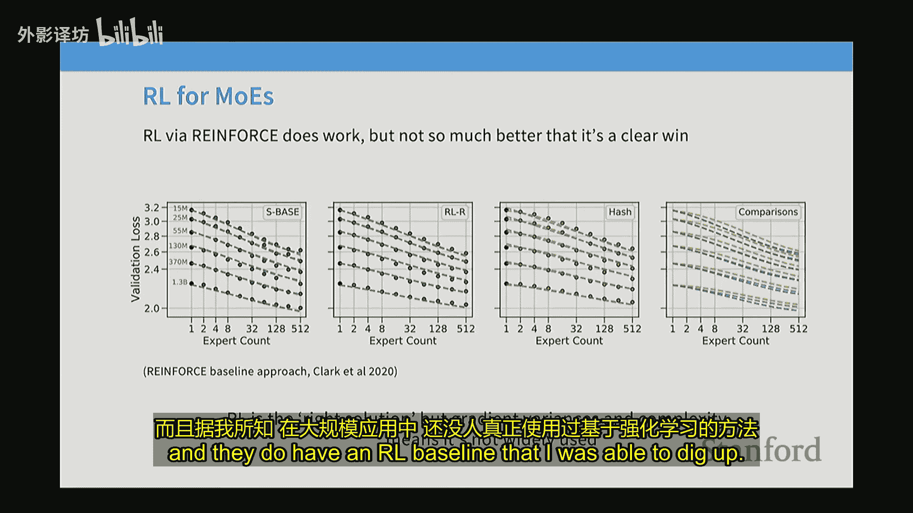

据我所知，用于优化这些门控决策，在大规模应用中，应用的更多的是各种随机近似方法，所以他们可能会添加一些扰动，下面是一个2017年沙切尔提出的例子，这是早期的一篇关于mo的论文，在这些论文中。

他们仍会进行某种前K路由，所以他们会保留H操作中的前K个元素，然后对其进行soft max操作来得到门控，但我们得到这个H操作的方式如下，所以我们要做的是采用原来的线性亲和度，这和我们之前做的一样。

我们基本上就是在计算输入X，以及为每个门控学习得到的权重，所以这部分是一样的，但实际上我现在要稍微抖动一下它，我要添加一个正太的，然后我要选一个学来的W噪声尺度，这会控制网这个过程里注入多少噪声。

你可以把这当成一种随机探索策略，通过特定方式操控W噪声，比如对其进行退火处理，或做些其他操作，我可以控制这个mo将会面临的权衡，所以这能为你提供一个解决办法，探索利用困境的，尤其是你要是给事物加点噪。

每个专家可能会随机收到一些其他符号，他意料之外的，所以这会让专家没那么专精，但可能会更抗造一点，所以总体来看还挺不错的，当然这种随机性也意味着你没法那么专精，然后就会导致效率降低。

还有人们用了另一种方法，他们会对路由器的逻辑值做某种乘法运算，或者不好意思，他们对路由器的逻辑值进行乘打扰动，以使专家不那么脆弱，但在一些后期论文中，这种抖动过程在一定程度上被摒弃了。

因为他们发现它的效果，不如一些基于启发式损失的方法，这不是一种被少数人尝试过的方法，这种随机路由技巧，在谷歌早期的几篇论文中被尝试过，但我觉得很多已经普遍不再采用，训练这些混合专家模型的人了。

好的所以对吗，对于随机方法有哪些问题，如果你这么想，所以问题是我们还是无法区分，因为我们取的是前K个，但如果你稍微改变一下对问题的理解，如果你考虑一个多臂老虎机问题，它和这个结构一样，你拉动一个土匪币。

并且你看不到其他币，所以你无法真正有效的分配你的资源，如果你随机拉动一些其他的，现在你有了足够的数据来进行一些优化，所以这种抖动本质上类似于EPISSEN，贪婪风格的探索，在这种方式中。

你以一定概率随机拉动一些其他笔，概率本身取决于你对这个路由决策的信心，所以大概就是这种直觉，然后当然这会给你一种获得信号反馈的方法，好的，所以实际上人们最终的做法是不做那些，我们不做强化学习。

我们不做随机探索，但我们依靠另一种机制让事情合理，所以如果我们正在进行前两名的陆游，从技术角度讲，我们在梯度下降过程中确实能得到一些信号，因为我们能够比较以评估的前两名专家，所以可以进行一些优化。

但当我们忽略时，如果我们抛开所有其他约束，出现的大问题是，最终你总是倾向于只选一位专家，而且那位专家样样精通，而其他专家都不行，你最终会陷入这个局部极小值，你一直把所有令牌都导向同一个专家。

所以关键就变成了，我们怎么摆脱那个局部最小值，而损失平衡，也就是平衡各项损失，是摆脱这种情况的关键窍门，这一点还是挺重要的，得理解一下，因为这其实是大多数人用来训练，混合专家模型的损失值对吧。

所以要是你之前走神了，你可能得留意一下这里的这组方程，所以这最初源于开关，变压器来自2022年的FEDEX，然后他们引入了这个特定的损失项，他们会便利每一个专家，然后他们会计算。

你可以将其视为向量F与向量P的内积，你可以将其视为向量F与向量P的内积，那么这些向量是什么，NF对应每个专家，这是分配给专家I的令牌占比，所以你可以将其视为一种概率向量，这告诉我在一批数据中。

我的令牌占比多少，或者不管这里是什么单位的数据，我将多少路由给了专家，但现在屁事，分配给每个I的路由器概率占比，所以路由器概率就是我原本打算发送的，原始soft max路由决策。

所以这衡量的是P为路由器的预期概率，然后F是，top k方法做出的实际路由决策，这里有件挺有趣的事值得一看，就是假设我们对该损失函数关于P求导，所以这是一个关于P的线性函数，你会发现。

最强的降权作用发生在那些专家身上，那些获得分配最多的，所以他实际上与你获得的令牌数量成正比，所以如果你获得更多令牌，就会被更强烈的向下推动，如果获得更多令牌，所以这大致就是这种损失的基本情况。

而且几乎每个人都会用一种类似FP的技巧，已尝试在不同单元间平衡令牌，所以你最初可能想要平衡的基本单元是批次，你可能希望将每个批次平均分配给专家，但实际上你可能还有其他想做的平衡方式。

而deep sec正是做这类事情的，我会讨论他们引入的所有辩题，所以每一批子他们都要确保，专家们获得的令牌数量均等，这出自deep sec论文，希望你对此看起来十分眼熟。

这和你之前看到的FP内机结构一模一样，P关于I的定义稍有不同，那是S但这在之前应该也很眼熟，那是soft max的前K操作，所以希望这一切在你看来都还不错，不过你可能还想要其他东西，这倒不错。

但你可能还得考虑系统相关问题，因为你要把专家分布到不同设备上，而且你可能想在每个设备上实现平衡，所以你可能会有另一个结构基本相同的损失项，但不是对资源分配给哪些专家进行求和。

你可能会衡量资源分配到哪些设备上，而这会是个不同的AF，它是针对设备组，而非每个专家进行测量的，所以现在你可以设置一个不同的损失，来平衡设备，然后进行优化，你自然会尝试学习路由函数。

以确保每个GPU或者每个TPU之类的设备，都有偶数个标记，以实现均匀的利用率，从系统角度看，这很棒，所以基本上大家都在做类似的事，所以实际上deep sk v3有所创新，这还挺酷的。

而且我之前好像没见过这个，这是混合专家模型领域里最早的事物之一，并非源自谷歌，即他们去掉了这个针对每个专家的平衡项，他们已经彻底去掉了这个，相反，他们现在基本上是采用soft max分数。

然后他们添加一个小的b of i调整系数，其中b of i是给每个专家的一个小，调整系数得分，所以专家爱可能会被加重或减轻权重，所以要是某个专家得到的令牌不够，它就会被给予更高的币值。

然后就能让他获取更多令牌，其工作方式是其工作方式是，通过一种非常简单的在线梯度方案来，所以他们会在每一批次进行测量，每个专家都得到了什么，比如说他们得到的令牌数量是偶数吗，要是他们得到的令牌不够。

他们给I的B值添加某种伽马学习率，让他有所提升，要是他们得到太多令牌，他们会减去伽马，让那个专家的吸引力稍微降低点，所以他们只是为每个I的S学习一些微小偏移，注意这里你只用I的B值来做路由决策。

实际上你不会把它作为门控权重的一部分，发送出去，这事挺重要的，所以他们把这叫做辅助无损失平衡法，要是你去读一读EEPSCV3那篇论文，你们都应该去读，因为那是篇很不错的论文，他们会着重强调。

这能让训练变得如此稳定，出色很棒，接着当你继续读这部分时，他们会说，其实但我们决定，对于每个序列或许仍需保持平衡，而且这效果欠佳，所以我们又把启发式损失加了回去，所以他们确实有一种叫序列互补。

辅助损失的东西，这基本上就是他们认定所需的辅助损失，因为他们想做的是对专家进行负载均衡，是按序列级别而非批次级别，我不确定他们为何要这么做，而非其他任何BFI风格的技巧。

但这差不多就是他们在deep sk v3里的做法，所以他并非如他们想让你相信的那样，完全没有辅助损失，好的哦对了，有个问题想问，这有点不公平，但如果我们无需担心系统优化，你觉得这个模型的性能会好很多吗。

还是会大致维持不变，如果我们不考虑系统优化，这个模型的性能会变好，还是维持不变，当你说这个模型你是什么意思，Deep seek v side，还是说这些现代混合专家模型，那么你是说如果我们忽略系统问题。

我们觉得混合专家模型还行吗，这么问是这个意思吗，比如说下游传递的性能如何，会比我们现在的更好吗，嗯所以我觉得要是我不用平衡这个，比如说我得给每级设置数量大致相等的标记，对没错嗯。

我觉得就每个专家的平衡来说，这个术语对吧，这与系统无关，所以你还是想这么做，因为如果你不这么做，你会发现其实我会持续引用旧的mo论文，因为他们做了很多消融实验，他们做了一个很棒的消融实验，在这个实验里。

他们恰好去掉了这个，而他们发现的大致是在训练初期，模型只会挑选一两个或者两三个专家，其他专家都被弃用了，就像路由器从不给他们传数据，所以那时你纯粹是在浪费内存对吧，所以现在你平白无故损失了性能。

实际上你得到了一个更小的模型，所以即便你无视其他诸如设备平衡等问题，并行性等问题，你也得到了最差的模型，因为你没有合理分配专家，这和充分利用所有参数是一个道理，你要有效利用参数，你要进行专家平衡。

抱歉再说一遍，device指的是什么，实际上通常指GPU或GPU有个微妙之处，我可能会在最后或倒数第二张幻灯片讲，这个还有更复杂酷炫的版本，在这些版本里你也要平衡事物，以尽量降低通信成本。

所以就有了更宽泛的设备概念，如一个机架或其他类似的，但这里通常指GPU是的，哈希作为路由算法似乎能提高性能，对此有什么直观认识吗，因为这实际上就是从少数几个中，随机选一个前向网络来传输对吧。

那么为什么要有多个副本，每个副本得到的数据更少，为什么这样能提升性能，没错，问题是，为什么哈希会有任何作用呢，我对此没有很确切的直觉，但你可以从两方面来论证，一种是即便你在进行哈希，相同的词源。

会去往相同的，或者每次相同类型的序列，都会进入同一个专家处，所以每个专家仍会得到输入的一些确定子集，所以仍会出现一些专业化的情况，只是非语义性的或非习得的，如果你是一个分部方面的特定情况。

当然这个词可能会对某一位专家起主导作用，所以实际上仍可能出现语意义上的专门化，其中某一位专家，实际上会被频繁出现的事物主导，比如一个与输入无关的纯粹随机情况，我敢打赌那会相当糟糕，没错。

我从未运行过或见过那种情况，不过确实我觉得那会糟透了，而且你有很多层很多变压器，我想你在讲座前面部分已经见过了，你提到每位专家都配备一个GPU，那么要是你有一个支持图谱，比如32层和64位专家。

那将需要大量GPU，所以我想知道，是否会将几位专家整合到一个GPU上，所以问题是要是有很多层和很多专家，难道不需要大量GPU吗，没错，要是专门为每位专家配备一个GPU，确实那可就有点疯狂了。

但你会发送类似分片的数据，每个GPU都能持有足够的这些单元，来有效利用内存，并行处理的关键在于要始终充分利用所有内存，因为那是你的资源之一，你不想过度进行并行处理，好的很棒哦，好的。

我已将骁龙实验置于此处，是的，所以这就是关于问题的情况，若不进行专家平衡，损失会怎样，我觉得左下角这张图值得一看，若不进行负载均衡，令牌会分配给哪个专家，你看粉色和黄色的那两位专家。

他们就这么占据了主导地位，他们占据了约50%的令牌，其他所有专家都没发挥作用，他们啥都没干对吧，这样你就浪费了大部分专家，此时你八位专家中的六位，而且你无意间创建了一个双专家模型。

这会让你在顶部看到更糟的损失，就是那条青绿色的线，当然也许这仍比密集模型要好，因为至少有两位专家在工作，但实际上你本可以做得更好好的，所以我不会在系统方面进行深入探讨。

因为我还未真正开始讲解核心系统概念，你需深入领会许多并行性问题，比如数据中心通信速度的层级结构，但实际上如我之前所说，要记住的一点是，mo能多完美的适配设备，人们所说的是专家并行。

这涉及在每个设备上安排一两名专家，当你处理一个令牌时，会发生什么，嗯你会遇到路由器，经过路由器之后，你已经挑选了几位专家，所以现在要进行一次集体通信调用，比如全队全通信调度。

将令牌发送到相关设备前馈层计算输出，然后将令牌返回到其所属位置，或者合并多个，所以还需要另一种集体通信调用，所以如果前馈计算足够强大，你在一定程度上能够负担得起，进行这种专家并行计算的成本。

而这其中的一个好处是，它是你工具包中的另一种并行形式，所以在右边你有数据并行，两三种不同类型的模型并行，然后你有专家并行，你可以将它们全部结合起来，想出权衡你所有资源的方法。

所以通信速度你拥有的数据量P4大小，还有你的专家数量和内存，所以我就不详细讲，这具体怎么帮上忙了，但要记住，这回给你一种新工具，另一件有用的事是，比如说你在一个设备上有多个专家，由于计算是稀疏的。

你可能会期望比如说第一个令牌，第一个令牌与专家零相乘，第二个是专家一，这第三个就是专家二，所以这实际上是三次小规模的稀疏矩阵，乘法运算，你可能希望现代GPU，能够利用这些复杂的这些稀疏矩阵乘法运算。

没错，所以如果你正确安排专家，并且权重以正确方式融合，那么现代的稀疏矩阵乘法引擎，就能有效确保进行这次大型矩阵乘法运算时，不会浪费任何浮点运算，所以像mega blocks这样的现代库。

基本上可以利用这种设备级的利用稀疏性支持，一次性进行多个专家计算，所以这是混合专家模型带来的又一优势，那么有件有趣的事，这对你们大家可能已不再神秘，因为你们是在GPT4时代成长起来的。

但当GPT4API首次推出时，它对我而言有点神秘，因为当你把温度设为零时，你还是会得到不同的响应，即便按说应该是确定的，很多人猜测这是为什么，我不是说这就是原因所在，但实际上。

混合专家模型里存在一个有趣的随机因素，那么在混合专家模型里想想会怎样，你要把资源发送给不同的专家，而且专家在不同设备上，可能你有很多事例，当然你会处理查询时请分批进行，那么要是你已将查询分批处理。

这些令牌会被分发给不同的专家，那么想象一下，你有一批任务要处理，还有一群专家，但不管啥原因，这批任务都交给了专家三，所有令牌都给到了专家三，那现在会怎样嗯，专家三所用的设备内存不足。

无法加载所有这些令牌，接着就会出现所谓的令牌丢弃现象，训练时也会出现这种情况，通常会有所谓的负载因子，用于在一定程度上控制允许的最大令牌数，要是路由器给某个专家分配了过多令牌，就会丢弃那些令牌。

要么是系统原因，要么是因为你担心那个专家会占据主导，至少在训练阶段，所以现在这个令牌被丢弃了，他根本不会有任何结果，多层感知器只会进行零计算，并且残差连接只会直接传递数据，然后你将返回一个结果。

所以如果你的令牌被丢弃了，你得到的结果会与令台未被丢弃时不同，所以基于P4中的其他内容混合专家模型，在训练时和推理时都会引入随机性，这是舰挺有趣，但你通常不会想到的是。

因为你做推理时几乎从不考虑跨批次效应好的，所以这大致就是主要内容及构建，混合专家模型的主要基本组件，还挺有意思，要是你明天真出去，并尝试训练一个混合专家模型，我觉得系统方面会让你有点郁闷。

但另一件可能让你郁闷的事或许是稳定性方面，所以混合专家模型有这种特性，有时他们会突然出故障，如果你试图对他们进行微调，他们很难微调，而且他们有时会突然出问题，所以巴雷特佐夫等人进行了研究，他们写了一篇。

关于如何让混合专家模型更稳定的论文，有一篇论文即我在此引用的这篇，其目的是稳定混合专家模型的训练，我会提到一些技巧，我认为这些技巧很实用，人们也会采用，首先是如果你在进行路由器soft max操作。

所以这就回到了上节课讲的稳定性，我关于稳定性说了什么，需要担心的是soft max函数，soft max函数总是需要关注的地方，对于mos来说，他们在路由器计算中都采用float32，进行所有运算。

为安全起见，为安全起见，他们在路由器计算中都采用float32，进行所有运算中的运算，有时它们还会添加一个辅助的Z值损失，所以希望你们能记住这一点，就在上节课讲过对soft max中指数化后的值求和。

再取对数，对soft max中的值求平方，然后将其作为额外损失加上，所以这会让归一化值接近一，这有利于稳定性，所以这实际上是使用Z损失的地方之一，在他在训练模型中变得更流行之前，你大致能在这里看到效果。

如果你看这些损失，我觉得是中间部分，这里的第二个图表或许很棒，你知道若从路由器路由功能中移除Z损失，你会在验证损失中看到类似巨大的损失峰值，在这期间模型会表现的有些疯狂，然后又被拉回。

当然他仍能正常训练，但有肌损失比没有要好，到最后验证损失会有相当明显的差距，人们还可能发生其他情况，当然你会想要微调你的混合专家模型，要是你打算推出并发布混合专家模型。

可能还想对其进行基于人类反馈的强化学习，但这结果有点问题，一些早期工作，当人们开始研究混合专家模型的时候，这可追溯到bird和T5那个时代，所以当时有很多微调工作，人们发现实际上存在很多过拟合情况。

要是你在使用某种稀疏模型，你看训练集和验证集间有个很大差距，就是这条蓝城线，而密集模型及这条绿红线，其训练集与测试集的差距较小，因此人们对过你和问题忧心忡忡，因为你用这些庞大的参数模型。

在小数据上进行微调，当时提出的一个解决方案，据我了解，这个方法不太受欢迎，是设计你的混合专家模型，使并非每一层都是混合专家模型层，但比如说你可以交替使用密集层和摸层，然后你就能对密集层进行微调。

然后那样就行，他的表现就如同密集模型，所以那样没问题，另一种解决方案是，我们在deep sick ma论文中看到的，就是多用些数据，比如要是存在过拟合问题，我们能获取大量sf t数据。

把所有那些数据都输进去就行，那么对于deep sec混合专家模型而言，他们采用了140万个训练样本，那么或许你就没那么担心过你和问题了，我最后要讲的是，这是工具包里一个大家都了解的技巧，升级再利用。

所以这个思路是采用一个密集模型，比如这边这个，然后取出你的多层感知器，然后复制多份，然后对其进行扰动处理，然后你有一个从头初始化的路由器，然后你就假定这是个混合专家模型，然后从这开始训练它。

你只需从密集模型初始化混合专家模型，这是一种所谓的升级回收技巧，而且人们已证明，若能让它运行，这是获得混合专家模型的超划算方法，而且混合专家模型很适合推理，因为并非每个多层感知器在推理时都会激活。

所以你可能有效得到一个参数大得多的模型，无需训练参数规模大得多的模型，有几个人在这方面取得了成功，mini cpm我会在规模定律讲座中再提，但这是一个中国开源语言模型，基本致力于构建优秀的小语言模型。

并且他们成功采用了一个密集模型啊，并将其升级为混合专家模型，你可以看到最后两行中，他们的数据显著改善，所以从密集模型到混合专家模型，它们在性能上有显著提升，昆恩我在讲座开头提到。

他们在某方面最早的城市之一，是采用他们的一个密集模型，然后构建mod，并且相较于当时较小的模型，它们的性能有显著提升，他们得到的模型与拥有27亿参数，活跃模型的70亿参数模型相当的模型相当，所以总结。

我想大致讲一下deep sec的猫架构，在最后希望这能让你有所了解，我首先要做的是，我想让你们了解一下deep sk v3的架构，以及他们所做的那些改动，因为这是个现代高性能开源系统的例子。

我还希望你们能认识到架构变化不大，deep sc v1也就是deep sec混合专家模型V1，它不算很新，大概有一年半或许两年了，而且那时他们基本就确定了架构，我想让你们看看他们做了哪些改变。

从最早尝试到大规模训练期间，这就是最初的起点，这是deep seek m e，我把它称作V1，但正确称呼可能是deep sick moe，它是个有1600亿参数的模型，其中280亿个参数是激活的。

你们已经看过这边这个图了，这是两个共享专家加64个细粒度专家，每次有四个处于激活状态，或许当时大概有六个处于激活状态，抱歉路由部分你们已经看过了，我在这讲座中间部分讲过这个，这是非常标准的前K路由。

其中soft max在进行前K选择之前位于底部，至于平衡，在训练时他们只需添加这个辅助损失，平衡项包括专家级和设备及平衡项，希望你们还记得之前讲的那些，所以这就是V1。

接着他们发现自己的混合专家模型相当有效，所以我想再补充些背景情况，深度序列最初有个密集模型，然后他们有了个混合专家模型，而且混合专家模型相当出色，所以当他们进入V2阶段时，他们直接采用了混合专家模型。

现在这是个有2360亿参数的模型，其中210亿个参数处于激活状态，所以你需要大量内存，不过在推理此模型时，你的浮点运算量消耗不算大，如今架构相同，我直接照搬了一模一样的图，因为架构确实相同。

减去活跃专家数量的变动，现在有一些新情况出现，但不算多，所以顶级案例选择器相同，所以之前的公式，这个先前的公式是一样的，他们还是这么做，但他们还有个超妙的附加技巧，这就是我一开始想说的。

有细粒度专家有啥缺点，为啥我不能有，我不知道1024个还是2046个，细粒度专家，问题是把专家分的太细，而且有很多活跃的专家，你得找到那些专家，所以通信成本可能会增加，而且要是你非常分散。

你可能需要向许多设备发送大量令牌，于是他们想出了个妙法，即，我不会简单地将每一批，直接路由到排名前K的专家那里，这可能会迫使我把令牌发送到许多设备上，我要先挑选出前N个设备，所以我要进行正常的评分计算。

但我首先会将允许的设备子集限定为前M个，一旦我选好了设备，然后我会为每个设备中的每个资源选出前K个，所以现在我已经对设备进行了限制，这确实控制了通信成本，现在这能让你获得更高效的训练。

当你扩展到如此巨大的规模时，当你训练一个，拥有2360亿个参数的模型时，你需要开始真正关注事物的系统层面，当你训练一个，拥有2360亿个参数的模型时，在这个规模下，另一件反应系统必要关注点的事情是。

即他们添加了一个通信平衡损失项，对专家而言，一种思考方式是有输入和输出，输入是传入的令牌，然后将其路由给专家，输出则是要把令牌放回原处，所以如果一批数据属于这个设备，它得回到原来设备所在之处。

所以我们得同时考虑，输入的通信成本和输出的通信成本，所以他们添加了一个平衡损失来平衡输出，通信成本同样不只是在输入方面，所以这是个小要点，但你能看出他们对细节很关注，确保各个系统方面都能得到妥善处理。

最后我们进入了深度搜索，V3抱歉，上面应该是V3，不是V二六千七百一十一个参数，其中37个为活跃参数，还是同样的数字，因为某架构本身没变，自深度搜索mo以来，这一直未变，能用就别改。

他们确实做了几处改动，也许他们听到你们都在说，为啥不归1~1呢，所以他们把门控归1~1了，他们把soft max会议化操作移到上面去了，但实际上他们并没有对门控决策做指数运算。

他们实际上用的是SIGMOID的函数，这比soft max操作更温和，更好用，比soft max操作，所以他们在这儿做了些改动，但从概念上来说，这和top k路由决策仍是一样的。

希望你能看到非常发生非常相似的事情，然后在损失方面，他们采用了这种无辅助损失技巧，根据I的BD增或根据专家负载进行递减，然后他们有一个序列级的辅助损失，只是为了补充一些背景。

为什么要在单个序列上平衡不同的专家嗯，他们非常担心的是，在训练阶段没有序列及平衡损失也无妨，但在推理时可能会这样，有人给你发送一些非常偏离正常分布的序列，这可能会让某些专家应接不暇对吧。

所以在推理时你无法控制会得到哪些序列，所以你可能需要更强一些的平衡手段，它是在单个序列层面上起作用，而非整个批次层面上好的，然后呢哦抱歉，你是想说没错，他们保留了排名前M的改进项。

比如说他们没有保留通信损耗这一项，所以他们舍弃了一些东西，但是排名前M的那个，我是说他们保留这个似乎挺明智的，没错，但他们可不是总在添加东西，他们去掉了一些东西，所以在最后2分钟里左右的课堂时间。

我要讲一下deep sk v3里非more的部分，因为我觉得我们已经到了这个地步，此时我已经讲了deep sk v3的大部分内容，这时候我不妨讲讲步骤，Deep sick v3，剩下部分的。

这样你们就都知道咋回事了，所以他们对注意力部分有个巧妙优化，叫MLA或多头潜在注意力，其实你们都已知道理解这个所需的所有要点了，因为上节课结束时，我之前讲过GQA和MHA对吧。

所以那些都是未优化知识库缓存大小，所需的推理优化，所以那些都是未优化知识库缓存大小，所需的推理优化，所以deep sec团队采取了不同策略，或在优化此方面采用不同方法，他们并非减少头的数量。

而是会将头拖赢到更低维空间，所以你有输入H而非直接从这些H生成K，以及直接从这些H生成V，我首先会生成一个低维的C，你可以把它看作是H的压缩版，而且这个C更小，更易缓存，然后我只缓存这些C。

每当我需要这些K和V时，从概念上讲，我可以基于这个KV进行某种向上投影，然后我可以与Q进行内积，所以你大致能明白这会如何成为一个，要是只需保存C就能节省KV缓存，而非更高维的T的H，而这正是关键所在。

所以你提取T的H，你将其投影到低维的C，然后再将其投影回K和V，如果C很小，那么你已压缩了KV缓存，这挺好，然后在计算方面，要是考虑浮点运算次数嗯，你可能会觉得这可不太好，因为我得额外乘上矩阵WUK。

我之前没有这个矩阵，这是个额外的矩阵，乘法得算一下，但这里的巧妙之处在于，记住在K的另一侧，我要算K点乘Q，在注意力运算里，Q点乘K会是个内积，而且Q本身有个投影矩阵Q所以这里的窍门是。

你可以把这个work和这个Q矩阵合并成一个矩阵，我没有额外进行矩阵乘法运算，我刚把这个新的矩阵乘法合并到另一个当中，这就是结合率，我能把这俩合并训练时，他们也会压缩查询以节省内存。

但实际上那个并非那么必要，因为它与KV缓存完全没有交互，我只是顺便提一下，最后这个因为这有点微妙，但这是种你能察觉到的巧妙微妙之处，也就是这个最初的技巧，我开头说的这种东西和rope不兼容对吧。

原因是ROP矩阵基本上你有Q和K，然后对每个Q进行旋转，以及通过与旋转矩阵RQ和RK相乘来旋转K，但如果你这么做，那么这些RQ和RK就处于查询投影之间，以及这个潜在向量上投影矩阵。

而且我不能重新排列这些矩阵乘法的顺序，rope有点碍事，而且他们还有一种解决方案，基本上是在非压缩维度上应用RO，这也算是个题外话，我觉得这没那么重要，若你极为感兴趣，可查阅那篇论文，他们做的另一件事。

这是我要说的最后一点，即他们对名为MTP的损失函数做了一个小改动，他们在其中并行预测多个标记，那么通常他们能做的事，你有输入，你把它们向左移移位，这样你就能预测未来的一个词源。

然后你的transformer会预测所有这些词源，这就是常规的transformer损失，但在进行这些预测之前，你可以这样做，你可以获取隐藏状态，你可以把它传给一个超轻量级的单层。

Transformer，而且那个模型能预测未来的一个词源，所以现在模型不只是在预测下一个词源，他在预测未来的两个词源，希望这一切都能说得通，这只是一个小型轻量级模型，就能做到这点。

你差不多能在这看到他的架构，有件事有点令人失望，是我在为这次讲座做研究时了解到的，实际上他们只对提前一个词源做NTP，所以即便他们有个复杂图表，说明如何对多个资源操作，结果却只对一个资源进行操作，好了。

我讲完了，混合专家模型，如今在一定程度上处于如何构建的核心，并不属于一个真正高性能的大规模系统，并且他们利用了一种稀疏性概念，你并非一直需要所有参数，而离散路由是真正的重大挑战，而我认为。

这是混合专家模型，没有立即流行起来的主要原因之一，要尝试优化这种前K路由角色很可怕，但启发式方法不知为何就起作用了对吧，就像他们确实起作用了，现在有很多实证证据表明，对于混合专家模型。

至少在运算量受限的情况下，这是个好主意，这很划算，你应该这么做，所以肯定值得学习。

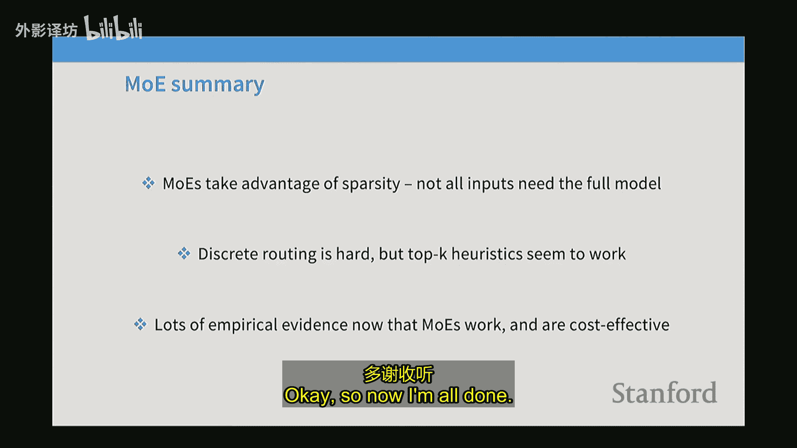

