# 【中文配音】硬核！斯坦福 CS336：手把手带你从零构建 ChatGPT - P5：5.GPU原理与分布式训练基础-GPUs - 外影译坊 - BV1BWEWzfEKi

希望大家都能在作业一中玩得开心，今晚到期需要延期，请告知作业二很快就出来了，我们正在对一些TRITTON的内容做最后的润色，希望你们喜欢，你们将有机会实现flash attention2或者其部分内容。

我觉得这很不错，所以今天我们来谈谈GPU，GPU是让我们语言模型运行起来的东西，所以得把他们弄对，这很关键，要是你没好好研究过让模型运行的硬件，他们可能看起来挺神秘的，所以我今天的目标是。

尽量让KDA和GPU没那么玄乎，我想揭开的其中一件事，你不用非得弄明白这上面的内容，我知道幻灯片上东西不少，为啥GPU会变慢呢，而且他们变慢的方式神神秘秘的快，讲完的时候，我会讲讲这上面的内容。

当你增大矩阵乘法的规模时，你可能会预想它要么变慢，要么变快或者其他情况，你会得到这些看起来很不可预测的波浪状图案，然后你就会想，为什么我的GPU在某些数字的特定倍数下速度快，在其他倍数下却慢呢对吧。

这非常神秘，我们会试着弄明白这一点，另一件事是我们想知道如何制作快速算法，我想你们几乎所有人都听说过快速注意力机制，他就是那个能实现的东西，通过在transformer内巧妙计算注意力操作。

可实现长得多的上下文，所以也许你想提出新算法，或者像闪速注意力这样的新实现，比如要做到这一点，我们需要了解哪些基本要素和组件，所以这些算是今天的两个学习目标，第一个是在讲座结束时。

你应该对GPU感到比较得心应手，你应该大致了解他们的工作原理，第二点是你应能自如地加速算法的某些部分，你构建了一个新架构，你有望能用KDA加速它。

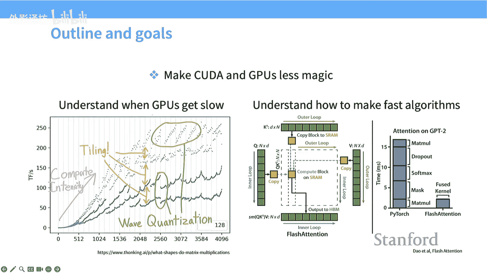

而且硬件并非我的专长领域，有一些特别的资源，我得好好感谢，尤其是霍勒斯，他的博客里有很多关于GPU的有趣知识供你了解，例如为什么零填充的矩阵乘法，比那些没有零的矩阵乘法更快吗。

你可以通过访问他的博客来学习，我还参考了其他一些资源，比如KDA模式组以及谷歌的优秀TPU书籍，如果你对这个主题感兴趣，我鼓励你去看看那些资源。

以了解更多，因为这在某些方面像是对硬件的浅显，但有望完整的讲解，所以今天我们只关注硬件站的非并行部分，所以我们要深入研究GPU，就像研究单个加速器那样，了解他们的工作方式以及一些重要部件。

我也会非常简略的讲讲TPU，因为在某些方面他们在概念上和GPU很相似，所以我这里的讨论也适用，然后等我们对硬件有了些了解，以及GPU的执行模型，那么我们要弄明白是什么，让GPU在某些工作负载下运行的快。

是什么让它们变慢，我们要了解其性能，接下来是最后一部分，这部分会有点像实操内容，我会试着讲解一下快速注意力机制，我会把我们学到的东西都梳理一遍，然后试着给你们讲讲快速注意力机制，他就是这样整合起来的。

所以这就是今天讲座的最后一部分内容，你们很多人都学过自然语言处理课程，现在在自然语言处理课程里，我想你们会讲一些规模定律，想必你们都见过这个对吧，这只是在介绍背景，我们都知道拥有更多计算资源。

有助于训练大语言模型，这是一张预训练缩放图，但你也可以用推理缩放图来替换它，大家都知道计算资源越多，数据处理量就越大，就能处理更多数据，就能训练更大模型，进而提升性能，所以你可能会想当然了。

深度学习非常重要，但真正驱动性能提升的是更快的硬件，更高的利用率以及优化的并行化。

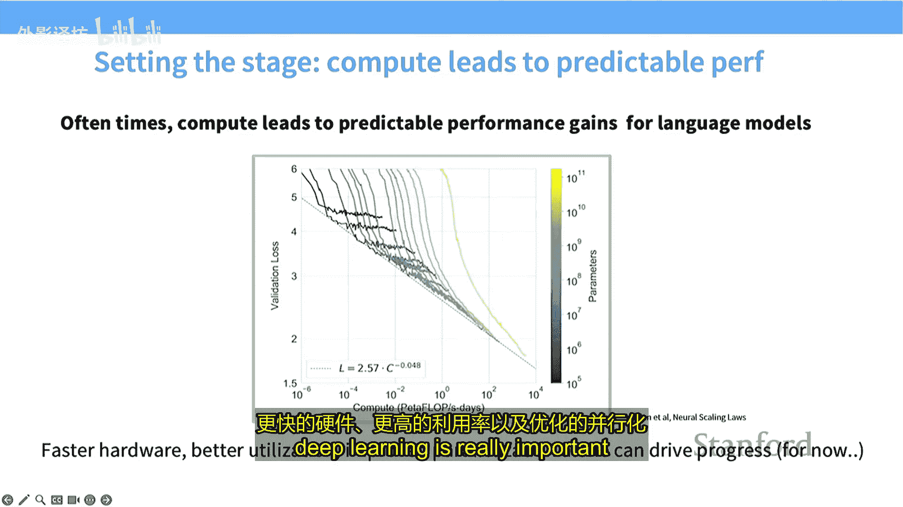

这在一定程度上为理解硬件的重要性做了铺垫，当然一旦你想到计算扩展，你就会问好吧，我们如何实现计算扩展，我们如何让模型训练的更快，所以在半导体缩放的早期，如果你在考虑CPU，他们怎样才能变得更快。

他们会在DND缩放的情况下进行缩放，对吧，按照摩尔定律，每年芯片上的晶体管数量会大致翻倍，要是出现这种翻倍情况，最终结果是DIO的缩放，在这种情况下，越来越小的晶体管，能够以更快的速度。

以及更快的时钟速度和更低的功耗，进而带来更高的性能，然后在20世纪80年代至2000年代，这种方法有点行不通了，你能从轩尼诗和帕特森的这张图表中大致看出，以及帕特森的单线程性能。

就是这里的蓝色点基本上开始逐渐下降了，当然晶体管的数量并没有真正开始下降，确实出现了晶体管密度越来越高的芯片，但这并无帮助，它，并不能让单线程的吞吐量更高，所以这意味着我们不能单纯的在绝对速度上。

更快地进行计算，要知道我们得靠并行扩展来弥补对吧。

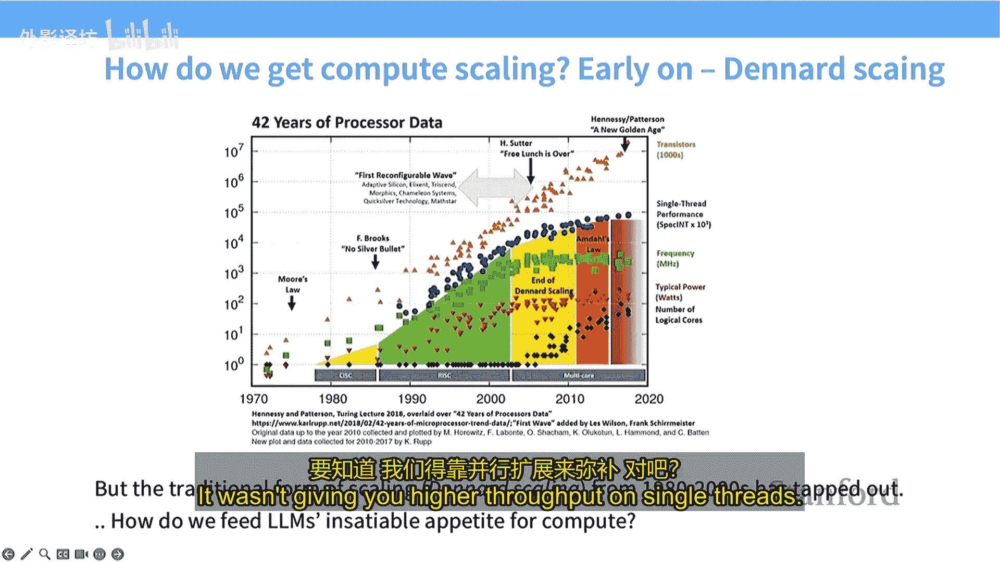

那么深度学习的扩展情况，还有神经网络从单线程扩展，即单纯在绝对速度上加快计算，转向并行扩展，在定型扩展里有很多工作负载能同时计算，这是我最喜欢的计算扩展图表之一，由比尔达利在主题演讲中展示。

图中他展示了超级指数增长，从最早的K20到H100每秒的整数运算次数，它有点像这样相当显著的指数或超指数曲线，所以我们得真正明白如何利用这条曲线，以便充分发挥我们语言模型的最大效用。

所以这差不多就是我们的目标。

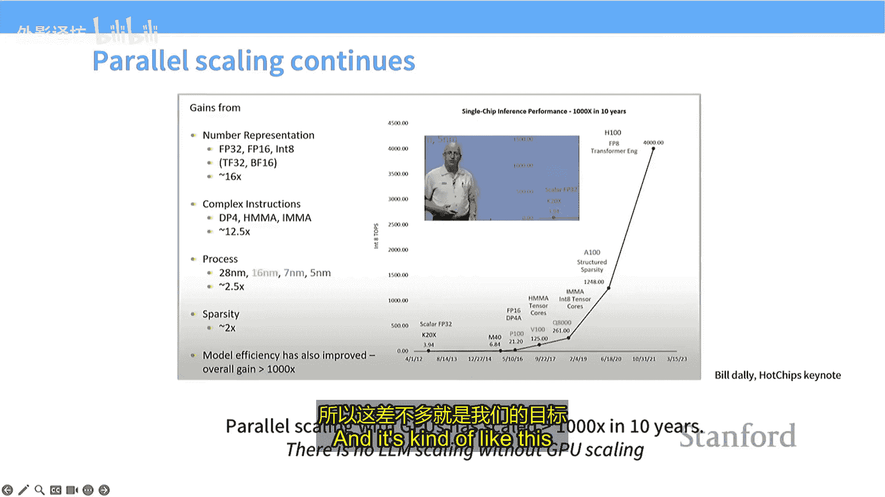

所以我已经暗示了这种重要的差异对吧，一旦开始编程，想必大家都对CPU不陌生对吧，对于这种执行模型，有程序时在单线程中逐步执行程序，为支持这种执行模型，你需要什么嗯，需要大型控制单元，只需快速运行这些。

因为存在大量分支，且有大量条件控制逻辑，这是一张CPU的抽象示意图，会把大量芯片用于，大型控制分支预测，并且会快速运行这些，因为它没有那么多线程，现在有很多CPU拥有大量核心。

但与GPU相比几乎微不足道，相比之下，GPU有大量计算单元及算术逻辑单元对吧，所以就是那些绿色小方块，而芯片中专门用于控制的部分要少得多，所以有一小部分控制逻辑在协调，大量大量计算单元并行运作。

我在心里想，所以这大致就是CPU所强调的情况与GPU，但如果你看看其设计目标，他们的设计目标大不相同，所以你可以把CPU看作是为优化延迟而设计的，我想尽快完成任务，若右侧这里有任务T1至T4。

在CPU中我会尽快完成每个任务，要是你想快速完成其中任意任务，任务T1会很快完成，在GPU中是针对高吞吐量进行优化，我不在乎延迟，我只希望所有任务能尽快完成，为支持此。

也许你有很多现成这些线程能很快休眠和唤醒，最后你完成了所有工作负载，从T1到T4，在CPU完成之前，虽说单个而言这些都有较高延迟，所以他们有不同的设计原则和目标。

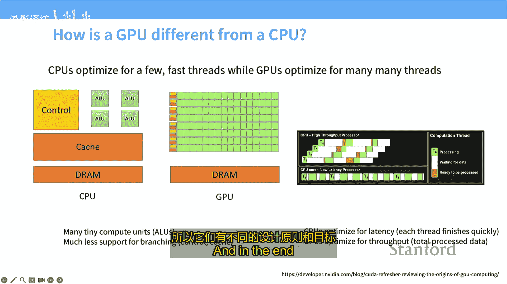

好的，所以GPU的结构大不相同，我不知道你们是否都看过GPU的布局图啥样，我马上给你们展示芯片图，但核心要点，这是GPU背后的重要概念是GPU会执行大量的SM，也就是流式多处理器。

而流式多处理器你可以将其视为一个原子单元，当你用TRITTON这类工具编程时，它们将在流式多处理器层面运行，在每个流式多处理器中，它包含多个SP，也就是流式处理器，流处理器会并行执行大量现成。

所以可以这样想，刘多有一堆控制逻辑，它能决定执行什么，例如它能进行分支操作，流处理器会获取相同的指令，并将其应用于许多不同的数据，因此你可以进行大量，并在这个模型下进行大量并行计算。

流多有点像是每个控制的基本单元，流处理器能单独进行大量计算，若看一下A100，它是现阶段上一代的GPU，有128个流式多处理器，这比CPU的核心数多很多，每个流式多处理器都有大量流，处理器。

内部还有专门的矩阵乘法单元。

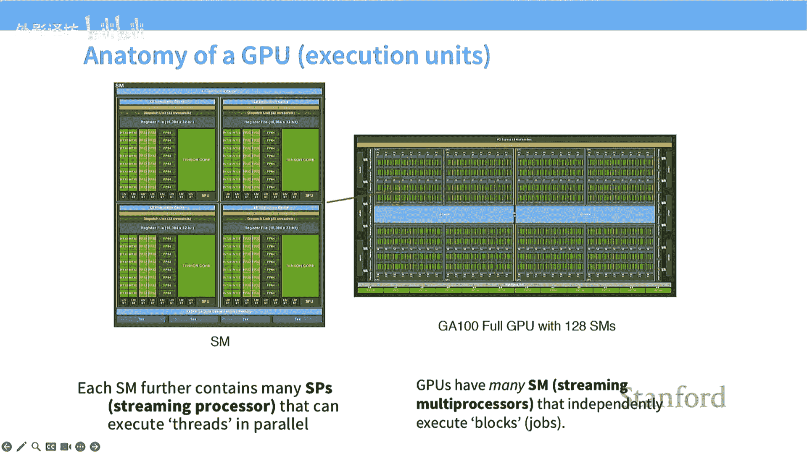

所以这就是大致的计算模型有问题吗，抱歉，所以他和那个一样，所以问题是这个GPU和那个GPU一样吗，是的，这是他的一个卡通版本，你可以把每一行看作是一个流多处理器，他有自己的控制单元。

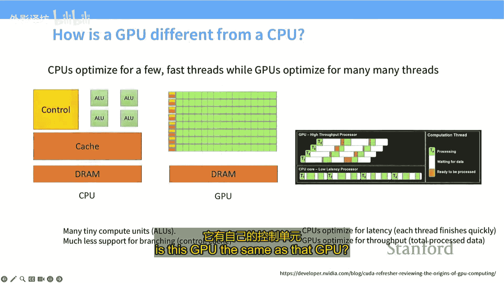

每个绿色方块可能是这里的其中一个，就像其中的一个单精度浮点运算处理单元，并且每个流多处理器可以操作，其拥有的各种部件，比如张量核心，用于进行计算，好的，有两件重要的事，你可以把GPU当做计算机。

他们负责计算，但实际上，计算只是我们需要留意的两件要事之一，但实际上，计算只是我们需要留意的两件要事之一，在这方面，内存可能更为重要，并且它会一直更重要，就我们在GPU上运行程序的性能表现来说。

所以要理解内存，你得了解GPU和芯片的物理布局，从某种意义上说，当你运行速度如此之快时，内存的物理距离就变得相当重要了，所以我来给你讲讲各部件的物理布局，以及这与内存访问和性能的关系。

所以内存离每个SM越近，速度也就越快，所以会有一些速度极快的内存类型，比如L1和共享内存，它会位于SM内部，并且它会非常快，像寄存器以及频繁读写的东西，你会想把它们放进L1和共享内存，大致如你所见。

二级缓存有这些绿色区域及SM，然后还有这些蓝色区域，这是在图形处理器芯片上，这些是L2内存在SM旁边，所以他们不在SM内部，但它们在物理距离上仍相当近，而且这些速度依然很快。

要知道他们的速度仍低了1/10左右，但他们速度还是挺快的，然后在芯片外部，这算是一种，我觉得这像是3090显卡之类的，或者可能是PCEA100哦，这是PCIA100，你看这里有GPU。

实际上dram就在芯片旁边对吧，所以他得实际离开芯片去连接，在这张芯片图上，能隐约看到边缘处的这些黄色连接器，这些是HBM连接器，它们连接到实际GPU外面的dram芯片，你能大概看出访问这些的速度对吧。

片上共享内存快得多，比如从那访问东西要20个时钟周期，而访问其他地方得花大约200个，或者从二级缓存或全局内存读取数据，需要300个时钟周期，而这十倍的差距会让你损失惨重。

所以如果有一段计算需要访问全局内存，这可能意味着在SM上，你实际上没活可干了，你已经完成了所有矩阵乘法，你已经做完了，现在你只能干闲着，所以利用率不高，从某种意义上讲，这是一个关于内存的非常关键的思考。

主题是理解GPU工作原理的关键，在作业二里，你要实际为GPU编写高性能代码，所以你得思考执行方式，GPU实际的执行，这有点复杂，但也没那么夸张，你需要考虑三种力度，有快有数还有现成，而这就是顺序上。

力度就这样逐渐变细对吧，快有点像是大的线程组，每个块都会被分配给一个SM，所以可以把每个SM看作是一个工人，他是个独立单元，一个块会被分配给一个SM来处理，所以这就是每个力度，单位在这些块里有一堆现成。

每个县城都是一项待完成的任务，当这些线程执行时，他们会分组执行，这就是线程数，所以你获取一个快，它是一组线程，然后你从那个块中获取线程，并且他们每次会议32个连续编号的线程，为一组来执行。

这就是所谓的线程数，所以从这个图中你大致能看出发生了什么，你有一批块，每个块被分配到不同的流处理器，并且每个块内会有多个不同的线程数，并且每个线程数由多个线程组成。

所有这些线程都会在不同数据上执行相同指令，对吧，所以这就是执行模型，现在它会你可能觉得这挺神秘的，这些块线程数和线程都是啥，它们对我们的性能有重要影响，在我们之后设计库达内核等东西时。

所以希望你能记住这个，我们继续讲的时候。

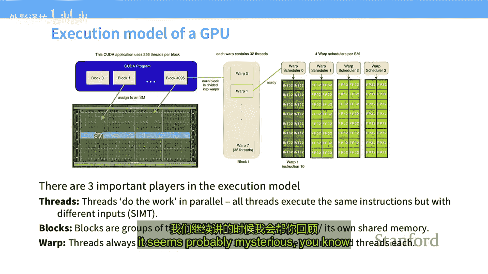

我会帮你回顾，希望讲清楚了，所以那就是GPU的一种逻辑执行模型，要是你明白了这一点，你也就大致明白GPU是怎么执行任务的了，GPU还有一种逻辑内存模型，所以现在我就不给你展示实际的硬件了。

这只是你对GPU编程的一种思考方式，所以就有了寄存器，所以这些是用来快速存储单个数字的存储方式，你有本地内存，你有共享内存，你还有全局内存，并且它在内存层次结构中逐级递增，它变得越来越慢。

而且你的代码可以写入全局内存，常量内存不常被使用，因此每个线程都能访问自己的寄存器和，共享内存，但跨块的信息需写入全局内存，而这实际上相当重要对吧，所以现在这意味着，每当你编写一个执行操作的线程时。

理想情况下它处理的是差不多相同的少量数据，所以你把那少量数据加载到共享内存里，所有线程都能愉快地访问该共享内存，然后就终止完成了，那会是个很棒的执行模型，相反如果你有一个线程需要到处访问数据。

那他就得访问全局内存，那很慢很慢，当我们探讨在GPU上的各种操作方式时，这个主题还会再提到，当我们探讨在GPU上的各种操作方式时，这个主题还会再提到，希望讲清楚了。

那大致是GPU的一个非常高层次的四页内容概述，如果你对其工作原理有任何疑问。

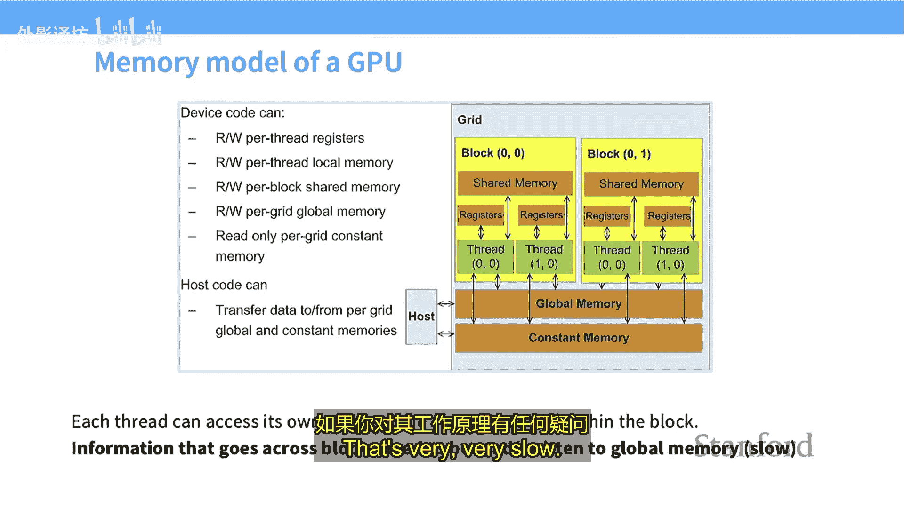

我讲的时候随时提问好，这里有个相关话题，去年我没讲这个，因为我觉得关于TPU的资料比较少，但是那本不错的TPU书籍，或者我在讲座开始时提到的那个网站上线了，而且它实际上有很多不错的细节。

而且我和几个谷歌的人聊过，Tpu，从高层次看它和GPU非常相似，所以我想花点时间讲讲TPU，你可能从未操作过TPU，但我觉得理解这点很重要，这些替代加速器在很多方面运行方式都很相似。

所以这是TPU的外观图，所以有个东西叫张量核心，把张量和想象成类似于流，多处理器或流式多处理器，这些都是可以对数据进行操作的，独立原子单元，有一个标量单元，它基本上是个控制单元。

而且它还能执行类似CPU的各种操作，有个能对向量进行操作的向量单元，所以如果你有一个向量，并且你想对它逐元素操作，那是进行此操作的好地方，然后芯片有一个非常大的专用部件，专门执行矩阵乘法的，称为MXU。

然后它又用于向量内存和共享内存的高速内存，两种在芯片上速度快，类似于张亮核心内存，然后芯片外部还有高带宽内存，所以希望你能看到它与流多处理器的相似之处，外部有慢速内存，内部有高速内存。

还有专门用于矩阵乘法的硬件，核心结构非常相似，不同的是，我会在下周的并行性讲座中讲，这个加速器的联网方式有点不一样。

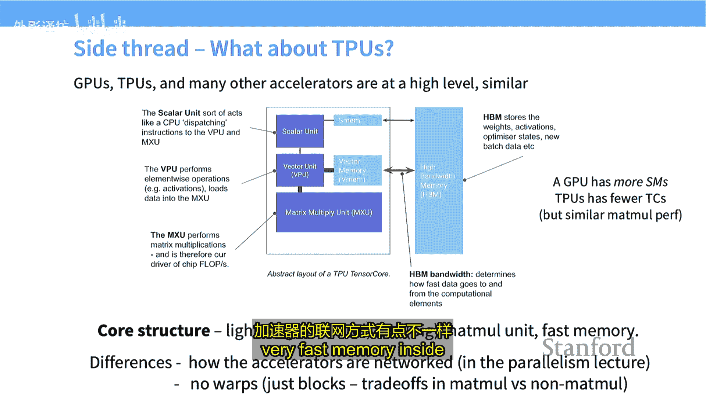

还有注意我没讲线程数，其他那些我都没讲，张量核心在某些方面很简单，因为他们专门用于矩阵乘法，张亮核心和GPU不同，只专注于这个，所以在某些方面这很简单，架构简单得多，但概念上是一回事啊。

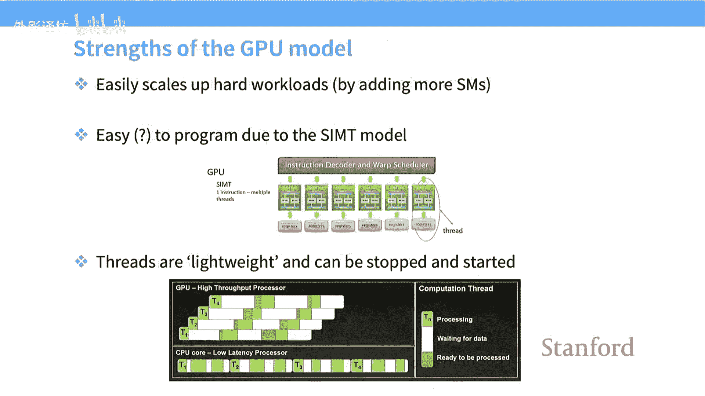

没错，他之所以叫张亮，是不是因为在某些方面，针对获取通用张量做了优化，或者这只是另一种情况没错，所以问题是他叫张亮，是因为能对任意张亮进行操作吗，所以他能对任意张亮进行操作，它能进行索引MXU。

执行的操作是矩阵乘法运算，所以它总是如同对张量进行批量。

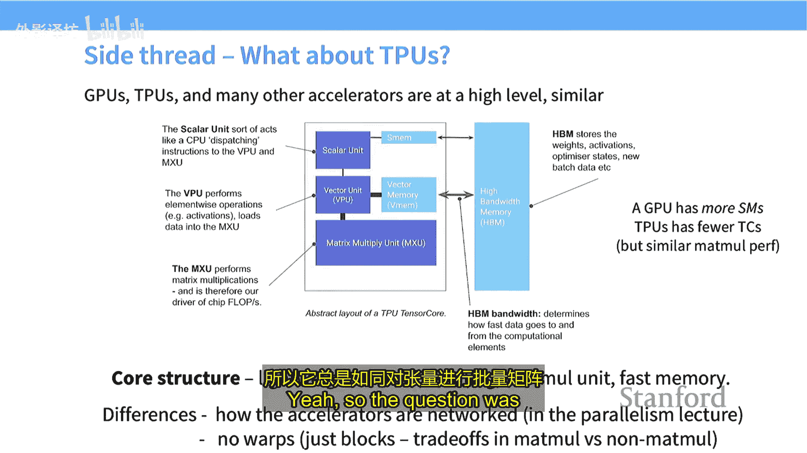

矩阵乘法运算一般，所以这有点像又像没错，又不完全对，不知是否明白，所以他们作用于张量，但他们一直执行的操作是矩阵乘法，而非更复杂的张量运算，GPU如此成功的原因在于它能很轻松的实现扩展。

要是你想要更强的处理能力，多加点SM就行，你无需担心提高时钟频率，也不用担心会出现更多散热问题，在编程方面粗大挺让人犯怵的，但实际上因为它的编程模型编程也没那么可怕。

但实际上因为它的编程模型编程也没那么可怕，它的工作方式是在每个SM内部有个线程，它会对一堆不同的数据执行相同的指令，它会对一堆不同的数据执行相同的指令，从概念上很容易理解，你可以琢磨一下这是什么意思。

尤其如果你在对矩阵进行操作，且你在进行简单操作，这正是这种单指令多线程模型，最后每个县城都非常轻量级，且他们可随时暂停和启动，如果你需要等待另一个线程，或者如果你需要移除某些东西，并启动另一个进程。

所有这些线程都非常轻量级，所以这意味着线程关联的状态不多，他们可以被停止和启动，这让GPU在每个SM中都能有较高利用率。

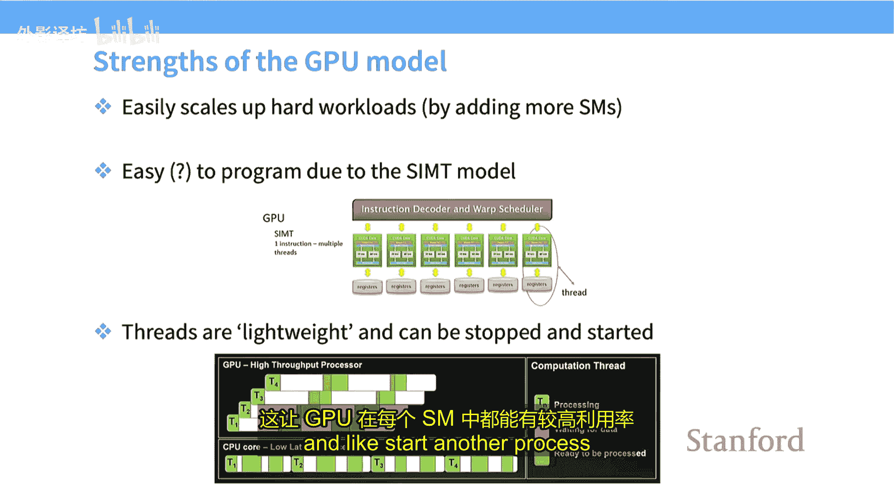

所以GPU及图形处理单元在其大部分时间，在早期它未被用于科学计算，但由于它可编程，研究人员弄清楚，如何用早期英伟达GPU进行快速矩阵乘法，这是关于的早期论文之一，利用图形硬件进行快速矩阵乘法运算。

而且它表明如何破解诸如纹理，缓冲区之类的东西等等，以使其能进行矩阵乘法运算对吧，所以即使没有特定支持，研究人员想出了办法，但我认为如今尤其是在这个时代，英伟达等公司已意识到矩阵乘法运算很特殊。

比如你在进行深度学习时，你的大部分工作量是矩阵乘法，所以在某种程度上，矩阵乘法算是得天独厚的运算，这是一张图表，展示了每秒万亿次浮点运算次数，由不同带NVIDIAGPU。

橙色线条代表矩阵乘法的浮点运算次数对吧，就像你做矩阵乘法时能获得的性能，蓝色线条是你非矩阵乘法的浮点运算次数对吧，然后你会看到这样一个很大的，在UV100系列时出现了很大的差距。

当他们开始引入一种张量核，是用于进行矩阵乘法的专用硬件，而且你会看到矩阵乘法性能存在巨大差距，相对于非map摩尔的性能对吧，所以如果你要设计某种神经架构，关于这点我在架构部分也讲过。

你必须使大部分工作负载为矩阵乘法，因为这在速度上比其他快几个数量级，比你在GPU上能做的任何其他操作都快，所以要是你构建一个非矩阵乘法的神经网络，你可就麻烦大了，接下来我要说的最后一点。

希望你们当做常识记一下，你们都知道马特米尔斯速度快是一方面，但另一件要记住的重要事是，GPU不同组件的相对扩展程度，所以这张图标很棒，展示了你们看GPU不同组件的速度有多快。

咱们就说大语言模型训练站在扩展，所以蓝色线条是GPU与主机之间的连接，即它所连接的服务器，所以你能用PCIE，你能用nv link，你可以使用所有这些高端互联方式。

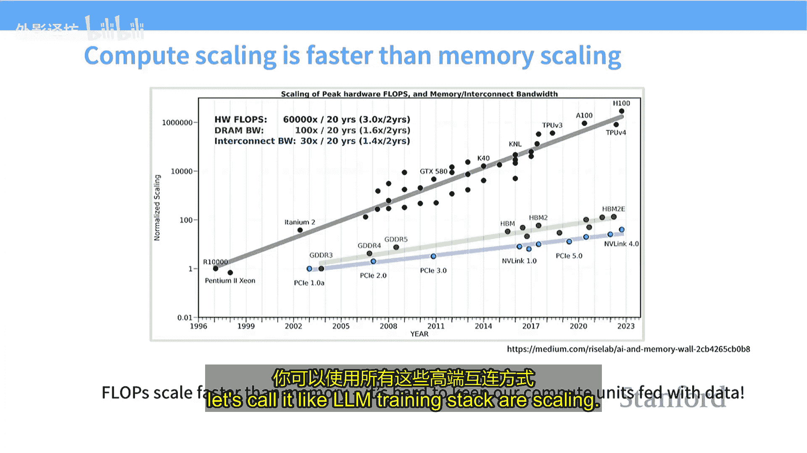

它们在增长，不过有点慢，所以这个图表是关于归一化扩展带宽的，相对于第一代互联技术，绿色线条代表全局内存速度对吧，从GDDR升级到HBM2E，而且快的多对吧，这是对数尺度快了100倍。

但这扩展速度仍有点慢对吧，这里这条灰线对吧，这是计算扩展，这就是浮点运算次数，若考虑Mac mle每秒浮点运算次数，这是计算扩展的速度，而且快得惊人，它的速度快了一到10万倍，在扩展的早期阶段。

也许你的问题是基于浮点运算次数的对吧，就像你没有足够的浮点运算次数，来进行矩阵乘法一样，但现在一直到最右边的H100型号，这些GPU的速度惊人，你的瓶颈可能最终会是内存方面，因为内存的增长速度没那么快。

随着我们迈向未来，这种情况不会有太大变化，dram很难扩展，这种差距会越来越大，所以如果你在设计硬件高效算法，你就得越来越多地考虑内存，所以我们会持续关注，我会一直强调这事，这是GPU的重要主题之一。

所以我一直在给你们讲很多GPU的事，尤其是要是你最近没接触过这些，这可能有点新鲜，简单回顾一下，GPU是大规模并行处理系统，他们在多个不同线程中应用相同指令，它们还有一种叫SM的东西，有点像核心。

GPU里有很多很多个SM计算和矩阵，乘法的规模增长很快，而且其规模增长速度比内存更快，这也是考量GPU特性时的一个重要方面，但也有一些高速内存对吧，并非一切都很慢，所以我们毫无办法有内存层次结构对吧。

所以有些内存类型非常快，其他内存类型则很慢，那么如果我们利用这种层次结构，也许我们就能得到极快的东西，所以这是关于GPU要记住的要点，如果你记住这些要点，你就能清晰的思考，接下来我要讲的那些性能组件。

进入下一部分之前，大家有问题吗。

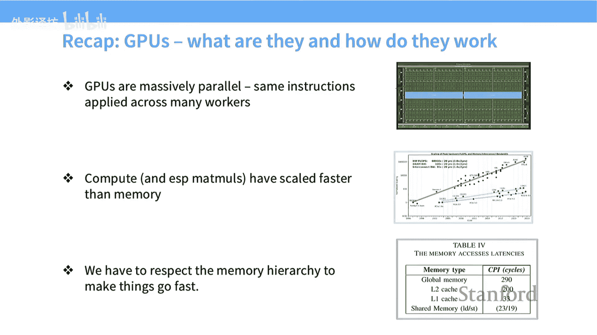

好嘞挺不错，那么现在你们都算是GPU专家了，而我们要做的是，我们希望让机器学习工作负载在GPU上快速运行，那我就从这张图表讲起，我们的目标之一是搞清楚这张图表究竟是什么。

我觉得这会是个能激发我们积极性的，有意思的挑战，所以这里我们在做的是将方阵相乘，所以X轴表示的是方阵相乘的规模大小，而这里的Y轴，这是我每秒执行的操作次数，所以你可以把这理解为Y轴上的硬件利用率。

所以当我的矩阵越来越大，我的会越来越好，硬件利用率也会更高，因为我有更多工作要做，这样就能覆盖启动任务等方面的开销，但现在出现了各种怪异的情况，你能看到四条不同的线，而且这些现成波浪状看起来毫无规律。

所以我们想确切弄清楚这些线究竟是怎么回事，在本节结束时，我保证你们会确切理解这些现象中的每一个，你们能够说是的，那个图表看起来完全正常，这是GPU自然而然会做的事，好啦，首先如果你看那个图表。

你会发现它看起来有点像这样对吧，要是你学过系统硬件课程，你就懂，你应该把这个记成是屋顶线模型，屋顶线模型基本是说，要是我们看吞吐量或利用率，我们会发现有两种情况，会有一种情况是受内存限制的对吧。

它在这边绿色曲线的左侧，然后右侧有一部分存在吞吐量限制，在某种程度上你可以这么理解，在右侧我们在充分利用计算单元，所有矩阵乘法单元一直在做乘法运算，在这条对角线上，我们存在某种内存瓶颈。

所以我们的计算能力受我们所拥有的强度限制，我们每字节的浮点运算次数，所以我们要避免处于左侧，这个受内存限制的区域，并且我们希望处于右侧区域，在该区域我们能充分利用所有计算单元，所以从某种意义上讲。

这就是目标，希望这个屋顶线模型大致是这样的，我们有这样一个对角线部分，然后在顶部这里有这样一个平坦部分，所以这是谜团的一部分啊，结果发现这有点复杂，简单来说，确保我们不会无故访问内存。

我们应尽量减少对慢速全局内存的访问次数，但事实证明，要做到这一点，我们需要一系列技巧，有很多不同的事，你要是做了会把自己搞砸，会让你变得极慢，而且第一个并非内存瓶颈，我就简单提一下，它不常出现。

我们先把它处理掉，接着我们来谈谈剩下的五个项目，在某种程度上，这些对于考量GPU性能来说至关重要，好那我首先要讲的是条件语句，就像我之前说的GPU，其执行模型称为SIIMT，即擅指令多线程。

因此一个线程数中的每个线程，都会执行相同的指令，并且会在不同数据上执行，那么如果我写一段这样的代码会怎样呢，我有一条if语句，若线程索引小于四，就执行某些操作，若线程索引大于或等于四，那就执行其他操作。

我有一个非常简单的条件模型，若我在GPU上运行此内容将会发生的事，我会在四个线程上运行A指令，我将暂停另外四个线程，他们本应执行else部分，然后这另外四个线程会被激活。

然后他们会执行X而我原来的四个县城会休眠，我会交替执行这些指令，为什么会这样呢，我不能执行A，不能在这些不同线程上同时执行A和X对吧，就像我刚才说的，每个线程都必须执行相同的指令。

所以在单个线程数内的条件语句，可能真的会很麻烦，真的很有害，因为他们会迫使你暂停任意一个线程，那些没有执行主要控制流的县城。

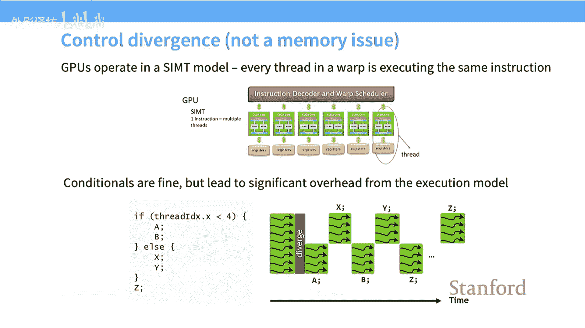

好了，这是我唯一要提的非内存相关内容，而且这应该挺明显的，你可能不该在大规模并行计算单元里使用，条件语句，但一旦解决了这个问题，我们需要考虑的其他技巧都和内存有关，我首先想提一下较低的精度。

这可是个大招，这是个重要技巧，你得一直这么做，回到比尔达利的这个图表，这里面有猫腻，这看起来挺不错，因为数字一直在涨，但要是你看看这些年推动GPU发展的因素，你其实会发现是数字表示形式。

从FP32到FP16，再到INT8等等，只需降低精度，就能实现多个数量级的提升，以及GPU操作精度降低，下面我来解释一下为何这至关重要，若计算时使用的位数更少，还有权重等需要移动的位数就会大幅减少。

所以即便你在访问这些位，从全局内存读取时，这些也就没那么要紧了，下面举个简单例子，让我们来想想，一个简单的竹元素操作的算术强度，所以我要用real u来做这个，也就是X等于X和零比较后的最大值。

然后我要在一个大小为N的向量上做，比如说我要在32位浮点数上做这个，那么我要进行多少次内存访问呢，我得读取X如果X小于零，我得写入结果，而且所有这些都是32位浮点数形式的，差不多就是八个字节。

我要做多少次操作嗯，我要判断X是否小于零，所以这是一次比较运算，而且我做一次浮点运算，所以每次浮点运算我处理八个字节，如果我用float16来做这个，那么我这里没有改变浮点运算强度，但有内存访问。

所以现在每次浮点运算有四个字节，某种程度上我免费获得了两倍的内存带宽，假设我能用半精度浮点运算，这是诸多事物设计方式的关键所在，作业的一部分是你需要去尝试，并尝试诸如混合精度等各种方式。

或低精度训练等各类情况，这里的一个关键在于，并非你网络的所有部分，以及你的训练算法都应采用低精度，那么我给你举个矩阵乘法的例子，在混合精度的矩阵乘法运算中，你需要将输入设置为16位。

所以这些是低精度数据，然后进行32位的完整乘法运算，这很有用，原因在于中间计算过程在累加部分核实，你希望其为高精度，所以你用FP32累加器来进行累加，然后张亮核心会返回一个FP32。

结果你可以对其进行向下转换，若有需要可转换回16位，所以我们的输入为16位，但诸如累加之类的操作，我们可能想用32位来做，所以存在很多不同情况，有些操作可使用16位存储，有些操作可能需要更高精度。

所以你想将其保持为FP32或FP16格式，你可能会需要一些具有更大范围的操作，如X函数，如果你没有动态范围，它们可能会爆炸或清零，所以你可能想把它们设为VF16，需要进行大量精细的工程工作。

以确保这些模型确实稳定，当他们以较低精度训练时，但要是你能做到，那就太棒了，因为从32位到16位，你基本上把瓶颈的吞吐量提高了一倍对吧，要是你的内存是瓶颈的话，好的另一个我觉得这有点类似。

很多人提到时会想到，比如我打算写个KDA内核之类的操作符，融合挺直观的，也是个有趣又自然的思考方向，所以关于GPU工作方式的一种思维模型，还有内存的工作方式，是赫赫画的这种有趣的工厂示意图。

那么想象一下，你有一家工厂，你的工厂就相当于你的计算资源，他会接收一些小方块零件，然后输出小三角零件，要是你提升了计算能力，但用于计算的内存传输带宽有限，你就无法使用第二个工厂了，你仍受限于该速度。

在该速度下已无法从内存向计算传输数据，所以就出现了这个瓶颈，当然你早就知道这点了，我一直在强调内存瓶颈问题，但我认为有一个潜在的方面，通过这个方面，你可能会产生大量开销，不知不觉中。

这有点像是左边的计算模式，那么想象一下，这个图表的左边就是内存所在之处，右边是计算单元，所以要进行计算，我以一个正方形开始，接着我将方块从内存移至计算单元，我进行一些操作，我将它们变成三角形。

现在我将三角形送回内存，我意识到我又需要那些三角形了，所以我把它们传回计算单元，现在三角形变成了圆形，然后循环往复对吧，我把计算结果来回传输往返于内存之间，你可能会说这是一种非常简单的方法。

如果你只是在图形处理器上简单的进行操作，然后直接把结果传回全局内存，最终就会是这样对吧，如果你计算一块数据往返的次数，这相当糟糕，你已产生大量内存开销，现在你应该能意识到，若看右边这个计算没有依赖。

我应能从正方形到三角形，再到圆形，再到矩形，然后返回矩形，我可一直将所有内容留在计算单元中，那就是右边的图，这就是融合内核的思维模式，你有一系列操作会依次作用于一块数据，我不会将其写回存储。

而是我要做的是，我会在一个地方尽可能多地完成所有计算，然后仅在必要时才将其送回内存，所以这就是内核融合的概念啊，好的有一些非常简单的例子，关于如何，如果你编写一些简单幼稚的代码。

你可能会得到一组有点简单幼稚的启动方式，所以这里有个例子，我写了一个简单的神经网络模块，假设我写了一个输入X的神经网络模块，它会输出sin平方X和cos平方X对吗，代码简单。

现在运行这个PYTORCH中的计算图大概是这样，它将启动一系列扩大内核，它将启动输入X，它将启动一个扩大内核来计算CX，它会启动一个来计算cos x，接着是sin平方X。

还有cos平方X以及sin平方X加cos平方X，所以会有一系列反复操作才能完成这个计算，这正是我之前给你看过的左侧图形，但要是你更聪明些，要么你自己编写KDA内核。

要么你使用类似torch compile的工具，你能轻易意识到那五个操作，实际上依赖的并不多，他们仅使用少量内存，所以你能将它们融合为一个操作，能在GPU的单个线程上完成所有事。

且无需将数据传回全局内存，所以像这样的简单融合操作，可由编译器自动完成，我刚提到了torch compile，要是你还没这么做，你应认真考虑在各处使用torch compile。

我们也会在作业里向你们展示torch compile，这挺不错的好，那我已经讲过精度和融合了啊，要是有人有问题，在我讲重新计算之前，告诉我还有我们在GPU上能做的其他各种技巧。

那么我们能做的另一件事叫重新计算，重新计算就是多花些计算资源来避免内存访问，所以回想一下你最初的反向传播课程，这个实际上来自cs221课程，我们要做什么，我们在最底层获取输入，这些是黄色的。

然后我们向上传播激活值，那些也是树上的黄色数值，然后我们反向计算雅可比矩阵，那些是边上的绿色数值，然后为了计算我的梯度值，我来传播你们相乘，所以雅可比矩阵和激活值，我要反向传播梯度对吧，嗯想想看。

前向传播的那些黄色值得存储起来对吧，然后它们被存储，然后得从全局内存中取出它们，我存他们的地方，然后把它们放进计算单元，从机械层面讲，事情就得这么发生，但这可能会有大量内存输入输出。

相反你也许能避免这种情况，我来给你举个例子，讲讲重新计算怎么加快速度，这是另一个我可能会写的挺傻的函数，我要把三个SIGMOID的函数相互堆叠起来，你往左边看，那就是前向图，那应该恰好就是你脑海中。

三个SIGMOID函数堆叠在一起的模型，现在这个的计算过程和对应的图，我要去计算SIGMOID函数，然后我要存储S1和S2，也就是sigma函数的激活值，我有了输出，然后这就算是我的前向传播了。

现在这里的反向传播有点糟糕，当我进行反向图计算时，我需要获取S1和S2，我需要获取反向传入此输出框的梯度，然后将其带入这个反向计算中，这样我就能得到X的梯度，所以我需要进行三次内存读取。

一次内存写入来计算反向传播，接着进行前向传播，我需要读取一次X的内存，还要对S1S2和输出进行三次内存写入，希望这讲清楚了，这有不少内存读取和写入操作，我得做八次，而且我的算术运算强度很低。

因为我完全没有矩阵乘法运算，所以重新计算的意思是，我压根不想存储那些激活值，我不打算把它们存进内存，我只会在反向传播时重新计算它们，现在在我的心前向传播中，我不存S1和S2，我把X用作输入。

我计算SIGMOID函数，我得到输出，所以现在读取一次X的内存，写入一次输出的内存，现在在反向传播中，我不再有激活值，所以我要获取两个输出D，一个是从上方传入的反向信号D。

另一个是我的输入X也就是我的输入，所以我要取其中的两个，这是两次内存读取，然后在我的SM中及时处理，在我的本地内存中，我要计算这些函数值，然后我会将它们放入反向图，对我要重新计算S1和S2。

并在本地内存中及时计算输出，因为我这么做，这里不会发生全局内存读取操作，然后我有一个名为DX的内存没错，所以现在比较这两者对于相同的计算，我有5/8的内存访问量没错，我们付出的代价是。

我得重新计算这三个SIGMOID函数，但如果你因内存受限而处于闲置状态，这是个很好的权衡，你会对此很满意，因为现在你已用计算资源，你有过多的计算资源换内存带宽，而你内存带宽少。

所以这是用你有的换你需要的好办法，当然这不一样，这和梯度检查点技巧一样，并重新计算激活值，以节省内存，但这么做原因不同，这是为了执行速度，不只是因为你内存不够了，所以采用的是同一技术。

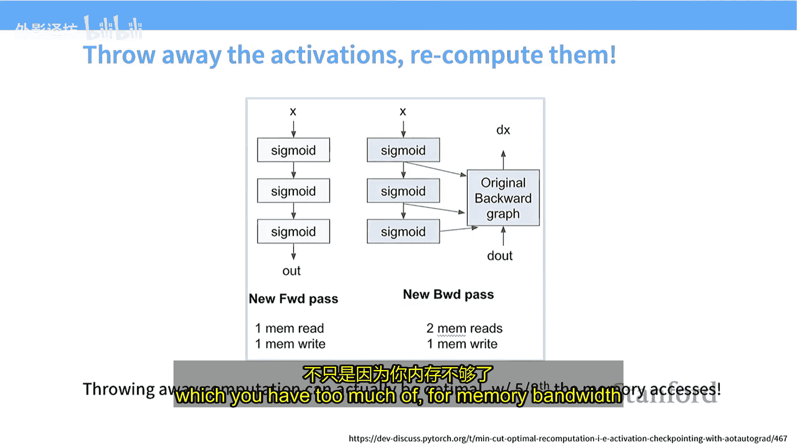

但目标各异，好嘞，接着这个我觉得真的挺有意思，而且在我开始之前，我都不了解，深入探究图形处理器和动态随机存取存储器，的硬件模型工作原理，所以图形处理器中的慢速内存，也就是全局内存，动态随机存取存储器。

实际上它超慢的，为了让其更快，在硬件层面进行了某些优化，硬件层面针对dram的一项优化是，当你读取一块内存时，你不只是得到那个值，你实际会得到一整块内存的数据，这就叫突发模式。

假设我继续去读取这个大内存块的第一个值，内存不是只返回给我零，它会返回给我0123，它会一次返回四个值，就好像是给你，我敢肯定你以后会用到一二，还有三二，所以每个地址空间会被划分成所谓的突发段。

然后给你的是整个突发段，而不只是你要找的东西，这可能会让人觉得非常费解，比如说为什么内存会免费多给你三个字节，而你只请求一个的时候，这里面有个挺有趣的，硬件方面的原因，那就是当你对内存进行寻址时。

未从内存中发出信号，那些字节得移到放大器，这是较慢的一步，一旦做完这个就能免费得到好多字节，所以才有了这个起始部分，这在一定程度上掩盖了这个更耗时的步骤，也就是把数据存储位置移到这个放大器的步骤。

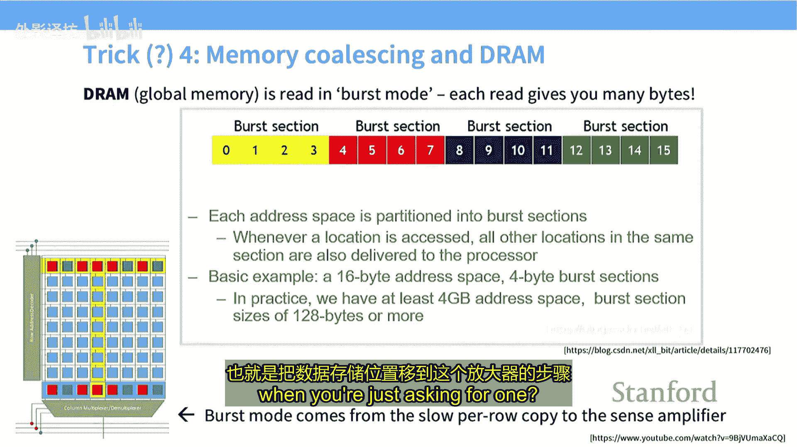

但不管怎样，这意味着我们或许能要是内存访问模式良好，就能大幅加快内存访问速度对吧，所以要是我想读取这边的整块数据，要是我随机访问他，那我就得去查询，次数大致和我的查询长度一样，但要是我这么做。

然后我查看第一个值，那我就能一次性拿到整个这个数据段，然后要是我去查看第四个，我就能一下子拿到这个数据段，也就是第二个，所以要是我在内存访问上够机灵，基本上就能获得四倍的吞吐量。

只从每个分段中访问我需要的位就行，所以这叫内存合并，所以要是一个线程数中的所有线程，都处于同一个突发范围内，那么基本上，智能硬件和编程模型会把那些查询分组，而不是逐个查询，0123他会把它们分组。

然后说就给我零，然后我就能一次性读出所有的0123，来自这种突发模式的dram，记住一个线程数，由32个带编号的线程组成，因此来自一个线程数的内存访问是同时发生的，所以当这些线程数读取到这些突发部分时。

可以进行优化一遍，能一次性获取所有四个字节，而不是一次只获取一个，这样就能让内存吞吐量提高四倍对吧，所以这些都是比较简单的事情，但它们实际上非常重要。

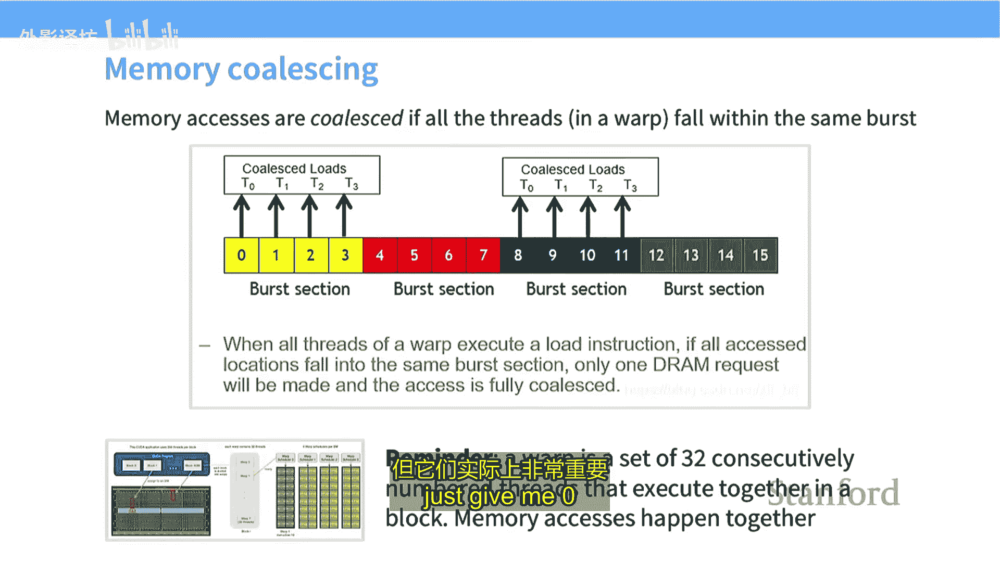

来想象一下，我要进行矩阵乘法运算，这是个核心任务，要是在裤袋里从头实现神经网络得大量做，这个要是在裤袋里从头实现个神经网络，这种情况下想象我用两种方式之一读取矩阵，我可以按行读取，所以每个线程遍历一行。

或者我可以按列读取，所以每个线程向下遍历一列，结果是左边这个你会便利不同的行，所以每个线程访问的都不同哦，抱歉，每个线程按列遍历左边这个模型会很慢，因为内存读取无法合并，而如果切换到右边。

每个线程都向下，所以他们按形递增，那么这些内存读取就能合并，所以你懂的，你可以花点时间想想，为什么这是对的，当我第一次看到这个图时，我就想这不是反了吗，其实不是这个才对，那么思考这个问题的方式是。

比如说在右边这个图上，会有一系列线程从左到右进行访问，所以每个线程都会尝试加载第一个元素，然后在下一个时间步，我要从这列加载元素，接着是第二列，第三列，第四列，以此类推，要是那样的话。

时间不为一时会怎样，时间不为一时，我的第一个线程会加载这个点，接着第二个线程会加载这个点，还有这个点那个点，所以那些根本没法合并，他们读取的是不同的突发片段，所以这就意味着我得读取这一整块内存。

未执行任何操作，相反若按列方向，所有线程会在单个突发段内读取，那么只需执行一次内存读取操作，然后就能一次性获取所有内存，这是一种非常底层的优化方式，但这很重要，如果内存便利顺序有误。

实际内存访问速度会比预期慢得多好的。

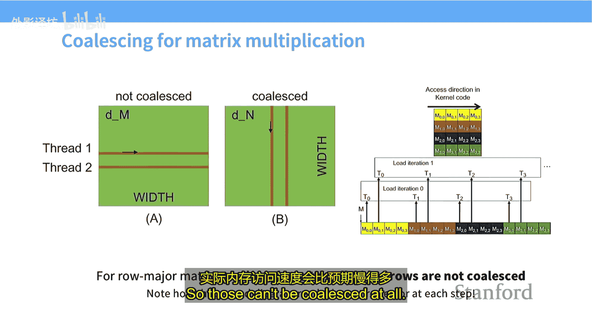

那么接下来要说的是，最后也是很重要的一点，这就是分块的概念，分块是这样一个概念，你要把内存访问操作分组，以减少我们所需的全局内存访问量，所以为了解释这一点，我将试着讲解一下矩阵乘法的这个例子。

希望我能向你解释原因，用于矩阵乘法的简单算法会有很大问题，之后我会给你们展示同一思路的分块版本，希望你们能明白，为何这将减少你所需的全局内存读取次数，那么我们从这个非常简单的矩阵乘法算法开始。

我有一个矩阵，左边是M矩阵，上面是N矩阵，为了计算矩阵乘积，我得便利M的形以及N的列，然后求内积，并将其存储到这个P矩阵的相应型中，我在这里列出了每个线程及线程，0001十十一。

对应于它们存储输出的位置以及访问顺序，他们访问各个元素的顺序，现在请注意，接下来将会发生这里的内存访问未合并，就像这里的行矩阵，这些将以非合并顺序被访问，我有多次重复的内存访问操作对吧。

所以在第一个线程以及这里都访问了，M 00n10，在两个不同线程中被访问，所以这些值被反复读取，并从全局内存读入多个不同线程，所以这可能会非常慢。

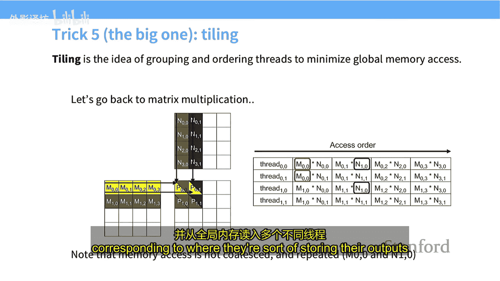

所以存在一个问题，我们能否避免过多的全局内存读写，我理想的做法是，所以先让我解释一下理想的结果，接着我会讲解算法，理想的结果是我想花些时间，把数据从全局内存加载到共享内存，在那里速度更快。

我要在共享内存里进行大量运算，然后就处理完那块数据，这就是理想结果，我已尽量减少对全局内存的访问，那么在矩阵乘法中我该如何做到呢，那么现在我要做的是，我要取我的M矩阵和N矩阵，然后我要把它们分割成小块。

所以在这里我把它分割成了2×2的小块，所以我有一个22的M小块，和一个22的N小块，基本上每个矩阵里都有更小的子矩阵，现在想象一下，我的共享内存足够大，能在每个SM中容纳这些子矩阵。

所以现在这带来了一个非常非常简单的算法，可用于计算，所以我首先要加载，比如说左上角这块M00，然后我还要把N00这块，加载到这里的共享内存中，所以现在我有了这些能计算的部分和，我可以算出M00。

M01与N00N10的型机，然后把结果累加到P00中，对于这里所有能填充的不同子矩阵，我都能做同样的操作，我都能做同样的操作，那么一旦我彻底处理完这两块，然后我可以在这里加载一个新块。

然后我可以用我的M数据块重复该计算，并且将我的N2。0数据块加载到共享内存中，然后我可以在P中递增部分和对吧，所以现在我已经真正的合并了，并减少了我必须进行的全局内存访问次数。

我一次性的将尽可能多的内存，加载到共享内存中，我在那块可用的数据块上进行所有子矩阵计算，然后我继续处理下一个数据块，当然还有一件好事是，因为我正在加载一整个数据块，我可以随意按任何顺序便利这些字矩阵。

比如按列或按行便利，这样我就能合并所有内存访问，每当我把一个块从全局内存加载到共享内存时，所以当我们对访问进行分块时。

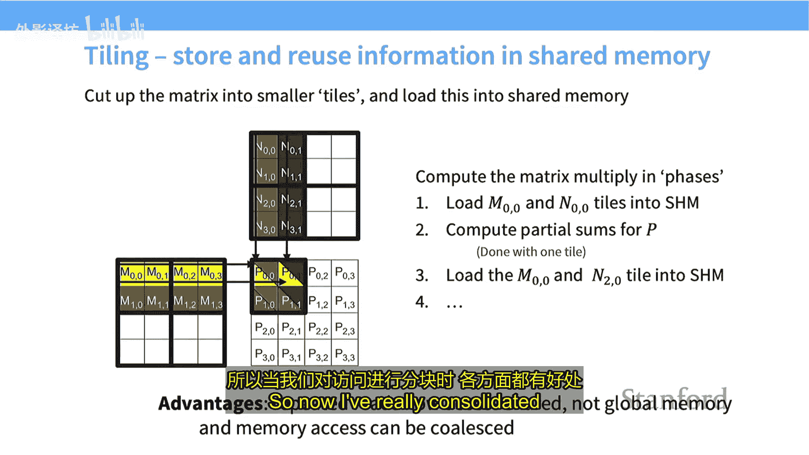

各方面都有好处，所以我们可以进行一些分块运算，比如说我们有矩阵A和矩阵B和一个矩阵C，那么假设这些完整的矩阵，这些都是方阵大小均为N，比如说我有一个尺寸为T的块，对吧哦好。

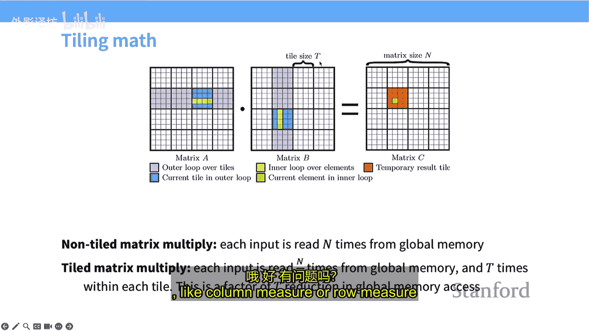

有问题吗，在上一张幻灯片里加载M00，这里是三个，我们又在加载M00，那么在这种情况下，我写这个只是为了完整，但比如说M00就存放在共享内存中，我们就把它缓存起来，我不会再加载它。

那肯定只是为了完整才放在那儿的，倒也不是真要再去丢弃并重新加载矩阵，那可就有点离谱了。

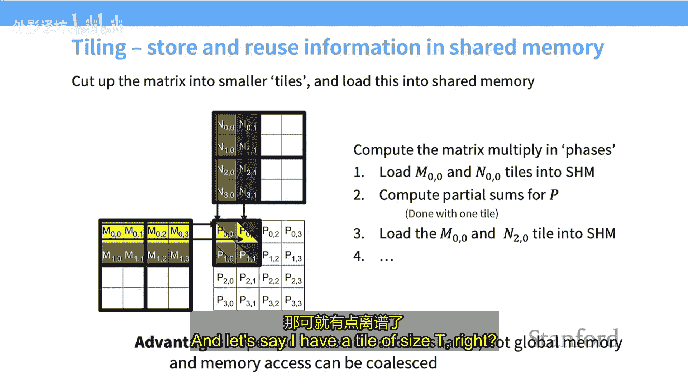

好的，所以我们可以通过简单的分块运算，来想想是怎么回事，假设我要做一个端对端的矩阵乘法，要是我进行飞分块的矩阵乘法，要是我只是逐行逐列来做，那每次我处理每个输入时都得从全局内存获取，所以每个输入。

从全局内存读取的次数大概是N次，所以这些每个都要读取大约N次，如果我进行分块矩阵乘法嗯，全局读取是对分块进行操作，所以我从全局内存中读取每个输入NT字，并且我在每个分块内读取T字。

当然我在进行矩阵乘法运算，所以我无法减少读取总数，我必须读取所有矩阵元素，但我可以将读取操作转移到快速的共享内存中，所以我将共享内存进行T4内存读取，向全局内存进行NT字读取，这很棒。

因为若我们有一个能存储大分块的大共享内存，这是关键的减少因素，在必须从全局内存获取的数据总量上，所以分块真的是个非常强大的想法，当你对矩阵进行操作时，并且能将数据移至共享内存。

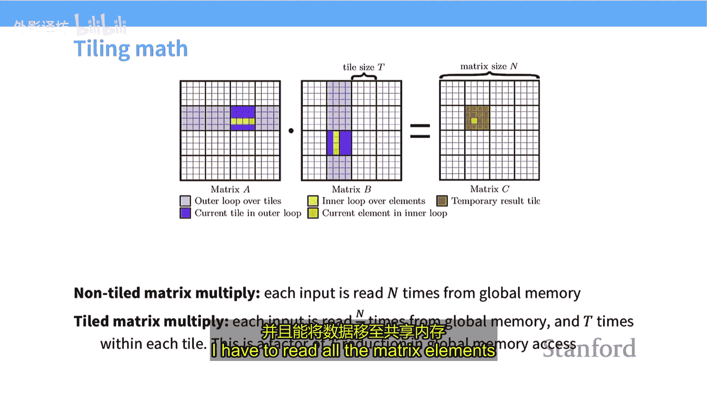

分块相当复杂，这是诸多关于GPU与矩阵乘法性能的，令人困惑之事的源头，可能会发生一件事，一旦我们开始对数据分块，你就会开始问关于离散化的问题，那么设想一下我的分块大小为128。

这似乎是个不错的规整分块大小，但当我有一个256大小的完整矩阵时，那就很棒，这是个2×2的分块，数据加载良好，现在假设我在列方向上，有个大小为257的分块，现在这可就不妙了。

因为我得要六个图块才能覆盖这个矩阵，右边那两个图块极为稀疏，里面没多少内容对吧，而这其中的问题是，每个图块都会被分配给SM对吧，所以这些图块每个都会成为一个块，并且每个线程都会在每个图块内运行。

所以右边那两个图块，他们根本没多少事可做对吧，那些SM基本上会闲置着，要是你的计算能力受限，你会想要在各个流，多处理器之间更均匀的分配负载，所以你得优化分块大小，尽量避免这类情况。

但实际上确定分块大小有很多复杂因素，记住你得合并内存访问，你得仔细考虑这一点，你不能超过共享内存大小对吧，所以不能太大，你得划分矩阵维度，最好能均匀划分，或者尽量接近均匀，这样就不会出现这种情况。

到最后共享内存未得到充分利用，比如说如果有个小一点的图形处理器，会做预取之类的操作吗，他们能提前获取图块，在某种程度上会这样吗，对你问的是内存读取和计算能否重叠，没错，图形处理器中自然会这样。

他们总是尝试利用可用带宽，只要共享内存可用，他们就能把东西放进去，问题是，每当你有效利用SM时，你的共享内存基本上就满了，这就像是个瓶颈资源，所以某种程度上没有预取空间，好的了解，还有另一件事。

我们要深入细节了，复杂之处在于平突与突发部分之间的相互作用，想象一下我有这样一个矩阵布局，这里有一些不错的突发部分，每个突发部分都与一个图块完美对齐，所以要读取这个图块，我只需获取四个不同的突发部分。

然后我就得到了整个图块，现在想象一下，如果我额外添加一个元素会怎样，以及矩阵的布局，我的突发部分就会溢出，现在当我加载图块时，我会加在这第一部分，这真的很棒，我把整个第一行作为一个突发部分获取。

现在第二行实际上分属两个不同的突发部分，所以我得读两次才能获取第二行等等，所以内存访问次数实际上翻倍了，因为我在最后加了一个元素，这在一定程度上提高了对齐度，突发部分与对齐布局的，所以基本上如果数据快。

或者你的矩阵大小不是起始部分的倍数，你很容易遇到这样的情况，形与起始部分不对齐，而且内存访问量增加了一倍，解决这个问题的办法是进行填充，从而得到规整的矩阵大小，所以你的数据块划分去与切片大小对齐。

所以这就深入到非常细节的部分了，但如果你真的想从矩阵乘法中榨尽所有性能，这些就是你得考虑的事，要是你不考虑这个就会出问题。

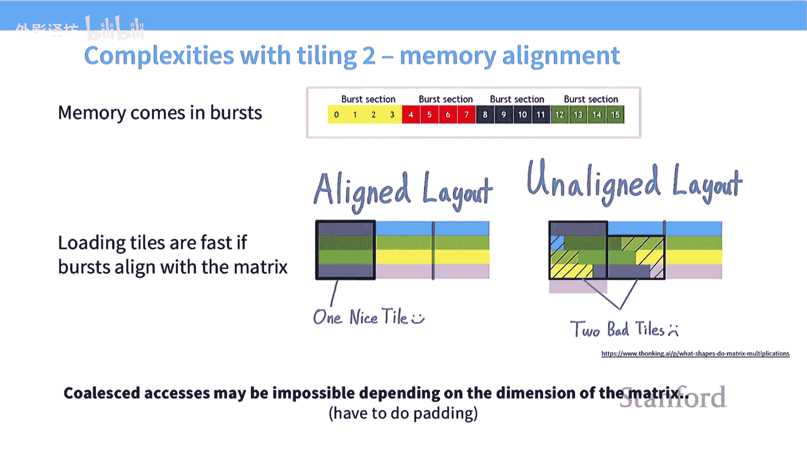

当然我猜想torch compile之类的，以及所有针对矩阵乘法的扩大优化，他们做的正是我刚讲的那些事儿，这样就能提升性能，所以呢所有这些矩阵的复杂情况，最终就会变成这样，我在念安德烈发的推文。

对NANOGPT最显著的优化是，将词汇表大小从5万257，增加到5万304，它是最接近64的倍数关系，这会让占用率高很多，注意二的幂对吧，所以增加了多少能提速25%呢，就好像给词汇表增加了47个维度。

差不多就是怎么会这样呢，对吧所以这又把我们带回到了这个谜团，我一直跟你讲GPU的所有细节，希望你能全面了解所有性能特点，但在某种程度上好处是，我现在可以给你解释这个图表是怎么来的。

最后你不会觉得矩阵乘打性能有多神秘，或者最后也不会觉得可怕，最开始的部分非常简单，我们明白计算强度，这正是我一开始指出的那个理论上限，所以到这里为止大约为1536，没有足够的矩阵乘法运算任务。

只是加载矩阵，以及执行必需的基础输入输出操作，在这一点以下会成为瓶颈，所以超过这一点后，吞吐量会急剧下降，你没有足够的内存带宽来支撑计算单元，现在在右侧，理论上，如果我画出上包络线。

这就是所能达到的最大性能，所以在这里所有计算单元有可能达到饱和，从而获得非常好的性能，但是如果你把矩阵大小搞乱了，你最终可能会处于这些非常奇怪的境地，在每一个这样的情况里。

你可能最终会处于一个奇怪的低谷，所以我们要思考一下，稍微思考一下，为什么会出现所有这些不同的最终境地，那么首先这里的第一行，这是个平凸对齐问题，那么你看看这里的倍数，所以我按矩阵大小的整除情况。

给这些行都着了色，这就是他能整除的那个数，所以要是它能被32整除，那你就没事，你在这儿的这些紫色点上，要是你能被16整除，你其实还在这上面呢，有两种颜色，然后要是你是绿色，你对应的K值是八。

你在这上面要是你是橙色，你对应的K值是二，要是你对应的K值是一，你在最下面站，要是一个数不能被任何数整除，那就别选质数维度，在矩阵乘法运算中，你无法获得很高的吞吐量，而这在很大程度上是。

因为一旦到了K等于二和K等于一的时候，你基本上是在造成这种局面，即你再也无法读取数据块了，按与突发读取良好对齐的方式来，而这会导致一些严重问题，所以这算是个问题，但是这是谜团的一部分。

但我觉得谜团的另一部分仍然存在，那么在这条橙色线内，我觉得你要是放大这里，你能看到从这儿到这儿有个大幅下降，你会不禁琢磨这儿发生了啥，我把维度增加两倍，性能咋还降这么多呢，那咱们看看这些数字。

然后呢我觉得这是个挺有意思的谜题，所以我来给你讲讲这个谜题，这就要发生了，当你把尺寸从1792，转换到1793或者40，这里假设是四，只是为了让他仍是二的倍数，那么为啥会这样呢。

嗯假设我们用的图块大小是256，乘以128，这尺寸挺自然的，有趣的是，这些GPU里的矩阵乘法单元，他们自然是在大小约为128，的矩阵上运行，所以256×128，是个很不错的图块大小。

那么这意味着有多少个土块啊，嗯有7×14个图块对吧，因为我们用矩阵维度除以图块大小，总共98个不同图块，要是我们把这个加一，我们得对每个坐标向上取整，这样就会多很多图块，120个对吧。

所以图块数量增加了不少，嗯接下来不仅图块数量大幅增加，有些的利用率较低，这可不好，但实际上更糟糕，一台A100有108个SM对吧，要是你回溯到某种GPU执行模式对吧，SM可以并行执行，它们算是执行单元。

所以当你有98个SM时，它们都会运行，你可以把它们都调度起来，所有SM都在运行，利用率很高，一旦达到120个计算单元，现在计算单元比流多处理器多，所以108个会执行，然后你会回过头说好吧。

我还有更多流多处理器，在极低利用率下，你将执行剩下的12个，然后等待完成，而那会很糟糕，那么查看一下利用率，一段时间内利用率会不错，你会急剧下降，然后你就差不多完成工作了，所以这就是波形量化。

理想情况下，块大小要么远大于留多处理器数量，要么并非如此，吉尼只是刚好超过流多处理器，并且还额外造成了这种量化误差，好啦我知道这都是些底层细节，但在诸多方面，我在许多课程中都讲过，深度学习中的语言模型。

注重细节，而这类对细节的关注，是能让人们扩展语言模型的东西，达到极其庞大的规模，并具备卓越性能，所以这值得了解，即便你不打算从事系统工程工作，那么技巧有哪些呢，关键要点如下，首先你得减少内存访问次数。

所以有很多办法能做到你能进行合并，这样就能重复利用读取操作，那些免费就能获取的读取操作，你能进行融合，这样就能把多个操作融合起来，并避免不必要的读写，你可以把内存转移到共享内存，所以即便你要进行读取。

它们将来自速度快的多的内存，那将会是一些你能用的分块技巧，最后你可以用内存去换取你所拥有的其他资源，所以你可以用它来换取计算能力，这将是重新计算，或者你可以用它来换取数值精度或稳定性，这就是量化。

所以你有很多技巧来提升性能，所以你能做的事有很多，你只需真正留意内存对GPU性能的影响，这是充分利用它的关键。

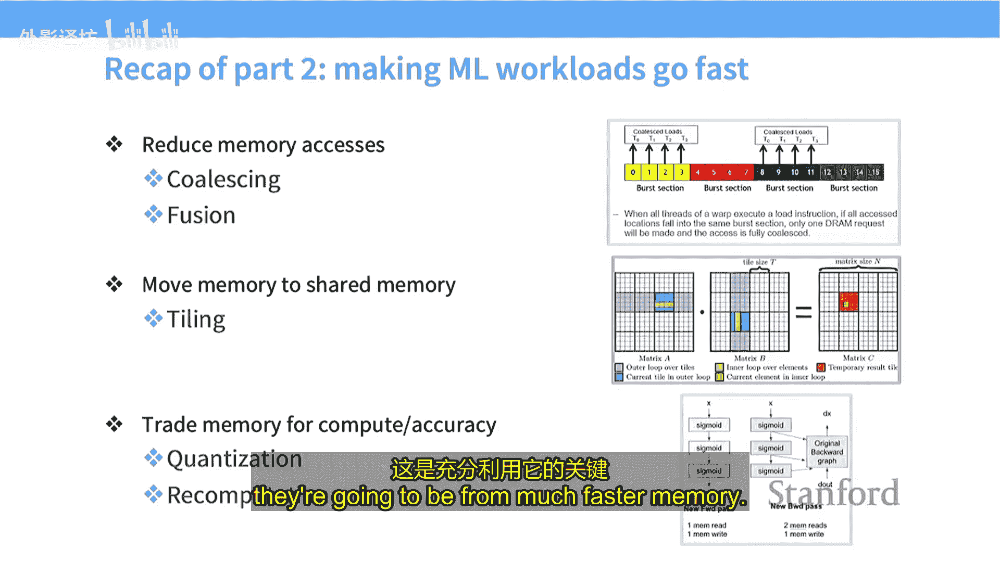

在我讲到闪存注意力的最后一部分之前，大家有问题吗，好嘞好，那现在我来做个总结，我会尽力做到，我教你们的技巧并非是关于GPU的零散知识点，它们是标准性能优化工具包的一部分。

还有flash attention和flash attention，二有望教会你们这一切是如何整合在一起的，以此构建现代高性能transformer的一个基础，我猜是这样，那么如你们所知。

flash attention我们知道它能大幅加快注意力计算，你们大多数人可能都知道，这是通过一些扩大内核的巧妙方法实现的，但或许你们并非了解所有细节对吧，所以如你们所知，论文是这么说的好吧。

所以有一部分情况是这样的，你关注的是一个未优化的ti torch变压器实现，如果你融合内核并进行一些操作，你可以获得显著加速，论文中提到，我们应用了两种成熟技术分块和重新计算，以克服技术难题。

在亚二次HBM访问中计算精确注意力的，所以这并非亚二次计算，因为你无法做到，你必须计算注意力，但他们对高带宽或全局内存的访问次数，将低于二次方，所以这才是关键，如果内存成为瓶颈，你要避免它成二次方增长。

这样至少能用计算资源来承担二次方的开销，而非内存，那么快速回顾一下，至此你已实现注意力机制在多门课程中多次，所以会有三次不同的矩阵乘法运算，有一个K1个Q和一个V中间夹着一个soft max。

所以矩阵乘法很简单，这可以用平铺实现，我给你们展示过那样的例子，注意力有何不同，嗯有个soft max运算，那才是真正棘手的地方，然后一旦我们能搞定soft max，我之前说的那些矩阵乘法。

相关的内容就会起作用，所以矩阵乘法如我之前所说，这正是我教你的，所以如果你查看一下关于flash，注意力机制论文里的图一，这其实就是个简单的平铺矩阵乘法，你能看到K矩阵和Q矩阵，你能看到它被切成了小块。

它的小块被复制到SRAM中，他们在相乘，然后他们被发送到HBM在那里进行soft max运算，然后再与V相乘，就KQV矩阵乘法来说，这一切都挺简单的，但现在我们得想想soft max了对吧。

比如说soft max是咋回事，所以这里关键是soft max，抱歉我要往回退一步，那么soft max的问题，soft max有啥问题，它是个全局操作对吧，注意力机制里的soft max是逐行操作的。

你得把整行都加起来对吧，用于计算soft max的归一化求和项，这很成问题，要是有图块的话，理想状态下我想在图块里把所有事都搞定，我可不想往大局这里写数据，所以我需要一个能在每个图块里在线计算的。

Soft max。

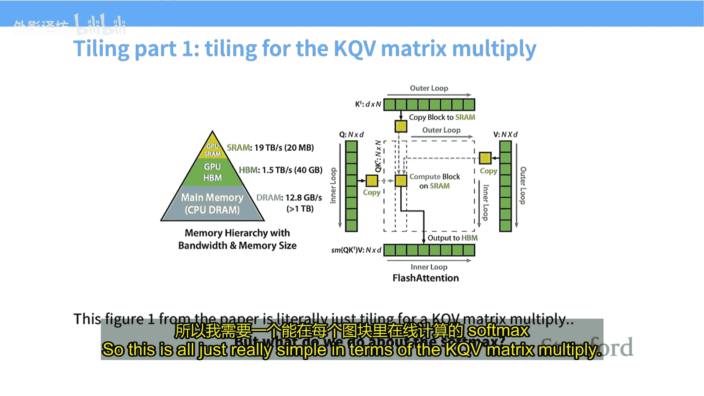

我想在每个图块里做尽可能多的计算，所以关键是要使用在线soft max，那它是什么，若有一组直流，通常是批量版本的soft max，取所有的X1到XN对其进行指数运算并求和，然后进行除法。

这就是普通soft max的做法，然后可能会计算最大值，然后减去它已确保数值稳定，所以左边是标准的数值稳定soft max，那么在现soft max，我借鉴了2018年，米哈伊洛夫和金梅尔斯坦的研究。

你能隐约感觉到，你可以通过类似伸缩的方式提取某种论据，基本上当前运行的归一画像，以及当前E的11次方减去XK最大值的顶项，对吧，所以你要做的事，你要维护你从X1到XJ所看到的当前最大值。

这是我当前的迭代次数，然后我还要维护这个修正项，若我的Mac已更新，这将基本校正我的Mac，然后我要在这添加个新项对吧，所以这个D会在线跟踪这边方程二的最高项，然后在最后，然后我也能计算归一画像。

然后得到我想要的归一化后的Y对吧，这个地本身就是我需要的归一画像，所以关键在于这可在线完成，我一开始并不需要预先获取，X1到XN这一系列数据，我所需要的仅仅是X1到XN，这样一连串的数据，而这才是关键。

因为我现在能够逐块计算soft max，在每一块数据中我都能运行此算法，这就能让我计算出该块数据的soft max值，然后我可以进行写回，可针对所有正在跟踪的组件进行操作。

而这就是我进行此计算所需的全部，所以计算soft max时，我根本不用把完整的N平方矩阵具体化，基本上就这些，但一旦你有了这个，你就把他们整合好了，然后就能得到快速注意力的前向传递。

如果你去看一下快速注意力的论文，这将是我们要求你实现的一项任务，所以你要按照这里的步骤来做，你会确切的看到这个想法，首先你要对KQ矩阵进行乘法运算，并且这将被分块，所以这些是小分块，然后它们会相乘。

那我该如何计算soft max呢，嗯我要维护这些指数和的一个动态值，这些指数和，然后不断对其进行更新，并对最大项进行校正，通过这么做，我可以逐块计算所有必要的值，从一个块到另一个块。

然后再与末尾带V的快相乘一次，这样就能得到我的完整soft max输出了对吧，所以我们无法计算出那个输出，直到完成所有块的乘法计算对吧，所以我们确实得对每个块进行回溯，所以问题是处理完所有块之前。

你无法计算这个，所以你得对所有快进行回溯，所以嗯，没错，所以你得在输出soft max之前，你得把所有图块过一遍，这是对的，但假设我把所有图块都过一遍对吧，就像我把所有N平方的图块都过一遍。

那时我就有了所有组件，直接输出soft max所需的，那时我无需重新计算，因为我已得到归一画像，处理这些块后，处理完所有这些块后，我已构建出L3或L即所有指数项之和，所以对于最后一块。

我已将其存入共享内存，然后就能进行指数运算，再做除法，然后返回所有分量，好反向传播我就不讲了，你可以逐块进行重新计算，这能让你避免存储soft max，记住我一直想避免存储任何N平方大小的东西。

所以在此处我对分块处理颇为巧妙，如此一来我就无需存储任何N平方大小的组件，例如在我计算soft max时，但在反向传播过程中，要是我存储激活值，那已经是N平方大小了对吧，所以我不想存储我的N平方激活值。

我得逐块实时重新计算它，当我进行反向传播时对不，所以这是他们实现反向传播的另一个关键技巧，但除此之外就很标准了，这和计算梯度其实是一回事，只是逐块计算而已，那么好了，到此为止。

希望你们大致明白所有这些内容了，我讲的分块合并和重新计算，这些内容汇聚起来，让你瞬间集中注意力，以及所有这些超酷的事物，能让你的transformer运行速度大幅提升，所以总结一下整个讲座，硬件。

在很大程度上推动了我们，如今所有的语言模型发展，所以如果你真的想充分利用你的硬件，你就得了解底层细节，我认为所有系统的进步，都涉及到我今天讲的很多概念，以及当前GPU的某种扩展情况，那个情节你真该记住。

真能促使你思考内存移动对吧，内存移动是这一切的瓶颈，所以你不能只想着我该如何减少浮点运算次数，那也很重要，真得好好想想我该如何提高内存移动效率，最后若需进行一定量计算，就要做好优化。

要做到这点就得优化数据移动对吧，尽可能避免高带宽内存中的大量数据移动，或者尽量避免全局内存的数据移动，你得减少这种情况，并将所有数据置于超高速的共享内存中。

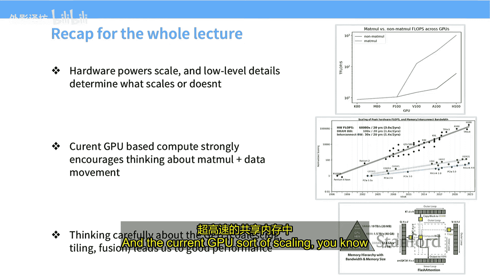

这样就能在诸如快速注意力等方面有出色表现。

