# 【中文配音】硬核！斯坦福 CS336：手把手带你从零构建 ChatGPT - P6：6.内核优化与Triton框架应用-Kernels, Triton - 外影译坊 - BV1BWEWzfEKi

今天我们将详细讲解如何编写高性能的GPU代码，所以作业二的一部分是你得进行一些性能分析，你需要为flash注意力机制二，编写自己的track内核，你需要让所有这些都具备高性能，那么在这堂课上。

我们将稍微深入探讨一下，并且我们将尝试为语言模型中的标准组件，编写高性能代码，并且我们将尝试为语言模型中的标准组件，编写高性能代码，本次讲座的计划是，我们将简要回顾一下GPU相关内容。

只是为了确保你们再次熟悉GPU的基本组件，以便理解讲座后续内容，然后我会给你们讲一些基础内容，关于基准测试和性能分析的，这对作业很有帮助，以及一般而言，如果你想编写高性能的。

PYTORCH或深度学习代码，接着我们要编写一些内核，我们将用类似C加加的方式编写CUDA内核，然后我们会在tron里做同样的事，然后最后我们要做件简单的，而是使用PYTORCH。

现有的JIT编译器为我们优化，这是件很棒的事，然后我们会比较这些，并进行性能剖析和基准测试，自始至终我们都会深入探究，我们将一直深入到PTX，它很接近机器代码，了解GPU在幕后实际在做什么。

当我们编写这些代码时，然后希望我们有时间，而且我想我们会有时间，我们将通过编写一个快速的soft max的TATTON实现。

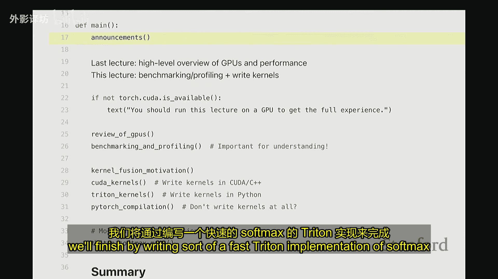

来完成，在最后作业一已结束，还有一个排行榜，你仍可在那里提交和更新东西，你们有些人可能正在使用延期次数，所以请完成作业一，然后作业二已发布，如我之前所说，你们需要做一些系统相关的事。

现在有一些涉及GPU内核的有趣内容，可供你们操作，然后下周我们要讨论并行性，那将是作业的另一部分，比如编写像数据并行这样的快速并行代码。

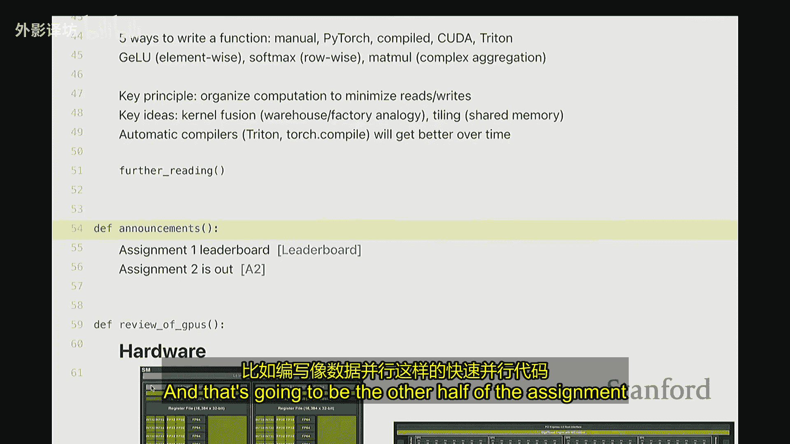

所以我们下周会讲到好的，那么现在还记得GPU怎么工作吧。

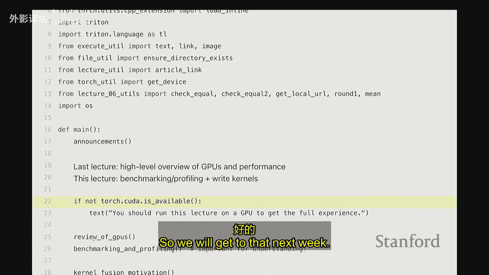

当我们有A100或H100这类产品时，我们会有多个流多处理器。

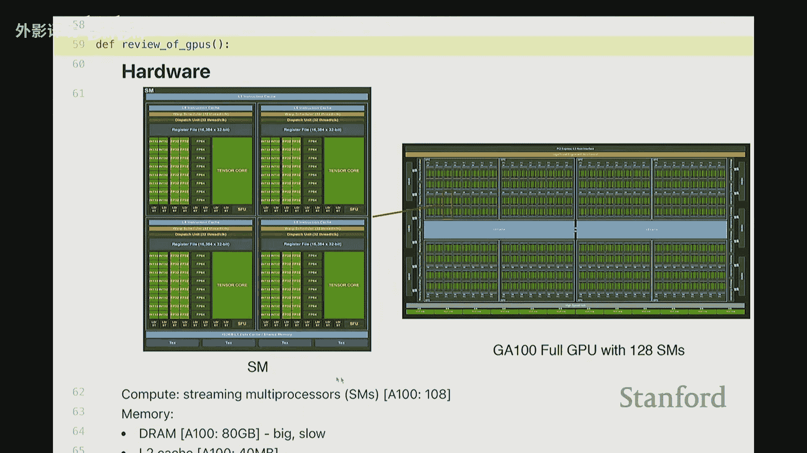

每个流多处理器内部都有大量，可进行计算的单元，我们有N32位或FP32位的计算单元，然后每个流多处理器会启动大量线程，对不对，我们有内存层级，即我们有动态随机存取存储器，也就是全局内存。

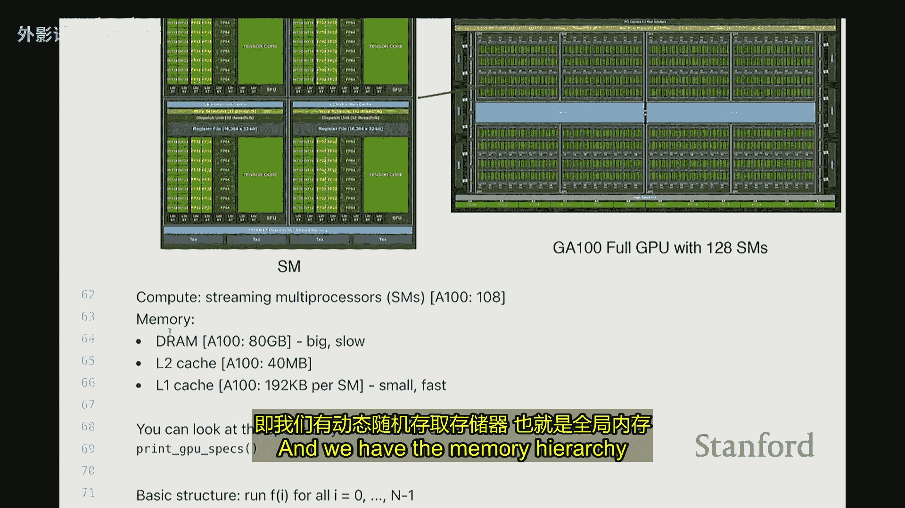

它既大又慢，然后我们有速度快的多的缓存，实际上看这里有个东西叫寄存器文件。

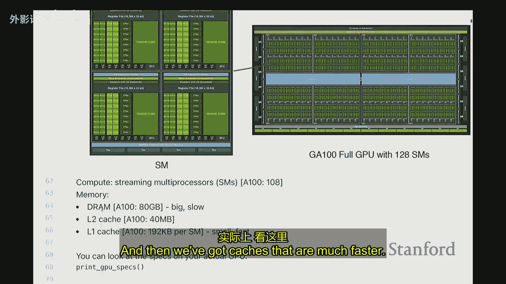

这是一种速度极快的内存，每个线程都能访问，我们将大量使用这些寄存器，在我们如今为GPU编写高性能代码时。

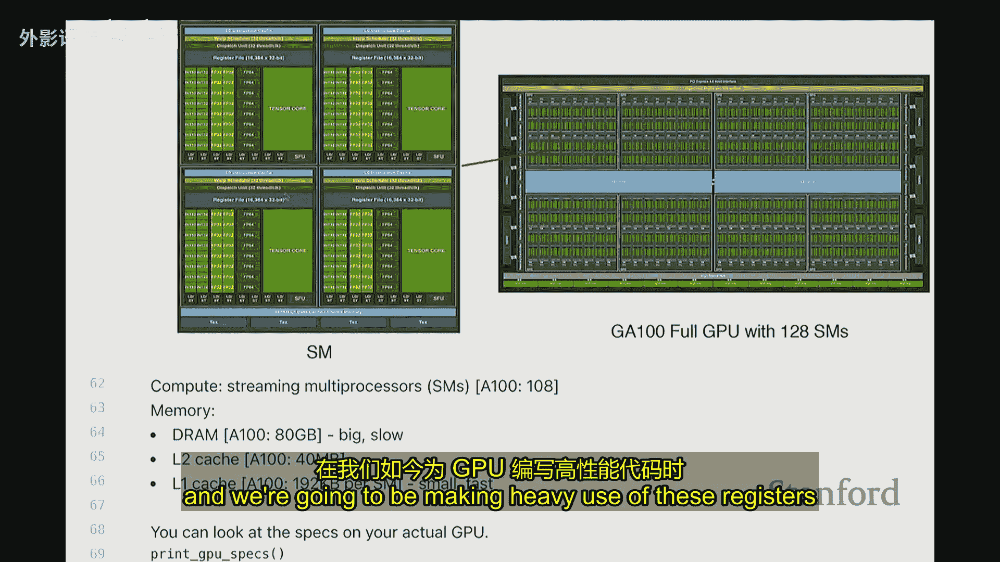

所以执行模型的基本结构是我们有一组线程块。

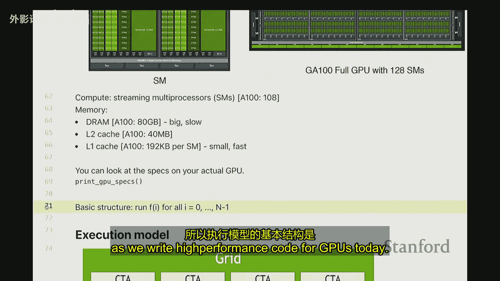

并且一个线程块将在单个流多处理器上调度，所以这是我们要考虑的一种原子单元，特别是当我们在tron这样的环境中编写代码时，然后在每个块内会有一堆线程，而实际进行计算的就是这些线程，所以如果你有一个向量。

并且要对该向量的元素进行操作，你就要编写代码，每个线程会计入，并且可能一次对该向量的几个元素进行操作，对不所有线程一起会把这个向量完整处理一遍。

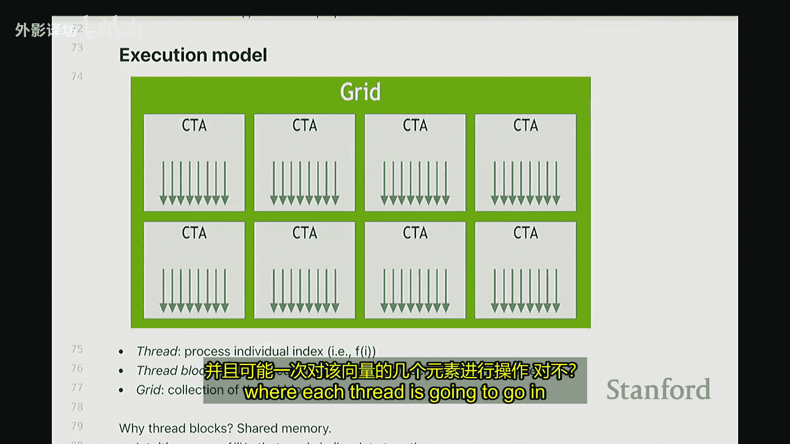

为什么要有现成块这种东西呢对吧，为什么不只用线程和全局环境呢。

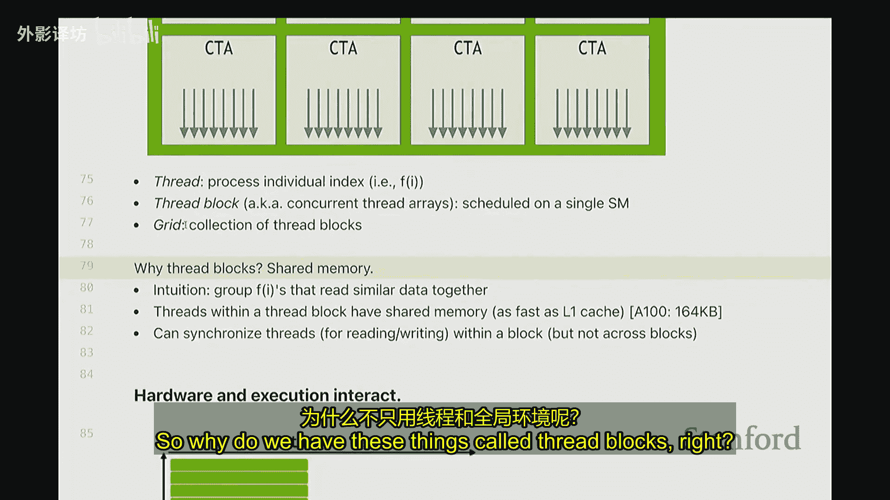

嗯线程快可以相互通信流，多处理器中有共享内存，速度相当快对吧，所以当你需要进行矩阵乘法之类的运算时，你需要在线程间传递信息，在线程块内速度很快，但跨线程快或跨阻时开销就会很大，所以你所需的任何数据。

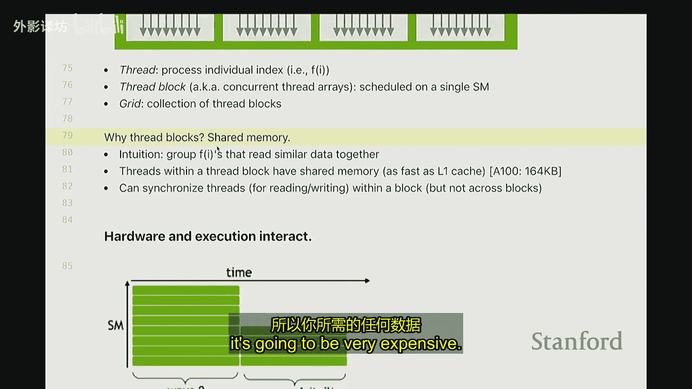

你得将其保留在同一个线程块内，或者在同一类簇中，这样能让事情进展得极快，而且这会和一级缓存的速度差不多，那是个很棒的情况，所以你可以用这个在线程间同步，但例如你不能跨线程快同步。

你无法真正控制会发生什么。

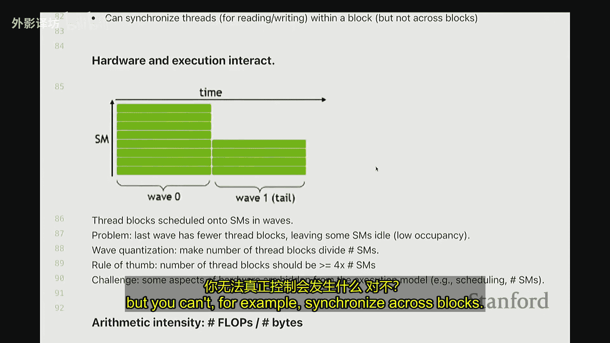

对不还记得我上周提到的事，有一种叫波的东西对吧，波并非那种你通常会想到的固有事物，但对于性能而言，它是重要组件，所以当我们实际运行这些时，县城被分成连续的32线程块，这就是一搏。

并且他会在一个SM中一次性全部执行，所以我们想做的一件事是，确保所有波都有等量计算，我们并不总能做到，但要是可以的话，我们想这么做，所以我们希望线程块数量能整除流，多处理器数量，并确保每个波有等量工作。

所以理想情况下，线程块数量应远多于流多处理器数量。

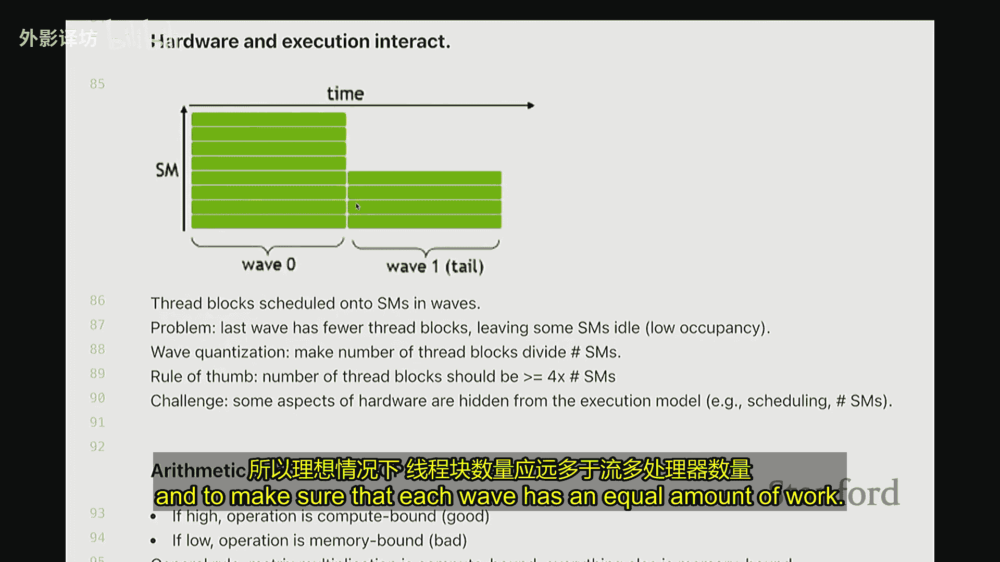

我们会努力实现这一点，编写高性能代码时好，接下来是最后一个概念，也许这里最重要的概念之一是算术强度，我们希望保持高算术强度，我们想要的每秒浮点运算次数，多于内存传输字节数。

这是因为要是你还记得上节课讲的缩放图，我们计算能力的提升速度，比内存的提升速度快得多，所以很多时候计算最终会受限于内存，而实际上我们并没有完成所有工作对吧，所以一般而言，矩阵乘法受限于计算能力。

要是我们巧妙的去做，其他所有操作都将受内存限制，我们会设法巧妙减少受内存限制的操作数量，或者减少操作受内存限制的程度，以上就是我们对GPU的非常简要的回顾，希望大家都还记得这些。

你们对执行模型应该仍有清晰印象，随时打断我，要是你们还有疑问，或者对这一切如何运作有疑问都可提问，好的不好意思，WAP的功能是什么，一个WD一个WB，一个WAP本质上是一组一起执行的线程。

而WB存在的原因是，他们减少了所需的控制机制。

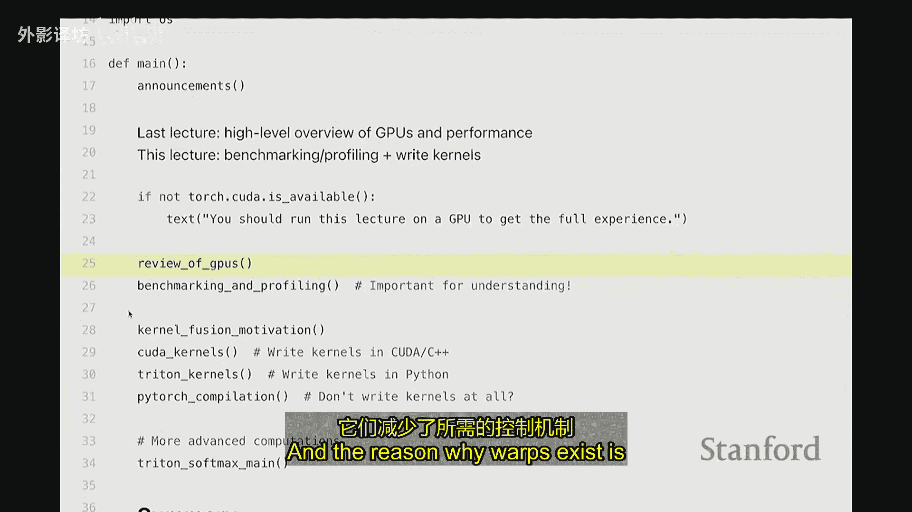

因为你同时执行所有这些线程，你不需要为每个线程设置控制，32个线程一组时才需要，所以例如计算单元的数量远多于线程数调度器。

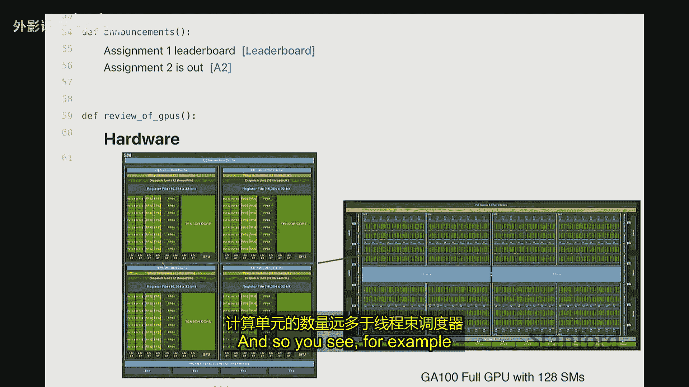

这样你就能在不用担心控制的情况下，进行更多并行工作，这是CPU的一个权衡之处，CPU有更多硅片面积用于专门控制，还有分支预测之类的，而GPU则更侧重于计算，控制更简单，现在我们要进入新内容了。

我认为有一点很重要，需要记住，要是你想编写高性能代码，你得记得对你的代码做基准测试和性能剖析，这看起来挺明显的，但我见过不少情况，有些学生或其他人会说嗯，我觉得这是瓶颈所在，所以我打算花三小时优化它。

结果发现根本不是瓶颈，我敢说这挺有意思的，但这时间算是白浪费了，所以如果你真的使用高性能，或非常详细的分析器，你就能确切的看到你的瓶颈所在，以及机器正在做什么，一旦你掌握了这些。

你就可以将精力投入到代码执行中，最重要的部分，所以这就是我想传达的要点，因为关于GPU执行的一些细节，以及如何编写soft max内核，那将会有所变化，也许你甚至想只依赖，torch的自动即时编译功能。

但无论用什么工具，你都得进行性能分析，这一点不会变，所以我希望你能把这个想法记在心里，就是说就得一直做性能分析，要是你想写高性能代码，实际上理论是有极限的，我觉得系统是这门课的一部分。

你能很好的对其进行推理，架构则有点难进行推理，你可以好好思考一下屋顶线模型之类的，但你的矩阵乘法速度有多快呢，嗯或许这取决于库版本或硬件，哪些东西因何成为瓶颈，有各种微代码的东西，你并不完全了解。

所以你得进行端到端基准测试，每当你开发这些东西时，所以我要进行一个示例计算，这是我们能运行的最简单的内容，和你们作业一里做的所有事比起来，但我要运行一个很简单的多层感知器，它有128个维度，它有16层。

它有一个批量大小，它有五个步骤，我只做前项计算，然后对五个不同步骤做反向计算，为了让代码清晰些，代码大概是这样，我要定义一个MLP模型，一会儿给你展示，然后我定义一个随机高斯输入，然后在最后一种情况下。

我运行它五步，在那里进行前向计算，然后进行反向计算，然后返回结果，即MLP输出的平均值甚至没有损失，太简单了，就是你把MLP向前运行，我最后做平均池化就行，然后MLP算是你在这里能想到的。

最简单的东西了，它就是一堆相互堆叠的线性层，就是这部分，然后我中间有个GALU对吧，所以这就是GALU线性GALU诸如此类，一切都井然有序，所以希望这是个非常简单的MLP，你们都会觉得挺熟悉的。

那我们回去嗯，哦不好意思，我想回到这，现在我有了这段想运行的MLP代码，现在我要做两件事，我要做基准测试，所以我要计时，所以我想知道这个函数运行要多久，然后我要进行性能分析。

也就是深入函数内部去询问我的时间都花哪了，那我们先进行基准测试，所以基准测试就是测量，执行这些操作的运行时间，而且我只关心端到端的执行时间，在这种情况下，是我的多层感知器函数的执行时间。

这里面有些微妙之处，你坐在那会想，为什么有人教我怎么调用，我不知道其运行时间，但你得稍微留意一下如何测量时间，而且我觉得要是你不留意做第二项作业时，你会掉进这些陷阱，那我们这么做是为啥呢。

我们稍后会比较不同时限，我们要比较TRATTON，手写C加加PYTORCH实现以及torch编译，而且我们想弄清楚写那个KDA内核值不值，我们还想了解当我增大矩阵乘法的规模时，它会慢多少。

所以我们想对这些进行一些实证测试，所以在整个讲座中，我将使用这个基准测试函数，这将是一个包装函数，我会逐步介绍基准测试会进行以下操作，它会有一个我要进行基准测试的函数，也就是运行函数。

接着我会进行几次热身迭代，然后我会进行几次试验，你可能会想，那咱们在这儿做的这个热身是咋回事，嗯有件很重要的事，当你首次运行PYTORCH代码时，比如说他向GPU发送了些东西，对你而言。

他可能看似非常迅速且直观，但在首次执行某个东西时，在后台机器代码正在编译那条代码，指令可能正被发送到GPU，有各种事情发生来初始化你的代码，所以你总得进行些热身迭代，以确保你不是在测量启动速度。

相反你要测量的是稳态速度，要是你运行成千上万次迭代，你感兴趣的是那部分，不一定是你及时编译KDA代码的速度有多快，所以我们要有热身，而且你应该总是进行一点热身，然后另一件非常重要的事。

等讲到性能分析器时，我会说，这个就是你要调用torch cuda同步这个东西，这是什么东西，NGPU和CPU基本上是两个独立的计算单元，在你电脑里对吧，而且他们基本上可以独立运行。

所以执行模型就是我这里的这段Python代码，这个是在CPU上的对吧，当我运行东西时，它会向GPU发送一堆KDA内核，他会请求运行这些任务，然后GPU会去执行这些任务，而CPU会继续运行。

他不会等CODIE执行结束，所以这很适合编写高性能代码，但如果你想做基准测试，应该能马上发现问题对吧，如果你在做基准测试，且有这个模型，GPU在一旁运行，而CPU在做别的事。

实际上你没在测量GPU的执行时间对吧，所以torch cuda synchronize的意思是好吧，确保GPU且CPU处于相同状态，并且没有未处理的任务在运行，并且在正在执行的代码方面。

我们处于同一进度，并且在正在执行的代码方面，我们处于同一进度，现在GPU和CPU处于相同状态，我要实际计时了，我要对某件事进行若干次计时，我要运行这个计算任务，这里它指的是睡眠命令，我要做三次这个操作。

由于我尝试睡眠50ms，那就是我最后会得到的时间，所以我三次调用time time，当然在这里我也会在运行结束时进行调用，以确保GPU以及CPU的状态是一样的，所以如果CPU领先运行。

它会在这里等待GPU执行完成，反之亦然，所以现在我差不多完成了，然后我要取平均值，因为每次测量可能会有波动，因为GPU的热特性等因素，所以你要进行多次重复取平均值，然后返回结果。

这就是我们的基准测试代码非常简单，但要记住这里的两个要点对吧，一定要先进行热身，并确保调用库大同步，要是做了这些就很简单，要是忘了做这些，你会得到很离谱的数字，比如你会发现大型矩阵乘法瞬间就完成了。

这肯定是不可能的，对吧好了，那现在我们可以对矩阵乘法进行一些基准测试，我来逐步讲讲，其中一些他们只是给我们已知的内容加上数字，但我还是想逐步讲一下，大家确保都清楚这点哈对吧。

所以我在H100系列上运行了这个程序，我有GPU，我要针对这些尺寸做矩阵乘法运算，然后我要去做为每个维度收集一堆矩阵，乘法的时间，为每个维度逐一查看这个基准测试结果，所以正如我们所料，我们大致能看到。

随着矩阵尺寸增大，我们的运行时间呈超线性增长，当然在最小尺寸时，像1024和2048，我们实际上看到时间完全没有增长，因为进行这些矩阵乘法运算，存在固定的额外开销，这些数字得从CPU传输到GPU。

启动内核有开销，所以并非一直到零都是超线性的，但一旦矩阵足够大，我们看到了与矩阵乘法预期相符的作法，所以希望这够直观，现在咱们来试试，给咱们的多层感知器做个基准测试，那咱们要干啥呢。

我们要把多层感知器做大些，我们会设置成256维，我们会设为四层，批量大小设为256，走两步，那这得花多长时间呢，嗯这得花6。2秒，现在我能做些基本操作了，我能把步数从两步调到五步。

我可以对所有这些进行基准测试，我会得到234，然后是五步与矩阵乘法的情况不同，如果我增加步数及前项的步数，以及多层感知器的前向和反向传播次数，我预计运行时会有怎样的表现，嗯我预计会有某种线性扩展。

而这大致就是我们所看到的，每次多层感知器执行大约需要五秒，而且我们看到它大约是N乘以五，这里端到端对象的运行时间，我看看能否重置此处正在监测的对象，哦不行，我做不到，好的，我要稍微缩小一下，对此抱歉。

好的，现在我们还可以增加层数，从两层到五层，那这会怎样呢，嗯运行时间会增加，同样与层数成正比，这次又一次一层大约需时五秒，略少于此，所以我们得到的层数约为四倍，实际上就是四倍线性缩放。

又出现了不出所料对吧，所以步骤和层数显然都与运行时长呈线性关系，而这正是我们最终看到的，我打算跳过批量大小这个部分，因为这变得有点繁琐了，就这里跟踪的事物数量来说，好了，本次基准测试到此结束。

我们可以创建一个挺不错的函数，它会进行一些热身，并执行突大同步，我们可以测量任何想测的运行时间，这挺好的，你在代码里应该一直这么做，你可以测量你新的架构运行需要多长时间，但是我觉得若想解决问题。

基准测试是个很粗略的工具，它会告诉你代码运行慢，但它不会告知你时间花在了何处，所以我们要做的是进行性能剖析，所以这会是个力度更细的东西，我们想做的，所以性能剖析很不错，因为它不仅能帮你看清时间花在何处。

涉及哪些函数，但当你查看所调用的内容时，通常你会与PYTORCH接口交互，比如你所调用的PYTORCH部分，但在PYTORCH之下，有一整套co大相关内容正在被调用，当你运行分析器时。

你实际上可以一直看到底层调用中，实际被调用了什么，这样你就能获得更好的直观认识，了解程序在硬件上实际是如何运行的，所以我们将逐步剖析几个简单函数，然后就能对实际发生的情况有一些直观感受。

嗯好在如果你想进行基本的性能分析，PYTORCH有一个非常不错的，内置性能分析器可供使用，这样你就无需脱离Python PyTorch环境，并得到一些看起来还算合理的输出。

所以我在这里对一些函数进行了性能剖析，你也能大致看到其输出，所以我采用了之前的睡眠例子，这就是睡眠函数，当我们分析睡眠函数的性能时，性能分析函数大致如下，我又做了一次热身。

我对torch koda进行了同步，然后我调用性能分析工具，我同时记录CPU和GPU的时间，然后我运行了一些程序，然后我再次同步，然后我打印出所有时间的平均值表，好，那我现在回去。

现在我要分析睡眠函数的性能，看看这里发生了什么嗯，所有时间都花在了KDA设备同步上，因为没有GPU在工作，这基本上就是个空操作，对这个进行性能分析有点愚蠢，那么现在我们来看点重要的。

那我们看看两个矩阵相加的基本操作，所以我定义了一个加法函数，它接受一个A和一个B然后将它们相加，这是一个辅助函数，用于实例化两个随机高斯矩阵，然后调用操作参数里的内容。

所以这是再把两个大小为2048的矩阵相加，所以现在我要分析这个，然后我会调用分析器，然后我会得到类似这边这个块的东西，所以这就是我得到的，然后我得缩小，因为这个不行，从后面能看到这个吗。

要是从后面能看见，能给我点个赞不行挺好，要是看不到就点个踩好嘞，所以当我们在Python里调用ADD函数时，这差不多就是我们与之交互的全部了，这个加法函数A加B我们就想这些。

但实际上在这背后可谓是冰山一角，还有很多事情在发生呢，于是这个被调度到GPU上，首先有个叫A10的玩意，它是PYTORCH的一种C接口，接着这个包装器被调用，他会说好累，我要去加些数字对吧。

这就是被调用的，那就是外层包装，然后它会调度到一个特定内核，叫做原生coda函字ADD，针对逗号的按元素向量化内核对吧，而这才是真正做加法运算的，接着还有个叫库大启动内核的操作，这会耗时一些。

实际上CPU在接收命令并传至GPU，这就是内核启动，这会花些时间，接着扩大设备进行同步，我们在等GPU完成并传回给我们，这也会花些时间设置同步屏障会耗费一些时间，所以基本上最后CPU上的总时间为1。

4ms，而cod上是17微秒对吧，所以GPU速度非常快，CPU则较慢，如果看一下所花费的CPU时间及CPU自身耗时，我们看到了那种C加加接口，或者说C接口实际上耗费了我们大量CPU时间。

他们算是做任何事实的一种额外开销，及我们向GPU传输数据的过程，所以那就是加法函数，然后我们看看实际发生了什么，如果我要做矩阵乘法，情况也是如此，所以我在计算A乘以B，所以这是A的矩阵乘法运算。

以及B我又在计算2048个矩阵，然后我进行性能分析，这次我看到了A10矩阵乘法运算，这表明这是用于进行矩阵乘法的底层接口，接着它会调度裁剪列表，它是NVIDIA的高性能矩阵乘法KDA库。

然后他会调度到一个非常特定的裁剪列表，内核，它会有一些分块大小，这里的名称被截断了，我马上给你看一个更详细的版本，这基本上指向了一组非常特定的分块大小，以及块的数量等，因此这个东西是参数化的。

实际上它正在进行矩阵乘法运算，再一次我们看到了同样的两件事，在下面内核启动以及coda设备的同步，你可以再次看到CPU时间和coda时间的划分，我们在coda上花费的时间要多得多。

因为矩阵乘法比两个向量相加耗时更长，好的到目前为止有问题吗，我可以在此处暂停片刻，我想我刚才独自快速浏览了分析器，所以如果有人有问题，我可以停一会儿，如果没有问题，我就继续好的哦，什么事，在这种情况下。

我们的限制时间比CPU时间长，但我们确实有一个屏障，他要求让CPU等待线程同步，所以基于此，CPU时间难道不该始终至少保持一样长吗，不是是的，我觉得这没把CPU空闲时间算进去，是否有什么特别的原因。

当我们从网matt mode添加内容切换时，CPU时间就下降了，是否有原因，当我们从网matt mode添加内容时，CPU时间下降了，说实话我不确定什么是，与在实际中运行相比。

分析器里会不会有导致数据偏差的开销，没错，分析器是存在开销的那些障碍，就会导致这种情况，我给你展示一款英伟达的更先进分析器，你还能添加像注释这类东西，他们也会对计时稍有影响，但影响不大。

你看到的真正大规模的情况，分析器不会对其造成严重扭曲，所以要是你看的是微观纪实，那可能会有影响，但对于我们在课上关注的很多内容而言，不会有影响，怎么了，只是想确保我理解的对，那这是关于广告案例的情况吗。

id8%的CPU在被使用吗，在那个以毫秒计的时间段内吗，没错是的，所以这是时间占比，如你所见，A10广告在CPU上实际执行的毫秒时长，我觉得这不是CPU利用率，比如的占比等，CPU正常了，就这些吗。

没错，这是CPU处于活动的时间，不是利用率百分比，所以这并非CPU的总浮点运算次数，这是CPU进行操作的总时间百分比，好嘞挺酷好，这是矩阵乘法的另一个例子，所以这是不同维度对吧。

所以我在这里对一个128维矩阵，进行乘法运算，所以是128×128的矩阵，规模小得多，实际上你会看到，现在他直接执行某种不同的命令，他在执行XMM和gm m gm m属于矩阵乘法类型。

这里是32位浮点型数据，从这个内核的命名大致能看出这里的情况，即这是某种分块矩阵乘法，而且它不会便利切割列表，他直接执行这个特定命令，所以对于一个小规模的矩阵乘法，你会看到它正在调度到另一个内核。

这样你就能大致了解矩阵乘法的复杂程度，当我们在这种高层次抽象层面进行操作时，我们只是将矩阵乘法视为一个整体，我们写作A乘以B，然后就搞定了，但在底层之下，这取决于你所使用的维度，这取决于你所使用的硬件。

实际上它在底层会调度到截然不同的矩阵乘法，基本操作，而这实际上会表现为截然不同的性能特征，所以有个有趣的小窍门是使用torch compile，我稍后会讲到，实际上有个选项能在你的硬件上。

对矩阵乘法性能进行微基准测试，然后它会为你的模型挑选性能最佳的矩阵，乘法子历程，我以前发现这能让你免费提速约10%，很酷的是，针对这些进行优化，实际上能在现实中让你免费受益，好啦。

这是MATTEL的另一个例子，分析器还有个很酷的地方，与单纯的原始基准测试相比，现在我们能大致看出正在调用哪些co大内核，我们能看到不同大小的矩阵，会导致不同的co大内核。

我们还能看到cut list a AD simpig jam对吧，这是cut list线性代数库吗，它会告诉我们诸如分块大小之类的信息，所以到目前为止，这些操作在某种程度上挺无聊的，比如矩阵乘法与加法。

它们基本是一一对应的，在CPU端进行操作，它会转换为GPU上的操作，然后就直接传过去了对吧，在所有这些操作中，只有一个操作会在GPU上产生作用，所以我想看看一些更复杂的操作，还有两个这样的。

他们具有更复杂的行为，所以现在我想看看这个名为torch dex的操作，它计算的是两组矩阵中，两组向量之间的两两欧几里的距离，所以这将是一个针对A的大距离矩阵计算，以及我想要的B，这就是KDST。

显然这是个复杂的多的操作，如果你想计算欧几里得距离，你需要计算点击，你需要计算平方根，我们会看到一旦计算出kiss，现在这是KDS的分析结果，所以我们看到这个torch Python命令。

在C接口中映射到某种低级别的C距离计算，所以这是A10C距离计算操作，然后映射到A10欧几里得距离计算，然后它会分解为一系列操作，比如A10矩阵乘法，A10幂运算，然后求和。

因为这些都是你实际所需的言语，用于计算你所有向量之间的欧几里得距离，当你对这些矩阵乘法中的每一个，以及拼接和求密，这里会调用相应的coda命令，我们有通用矩阵乘法，我们已很熟悉，所以这是一次矩阵乘法。

他在GPU上占用了我们78%的计算时间，我们有数组的复制和拼接，这占了执行时间的6%，接着是这种按元素向量化的内核，它进行幂运算，占GPU5%的时间，还有3%用于求和。

所以现在能清楚看到我的GPU时间都花在了哪里，由此我能大致了解该在哪些方面进行优化，也许我能优化矩阵乘法，那就太好了，因为这占了GPU70%多的时间，不好意思，我要说的最后两个例子。

我要讲的是JERUU和soft max，所以这些会是我们接下来要一直探讨的哦，抱歉有个问题，好的，我可能会在几分钟后回答那个问题，因为有个更好用的分析器，能给你呈现更清晰的画面，所以我可以在这比划比划。

但我觉得用图片展示会更清楚，好的，那现在我来讲讲真鲁和soft max，所以JLU会使我们整堂课的事例，所以这就是一种非线性，它就是高斯误差单元，高斯误差线性单元，而那是双曲正切函数与指数函数的乘积。

要是我没记错的话，所以我们会进行各种各样的运算，所以我们要将A和B相加，然后我们会提及GLU有点像，在模拟线性与非线性结构，我们多层感知器中可能存在的，所以我们再次看到本质上是同一种映射。

我们看到B与十相加对应A加B，然后我们有coda对应的部分，然后在coda中实现了GLU函数，它在这下方他占了大约33%的计算量，好挺合理，然后我们再次看到soft max，我就不详细讲这些了。

因为过一会他们就都差不多了，但真正要指出的是，我觉得很酷的是，很多像soft max和JU这样的核心基础组件，只是专门为他们编写了代码对吧，所以不是GPU在执行这些基本操作。

有一种整合的运算器来处理这些，所以不会有在CPU和GPU之间来回折腾这些操作好，我之前提到过，我打算回答一下CPU在做什么这个问题，那我们来想想更复杂些的东西，我有用于基准测试的MLP示例。

我最初就是用它来进行基准测试的，比如说我打算优化MLP，让它运行得非常快，那么我们该怎么做呢，嗯理想情况下，我们会以一种很好的细粒度方式进行分析，所以如果我们使用火炬剖析器，这就是我们会得到的结果。

如果你还记得MLP，它有堆叠的线性层，有正向和反向两种情况，大致能看到由反向过程发生，由矩阵乘法和线性运算，然后反向传播有梯度累积操作，这里是矩阵乘法内核，然后这里只能装下十个。

所以我觉得这在某一处被截断了，但这挺好，它确实表明大部分时间花在了矩阵乘法上，但你难免会好奇，其余时间都去哪了，为什么只有31%的时间留在这，那这里60%的部分在哪，这是个A10MM。

但没有对应的内核对吗，这有点神秘，对于一个非常复杂的模块。

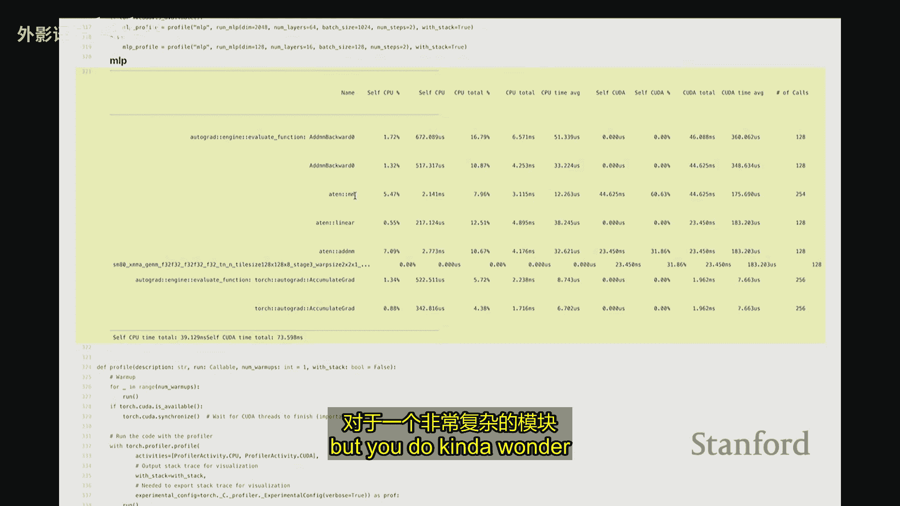

这可视化效果不太好，所以就这一点而言，我觉得我们得找个真正成熟的分析专家来，你得，不然我们会让你查看这个，也就是英伟达的insight系统，这就是英伟达详细查看GPU行为及性能的方，式的方式。

所以运行这个多层感知器时，我们就能确切看到发生了什么，那在后面你能看到不知道这边这个小文本吗，点赞行，要是你能看见，那我就不放大了，但即便从这看，他看着也确实小行，那咱看这能看到好些不同的东西。

在这儿能看到coda硬件，然后能看到现成，那这上半部分这个库，大部分这就是GPU大致在干的事，然后在这个线程这块，我们大致能看到CPU的工作情况。

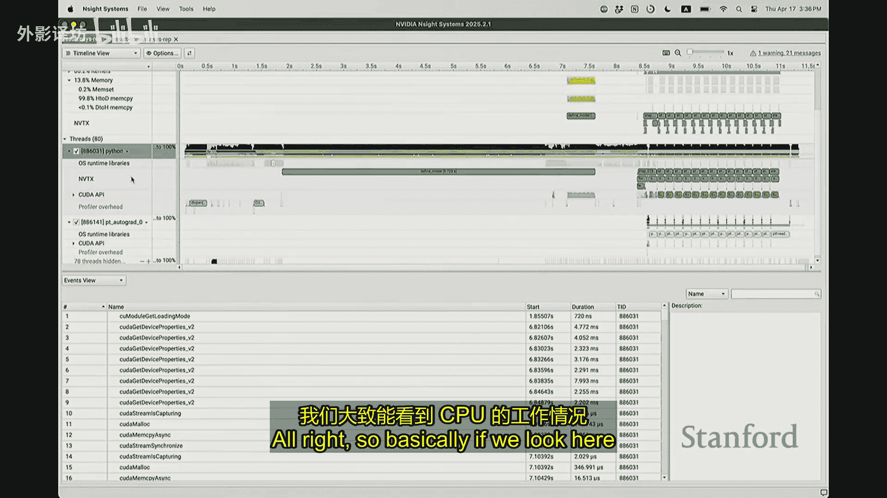

我想我也能调出代码，没错，当我分析这里的代码时，我添加了一些注解，好的这个我肯定得放大瞅瞅。

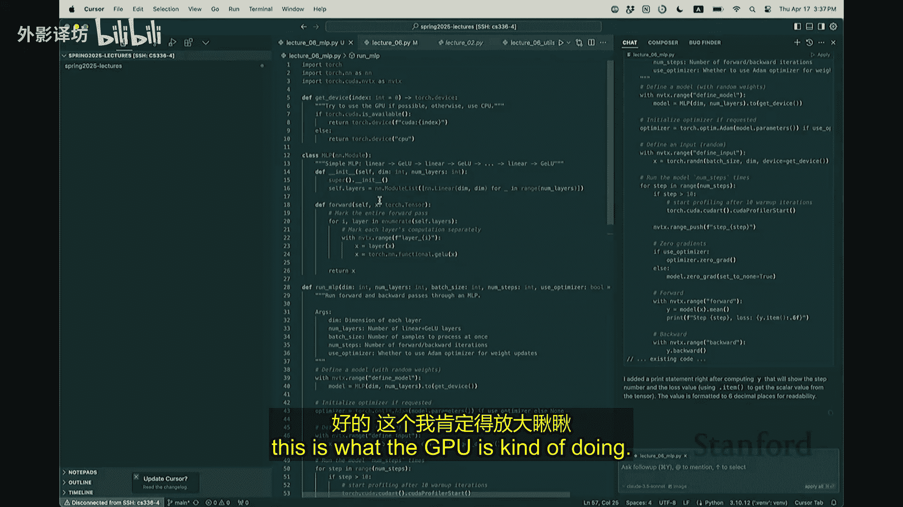

非常棒。

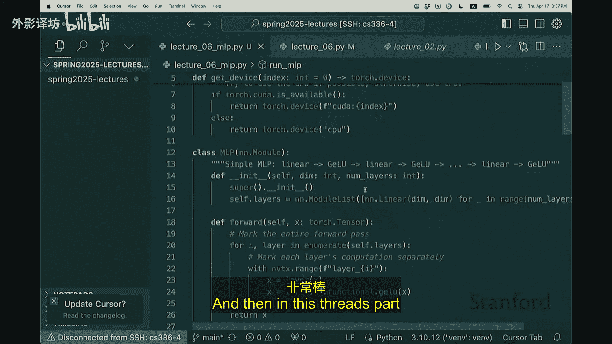

所以我用这组东西给代码加了注释，上面写着NVTX。

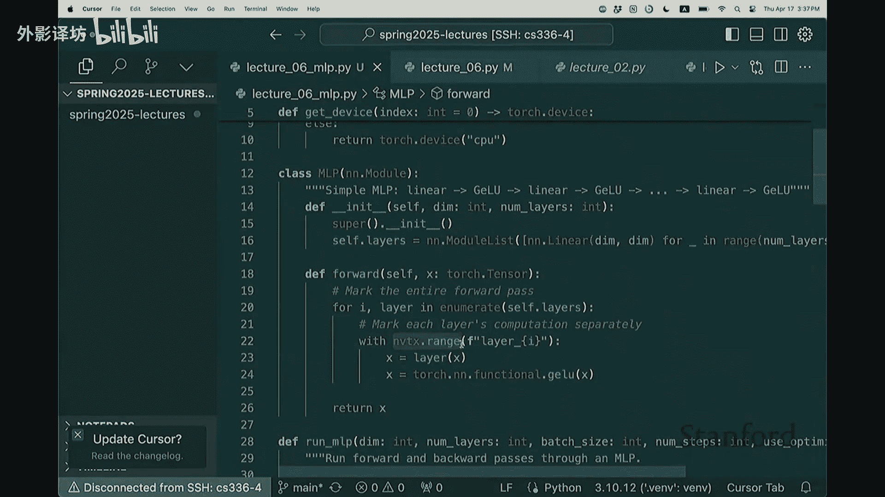

基本上是用标记来注释我的代码，所以当分析器来到这里时。

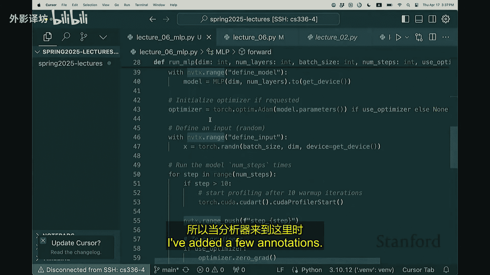

他就会知道，这段代码属于一个名为定义模型的模块。

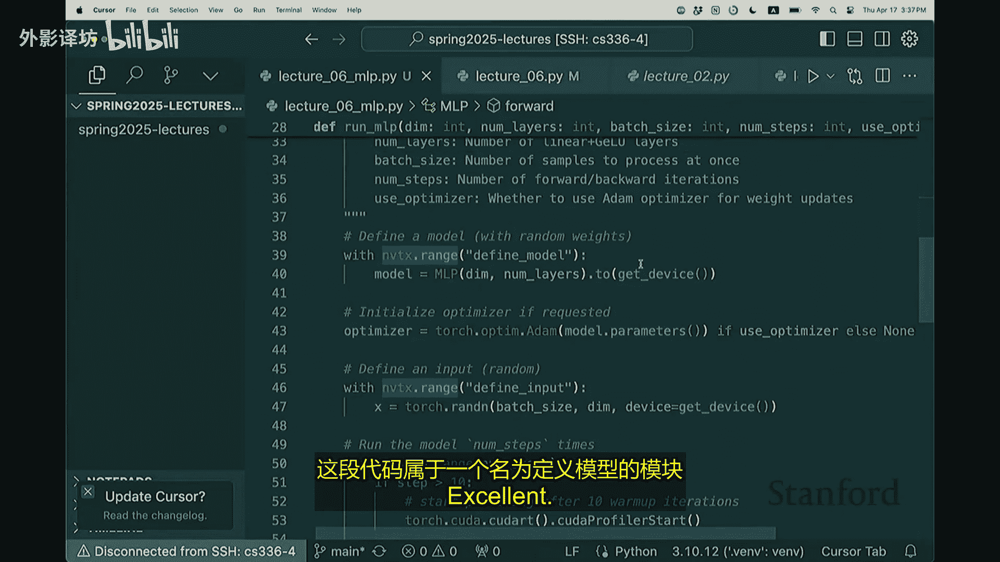

例如写着步骤范围推送和弹出的这部分。

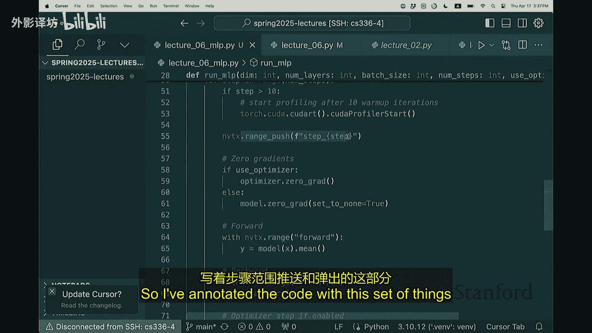

这里从第77行到55行的范围，应该用标注step下划线step的内容来注释，明白吗，所以在调用分析器之前，我已经在代码中添加了所有这些注释，那我们回到这里。

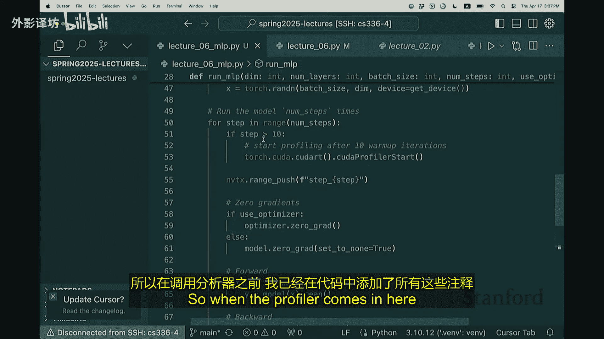

所以现在我们转到写着NVTX的这一行，我们大致能看到定义的模型，也就是我用来封装模型构建调用的部分，接着我看到了步骤零，步骤一，步骤二，步骤三，步骤四，步骤五，所以现在这个探查器里。

每个步骤都有了很好的注释，而且我们大致能看到模型运行时的所有操作。

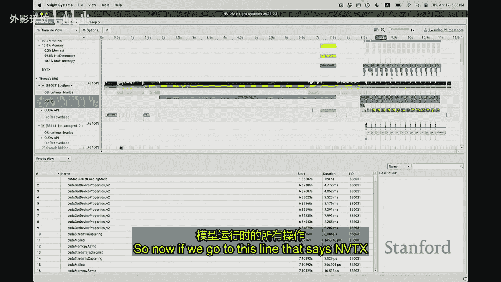

我将从这边开始，我们发现这段代码他没做多少工作，他只花了14秒，实际上探查器大部分时间都花在开销上，所以直到大概这里主要是加载库之类的操作，而这要花很长时间，仅仅初始化所有内容就明显需要7。5秒。

然后至少在GPU上程序运行到7。5秒左右，约五秒的时候，他开始真正构建模型，在这里你可以看到内存占用情况，这里就是内存开始分配的地方，在GPU内存方面，内存使用开始增长，此时模型构建完成。

接着是零部行动开始的地方，所以你之前问过CPU和GPU之间发生了什么，这个的执行模型是在CPU上，这算是零部，我从这里开始，这是前向传播，这是第零层，那么我们来想想发生了什么，正如我之前说的。

当你首次遇到过，当你首次在PYTORCH中调用一段代码时，他不会直接执行，它，实际上会做一些实时编译之类的事，所以向运行时触发模块加载，这种事是一种额外开销，为了初始化层而做以及计算。

并将各类代码片段移动到GPU中，所以这需要很长时间，然后在零层完成后，现在如果我看这里的任意一个切片，咱们稍微放大到选定区域，我们会看到这些层中的每一层都超快，这里发生的事，当我在CPU这边选中这层时。

注意那不是层一在GPU那边的位置对吧，就像我之前说的，CPU和GPU是两种不同的执行设备，所以我从层零开始，层林弄好了，我开始第一层，现在CPU实际上只是在发送各种扩大命令。

此时他已经将所有扩大内核都启动到GPU上了，所以当CPU说他在进行第一层时，它实际上是在将命令排队到GPU中，他说现在依次运行这个这个这个，所以CPU的运行速度比GPU快得多。

等到第一层在GPU上开始执行的时候，实际上我们在CPU上已经运行到第九层了，CPU已经大幅领先，而且CPU会维护一个队列，它会向GPU发送一定数量的coda内核，所以一旦达到那个队列深度。

它就会停止大幅领先运行，但在那之前它只会继续运行，然后尽可能的一直运行下去对吧，在这种情况下，这确实会变成我要再缩小一下画面，好撤销缩放操作行了，这样就有点过头了，因为如果我再缩小一次。

注意看在这些步骤里，我超前太多了，就好像零步骤在这儿呢，第二步在这，这是第一步，基本上没花什么时间，第二步来了，所以CPU基本上向前运行了一整步，并且在GPU之前反向运行，可能会做一件有趣的事。

如果你在编写各种训练语言模型的代码。

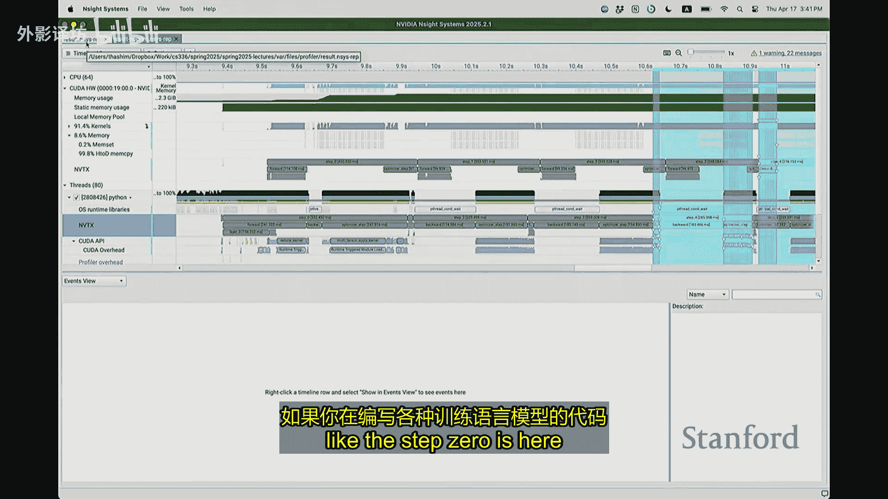

你可能会做的一件平常事，试我们回到代码，我可能会在迭代之间打印损失之类的，这似乎不会有什么影响，对GPU正在做的事没影响对吧，你可能会觉得嗯这是一条打印语句，它能有多大作用呢，稍微想一想。

这会对GPU的执行布局产生重大影响，因为要打印这条语句，这条打印语句在CPU上执行，而且CPU需要获取损失数据，这意味着它得等GPU算出那个损失值。

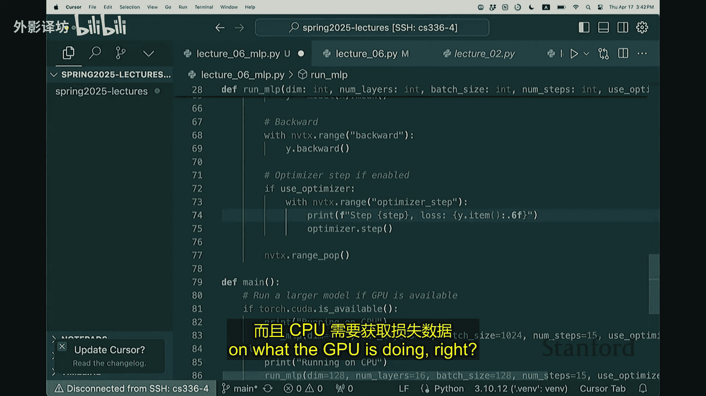

那我们看看会怎样，如我所说。

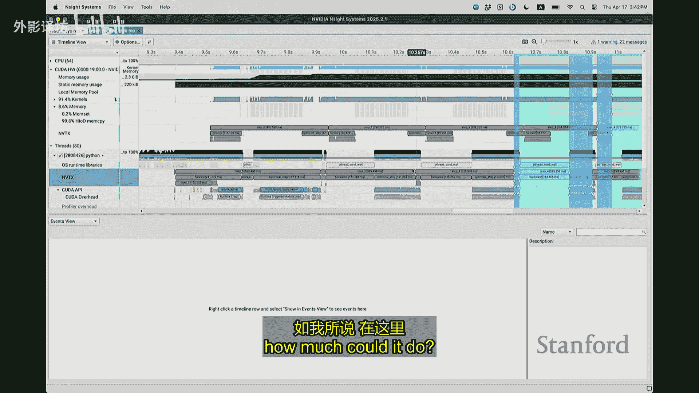

在这里CPU上的第四步比GPU上的对应步骤早很多，现在咱们切回去，这就是我分析的那个版本，这里有打印语句对吧，然后我在这儿放大选中区域，现在看看第一部和第二部基本同步了，对吧，因为我得等损失算出来。

你看这个，然后说但还是有点偏差对吧，就像第二步，第一步和第二步没完全对齐，那么现在咱们往回拉看看哈，CPU上的第一步咋了嗯，基本上CPU上第一部的终点处，也大致是优化七步骤开始的地方对吧。

所以到那时前向传播就完成了，抱歉这个Q大刘会进行同步，所以CPU上的这个KDA流同步命令，这基本上就是说我在等GPU，因为我不能提前执行，我在等这个损失被计算出来，然后会发挥给我对吧。

所以这算是个虚拟操作，这里是说CPU一直在等待嗯，反向传播步骤已完成，所以现在我能打印损失值了，我已打印损失值好，现在CPU可以开始向前跑了，而且他确实向前跑了，并开始发送第二步的东西了。

然后一旦这个到了这里，他快没指令可执行了，他又在等损失值了，库大已同步等等等，反向步骤已完成，现在我能打印损失值了，现在我又继续往前执行了对吧，所以在这种情况下，在这两种情况下。

GPU基本上都在满负荷运行，但在极端情况下，比如你一直在打印大量内容，你会引入CPU瓶颈对吧，因为CPU得一直等着GPU，而且它无法提前启动内核，所以这事还挺酷的，通过分析器就能看到。

有点像CPU与GPU的对比情况，实际上它们是相互通信的，不同设备，它并非一个单一的统一体，除非你开始用更高级分析器查看，否则看不到情况，否则看不到情况，关于这类事情有什么疑问吗，行好嘞。

另外我想给你展示一下，是我之前用过的分析器，你也能在NSYS中生成类似的视图，在那里你可以选择一些你想要的内容，咱们先热个身，我之前说过，我们要，所以我们要排除开头的几步，那我们从第三步开始。

我们将衡量一些步骤，大致在这个区间，我们可以采用这些内核，这就是进行计算的地方，而且你会发现，实际上有多种不同类型的矩阵乘法，这是一个矩阵乘法内核，这是另一种矩阵乘法内核，还有一种不同的向量化元素内核。

并且所有这些所需的计算量都不同。

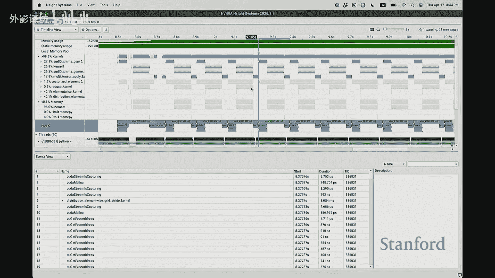

然后我们可以据此说哦。

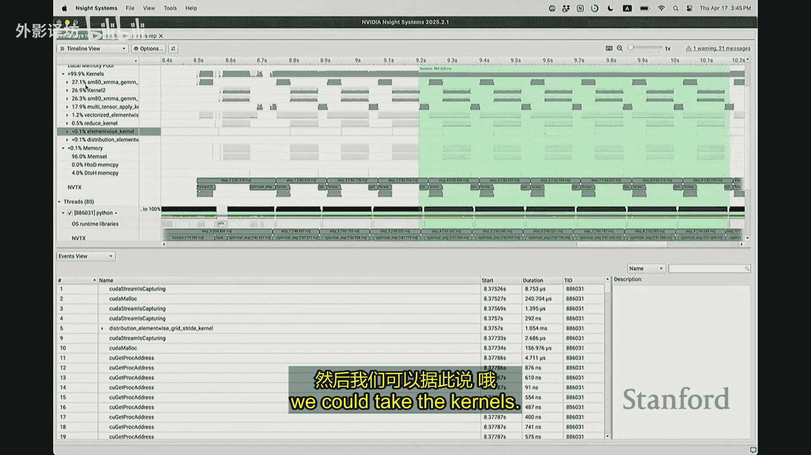

在事件视图里给我展示所有正在发生的事，我还能看到统计视图以及其耗时情况，等等看看，我们要平均时间，不抱歉，我们要coda内核执行摘要，对我们要内核的总时长，这样我们就能看到哪些内核耗时最长。

并汇总这些视图，所以这实际上是个非常非常强大的工具，能给出快慢汇总视图，以及正在被启动的各个内核，以及他们启动的时间，以及该内核的CPU命令来自哪里，我想最后讲一点，这就是为何无关紧要的原因之一。

我们用Python编程，而且Python不是高性能语言对吧，因为CPU从不成为瓶颈，因为CPU能提前运行，并可以将命令排入GPU队列，所以这种分离状态，或者像GPU之间的这种断开情况。

而CPU是关键原因之一，我们能使用这种出色的高级编程语言，但仍能充分利用我们的GPU，好的，在我切回这个之前有问题吗，因为我接下来不会再用NSYS了，在这堂课上是的，但在作业二里你会用到它。

我想你会喜欢的，因为它能让你了解到你的硬件实际在做什么，来训练这些语言模型好了，刚才讲的是基准测试与性能分析，现在你已拥有进行性能相关操作，所需的所有工具，现在我们要在剩余时间里编写一些内核。

还记得内核融合吧，所以这就是我课上给你们展示的图对吧，有个小工厂，每次我需要进行操作，我得把他从仓库运往工厂再运回来，所以要是我不假思索地依次进行一系列操作，我得支付不少运输费用来回仓库。

我该做的是找一个工厂一次性完成所有操作，这样我就不用多次付这笔钱了对吧，这很重要，那么现在我们要进行JU操作，然后我们要为JL编写一个内核，我会用几种不同方式编写那个内核。

然后我们来看看这么做对性能的影响，所以我们有GU的PYTORCH实现方式，它是这样的，TCHN函数里的GALU，我调用近似于ten的函数，因为我想让这个与我接下来要做的简单做法，完全匹配。

因为我想让这个与我接下来要做的简单做法，完全匹配，所以这实际上不会乘以高斯分布的累积，分布函数，它将是一个更容易计算的近似值，这就是PYTORCH，Tell you，现在我要干件傻事对吧。

你看这段代码就会说这性能会很低，我要进入PYTORCH环境，我要把GLU写成0。5LX乘以110，H乘以二分之根号TX，再加上0。044715乘X的立方对吧，神奇的公式。

但这是对伽利略公式的一个很好近似，你可以查一下，或者说服自己，这是真的，但如果你这么做，你会看到有很多运算对吧，有个类似双曲正切的东西，有个X的立方，还有乘以一个常数，以及X乘以0。5。

如果这涉及多个不同的KDA内核，这可能会很慢，从融合方面看，这应该是我们现在的直觉，那再来看看这是不是真的好嘞，这俩是一样的，在左上角能看到他们算出的数字一模一样。

我们可以在随机高斯数据上系统的验证这一点，现在咱们来给这俩做个基准测试，好对于一个特别大的值，手动计算时间是8。1秒，而PYTORCH耗时1。1ms，而且融合版本会快很多，实际上快八倍哇。

和写个简单内核比起来差别可大了，当然你的Mac模型可能仍是瓶颈，但要是能从8ms提升到一毫秒，那就太酷了，那会让人很满足，所以我们要尽量接近，在接下来几部分课程中达到1。1ms。

那么现在我们来看看具体情况，我无需查看NSYS，因为我只想了解一些高层次的内容，对于手动GLU就像我之前说的，它会进行一系列操作，它会进行一堆乘法运算，它是向量化的，但这里会启动一堆coda内核。

注意右边这个库大内核会被调用三次，因为这里有一堆乘法运算，我们还有加法，我们还有双曲正切，而且这些可能都有点慢，最后我们这么做会带来相当大的开销，现在让我们对PYTORCHJELO也这么做，这可太棒了。

只进行了一次KDA内核启动，而且他就能处理所有内容，这正是我们所期望的，当然这速度超快，因为它就是单个KA内核，所以这很不错，而且我们希望能设法用上KA内核，那么首先你可能会想到。

这取决于你对编写GPU高效代码的了解程度，PYTORCH团队肯定是用尽可能低级的语言，编写的这个，所以我们也这么做，我们不会采用最低级的方式，而是要使用C加加API，并且我们要用C加加编写CUDA内核。

那么让我们打开它并编写自己的KDA内核，那么这要怎么实现呢，好的，那么我们深入进去，并创建了整个内容的C加加版本，所以当我们说KDA时，它实际上适用于与GPU进行交互和编程的，C加加API。

就像我们描述的GPU的逻辑模型一样，我们要编写某种函数FF，然后当我们调用这个库大内核时，它将自动对向量的所有元素调用F或矩阵，然后我们就能并行计算所有我们想要的内容，在术语方面，我们将有一个网格。

它是线程块的集合，所以可以这样想，我有一个任务，我要把它分成一些块，并且会有一些快，例如在二维网格中，就是这样会有一个行坐标，然后会有一个列坐标，如果你在处理矩阵，这会非常有用，然后有这些块各自的大小。

比如这些块在线成块数量方面有多大，所以这就是块的维度，然后这些块里有一些线程，而这就是比如一个线程块所处的坐标，然后每个块里都有各自的线程，所以这里存在一种层次结构，有一个网格，然后网格里有一个线程。

接下来我们大致要每个函数都将接收三样东西，它会获取线程块索引，比如我所处的线程块快的维度是怎样的，然后我的索引是什么，比如线程索引，有了这些，我大致能知道我在矩阵或向量中的坐标。

然后我大致能够决定我想要的逻辑，在我们继续之前的最后一点，实际的C加加代码是在你调试coda时，你要以KDA启动阻塞等于一来启动，这将使你能够实际调试你的KDA内核，他会给你返回一些错误信息。

在运行时产生开销的情况下，如果你不这样做，如果你在编写co大代码并需要调试时，将会遇到困难，好了，这是我的JU代码，让我们逐块来看一下，然后我会讲解每一部分的作用，这可能耗时最长，在我们要讲的内容里。

除机器代码外，一旦你懂了这个，你应该就能理解其他部分了，所以我们会稍微慢点讲这个，所以这段代码分两部分，那么第一部分上面这块GELU内核，这就是实际的内核，他负责计算，这个会被发送到GPU。

它会进行计算，然后返回结果这块及这里的GLU函数，这是个包装器，这个在CPU上它会协调内核启动，实际上内核会到GPU上运行，那或许我们可以先从这种包装器部分入手，先从这个值函数开始，对不。

所以我们总会检查两件事，基本上在TATTON或CUDA代码里，我们总会检查哦，抱歉后面有人提问，好的抱歉，是我不好，这很容易搞定，但我得确认你看不见，好嘞，不错行，这样行不好嘞，很棒好嘞。

那咱们就从加里奥函数开始，我们总得做两件事，首先得确保得让X存于GPU设备里，像是某种哭大张亮那样，要是不这样，那就有问题了，咱们在GPU上就啥都干不了了，第二件事可能没那么明显，就是得检查一下。

确保X是连续的，就是说它存于连续的内存块里，因为当我们对X进行索引，我们要进行一系列索引运算，我们假设X存储在一块内存中，如果不是，那就基本无法通用的做到这一点啊，所以当我们计算GALU。

我们输入X我们会输出Y，所以我们需要分配一个输出，所以torch张量Y等于torch，创建一个与X形状相同的空张量，这只是说给我一个输出张量空间，或者一个指向与X维度相同的输出张量的指针。

并且注意我没有调用全零函数，这将节省额外计算，我不需要将这些Y值零，因为反正我都会往里面写入数据对吧，所以这是一个小，但不妨这样做，这是一种优化，接下来在我们编写的所有代码中，我们都得弄清楚网格对吧。

那么我一共有多少个元素，每个块的大小是多少，每个块里有多少个线程，那我总共有多少个块，当我要算出快的数量时，我会调用KD，它实际上是要计算比率，用元素数量除以块大小，然后向上取整，因为我要向上取整。

确保最后一组元素无法被块大小整除的，仍会被计算，所以我取向上取整，而非向下取整，然后这都是很简单的记录活儿，然后我说行启动内核，gay鲁内核启动了这种尖括号，表示这与给定数量的快有关，以及每个块的大小。

这会被传入内核命令中，接着我会传入指向X的指针，还有Y的，实际上我不会传入X的值，还有Y以及元素的总数，我需要用这个来计算内核的边界条件，内核的边界条件，现在来看实际的内核。

我有一个全局的void型glue内核，我获取输入的指针，还有输出以及元素数量这个关键字global，不好意思，网站这里显示有点乱，这里的显示有点乱，但你应该把它看作是下划线下划线。

global下划线下划线，这是个关键字，用于将其标识为扩大内核函数，那么我在做什么呢，嗯这个线程实际要对单个元素I进行操作，但我没有将I作为输入代码，实际上没告诉我处于坐标I的向量中。

所以我需要计算自己的位置，我该怎么做呢，我要获取快索引，我只有一个维度，所以是快速引点X及第一个坐标，然后将其乘以每个块的大小及快的DMX，这基本上告诉我当前快的起始点，然后我加上线程索引。

这样我就知道当前块的起始位置，然后我加上偏移量，我在块内的位置，这样就得到了全局坐标I，所以要进行一些不及计算来获取此处的坐标，然后这一点同样重要，你基本上能在人们编写的所有co大代码中看到，这种模式。

自然情况下不存在任何越界检查，所以你要做的事，我已获得坐标，我要检查，确保我要处理的是在边界内的数据，并且在线程块末尾的一些县城，他们将处理内存中越界的数据，你不会希望他碰到那些。

所以基本上你以A小于元素数量为条件，如果超出范围就什么都不做，抱歉是的，抱歉，这只是你编写KA代码所用的文件扩展名，这是为了将它与标准C代码区分开，好的，所以这只是个文件名，是see you。

它没什么特别的好的，那么现在在这里面我们要进行计算了对吧，就这么简单，我要写下，我有输入i in，我要去索引第I个元素，然后我像之前那样计算高斯误差线性单元，然后我把它赋给I的输出，然后就搞定了对吧。

就这些，这就是我要做的，而且这都是关于指针的，我真不用太担心这里实际发生了啥，大致就是这样，接着我就能用上自己已有的KDJU代码，然后就能直接内联加载这种C加加代码。

然后在Python里就能直接把它编译成一个模块，这一切都挺不错，很方便，根本不用跑到命令行去操作，这样一来CODJIU就定义好了，所以这挺不错，基本上它就是基于这个的编译结果。

在Python里就能调用它，我们会用C语言绑定来调用这个好啦，我们调用完CODJAU了，我有我能检查一下，手动的勾鲁和KDA版的格鲁一样，现在咱们来测试一下这俩的性能。

我测出了运行PYTORCH所需的时间和上次一样，大约1。1ms，记住手动算的话是8。1ms，那么让我们敲起鼓来，我们的扩大时间是多少，嗯我们已经将其降至1。8，不如PYTORCH的实现。

但我们已非常接近PYTORCH的时间，我们已从8ms降至1。8ms还不错，因为那段C代码不难写，所以现在我们也进行了一些分析，我们大致能看到这里正在发生的情况，它叫做GELU内核。

这就是发送到GPU的代码，然后它调用类似mt的函数，这是初始化，然后步长为空对吧，然后KDA启动内核并同步设备，基本上就这些了，再注意一下，这是一个Q大内核，占用了100%的GPU时间。

有点像我们想要的对吧，所以我们还能进一步优化，但这一切实解决了内核融合问题，我们把所有运算符都融合在一起了对吧，所以挺不错的，这类逐元素操作在coda中很容易编写，比如你要是有新的，我不知道非线性。

要是真想，你自己就能轻松为其编写一个co大内核，但更有意思的操作需要读取多个值，比如规约运算，那些会变得稍复杂些，快速注意力会稍复杂些，但也没那么复杂，当你必须在作业中完成时。

好的关于简单的C加加Q达内核有问题吗，对，所以问题是如果他不连续会怎样，至少在我们写的代码里，他会直接抛出错误，因为它不符合条件，你可以编写代码来处理它，但内存几乎不会碎片化，因为他会连续分配。

而且除非你在做很复杂的操作，否则不会在内存中间释放，而且除非你在做很复杂的操作，否则不会在内存中间释放，所以你真该除非你在做很高级的操作，否则内存是连续的，是的，所以问题是，如果你在进行转制。

那它就不再连续了，索引中的所有元素之间会出现跳跃，如果你对案列存储的数据进行按行便利，是的，所以我认为转置或者类似视图的操作，或者本质上改变维度算是唯一的例外，但这在外部的包装层是可以处理的对吧。

基本上你可以给它传递一个，具有连续索引的东西，对于很多矩阵而言，你其实不会在意对吧，是的嗯好吧，那要是你选了不同的块大小会怎样，与GPU相关的问题就会出现，比如说你有足够的快来让流多处理器饱和吗。

每个块里的工作量够吗，而这两点在这可能比较关键，但我觉得我猜对于比较大的块大小，像1024，过了某个程度可能就无关紧要了，因为我们没在做什么高级的操作，就这个极其简单的例子而言，全是竹元素操作。

我们的非GPU版本为啥这么慢，因为这个团队要做个小操作，然后再把GPU送回，然后你又让一个小版本也这么干，所以问题是，为啥我们非coda内核的手动部分这么慢，其实并不是他把数据从GPU发回。

CPUX会存放在GPU里，我们在GPU中分配它，我们将进行设备端coda操作，但他基本不在SM中全程，所以一旦我们算X平方，那就是个COA内核，所以那个乘法运算会把向量从全局内存。

读到SM中计算再写回去，所以这都发生在dram到SM是dram到SM的通信成本，而非CPU到GPU的，当然如果你已设备CPU编写，那么除了JM传输成本之外，你还会得到CPU传输成本。

好的现在你已经看到了还好，所以还不算太麻烦，但要是能用更友好的Python抽象，来编写KDA内核就好了，而这就是TRITTON，而且TRITTON相当不错，它处于很好的中间地带。

在这个地带你无需完全管理GPU的所有事物，所以TRITTON是OpenAI，在2021年开发的一种领域特定语言，并且它让GPU编程变得容易得多，所以某种程度上你用Python编写所有内容。

而且你不再真正去考虑县城了，你考虑县城快，并且try ton会管理诸多繁杂的事务，但可自动优化四，它能够管理内存合并，所以记住从动态随机存取存储器中，你一次会获取四个相邻的值，这就是所谓的突发模式。

所以你一定要确保你的内存读取操作，会被分组为相邻的四个一组，或者一次更多元素的调用，这样它就能自动处理，它会将这些分组，它会进行共享内存管理，当你需要进行管理时，在具有多个线程的流多处理器中。

你要写入哪种内存，在每个流多处理器内部，你可能需要停止或启动线程，这些都是自动管理的，单跨SM的调度或者不同SM的操作是手动的，所以编程模型是你要以SM为中心进行思考，并且编译器会处理更多底层细节。

而且TRATTON很不错，因为它比很多PYTORCH实现的性能要好得多，所以这有点像直接编写coda，但你仍处于熟悉的Python环境，而且我认为这里有个很容易被忽视的优点，都用Python。

你可以逐步查看，你能在一定程度上很好的调试，它让我们逐步查看一个track内核，再一次我们要编写GELU，并且我们要在tron中编写它，所以这里我让代码结构，尽可能与我们的其他代码相似，可以这么说。

这有点像是CPU端的代码，这是TRITTONJU的包装代码，他接收一个X，这是一个PYTORCH张量，我在顶部有两个断言，然后我再用EMT下划线，lag分配一个输出张量Y，并且他有着同样的坐标计算组件。

甚至内核启动看起来也很相似，我有这个number下划线blocks注释，然后我的块大小在这末尾不在括号里，但基本上我在给内核传递相同的信息，现在试试这边这段代码就是你的内核，这和我们之前做的是一样的。

但现在他是用Python巧妙编写的，这里的思维模式是输入位于X指针处，Y指针是输出向量，类似起始坐标，块大小就是每个块的尺寸，而number elements大致位于数组末尾。

所以现在我要获取557~561，这几行代码，这是在计算我的索引对吧，我之前给I赋过某个公式的值，这里也在进行同样的计算，我在计算当前块的起始位置，那是我的快ID乘以块的大小，比如说我住在一号块。

这样就能确定这个位置，他会得到正中间这个位置，然后我得知道自己在块内的位置嗯，这就是某种偏移量，但现在注意有一个不同之处，我不涉及偏移量，因为我不是在编现程程序，我在编快程序，那这是什么意思。

我的偏移量实际上是个向量，而非单个值，因为这基本上是我要做向量化操作，其中向量化操作由不同线程处理，所以这里我的偏移量是快的，起始点加上一个向量，也就是这种块大小范围的偏移量，所以我的偏移量同时包含了。

快一中的所有这些坐标，当然如果我在最末端，我可能会越界，所以我需要一个掩码来处理向量边界外的情况，现在我要一次性加载一个单一的向量化操作，一次性，所以X指针加上偏移量，这些就是我要负责掩码处理的值。

然后将其加载到X中，也就是我的内部值，我需要的内部临时向量，用这个临时向量，我要进行和之前一样的GALU计算，没有双曲正切函数，所以我手动计算它，但你可以自己确认这个公式和我们这里的一样。

然后Y就是上面算出的公式，结果现在我完成后，我需要把它写回到我的输出缓冲区或输出向量，所以我算出我的目标，所以这是Y指针加上偏移量，我取用我的值，我的临时值Y，然后我存储它。

所以这非常非常与之前的非常相似，但这个是向量化版本，我能够一次对整个块进行操作，所以不是从现成的角度去思考，我是从快的角度去思考，但也没太大不同对吧，这些都是相当相似的内容。

现在我已经写完了tron jelo，然后好的，我会尽快讲完好的，那么最后一件事我在这里只讲几点，因为我不想讲的太繁杂，让你们都听不下去走人了，但我们能做的最后一件超酷的事就是try on。

当然它会编译成一种针对GPU的，近乎机器代码的低级代码，当然它会编译成一种针对GPU的，近乎机器代码的低级代码，而且我们可以查看这种名为PTX代码的，非常低级的调用，在TRITTON编译器处理完它之后。

实际上还挺酷的，你大致能看出GPU在线程层面是怎么工作的，所以这就是TRITTONJU内核，它由编译器生成，一开始他会做些非常基础的事，那么他在这干啥呢，他在说嗯，我得存储些值对吧。

我得存储中间计算结果B实际上表示无类型的，基本就像字节，所以我需要32位大小的字节，我需要浮点数来做名为F的计算，我还需要另一组64位的寄存器，那是另一组寄存器。

这样我就有了所有这些寄存器用于临时计算的，然后从这里开始，我要开始计算我的坐标了，不好意思，这部分在加载函数的各种参数，比如X指针以及Y指针在这里被加载，从这里开始。

我着手计算我的TRITTON类内核的坐标偏移量，接着当我执行到这里时，这条全局加载指令，这是用于加载的代码，把X指针指向的值加载回我的临时寄存器，所以基本上是要加载R2R3R四。

利用RDE中的内存位置加载R5，注意他是如何一次性加载四件东西的，因为他巧妙地处理了合并操作，我们知道能免费获取四个值，我们应一次性处理这四个值，因为已获取到他们，然后你再对重复同样操作。

你在此处重复同样操作，然后基本上就开始进行浮点数运算了，即单精度浮点数运算，它基本上会进行双曲正切计算，我不会逐一解释，但此处它再乘以一个常数，它通过多次乘相同数来计算X的立方。

然后他将在此处计算二的X次方，但我们想要的是E的X次幂，所以他乘以log已得到指数形式的底数，你能清楚看到所有不同的GPU，未得到最终结果而进行的一步步操作，所以我直接跳到最后。

这些都是他需要进行的浮点运算，然后在最后他将R38到R41的值，存储到RD4中，即我们输出的内存位置rd4，那么这大致就是底层实际发生的情况，我们可以看到每个线程一次处理四个值。

并且它的临时存储是寄存器，这是非常高速的存储，它在非常局部的范围内拥有，所以我们能看到这回仅从表面看，这可能是相当快的代码好的，所以那就是PTX，我们可以查看，然后看看他在各种事情上的表现。

但现在咱们回过头来实际测测，所以手动操作加里奥用了8。1秒，PYTORCH耗时一点一秒，库达耗时1。84秒，TREATTON耗时1。848秒，所以我们没变得更快，但编写TRITON代码容易多了。

我们用Python写的，我们考虑了代码快，我们能进行向量化加法，要是你在做更复杂的事，基本上TRITTON会帮你处理很多内存相关事务，实际上还挺不错的，然后再进行性能分析。

我们看到单个内核启动占用了全部GPU时间对吧，所以这挺好的，然后就开始尝试各种内核，最后一点至少在这种情况下，哎呀稍等一下，好的，我要讲的是torch compile，当然编写库达内核很酷。

还会让你感觉超棒，但也许我们没必要这么做，我们在这干的事特简单，我们只是取这些X的立方以及指数运算，然后把他们一股脑塞进一个库达内核里，所以也许我们不用费太多事就能搞定。

我们已经给你们展示了几种不同的方法，我要讲的最后一个是叫做torch compile，它会采用未优化的PYTORCH代码，并生成更优化的代码，所以在这里它会尝试自动进行，诸如内核融合的优化。

这个编译后的值将会在其生成的实际输出中，是等效的，但现在我们来看看运行时间对吧，所以我们得到了运行时间有点变化，但基本上是同一类数据对吧，手动8。1秒，Pytorch，1。1秒，coda1。8秒。

然后1。47秒，torch编译对吧，所以重点是现代JIT编译器相当不错，它能进行像操作融合这样的优化，而你根本不用做太多，如果你看看幕后，你大致能看到基本上又一次发生了一件事，这是一种融合了加法。

乘法双曲正切的TRITON代码，所以他在幕后生成的TRITON，其功能与我们的TRITON代码基本相似，但实际上它比我们的优化程度稍高，所以它的性能甚至比我们的代码还要稍好。

所以torch compile相当不错，确实是的，问题是你何时知晓，我想表述这个问题的更好方式，是你何时知道自己能比torch compile做得更好，对吧，这算是个相关问题，我觉得对于简单的操作。

比如简单的运算符融合，或者他很擅长的另一件事是优化矩阵乘法运算，所以就像我之前说的，torch编译能做侏儒，要是他知道矩阵的形状，就能算出该调度哪些内核，他很擅长这些，我怀疑你很难比这做的更好。

但还有像要是你看过flash attention，一二和三，那些都是颇为重要的优化，如今torch compile和JAX的XLA编译器，就能做到那些，但这是因为我们事后才明白，那些是正确的优化做法。

我觉得其中有些事情不太容易弄明白，Flash attention，三有利用H100硬件的额外硬件层面优化，用即时编译器去实现并不容易，所以有些事情我觉得用torch compile很难实现。

我觉得你能做的更好，但一般来说我觉得重点是你回家后别这么说，我打算为语言模型的每个部分编写coda内核，那可能不太值得花时间，但要是你再编写一个带有复杂部分的新架构，而且没充分利用起来，但你觉得可以。

那也许是该用上TRITON的时候了，所以基本上时间到了，但我们可以快速过一下TRITTON的最后一个例子，也许这对你们做soft max作业的第二部分会有帮助，所以一个不同之处在于，到目前为止。

我们只进行基本的逐元素操作，而且这真的很简单，因为你只需对每个元素进行操作，而且这类事情没什么复杂的，那么现在我们来进行soft max操作，也就是它有一个规约操作，在这个操作中，你要对所有元素求和。

那么我们该怎么做呢，嗯我们要对矩阵的每一行进行归一化处理，我们想让这变得快速，所以这个的简单版本会很慢，现在我们要编写TRITTER内核，要是我想偷懒做这事，最简单的办法是你可以想想做这事。

最简单的办法，现在假设你要编写一个soft max，你要对矩阵的每行进行归一化，想象一下这些矩阵很小，所以你只是在为小矩阵编写内核对吧，要是你在做这个怎样的分块设计才合适，嗯或许我们该让网格就只是行。

所以每个计算单元负责处理一行，这算是最优做法了，因为要是能把一整行放进一个计算单元，那就直接在计算单元里对该行求和，然后再做除法对吧，挺好的，所以这就是我们这个超级简单的，soft max内核的设计。

所以我们要做的是，我们要把块大小设为，我们将把每个块设为一行，所以块大小应为列数，再加上一点缓冲区，以容纳所有列，所以这是TRITTON中N的下一个二的幂，这是填充列的好方法，然后我要把每个块设为一行。

所以块的数量恰好是行数，接着我有treaton soft max内核，其编写方式正如你所想，所以现在我们有一个矩阵而非向量，所以我们有X个指针，我们有Y个指针，我们需要矩阵的步长。

然后我们就能大致算出自己所在的行索引，我能得到列偏移量，这将是与之前类似的代码，实际上获取行偏移量更简单，因为每行都是一个快，接着我要做类似的事情，我会把每一行加载到SM的本地内存中，然后进行计算。

方式类似soft max，针对每一行先减去最大值，再取指数并求和，然后做除法，得到soft max归一化后的形，然后将结果写回全局内存，毫无复杂度，只要计算能在SM中顺利进行。

编写TRITON代码和普通Python代码很像，只是多了些加载操作，还有存储以及跟踪快的位置，所以挺简单的，咱们回到TRITTON开始，然后我们能大概看出各个代码片段的运行速度，所以我再缩小一下。

只是确保一下行，所以手动计时要3。7秒，用torch编译的时间是1。3秒，PYTORCH耗时1。5秒，TRITTON耗时1。9秒，还是有点慢，实际上，torch编译比原生PYTORCH实现表现更好。

特别是当他了解某些操作的形状和大小时，所以最后我们可以查看性能分析器，在这里手动执行soft max有点麻烦，你会看到到处都在进行各种疯狂操作，我来清除这个，如果我们回到这里没错。

我们能看到各种操作在四处进行着，我们有x max和SU，因为我们的实现方式比较简单，并且内存读写操作随处可见，编译后的soft max会是一个相当快的融合操作。

然后我们有PYTORCH的soft max，它同样也是一次KDA内核调用，我们的triton soft max亦是如此，我们有出色的triton soft max内核，它是一个整合了所有功能的单一内核。

行这段PTX代码我就不细讲了，我想你懂的，我们时间有点紧张了，而且我也不想再跟你们讲底层内容了，但希望这能让你们略微了解底层GPU编程。

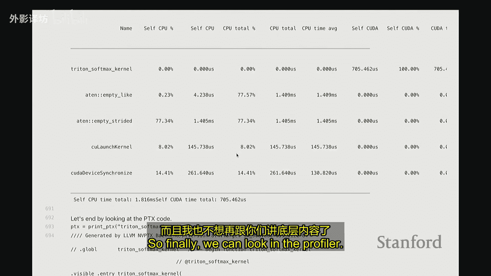

以加速语言模型运行，希望你们做第二项作业时能乐在其中。

