# 【中文配音】硬核！斯坦福 CS336：手把手带你从零构建 ChatGPT - P7：7.分布式训练技术（上）：数据与流水线并行-Parallelism 1 - 外影译坊 - BV1BWEWzfEKi

好嘞，今天是基础系统课程的第二讲，现在我们要继续讲多机优化。

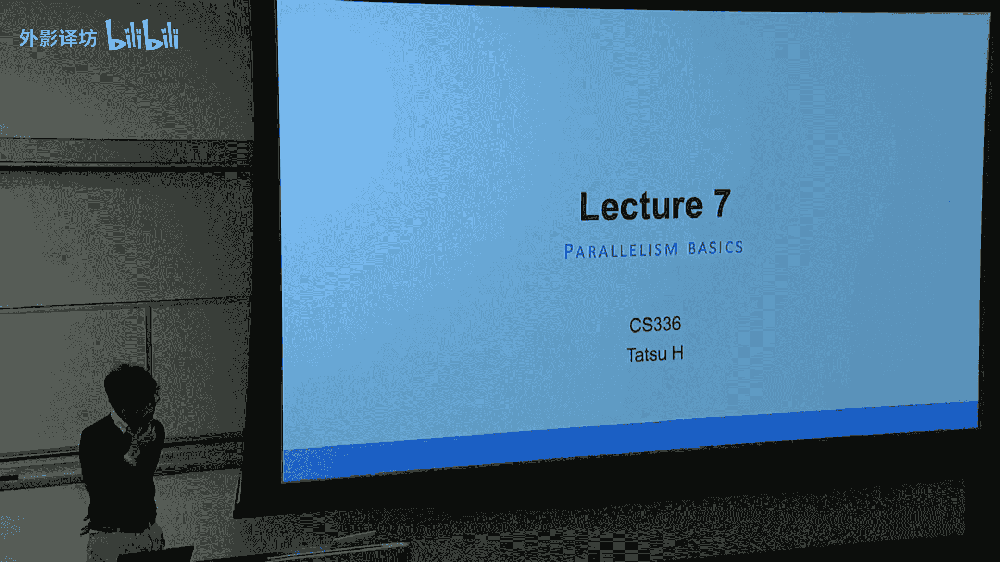

所以今天的重点是跨机器并行性，所以今天的目标是从优化单个GPU的吞吐量开始，到能够理解这些复杂性，以及训练超大型模型所需的细节，当模型变大时，就无法在单个GPU上适配了。

所以你必须将模型分散到不同的机器上，但同时你必须能够利用你所拥有的所有不同，服务器，以快速训练这些模型，所以我们既要应对计算，又要处理内存方面的问题，不同机器之间的通信会相当复杂多样。

在不同层级的GPU之间，我们有不同类型的通信，我们有不同类型的通信，因此这会产生不同的并行化范式，人们会同时使用多种不同的并行化策略，我们会详细探讨每一种流行的策略，接着我们会讨论如何将它们组合起来。

从而高效的训练一个超大型模型，然后我将以来结束本次讲座，看看一些例子，人们实际运用这些并行化策略的，来运行大规模分布式训练好的。

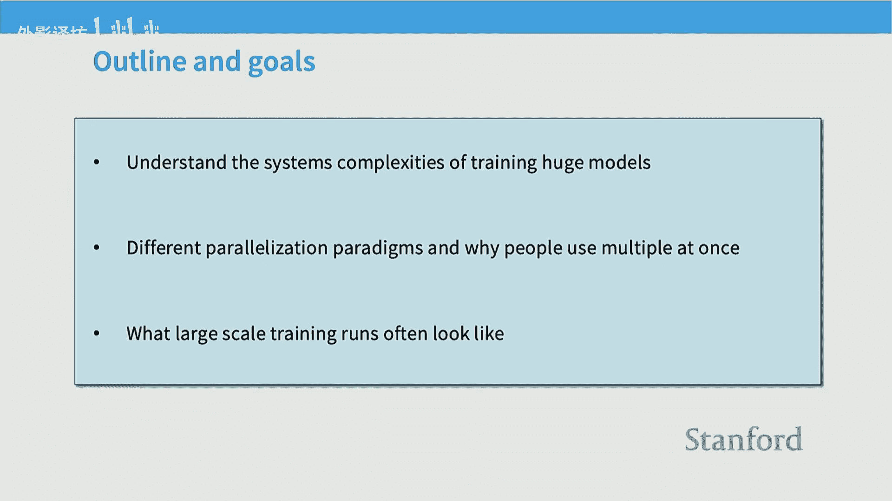

所以这大致涵盖了本讲座的不同部分，我们先讲讲网络的基础知识，接着我们会探讨，如何这些网络硬件概念，如何映射到不同的并行化策略，会有一些案例研究收尾向你展示如何整合，所以我上周跟你们讲过GPU扩展。

看到每个GPU的每秒浮点运算次数呈超指数，曲线急剧上升，相当令人印象深刻，但是如果我们想快速扩展计算和内存，单靠一个GPU不够，我们得再等几年，让这条曲线持续上升，所以如果我们想训练一个强大的语言模型。

现在我们得依靠多机并行，那么看看世界上最快的超级计算机，右边展示的就是这个最快的超级计算机，具备强大的计算能力，可达百亿亿次浮点运算，那边你看到的绿色线条就是那些，这就是你真正得依靠的。

若你今日打算训练最强大的语言模型，所以这就是为何要考虑多机并行性的计算方面，原因，但我们也可从内存角度思考同样的问题，所以这两者才是核心资源，以及你必须要考虑的核心问题，那么在内存方面。

许多模型变得相当大，当然GPU的内存也在增长，但速度没那么快，而且单个GPU装不下这些模型，也许最终在遥远未来，我们无需担心诸多此类问题，但我们有数10亿的参数，他们无法很好的装进单个GPU。

所以我们得十分留意所面临的内存限制，所以这些就是我们要应对的现实情况，那我们需要哪些工具来处理这些呢，嗯GPU想必你们已经留意到了，在课堂集群里，他们并非单个出现同一物理机架内的一台机器。

会有多个GPU，下面举个例子，我记得这是从gt neo x论文里拿的，但这是个老例子，但同样的道理，也适用于你们课堂上的H100机器，这里有八个不同的GPU，它们通过快速互联与各种CPU相连。

在每个GPU内部，你能在底部看到这个MV交换机，这是八个GPU之间极快的连接，但如果这八个GPU想与另一台机器上的GPU通信，他们得通过一个网络交换机。

你看这个那条写着HDR infinite bad的紫色线条，要知道跟NBLINK连接比起来，这个连接速度慢多了对吧，你能大致看出吞吐量的差别，每条通道速度大概慢八倍，所以这种硬件层级。

我们所拥有的将会有重大影响，对于我们在实际中最终如何让模型陷入瘫痪，讲这些时，你可在脑海中保留这个思维模式，在单台机器内部我们有非常快的连接，然后当我们跨机器时，速度会变慢。

然后取决于我们使用的硬件一旦超过，比如说甚至可能会更慢，256个联网的GPU。

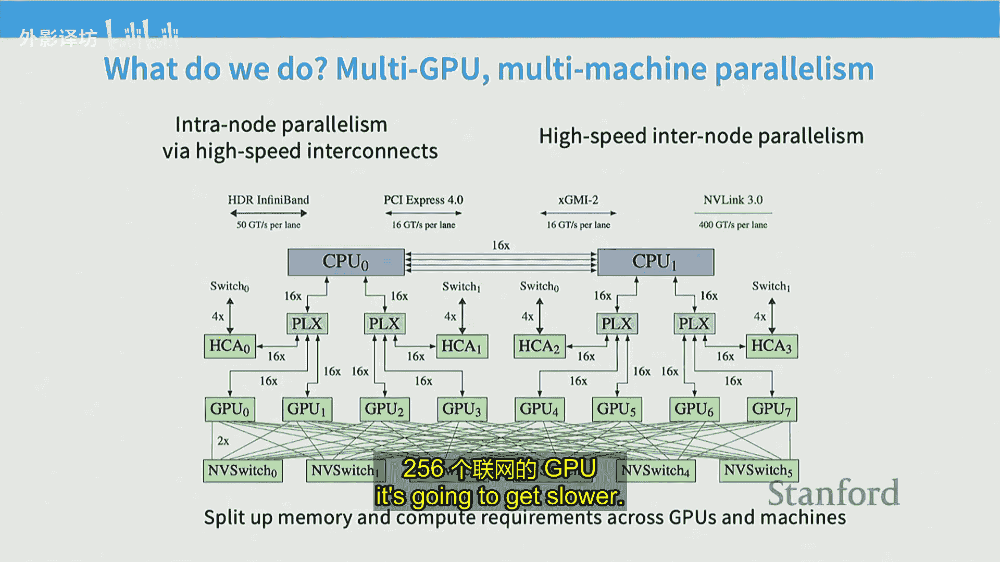

你们很多人可能已经知道，这个学过系统或网络课程，但这里简单复习一下集合通信操作，我之所以提到这个，是因为有一个特别重要的特性，或者是你多少需要了解一下的某种等价关系，才能真正搞懂一些细节。

并行化算法性能特征的，那我就来讲讲这些，然后我再讲讲一种重要的性能方面的影响，那么第一个你们可能都听说过，就是全规约有四台机器，这种情况下有四个节点，每个节点都有自己的数据，你要做的是执行某种规约操作。

假设我要把所有这些输入加起来，然后我想把输出复制到每台机器上，这大致会产生成本，大约是你们所规约总数的两倍，你有一个广播操作，这里我从2号获取一个输入，然后我想把它复制到其他所有号对吗。

这大致会是约一倍的，从通信成本角度来看的，输出总数，然后是规约操作，我们有不同的输入，然后这些会被加总，然后只发送到一台机器，然后有两个非常重要的，即使这些可能不太常见，全收集和散射就是这样的操作。

所以全收集是一种操作，比如说我从第零个参数中提取某种单一子组件，然后把它复制到其他所有机器上，第123个也是同样的情况，所以比如说这些分别处理参数的不同部分，然后把它们复制到其他机器上。

所以这差不多就是，把我有的复制给其他所有机器，还有规约散射，比如说我处理每一行数据，我把它们加起来，然后只把结果发送到第零个机器，这是全规约的一个部分示例，希望这张图能清晰展示规约散射的工作原理。

全收集和规约散射都相当重要。

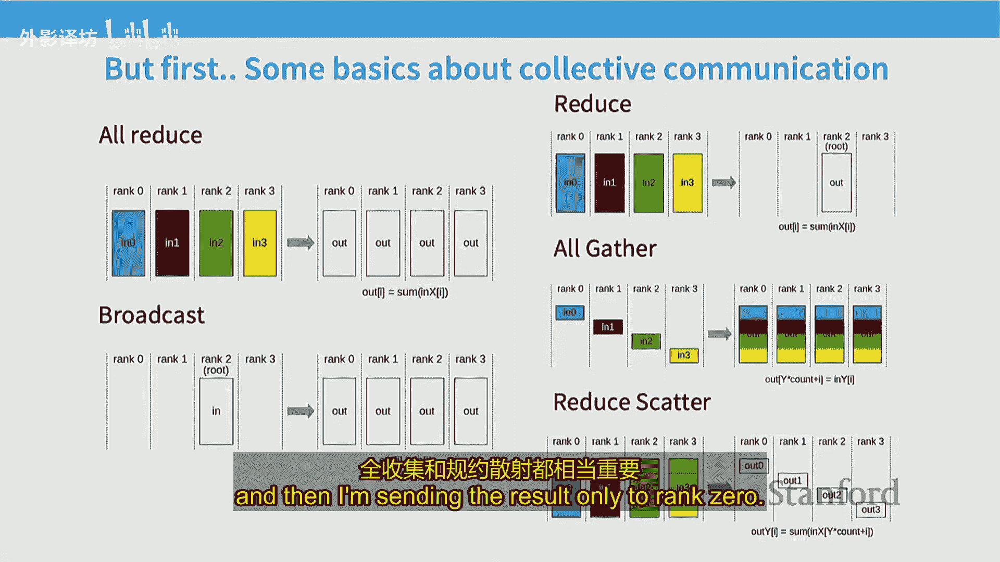

因为在某种程度上，它们是构建的基础，众多并行化算法所基于的基础，所以这是一种重要的等价关系或恒等性，我会在讲座中提及，他一或两次作为本次讲座的关键点，如果你想进行全规约操作。

比如说我有不同的显卡ABCD，并且每个显卡都在处理一个不同的数据点，所以这些数据点都有不同的梯度，而且我得把这些梯度加起来，然后我要把所有这些梯度传回给显卡，这是个经典的数据并行操作。

我可能要在四块显卡上做，所以这就是全规约操作，不过有件重要的事，这可用两个操作替代及规约散射和全收集，规约散射会对每行进行求和，然后将每行结果留在，比如分别留在GPU0123中，然后我要进行全收集。

以便将其复制回其余GPU，所以现在每个GPU都得到部分参数的完整总和，然后他会将其复制回其余工作进程，在带宽受限的情况下，这基本就是你能做到的最好程度了对吧，对于全规约操作而言。

你能做到的最好程度是大致与规约散射的带宽，相匹配和全收集，你可以通过列出在全规约操作和右侧操作中，各发生了多少种通信操作。

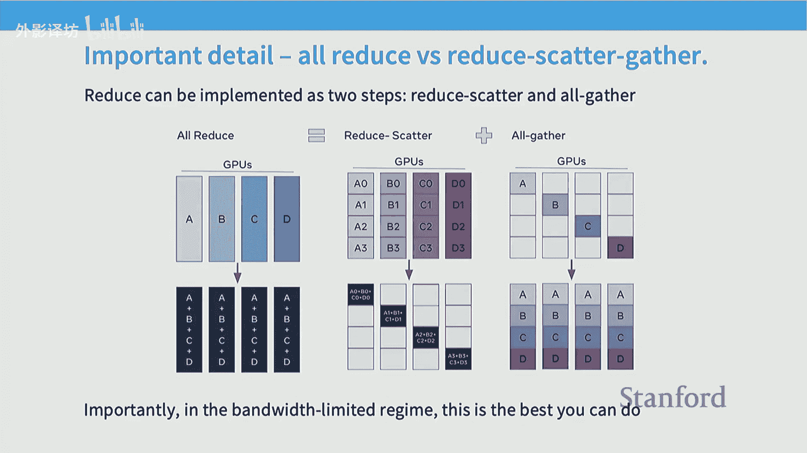

我最后想简要提及的一点是，在我开始讨论并行化算法之前，这大概是我唯一会讲到GPU与GPU对比的地方，今天的大部分讨论实际上可以不考虑底层硬件，但实际上有件重要的事，我想先提一下。

以便我在讲解过程中能稍后再提到它，在GPU里我们要如何将不同机器连接起来，或不同加速器连接起来，嗯就像我在这的GPTNEX幻灯片里给你们看的。

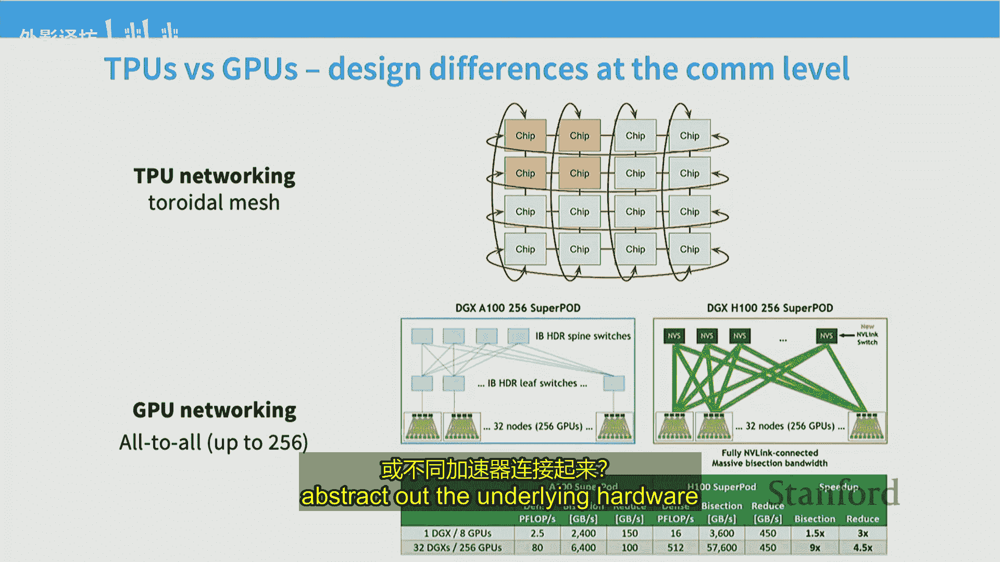

在GPU世界里，他一般是这么工作的，你有一些节点及单个机器，假设每台包含八个GPU，然后有这些交换机能相互快速连接的，并且这些机器全互联。

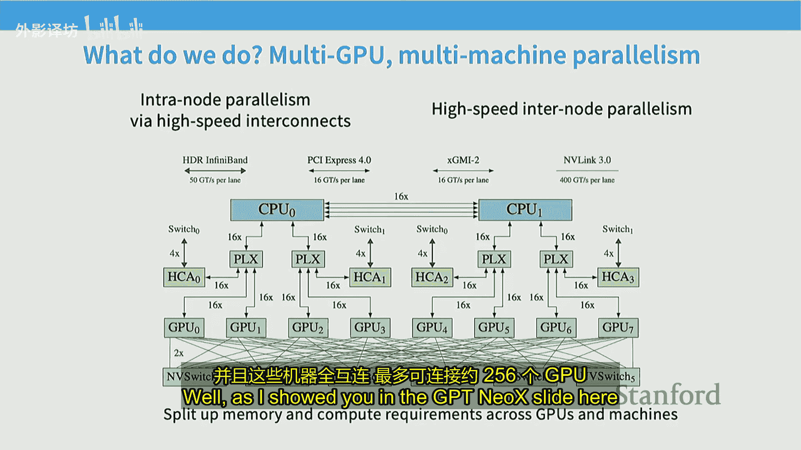

最多可连接约256个GPU，所以这是个重要阈值，在此之前机器间通信非常快速且任意，然后超过此阈值，实际上你将需要慢得多的通信，即这些液交换机和几交换机，一旦你超过了大约一个机架的GPU数量，另一方面。

如果你看一下谷歌的TPU设计，他们在机器联网上采用了截然不同的方式，你有一个TPU芯片，他们都能非常迅速的与相邻芯片通信，所以这是一种极易扩展的，他们称之为环形网格，但你只能与相邻芯片通信。

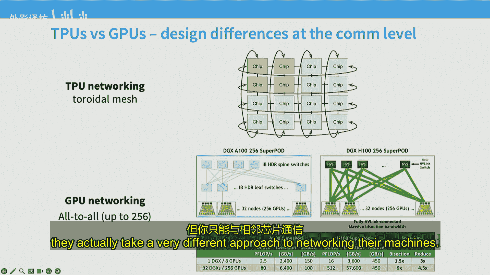

而我之所以讲这个在全规约幻灯片之后，若你考虑进行诸如全规约或规约散射。

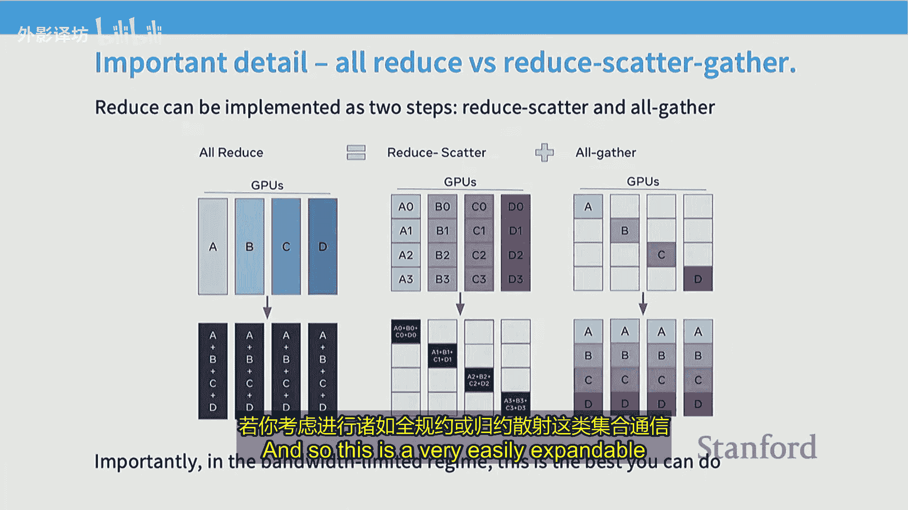

这类集合通信，你能同样高效地实现它们，在环形网格上实现，这些集合通信会比在全队全连接上更高效，所以要是你纯粹为集合通信做优化，那么考虑TPU网络是有道理的，而非GPU网络，我将简要谈谈优点。

稍后我讲解不同定型化操作时会在谈及利弊。

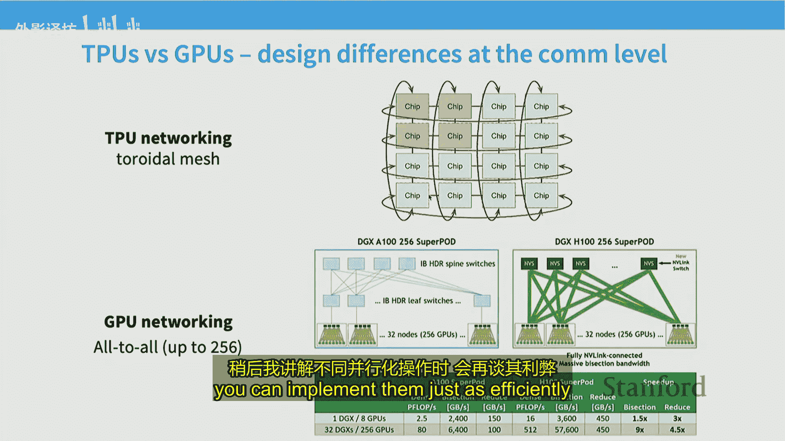

稍后我讲解不同定型化操作时会在谈及利弊，那么综合来看，现在我们要开始讨论一种新的计算单元了，不再是GPU，新单元，是数据中心，整个数据中心将是我们的处理对象，现在我们要尝试想出一些算法。

以及一些分片策略，实现两个不同目标，第一个是线性内存扩展，那么当我扩大GPU数量时，我能训练的最大模型也会随之线性扩展，所以我能训练更大规模的，要是我真想就能训练更大的模型，我也需要线性计算扩展。

随着我增加GPU数量，我用于训练模型的有效计算也会线性增长，最后许多这些算法将被实现，只需通过各种方式调用，这些非常简单的集合通信原语，所以当我们思考这些并行算法的性能特点时。

基本上通过计算集合通信原语就能进行推理，就能进行推理，所以这是思考这些的一种重要方式，这里我们不会深入探讨这些算法的底层实现，好的，关于第一部分有问题吗，从上一张幻灯片，这是否意味着相比全规约操作。

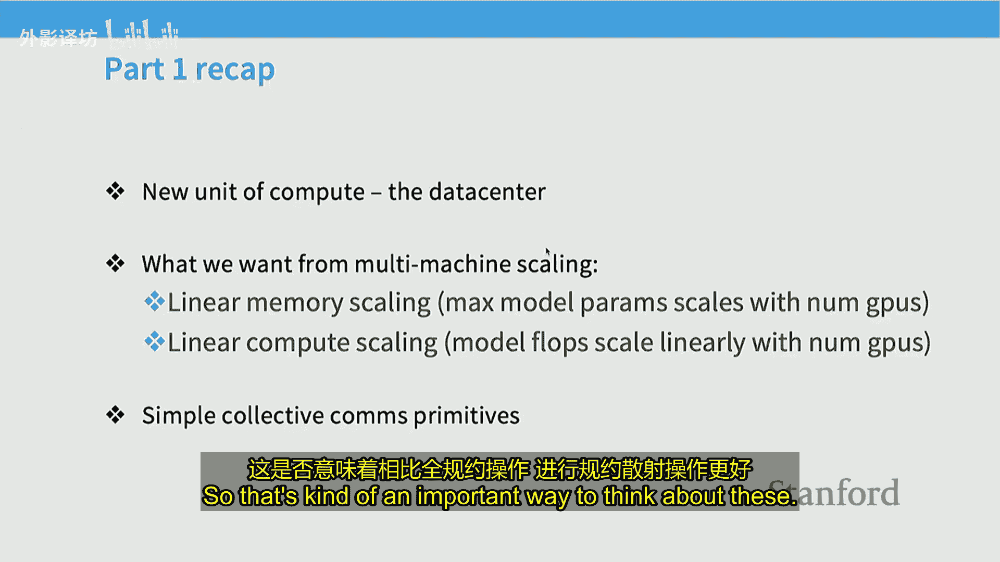

进行规约散射操作更好，而不是全规约操作，没错，就是这张幻灯片，这张幻灯片的结论是它们是等效的，我觉得如果你想想类似这样的情况。

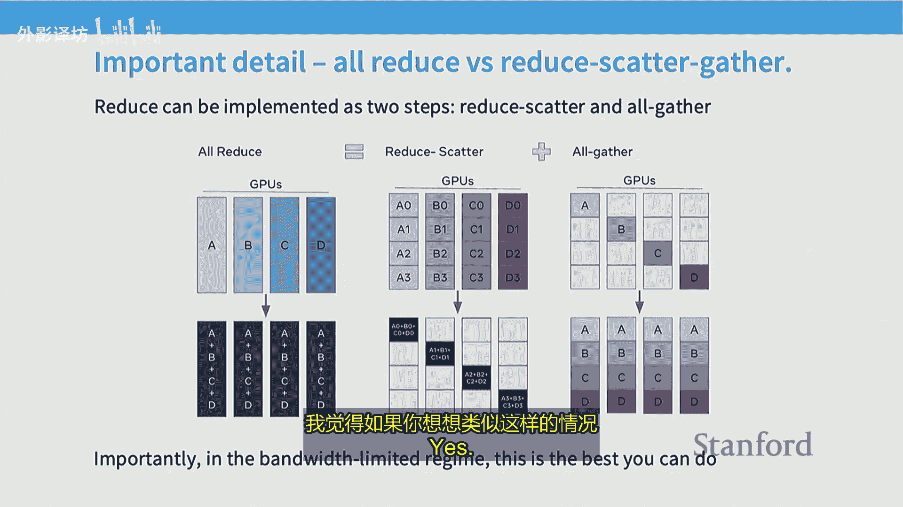

在并行进行梯度下降时，全规约是一种很自然的操作，因为你要进行散射，抱歉你要把数据分散到不同机器上，然后你得一起对梯度进行全规约对吧，但我想说的是这种很自然的操作，全规约实际上可以写成两个不同操作的。

和它们是等效的，所以在性能上没有什么损失，从左边的表示形式转换到右边的表示形式，至少在带宽上，这在大概五张幻灯片后会有重要影响，所以你们可以稍等看看，我为什么提这个好的，还有其他问题吗，很好好的。

现在我们要开始了，从某种意义上讲，这算是本次讲座中颇为精彩的算法核心部分，这里有三种并行策略，是我们真正需要思考的并行性内容，所以第一种是数据并行，高层次的数据并行，就是要大致复制参数，在不同GPU上。

我不会担心拆分参数，但我会使用我的批次数据，并拆分我的批次数据，不同的GPU或机器会分到我批次数据的不同部分，这就是数据并行执行，这个操作有很多微妙之处，现在模型并行开始有这种情况了。

我不想让所有GPU都处理模型的所有部分，随着我的模型变大，那会是个大问题，所以我得巧妙的分割模型，需要GPU处理模型的不同部分，这就是模型并行，最后一部分是激活并行，我们平时不太会想到激活函数。

因为PYTORCH处理起来很透明对吧，但随着模型变大，序列长度变长，激活内存开始成为大问题，所以要用很大的批量训练这些大模型，就得想办法管理激活内存，所以我们也得把它们分开，所以有办法解决这个问题。

当我们把这些都整合起来，我们拥有工具，以便在拥有大量机器时扩展计算能力以及内存，以便在拥有大量机器时能够顺利扩展内存，所以这些算是核心概念对象，现在我们要讨论如何高效实现这些想法，所以数据并行的起点。

某种程度上就是随机梯度下降，如果我们进行的是非常简单的批量，随机梯度下降，做这个的公式，就如我幻灯片上的这个等式，我取批量大小为B，然后我把所有这些梯度加起来，然后我更新参数，所以简单的数据并行。

就是说好取批量大小必并拆分，然后发送到不同机器，每台机器计算这个总和的一部分，然后我会统一交换所有梯度来同步，在每次类似操作后，每次梯图更新前我会同步梯度，然后进行参数更新对吧。

那么现在我和你们讲计算还有内存扩展等，那我们说说这些都是什么样的，对于计算扩展数据并行性很不错，每台机器每个GPU都会得到BM个样本，要是我的批次大小够大，每个GPU都会得到一个挺不错的批次大小。

也就是VP4大小，而且有望让计算达到饱和行，这挺好，通信开销是多少嗯，每一批我都得传输两倍数量的参数，记住一次全规约操作大致是数据量的两倍，这里指的是通信成本方面的量，所以要是批次大小够大。

这就没毛病对吧，要是我的批次规模够大，我就能把通信开销给抵消掉，时不时同步梯度带来的内存扩展，这事我完全不碰，每个GPU都得复制参数数量，他还得复制优化器状态，这对内存扩展可太不利了。

所以要是我们完全不用操心内存，这算个可行的策略，但我觉得实际情况是内存就是个问题，我想在座的各位都曾尝试，将大型模型加载到GPU上，结果PYTORCH提示内存不足，你内存不足。

而这对训练而言同样是个问题，因为若能处理更多批次的数据，就能提高数据并行的效率，所以理想状态下最好能节省内存，那咱们来仔细看看，简单数据并行的内存使用情况，而且实际内存情况比看上去更糟。

这实际上相当糟糕，因为你在作业一中已经做过这个，但我们可以大致想想需要存储多少份模型，而且数量很大对吧，取决于的精度，在我们进行一些训练时，每个参数你大约需要存储16字节的数据。

实际上你需要存储大约五份权重数据，这真的相当糟糕，因为如果你只考虑模型参数，从技术角度讲，你只需要两个字节对吧，那这个八倍的系数是怎么来的嗯，至少得要梯度，要是你用bf16来计算梯度。

那就又得要两个字节，但接着优化器状态就冒出来了，这可就是个大问题了，因为你有四个字节的主权重，就是你在随机梯度下降里累加的那些，就像你算的这些，中间和你需要四字节或两字节来存储，ADAM的E接取估计值。

因为ADAM会记录历史梯度，然后ADAM还需要二阶矩估计，类似于你过去所获得梯度的方差，而这还需要额外的四字节或两字节，所以原本看似不错的情况，如今实则相当严峻，所以这个16倍的。

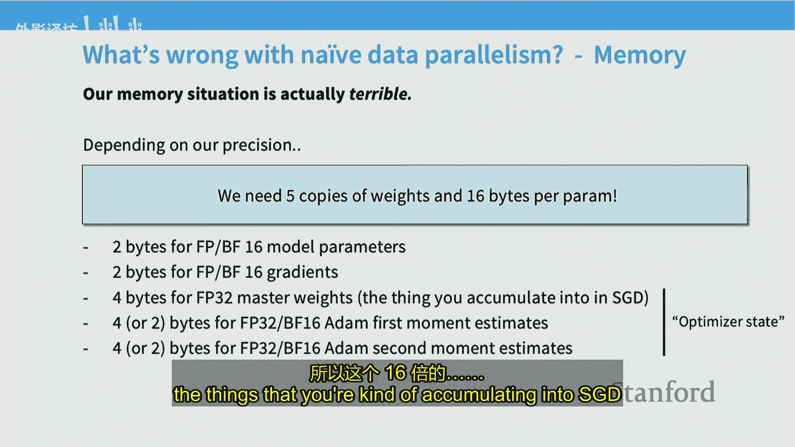

如果我把它画成一幅图，你会意识到你大部分的内存使用，至少在参数内存这方面，实际上主要由你的原子优化器，的优化器状态决定，所以你所消耗的内存将取决于你的优化器状态，占用了多少字节。

而且通常这甚至会超过核心参数和梯度的内存，使用量，那么举个简单例子，一个75亿参数的模型，分布在64个加速器上，你正在使用大量内存，而且这种内存至少在总内存上呈线性增长，会随GPU数量线性向上扩展。

所以这根本不行，但一旦我们大致看看这个情况，我们就能得到一些很简单的想法，显然你可能会想或者可能并非如此明显，我需要跨设备复制参数和梯度，这对数据并行来说似乎是必要的，但我真的需要所有优化器。

状态都在每台机器上吗，一旦你问了这个问题，你也许能到这儿的第二行，这就叫做优化器状态分片，要是我们能做到这点，那么至少在这情形下，我们能把总内存使用量从120G，降到31。4G。

接着或许我们能开始对梯度进行分片，然后我们能把内存使用量降到16。6G，要是我们还对参数进行分片，我们能降到1。9G的内存使用量，那会是个相当不错的情况，因为现在我们已大致完全分片了，整个优化器状态。

以及我们所需的参数和梯度内存，什么是，我猜是对他们逐个进行梯度计算，这是个很好的问题，问题是我们如何分配优化器状态，当我们进行数据并行时，GPU0必须负责处理数据0。1。

所以显然他需要了解所有参数并进行更新，那么他要如何对优化器状态进行分片呢，某种程度上我觉得是零，就是这个意思，这就是零开销的数据并行优化器，这在某些方面非常巧妙之处在于它表明，即使当进行数据并行时。

实际上无需将所有内容都复制到每台机器上，在通信方式上可以巧妙些，以避免这些情况，所以我将详细讲讲这个这是个很棒的问题，那么我们要做的是，如我所说，我们要拆分优化器状态。

所以一阶和二阶矩现在分布在所有GPU上，但每个都有参数和梯度，那么这有何重要性呢，若我有参数和梯度，假设我是GPU0，我拥有所有的参数和梯度，这些足以让我计算完整梯度，这个事例可以计算完整的梯度更新。

我唯一做不到的是无法获取那个梯度，并进行原子步长更新，除非看到所有优化器状态，否则我无法更新参数，所以这算是关键所在，那么现在GPU0将计算所有内容的梯度，但GPU0现在只负责更新其所属分片的参数。

所以这算是关键所在，咱们要把更新参数的活分配一下，然后再把参数同步回去，那我给你详细讲讲这具体是咋运作的。

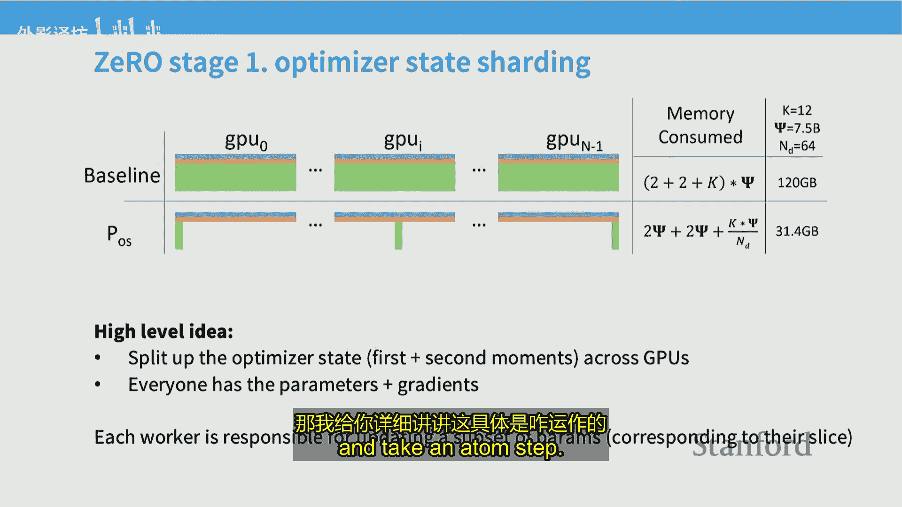

还有为啥叫它零开销，那第一步哈，比如说每个GPU拿到一个不同的数据点，我就把这些批量计算简化一下，假设有零到4号GPU，每个GPU都拿到一个示例，他们会在各自持有的势力上计算完整梯度。

接下来我要对梯度进行规约散射操作，所以我要发送这些梯度，我要进行收集每个GPU各自的梯度，假设GPU0负责这14的参数，这里参数在Y轴，而X轴是GPU，所以我们要进行规约散射操作。

以确保GPU0拥有全部梯度信息，来自其他所有GPU用于其负责的那部分参数，所以现在他从GPU已获取该梯度信息，以及GPU2和GPU3，所有这些都归约到GPU0中，希望这讲清楚了。

现在GPU0拥有更新自身参数所需的全部信息，因为它拥有与第一部分对应的优化器状态，它拥有第一部分的完整累加后的梯度，现在它将进行一次梯度更新，就其参数部分而言，使用梯度和状态对吧，这样一来。

我在GPU0中就拥有了该子集的完整更新参数，而我要做的就是将所有参数进行全收集，把更新后的参数返回给所有节点，好的，这里有不少问题，我从这儿开始没错，所以问题是，参数通信成本的数量是按每台机器算。

还是按总数算，这里指的是总数，这将是约1/4的参数，会被发送到这台机器三次，然后重复四次，那是从一台机器来的吗，那也是总数目参数数量的两倍，就是总数，因为每个块都要发送到其他类型的机器上，什么是。

所以这个问题并非你展示的内容才有的，但让我想到了这个问题，所以好像在很大程度上假定参数是相互独立的，当我们画出所有这些表明相反情况的图表时，比如我们有相互连接的节点之类的，而且当我们出现情况时。

这似乎尤为紧迫，当我们试图把这些分开并分别进行更新时，那会引发什么问题吗，好的，那么问题是，亚当W似乎假定参数是相互独立的，我这么假定是，因为你说我们在追踪梯度和之类的。

然后我们大致沿对角线方向更新参数对吧，但我们知道它并非完全对角，那么这有问题不，你知道已经有有更好的尝试来改进ADAMW，使其不只是对角的，有像KFAC这样的东西，还有所有其他类似的二阶优化器。

是人们想出来的，他们还没能取代ADAM，尽管他们确实有优势，有一些非常有趣的事情，你可以用这些改进的二阶预处理方法，去做什么事，我们正在规约哪些行，所以你是在问这张图的形式什么是的。

那么想象一下这里的行代表参数，比如说GPU0负责若干参数，所以上面这是一组参数，所以当我们进行规约散射时，我们的意思是以这组参数为例取第零个梯度，以这组相同参数为例，取第一个梯度，然后把它们加起来。

然后把它们放到第零个位置，大致是我们这里说的意思，行知道了，这里关键是我们在做规约散射操作，在全收集操作中对吧，要是你还记得我之前说的，全收集操作中的。

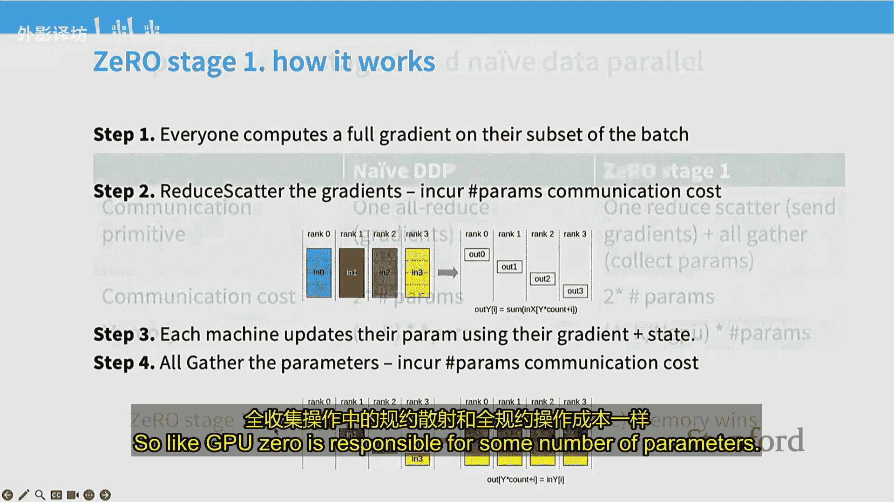

规约散射和全规约操作成本一样对吧，所以这里发生了一件颇为神奇且令人惊讶的事，我们之前对所有梯度做了全规约，确保大家的梯度都同步，而这让我们付出了两倍参数数量的成本，但要是我们在更新方式上动点脑筋嗯。

我们可以进行一次规约散射和一次全聚合，在这两个步骤之间，我们可以进行一些计算，这样我们的计算通信成本不变，但至少对于优化器状态而言，我们在整个模型上，对优化器状态进行了全部分片，所以在某种意义上。

零阶段一是免费的，在带宽受限的情况下，还能带来内存优势，没错，你说能抑制高阶贡献，这是什么意思，每个GPU除以GPU的数量，所以似乎可以多加入些组件，懂了，所以大致可以说你能跟踪更多优化器状态。

换个说法，你可以拥有更复杂的优化器状态，因为你可以用GPU数量来除它，虽说如此，我们接下来要做的是，我们实际上要让其他组件随GPU数量扩展，所以某种程度上这会让事情不再轻松对吧。

比如说优化器状态仍将是瓶颈，要是我们能用GPU数量去除所有东西，希望这能算是个合理且有说服力的回答好了，那咱们要一步步搭建到零阶段三。

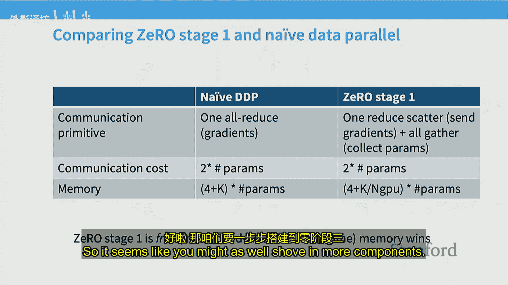

这会更复杂些，零阶段二还是相对简单的，那么现在希望优化器状态分片，这个技巧能讲得通，我觉得这超酷的，那么现在我们想再分片更多内容，所以我想在多台机器间对梯度进行分片。

大致来讲我们能采用和第一阶段类似的方法，但还有个额外的复杂情况，那额外的复杂之处是什么呢，嗯我们无法实例化一个完整的梯度向量，要是我进行完整的反向传播，并尝试计算一个完整的梯度向量，我可能会内存溢出。

所以我希望我的最大内存使用受此限制，即完整参数分片梯度分片优化器状态，那么我们得做的是，当我们进行反向传播，在计算梯度向量时，我们无法先实例化完整梯度，再进行通信，我们要做的是在反向计算梯度时。

一旦我们算出一层的梯度，我们就得把它发送到他所属的相应GPU上，大致就是这么运作的。

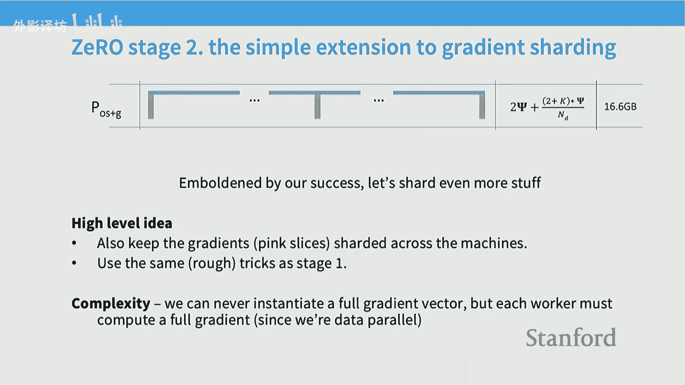

大致是同一个意思，所以现在每个人都有自己的批次部分，每个人在计算图上逐步反向推进，假设我们将逐层操作，所以曾会被原子性的分配到不同的GPU上，那么接下来我们要做的是，当我们在计算图上反向进行时。

在计算出一层的梯度后，立即调用规约操作，将其发送给对应的工作节点，所以一层归某个工作节点所有，在这种情况下，可能是第二个GPU，所以我们要立即对其进行规约，将其发送到此时的工作节点。

并且现在不再需要梯度了，我无需在D013号进程中存储梯度，所以我能立即释放它，接着我们继续此过程，如此一来，所有机器都拥有了已完全更新的梯度，现在他们所负责的那部分参数有了完整梯度。

他们所负责的那部分参数，有了完整的优化器状态，每台机器均可更新自身参数，然后将参数重新汇总到一起，这似乎意味着需要更多通信，因为你在每一层都做这种类似规约的操作，但这只涉及少量参数对吧，它是分片的。

所以整体通信量保持不变。

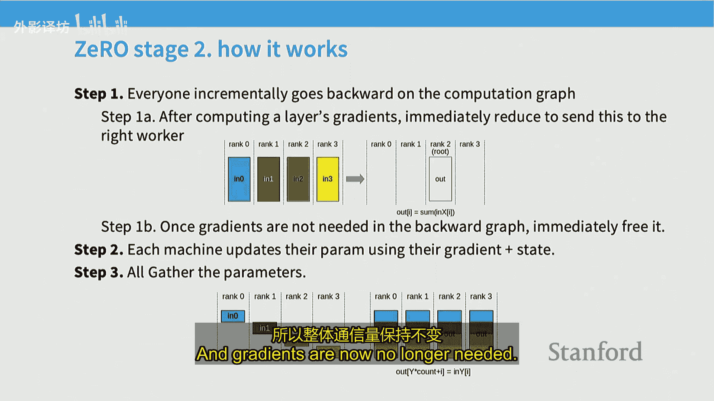

所以零阶段二会有更多开销，因为我们得逐层进行同步，还要确保梯度能正确发送到相应的工作节点，但开销相当小对吧，它依旧非常简单，挺直观的，现在这其中的最后一个零阶段三肯定更复杂，但它能让你获得最大的收益。

也就是说，现在基本上所有东西都要除以，你所拥有的GPU数量，而且你能实现最大程度的节省，如果你听说过FSDP对吧，你过去可能在生活中的某些方面使用过它，FSDP正是零阶段三，所以现在你今天有望大致了解。

FSDP的工作原理，所以同样的道理适用，我们要对所有东西进行分片，包括参数，我们要做的和零阶段队列一样，也就是我们要进行增量通信并进行计算，这样就不会让这些大的梯度向量闲置着。

并且我们会按需传入请求参数，当我们便利计算图时，包括前向和反向传播，当我们进行操作时，我们会按需发送数据，当然关键是要尽可能以低开销来实现这一点，我觉得FSDP真正让人惊讶的并非它可行。

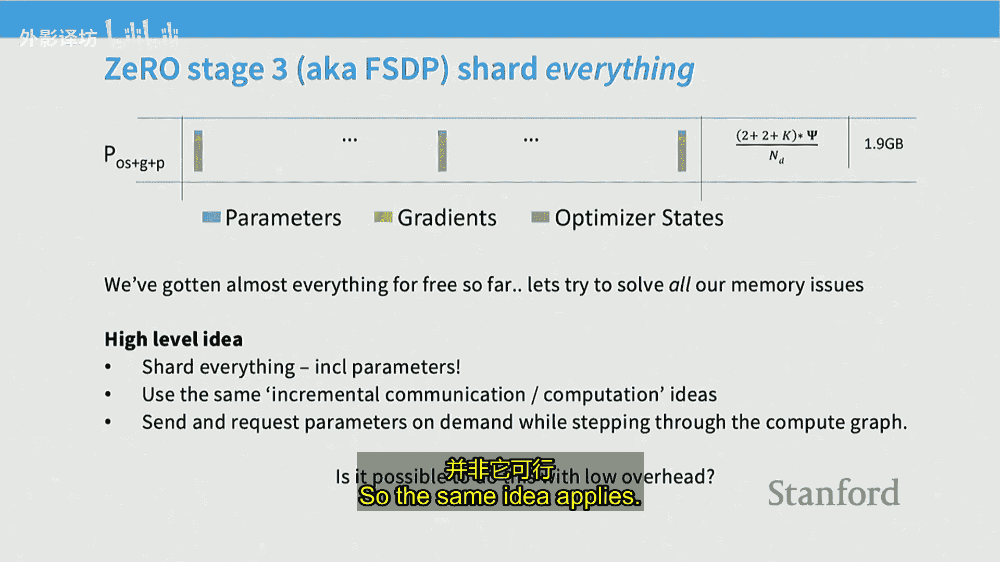

而是它能在开销相对较低的情况下实现，在下一张幻灯片中，你就会大概明白他为何开销低了，我承认一开始看这张图可能不太直观，但我保证这可是FSDP的简化版，下一张幻灯片会稍微复杂点，但从概念上来说。

这其实能解释清楚一切，我们要做的是获取模型权重，在这个过程中我们会收集所有模型权重，对于每一层没有单个GPU能拥有所有参数，所以我不能按常规那样说，OGPU0去执行前向传播，那是不可能的。

比如说GPU0只负责最底层，所以他进行该计算，然后他停下来，并说道，他向其他所有工作节点请求全部参数，于是他停下来进行全收集，就在这桥有个全收集步骤，它收集所有参数，现在它有了前向传播所需的参数。

所以他能向前推进，然后算出之前没有的那一层，然后他就能释放权重了，他不再需要这些权重了，干掉他，现在我可以对下一层进行聚合，我可以再进行一次前向计算，然后释放权重，然后我可以重复这个操作对吧。

激活值得存储起来，所以这里激活值占用的内存一直在增加对吧，所以这迟早会成为一个问题，但如果我们暂时不管激活值，这样挺好的，因为我加载了一层，我进行一次前向计算，然后把它释放掉，如你所知。

这里的内存开销非常低，一旦我快到结尾，现在我可以通过反向传递做同样的事，我可以进行反向传播，而且每次我在神经网络中反向移动时，我会对所需参数进行全收集操作，我可以通过规约散射进行更新，在计算出梯度后。

现在我可以释放权重，我可以释放不需要的梯度和参数，在最后我有一个已完全更新的模型，因此我们在这里要处理三种不同的操作，我们有一个全收集，我们还有另一个全收集，然后我们还有另一个规约散射。

基本上是在进行梯度更新步骤后更新模型，所以从概念上讲，这只是比零阶段二多一步，但你确实能隐约看出，这里存在一定的额外开销，所以总的通信成本现在更高了，我们之前是这样的，我们的参数数量是原来的两倍。

在某种意义上，一切都是免费的，现在不是了，参数通信成本变为原来的三倍，而且等待这些通信完成会产生成本，而且等待这些通信完成会产生成本，但我觉得FSDP真正厉害之处在于。

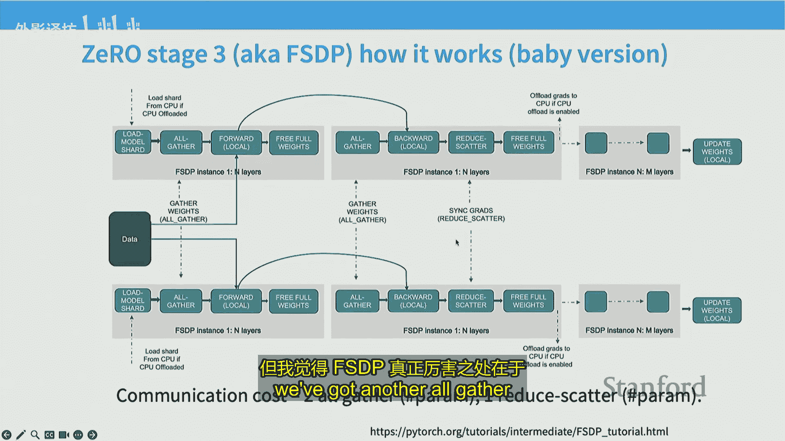

他的开销出奇的低，你可以想象，因为我们一直在疯狂地索要，并一直来回发送参数，事情会变得很慢，我们得一直保持通信，但你可以实现通信与计算重叠这个核心想法，所以你希望两者都，你希望在后台通信时。

GPU也在工作，就像预取一样，这样等你需要某些信息时，它已经加载好了，他已经传送给你了，然后你就可以开始行动了，所以我会讲解下面这个例子，但这算是让FSTP真正有点效率的关键所在，那么咱们来想象一下。

有个大概这样的计算图，比如说W1W0加上W2W0乘以X，有个输入结果是Y就这么个很简单的计算图，然后你可能会运行FSDP，然后你会得到实际的计算结果，还有通信情况，就像这里最后的这个方框图那样。

所以关于CPU，很高兴我们上周讲了洞察系统的例子，希望现在这个图能清晰了，CPU将基本调度一系列命令，要求GPU的通信部分去获取若干参数，他会向GPU发送指令，告知好的，可以执行一些矩阵乘法。

并且在一定程度上它的运行速度将远超GPU，我们上周查看剖析器时就见过这种情况，现在我们来看看通信的顺序，以及当前设备上发生的计算，记住我得按需收集数据，所以刚开始的时候。

我得确保确保这里每个人都有第零层的权重，也就是W0，所以我执行全收集零操作，然后等他完成，一旦完成，我就能对W0进行前一项计算，比如说我大致能算出X乘以W0对吧，此时全收集已在全收集零结束时同步开始。

在我进行矩阵乘法运算时，我已开始加载所需的下一组参数，当然我的通信速度较慢，因此存在一定差距，但我结束的比初始加载快得多，所以现在可以进行前向传播一，同时在后台再次我已开始加载第二个参数。

还有这里的黄色部分，我现在正在释放与前向传播易关联的参数，现在我再重复计算W0被使用了两次，所以我不用再弄这个了，这很快就完成了，而且我能很快搞定对吧，在需要之前，我就已经加载好了，前下按。

所以这里没有问题，然后我可以释放第二个，这就是前向传递的全过程，而且你看这里的差距比较小，在计算开始前，我们就能完成大量数据载入，所以通过这样巧妙的操作，在实际需要前先对等待请求进行排队。

就能避免很多通信开销，这时对于四二，前向传播已完成，我可以释放权重啊，接着开始反向传播，你看反向传播所需的全收集二已完成，于是我可以开始进行反向二和反向零的操作，权重零已存储完毕，至此完成。

接着反向传播过程中出现了较高开销，因为我要进行规约散射，接着是全收集等操作，希望你看到这幅图后会惊叹，挺令人惊讶的，即便我们在进行这种疯狂的分片操作，就好比你在看这张图。

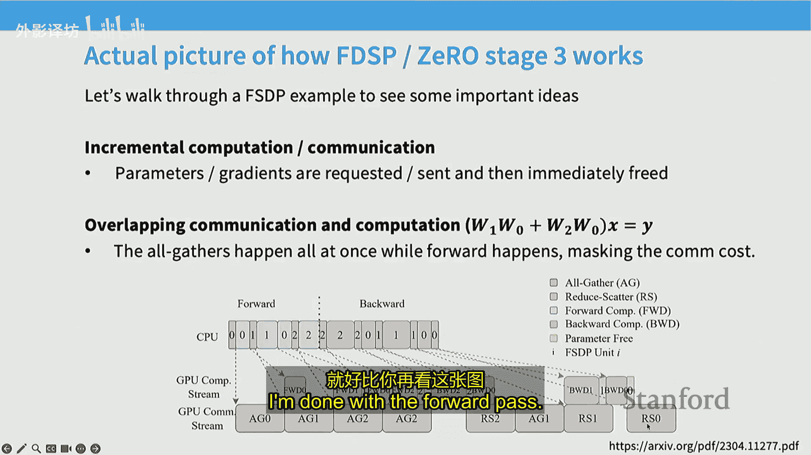

我们已对参数梯度和优化器状态，进行了完全分辨。

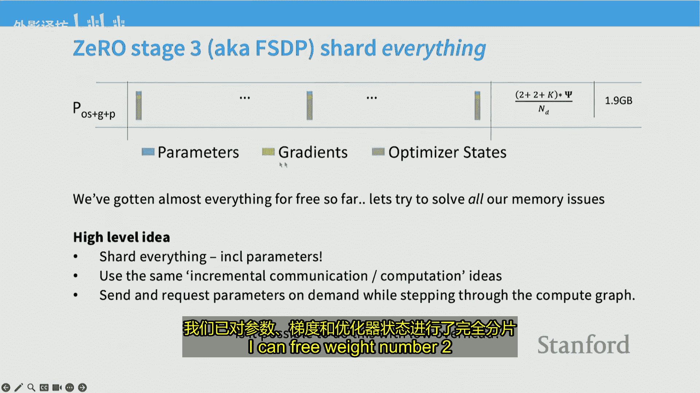

但我们所需的总带宽仅为三倍，而非两倍。

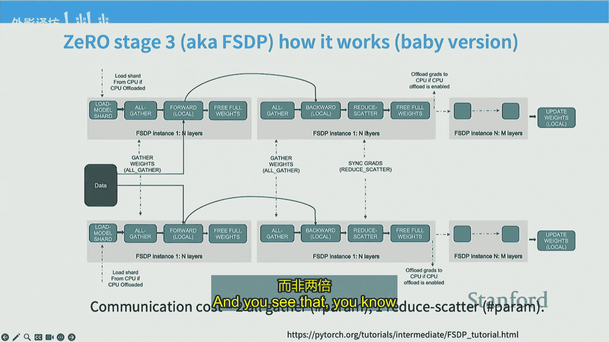

所以这看起来还不算太糟糕，而且我们实际看到的气泡状情况也不算糟糕。

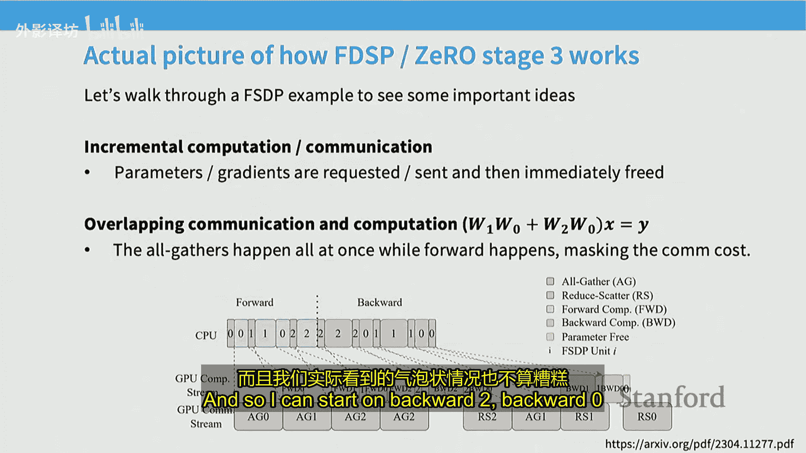

通信几乎已被充分利用，并且计算持续了很长时间，所以实际上我们充分利用了现有的资源的资源，这很酷，是的，所以你需要一个缓冲区来在其中存储这些权重。

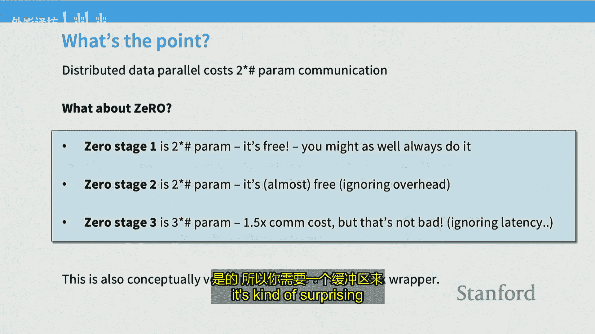

所以这张图不太正确，读取当前层的这些权重时。

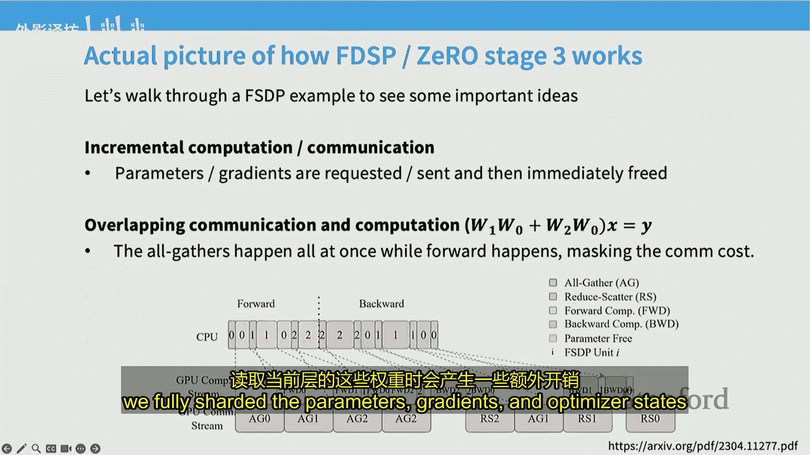

会产生一些额外开销，此外另一个关键问题是，我完全没有提及激活函数，那将占很大一部分，因为你有大量的激活值，对于某种意义上存在于此的整个模型，没错。

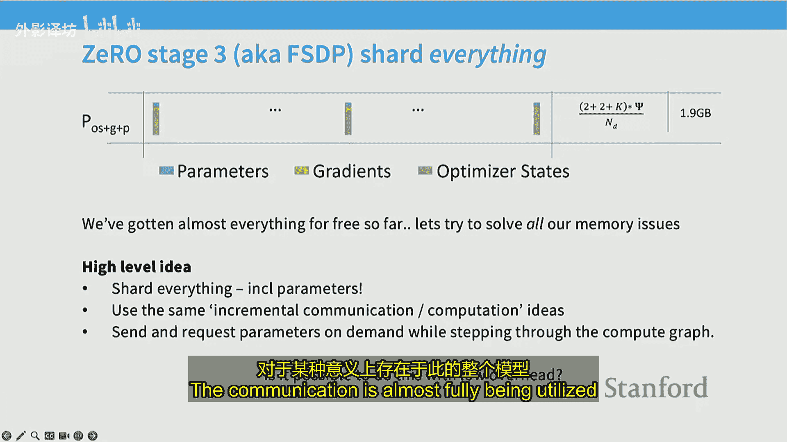

很酷好的，所以这算是分布式数据并行，比如说在某些方面，零是人们有效进行分布式数据并行的方式，所以存在不同阶段，而第一阶段基本免费，它的通信模式和朴素数据并行一样，但能得到分片或优化器状态，这很棒。

不妨一直这么做，零阶段二的参数数量翻倍，所以总带宽消耗不便，但反向传播时会有额外开销，对梯度进行这种增量释放，反向传播时零阶段三更复杂参数，通信成本会变为三倍，但这还不算太糟对吧。

就像我们之前看到的图中有一些开销，但如果你真能巧妙地隐藏通信模式，实际上效果相当不错，所以即便网络模式中有速度相当慢的链接，人们也会使用数据并行，而且这在概念上也非常简单，这里的一个优点是。

尤其是数据并行，对架构的要求没那么高，我压根没讲过，在这当中，我们到底是如何实现一个transformer的，这全都非常抽象，比如说这就是其中一个原因，全阶段数据并行很受欢迎。

编写一个能定型化任意神经网络的包装器，很容易，编写一个能定型化任意神经网络的包装器，很容易无需深入了解，也无需深入思考架构实际在做什么。

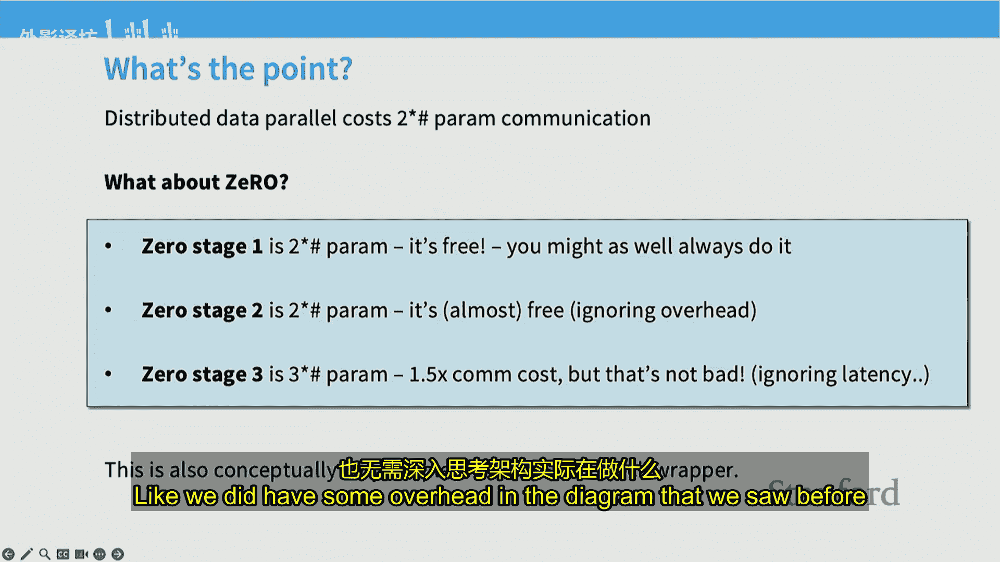

所以这里有一些例子，我算出了一些例子，因为我的GPU内存老是有点不够用，你大致能看出最大尺寸是多少，我能在一个有八块80G，100的节点上运行的模型，你懂的，节点极限你最后可能会得到。

比如说哦我勉强能装下一个60亿参数的模型，而我觉得要是我用零阶段算，你懂的，我能装下一个大概500亿参数的模型，在运行更大模型的能力上能大幅节省，通过像FSDP这样的方法，巧妙节省内存。

就能运行越来越大的模型，所以行哦，抱歉有个问题。

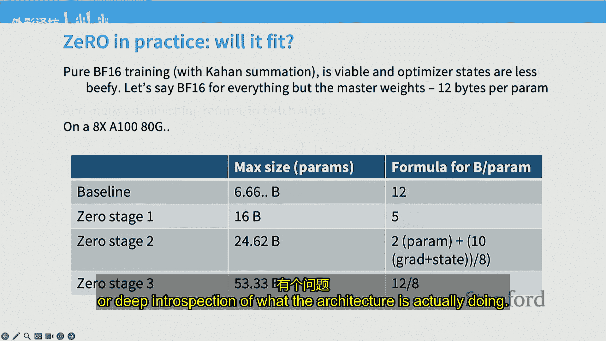

那么模型并行性，本质上就是要确保参数存于不同的，我看看能不能找到，所以在某些方面确实如此。

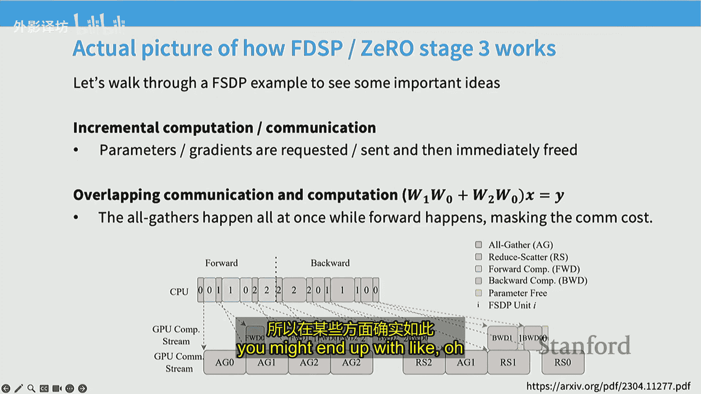

我们已经对参数进行了分片，所以你可以称这为一种并行性，但是模型并行性的关键在于，确保参数完全存在于一台机器中，我们不会尝试以各种方式传输，它们只有激活值会被传输，所以在模型并行性部分。

你会看到非常不同的讨论，那里的重点将是传输激活值，而不是传输参数，这会有很大不同，所以你问的是这一步。

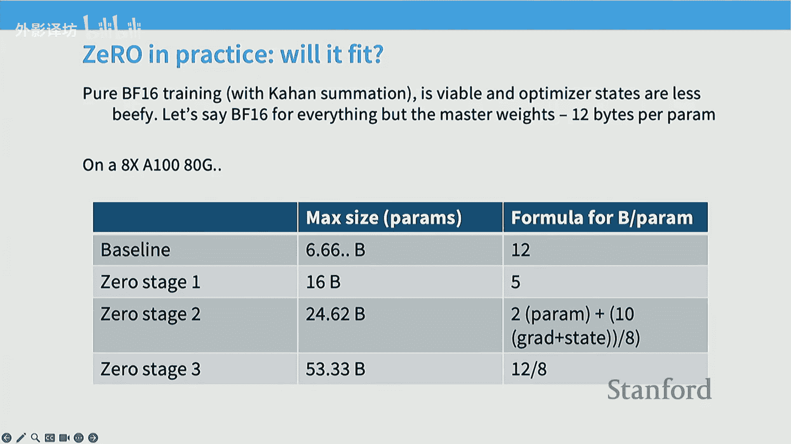

进行全收集，把仅在一台机器上的权重收集到所有机器上。

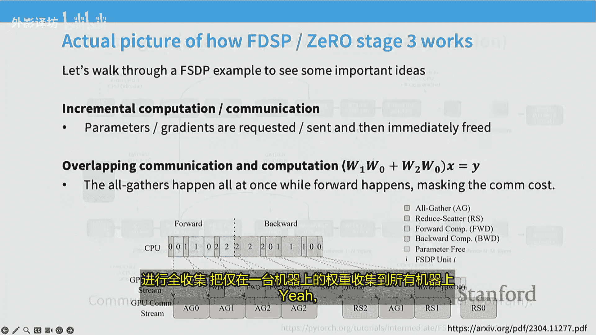

而此时权重只在一台机器上对吗，所以我们得把，我们要把一台机器上的权重进行散射，还是说要进行全收集，抱歉我得确认我没理解错这些术语。

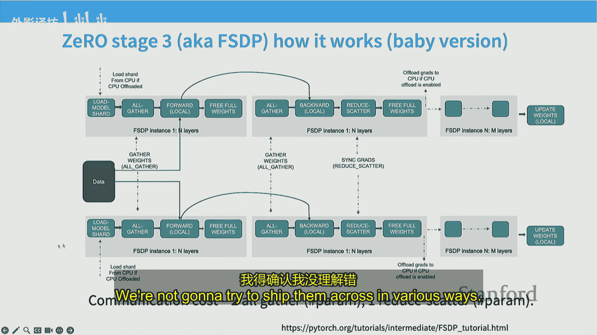

我有点不太明白，所以我得确认下。

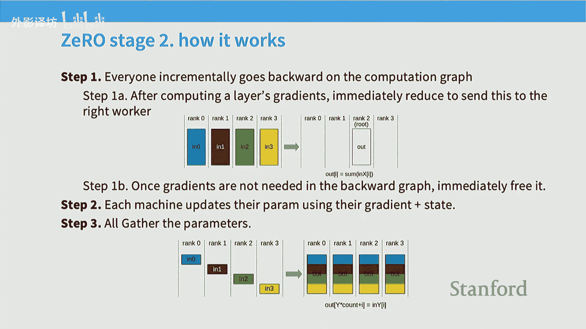

不好意思没错，所以我们要做的和这个一样对吧，那么每台机器都有一些参数，我要把这些参数汇总到所有机器上，以确保每一层都能在所有GPU上正确复制，这是你想问的问题吗，还是你想说有没有更简单的言语可以调用。

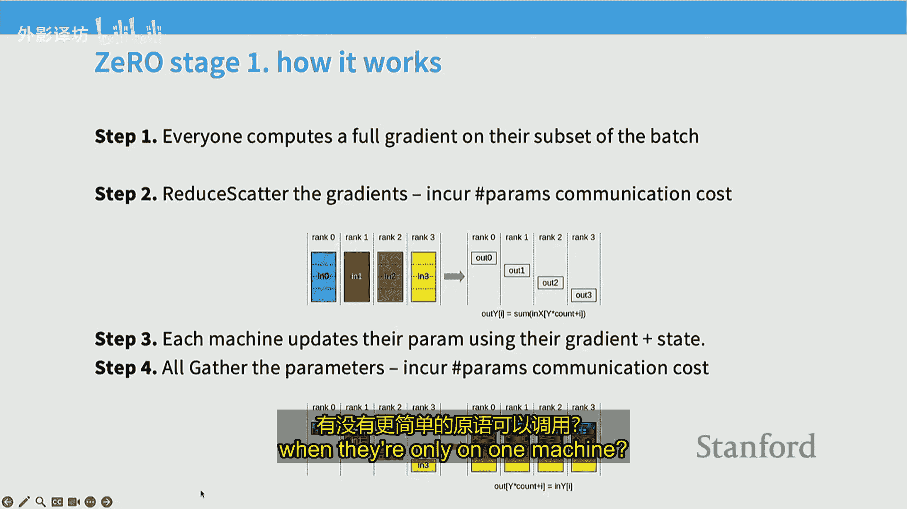

你是说广播才是合适的对象，而不是全收集，我想可能是这么写的，因为曾不在单个GPU上存在一些特殊情况，但我不太确定，我同意你说的，广播应该也能做同样的事，如果参数只在一台机器上好的没问题。

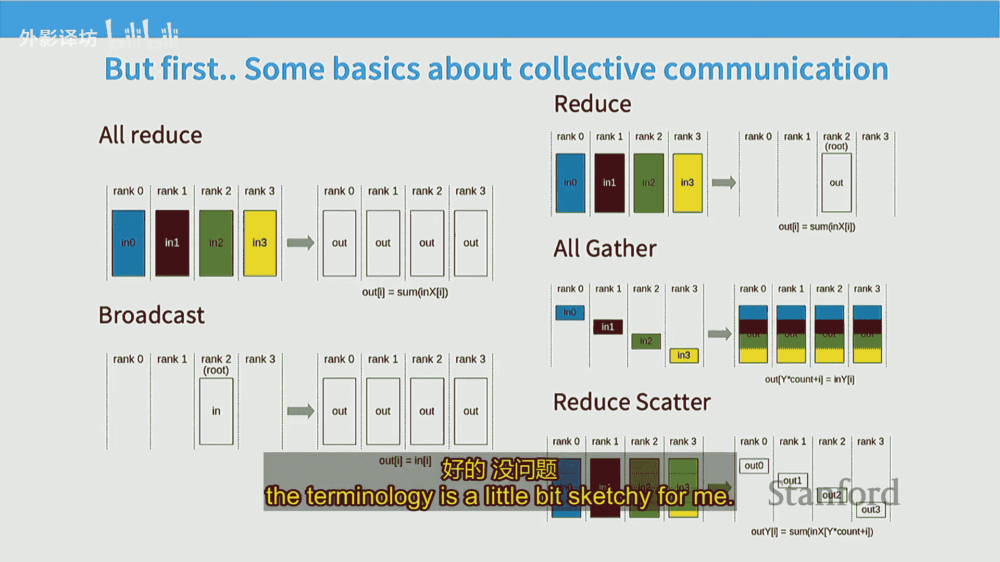

好的好，我确认一下，好嘞，知道了。

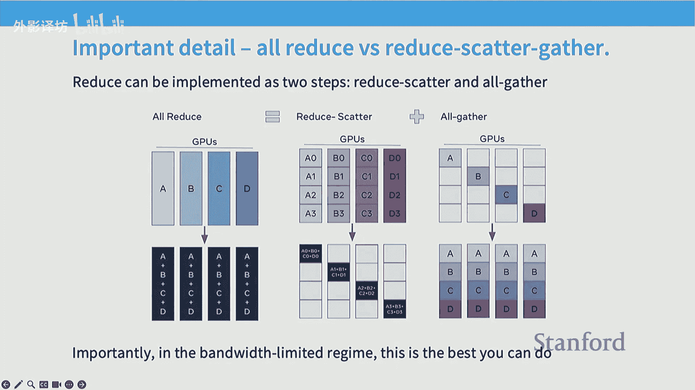

行没错，那么在数据并行中存在一个关键资源，这可是个重要的点，你得记住哈，在数据并行里，批量大小其实是个相当关键的资源，体现在就是说，你并行化的数量不能超过批量大小对吧。

因为每台机器上差不多只能有一个样本，每台机器上不能用分数个样本，所以这就意味着，如果批量大小有限制，你就无法再使用数据并行，而且批量大小会出现收益递减，所以在作业一中，你可能已经试过不同的批量大小。

但你大概知道，当你把批量大小提高到超过某个点后，你就会开始看到相当快的收益，递减到你的优化率，关于这个有很多相关论文，OpenAI有一篇关于临界批量大小的很不错的论文，在那篇论文里。

他们基本上认为超过某个点后，每个势力对你优化能力的贡献会迅速出现，收益递减，基本上直观来讲，在某个点以下，你会存在大量梯度噪声而减少，这种噪声非常有价值，但在某个点。

你实际上从根本上受限于你所采用的梯度部署，而非方差减少，所以这基本上意味着仅靠数据并行，无法实现任意大的并行性，这个批量大小可是个非常重要的资源，本质上你有一个固定的最大批量，你可以用不同方式来分配它。

我稍后再谈，因为其他类型的并行性也能从更大批量中受益，所以你在某些地方会用到批量大小，数据并行还是存在问题，零阶段一和二无法扩展内存，零阶段三原则上还不错，但它可能会很慢，也许更重要的是。

而这与之前的问题相关，它不会减少激活内存，我想完全拆分我的模型，并使它们完全独立，因为那样激活内存也会减少，所以现在我想要更好的方法来拆分模型，这样我就能在这些GPU中容纳这些非常大的模型。

所以这将把我们引向模型并行性。

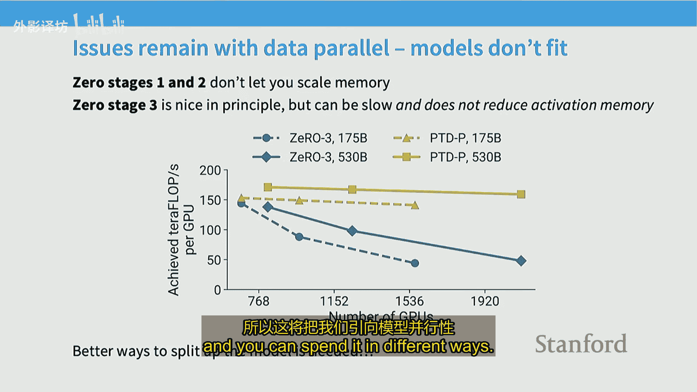

我们想在不改变P4大小的情况下扩大内存，而且我们需要一个替代轴，在这个轴上无需花费，或者根本不需要大批次来进行并行化，所以我们要做的是把参数分散到多个GPU上，并且在某些方面这类似零三这种情况。

但我们不再传递参数了，我们要传递激活值，而且这会有所不同，而且有时激活值比参数小得多，这对我们很有好处，那我们来聊聊两种不同的并行方式，我要讲一下流水线并行，它在概念上比较简单，但在实现方面要复杂得多。

另外还有张量并行，它在概念上可能没那么直观，但实际上实现起来更方便，也更常用，它们对应着划分模型的两种不同方法。

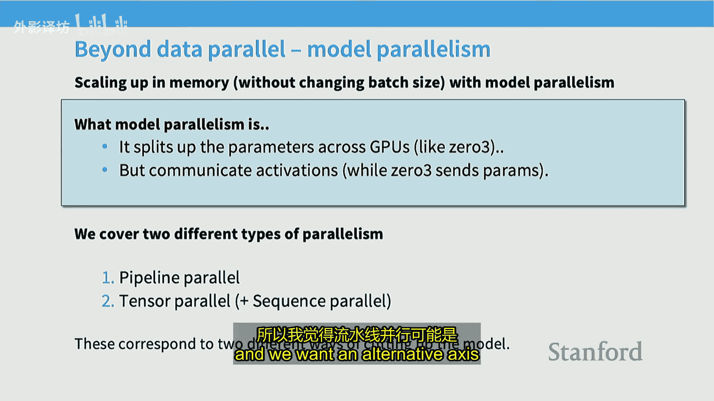

所以我觉得流水线并行，可能是划分神经网络最直观的方法，你知道深度神经网络是分层的，那么如果我有多层，很自然的在层边界处分割网络，所以每个GPU负责处理部分层，然后传递激活值。

这种情况下每层对应一个GPU，GPU之间传递激活值，反向传播时，它会将反向梯度从GPU3传递回零对吧，它会将反向梯度从GPU3传递回零对吧，行挺不错的，这图有啥毛病嗯，你看大部分时间里。

你的多数GPU都是闲置的，这实际利用率低的可怕，要是我按之前说的那种简单并行来弄对吧，要是我有每层都有前向运算，比如说我有一个例子，那就会得到这样一幅图，所以图里不同行分别代表不同层和不同GPU。

这里X轴代表时间，从左至右，那你看到了什么，首先我在最左边计算第一层，然后激活值传入第二层，GPU2启动，然后进入工作状态，轮到我了，他开始工作，将数据传递给GPU3，接着是GPU4。

现在可以开始反向传递了，然后你会看到一个巨大的人们所说的气泡现象，这会带来很大的额外负担，而在此期间你完全无所事事，你会看到GPU只有N分之一的时间，是处于活动状态的，在添加了四个GPU的情况下。

这可能是最糟糕的并行方式了，但我得到的吞吐量却只有单个GPU的，那么你可以做的一件事是。

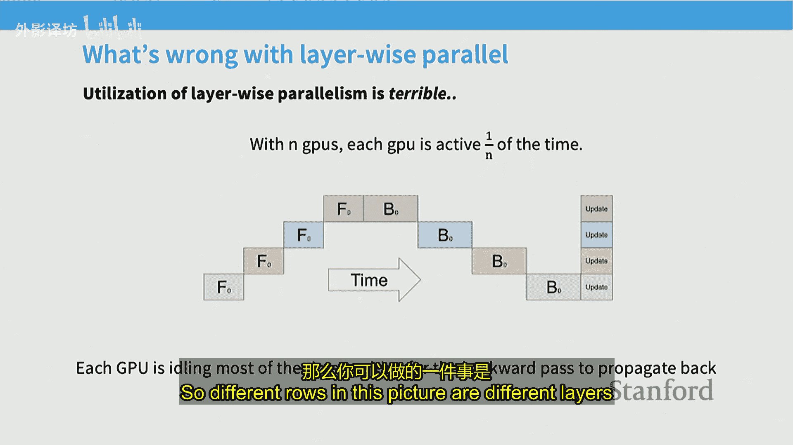

你可以在做法上更灵活些，然后可以说我要构建一个流水线对吧，我不会仅仅按层进行划分，我会安排一系列任务，由每个GPU来处理，那现在假设我有一个小批量数据行吧，所以每台机器会处理四个左右的事例，我要做的是。

我能完成第一个事例，我的第一个数据点，我就能把激活数据发送到第二个GPU，一旦完成，然后我就可以开始处理第二个数据点，这样一来通信和计算就有部分重叠了，第二个GPU能在第一个GPU继续工作时开始运行。

现在增大批量大小，可能会减小气泡尺寸，增大批量大小，希望你能明白我之前为何说，批量大小是一种资源，如果你有有限的批量大小，并采用流水线并行，例如你可以用相同批量大小，减小流水线气泡尺寸。

或者你可以用它进行数据并行，所以有许多不同方式来对待你的单个批次大小，然后将其拆分成不同方式，好的，那么现在你的VP4大小能够控制间隔时间，事实上，你的开销比率与你拥有的有效计算量之比。

为阶段数减一除以V批次数量，所以如果你有很大的批次大小，流水线并行可能会高效，但如我们之前所说，P4大小是有限的，我们不能随便把它调到想要的值。

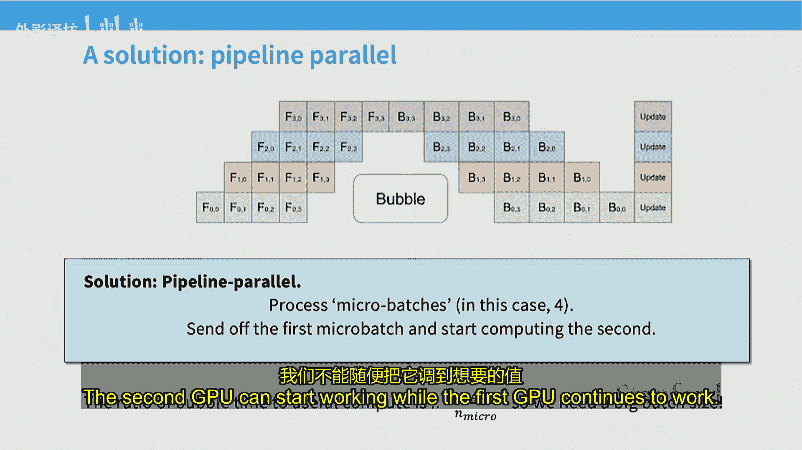

所以一般来说流水线看起来真的很糟糕，我们为什么要这么做，我们为什么要为了并行化而承担这样的代价呢，嗯有几个原因与数据并行相比，流水线有助于节省内存，我的意思是，零三也会对参数进行分片。

但这也会对激活值进行分片，这很好，流水线也能有良好的通信特性，它只取决于激活值，它同样是点对点的，所以根据拓扑结构，这是有可能的，并且取决于你所具备的条件，流水线对网络中较慢的部分可能非常有利。

所以通常会在较慢的网络链路上，采用流水线并行，所以在节点间，甚至有时在不同类型的机架间，或者是在不同机价间，你可能会采用流水线并行，谷歌的人最近跟我说了个例子，他们说TPU的一大优势是。

我们无需过多进行流水线并行，因为我们所有连接都大得多，他们有大型环形网络，256个GPU时，他们没有这个限制，此时它们会突然转向更慢的网络链接，这时可能会想切换到流水线并行，所以这是个现实中的例子。

当你开始考虑流水线并行时，这是英伟达一篇论文中的例子，稍后我会详细讨论这篇论文，他们做了出色的工作，展示了性能特征，不同类型的并行性，但当批量大小为80，随着流水线并行大小增加，设备数量。

每个GPU的利用率开始明显下降，而如果你有一个大的批量大小为128，对于规模合理的流水线并行，你能有相当不错的利用率，所以批量大小对于掩盖空闲时间很关键，否则就会出问题。

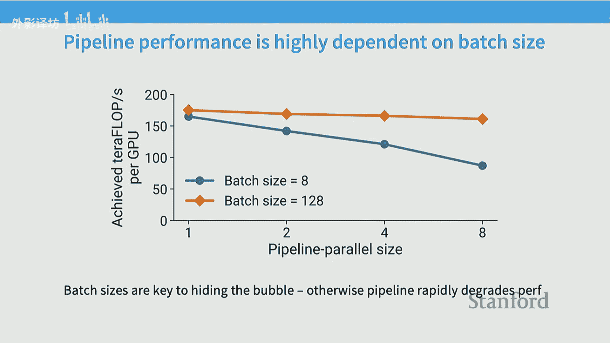

当然你可以采用不同的流水线策略，所以与其采用这些，标准的气泡调度模式，你可以把事情拆分成更细的部分，你可以把不同阶段，将不同子层分配到不同设备，你可以在不同部分进行不同的计算。

然后你就能更好的让流程交错进行。

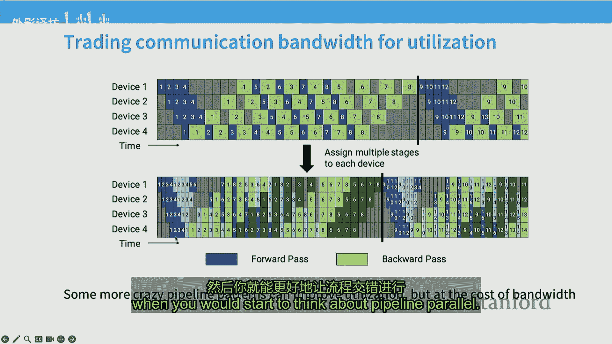

接下来我想花点时间讲讲这个的进阶版本，接下来我想花点时间讲讲这个的进阶版本，这非常巧妙，叫零气泡流水线，或者用深度搜索的术语来说，我想他们叫它双管道，但核心技巧是一样的，那么在这里想想看。

假设我们在做反向传播来计算梯度，你可把这个拆成两个不同部分，第一部分是关于激活值的反向传播，所以当我顺着残差连接往下走时，我实际上得计算关于激活值的导数，然后当我碰到一个参数时，我也想计算梯度本身。

比如我要怎么更新参数，而不只是激活值如何相对于前一层变化，所以给你举个具体例子，我们来看看这边左下方的图，那么在这个图里你能看到前向传播，这是一个单隐藏层多层感知器，所以我们要乘以一个权重。

我进行非线性变换，然后我输出非线性变换结果，所以这算是多层感知器中一个简单的部分，现在我们来看看反向过程，关于损失的导数传入进来，然后我就能计算它会如何改变，X及我的多层感知器的输入。

所以从某种程度上讲，这里就是关于激活值的导数，然后当我计算这些，当然我能用它们来计算梯度，我需要更新权重，但关键在于这部分计算权重梯度的这一环节，这在任何时候都能进行对吧，这不存在什么依赖性。

因此我可以将此计算的调度，重新安排到计算图的任何部分，所以你可以进行标准的流水线并行，针对那些串行相关的部分，但每当你需要进行这些计算时，仅为更新参数，你可以在任何地方重新调度他们，所以关键在于。

当你从一个不错的所谓的EFEB流水线，这是一个不错的，经过优化的减少气泡大小的调度，然后你就能拿到这个，你可以把这个B分离出来，这是反向部分的计算，然后是W6，这是计算权重梯度所必需的计算。

现在我可以计算权重，也就是W原本会出现气泡的地方，所以原本有这些白色闲置组件的部分，现在我可以用这些W来填满它们，所以仔细想想，串行依赖关系究竟是什么，我现在能得到很棒的成果，在这方面。

我的GPU能得到很好的利用，需要说明的是，这极其复杂，如果你真想这样实现流水线并行，你得去干预，自动微分计算这些东西的方式，你得有个队列来跟踪数据流向，我听到一件趣事，最近在与某人的谈话中。

在类似前沿实验室的环境下训练语言模型时，他们说，其实团队中有两人了解我们基础架构中，流水线并行的工作原理，有一人离开，于是我们的训练架构中只剩一人挑大梁了，诸如此类的情况。

不少流水线并行在架构上极为复杂，这儿看似简单，若你感兴趣，我鼓励你去尝试实现它。

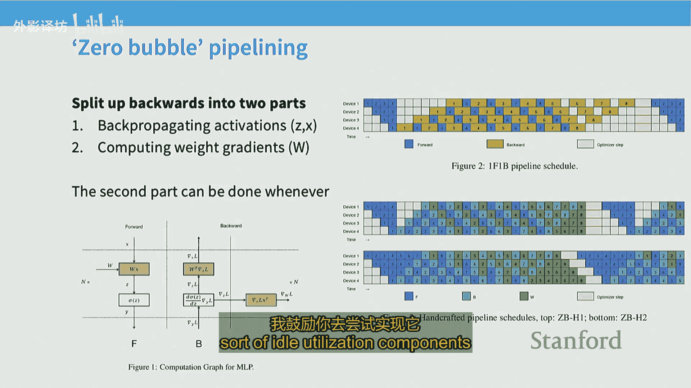

它确实很快就会变得棘手，而且我觉得这是个不错的提示，该换成另一种模型并行方式，因为这个简单的多，而且很多框架常常能很好地利用这种方式，甚至很多训练超大模型的人，非常依赖或主要依靠这种模型并行方式。

那我们还能怎么拆分模型呢，那么想想看，我们做的大部分都是矩阵乘法，在大型模型中，大部分计算都是矩阵乘法，多数参数是矩阵乘法或矩阵，那我们能做什么嗯，要是能对矩阵乘法进行并行处理，那就挺好。

所以张量并行是这么个思路，我们可以进行一个大型矩阵乘法，然后拆分成一组可相乘的子矩阵，所以如果顶部有这个矩阵乘法，我们有X及X乘以A等于Y，相反我可以把A切成两半，然后我也能把某分成两半。

我能计算子矩阵，我能把它们加起来，然后最后我就能得到答案对吧，所以从概念上讲，流水线并行是沿深度维度划分，就像层那样，这就是张亮并行是沿矩阵乘法的宽度维度划分，所以我们要分解乘子矩阵，然后进行部分求和。

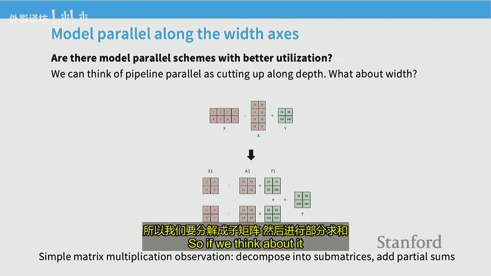

所以这里有个MLP中的示例，每个GPU负责处理一个不同的子矩阵，例如一个大型MLP矩阵乘法，然后我们要进行集体通信，在需要时同步激活值，我们要怎么做，所以这是一个MLP，大致分成上半部分和下半部分。

有两条不同的路径，这些是在对矩阵进行拆分，所以我想做这个操作，Y等于GLUX乘以A，我将矩阵A拆分为A1和A2，接着在右侧我要计算舍弃YB对吧，然后我要将结果作为Z返回，所以我也要把B拆分对吧。

所以我把两个大参数矩阵，都拆成了A和B两部分，在前向传播过程中，我要做的是获取输入X，然后我要把它们复制两份对吧，这样每个GPU都会得到相同的输入，然后他们会用A1和A两对齐进行运算对吧。

它们是同一种类的哦，抱歉，他们的行为度相同，所以对他们进行操作没问题，所以XA1和XA2会给出一些激活值，Y1和Y2，这些会进入B1和B2，然后我要做规约求和，这正是我之前给你看的图，所以你先复制。

然后进行规约，然后你就得到答案，Z在反向传播中，现在其实正好相反，因为在反向步骤中，梯度是反向传递的，这个G将是单位矩阵，所以我要在两边复制导数，然后我要一直进行反向操作，一旦我到了F。

这是经过全规约的对吧，因为我从两条路径得到两种导数，然后我把它们加起来，所以这个F和G是同步屏障，在前向传播过程中，我执行一次全规约操作，在反向传播过程中，我执行一次全规约操作。

只是在计算图的两个不同位置，你应该能明白，无论何时进行矩阵乘法运算，这都是个很好的办法，你可以拆分矩阵乘法运算，并在不同设备上进行并行化处理好的。

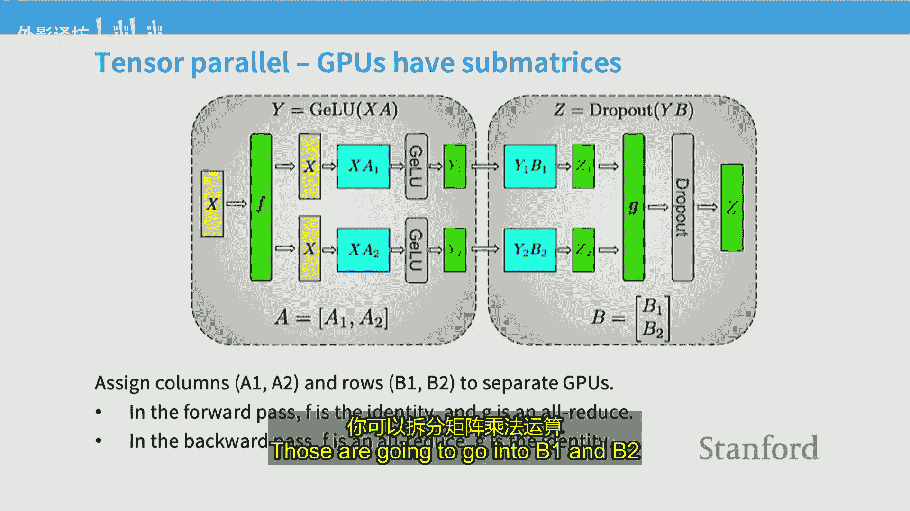

正如你所想，这实际上有点费成本，我们有一个同步屏障，每层都有，它需要传递一个激活信号，有点像在正反传播中，对相关内容的残余激活值计算两次，所以张量并行这个简单概念，需要非常高速的互联，所以有个经验法则。

这是个很容易记住的经验法则，即张量并行在单个节点内应用，比如说一个装有英伟达的GPU，会配备八个不同的GPU，它们都在同一个盒子里，正如我今天讲座开头给你们展示的，它们连接速度极快。

所以那八个GPU能快速相互通信，所以使用类似在这八个设备间，带宽消耗极大的张量并行，所以通常你会看到张亮并行应用于多达八个GPU，这八个GPU在同一台机器里，因为那样性能下降最小。

这是一个来自hogging face的例子，一个关于并行化的教程，展示了不同级别张量并行时吞吐量的下降情况，你会看到，进行张量并行时，吞吐量会有10%和12%的下降，但直到使用八个嗯，也许这是可控的。

这算是为了能更好的并行化而付出的代价，但当使用16个设备时，性能会有惊人的42%的下降，增加到32个设备时。

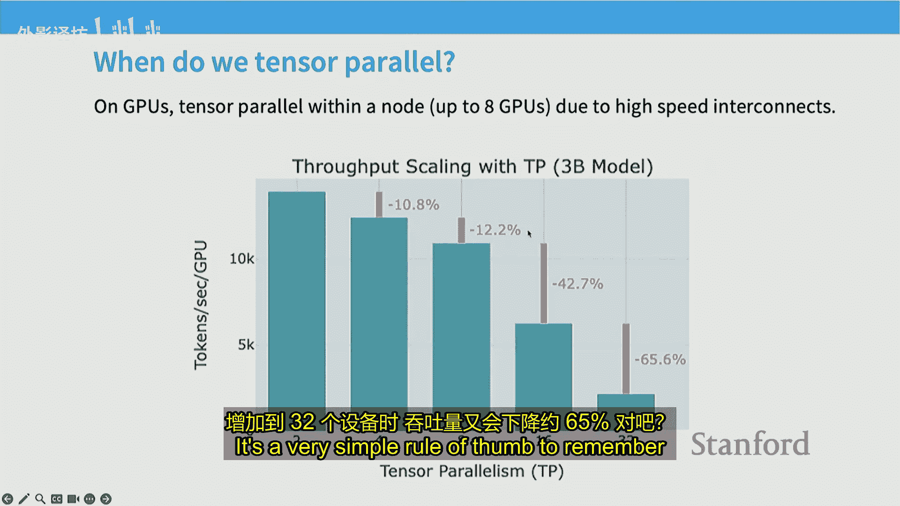

吞吐量又会下降约65%对吧，希望你能直观看到。

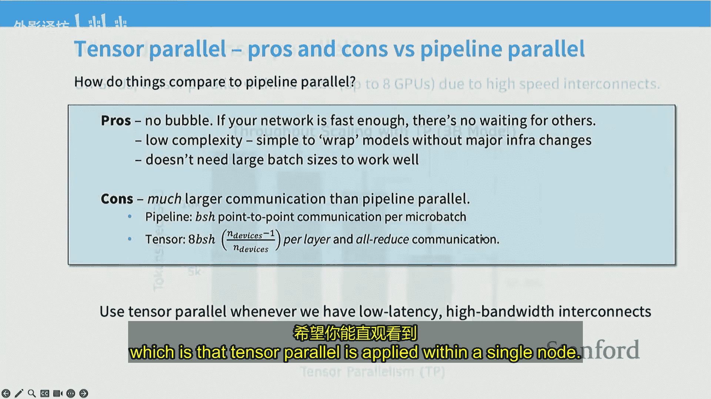

进行张量并行时，八个设备是最佳选择，那才是最佳点，取决于你能获取的硬件互联类型。

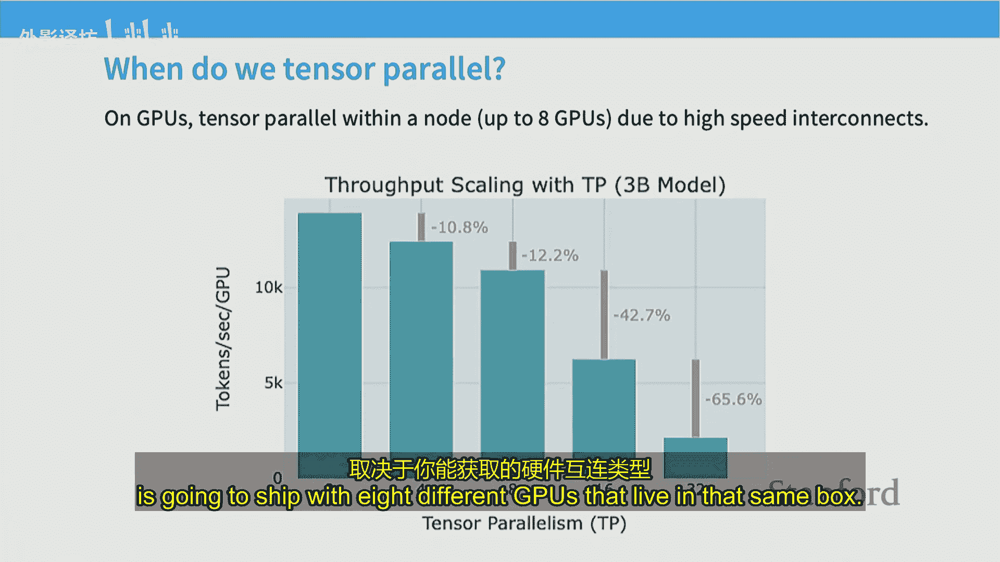

好的，那么现在与流水线并行相比如何，与流水线并行相比，我们无需再应对之前的那种问题了，我们无需使用更大的批量来减少气泡问题，这挺好的，而且应用张量并行时，复杂度相对较低，你真正需要知道的是。

大矩阵乘法运算在哪，我能把它们分开吗，然后让他们在不同设备上运行吗，前向和反向操作还是一样的，与实现像零开销这样的方式相比，或双管道流水线并行，你会处于更好的多的状态来做这个。

所以缺点在于其通信开销要大得多，在流水线并行中，存在批量大小以及序列长度残差维度，还有每个VP4的点对点通信，在张量并行中，每层的通信量变为原来的八倍，并且存在全规约通信操作，这可能需要进行大量的通信。

所以经验法则是如我之前所说，有低延迟，高带宽互联时就会用张量并行，你会看到的，你知道的，根据你有的机器类型会有2~16个，实际中使用的张量并行，取决于你拥有的机器类型，我会给你们展示一些例子。

当我在结尾讲张量并行的例子时，好的，在讲序列并行和激活分片这种第三种类型之前，关于流水线或张量并行，张量并行有问题吗，二者能否同时使用，没错问题是他们可同时使用吗，答案是肯定的，确实会同时使用二者。

所以我想稍后会举些例子，但我觉得在大规模运行时，常见的情况是经常能看到张亮并行，在此基础上常使用流水线并行，我所知的唯一采用流水线的例子，但deep sk v3部使用张量并行，据我所知，据我所知，是的。

问题是我你会在机器内部使用张量并行，在机器间使用流水线并行吗，是的，所以你会在机器内部做张量并行之类的，并在机器间结合使用数据并行和流水线并行，稍后我会告诉你经验法则，不过基本上你使用流水线并行。

是因为你的模型装不下，如果你能装下整个模型，你进行数据并行，加张量并行，或者甚至只进行数据并行，很好好的很棒。

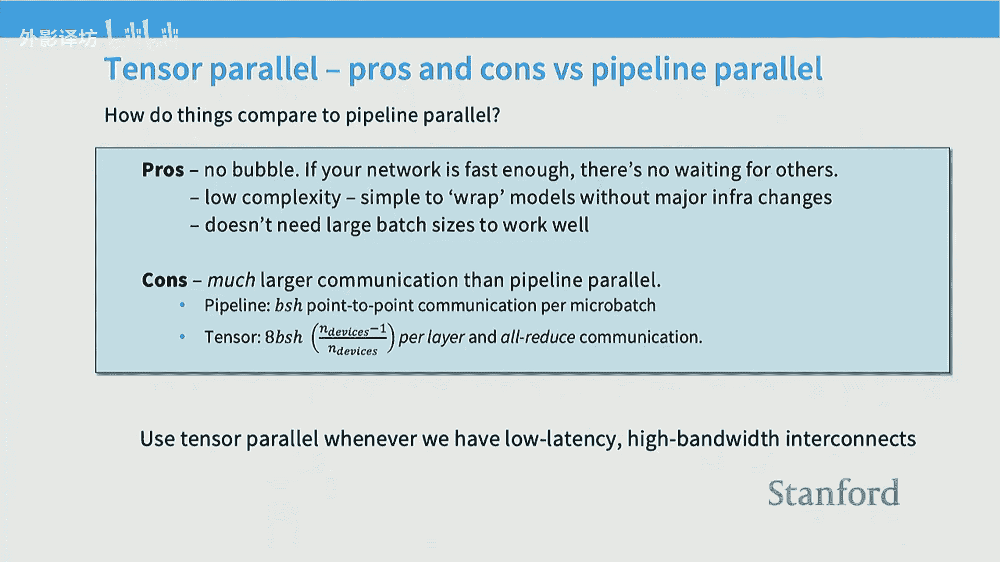

那么我们一直在讨论内存，从某种意义上说，内存是并行化非常重要的一部分，因为我们要训练大型模型，所以当你查看你的内存时，你会意识到，激活值实际上在你的内存使用中，占了很大一部分。

所以如果你看看标准的前向和反向路径，我想这来自PYTORCH教程中的一个，你会发现内存使用情况变化很大，所以我来讲解一下这个，因为我觉得总体来讲这是个挺有意思的内容，训练过程中，你一直都有参数。

因为参数是固定的，但在第零次迭代时，你完全没有优化器状态，所以实际上大部分内存你并未使用，但当你进行前向和反向计算时，你会看到激活值不断增长，当你累积所有激活值时，当你开始反向路径时，你的激活值会下降。

意味用完激活值时，你在释放它，然后你再累积梯度，所以你的梯度内存使用增加，而峰值实际上出现在反向传播的中间某处，此时你尚未释放所有激活值，并且你仍在累计梯度，所以在第二次迭代时。

你在这里也能看到类似情况对吧，所以这个图表的重点是要说，我们已考虑了其他所有方面，我们已考虑了参数，我们已考虑了优化器状态，我们已考虑了梯度，但至少我们没有深入思考过激活函数，那我们就来做这件事。

所以我要和你们详细讲的，最后一个复杂点是激活内存，所以张量并行和流水线并行，基本上能线性减少大多数内容，但它实际上无法减少所有激活内存用量，这是英伟达一篇论文中的例子，探讨的是如何减少激活内存。

我觉得有件事挺有意思，即如果你把模型做的越来越大，从左至右你会看到一个参数，且优化器状态内存可保持不变，若我们积极并行化，但激活内存却持续增加，因为它有些部分的并行效果不太理想，所以不管你有多少设备。

实际上每个设备上，激活内存的增长是无法消除的，我马上就给你讲为什么，而我觉得要是你做点，像重新计算这样稍微巧妙些的事，就能让激活内存保持在低水平，而这对一些大型模型的并行化来说至关重要。

那么每层的激活内存是多少，你之前或多或少接触过这些内容，transformer数学和微积分，所以希望你现在已经熟悉这些了，但我们可以计算，我们每层所需的激活内存量是多少，这里有个实用的公式。

这就是你所需的内存量，它等于SBH乘以34，加上5AS除以H其中一些数字让人费解，但实际上他们没那么神秘，你可以很明显的看到有个左相，然后有个右相，左项源自多层感知器及其他主点运算。

这就是SBH乘以34的出处，这些取决于残差流大小，也就是H在右侧有一项，实际上是把这个展开会得到S平方B对吧，因为H会相互抵消，这就是你所需的内存，对于soft max项以及注意力中的其他二次项对吧。

当然如果你使用闪存注意力，你可以大幅减少并采用重新计算，我们知道能大幅减少第二项对吧，那么假设我们进行张量并行对吧，我们尽可能到处进行张量并行，所以我们在多层感知器里做。

我们在键值计算和注意力计算中都这么做，我们最终会得到这样的结果，这看起来挺不错的，但还差点意思，那么每层的激活内存除以TT，即进行张量并行的设备数量，所以要是我们除以八，理想情况下。

我们会把所有激活内存都除以八，但你看有个掉队，像SBH乘以十，它还没被缩减，要是你想想这些是什么，这些就是非Mac more组件，所以层归一化，随机失活，注意力输入以及多层感知器，不幸的是。

所有这些项都会随规模增大而持续增长，而且他们很难很好的并行化。

所以我们最后要考虑的是是，采用那些简单的主点操作，目前我们尚未对其进行并行化，而我们只需将它们拆分，有一种非常简单的方法来拆分它们，也就是说，如果我们进行层归一化，序列中不同位置的这些层归一化操作。

彼此完全不相互影响，他们根本不关心其他任何事，那么我们要做的是，假设我们有一个长度为1024的序列，我们要把它切开，然后每个设备将处理该层归一化的不同部分，或者是随机失活的不同部分，对不那些主点操作。

现在可以完全分割开在序列维度上，因为现在我们在序列维度上分割数据，我们得进行一些同步，确保我们进行的并行计算能再次聚合，所以在前向传播中，这些G它们是全收集，而G杠是规约散射，而在反向传播中，两者相反。

这两者之间在某种意义上存在一种对偶性，我们在这做的事，对于层归一化，我们已经把东西分散开了，所以我们得把它们聚集起来，这样我们就能进行标准计算了，然后每当我们进行随机失活时。

我们想把它们分散到我们已有的并行组件中，而在反向传播中，我们是在以相反的方式做这件事，对吧好的。

所以希望这讲清楚了，这想法挺简单的对吧，我们只是在进行并行处理，对之前没并行化的最后几个组件，所以现在我们可以把这些不同部分整合起来，然后差不多就到终点了，也就是我们从这儿开始的，也就是完全没有并行。

我们做了张量并行，这能让我们把所有非主点运算的部分除以T，然后要是我们应用序列并行的思路，我们可以再把这个组件除以T，然后我们可以进行激活值重新计算等操作，这是用于消除第二项的快速注意力技巧。

而且你能轻松应付的最小内存是底部的，这个即SBH34除以T，如果研究不同公式，常常用到这个用于transformer计算中，确定使用多少激活内存，你经常会看到类似SBH34的东西。

然后若有T张量并行就除以T，因为这算是那种很容易就能达到的最低限度，针对那种内存所能达到的好的，关于序列并行和激活有问题吗，什么是，你是说，如果我们有一个比单一线性链更复杂的计算图，那会成为问题吗。

这是个好问题，我还没考虑过这个问题，我猜不会，至少在张亮并行方面，他是纯粹按层进行操作的，他并不太在意依赖关系，或许在流水线病情方面，如果有多个分支，就有机会增加病情度，就有机会增加病情度。

但我不太确定没错。

好的，所以还有一些其他并行性策略，我就不赘述了，因为时间有限，也免得你们听着烦，因为我觉得已经给你们讲过了，一大堆并行化的底层细节，所以我首先要讲的是上下文并行，也就是环形注意力。

你们可能之前听过环形注意力这个词，这本质上是一种拆分计算过程的方法，以及计算大规模注意力时的激活成本，本质上你只需在不同机器间传递键，所以每台机器负责不同的查询，然后键值会依次传递在机器间。

以环形方式以便计算KQV内机，这里妙的是，你其实已知道该怎么做，因为你已对快速注意力进行了分块处理，所以你知道注意力是可以如此计算的，以这种在现逐块的形式，这就是环形注意力的情况。

另一件事也就是专家并行，鉴于你已经知道张亮并行，这就相当简单了，专家并行，你可以理解为类似于张亮并行，即把一个大的多层感知器，拆分成多个更小的专家多层感知器，然后将它们分散到不同机器上。

专家并行性的关键区别在于专家是稀疏激活的，所以你得稍微考虑一下路由，而且路由不会像全队全通信那样具有可预测性，比如说不像我们之前张亮并行中的全对全通信，因为现在可能有一个专家过载了。

你的网络会变得稍微复杂一些，但除此之外，从概念上讲，你所处的世界与与张亮并行类似，好的，那么回顾一下我们讨论过的所有内容啊。

我做了个表，列出我们的不同策略，我们有分布式数据并行和零幺，这是一种拟采用的简单数据并行方式，每批都会有一些额外开销，你没有内存扩展，但带宽属性合理，但你要消耗批次大小才能做到这点，要实现大数据并行。

你需要大批次大小，你拥有FSTP，在某种程度上它类似于零幺的优化版本，能够实现内存扩展，但你需要在不同层面付出额外开销对吧，所以现在你面临更高的通信成本，而且可能存在同步障碍，导致利用率不高。

流水线并行的优势在于，我们不再依赖于每一批次的相关方面，并且能够实现线性内存扩展，但我们还有另一个问题，这也会消耗批次大小，而且设置和使用起来很麻烦，所以很多人会尽可能避免使用流水线并行，最后张亮并行。

在带宽方面成本很高，以及所需的同步量，但它有个很好的特性，对P4大小没有影响，所以它算是一种并行策略，你可以使用它在全局批次大小方面没有成本，这很不错，所以我们得平衡多种有限资源，我们拥有内存。

这是一种资源，我们有带宽和计算资源，这是另一项资源，接着我们有批次大小，这算是一种非传统资源，但你得把它看作是有限的资源，你可以把它用在这些方面来提高效率，还有一个很棒的TPU并行性或者叫TPU手册。

就这么叫吧，我上周提到的谷歌相关的，但实际上他们有一个相当不错的并行性板块，他们还有一张很棒的图表，在我开始讲一些例子之前，想给你们展示一下，那么关键指标，正如我之前说的是，批量大小取决于批量大小。

与你拥有的GPU数量的比例，不同类型的并行性会达到最佳状态，所以他们会用某种公式来计算通信量，还有你最终针对每个模型所做的那些计算，所以这是一个用来生成这个图表的简化公式，你能大致看出来。

要是你的批量大小太小，你有很多GPU，而批量大小却极小，那你就没法做到高效了，你始终受通信限制，就是这里的下半部分，实际上你大部分时间都花在通信上了，随着你的批量大小越来越大，最终你能达到一个点。

即如果你同时使用FSDP和mp，在这种情况下就是张量并行，实际上你基本上能达到计算受限的地步，所以现在你不会再在等待通信时浪费浮点运算，最后如果你达到一个点，即你的P4大小很大。

那么你就可以只使用纯数据并行，纯FSDP会让你进入一种模式，当计算耗时高于通信号时，所以如果P4大小足够大，你就可以只用完全分片数据并行，所以这算是个挺酷的例子，能说明为啥要混合使用这些何时混合使用。

这些为何批次大小是一种资源。

希望这能直观展示这是什么好，那么把这些放在一起，最终就得到了人们所说的3D或4D并行性，我最近好像听到了5D并行性这个词，我当时还不太清楚第五维是什么，我得去查一下，但现在你可以把它都整合在一起了对吧。

并行性的不同维度，这是个很简单的经验法则，我最初大致查了查，并在去年把这些整合好了，但今年结果还是一样，所以现在你可以照着这个来，你首先得把模型和激活值存入内存，要是不这么做就没法训练。

所以这是个必要条件，所以在模型能存入内存之前，就得拆分模型，所以我们要进行张量并行，而且我们知道在每台机器的GPU数量范围内，效率很高，速度很快，所以在那之前我们会进行张量并行之后。

这取决于你对流水线并行的需求以及带宽限制，你要么使用零三，要么在多台机器上进行流水线并行，直到模型能存入内存，在那之后，直到你几乎用完GPU，现在你可以运行整个流程了。

而你唯一的目标就是增加手头总的浮点，运算次数，所以你将借助数据并行完成后续的扩展，因为数据并行在低带宽通信信道上表现出色，并且它很简单，如此便能让你以某种方式用上所有的GPU，现在要是你的批量大小很小。

那么有一种，通过调整批量大小来提升通信效率的方法，比如要是你没有把所有批量大小作为一种资源，消耗完，你可以在设备上使用梯度累积对吧，即便你内存受限，这也能让你实际上拥有更大的批量大小。

这能让你调整批量大小，所以能提高通信效率，因为跨机器同步频率降低，好的简单的经验法则，这都能让你以合理的效率训练模型。

无论你在做什么，为了让这个更具体，我将在最后讲几个例子，我会快速浏览一下这篇很棒的论文，2021年MEATTROLM发表的，基本上是用图片向你展示这些东西，还有很多消融实验，以及一些去年的模型。

所以这是一个展示他们如何训练模型的大表格，参数从17亿提升到1万亿，而且这些方面的利用率都很高，你能看到他们达到的理论峰值，浮点运算次数的占比范围，在40%到52%之间，挺不错的，可见张亮并行从一开始。

然后最终增至八，然后在80封顶，所以他们首先采用张量并行，然后流水线并行保持为一，但一旦模型变得足够大，它们无法容纳这些大模型，所以流水线并行必须增加以作补偿，然后数据并行大小基本从最大开始。

然后慢慢变小对吧，因为随着我们增加流水线并行度，从某种程度上讲，这正在占用批次大小，所以你无法有效使用同样大的批次大小，如果它们在某种程度上用于流水线并行好的，那么精心设计的三维并行性。

会在总浮点运算次数上，给你带来一定的线性提升，所以你看如果你进行精心设计的三维并行，你会看到每个GPU的总体，实际浮点运算次数较为平稳，这给你带来了，如果你添加更多GPU总聚合吞吐量呈线性扩展。

那就很棒，张亮并行八通常是最佳的，你看这是流水线并行规模和张亮并行规模，你看批量大小为128时，设为8。8是最佳的，即使批量大小较小，张亮并行大小为八仍是最佳的，而且激活值重新计算能支持更大批量。

记住更大批量，能帮你抵消流水线并行的开销，所以激活值重算尽管会带来更多浮点运算量，却能自行回本，我们已经在flash attention中见过这种情况了，好了，接下来要说的最后一部分是近期语言模型。

比如他们是如何做的，所以我查阅了几篇论文，看看人们的并行策略事例，关于AO和DA的论文。

他们对一个有700亿参数的模型，采用了FSDP关于deep sec的第一篇论文，在零阶段一采用了张量序列和流水线并行，这就是我跟你讲的那种基础情况，实际上V3做了些稍有不同的操作。

他们采用16路流水线并行，以及64路专家并行，这类似于张亮并行，并且在其数据并行策略上采用零阶段一的方式，另一个中文模型译，其操作是同样采用零阶段一，进行张量和流水线并行。

而i lightning由于采用了混合专家模型。

用专家病情取代了张亮病情，最后一点，要是你对某种前沿技术感兴趣，即带有诸多细节的分布式训练，la3的报告读起来着实很有趣，他们详细说明了其网络搭建方式，以及所发生的各类情况。

然后你又会看到我之前说过的那些情况，你会看到八倍的张量并行，你会看到CP及上下文并行，这即与长上下文训练相关，这是最后一步，所以你可以忽略那个你有流水线并行，在前两个阶段会进行数据并行。

你甚至也可以忽略这里的第一阶段，因为那是他们为保持稳定而进行的小批量训练，如果你看看他们的理由，关于他们如何采用并行策略，你会确切看到我之前说的基本如此，你想要进行张量并行，上下文并行，流水线并行。

所需带宽量依次为数据并行，数据并行，能容忍较长的网络延迟，因为可以异步获取，分片模型权重，所以他们采用了一种策略，就是我之前跟你说的那种，用于训练一些超大模型。

关于lama3的有趣小插曲，你可能已经听说过，类似的，不是在谣言里，而是在和朋友的闲聊中，就是有很多GPU出现故障，当你大规模训练模型时，他们因GPU故障出现了148次中断，占总中断次数的约30%。

他们遇到过机器意外维护等情况，那是32种不同情况，即32次训练中断，所以当你训练如此大规模的模型时，我已经讲过算法了，但你还需要具备某种容错架构，以便能够处理这类情况，我还听过各种故事。

人们说更可怕的并非明显的模型故障，而是数据损坏，比如GPU可能会悄悄失灵，给你错误数据，彻底毁掉你的运行好，最后一个例子是关于JA2，我想以此结束，因为这是个TPU的例子。

你知道他们执行零三大致是FSTP，然后他们进行模型并行和数据并行对吧，那么在这你也知道，就像我之前讲的这种TPU，能让他们进一步拓展模型。

并行性好，综合来看，扩展到超过一定程度，将需要多GPU多节点并行性，没有单一的解决办法对吧，所以你要把这三种方法结合起来，以发挥优势，然后还有简单的，还有一些简单且易懂的经验法则。

教你如何在实践中执行这种并行性，好嘞。

