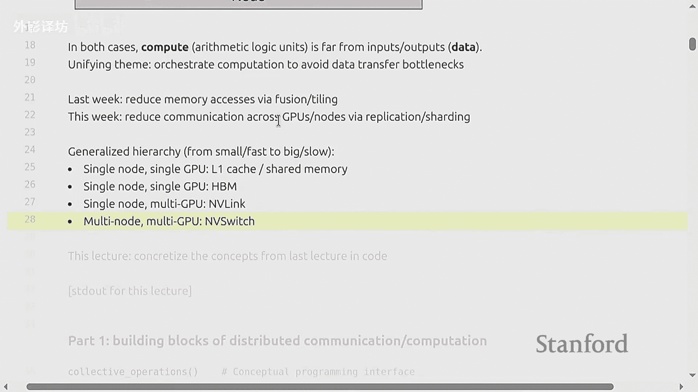
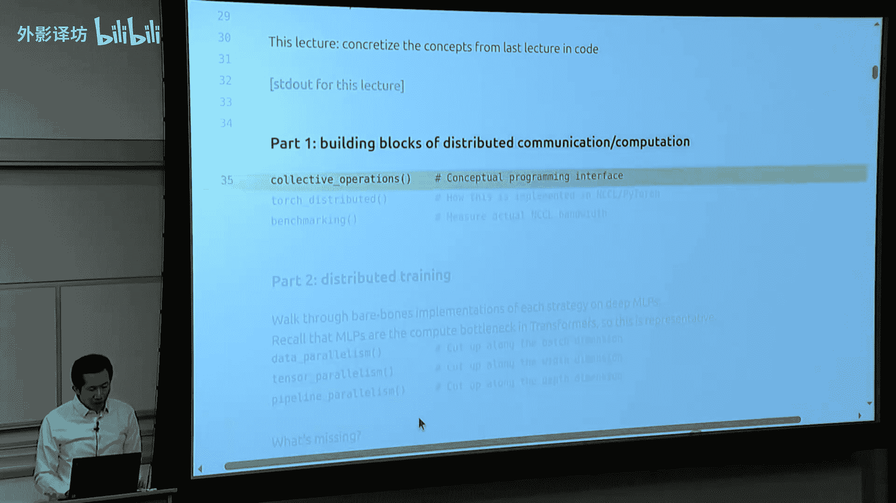
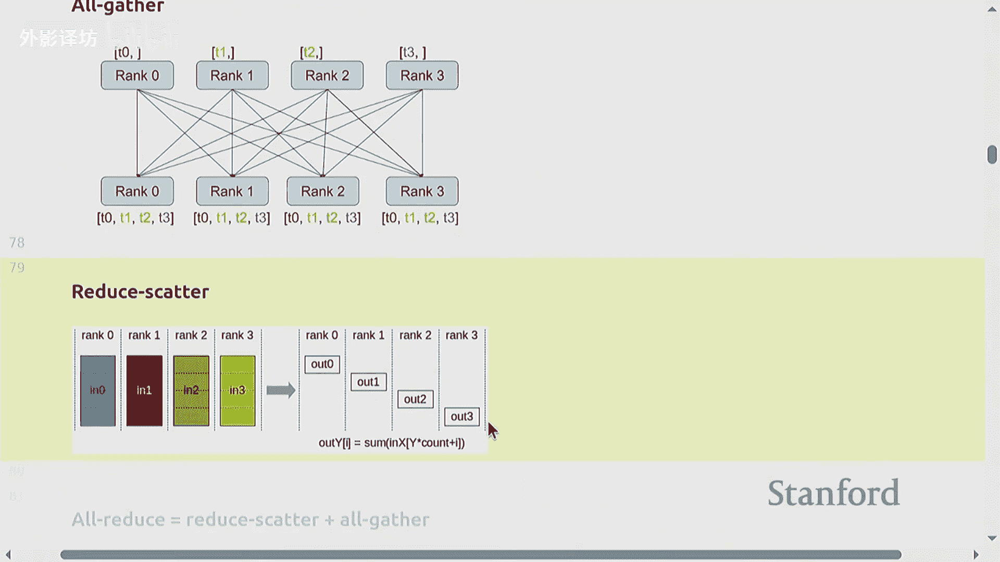
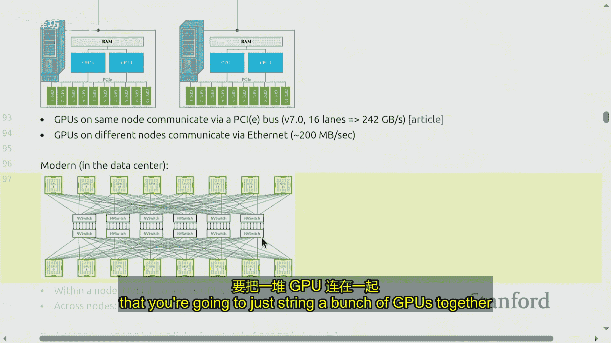
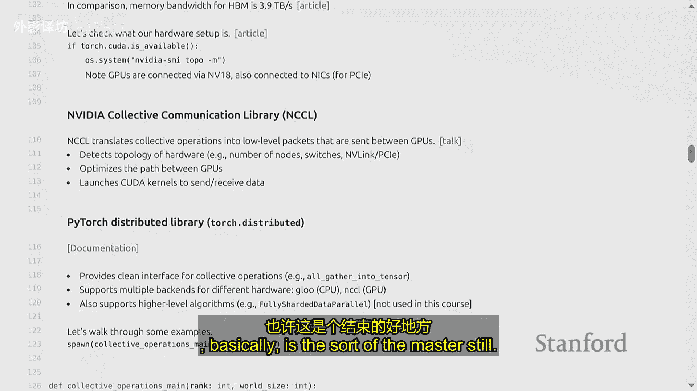
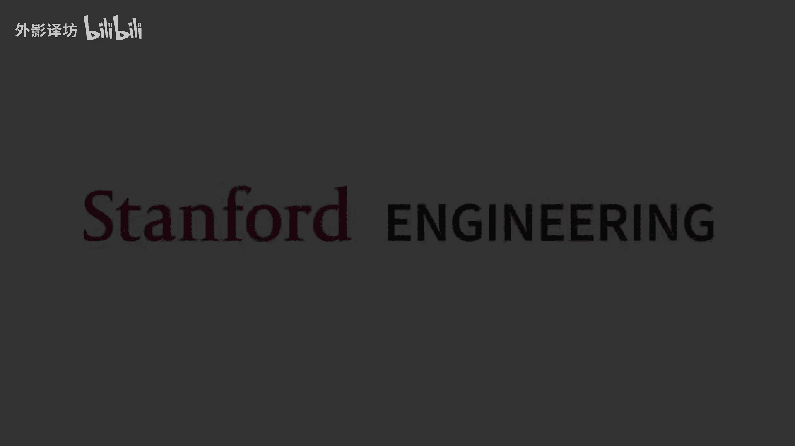

# 【中文配音】硬核！斯坦福 CS336：手把手带你从零构建 ChatGPT - P8：8.分布式训练技术（下）：模型与张量并行-Parallelism 2 - 外影译坊 - BV1BWEWzfEKi

这是系统讲座的第二周，我们尝试充分利用现有硬件，让模型训练的更快，上周我们讲了单个GPU内的并行性，这周我们要探讨多个GPU间的并行性，所以你脑海中应该有这样一幅图，那么我们有一批节点。

这些基本上是每台都有若干个GPU的计算机，通常为八个，在每个GPU里有一组流式多处理器及SM，他们实际执行工作，你看这里绿色部分基本上是内存和通信，所以在每个流式多处理器内，你有一个非常小的L1缓存。

在GPU上有高带宽内存，其容量更大，然后有连接不同GPU的连接，所以可以这样来理解，计算，必须在流式多处理器内的这些算术，逻辑单元上进行一次计算，需要输入和正确输出，一般来说输入和输出可能相隔较远。

要是你运气好，他们在IOE缓存里，要是你没那么背，他们在HBM中，现在就在本周，我们在讨论多GPU和多节点训练，你所需的数据可能在另一个GPU上，所以关键是你要如何组织计算，以避免数据传输瓶颈。

因为我们要保持高算术强度，我们要让图形处理器饱和运转，让他们持续高效运行，一般而言，数据传输速度会慢得多，所以这会成为瓶颈，所以上周我们看到了一堆不同的技术，尝试在GPU内实现这一点，包括融合和分块。

所以基本思路是不直接从hp m读写，你可以加载到L1缓存或共享内存中，它们具有相同类型且速度相同，然后就在本地暂存区处理，然后即审慎的写入hp m，本周我们开始着手研究GPU间的通信。

以及那些我们需要进行复制操作的节点，并对我们的模型和参数进行分片，同时优化我们的状态，在那我们采取的方式将决定成本，所以这里有这么个，我稍微灵活处理一下，将所有内容归为一种层级结构，你可以这样想。

从快而小到大而慢，所以最小且最快的位于单个节点，单个GPU上存在L1缓存速度超快，但容量超小，然后单个GPU上有HBM，然后同一节点的GPU之间有mv link，最后有mv switch。

当然这都在英伟达生态系统里，所以理念是很多核心概念。

最小化数据传输其实是一样的，但现在机制有点不一样，因为L1的行为和这类MV交换机不同，所以这堂课主要是要把上堂课的概念，用代码实现出来，会讲一些新东西，但test已经很棒的。

给你们概述了所有不同类型的并行性，我会试着把它和代码结合起来，以便我们能更深入的了解实际情况，我会引用这里的这个标准输出文件，它是运行这堂课后的输出，要是你进行多进程处理，会有些小问题，这里就不细说了。

要是你进行多进程处理，那么这个框架就不太适用了，好的，本次课程分为两部分，第一部分我们来看看基础内容，集合通信操作，我们上次讲过，以及他在NICL和PYTORCH中的实现方式。

然后我们会进行一些基准测试，接着在第二部分，我们来实际看看分布式训练，数据张量和流水线并行好了。

那咱们先来讲讲集合通信操作，集合通信操作，适用于分布式编程的一些基本操作，集合通信操作，适用于分布式编程的一些基本操作，集合指的是有多个节点，这些其实很古老了，至少在并行编程文献中，从80年代就有了。

一般来说他们能提供更好的抽象，比自行管理点对点通信更加，所以这些都是经过实际验证的，是历经时间考验的可靠基本操作，先来介绍一些术语，全局大小其实就是指设备的数量，比如有四个设备，还有质的概念。

要是你熟悉线性代数，可能会觉得有点费解，其实质就是指设备，所以有置零置1~2，要是有四个设备，还有置三好，下面讲讲集合通信操作，先从广播说起，就是在某个制上有T0，然后想把它分发到其他所有制上。

或者说所有制都要，所以这很简单，散射类似，不过你有四个值，然后要把每个值放到不同的设备上，这样每个设备得到的值就不一样，收集是散射的逆操作，每个设备都有不同的值，然后把这些值集中到一个设备上。

规约和收集类似，只是把链接换成相加，全收集和收集一样，只不过你是对所有目标都这么做，收集操作只针对质为012的设备，或任何单个制的设备，全收集就是对所有设备都进行这个操作，然后最后是规约散射操作。

我找不到关于这个的好图片，所以我复用上次那张图，它类似于规约，你获取一堆不同的值，然后把它们加起来，或者对他们进行其他可交换的运算，然后把结果放在一个设备上，但和散射一样，你要进行放置操作。

向量或张量的不同部分位于不同设备上。

好的记住全规约就相当于规约加权收集，那么记住这些术语的方法如下，因为这可能会有点让人困惑，比如哪些是全收集操作，哪些是规约散射操作，规约的意思是你在执行一些诸如求和求最小值，求最大值或求平均值之类的。

可结合与可交换操作之类的，可结合与可交换操作，广播散射是收集的反向操作，而全集表示全部目标为所有设备，好啦希望这是对上回内容的回顾，那么我继续之前大家有问题吗，既然我们要基于这些基本元素构建。

所以大家都理解的话，会有帮助，好那现在咱们看看这实际是怎么实现的，先从硬件说起，好，那下面是GPU硬件的常见样子，这有点像家用的情况，我猜你有台电脑还有CPU，通常你的GPU位于一个节点上。

通过PCIE总线进行通信，如果你需要连接在不同节点间通信，然后这些都连接到以太网，所以机器通常就是这样构建的，如果你购买一个GPU用于游戏或其他用途，这大致就是你的配置，正如我们将看到的。

这有点不太理想，因为开销很大，当数据需要在GPU之间传输时，它得经过内核被复制到缓冲区，然后通过以太网传输，这就带来了很大开销，那么在现代科学计算领域，在深度学习领域，如果您知道要把一堆GPU连在一起。

共同处理事情，那基本上就直接把这些GPU连起来，在英伟达生态系统中，我们有NVLINK可直接连接GPU，从而绕过CPU，无需经过主机内核，甚至跨节点我们可通过mv switch直接连接GPU。

所以我们绕过了以太网，由于以太网是很久以前开发的，显然不适合这类应用，因此mv switch和mv link省去了所有这些环节，并直接针对工作负载类型进行优化，我们感兴趣的。

看看H100S每个GPU有18条MV链路，第四代即将问世，这样一来总带宽可达900G，与这些相比，它比PCIE快得多，而且比以太网快得多，相比之下，若考虑成本，从SM读取高带宽内存，仍要快四倍左右。

当然这些数字一直在变，有了新的布莱克维尔产品，我觉得这个数字大概会变成两三倍，好的是的，那么问题来了，关于PCIE，数据是怎么传输的，我觉得还是得经过CPU，还有别的问题吗，说到PCIE。

我是说他是为诸如之类的东西开发的，其他东西也连到它上面，像声卡或固态硬盘，所以它并非完全是它有点像通用的设备，通信总线，没错，没错，那么问题是m blink也与CPU相连。

我想我们稍后会看到他是怎么连的，可能就在这张幻灯片上，设备如何连接，当然啦你还是得和你的CPU交流一下，好的，有个命令可以运行，然后就会产生一些输出，能让你看到GPU实际的连接方式。

所以我在我们的集群上运行了这个命令，有八个GPU，我猜你弄不到八个GPU，但是但我猜要是你能弄到的话，就会是这样的，你可以看到每队GPU之间MV18正在连接，还有这类网卡及其他部件，好的，哦对了。

那么网卡主要用于提供PCIE连接并连接CPU，所以那就是硬件，那么如何使用硬件，所以英伟达在其出色的硬件基础上，花费大量时间开发了优秀的软件，我想是基于非常出色的硬件。

英伟达有一个名为NICL的集体通信库，这实际上将集合通信操作，比如我们之前提到的全规约操作，转化为需要在GPU之间发送的底层数据包，所以这个库实际上做了很多工作，因为它让程序员能够仅在我需要这个张亮。

出现在所有机器上，然后就实现了，所以接下来简单讲讲过程，当你进行配置时，已启动一堆设备，会进行一些通信仪，确定硬件拓扑结构，它会优化GPU之间的路径，然后当实际调用这些集合通信操作时。

然后启动K代内核来收发数据，好的这就是NICO，他以库的形式提供，但对我们来说，NICO有点过于底层了，因为我们大部分工作都是用Python做的，所以PYTORCH有这个torch分布式库。

它本质上为这些集合操作提供了简洁接口，现在在你的PYTORCH程序里，你可以直接对一个张量进行全收集，并写入另一个张量，并且会显示在所有不同设备上，它还有个很棒且实用的特性。

它支持针对不同硬件的多种后端，所以要特别记住NICO用于GPU，但你也能运行集合操作，记住这并非特定于GPU，它适用于任何设备组，所以你也能用这个叫glue的后端在CPU上实现。

比如说要是你在笔记本上为作业调试程序，你能用K路，即便没有GPU也能运行，所以总之拥有这些高级言语，还有个好处是，他们比那种只能在特定GPU上运行的，更具可移植性，只依赖特定GPU的情况。

当然性能实际上取决于硬件，但至少在逻辑层面，你能确保代码运行，分布式，还支持诸如FSTP等其他高级特性，这是test速上节课讲过的，但这门课我们不会用这个，因为要从头开始开发，我们就这么干。

好那我们来看几个例子，看看torch类型的分布式集合，通信操作是怎么工作，我写了个实用函数，你要是想可以看看代码，他接受一个函数并运行，本质上它是Python多进程的一个封装。

它会运行四个执行此函数的进程，所以当你在这个函数里，你应该想到，实际上有相当于全局大小数量的进程，在运行这个相同的函数，其中至从011直到全局大小减一，所以现在我只处理其中一个设备，因为这里不是并行的。

所以一般来说你首先要做的是，这个过程需要自行初始化，本质上他们得找到彼此对吧，因为你的多处理器运行着很多进程，他们需要连接到一个主机，以便能够明确，知道彼此存在，所以这不是所有数据的去向。

数据通过镍这种介质传输，但这只是起到一定的协调作用，而且我们有一个GPU，我们能用镍，不然就得用胶水了，好等你设置好之后，那现在我们要开始干活了，有个很实用的函数叫屏障。

他主要是等进程组里的所有进程都到这一步，记住所有操作都是异步进行的，在某些情况下，你只是需要一个同步点，所以屏障就能起到这个作用，我把它放这儿，其实是些琐碎原因，因为我想把所有这些打印语句归在一起。

但你想用barrier，还有其他原因，稍后再说，所以我要为每组构建一个张量，所以张量是0123加上质的值，所以我要为每个值打印，在进行归约前，他啥样如下所示，后排的人能看清吗，能看清吗，好的好的。

那么在设备零上数据是0123，设备以上是1234，以此类推，注意由于这是异步的，所以打印顺序是无序的，无论按什么顺序打印，所以每个设备都有一个不同的张量，然后进行规约操作权规约时传入那个张亮。

你说要对他求和，在这种情况下，我不打算进行异步操作，但你可以进行异步操作，这有助于同时进行通信和计算，然后全规约之后会怎样如宣传的那样，基本上针对第一个分量把它们加起来得到六，这个得到十十四和18。

那么在所有规约之后，基本上这个张量会被相应的和覆盖，所以它用起来很方便简单，好那咱们做规约散射，对于规约散射，我要创建一个维度为全局大小的输入，这种情况下他是四，我要分配一个输出。

因为规约散射不会原地操作，这将是一个标量，所以在规约散射之前，他就是这个样子，我的输入和之前一样，输出为零，但它可以是任意值，因为我没有对其进行初始化，然后再进行规约散射之后，我在这一步传入输入和输出。

然后进行相加，然后对于第一个分量进行相加，这在rank0上进行，对于第二个部分，我做求和操作，然后在设备仪上进行，以此类推，好的如你所见，他执行的操作和全规约一样，只是输出分散在各个不同设备上，好的。

现在我们进行全收集，所以我直接用规约散射的输出，就是这个，作为输入，然后为输出分配一个空数组，然后在全收集之前，我猜输入是这个，而输出只是一些任意的值，在我进行全收集之后。

结果就是我使所有这些张亮出现在所有设备上，所以这也算是一个例子，希望现在你能确信，规约收集加上全收集就是全规约，因为我计算的量与全规约时一样，好的有问题吗，清楚了吗是吗，在规约散射中。

我们是否在记录哪个索引对应哪个GPU，那么问题来了，在进行规约散射时，你是否记录哪个索引对应哪个GPU，所以按照惯例维度基本上得是设备的数量，我的意思是它可以是一个普通张量，但其中一个维度是设备的数量。

并且他只是推断出基本上你想要的输出是，比如说抱歉，输入基本上得是设备的数量，然后他大致知道相应的计算会进入每个输出，是的，你得稍微留意一下，确保维度对齐，所以过一遍这些小例子会有帮助，还有别的问题吗。

好的，所以最后我们现在正处于这个运行过程中，当你完成时，你就清理一下好的，那么到目前为止，我们已经讨论了这些集合操作，简单讲讲他们在PYTORCH里的实现，然后是镍，然后是PYTORCH。

我们来做些基准测试，按照我们在作业或第一堂课中的做法，或者更确切的说是第二堂课，我们现在先关注一个节点，那我们进行规约，所以我要创建一个有1亿个元素的张量，全局大小为四，所以我要分配一个张量，一般来说。

我觉得希望你们现在能明白，当你进行基准测试时，你得格外小心，在某种程度上要清理一下状态，在这种情况下，我要先热身，先运行一次操作，然后同步并执行屏障，我觉得其中有些可能有点保守，但只是为了保险起见。

确保所有内核都被加载，所有需要计算的都完成计算，接着我要开始计时，进行全规约操作，然后再次同步，最后停止计时，这样我就能知道这花了多久，要是我在这里往下滚动，我觉得这没什么用，或许我该打印出微秒数。

我想挺快的，几秒，现在我们来测一下带宽，也就是每秒实际总共传输的千兆字节数，好啦，那咱们实现这点的办法是得想想，这实际传输了啥，所以有个张量，其元素大小是那样的，每个元素的大小呢，我猜是这个。

我觉得这是32位浮点数，所以就是两个，不好意思，是四个字节，所以这就是字节大小，好嘞，现在这有点微妙，那么实际发送或传输了多少字节呢，所以每个位于一个至上的张量，都有大小为字节的数据。

然后他需要把数据发送给，除自身外的其他设备，但这里有个两倍的关系，那么为什么会有个两倍的关系呢，因为你在做全规约，还记得不，所以你要把所有不同的元素都发送到一个地方，需要把它们加起来。

然后这个结果要返回给每个参与的设备，所以每个设备要先发送输入数据，然后接收输出数据，所以这就是为什么这里会有个两倍的关系，所以总时长是全局大小乘以实际过去的时长，所以我想我们假设如果有四个处理器。

那就差不多是实际经过的挂钟时间的四倍，而带宽就是持续时间内的字节数，那么这里得到了什么，大约每秒二百七十七千兆字节，所以我觉得对于H100及更高型号，我记得我说过大概每秒九百千兆字节。

现在当然我们都知道，具体情况会因张量大小而有所差异，还有设备数量以及其他各种因素，不不是天气，是各种其他因素，所以具体情况可能会不一样，所以做下基准测试总是不错的，看看你实际每秒能达到多少GB，好的。

那么规约散射的情况会很相似，那我们快速过一下这个，所以我们创建了输入数据，其大小为全局大小乘以元素数量，每个设备都会有这个矩阵，然后我们要进行预热，然后开始计时，进行规约散射操作，再停止计时。

然后看看花了多长时间，嗯好吧，这没什么用，然后我们来看看带宽，所以这里发送的字节数不是二的幂，记住这是因为在规约散射中，你只需将输入发送到一个地方，如果你只考虑规约，所有元素都汇聚到一处，就这么简单。

而散射就是说张亮的不同分量会去往不同地方，但实际上它类似于规约，好那如果你做同样的计算，你会看到他时，我猜这种情况下我得到了70，所以我不太清楚为啥恰好是70，而不是别的数字，我猜有人可能会推测。

全规约一般来说会更多产生的流量，以及所有规约操作可能会更优化，我认为英伟达硬件有这种显著的加速能力，它实际上对部分计算进行了处理，在实际网络中，这消除了二倍的影响因素。

但我不知道这能否完全解释此处的差异，在NICO中发生了很多事，很难准确推断其性能，因此需要进行基准测试，是的，所以问题是看起来这只是输出的字节，我们关注的是输入，所以说清楚一点，我假设输入已在设备上。

所以我不算那段时间，我只计算进行规约散射所需的操作，这只是个散射操作吗，这是个规约散射操作，所以你需要规约样本，所以这个函数执行规约散射，所以这是一个操作，所以你是说对于所有规约操作，因为要进行规约。

所以存在两倍关系，然后你需要再分散开，对于规约散射，我的意思是它只是个名字，它被称为规约散射，但实际上它只是一个规约，好的基于此，你也能看到，如果你进行规约散射，然后再进行全收集，这些都没有二这个因数。

所以把它们加起来就会得到一个因数啊，这也是理解所有规约操作，会执行两次的另一种方式，好的有一些关于如何进行基准测试，以及这些集合通信操作的参考资料可供阅读，好那我们现在来谈谈分布式训练部分。

所以我们这里的总体方法是，我将逐一介绍最简实现深度多层感知器上，每一种策略的本质上，那么回想一下，你通常处于这种情况，多层感知器是计算瓶颈，而不是注意力机制中的转换模块，所以在某些方面。

尽管这是个非常简单的架构，它很能代表你会见到的工作负载类型嗯，好那我们从数据并行说起，实际上要注意数据张量并行和流水线并行式，你可以把它们看成是拆分的不同方式，模型或数据，希望我能在这直观展示一下。

好那么在数据并行方面，这是你的模型，假设它有四层，MLP的每一层都是矩阵乘法，这里即隐藏维度，所以数据也是个矩阵，它包含P4维度和隐藏维度，而数据并行只是沿P4维度切成更小的快。

所以现在每个计算单元将获取数据的不同切片，那我们在此举个例子，所以我要生成一些示例数据，假设我有一个128的P4大小，和1024的隐藏维度，然后生成一些随机数据，我有批次大小和维度数量。

然后我要运行数据并行算法，所以这里我要，所以我处理完了这些数据，有一个批次大小以及之前提到的维度，现在我将P4大小除以全局大小，这样我就得到了本地P4大小，指定至上的P4大小是多少，然后我打算基于制。

只需算出本地批次大小的起始和结束索引，我需要访问的本地批次大小，然后从中获取相应数据，所以基本上我只是从中选取，并根据质选取一些行子集，好的，现在我在这里设置MLP，可以说这做的非常简单。

这里我再创建MLP参数，那么每一层都有一个矩阵，其维度为number dimension乘number dimension，请注意，number dimension为1024，接下来我将创建优化器。

请记住此函数在每个设备上异步运行，因此四个设备都将运行此程序，设备编号依次为0123，现在我即将开始训练，因此进行若干步操作，我要对各层进行前向传播，矩阵相乘非线性变换，在矩阵相乘非线性变换。

这里有四层，要计算一些损失值，我其实不在乎损失值是什么，它只是虚构的，随便编的，然后我要进行反向传播，到目前为止，这看起来就像是我在实现随机梯度下降对吧，而这正是关键所在，唯一的区别是。

现在要实现分布式数据并行及，你只需要在这里插入这一行，它会同步各个工作节点的梯度，所以针对每一层，你要做的是你调用全规约操作，而你要平均的是参数梯度，所以这就好像你有点劫持了别人的随机梯度，下降代码。

然后你说等等，实际上我要在反向传播后混合所有梯度，然后做完那件事后，你就像平常一样更新参数，从随机梯度下降角度看，看起来没什么动静，我只是在运行SGD，但有人刚把我的梯度混合了，好吧。

我想那就打印些东西，在数据并行时，我在打印损失值，需要注意的是，不同质的损失值不同，因为数据不同，但在规约之后，所有参数都一样，好啦，这算是全规约在机器学习场景下的典型应用，那么问题来了。

如果所有这些进程都在异步运行，你要如何确保呢，你要如何确保他们每一个都处于同一步骤呢，比如说这是因为全规约是个同步点，他会让所有人停下，然后进行全规约操作，所以你得小心，因为如果你的某个。

某个设备进程缺少全规约操作，那么它就会挂起，问题是为啥获取初始参数得开设备呢，他们应该是一样的，他们是一样的，原因是我猜是因为我没有为此写的代码，基本上会把它放到合适的GPU上，好啦，还有别的问题不。

所以分布式数据并行，是你们作业里要实现的东西，说不定你们当中有些人看过，有些人没看过，这会在transformer的环境中进行，但这算是最精简的版本了，这样你就能清楚的看到发生了什么，好的。

这就是DDP，不同设备的损失各不相同，但梯度会被处理成全部一样，所以所有设备的参数都是一样的，所以实际上你要进行大量的随机梯度下降运行，但由于它们是同步的，他们在做同样的事。

所以你可以把这当做是一种的实力，激活的类似物检查点，有时候你只是做些额外的计算，因为你不想存储数据，在这种情况下，比如说传输优化器状态，但那会是个坏主意，因为仅仅运行会快得多。

更新优化器状态比实际移动优化器参数快得多，好的，去年我试过用FSDP，但那有点麻烦，所以我打算跳过那个采用张量并行，这里我们保持数据不变，现在我们要做，我们将沿隐藏维度分割模型。

所以每个设备将获取每一层，但每个设备只获取每层的一部分，最后我们要做的是传输所有数据和激活值，所以我们再生成相同的样本数据，接下来看看张亮并行，好的，我设置了批量大小，维度数量和之前一样。

现在我要之前我在分割批量大小，但现在我在分割维度数量，所以本地维度数量为1024，除以全局大小，结果是256，所以本质上每个模型啊，每个设备获取模型的一部分及参数占比，为全局大小分之一。

还记得我们进行并行计算的初衷是，因为模型无法放入单个GPU，所以我们要将其分配到多个GPU上，所以参数矩阵现在是NUM乘以局部numbing大小，现在每个设备要我这里只实现前向传播，而非整个训练循环。

所以我要开始逐一遍历所有层，所以我要计算激活函数的值，首先这个看起来挺正常的，只是要记住，激活值实际是按本地维度数，而非维度数进行批量处理的，激活值实际是按本地维度数，而非维度数进行批量处理的。

因为现在每个计算单元只拥有一部分激活值，但现在一旦我获取到激活值，我需要进行数据传输，在这里，我要为所有激活值分配内存，所以此时此时每个人都有一个X值，但那个X代表了不同部分的激活值。

所以现在我要分配P4，大小乘以局部维度数量的值，而是全局大小的数值，所以基本上每个设备都会有足够多的呃，我要获取那个基本上会有全局大小数量的批次，大小乘以局部维度数量的矩阵，然后我要进行全收集操作。

好的，所以我要发送所有激活值，而且这相当简单，记住X等于批量大小乘以局部维度数量，但每个设备的X都不一样，所以当我进行全收集操作时，我会把它存到激活值里，它的大小本质上和设备数量有关，形状和X1样。

所以现在每个设备的激活值都一样了，现在他有了所有模型的激活值，整个模型的激活值，然后把它们连接起来得到X，所以现在X又根据维度数量进行了批量划分，我再重复一遍，如你所见，这里有大量通信。

这就是为什么记住test称，对于张量并行，你需要非常高的互联，否则你得频繁传递大量这样的激活数据，然后对下一层和再下一层同样操作，你就明白是怎么回事了，只是为了打印些输出内容，关于张量并行。

我们来看看这里前向传播生成的激活值，基本是完整尺寸的，最后每个人的激活值都一样，好那么反向传播，我要跳过，因为那样做挺烦人的好，关于这个有问题吗，我只是在想，为什么反向传播很难做。

那么为什么反向传播难做呢，我不觉得这一定很难，不过我猜在有限的时间和空间里，这不难，只是需要多花点功夫好的，那么现在我们来看流水线并行，那么在这种情形下，我们按层切割模型。

所以所有设备都能获取到所有数据，并且每个设备获取一层的全部内容，但他们获取的层不同，好嘞，那对数据进行采样，然后针对所有设备运行此函数，好啦，那我来算算每个设备里有几层，这里是两层，所以我有个四层网络。

我有两个设备，所以每个设备负责两层，就像这张图所示，接下来我只针对所需的层分配参数，接下来我只针对所需的层分配参数，所以我要进行前向传播，记住还有进一步的优化工作要做，也就是如果只是盲目去做。

你会得到test之前讲过的这些流水线气泡，减轻这种情况的一种方法是，把批次拆分成微批次，所以在此我将进行划分，将这个批次分成大小为32的批次及四个，接着思路是，每个设备基本上要等待前一个设备。

将其传递到激活函数，它将应用那些层，然后将其转发到下一个设备，那么从基本情况开始，我们有设备编号为零，就只是数据，所以我把数据分成若干V批次，然后逐个遍历VP次，首先我接收张亮。

所以我现在用的是点对点原语，而非集合原语，本质上我接收张亮X，然后我会计算分配给该设备的层，所以在此情况下只有两个，然后我会把它发送到下一个设备，再说发送是点对点操作，然后是下一批，我要做同样的事。

所以我要跳过那个好了，基本就这样，所以流水线并行至少极其简单的那种，在概念上相对简单，但正如test上次所言，这个基本实现有很多欠缺之处，这里我们完全没有将通信与计算重叠进行，例如接收与发送是同步的。

但你真该让他们一步还有前向传播的顺序，实际上这只是前项，不是反向，但一旦有了反向，那你就得弄清楚如何交织前项和反向步骤，我想你刚提到的异步在这有体现，我想实际上，GPU会有点像在监听。

看他们是否想给他传东西，而且他有点类似我们熟悉的事件驱动，只有前一层把数据传给他，他才会开始处理，然后他开始处理数据，所以问题是这是不是类似于事件驱动编程，在这种编程里，你只需等着事情发生。

我认为事件驱动编程，你要编写这些处理程序，然后每当有事发生，也许你会收到鼠标点击，也许你会收到文件准备好的事件，然后一段代码就会运行，我觉得这差别挺大的，与这种编码方式，所有操作都得同步进行，确实。

你在等上一个设备给你发信息，但至少在这个时间里，他从哪儿获取数据，没有灵活性，他又不是在等随便哪来的数据，我觉得有办法进行异步训练，我想十几年前这挺流行的，十几年前颇为流行，在那种情况下。

他更受事件驱动，有一台服务器负责发送数据，每当梯度准备就绪，他就上船，然后梯度会累积，要是工作节点挂掉，那就会处理的更稳，但在现代训练里，尽管已经大幅扩展，一切似乎都有点处于同步模式，没错确实。

当我说到工作节点，并且各个设备在异步运行，那只是因为它们是不同的进程，但你仍对所有事情同步运行的方式，施加了相当严格的限制，我只是好奇你要如何更改这个程序，已处理与社区有交流的情况。

所以问题是你会如何更改它，让通信和计算重叠，比如说当你发送这个时，没必要干，等着数据被发送出去，你基本可以直接发起发送，记住数据发送实际上是通过内核启动，在GPU上完成的，所以这在一定程度上是独立的。

然后他就能马上接着处理下一个V批次，我认为你可以这样做，有一个名为ISON的函数，它是异步的，实际上这个必须是异步的，异步操作会返回一个句柄，所以你基本上要完成所有发送操作。

然后最后你要等待所有发送操作完成，然后是关于重叠的部分，当你实际进行反向步骤时，那你基本上得在这安排妥当，发送和接收的张亮明一样吗，如果你有多个发送和多个接收操作，他怎么分清呢，郭雨崩，所以问题是。

要是你有多个发送和多个接收操作，你怎么分清呢，所以在此处，张亮名称无关紧要，他就是那里的一个变量，而你所指定的是圆，所以如果我处于一个节点且正在接收，那么来自该设备的下一条消息。

我就将其放入这个X中并继续执行，为何我要从同一设备进行两组操作，如果你想从同一设备，向同一目的地进行两次发送呢，所以我对此不太确定，但我觉得如果你进行两次发送，他好像被放进了一个流里。

所以发送顺序仍会被保留，只是其他事情可能会同时出现，我觉得要是你有两个设备并发送两次，那么那个顺序就会保留下来，但你把一个设备发送到另一个设备的顺序，它随时都可能发生，是吗，就像这样发送，但没人接收。

要是他就停在那了咋整，那要是你发了却没人收到会咋样，我觉着他会卡住，他就只能干等着，因为没有，我是说因为这个进程可能只是在跑着，而你不知道他会不会它只是在执行代码而已，所以你不清楚他是不是永远都到不了。

还是说只是时间早晚的事，没错啊，那么问题来了，最后一个会怎样，所以到最后最后一个包含了所有的激活值，所以这基本上就是一次完整前向传播的结果，然后要是你进行反向传播。

那么你现在实际上就在计算相对于损失的梯度，然后你再往回转，从一个设备传递到下一个设备，以此类推，好的，我想我之前可能担心时间不够用，但看起来我其实还有时间，也许明年我该进行反向传播，好的。

其实我今天会很早就完成，所以要是你还有其他问题就该提问，到目前为止，我们已经看过了三个简单例子，数据张量流水线并行的，当然这适用于简单的多层感知器，实际上你会想用自己更高级的模型来做这件事。

比如transformer，我确实说过，至少在核心思想上，你能通过多层感知器大概明白，我觉得，但当然当你想训练时，你想训练的是transformer，而不是深度MLP，所以你仍需实现全部复杂性。

同样缺少的是通信与计算重叠，而这里对此处理的并不够细致，一般来说还会有一段更复杂且涉及不计的代码，我建议你去了解一下MEATRON，LOLM或PYTORCH的FTP，这会变得相当复杂。

而且我认为有一点使得某些不济工作，至少对于FSTP而言，并且在L2中也会稍微接触到这个，即如果你想要一个能处理任意架构的工具，那么你就得弄清楚参数，还要进行大量布计工作，来弄清楚它们的层结构等情况。

而在多层感知器的情形下，我只是做了个决定，我打算用一种特别简单的方式拆分这个模型，另外我顺便提一句，就是我们这门课讲的都是PYTORCH，但了解一下，围绕JAX和TPU的整个其他生态系统。

实际上在某些方面还挺不错的，这里的理念是JAX能让你指定义模型，他定义了分片策略，然后JAX编译器会处理剩下的部分，我们基于JAX开发了一个名为LAVENTURE的工具包。

我给你展示一下所发生事情的片段，这就是FTP和十行代码，基本上你有一个模型，然后你只需说按这个特定的进行分片，我是说，我不指望你逐字去读这个，但基本上你定义要按哪个维度进行分片，然后就这么简单。

张亮并行的情况也类似，你只需说我要沿着某个方向对模型进行分片，你可以在注意力头部维度上进行分片，也可以基于模型维度进行分片啊，所以在某种意义上，这给了你一种概念上的简易性。

你要做的本质上就是有这样一个计算图，但他有这些特定维度，模型维度嵌入维度，注意力维度以及序列维度，而JZ只需让你指定想要切割的维度，还能定义从那些维度到实际TPU的映射。

接着jack编译器神奇的自行弄明白，如何将其编译成，能对数据进行移动操作的基本元素，所以这比通过集合通信进行操作要高级得多，所以这比通过集合通信进行操作要高级得多，但我们还是继续使用PYTORCH。

因为它能让你在一定程度上了解，实际发生的幕后情况，但如果你真要在实际中做这件事，显然你没必要，而且你可能也不应完全从头开始实现这些好了，杰克的题外话，至此为止，那么总结一下，到目前为止。

我们已经见识了多种并行化的方法，而且每种并行化方法都是，你可以想象为沿着某个维度分割模型，或者沿着某个维度分割数据，如数据批次维度，宽度维度或深度维度或上下文长度维度。

我们也看到了这种反复出现的重新计算主题，你可以某种程度上从头重新计算某些东西，或者你可以存储到内存中，还要承受数据传输成本，或者在现在的多GPU多节点设置下，你实际上能够存储到另一个GPU的内存中。

然后进行通信，而这会更慢，所以这里存在权衡，通常重新计算会更好，但显然你无法重新计算全部内容，通常你不是受限于通信，就是受限于内存，最后硬件正在不断改进，所以你可能会想23，也许这些并非真的必要。

因为5年后，所有东西都能装进一级缓存或高带宽内存，所以并非如此，因为他们可能会大幅增加，虽说还是有物理限制，我们最终总会得到更大的模型，这些模型某种程度上已达硬件能力极限。

所以这种层级结构自从有计算机系统以来，就一直存在，它将一直存在，好啦今天就讲到这，所以现在可以提问，那么问题是在数据并行方面，你是说即便参数在一定程度上是同步的，可能存在其他依赖数据的因素。

比如P归一化，所以我真不知道你会怎样，批归一化一直都有点烦人，所以我一时还真想不到你具体会怎么做，我想至少在大语言模型的世界里啊，因为用了层归一化，所以这问题没怎么出现，只要你初始化所有参数。

并使用相同的随机种子，你就没事了，我是说GPU上可能会有不确定性问题，但希望这些问题不大，没错，所以问题是，PYTORCH是否也有什么优点，有点像JX提供的那样吗，是这样吗，没错。

所以呢PYTORCH确实有FSTP库，要是你没选这门课，那绝对得用它，它本质上是个包装器，你定义任意模型，然后他就会对其进行FCFDP处理，我觉得现在要是你问他，在自定义图表绘制方面能做到多好。

我觉得有些事情要来了，但我觉得他没那么成熟，我的意思是在JX领域和在那里，你可以声明重新定义的内容，还有谷歌的基础设施，如果你采用JXTPU系统，它已经相当完善了，但如果你看看deep sec。

它处于另一端，在那里，这些GPU的互联很差，这意味着他们得深入去破解，你懂的，他们实际上要达到镍这种程度，并且实际上要做很多事情，我不太明白，他们为了提升性能而这么做，而如果你在编写一个JS框架。

你只需从高层次上声明你的模型，然后就会有相应的结果，所以这就是你利用硬件的方法，我认为这真的取决于你所运行的生态系统，是的，是的，所以问题是激活检查点有一个API基本上能让你。

我想在PYTORCH和jacks里，能指定要重新计算哪些部分，因为显然你不想重新计算，要么全算，要么不算，可能每隔几层，大概就在大型映射模块之后，例如比如说要是你有一个映射模块，然后进行逐点计算。

我觉得基本上你不需要存两份，要是你有两样东西，在那获取它挺容易的，那你不妨就只存一个版本呗，对在那边，是普通硬件还是更专业的硬件，所以问题是，GPU会被专门用于transformer的硬件取代吗。

所以在推理领域，你已经能经常看到这种情况了，比如说GROCK和sarah birth，有能进行推理的专用硬件，而且我猜还有训练方面，CEREBIRTH能做训练，所以基本上那些硬件能给你提供更多片上内存。

我是说这基本上就是关键所在，我觉得suffer birth有个超大的，你懂的，本质上就是个L1缓存，所以无需外存数据，而且我觉得由于GPU很多简化得以实现，实际上仔细想想会发现有很多累赘。

因为他们是在某个时代被划分出来的，在那个时代得进行大量分支操作，还有各种临时计算，而这些在深度学习中并非真正必需，所以我觉得也有不少机会，改进硬件，我想那儿有只手，我不知道这是不是个合适的问题。

就我所想的这个问题，不过在这次讲座的背景下，本质上是一个在LAMBO中训练的模型，一直在优化服务器，但我想知道有没有接手的人，我们说的这些能不能用来逐步训练一个模型，比如说当你得到新的训练数据时。

而不只是微调，但实际上完成所有内容的重新计算，无需重新计算，是的，所以问题是这些技术能否用于进行持续训练，是的当然可以，那么当你思考我们所处理的单元时，它只是在做梯度步长计算对吧。

所以如果你采用一个半程训练检查点，你就可以继续照做，这里没有什么特别需要从头做起的，我想那里有个问题，所以关于之前那个问题，我不知道无形的特定硬件是什么情况，之前那个问题大概存在某种物理方面的。

由于技术原因，你无法把节点做的比现在大很多，你所说的改变是什么啊，如果你能制造GPU节点，比如，想要多大就多大，人们会这么做，所以大概是硬件方面的原因导致这不可行，那么实际进展如何。

针对你提到的特定硬件没错，所以问题是GPU肯定存在物理限制，我先讲一下，那么接下来，所以GPU没办法做的无限大或无限密集，我的意思是功率方面也有问题，你得把所有热量都排出去，而且带宽容纳量也有限。

所以具体细节我不太清楚，但至少在某些sarah bros的案例中，他们大概有这样一种制造方式，基本上就是制造芯片，让内存以某种方式集成在芯片上，所以我猜这只是一种把它放上去的方式。

我认为显然存在权衡取舍，因为这是以牺牲一定灵活性为代价的，但总体来说，我认为更全面思考这个问题的方式是，图形处理器仍是在某种程度上的，CPU时代发展起来的，在那个时代更侧重于控制，我正在执行代码。

那算是头等重要的，然后需要移动数据来处理代码已执行，但是深度学习工作负载的一大不同，在于其诠释某种数据流，比如计算图，若你看这些，他们是静态的，从一开始你就知道，直到训练基本结束前要进行的所有计算。

所以利用这些知识，你应该能以更明智的方式安排计算，而不是不得不应对，临时计算的灵活性和不确定性，好的可能还有几个问题，我就讲到这里，计算图通常存于CPU还是GPU中，所以问题是计算图存于何处嗯。

代码方面，我是说所有这些代码都在CPU上运行，但当你调用诸如PYTORCH中，需在GPU上运行的函数时，那么它会在后台启动内核，且内核是在GPU上运行的，代码是啊，我不太确定是这样。

那么我猜也许另一个答案是，我想计算图更多是概念性的，要知道并非真有一个实体的图，我的意思是我想某种程度上是有，但不是说图被放到了GPU上，如果这说得通，那么关于通信言语的问题。

他们是在CPU还是GPU上，所以这些集合通信操作在某种意义上是抽象的，所需执行的操作类型说明，要是你还记得，这事就能成，PYTORCH分布式有不同背景的话，所以它能在GPU或CPU上运行。

是CPU在调度他们吗，怎么调度的没错，CPU在起驱动作用，基本上它还是起主要作用，然后当你进行集合操作时，它会调用NICO库来启动，还是靠CPU，然后它会启动一些用于移动数据的内核程序，好的。

也许这是个结束的好地方。

好的。

