# 【中文配音】硬核！斯坦福 CS336：手把手带你从零构建 ChatGPT - P9：Lecture 9： 缩放定律1-Scaling laws 1 - 外影译坊 - BV1BWEWzfEKi

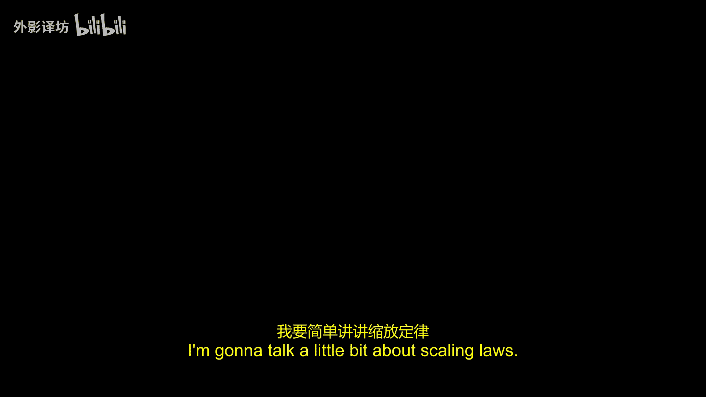

我要简单讲讲缩放定律，一开始我以为我们要讨论推理，但我会先花几分钟讲讲缩放定律，然后我们再大致想想接下来该怎么做好，那缩放定律的重点，首先我希望你设身处地想一下下面这个场景，比如说你有个超有钱的朋友。

然后他他给了你1万，实际上咱们就说一个月给你10万个H100，你得尽己所能构建最好的开源大型语言模型，所以这任务有点难，而且我们给了你一些必要工具，助你在这方面取得进展。

所以你可以组建基础设施团队和系统相关人员，你还能组建一个分布式训练框架，在接下来的任务中，你要组建一个出色的预训练数据集，然后你大致就了解了各种架构等知识，所以你大致明白你已集齐所有要素。

这样我们就能转动曲柄了。

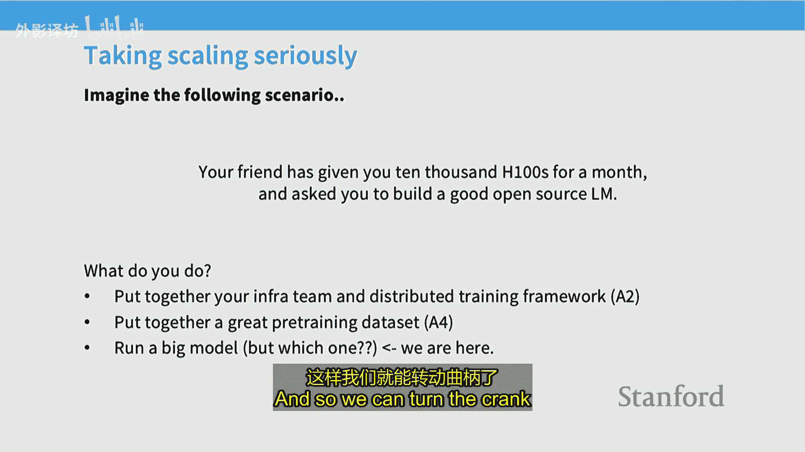

接着就能运行大型模型了，在最初的几堂课里，我们讨论了你在这个过程中，可能做出的其他各种决策，比如架构是怎样的，超参数是啥，比如你要怎么处理这些事嗯，我觉得在某些方面。

我在早期课程中给你的答案就是照着别人的做，照着拉马或其他类似模型做就行，但这么做其实挺无趣的，因为这无法开拓新领域，因为这没法让你开拓新领域，要是你在大型前沿实验室，还打算打造出最佳模型。

你肯定不想只抄袭别人，而是要创新，那要怎么创新呢，还能先得到这些优化方案，所以这就是缩放损失的关键。

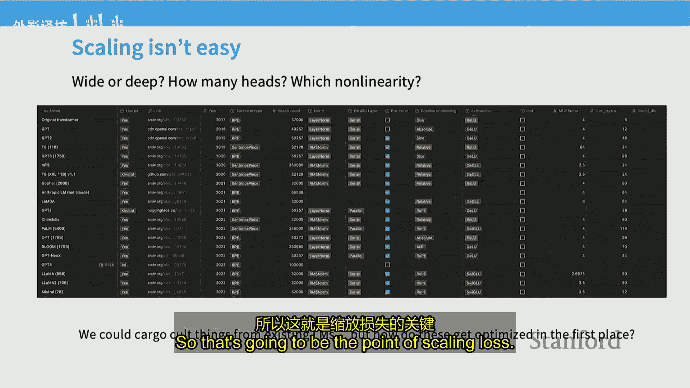

我们要做的是为语言模型的行为，建立简单的预测规则，而缩放定律本质上就是能够拿小模型，并将其扩大规模的这种理念，并能够如此做来提升工程效果，所以思考这个的一种方式，是以往那种令人不悦的深度学习方式。

就是训练一堆大模型，调整超参数，以使大模型性能良好，那将耗费大量计算资源，你很难轻易做到这一点，所以我认为新的乐观之处在于，要是你一直在留意诸多关于扩展的进展，你大概会这么想行吧。

我们打算训练一批小模型，我们能从那些小模型中学到不少东西，然后再把它们应用到更大的模型上，所以我们会选用计算规模，左侧最小的模型，我会学到很多该怎么做的方法，然后我就能一次性搞定，等我构建大模型的时候。

我想先从缩放定律的历史说起，以及缩放定律的背景，我想结合实际情况来讲讲这个，因为我觉得当人们谈论缩放定律时，通常是用类似救世主般的通用人工智能术语，来讨论，所以缩放定律只是告诉你。

惊人的事情会永远呈对数线性增长，然后我们会实现超级智能，但我觉得缩放定律其实更接地气，并且有着诸多有趣的历史，所以我打算从那开始试着说服你，缩放定律并非仅仅是在对数对数图上拟合直线。

尽管这是我们工作的重要组成部分，然后我会采取非常简单的步骤，我要试着说服你，至少对于数据而言，缩放定律是很自然会去思考和预期的，那么作为一个在统计，机器学习环境中成长起来的人，我将从统计机器学习入手。

什么是缩放定律，从某些方面来说，缩放定律告诉我们，当数据量增加时，或者改变模型大小，我们希望模型会有特定表现，要是你回顾一下机器学习基础课程，要是你还记得VC维，还有拉德马赫复杂度之类的，从某些方面讲。

这正是其理论版本，所以在最上面我有K个假设的有限集合中，学习超额风险时的泛化界，我们可以看到它应该与根号N分之一成正比，在某些方面，这是尺度定律的理论形式，我们据此预测误差随其变化而衰减的速度。

在下方我们可能会遇到一些更特别的情况，若我们进行生成式建模，且我们的生成模型属于非常灵活的非参数类别，我们不妨拟合某种平滑密度，那么在这种情况下，我们预测的是L2内误差。

估计密度的误差将由某个多项式给出上限，基恩的贝塔次方除以二贝to加一，这就是有些人所说的非参数速率，因此长期以来，理论家们一直在思考样本大小，尤其是样本大小应如何与误差相关，这是机器学习理论中。

人们长期思考的一个经典问题，但这些只是上限，并非实际的损失值，实际上，缩放定律在某种意义上是，从思考数据与模型大小如何关联，性能的理论层面的跨越，以及模型大小与性能的关系，到转向实证层面。

及实际上我们的界限并不精确，但也许我们实际上可以通过实证，来验证这些情况。

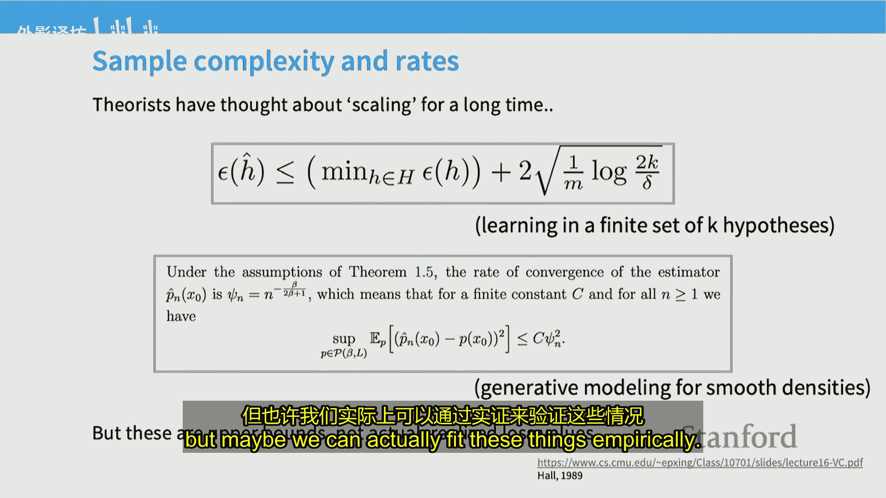

这是个有趣的冷知识，或者说是个有争议的冷知识，第一篇关于缩放损失的论文是什么，实际上引用这篇论文的并不多，但我觉得第一篇有关缩放损失的正确论文，可能是，1993年贝尔实验室。

发表在神经信息处理系统大会上的那篇，你可能会认出其中一些名字，这些人算是理论家，还有一些在机器学习理论方面，有过经典成果的人，比如瓦普尼克，科林娜，科尔特斯等人，我摘取了一些片段。

因为我当时在读这篇论文，其实是早些时候在准备这次讲座，我突然意识到，这篇论文在很多方面都领先于他所处的时代，据说在大型数据库上训练分类器，对计算要求极高，我们需要搞清楚在实际训练之前，找出哪些是好的。

所以我们要做的是，我们将提出一种新的预测方法，它能在不训练整个模型的情况下，预测模型的优劣，这听起来很像缩放损失，你稍后会看到，但它们有一种函数形式，大致是这样哦，模型的测试误差可表示为某种不可约误差。

加上一个乘多项式衰减的项，你会想哈，这看起来很像一条现代缩放定律，而且他们还做了件事，他们训练了一批小模型，它们拟合了曲线，然后他们会说哦，我们能够更准确地预测模型未来的行为，所以我想和很多事情一样。

缩放定律早在贝尔实验室时期就已，部分被考虑到了。

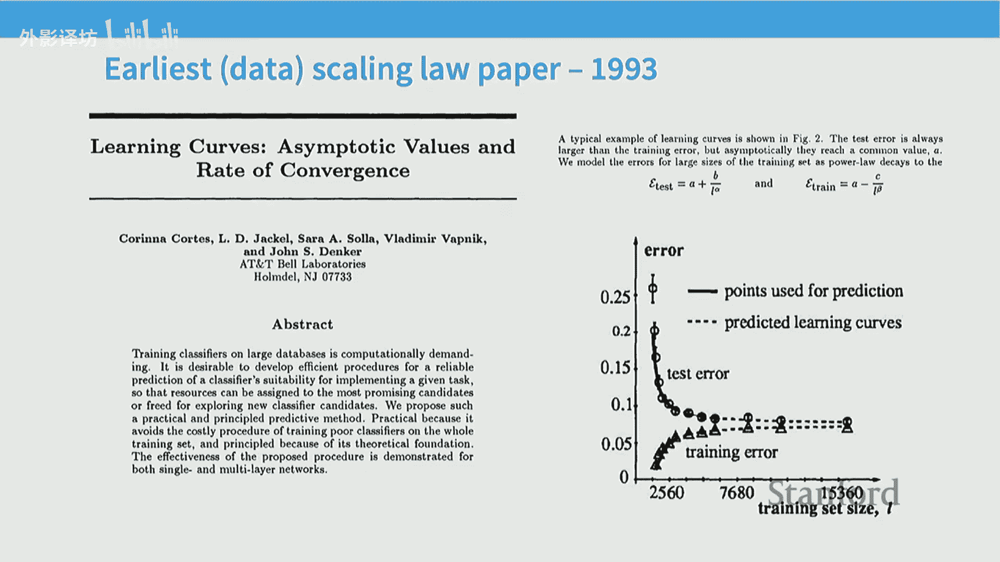

当然我觉得还有其他人思考过，与扩展相关的理念，不只是缩放定律，还有关于扩展的现代思维方式，在班科和布里尔的缩放定律，历史中常被提及的另一篇论文，他们研究的是某种自然语言处理系统的性能，如何随数据量扩展。

而且它们有类似的，通常是一条现代缩放定律，如你所知，X轴为对数轴数据，Y轴为性能数据，他们基本上在争论看，我们只需扩大数据规模，就能显著提升性能，这很可预测，也许我们应该考虑在时间投入上的权衡。

以及在算法开发和单纯收集更多数据，之间的权衡，然后你会想哈，这听起来很像很多预训练内容的思路，然后最后我想，人们近来和过去一直在思考的一件事是你懂的，这东西真能预测吗，正确的函数形式是啥。

早在2012年前后，你懂的，人们当时真在琢磨，比如说这些玩意儿真能预测吗，你知道是幂律，比如三次方和四次方，那些真的是预测模型行为的正确函数形式，当然这一切提醒一下，在研究模型的行为，Y轴代表能力。

它是X轴上数据量的函数，所以这就是我认为早已被深入研究的关系，在所有这些情形下，也就是所谓的数据缩放，要是你对最早的大规模神经缩放定律，论文感兴趣，那可能是2017年赫斯尼斯等人发表的论文。

我想他们做这项研究时是在百度，他们指出在一系列任务中，比如机器翻译语音，以及我觉得还有一些视觉任务，他们发现实际上错误率会成利率下降，而且他们还有一个很不错的图表，我很喜欢在讲解时引用。

当人们讨论缩放损失的时候，实际上你应该预期模型的行为，存在三个不同的区域，最初你是凭最佳猜测起步，接着你进入一个阶段，在这个阶段你可以大致预测的对模型进行扩展，那就是密率区，接着还有另一个渐进区域。

在该区域已正逐渐接近模型类别的不可约误差，我想强调一下，我认为在过去在过去几年里，出现了很多关于新现象的讨论，比如新兴能力或者扩展计算，成为新事物或者系统变得极为重要，但要是你在2017年。

仔细读过赫斯尼斯之类的内容，你基本上就能看到所有这些情况了，他们表示，实际上利用缩放定律进行预测非常困难，当模型性能随机时，因为突然就能脱离随机区域，他们提到了计算限制，实际上若我们能进行扩展。

这意味着通过计算进行扩展很重要，最后他们甚至还说，也许我们应该进行量化之类的操作，因为如果我们有可预测的扩展，那么这意味着我们应该愿意用计算来换取模型，准确性，这些全都是极为现代的理念。

但我觉得很多早期的规模定律，论文理解的颇为直观，因为一旦你看到这些图表，你会发现实际上通过可预测的资源投入，你会获得可预测的能力提升，所以从某种意义上讲，这是核心，并非完全关乎历史。

但我认为正是这种背景真正塑造了规模损失，好的关于这个背景，大家目前有什么问题吗，这主要就是数据规模扩展，但我想确保我们仔细过一下，是的，问题是，期望出现缩放是自然的，甚至可以说是合理的。

有没有无法进行缩放的情况，或者得到不同类型的缩放，我认为思考这个问题的一个方法是，如果你在衡量某种训练损失，流出的训练损失数据，那么我觉得缩放很自然对吧，就像所有经典统计理论讲的那样，事物应会收敛。

且当其收敛时，最终他们会变好对吧，从某种非常渐进的角度看，但我们确实看到了非扩展性的行为，几年前有个超有趣的竞赛叫反缩放奖，在那竞赛里，他们找随着模型变好而成反比缩放的东西，而且其中很多都很小众。

比如模型更倾向于复制，所以若你想抑制复制行为，比如说对于强大的模型而言，这会变得非常困难，但我认为有件事能将诸多此类情况联系起来，如果你过度偏离分布范围，此时数据无法很好的明确行为。

那么你会得到各种行为，比如完全没有缩放现象，或者是反向缩放之类的对吧，所以在某种程度上，你可以将此视为向深度学习，鲁棒性这类经典问题的扩展，很酷好的，那现在我要讲讲大语言模型的缩放行为。

比如主要试过以下几种实证结果，我将详细给你讲讲数据缩放，再举些例子，让你明白，这是很自然能想到的，然后我们再谈谈模型规模，这是另一码事，我觉得缩放定律已相当成熟，而且他们似乎在许多变量中频繁出现对吧。

在X轴上你能看到缩放比例和计算量，这些均取自卡普兰的缩放定律论文，我会在本次讲座中大量提及，所以这里的X轴是对数计算，Y轴是对数测试，损失在右侧，在右侧你能看到类似的缩放情况，都是关于数据集大小的。

所以这是数据量和参数数，在此讲解过程中，我要提及一个微妙之处，当我们对数据集大小或参数等进行缩放时，我们总是假设另一个变量，在此情况下，若你在缩放数据集大小，模型大小要比大得多。

比数据集大小所能达到的饱和程度大得多，因为显然若数据远多于参数，最终会趋于平稳，所以在所有这些情况里，我们试图避免进入渐进状态，他们在一些相当非标准的设置中同样适用，他们对下游任务也适用。

在分布范围之外，他们依然适用，这正是卡普兰论文中所展示的，所以在某些层面，利率关系似乎出现的更为频繁，比我们最初预想的更频繁，尤其是对于这些OD或其他变量，所以我想先讲讲数据缩放定律。

因为我觉得他们最为直观，至少我觉得这点的理论挺清楚的，确切的说，当我提到数据缩放时，我指的是一个简单公式，用于映射数据及大小，我把它称作N，它与我们的额外误差相关，额外误差是指不可约误差范围外的误差。

要是你还记得我在赫斯内斯提到的那个图，我们将会看到类似单调逻辑的曲线，实际上我们主要关注的是，从密率区域到不可约误差区域，当然探讨小数据区域会发生什么也很有趣，当我们不再随机猜测时。

但那样要推断起来难得多，而我认为这个又为，实际上我希望能说服你，实际上这部分出现功率损耗缩放是很自然的，那么好吧，所以我们的第一个实证观察结果，而这就是我要让你信服的自然知识。

即当我们在X轴上绘制数据及大小，在Y轴上绘制测试损失，然后在双对数坐标图上，模型性能呈线性，你可能会称其为无标度，或者你可能会称其为幂律，这些多是物理学相关术语，而且这已被许多人所证实。

但你可以参考卡普兰的著作，以查看这方面的诸多事例，我认为正如之前问题所提及的，在一定程度上，我们期望误差是单调的，我们用更多数据训练误差会下降，这很明显，不太明显的是这种缩放的精确函数形式。

所以当我说这是个密律时，它在对数对数空间里呈现性，那这意味着什么呢，如果某事物在对数对数中呈线性，这意味着X轴和Y轴之间存在多项式关系，为什么多项式衰减是自然的嗯，我会带你看两个例子。

这两者都会导致某种颇为自然的多项式衰减，我先从最简单的例子说起，这只是统计学入门内容，而非机器学习入门，所以我要做的是估计一组数据的均值，而估计均值就是估计一个参数的任务，我可以问问缩放规律是什么。

就数据而言，我的均值估计任务的误差是多少，所以我可以记下来嗯，我的输入服从高斯分布任务是估算平均值，我已将其写在上方的蓝色框中，误差是多少嗯，基于一些非常标准的论证，平均值也将服从高斯分布。

标准差为标准差除以N，所以我的估计误差是西格玛平方N，这是我估计的期望均方误差，如果你看这个式子，这是关于N的多项式，为了强调这一点，对这个式子两边取对数，左边是误差对数，右边是N的对数。

我得到误差对数等于log n加2log西格玛，所以这正是我们所期望的，若为均值，估计你和缩放定律，我们期望斜率为一，那么现在有了这个新知识，你可能会说好吧，我要四处转转，我要去看看估计不同事物的速率。

这会让我了解在数据扩展方面能有怎样的预期，所以你也许会说哦，我所期望的是EN，对于无偏学习，你可能期望的是一根号N等等，所以我们应该会看到一些很不错的整数，在对数对数图的这条斜率处。

我应该会看到像一或0。5这样的数，我们实际通过实证发现了什么，当我们查阅这些论文时，在赫斯尼斯的机器翻译中，我们把这些单独列出来，我们看到是0。13，对于语音我们看到是0。3，而对于语言建模。

我们看到指数是0。095，这些都比伊恩慢的多得多，或者比你预期的一根号N速率慢得多，当你只是在拟合简单函数时。

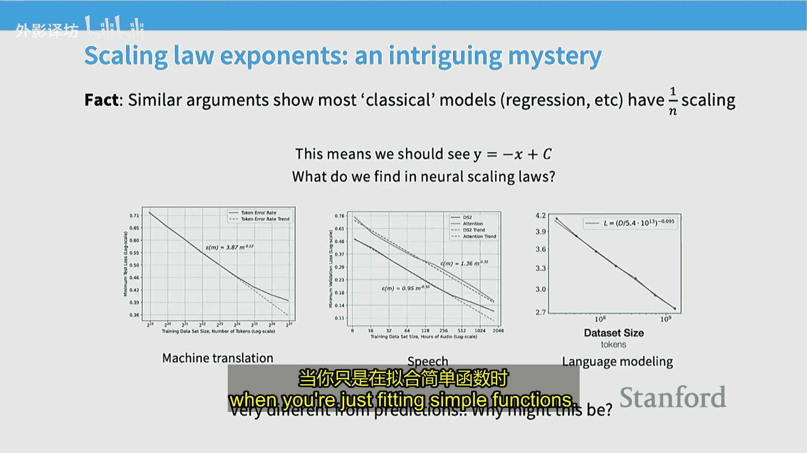

那么为什么会这样呢，这将是本次讲座的最后一张数学幻灯片，接下来其余时间，我们可以只专注于在对数对数图上拟合直线，但这有望让大家明白，为何会看到这些特定的斜率，所以我们知道神经网络不只是在估计均值。

甚至都不是在你和线性回归，它们能拟合任意函数，那么我们把它变成一个例子，然后我们来研究这个例子，所以我的输入是X1到XN，所以我有N个样本，我要把它们均匀地放入二维单位方框中。

我想估计某个任意的回归函数Y等于F，我假设F是平滑的，若要更精确，还有其他情况，但这里存在一些规则条件，估计回归函数F的一种简单方法，就是把二维空间划分为小方格，在每个方格内我能测量Y值的均值。

比如一个非常简单的非参数回归方法，就是划分空间，然后估计会出现什么情况，现在非形式化的奖，如果我们选取，我会有根号N个盒子，现在每个盒子会得到根号N个样本，现在我的误差是一根号N。

如果你顺着这个逻辑推广到更多维度，你会看到在D为中误差等于N的1D次方，然后是我的整体缩放，如果我对整体取双对数图，我预期斜率为1D对吧，那我为啥要给你讲这个例子呢，我给你讲了这个例子。

因为要是你有灵活的函数类，也就是所谓的非参数函数类，你就会预期有维度依赖性，所以缩放定律的斜率实际上会慢很多，从某种意义上讲，斜率几乎能准确告诉你内在维度，或者这项任务学习起来的难易程度。

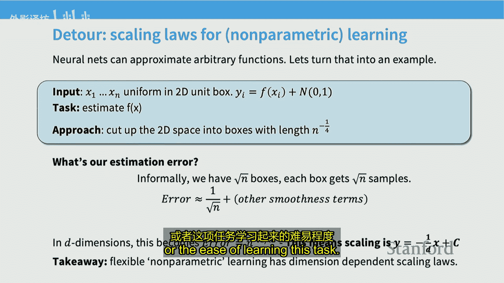

人们已经更正视或更确切的论证过这个了，已有多篇理论与实证艰巨的论文，认为，我们出现这些奇特或非标准学习率的，真正原因是它与数据的内在维度紧密相连，例如这些预测图表中的虚线和紫色圆圈，有些相近。

不过你懂的，对此不必过度解读，因为估计内在维度是个极其困难的问题。

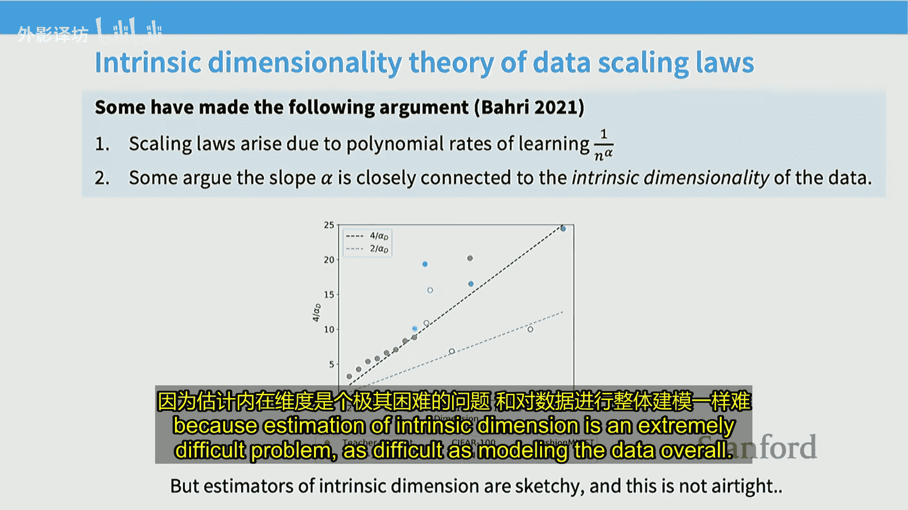

和对数据进行整体建模一样难，好的哦是吗，对我觉得这和你之前说的观点有关。

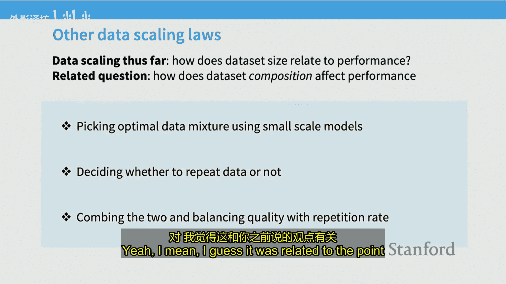

你最后说的那个从模拟角度看，要怎么生成有潜在内在维度的数据呢，是的，这里的结果是，比如说如果你想生成数据，其实这并不难，你可以写一个接收五个变量的函数，然后就会是只要那五个变量不会相互抵消。

那就是一个五维曲面，你可以添加一点噪声，你就可以开始了，这里的困难在于，他们实际上在SAF2上进行训练，然后他们有不同的情况，他们试图估计SAFA的内在维度。

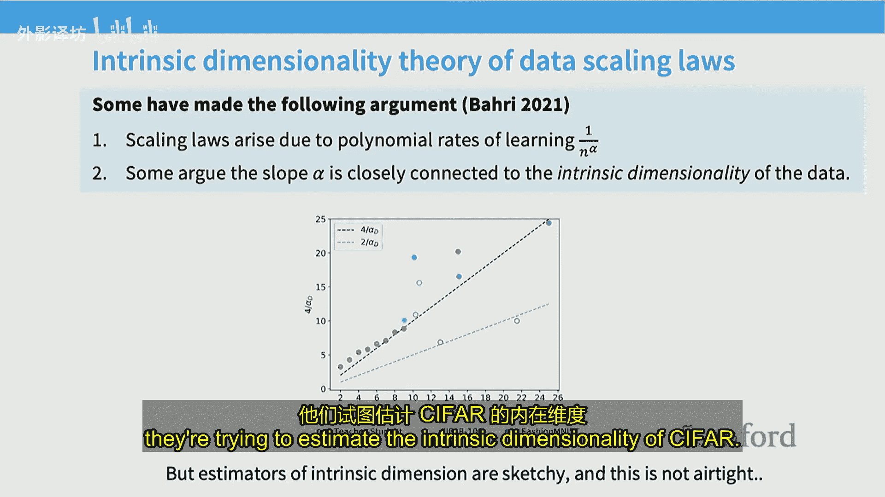

那是一项难得多的任务，好的数据缩放定律非常实用，我是从缩放定律的角度来探讨这个问题的，但实际上利用缩放定律能做很多有趣的事，借助数据缩放定律可做出各类工程决策，事实上人们确实如此。

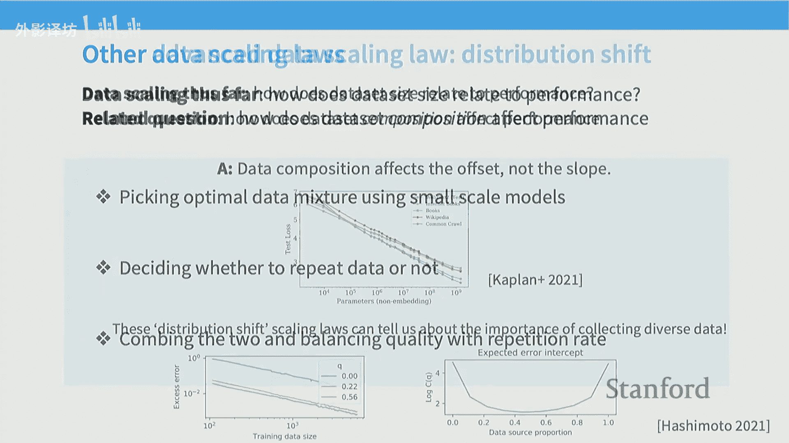

例如你可能会说数据集的构成如何影响性能，而非仅仅是其大小嗯若你在更改测试集，卡普兰等人的研究中，图表显示，实际上数据组成仅影响截距而非斜率，这意味着也就是说，如果你想挑选一个优质的数据集。

无需大规模训练你的模型，你可以缩小其规模，并在小很多的模型上开展数据选择实验，而且预期的形状，当我们混合不同数据时，我们可能会预期某些形状，你可以使用回归和其他各种技术来弄清楚。

例如使用缩放定律进行最优数据混合，人们已经就这个主题撰写了多篇论文，不过和所有关于数据选择的研究一样，很多这方面的内容较可靠，执行似乎相当棘手，还有其他有趣问题，如今有很多关于的讨论。

我们在互联网上的数据是否即将耗尽，所以一旦你开始问这些问题，另一个有趣且重要的问题是，我们能否一直使用现有数据进行训练，那样做会有怎样的收益递减特性，因此有一些有趣的研究，将缩放定律扩展到多轮训练。

其核心观点是存在一个有效样本量，在大约四轮训练后，随着数据重复使用次数增多，收益会迅速递减，通过修改常规的缩放定律，基本上就能得到一个版本，你拥有一定数量的有效数据，随着重复次数增加。

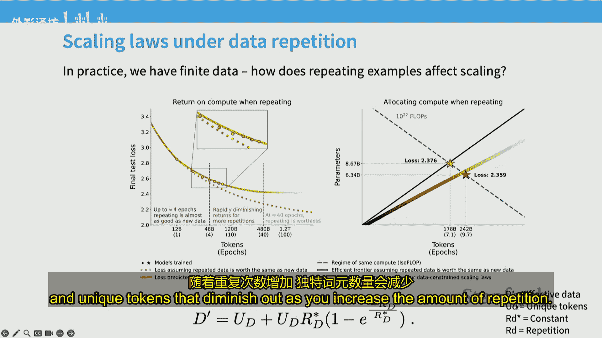

独特资源数量会减少，最后我认为有一个有趣的组合，关于这两个想法的一个情况是，如果你在考虑大数据领域的数据选择，想象一下你要对数万亿次元进行训练，那么什么会更好呢，重复高质量数据源会更好吗，比如维基百科。

或许还有其他类似的高质量资源，重复十次或者加入新数据会更好，你要么重复数据或者加入更多数据，现在有多个维度可用于优化你的数据组合，而且还有一些有趣的数据扩展研究，由卡内基梅隆大学的人做的。

主要是在重复数据和选择新的低质量数据，之间权衡。

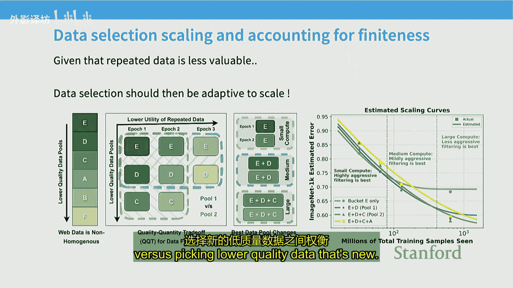

所以这一切实际上是我之前所教内容，的自然延伸，即如果你假设存在一种预测性密律关系对吧，并且这种密律关系，在某种程度上是基于每次混合成立的，那么你就可以拟合这类标度律的外推情况。

然后就能估计出你的数据在大规模时的质量啊，所以这就是起点，也就是数据缩放，希望至此，我在经验和概念上都已让你信服，数据与误差之间，存在对数线性关系是很自然的事，这种关系在不同领域和各类模型中。

似乎都很稳固，而且你能在一定程度上有个不错的，对于这里的情况有清晰的理论认识，一旦你这么做了，你可以用它来做各种事，比如挑选最优数据组合之类的，好的有问题吗，在数据缩放图上，模型大小是怎么选的。

是的就像我之前说的嗯，不是在这张幻灯片，但咱们看看回到这张幻灯片，当我们思考数据规模的扩展时，模型总是被选为非常大，所以数据不会让模型饱和，而且你要避免进入这种不可约误差状态，所以模型总是被选为足够大。

这样只要你只改变数据，你就处于密闭区域，对所有这些都是如此吗，就是那个非常大的模型规模吗，还是说每个点对应的模型规模都不同，是的，比如就这个图表而言，是一个大尺寸的模型。

比如说当你看这个轴上的计算量缩放时，那么数据和模型会按一定比例共同缩放啊，很酷还有其他问题吗，很好好的很棒好的，那么现在我想我们可以从数据缩放，在我看来进入稍微更神秘的缩放类型，接下来我们要谈模型缩放。

我认为这是一组更实际的工程问题，我们现在要试着解答，那么你负责构建并推出一个真正的大语言模型，而且有很多有趣的想法对吧，比如你可以训练最新的状态空间模型，你可以训练一个变换器。

你可以使用自适应矩估计优化算法，你能用随机梯度下降法对吧，人们发明了各种新技巧，哪些值得扩大规模，哪些不值得呢，你也可以使用你有限的计算资源，然后把它们花在不同的事情上，你可以更长时间的训练模型。

或者你可以训练更大的模型，对于给定的flog，你可以在这两者间权衡，而且你还能做些诸如去之类的事，收集更多数据，还是获取更多图形处理器，你能做的事情有很多，缩放定律，能让你通过一个很简单的方法。

回答所有这些问题，所以我会介绍一下经典的卡普兰缩放定律论文，如果你对这些主题感兴趣，我鼓励你读一读，它简直就是各类观察结果的宝库，其中有些内容比较老，但我觉得他依旧无可比拟，在我全面研究的所有内容中。

研究环境相当不错，且统一，从架构方面讲，你可能会先问，比如transformer和LSTM哪个更好对吧，哪个更好嗯，最直接的方法可能是扩大LSTM的规模，直到比如GPT3的水平，你就能判断它好不好。

规模定律的方法要简单得多对吧，你基本上要训练一批LSTM，还有在不同计算阈值或计算级别的变换器，然后你就能看到扩大他们规模时会发生什么，而且我觉得这里的趋势挺明显的对吧，就像不管你的LSTM有多少层。

都有挺大差距对吧，变换器和LSTM之间有相当大的固定因子差距，对吧，记住这是对数刻度，所以这差不多是说我不知道确切数字是多少，但试想一下，这效率要低大约15倍对吧，那么无论在这个图表的哪个位置。

你都清楚，长短期记忆网络的计算效率，只有变换器的1/15，所以使用长短期记忆网络存在固定的计算代价，至少在这个图表中是这样，从宏观角度看，你可能会说嗯，还有更多架构，哪些才是真正好且值得做的呢。

还有一些经典论文，这篇由谷歌等人撰写的经典论文，就做了这样的扩展工作，他们在这里采用了右边的一系列架构，然后他们基本将其扩展，所以X轴是计算量，红线基本代表每种架构，而绿线是transformer基线。

然后他们会问哦，这些替代架构中的任何一个，能与transformer匹配或超越他吗，结果如何，嗯实际上唯一看起来真正非常可靠，比得上transformer的是门控线性单元，还有专家混合模型。

一旦你知道了，那正是现在人们在做的事，对吧，所以这有点像那种观点的缩放定律版本，就好比说你是怎么得出这个结论的，在门控线性单元中使用开关变压器，而非执行者模型，而缩放定律为你为何要这么做提供了明确证据。

我觉得优化器的选择也类似这个来自赫斯尼斯，他们比较了s std和item，他们发现和之前很相似，计算上存在这种恒定，因此差距在这种情况下使数据及大小，当然这体现为item和STD在计算效率上的差异。

这里的RHN指循环高速公路网络，你可以忽略这里的细节，你大致能明白该如何做这种分析，而不是这里展示的具体结果，你知道一开始我还说了，诸如深度与宽度之类的话，比如说宽高比该是多少。

那是我们讨论过的超参数话题之一，我们看到了类似的分析，不过卡普兰的是标度率形式，至少我觉得这个挺有意思，因为我们可能会觉得更深的层会明显更好对吧，不同层数之间有明显差异，但至少我们在这儿能看到。

你知道实际上存在很多偏差，有一层效果非常差，但很多其他层的选择相对稳定，希望这能让人想起，我在架构讲座中展示的那张幻灯片，我在那提到了宽高比，宽与身的比例大致为四比16或者类似的比例，是个很自然的数字。

但存在一个很大的区间，在这个区间内你大致处于最优状态，而且缩放定律分析也支持这一点，我确实想指出一个重要的细微之处，而且这一点时不时会困扰人们，就是并非所有参数都是相等的，通常你会想要进行参数缩放分析。

但是如果你要比如说，将切入参数算作模型的一部分，那么你会得到一个相当不同的缩放定律，你会得到这种样子怪异，且在此处稍有弯曲的东西，而如果你只考虑非嵌入参数，你会看到我之前给你展示的那个，清晰的多的结果。

所以嵌入层参数的表现并非完全相同，而且它们并未呈现出相同类型的对数，线性做法与非嵌入参数相同，当你将它们纳入考量时，并且存在一些相关研究表明，在近期关于专家混合缩放的论文中，并非所有参数都相同。

在这些研究中，他们也在试图弄清楚何为参数，当你拥有如此稀疏激活的参数时，在这类论文中，他们试图推导出等效密集参数数量之类的东西，以便对混合专家模型中的参数数量进行归一化。

我之前在超参数选择时给你展示过这个图，但希望现在你能看到完整的背景，而不只是最初的超参数选择问题，我们知道在很多情形下，比如说我回到这，我们常常会看到如下的缩放定律曲线。

你会经常看到这些曲线斜率相近且不相交，并且这些曲线之间存在一定的恒定因子偏差，每当这种情况出现，然后你可以在特定计算水平上进行切片，或者一组特定超参数，并仔细分析超参数间的权衡。

并且在扩大规模时确保安全性，所以当你查看在卡普兰的论文里，你能看到这类分析，尤其是中间那个宽高比图表绝对值得一看，他们不只是在放大和缩小模型，他们实际上是选取不同规模的模型，5000万，2。7亿。

15亿，并且他们在研究宽高比如何改变损失，然后他们明白了，实际上曲线形状与缩放斜率相似，这意味着我能选择10~100之间的宽高比，介于两者间的值，在不同规模下都适用，所以这一点值得思考。

最初在深度学习模型训练时，你会考虑超参数调整，但调整超参数时要有规模意识，这在思维方式上有很大差异，在某种缩放定律风格的方法与其他方面之间，以及你所接受的训练内容，或者你自然而然想到的。

我们只在小尺度上调整这些模型，所以对于前馈比率和注意力头维度，也进行同样的操作，你在改变尺度的多个方面，并且你试图看看最小值是否相似，好的还有一件重要的事，接下来其实不是下一讲，而是再下一讲。

我将讲述一些人们扩大模型规模的实际案例，我们实际上会看到，批量大小这个因素以及学习率，实际上是两个相当棘手的方面，当你扩大模型规模时，必须谨慎应对，所以当你扩大模型规模时，你可能需要考虑。

不同模型规模下最优学习率会不一样，如果你这么做，那么最优批量大小可能最终也会变化，因为它们通常相互关联，所以我们需要思考如何正确扩展批量大小，以及批量大小如何与规模和学习率相互作用。

所以接下来几张幻灯片我会讲这些，希望你还记得系统课程里讲的，批量大小超过某一点后，收益会递减，所以在某一点之前，所以当批量大小小于噪声规模，我们在这边的左侧增大批次大小，差不多就相当于多走几步梯度步。

所以大致来讲，要是我把P4大小翻倍，这就跟走两步梯度不一样，这可真是个相当不错的情况，因为现在系统能够在批次上并行处理，你就有了这个优势，同时还具备走两步的优化效率，但过了某个点后。

你会遇到扩展无效的情况，此时你的噪声规模且批量大小相同，而且批量中的额外样本并未减少有效噪声，他正被某种程度的曲率所主导，可以说他被你优化格局，曲率中的偏差向主导，而很值得思考的一点。

一个有用的分析对象，就是临界批量大小这个概念，你可以将临界批量大小视为这样一个阈值点，在这一点上，我们从完美扩展转向显著的收益递减对吧，你可以在理论上对其进行分析。

一些关于临界批量大小的OpenAI论文，就是这么做的，但你也可以凭经验对其进行分析，这是另一个用规模法则的方式进行研究的内容，你大致能看出，你可以估算出进展开始放缓的那个点。

所以你可以实证估计关键批次大小的权衡点，而且你还可以训练更大更好的模型，有一件很有意思的事，当你试图降低损失时，所以你在这里向左，所以你才让损失变得更小，越来越好，你的关键批次大小最终会变小。

所以损失目标越小，总体批次大小就越大，比如说这会带来的一个结果是，如果你查看lama3训练报告，例如你会实际看到，他们会在某一时刻后增加批次大小，或者他们在训练时会增加批次大小，因为当损失目标变小时。

P4大小会随之变大，所以当我们增加计算资源和模型规模时，比如该怎么做才对，同样我们可以进行一次规模分析，这出自卡普兰，你可以试着去弄明白，随着我们增加计算量，最佳的批量大小是多少，而我们大致看到。

随着计算量增加，我们实际上能够实现合理的并行，总步数可以保持不变，至少在这个计算阈值范围之内，总部数能够保持不变，同时让批量越来越大，而如果你固定批量数量，当然步数会持续攀升。

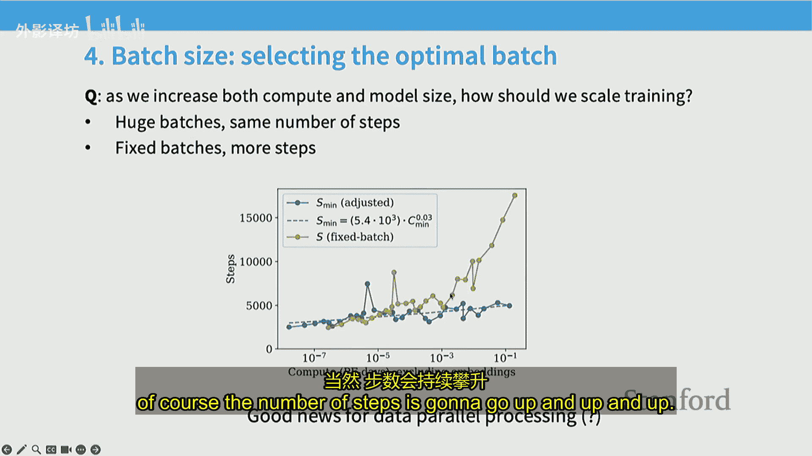

所以这对数据并行处理而言，有望是个好消息，这就是关于批量大小的情况，你或许应该记住的是，因为我觉得临界批量大小这个概念有点复杂，是这样的诶，存在一个收益递减的点，临界批量大小，这是一点，第二点是。

他似乎确实遵循一种颇为可预测的缩放规律，通常取决于你的目标损失，那么你能明白该如何正确权衡，在系统效率和优化进度上进行权衡嗯，正如我之前讲的，另一方面是你有批量大小，然后还有学习率，而且这两者紧密相关。

我会更深入的讲讲牛皮在缩放课程的下一部分，但我觉得这是个挺重要且更具普遍性的观点，所以你二者其一可以做，而且我想借助这个图讲讲这两点，那么咱们先看看左边这张图，上面标注的是标准做法。

所以当你训练一个transformer时，基本上你会看到，类似左边这样的情况及标准做法，所以最优学习率会处于不同点，而且模型越宽对吧，随着模型规模增大，并且你的多层感知器越来越宽，最优学习率会非常小。

当模型越来越小时，你的损失当然会上升，因为模型的表现力较弱，但最优学习率也会上升对吧，而且通常人们说有个经验法则，就好像宽度的倒数是合适的，缩放比例，在你应据此缩放，学习率更专业的人实际上会进行拟合。

基本上就是取这些曲线找出最小值，然后根据最优学习率拟合一个缩放规律，所以我们可以看到学习率会出现可预测的衰减，也许我们可以拟合一个缩放规律，关于这个问题，我会在接下来的系列讲座中详细讲解。

不过还有另一种方法，我觉得很多人已经开始采用了，而且我认为这很值得思考，就是你实际上可以重新对模型进行参数化，具体而言，你可以对初始化进行缩放，或依据宽度调整不同层的学习率，你可以缩放初始化的方差。

基于模型宽度，以及在模型不同层的前向传播中，对输出进行乘法运算，如果你以依赖模型宽度的方式来做此事，最终模型会得到一种参数化形式，其学习率应更稳定，至少在原始论文中，他在不同规模下完全稳定。

所以只需调整一次学习率，而且无需进行其他直接的最优转移操作，实际上在最小的模型上进行调整，然后直接转移到最大规模，这就是所谓的新P概念，我给你看的这篇原始论文叫mp，还有其他辩题，随着劳马斯发布。

meta宣称发明了一种名为METP的东西，我还不太清楚它究竟是什么，但你能隐约感觉到，很多实验室都在思考这个对吧，因为如果你必须依赖于预测最佳学习率，那你就得进行各种复杂的缩放定律拟合。

也许这会非常不稳定，但如果你能对你的模型进行重新参数化，那么也许你根本无需进行任何调整，当然你懂得比实际情况乐观的多，但希望这能让你有点概念，为啥这真的超酷，超有趣对吧。

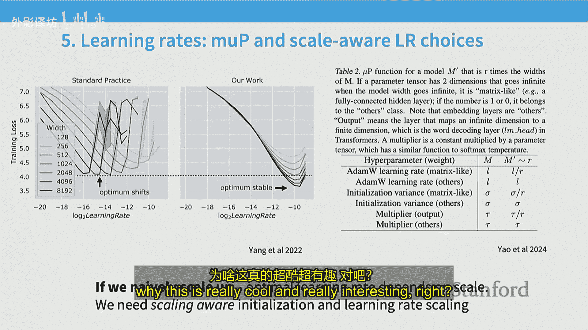

尺度感知初始化，到目前为止有问题吗。

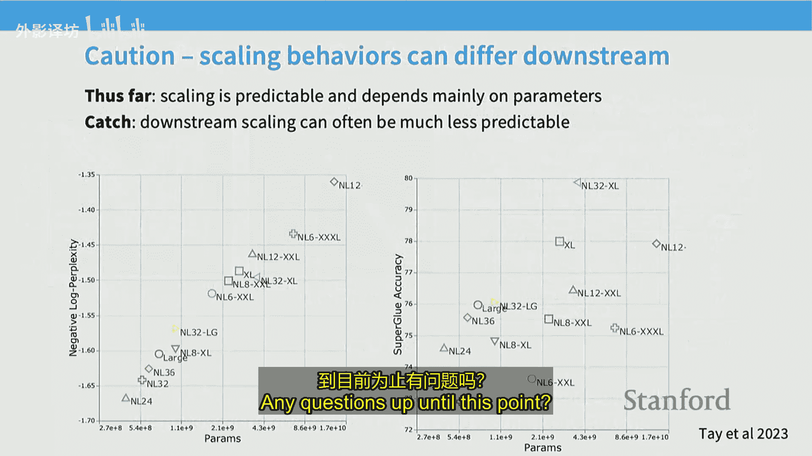

我感觉讲了好多缩放架构和参数的内容，所以我先停一下，以防有人有问题，比如说我真的理解其中的直觉，如果我们想要更低的损失目标，我们想要增加反向内容，是的，比如说当你有更低的损失目标时。

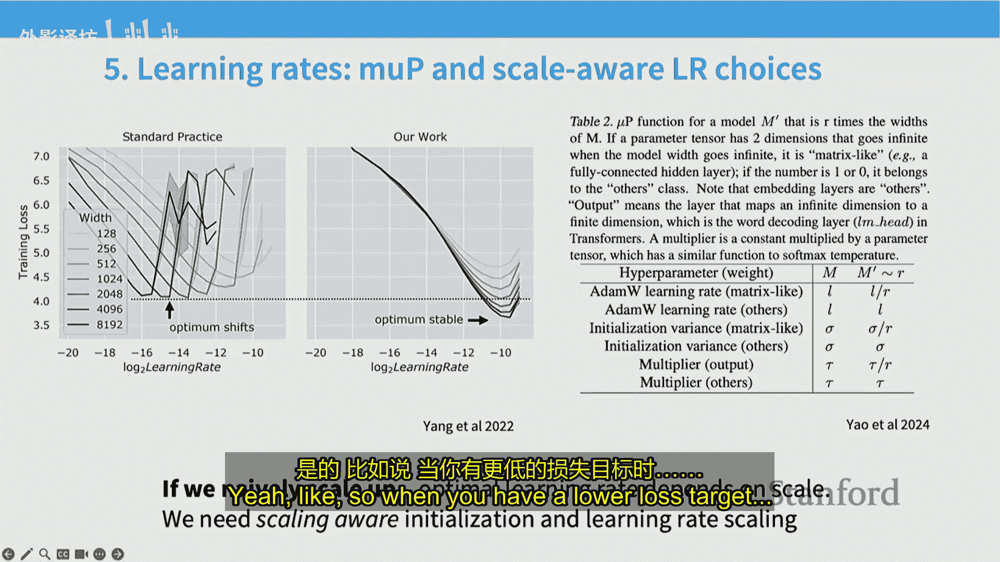

是的，所以损失目标越小，事情就越敏感，并且就像你要降低学习率，你也要增加批次大小以进行去噪，你拥有的目标越敏感，你的梯度可能就必须越精确，一种思考方式是，当你在冷却时，并且你的学习率在提高。

也许你的批次大小也应该增加，因为学习率和批次大小相互成反比，没错，这种P4大小的情况只适用于MLP，不适用于计算机视觉或者对计算机视觉适用，我不太确定。

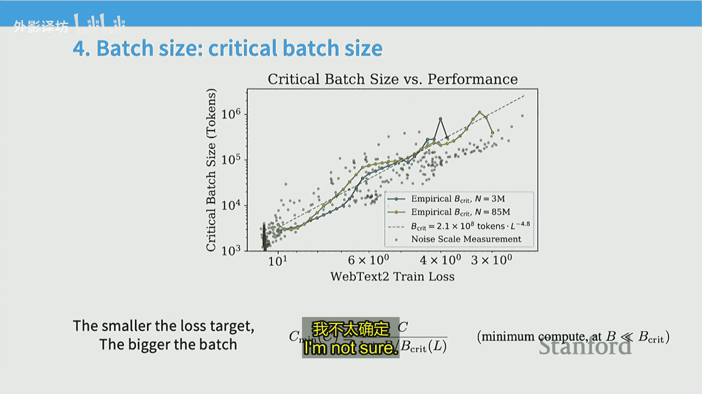

有一篇与OpenAI扩展相关的论文，适用于多模态模型，但我不记得上面关于那些临界批量大小，是咋说的了，噪声尺度是多少，噪声尺度，噪声尺度至少在这个图当中，要是你问的是这个的话，这属于一种理论分析。

基本上是关于P4内随机采样所预期的，梯度噪声，所以这并非是通过精确实证测量得出的，关于这些事物的量，好的，好的，那么我要提醒一点，我认为这对许多缩放定律研究来说，是个重大注意事项。

即缩放定律在对数损失方面表现良好，所以我们依据下一个资源预测交叉熵进行训练，当缩放定律的目标是这些交叉熵时，简单的任务能完成得很好，但如果你要进行下游任务，你试图在基准测试上直接进行扩展。

行为的可预测性低得多，所以在左边这取自YC的论文，该论文对比了多种不同的超参数和架构，你能看到参数数量，在此情形下，它是计算量的替代指标，且负对数困惑度呈现出良好的线性相关性。

而这基本上是说嗯你的深度无关紧要，或者宽度或者超参数的精确设置，真正重要的只有你的总计算支出，这是个非常简单又不错的事，但当你用到这些模型时，这要追溯到2023年，当时人们还在追求那种超高的准确率。

你大概会说好吧，但这些模型的下游性能怎么样呢，而现在我们看不到很好的线性关系了对吧，我们看到的完全是另一回事，某些模型比其他的要好很多，而且某些架构更胜一筹，所以你可能并不确切期待这种缩放特性。

我们已经在许多地方看到了，这个故事的不同版本，如果你研读关于状态空间模型的文献，那是我们见过的情况，在状态空间模型里，我们能看到非常不错的可预测性扩展，就像左边这些，但对于某些能力。

比如上下文学习或问答，常常是这样，人们已经证明这些模型可能表现欠佳，所以切勿将这种困惑度扩展，与下游扩展等同看待，而且每当进行此类分析时。

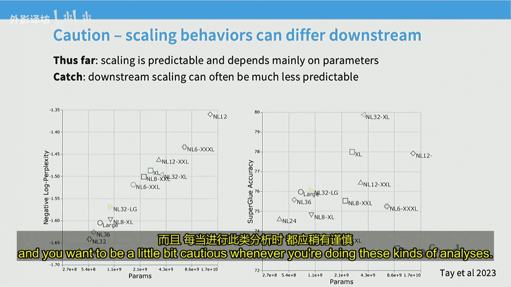

都应稍有谨慎，好的，所以或许这对你们有些人来说并不意外，但有望这能让人感到惊讶且具有说服力，即如果我们要做出诸多工程决策，诸如超参数选择架构决策，我们可以在训练前就做好诸多此类决策。

我们可以小规模训练这些模型，跨越几个数量级的计算，然后扩大规模，以尝试预测模型行为，所以基于缩放定律的设计流程相当简单，你训练几个较小模型，并且这些较小模型应跨越几个数量级的计算，你建立某种缩放定律。

所以你会发现，至少在你训练的模型上存在明显的对数，对数线性关系，接着基于此预测，你能够设置最佳高度参数，实际上在许多情况下，这些缩放定律不会有太大变动，它们的斜率实际上相同，在此情况下，由此可知。

你只需训练几个较小的模型，并且在许多此类情况下，那些小模型的结果能惊人的很好。

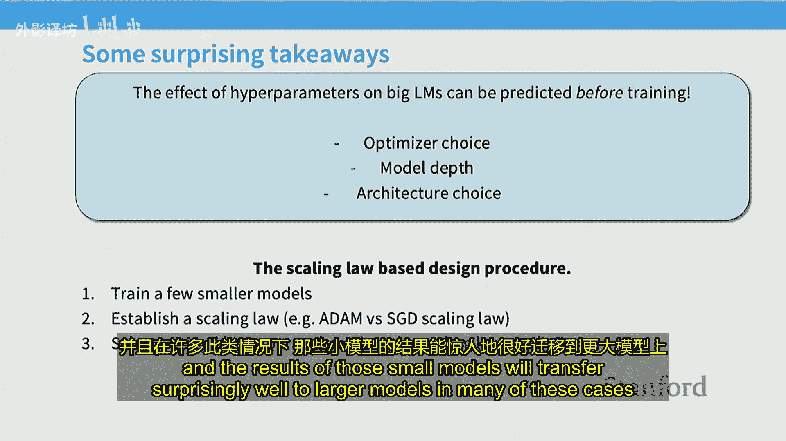

迁移到更大模型上，但并非所有情况皆如此，例如学习率便是一个重要的例外，好了，这就是进行超参数和架构选择等操作的方法，现在我要讲一下，缩放定律的一个非常重要的应用，它对我们如何选择模型大小有着巨大的影响。

我们对数据效率的看法，以及这些模型的其他情况，所以我回想起早些时候，当人们开始扩大这些模型规模的时候，有一个非常核心的问题需要你去问，我们需要更多数据吗，还是我们需要更大的模型，从某种意义上讲。

在2021年至2023年期间，数据远比计算资源丰富，所以我们无需担心数据总量的限制，所以唯一的限制资源就是计算资源对吗，你训练预算中的总浮点运算次数，这便是那种限制资源。

然后你可以用多种方式来使用该资源，你可以将其用于使用小模型，在大量数据上进行训练，或者你可以用极少的数据训练一个大型模型，对吗，这两种极端情况看着都很浪费对吧，比如说要是你有个超小的模型。

往里面输入海量数据貌似没啥用，反过来也一样，要是你有个含十个四元左右的超大模型，好像也没啥用，所以这对很多人来说算是个核心问题，于是几位作者同时提出了数据与模型，联合缩放定律，试图解答这个问题。

那这些定律是啥呢，到目前为止，我一直只谈论一个变量的缩放定律，而那个变量是变化的，它有实时参数数据或计算，但我们还没有研究联合缩放，所以数据模型缩放定律是这样的，这里的这两个方程都类似于。

在功能上相当于一阶，并描述了数据量和模型量之间的权衡，罗森菲尔德的第一个观点大致是说，存在一部分误差，其中一部分这部分误差随数据呈多项式递减，存在一部分误差，随模型规模乘多项式递减。

然后还有一个不可约误差项，即使将数据量和模型都扩大到无穷大，这个误差项也无法消除，卡普兰的情况也是如此，但这里他们考虑的是不可约误差，而非可约误差，所以这里没有常数项，所以这看上去有点随心所欲。

因为我觉得不存在什么自上而下的那种，能说明为啥这一定是正确函数形式的理由，但这对数据与模型中的联合误差，拟合的出奇的好，我想这是来自罗森菲尔德的，他们展示了一张很棒的三维图，图中这个是数据量。

这是模型的规模，而这是Y轴上的损失值，正在被拟合的曲面，就是它们的函数形式，这些点代表他们的实验运行数据，从后面看可能不太容易看清，但这个曲面几乎能完美拟合这些点，尽管这种函数形式有点随意。

就像凭空冒出来的，其准确性出奇的高，这个同样来自罗森菲尔德，在那里他们大致是说好吧，我只打算在较小的那部分数据上训练，小模型和少量数据没错，那么在左下方这块区域，然后我会将其推广到那些规模较大。

且使用更多模型训练的模型上，那么这种联合推断的拟合程度如何呢，嗯很不错，那么我们来看一下误差实际值在X轴上，而我对误差的预测在Y轴上，而且在image net和维基文本上，他们几乎都完全正确。

所以这看起来挺不错的，那么对于固定的计算预算，现在我们能做什么，我们回到比如卡普兰方法，我们在这看到类似做法，我们看到计算和数据有某种联合缩放，所以在这种情形下，参数在X轴上，颜色代表计算。

所以还有某种数据，第三轴为改变计算总量，它被隐式改变，所以当你在这些曲线上移动时，参数在变，而计算量保持不变，因此数据量将会变化，那么隶属我想你们很多人应该都听说过，可能是解决此问题的参考标准对吧。

所以罗森菲尔德和卡普兰都提出了。

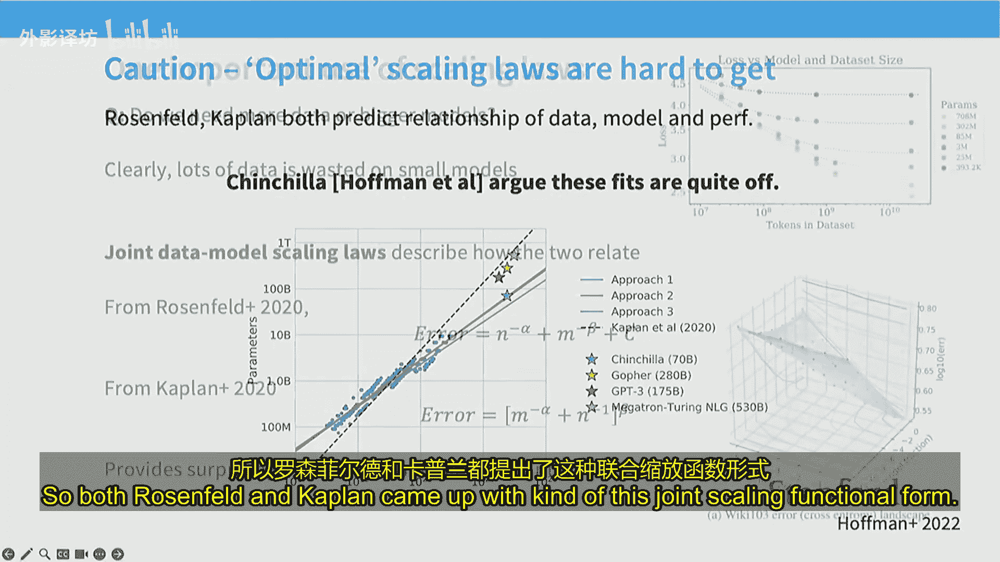

这种联合缩放函数形式，然后他们两人都注意到能够使用这些函数形式，以多种方式优化计算与数据之间的权衡，但由于种种原因，基本上很难精确拟合这类函数形式，而且像学习率形状不同，这类细节很重要。

所以塔普兰的一项估计偏差颇大，与后来在某种程度上被验证为最优的结果相比，所以由一群谷歌作者撰写的关于龙猫的论文，是一次实证尝试，试图确定令牌数量与模型大小之间的正确权衡。

假设你的目标是以最少的运算量获得最佳模型，所以他们有三种不同的方法及方法，123主要用于拟合不同曲线并进行缩放预测，这些蓝点代表他们训练的模型，基本上这些线针对不同的浮点运算次数。

预测不同的最优参数大小，希望你们大多数人都多少知道，新奇利亚比例大概是每个参数有20个次元，而这正是由此而来，就像你取这些点中的每一个，然后将其乘以20，大致就能得到浮点运算次数，或者抱歉将其乘以20。

你会得到次元数量，所以如果你用参数乘以，你会得到每秒浮点运算次数，有点像卡普兰结果之间的差异，他们基本上是在估算一组词源与参数的比率，以及类似龙猫那种模型的结果，原因之一是学习率调度安排对吧。

我们知道我们用余弦退火学习率来训练模型，对吧，所以余弦退火学习率大概是这样的对吧，它会上升，然后再下降，然后他会一路下降，直至达到底部的最低学习率，但关于余弦学习率，有一点总是让大家犯错的事。

不能过早截断它们，对于余弦学习率，你得一路坚持到最后才能得到一个有效的模型，你得有一个贯穿始终的冷却阶段，如果我在中途截断一个模型，这和从头开始创建一个模型不一样。

并在中间某处使用余弦学习律对其进行训练，这是促成因素之一，还有其他因素，从而导致了卡普兰估计值，与后来亲齐利亚论文给出的经过改进的估计值，相差甚远，那么新奇利亚的作者们实际做了什么嗯。

他们有三种不同方法，来尝试估算数据单元与模型之间的最佳权衡点，这些方法中的每一种都会给出不同的缩放系数，对吧，模型大小的缩放系数以及数据大小的缩放系数，令人惊讶的是，在这种情况下。

方法一和方法二的这两个都是0。5，而方法三给出的估计大不相同或略有差异，它们相差约0。03，但我们稍后再谈，你看卡普兰等人，比这三个估计中的任何一个都差很多，所以我们会逐一讲解这些方法，这些都合理。

它们在扩展方面有不同假设。

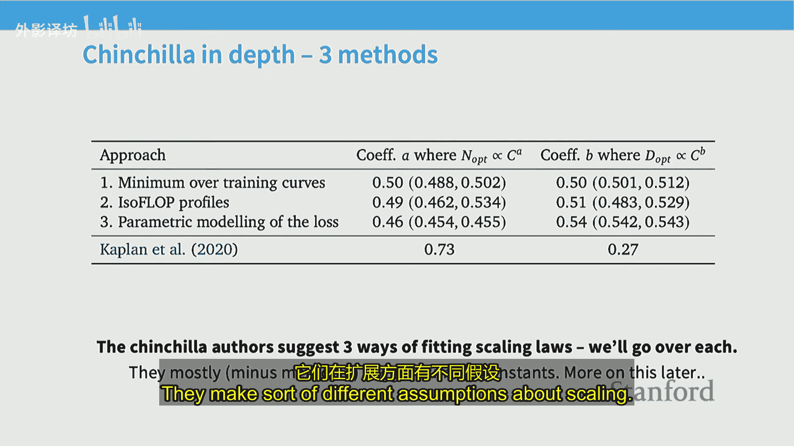

但最后他们得出的估计值极为相似，龙猫数据集的方法一是取个曲线中的最小值，那这是什么意思嗯，你要把所有不同的训练曲线叠加起来，所以在这里能看到X轴是不同的浮点运算次数，Y轴是训练损失。

我有许多不同规模训练的模型，当然每种规模所用的训练标记数量不同，所以训练过程中他们的总浮点运算次数不同，现在我要查看下包络线对吧，那一系列点或者在任何计算预算下，都是最优的检查点。

然后我可以拿这些模型看看，这些模型实际的参数规模是多少，你可以看到类似这样的总计算量，X轴上的参数数量以及相应的标记，形成了一个相对不错的缩放定律，所以这就是一种最小包络方法，意思是我期望最小训练损失。

当我在所有模型大小上进行优化时，实际在浮点运算次数上是最优的，这有点像回顾一些早期的论文对吧。

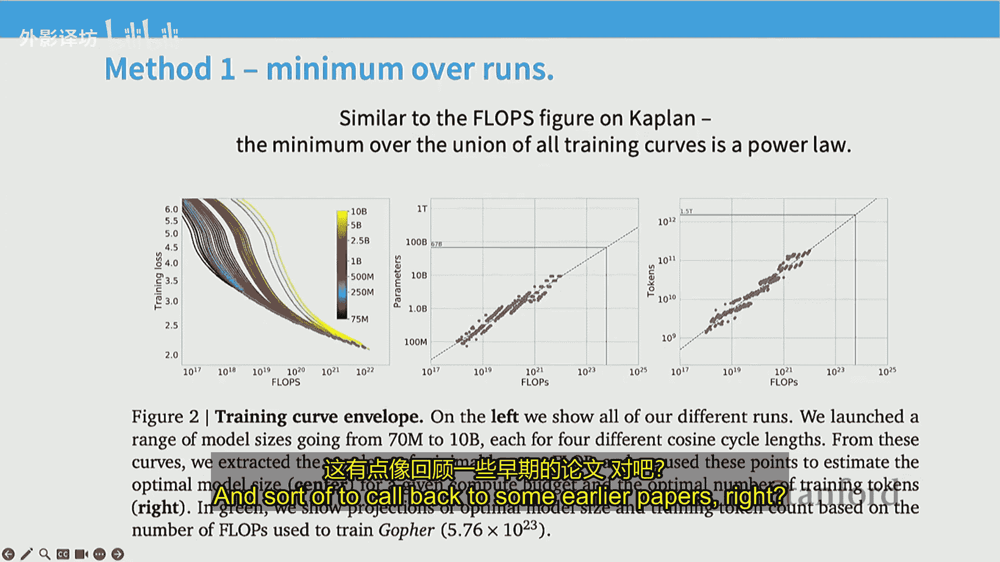

如果你回顾一下早期的卡普兰论文，以及其他缩放定律，你确实已经看到这种情况正在发生，你会看到不同模型，采用不同参数和不同计算规模进行训练，然后我们取这些中的最小值。

而且我们已经看到最小值形成了一种缩放定律，所以这是基于这一观察结果，不同计算规模下，众多不同训练曲线中的最小值，应形成一条密率线。

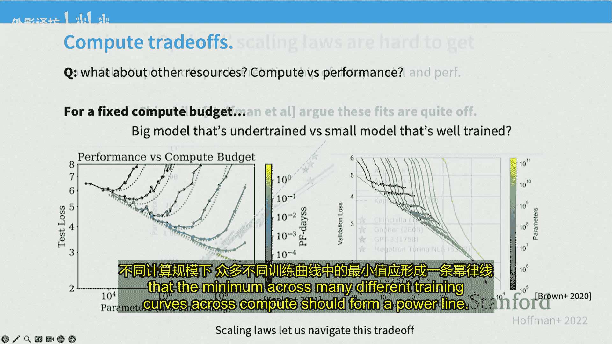

所以在该假设下，你能得到相当不错的拟合效果，由此得出的一个估计值与其他0。5，0。5的估计值高度一致。

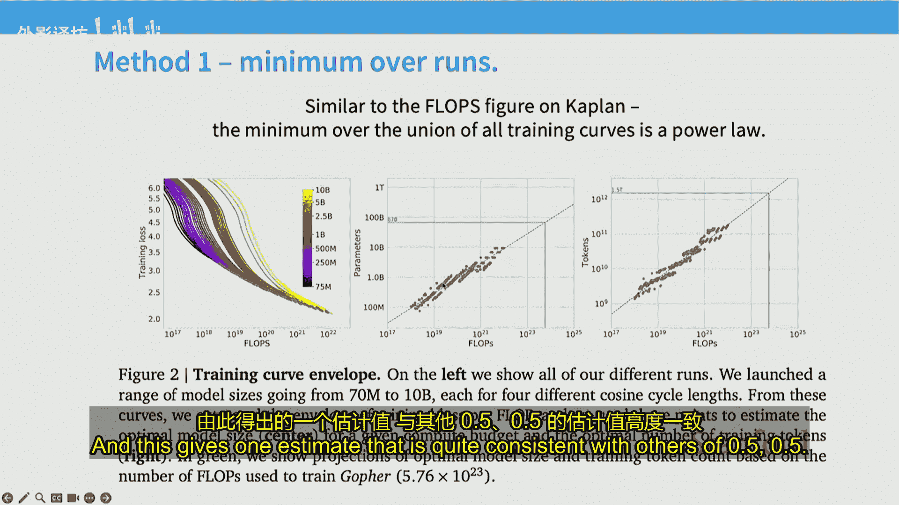

现在来说说另一种方法，我觉得要是你想选一种标准方法来做龙猫分析，可能就是它了，在某些方面，我觉得这在概念上是最直观的一种，也就是异构浮点运算分析，所以要进行异构浮点运算分析。

你要做的是选择一系列计算规模，所以这些颜色各代表不同的计算量，对于这些计算规模中的每一个，我打算这样做，实际上我能用更多数据训练参数更少的模型，或者用较少数据训练参数更多的模型。

所以对于这些每秒浮点运算次数，我要遍历各种模型大小，然后我就能查看每条曲线的最小值，我可以直接选出最小值点，类似非参数的方法，或者我可以针对这些分别拟和二次函数，进而得到二次函数的最小值点。

但无论哪种情况，这个论点还算比较简单，论点是应该如此。

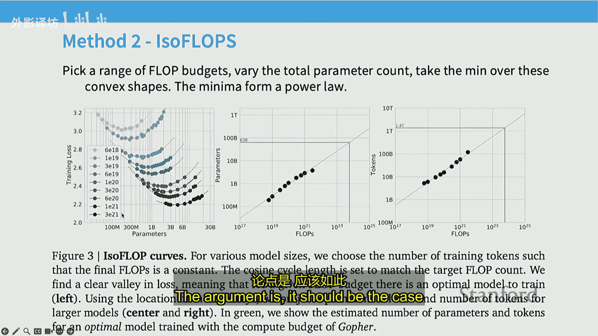

这个最小值本身遵循可预测的缩放规律，因此我可以从中提取出，每个浮点运算的最优参数，所以这就是所有这些的最小值点，而且我还可以提取出，每个浮点运算的最优令牌数，我可以通过用浮点运算运算除以参数数量。

来得出这个值，所以我可以同时得到这些，而且你可以再次看到，这能得出与方法一相符的非常清晰的结果，这样我们就能和之前的做比较，这是关于最终龙猫模型的预算，需要630亿个参数，这个是670亿个参数。

这两者非常接近，老实说最后一个有点杂乱，这又回到了罗森菲尔德那篇论文，要是你有这样的函数形式对吧。

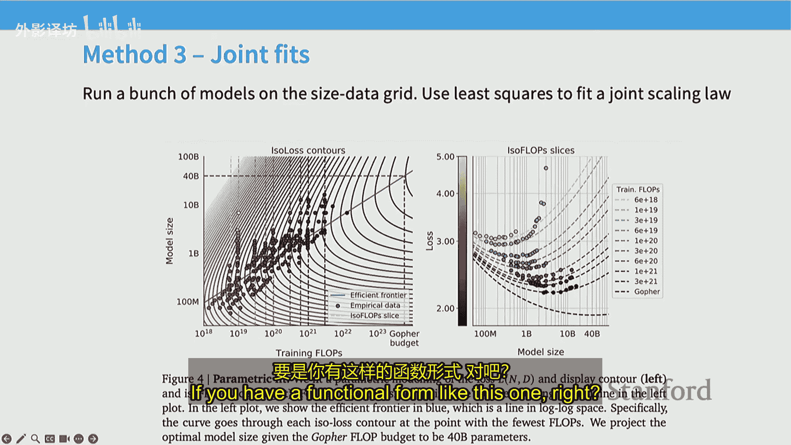

像这样来自罗森菲尔德很自然的会想说，我打算训练一堆同时改变N和M的模型对吧，然后进行曲线拟合，我要把这条曲线拟合到我得到的数据上，我从模型中得到的数据对吧，所以我要训练一堆模型。

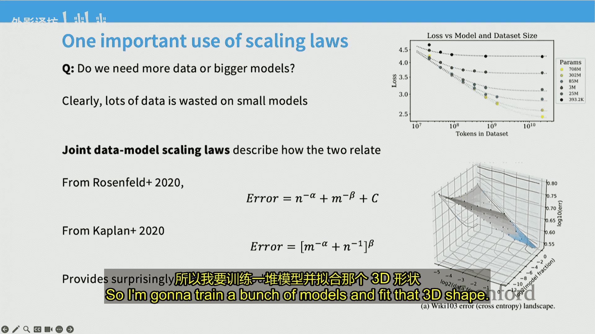

并拟合那个3D形状，从罗森菲尔德的研究可知，在一定程度上你和这些是合理的，所以你会得到这些点，这些就是模型，我拟合了一条曲线，就是左边那种类似热图颜色的曲线，然后你可以从这些虚线大致推算出。

隐含的每秒浮点运算次数大概是什么样，但你看这个，希望你能看出缩放定律是适用的，而且这里的曲线拟合效果不如其他图表，如果你看这些系数，就模型大小来说，龙猫方法三给出的估计值差别很大。

而且总令牌数和其他的也不一样，实际上这对我来说一直是个谜，我的一些学生说，为啥方法三差别这么大，然后我说我不知道。

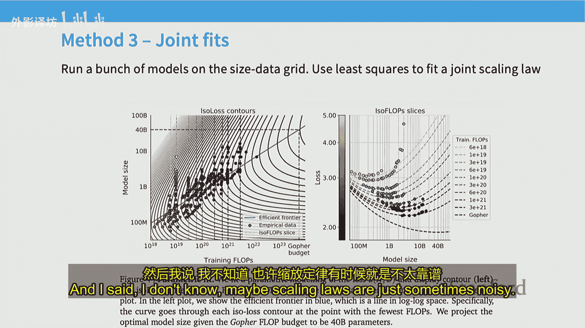

也许缩放定律有时候就是不太靠谱，不知道你们有多少人知道这个，但这真的是个挺有意思的冷知识，或者也不算冷知识，姑且算是个有趣的冷知识，那么去年EPODAI的一些人，我不知道是什么让他们这么做。

对这个结果十分好奇，以至于他们去尝试重现方法三很难进行复制。

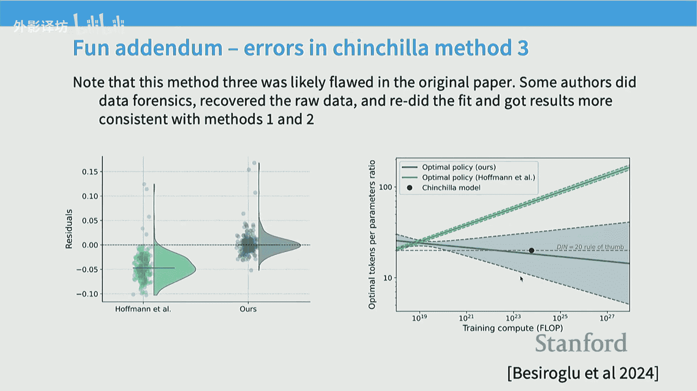

因为你没有所有这些训练数据，于是他们甚至采取极端方式去查看那些图表，并使用了一种取证工具，从图表中提取这些点的值，在此基础上。

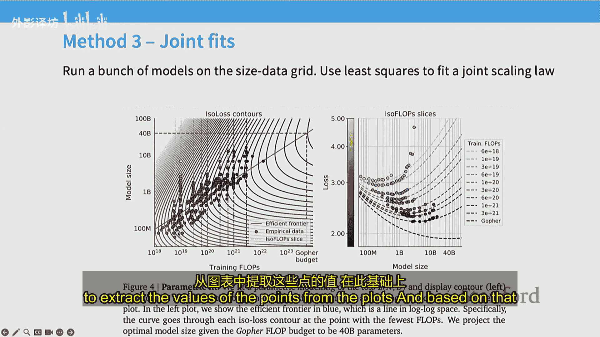

他们就能复制出原始结果，有趣的是，他们发现曲线拟合才是问题所在，比如他们的数据和方法都没问题，但实际上当他们进行曲线拟合时，他们未必做对了，所以最初的拟合存在残差。

要是你熟悉回归你的残差应以零均值为中心，因为不然你就得校正预测值，使其以零为中心，他们的残差非零，然后他们拟合的更好了，然后当他们拟合得更好时嗯，实际上他们的最优估计，几乎与方法一和方法二完全匹配。

所以这是个挺有意思的情况，最初的作者想法和数据都没错，但因曲线拟合上的一个小问题，他们有点弄错了，而重复实验实际上让结果更准确了，比之前更准确，通常重复实验会推翻一些结论，但在这个案例中。

实际上重复实验表明最初的结果一直都是对的，我觉得这挺酷的。

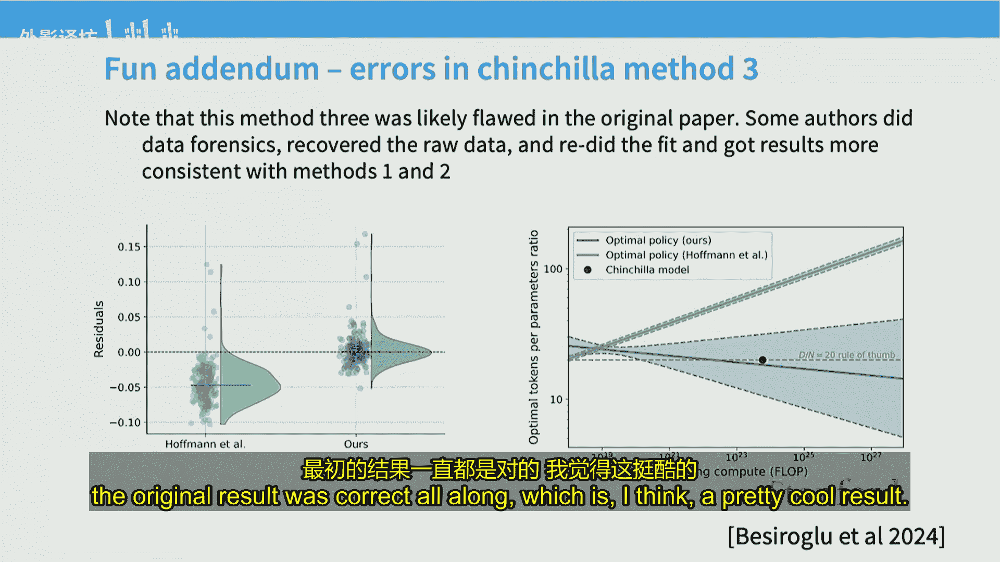

好了，接下来我要讲的最后一点，就这套龙猫模型的结果而言，你懂的，我们在讲训练的最佳缩放比例，所以你有一个固定的运算量预算，我想要最好的模型，但实际上我觉得情况已经变了，当撰写关于龙猫模型的论文。

以及卡普兰的论文时，那时大语言模型还不算真正的产品，所以实际上关键在于每个人都想要最大最炫，最智能的模型，但他们并不在乎，实际部署这些系统时的推理成本，但如今我们真正在意的是推理成本对吧。

因为这些系统实际上已是产品，他们能创收，要知道收益是有成本的，所以随着时间推移，我们发现每个参数的令牌数，即使在稳步增长对吧，比如GPT3，每个参数有两个令牌，Chen china。

使我们达到了每个参数20个令牌，持续了一段时间，人们开始摆弄每个参数20个标记左右的东西，但随后很快人们就明白，我们真正关心的是是，在参数规模非常小的情况下，就能拥有相当出色的智能。

所以人们开始非常迅速地，扩大每个参数的标记数量，我记得昨天看到，比如最新的QEM模型，是在30万一个标记上进行训练的对吧，要知道，人们真的在不断突破令牌与参数的比例极限，因为你宁愿支付前期成本。

也不愿为在大型昂贵模型上运行推理，支付持续运营成本，最后一件有趣的事，我想以此结尾及这些结果相当可靠且易于复制，几年前，我的一个学生医生，对推动文本扩散模型发展很感兴趣，所以我们要做的一件事是说。

这是一种全新的模型，我们不知道最佳的资源参数比是多少，我们不知道这能否可靠的扩展到，完全不同的生成模型，我们该怎么办，嗯结果是如果你只是沿用类似的说法，比如O我们要做对自回归模型进行s flog分析。

我们几乎没费什么力气，就得到了类似亲奇利亚的结果，你知道在扩散模型上也能进行同样的分析哇，能看到非常相似的曲线，尽管它是个完全不同的生成模型，然后要是把这些的最小值画出来嗯。

你会看到两者缩放比例都容易预测，且相差固定值，比如说我举这个例子，不是想说，因为我特别想推广扩散模型，而是作为一个很随机的案例或例子来说，这些缩放定律未必非得是那些精挑细选的例子，当你着手研究新模型时。

他们似乎自然而然就出现了，或者在新环境中开展工作时。

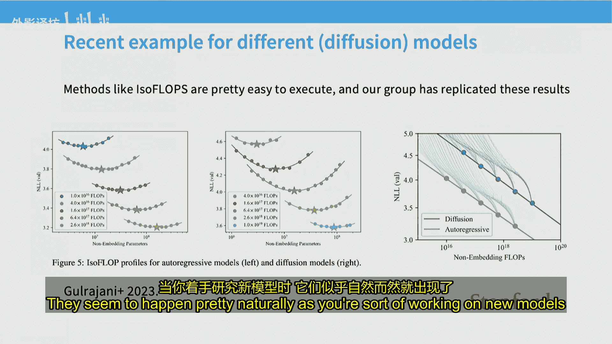

为了讲清楚这最后一部分对数线性关系，并非仅适用于我们所考虑的数据的一维情形，它们还延伸到模型参数，它们还延伸到总计算量，如此一来，我们就能在其他决策中进行各种超参数设置，这就是第一部分内容。

而且他们还让我们能做出超明智的资源权衡，对吧，他们让我们能在大模型和更多数据间做出权衡，而这点在龙猫分析里能看出来，像每秒浮点运算分析这样的结果如此清晰。

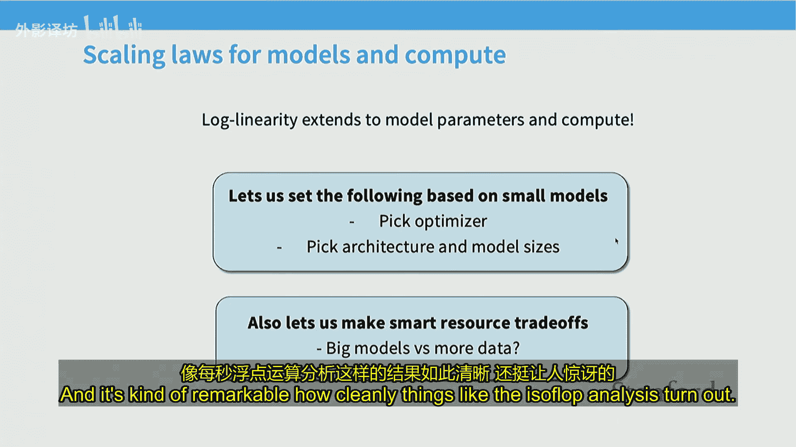

还挺让人惊讶的，所以好了，以上就是基本缩放定律的全部内容，我们今天回顾了卡普兰和龙猫的相关内容，希望现在你们都认同这个观点了，关于数据缩放，模型，缩放以及缩放定律的运用，在不完全进行大规模训练的情况下。

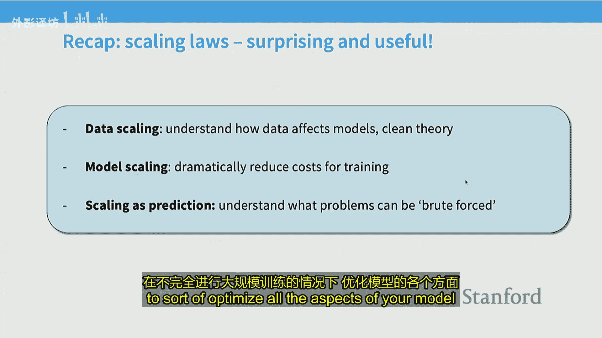

优化模型的各个方面，而无需实际进行大规模训练。

