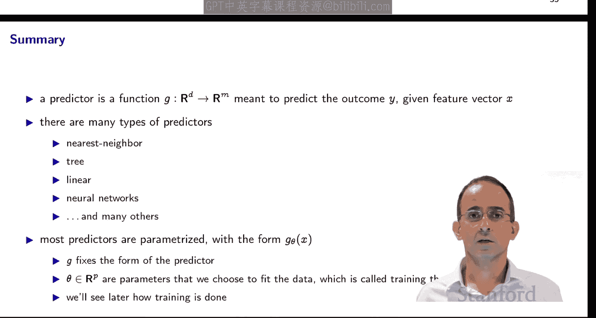
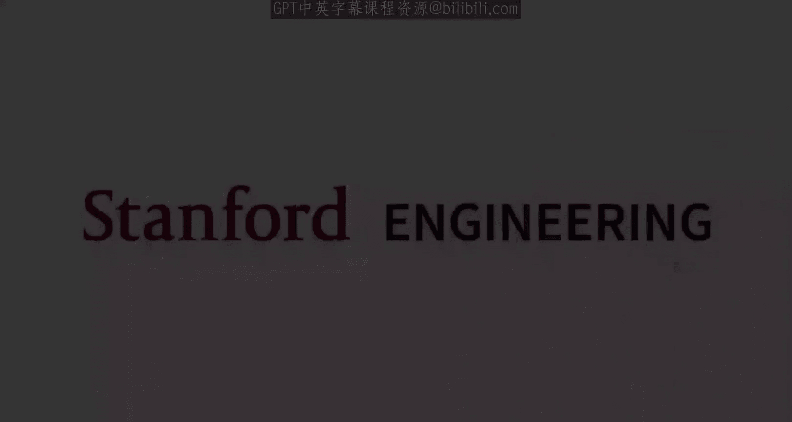

# 斯坦福大学《机器学习｜Stanford EE104 Introduction to Machine Learning  2020》deepseek翻译 p03 Lecture 3 - predictors.zh_en -BV1utzNYqEkr_p3-

Hello， welcome to section 3 of EE104， this is about predictors。😊。

So one of the primary tasks in machine learning is data fitting。We have。

A variable Y and a variable X， we think they're related。By some function， say y。

 say y is equal to f of x。We think y is approximately equal to F of x。😊。

Here we think about x as an independent variable and y is the outcome。😊，Or the response。

We might call it the target or the label or the dependent variable。

Very often we have y is in RM and x is in RD， so these are both vectors。Very often， M is one。

And so the outcome is a scalar。And we say， well， the target is related to。

The independent variableable。Approximately by Y is F of x。

And we're going to be told X and we'd like to be able to predict Y。And。

We don't know what this function is。And of course， there may not be such a function if it may just be that y and X are a bunch of unrelated data。

 whether they're related by some other variable that we don't know， or for you put an x in one time。

 you'll get a y， you put an x in a different time， you'll get a different y。There's a lot of noise。

 there's a probabilistic relationship between Y and X rather than a purely deterministic one。😊。

Usually these x is， these variables x。Usually these variables x are vectors of features that is。😊。

They are descriptors of the underlying data rather than the underlying data itself。So for example。

 if we have documents， for each document we might make a histogram of the word counts。😊。

And count the numbers of all of the different words。And that would be X。

 that vector of the word counts。If we had patient data， then mix might be patient attributes。

 to testla about resultss， systems。啊呀。Let's start again。

Very often x is a vector of features rather than the raw underlying data。So for example。

 if we had a document， then the corresponding X might be a。

Account of all of the different words in the document， the word count histogram。

If we had patient data， then X might be a list of different patient attributes。

 a list of test results， perhaps a list of symptoms。If our data consists of customers。

 then for each customer we'll have an X， which would be the purchase history of that customer。

Maybe a general framework。To construct features from the raw input data。

So the raw input data it might be a vector itself。It might be a word or a document。

 it might be an image， it might be video， it might be audio。嗯。

Or it could be a list of such attributes。Could consider multiple attributes。

We're going to call that input data U。And we're going to map it under a function phi to construct x。

 which we will call the corresponding feature vector。

This function P has a name it's called the embidding， or the feature function or the feature mapping。

And sometimes Phi is very simple， and sometimes it's extremely complicated。And。

Of from we will take a particular。Property， we will make sure that since P is going to be a vector。

 we'll make sure that the first component of Phi。嗯。It's always one。

And so that would note by x sub1 or5hi view Subscript 1。It's the constant feature。

Which we'll explain the reason for that in just a second。Similarly， we embed。

Or we construct features for the output data V。In we will call those y。

 and we will have y as equal to psi of V。So our data comes in pairs。UIs in VIs。

 the I data element is a pair UI VI， we map those to a pair X IYI。And we have N data points。

 x1 through Xn and y1 through Yn， and once we've embedded them， once we've constructed features。

Then we no longer need to look directly at U and V instead we can focus our attention on x and Y。

So we will have N D dimensional vectors， x1 through xn。In M dimensional vectors， y1 to Y N。

 Y1 to Y N。And so'll refer to the pair X I YI as the Ithe data pair or observation。Particularly。

Evocative term is to refer to it as the I example from which we wish to learn。😊，And collectively。

 we call the entire set of X's and Y' a data set。嗯。We're also。

 so that's our fundamental data that we're going to use in order to construct。Some。Fitted。

Model for the relationship between X and Y。We also might have prior knowledge about what F might look like。

For example， poly faith is a。啊，房吃。We might say F is smooth or continuous。

Which means that if x and x t there are two vectors that are close to each other。

 then f of x and f of x tther should also be close to each other。

Another thing we might know prior to knowledge about F is that we might know that y is always non negative。

And so we would like to ensure that property of。F poles in our model。

 we're going to learn from x's and y's， and we're going to see a whole bunch of y values。

 And no matter what y y values we see， we would like to ensure that。

The model that our learning algorithm produces has the property that f of any x is always non negative。

And there are many other such prior knowledge。So and there are many other examples of prior knowledge that one might have。

So the thing we're going to construct is called a predictor。

 it's a model that takes an X and gives you a prediction for what y would be at that X。

We denote that by G， it's a function that takes vectors in RD x's and gives us vectors in RM Ys。

For the feature of vector x， the prediction， we will denote by y hat， y hat is G of x。

And the predictor G is chosen on the basis of two things。

 the data that we've seen and the prior knowledge that we have。And that means that we can。

 in terms of the raw data， construct a prediction using a new raw data record。

So if you give me a new U that I've never seen before。

 I can map it under Phi to embed it and give me an x construct a feature vector corresponding to that U。

Then I can take that X and feed it into a my predictor。to construct G of X。

And that's an estimate for why， a prediction for why。

And then I can unembed that by applying the inverse。😊，Of。The feature map Psi。

To that Y hat to give me an estimate of V， which we'll call V hat。嗯。

And that means that I can test the performance of my predictor。In the original。

 in terms of the original data， rather than in terms of my x's and y's。

And sometimes psi is not invertible and then there's a slight variation of this formula that we will come to。

😊，Of course you can also evaluate how well does this predictor do on the data and we can take a data pair。

 the I data pair is X I， Y I， you'll feed XI into G。We'll get a Y hat， what we'll call Y hat I。

And we would like Y hatt eye to be close to Y eye。And that means that the predictor does well on the data。

It's a very reasonable thing to require of the predictor。Of course， our real goal is not to have the。

Predicor do well on the data， but to have predicted the predictor do well on。

Potential data that we've not yet seen。When somebody gives us some new。X or some new U。

They could quite reasonably ask， wellWell what did you learn from all that earlier data？

That we gave you。And the answer should be， well， from all that data。

 I learned that these kinds of x's give rise to these kinds of y's and let me predict a specific y that would be generated by the x that you just gave me。

Now when we're working with predictors we typically don't just say， well here's the predictor。

 we typically have a parameterized form for the predictor。

 so the predictor is a function of two things， it's a function of x。

 and it's a function of some parameterss theta。So we would have Y hat is G of x and Theta。

Sometimes we write this as a subscript so we'll write Y had is G subscript the of X。

 and that just makes it easy to refer to G。😊，G Theta is a function which takes an X and gives us a y。

And what this does for us is it specifies a form， a structure。😊。

Allowed predictors or predictors that we like。And we're only going to pick predictors that correspond to a particular the。

And our job becomes instead of choosing an arbitrary function that maps X to y， choose a theater。

And then evaluate G of x theta。So Car is a parameter， it's usually a vector。

It's a parameter for the prediction model。Often Theta is in some Euclidean space。

 here we've written RPP， sometimes it's a matrix， we'll see that。嗯。

And sometimes it's a list of there's more than one parameter， more than one parameter vector。

 more than one parameter matrix。嗯。Choosing a particular theater。😊。

That's called tuning or training or fittingtting the model。嗯。

And the learning algorithm is a recipe for choosing CA given data。So， for example。

We might have a linear regression model。That says that Y hat is Theta 1 x1 plus theta 2 x2 all the way up to Theta D。

And X。Y hat is this linear combination of the thes or equivalent in here a linear combination of the x's。

And。啊。Our job is to pick the theaters so that。啊。This is a good predictor。

We've already seen in previous classes on linear algebra that you can fit such a linear regression model using these squares。

pickinging theater to minimize the mean square error。Of course。

 there are lots of other methods for picking， for doing linear regression， for picking the theaters。

 even in a linear regression model， and we will talk about some of those in this class。😊。

I want to talk about a special class of predictors called nearest Neigh predictors。😊。

They work as follows， we're given a data set。X1 through xn， Y1 through Yn。

And the predictor says the following。You've got some new X and you' would like to predict a corresponding white hat。

The way you do it is out of all of the data that you've got。

 you find the Xi that is the nearest to X。And then your prediction for the corresponding Y。

I's simply why I？And that you define to be G。Of X at that x。And so this is extremely intuitive。

If you've got some new piece of data and you want to make a prediction about what y is at that data point at that x。

 well， why not look for the closest example that matches it？And say， well。呃。

That's probably the this is the closest example we've got。 so let's predict。

That the why we get is the why we got in that previous example。嗯。

It really is of course a parameterized predictor here。

 the parameter is a bit interesting because the parameter is the full data set。

 you can think about theta as x1 through x n and y1 through y in the entire data set。😊。

And we don't have to choose the parameter， the parameter is given to us with the data。

 it is the data。So training is easy， there isn't any training， there's no computation to be done。

All we have to do。Is。Keep track of all the data we've seen and whenever we get a new query point。

 a new X。We just look for the closest text in the data set and get return corresponding why。

This means that G is going to be a piecewise， constant function of x。

Because when x is closer to X's than all the other x's， well， and geo x is just yi。We can see that。

On this plot right here。Let me see if I can highlight some points on this。So these are data points。

And the orange line。Which I will highlight here in black。This。Where goes about here。Is the predictor？

And it tells us that， for example， if we receive。诶呀。A value。Of x of 0。2。Then we should predict。

A corresponding value y of 047。And so even though we've only got data points at specific points。

 we've fitted a curve， not a curve， really a piecewise constant function through those points。

Something to observe is that the function has discontinuities。

Let's look at some of those discontinuities。So here's one。也是哪个。还是哪个。

And these discontinuities are exactly halfway between two adjacent data points。

 so as we vary X when we're here。😊，We are our closest data point is this red point here。

 and then as we increase x， we suddenly switch to the closest data point being this。

Data point X right here， and as a result we switch our prediction also from predicting the Y corresponding to this data point to predicting the y corresponding to this data point。

You can do this in more than one dimension， doesn't have to be a one dimensional X here。

 one can do this when x is d dimensional as well here's a two dimensional case。

The two dimensional case here we have data points。Whi which are right here。

 I'll highlight these blue points。And。啊。And now associated with each data point associated with each X。

 there is a region， so for example， for this data point right here。

There's a region which is this region right here。Which is a polyhedron， it's got straight boundaries。

And this is the set of data points for which this is the set of x's for which the corresponding closest data point is this one。

If I'm here， my closest data point。Is this one。Now if I move。Across this boundary。

 suddenly I switch to the case where my closest data point becomes that one over there。

So each data point has a corresponding region。And those regions are called the Voi regions associated with the data。

So the function the predictor is piecewise constant， it's constant on voranno regions。

 and here's a three dimensional plot of it， this is x1， this is x2， and this is the prediction。

Why or why hat？And so here we have， again， we have data points。Here。

And then this is the function values。According on each data point。

 so right here on this foreign oil region right here。That vino region right there。

 that's the vnal region correspond to this data point， the value at that data point is y is1。

 y I is minus1， I'm sorry。And so if we are given a new X， which is anywhere in that region。

Then we will predict that Y hat is also minus1。So now we've seen the nearest neighbor predictor。

We can extend that idea and talk about the K nearest neighbor predictor。😊。

So the idea here is that you pick a number K， an integer。And then you say， well， you give me an x。

 and instead of just looking at the nearest neighbor to x。

 I'm going to look at the K nearest neighbors， X I1 through X IK。😊，Amongst the given data。

And what we're going to predict is we're going to predict Y hat to as follows。

 we're going to take those K nearest neighbors。😊，The nearest X eyes's。

 each one of them has a corresponding Yi until we've got K corresponding Y I and we're going to construct the average of those KYI's。

 and that's going to be Y hat。😊，So this is a generalization of the nearest neighbor predictor。😊。

It's certainly very useful， it's very well used， you might see that for example。

It makes you less sensitive to noise in the data， if the data is very variable。

 then the K nearest neighbor predictor is going to perform some averaging。😊。

It's going to smooth out the data。 It's going to remove some of the noise。

And there are many ways you might extend this idea， you might use a weighted average to form Y hat。

 or you might pre process the data， you might say， well， I'm only going to look at。

the data instead of looking at as a collection of data points。

 I'm just going to look at it as a collection of clustered data points。

 a collection of clusters of data points。😊，And then instead of picking the nearest neighbor。

 I might pick the nearest cluster。There's a bunch of different things you could do。

Here's how you compute the K nearest neighbor predictor， this is Julia。So we have a function。😊。

It takes an X， a y， a little x， and a K。So here this matrix X。It is an N by D matrix。

The ice row of that is the ice。X。Point， it's X。That variable corresponding to Ih data record。

Why here？Is。Also in by M matrix， it's the corresponding targets。

 the I row of y is the target variable corresponding to the I row of x。Here， little X is。

The query point， we're given a new x at which we want to predict a Y that's little x。And K here。

It's the K and nearest neighbors， It's how many neighbors we're going to consider。

So this first line of the code here just gives us the in， the number of data points。

 it looks as the number that returns the number of rows of the matrix X。Here we。Look at each。

Vow and subtract it from the query point， look at the sum of the squares of the entries of that vector。

And fair， we make a list of all the sums of the squares for each of the different data points。😊。

F as one to n， and that's in diss S， that's a list of all of those different distances。

The I element of that list is the distance from Xi to X。

And then this function sort perm gives us the indexes， the indices that point to the sorted。🤢，Enries。

Of disk square。 So the first entry of nearest neighbor IDxs is an integer。 And if we look at the。

Dear， so so if the nearest neighbor index is。If the first entry of nearest neighbor indexes is7。

 then disks square7 will be the smallest。😊，Entry and disk square。And similarly， then second。

Entry in nearest neighbor indexes。Points to the second smallest entry in disk Square。

So if we look at the first K by picking out the first K entries was turned by sort perm。

 that gives us K numbers。That point to the corresponding。Closest data records to X。

And then what we do is we construct the corresponding， take the corresponding wises。

 and we take their average。And we return that as Y hat。This is， of course。

 if you were to write this in Python or MATLb。It would look very similar the nice thing about this code is that really it looks very much like the mathematics that one might write。

😊，To describe this algorithm。And that's a nice feature that is worth aiming at throughout this class is that if you've got a short piece of mathematics that describes something you're trying to code。

Then the code should kind of correspond line by line to the mathematics。

And that way it's easy to debug。、 he itル weirdル。And so this is the case where K is2 on the same data that we had before。

And now this is interesting in that regions。Let me mark a region。So for example。

 this region right here。Regions still have polylohedral， still have straight line boundaries。

 they're still polylohedra。But they now rather than corresponding to a single data point。

 they correspond。这。K data points， in this case， K is 2。 So every。Point in this region right here。

It's too closest。Data points。This one and this one。

And you can see that if I'm in this region and I cross over into this region。

 then I'm going to switch from having。This one and this one。

That's my closest data points to having instead this one and this one。

 that's my closest two data points。So now regions are associated with pairs of data points。

There are more regions because there are more pace of data points than there are individual data points。

 although not every repair of data points has a non empty region。

And we can plot the corresponding K nearest neighbor's estimate here it is on the right hand side。

There are more regions， but also the function itself is somewhat flatter， has less variability。

And that's something we expect because the K nearest neighbors。A predictor。That'm。And so instead。

 it's going to smooth out the function。It's still， of course， peace wise。Constant。

Now instead what we can do is another variant of the K nearest neighbors， this is the soft。

 nearest neighbor predictor。😊，And what we do here is we take a weighted average of the measured y。

 but the weights that we use aren't fixed， they depend on x。

And so here's a very common choice of weights。Right here。These weights are interesting。

 one thing you might notice is that if I sum those up from I is1 up to n。

 then the sum over I of WI is equal to1。Let's write that down。Perhaps using。So。

Another thing to notice is that there's a parameter here， the parameter is row。

It has the dimensions or the scaling like a length， so in particular。😊。

If you look here in the numerator， I've got the norm of x minus Xi squared divided by rh squared。

So when row is very small。Well， one over a row squared is very large。And so E to the minus something。

Divided by row squared。Is going to be。Extremely small。Unless there's something in the numerator。

 unless the x minusxii norm squared is also。😊，Very small unless's of the similar size to row squared。

And so what that means is that when rh is very small。

 this quantity is going to be one when x is close to Xi。And0。Almost everywhere else。

And that means that this weighted sum that I'm going to get right here is going to be。The nearest。

The value of y at the nearest point。X I， the nearest I that the。At the nearest data point。

So this reverts to the nearest neighbour predictor when very small。When rowe is large。

 it becomes a little different。😊，Let's look at what it becomes。So I won't go through this code。

 but this code is because it's very similar to the previous code。

 it just explicitly follows the mathematics again。😊，So here is the soft， nearest neighbors predictor。

😊，This is the case where rowe is two on the left here。😊。

And you can see it's really rather the smooth。When row is one。

 it's becoming a little bit more similar to the。啊。The nearest neighbor predictor。

Here we can see when row is 0。5。Over here， we can see something that's really quite close to the nearest neighbors predictor。

And。And the nearest Ne predict is here on the left and we can really see that there's a correspondence between those two。

😊，So this is a nice way of smoothing out the。The nearest neighbor predictor and instead of us having a discontinuous。

😊，Peace wise， constant function， one has a smooth function。And we can make it。

And as smooth as we like。Okay， so let's turn now to another class of predictors。

 the linearar predictor。诶。Here G has the form G of x theta is theta transpose multiplied by x。

So when M is1， that means y is a scalar， the parameter theto is a vector RD。

And Theta transpose x just returns for a scalar。When M is greater than one。

 Theta here is a matrix which is D by M。😊，And so theta transpos times x is going to return for us an m dimensional vector。

 same size as y。This is also called a linear regression model。And。Why hat， which is。

G of x is3 to1 times x1。Plus Theta 2 times x2 all the way up to Theta d times Xd。

 which is a linear combination of the Theta I's with coefficients x1 through Xd。Hereair。If M is1。

 then Theta I is just the I entry of Theta。If M is greater than1。

 then theta I transpose is the ice row of theta。And so each of the theater eyes has a dimension。

Same as why。So we can interpret this， suppose why is scalr just for the。

To make the explanation simple。You can of course extend all of these ideas when y is a vector？

Well then the linear predictor has the form Y hat， which is G of x is theta 1 times x1 plus theta 2 times x2 all the way up to Theta dG Xd。

And that means that we can interpret the theateris very directly， so，嗯。

Cta 3 is the amount that the prediction y hat increases when x3 increases by 1。

If you happen to be in the case where your x3 is a booleion。😊，If had anything fixed values0 or1。

Then Cedar suite is going to tell you how much Y hat is affected。When x3 turns on or turns off。

If theta 7 is zero， well that tells us something also it tells us that the prediction does not depend on x7。

And in general， thedo is small as a vector means that the prediction is insensitive to changes in x。

And there's a very little nice little one line computation here is it。Illustrates that。

Here we're looking at the absolute value。Of the difference between G of x and G of x tell us。

 we've got two different x's。And well， G of x is theta transpose x and G of x tta is theta transpose x tta。

And so gathering together。The x's we get that's equal to theta transpose x minus x tilde。

And now we can use the Kooshi Shivas inequality， remember what that is， then we just write it down。

That says that for two vectors， say P and Q。That the absolute value of P transpose Q。

Is less than or equal to the norm of the vector P multiplied by the norm of the vector Q。😔。

And of course， we know that P transpose Q。Is the norm of P multiply by the norm of Q multipied by the cosine of the angle between P and Q？

And cosine between minus1 and1。So that means that this quantity。

 the absolute value of this scalar product。😊，It's less than an equal to the norm of theta times the norm of x minus x tilde。

And so if Theta is very small， so if the norm of the is small。😊，Then， the difference。

Between G of x and G of x tder can't be very big。Because it's bounded by that small quantity multiplied by the norm of x minus x toder。

So by making theater small， you make your predictor insensitive。To the data。

And that doesn't sound like a good idea， but as we will see in this class and it turns out to be an extremely important idea that we will。

😊，Revisit again and again。In many cases the first feature is constant we made x1 is 1 and that's a choice when we get to choose how we are constructing the features。

 what our maps Phi and psi are， and so we often choose x1 to be one， the constant feature。

And the reason we do that is that then the linear predictor， say G of x is theta transpose x。

 which has this term at the beginning of it， Theta 1， a constant term which doesn't depend on x。😊。

Plus， a term。That is。Linear in X。So it's linear plus constant。

And theta1 is called the offset or the constant term。

 some people will call it the bias in the predictor。It's the prediction when all the features。

Except for the constant of four so zero。Some people would call that an air fine predictor。

 a linear plus constant predictor。😊，If it was a linear predictor， then when x was0。

 we would have to have Y。😊，Ha be also zero here zero is。Somewhere down here is the origin。

And we can see that our prediction doesn't pass anywhere near the origin。

Another very common predictor is the polynomial predictor。So here。

 what we're doing is we're taking an appropriate embedding。

 we're choosing features and by choosing features in this way。

 we can get a known nonlinear function of view。Even though we're using a linear predictor based on x。

What you do it is you say I'm going to construct this feature map phi to be a vector。

So you give it a U， say u is a scalar， and we're going to construct a vector feature。In feature map。

 which returns1， u， U squared u cubed all the way up to the D minus once power of U。

And people would call Phi polynomial or power embedding。And it's interesting， it's taking a。

A one dimensional independent variable U and making a bigger。Regression problem。

 it's embedding it in a D dimensional regression problem。

And that means when we construct the linear predictor。

 we're going to have y hat is theta transpose x。😊，But actually。

 theta transpose x is theta 1 plus theta 2 u plus theta 3 u squared all the way up to the to D。

 U d minus1。So it's a linear function of x， but a polynomial function of U。😊，Here's an example。

So I've got a bunch of data points here and fitting a quadratic。Here。Or a cubic？会对。

There are other nonlinear predictors， here's one， this is a tree based predictor。😊。

And the idea is is that we have a predictor which is represented by a partially developed Boolean tree。

And add each vertex， which is not a leaf。Such as this one or this one。We have。A variable。

 an index into one of the components of x。And associated with that index or that component is a threshold。

And that's the threshold， which is the decision part at that node in the tree。😊。

So we started off coming in with X。We say is x second component x2 less than a equal to 0。

8 or is it greater than 0。8？😊，If it's greater than 0。8， we go down here。😊。

And when we return a prediction， why hat is 0。6。If it's less than 0。8， less than equal to 08。

 we go down here。😊，And then we end up with another at another。ANo leaf node。

And that's associated with another decision， and that decision is x is x1 less than equal to 0。

2 or is x1 greater than 0。2。😊，If x1 is less than than equal to 02。

 then we go down here when we return y hat is 0。25。If。X1 is greater than 0。2 than we go down here。

 we tell why hat is 0。5。😊，So the leaves are associated with the values， these are the leaves。😊。

And then normal leaf nodes are associated with。Conditions。

And the predictor is a piecewise constant function of x。

And we could plot it as a piecewise constant function of x， at least when the tree is small enough。

Here's a one dimensional x。Here what's the tree for this， well we can work it out。Let me switch to a。

😔，什么了。Pen。We go X。First decision。We have a choice we can there's more than one way to write any given decision tree let's do。

 let's look at this。Point right here first， and we'll say。If X。Is less。Then 0。2。

Then we're going to have Y hat。Is 0。25。Here we've got another decision to make。

And this one is going to be here。And the decision is。So here we x is greater than 0。2。

And here where the decision is is X。Less than 0。8。What is X greater？😔，Then 0。8。

And if it's less than 0。8， then we're going to have Y hat equal to 0。5。And if it's greater than 0。8。

 we're going to have Y hat equal to 0。6。So there's a decision tree corresponding to this。啊。

Prodctor right here。And of course， if we were in higher dimensions， then we're slicing up。

Vectctor space corresponding to RD。Into。Bectangular regions。And at each。

Vertex at each non leaf vertex of the tree， we're making another cut。

let's look at another class of predictors， these are the neural network predictors， very important。

 very powerful class of predictors， extremely widely used。😊，So what is a neural network。

 a neural network， this is a feed forward neural network。

 which is perhaps the most common type of neural network there are others as well that we will discuss。

 but this is the most common kind。😊，It's a composition of functions。😊。

So here I've got three functions G1， G2 and G3。And I take X and I apply it to G1 and then I take the results and apply it to G2。

 and then I take the results and apply it to G3 and that gives me Y hat。

And you can have any number of functions here here， we've just got three for the sake of example。

Now we write that using this notation。The predictor G is G3 composed with G2 composed with G1。

And this symbol with a little circle。Means function composition。

These GIs are called layers of the neural network， and here we have three of them。

We can split up this function composition into three independent things， first of all， we apply X。

We take G1 and apply it X and get z1。Then we take G2， apply it to Z1 and get Z2。And then we take。

 we take G3 and apply it to Z2 to get our output Y hat。And these intermediate variables。

 which we've introduced here Z1 and Z2， are called activations， they're the outputs of the I layer。

And to make it all consistent， we might make x here。😊，Z zero， and we might make Y hat here Z3。

 and that's a very reasonable notational convenience that will' make use of。嗯。

And and here it says here D0 and D3， and let me tell you what those are。

 because one of the things that's going on here is that each one of these Z's can have a different dimension。

😊，And we will have Z is going to be in R to the D。And that way。

 this notation D0 is D and D3 is M is simply expressing our usual notational convention before the dimension of x being D and the dimension of y being M。

Now you can visualize this is a nice graph。😊，X comes in， goes through G1 gives us。Z1。

Go through G2 gives a C2， goes through G3。Gives us Y hat。

 which you might call a flow graph for the data。Okay。

These layer functions have a particular form in neural networks， here's what they look like。

They're a composition of a function， H with an athne function。😊，So here。

Theta I transpose1 Z minus1 what this parentheses notation means。

 let me tell you what this means if I write X， Y， z。In parentheses， that's exactly the same。

Is writing a column vector， X， Y， Z。With them stacked up on top of each other。

So when I write theta I transpose1 comma Z， what I'm really saying is that I've got some vector theta I transpose。

1， and see。And that's， of course， I could expand that。😊。

As saying that's theta i1 times 1 plus theta i2。Times z1。Plus all the way up to Theta eye。

 whatever the dimension is。D plus one。Time Z D。It's a linear combination of the ZIs。😊，And。Of course。

 I don't need to write that one in there because it's just one。It's just the I1。

So I take a linear combination of disease with a constant terminal offset and then I apply a function H to it。

Now， remember that。啊。Disease。Vects and the output can also be vectors。

 and that would mean that Theta I would be a matrix。

And its dimension would be R D minus1 plus1 by D because it's。Input is a vector Z。I minus1。

 which has dimension R D minus1， and its output is going to have dimension R DI。

And this is the parameter associated with layerI， these are also called the weights。😊。

Now what I'm doing with that vector， which is。😊，Produced by this aine function is I am applying a scalar function H to it。

😊，And that scalar function H is called the activation function， and it acts element wise。

 so it's applied to each entry of the vector separately。😊，嗯。

So what that means if I've got a vector Z and it's equal to H of w。

 what that means is that z1 is H of w1， z2 is H of W2 and so ons really just a shorthand。

For applying the function。Separately to each component。

Now the scalar function H is called the activation function。😊。

There are many different activation functions that are used in neural networks。

 the most common one probably by far is this one called the Relu。Let's take a look at that。

So the value is this thing。😔，It's usually denoted by x parentheses with a subscript plus。

 also written max of x comma0。What it is is we can just draw a little graph of it here。😊，This。Is。Six。

And this is X plus。And it's graph。Its zero for negative x。And just X。With positive x。

 so if x is negative， x plus is just zero， if x is positive。😊，Thenな。X plus is just x。

Let's call a value， Relu is short for a rectified linear unit。

Another one that's quite common is the sigmoid function， E to the x divided by 1 plus e to the x。

And we will see a few others as well that are commonly used for activation functions。嗯。

So once one knows。The matrices Theta 1 through Theta M。Once one knows the activation functions。

 one can construct the functions GI。One can compose the functionss GI。T a predictor。

And that's a neural network predictor。It's often drawn as a network。

So heres a three layer neural network， remember what the functions are， our first function。啊。

G1 takes these two variables。X1 and x2。And constructs these four variables。

 So here the dimension here is D。Is two？D1 is4， that's the dimension of the variable at the first layer。

 it's the first activation。And we have。D2。Is 2。And then we have M is1， which is just D3 is1。

And the function。That maps us this way is G1， the function that maps us this way is G2。

And the function that maps us this way is G3。But it's quite convenient to draw this as a network like this where we've expanded out each of the variables。

 because then one can see several things， one can see that for example。

 the first component of Z1 depends on x1 and x2， as does the second as does the third and S does the fourth。

😊，And the coefficients that enter into this dependency。😊，Are the entries of the theaters？

So for example， Z2 component1。I's a linear combination of the Z1， Z11， Z12， Z13， Z14。Plus。

 a constant term。Pass through the activation function。 So it's each of。A linear combination of these。

 plus a constant term。The coefficient of Z11 is going to be seatd221。Here we can also see that Z14。

 it's coefficient， is the activation function composed with。

A linear combination of x1 and x2 plus a constant， the coefficient in the linear combination。

It's The 1，2，4。So these kinds of network diagrams are often drawn for neural networks。

 very often the theater eyes are sparse matrices， so they have lots of zeros。😊。

And that would mean that many of these arrows have zero coefficients associated with them。

In which case we typically wouldn't draw arrows that have zero coefficients。😊。

And so each of the vertices in this graph is a component of an activation。😊。

And the edges are entries of the weight matrices， now we would call them individual weights or scalar parameters of the。

Neural network。And so here we have three layers and we have specific dimensions of this particular neural network。

😊，Now by choosing the parameters， what have we got to choose。

 we've got to choose Theta1 and theta 2 and theta 3， this is the dimension of theta1 here， it's3 by4。

 this is a dimension of theta 2， it's5 by 2， and this is a dimension of theta 3， it's the v by 1。

So there's quite a few parameters that enter into the theaters and of course the activation function is a choice as well。

 that's not a parameter。😊，And we're going to。Pick。The predictor from this family of predictors by choosing the theatres。

 the Hs are part of the structural form of the predictor。

By choosing these theaters one can end up with a huge number of different functions which all look like trumal pieces of paper。

 here's one for this particular choice of theater you can see right here。

You can see that it's a piecewise linear function。But it's got complicated joins。😊，In the function。

 there's a complicated join there and there。And。啊。One can end up with all sorts of very strange functions by picking the theatres。

 and this is simply with a three layer neural network with quite small number of variables neural networks can have millions of parameters。

And。And then it it becomes impossible to。Visualize or understand what those parameters mean or how they work。

嗯。So in summary， a predictor is a function， it takes x's， which live in RD and gives a spect Ys。

 which live in RM。😊，And it's meant to predict the outcome y given a particular feature of vector to X。

😊，There are many different types of predictors， nearest neighbors， trees， linear predictors。

 neural networks， many others。And most of them are parameterized。

They have will write them G of Theto X。G fixes the form and see there are parameters that。We choose。

And we're going to choose them so that we fit the data as well as possible。

 and that's called training the predictor。

And we're going to see later how training is done。

