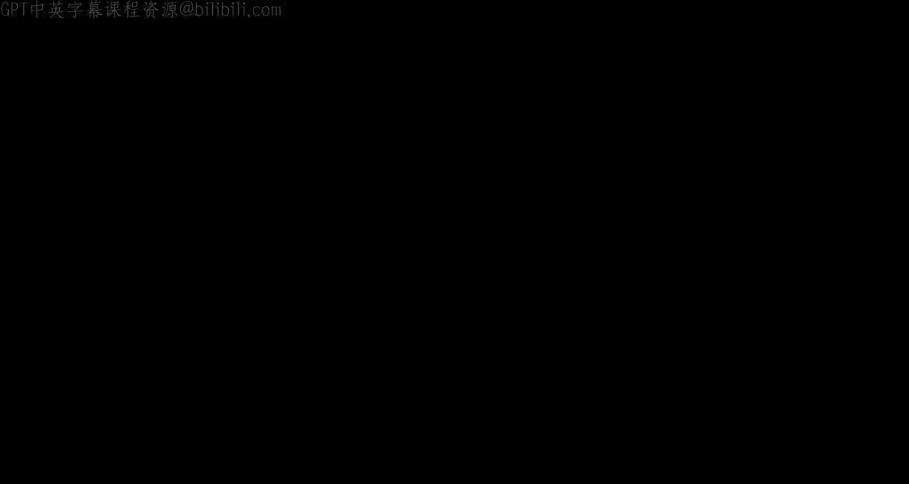

# 斯坦福大学《机器学习｜Stanford EE104 Introduction to Machine Learning  2020》deepseek翻译 p05 Lecture 6 - empirical risk minimization.zh_en -BV1utzNYqEkr_p5-

Hello and welcome to the empirical Risk minimization section。

This section is in many ways the heart of the class。😊。

Empirical risk minimization is the process by which。Preddiicctorors are learned from data。

So many of the predictors that we've seen， in fact many predictors overall。

 have a parameterized form。😊，We think about Y hat is G of xm's theta。

Where G is a function that determines the structure or the form of the predictor， it might be。

A neural network， or it might be a linear predictor， or it might be a tree。

And Theta is a set of parameters。😊，It might be a vector， a matrix source of other data structure。

 and that set of parameters is going to be。One of the determinants that produces the output Y hat。

And when we learn， we're going to learn by choosing the parameters Theta and we're going to leave G fixed。

So for example， we might consider linear regression。😊。

And if y is scalar then we'd have Y hat would be G the of x。

 and here G theor of x would take the form Theta1 times x1 plus Theta 2 times x2 all the way up to Theta d times xd。

😊，And so Theta here is a parameter， it's a D dimensional vector。

 and we might might y hat is theta transpose multiplied by x。We also might have a predictor。

For a vector Y in RM。And if that's a linear regression model。

 then we would have Y hat is G theta of x is also the to1 times x1 plus theta2 times x2 all the way up to the to D times xd。

But here， each of the theta I's is an m dimensional vector and the x's x1 through xd are the coefficients which determine a linear combination of the vectors theta1 through theta D。

😊，Often we would write that in terms of a matrix， so we would write our matrix Theta。

 which is a D by M the matrix， and the Ih row of that matrix is theta I transpose。😊。

And then we can express the relationship Y hat is G theta of x。

 as y hat is theta transpose times x just as before。We might have other types of predictors as well。

 we might have a tree prediction model in which case Theta would encode the tree。

 it would tell us the thresholds at each of the vertices of the tree and the leaf values。😊。

Now we're going to choose which particular theta to use。Based on some training data。

 we're going to have in。Data pairs X， Y， Y， I， if I is1 up to n。

And that's going to be the training data， we will use it to fit the model。😊。

And this is called the training process。There's many different training processes that vary based on what kind of predictor we're choosing to fit and what our performance metric is。

So for example， if we're training a linear regression model and if y is scalar。😊。

And then we might use something like these squares。

We would choose Theta to minimize the sum of all the data points size1 up to n。

Of y I minus the predicted value， y hat I squared。And this notation， Y hat I。

Is what it means is G evaluated at X。So Y hat I is the prediction when the predictor is fed with the I value of x。

And as a result， we say， well， we're going to choose Theta to minimize the sum of the squares of the prediction error。

which is the sum from i is1 to n of G theta of Xi minus Yi squared。

's a very reasonable way of learning a predictor in this lecture will actually cover a more general。

😊，Method。Which is very widely used and it's very effective and it's called empirical risk minimization。

And what it is at its heart is a generalization of the least squares idea。

And the way this works is we have a loss function。A loss function takes two vectors as its input。

 a Y hat and a Y， and it gives you back a real number。And it quantifies。How close why hat is to why？

Really what it does is it。Quantifies how badly Y hat approximates Y， because normally。

The loss function of Y hat and Y is small when Y hat is close to Y and large when Y hat is different from Y。

嗯。So if the loss function is small， we'll tell you that Y hat is really a good approximation of y。😊。

And if the loss function is large， we'll say it's a bad approximation of y。

And it's very common that we actually arrange things。So the loss function evaluated。

When y hat is equal to y is zero。😊，And the loss function when y hat is not equal to y is non negative。

So some very common examples。 The first is。The quadratic loss function。

I've got a scalar Y and therefore a scalar Y hat。The quadratic loss is just y hat minus y squared。

If I've got vectors for y and y hat， then the quadratic loss is the two norm or the Euclidean norm of y hat minus y squared。

 which is just the sum of the squares of the differences。Between why hat I and why I。啊。

Another common loss is the absolute loss。😊，If I've got scalar y and scalar Y hat again。

 then the absolute loss is just the absolute value of y hat minus y。Here's another loss。

 this is the maximum of y hat divided by y minus1。😊，And y divided by y hat， minus-1。

So this is the fractional loss or the relative loss， so if y hat is 20% more than y。

 then y hat over y minus1 will be 0。2。And if Y hat is 20% less。Then。

 then y over y hat minus1 will be 0。2。Another convenient way of expressing this is as the exponential of the absolute value of the log of y hat minus the log of y minus1。

😊，And often when we might scale it by 100， and then it really is percentage error。😊。

We often use fractional loss。😊，For quantities which either range over a very wide。Range of。

Magnitudes。We saw last time the example of website visits。

 which can range over many orders of magnitude。Another case where we might use fractional loss is where we're dealing with prices。

Where very often we're more concerned with the percentage difference in two prices than the absolute difference in prices。

And we all see particular interpretations of these losses and cases where some of them are better。

 more naturally suited than others。And we will also see many other possible loss functions in this class。

😊，Now we start off with a loss function and when using it。

 we construct something called the empirical risk。😊。

And the empirical risk is just the average loss over the data point。😊。

So in order to compute the empirical risk， we need to have a bunch of data。

 we need to have a predictor。And we need to have a loss function。And then for each data point。

 we simply compute the loss between G Theta of Xi and Yi。

And then in order to compute the empiricalovs， we average that loss。Overall were the data points。

And then if the empirical risk is small， the predictor。😊，Got a good job on average。

 over all the data。At least according to the particular loss function that we've chosen。

We usually write the。Empirical risk as a function of the theater that parameterizes the predictor。

Of course， it's also a function of the data set。But we suppress that in the notation。

And you might say， well， this is quite similar to what we talked about before when we talked about performance metrics。

And that's absolutely true。In both cases， we're measuring how well a predictor does。嗯。

The difference is is that performance metric is something that we use to judge how well our predictor is doing。

Whereas empirical risk is something that we're going to use to train。这个。Model。

 we're going to train the predictor， we're going to choose which predictor we're going to use。

According to a procedure which is。Trying to make the empirical risk small。And。

Very often empirical risk and performance metric are the same and you might say， well。

 why not just choose the empirical risk equal to the performance metric？

And we're going to have quite some details to say about that。In the rest of this class。

And usually what we try and do is we try and pick empirical risk to correspond to performance metric。

😊，嗯。Sometimes training works better when you don't do that。's some more examples of empirical risk。

For example， if you've got quadratic loss and scalar Y。Well。

 then the empirical risk is the mean square error。If you've gone。

Scaar Y and you're using an absolute loss function。

 then the empirical risk is the mean absolute error。😊。

So let's talk about empirical risk minimization。😊，It's the method according to which we choose。

And the idea is very simple， choose Theta to minimize the empirical risk。嗯。

And one way to say that is to say what we're doing with The is we're trying to make the average loss small over the entire data set。

It's a way of getting our predictor to match up with the dataset well。

Sometimes you can actually solve empirical risk minimization。Exactly， analytically。😊。

So in particular， if G of Theto is a linear predictor。😊，And。We're using a square loss function。

Then the empirical risk minimization problem。😊，Is the least squares problem？

And that's something that we can solve analytically。😊，There's an explicit formula。

 pretty optimalim  😊，In most cases， it doesn't work like that。Most cases。

 there is no analytic solution to the minimization problem， there's no formula。And。Instead。

 we have to use numerical optimization。To find aceta that minimizes the empirical risk。

And usually it's actually slightly worse than that in that the numerical procedures that we use cannot guarantee。

😊，To find the theater that actually minimizes the。Empirical risk。

 but instead can only guarantee to approximately minimize empirical risk。嗯。あの。

But there are also reasons why that's okay。We typically don't want or need atheda that is a perfect minimizer。

 but an approximate minimizer is fine。And we will have more to say on that as well。

Now the particular value of theater that you get， the particular predictor that you get depends on the particular loss that you chose。

😊，And how are we going to determine which loss we should choose， given that we've seen？Mean。

Square error， mean， absolute error， mean fractional error in many other potential loss functions。

And the answer to these kinds of questions is always the same we validate。

We validate against some external test set。嗯。And when we do the validation， we don't always validate。

With the same error measure that we've chosen to train with， we don't validate with。

The risk we validate with the performance metric。😊。

Now there's one more wrinkle that we add to empirical risk minimization。😊。

Which it turns out can make it work a lot better。And that is this thing called regularization。

And regularization works as follows。We're very concerned。文文。

Training a predictor that we don't overfit to the predictor。

 We don't have a predictor that is tuned very well to features of the training data。

Art features that are generically in。The data。In other words。

 if we take some other data set from the same phenomena。

That we want to make sure that our predictor is tuned well to those features that occur in that other data set as well。

And not to particular wiggles that only showed up in our training set。

The way we do that is we look at the sensitivity of the predictor。

We look at it how much it responds to small changes in x。

So we would call a predictor G theta insensitive。If for some X near next tilde。Gtheex is also near。

GC dore extoer。Another way to say it is that if the features are close。

 then the predictions will also be close。😊，There are many ways that you can make this more mathematically。

Precise， one is the notion of continuity。And there are other more quantitative notions than continuity as well。

嗯。But the key point is not so much how you measure the sensitivity of the predictor。

It's the benefit you get。By making a predictor， which is insensitive。2。The features X。

You make a predictor that generalizes well。To your new data。

And that's particularly important when you don't have a lot of training data。

So insensitivity is a good attribute for a predictor to have。Despite saddening like a bad one。

And a regularr。That's a function。Of theater that measures how sensitive。The predictor G Theta is。

So the regularularizer as a function R， it takes as input。😊，Theeter。And it returns a real number。So。

Here we've used RP P to indicate。The space in which theater lives。There's some p dimensional space。

And if y is scalar and we're using a linear predictor， then p is equal to D。エ。

Y is m dimensional and x is d dimensional， then p is equal to d times M。

And if we're using a neural network， then P might be a much larger number。So。

Our thedo is chosen such that it's small when G Thedo is insensitive。

And it's large when G that it was sensitive。There are some cases where we can。😊。

In a straightforward way。Quantifying how sensitive a predictors。So for example。

 in a linear regression model where GF，Of x is theta transpose x。Then。The small sensitivity。

Corresponds to small Theta。And the way to see then is to look at what's called the Koosshi Shiar's inequality。

Remember the Kooshi Shivas inequality， let me write it down。It says that if I've got two vectors。

 P and Q。I'm going to look at P transpose Q。The absolute value of p transpose Q is less than or equal to the two norm of p multiplied by the two norm of Q。

We're going to need a slight generalization of that to say the following result。😊。

So suppose G theta of x is theta transpose x， and I look at the sensitivity by measuring the norm of the difference between G the of x and G theto of x toer。

😊，Well， that's equal to the norm of theta transpose multiplied by x minus x tilde。

The norm of the transpose。X minus x2。I's less than an equal to the norm of the multiplied by the norm of x minus x tilder。

Now the tricky thing here is the choice of norm that we use for that inequality。嗯。And first of all。

 let me remind you of the result we're using first of all。Theta transpose times a vector x。

The absolute value。Less than a equal equal to the norm of st。Two norm。Krissonome X in the two norm。

Now， this is true。When。Both Theto and X are vectors， so here we've got Theta。

Is in R D and X is in R D。Now I want to also consider the case where y is not a scalar。

 but y is a vector， and then we must look at what happens when we multiply a matrix times a vector and ask if there's a simple way of constructing a bound on that quantity。

So here， let's consider matrix A。And look at the two norm。😊，Of。The matrix A times。N the vector X。

And we know what that is， that's the sum。Over I is one。Up to M。Of AI transpose X。Squared。

 I'm going to make that squared。 But here what I've done is I've written。A in terms of its rows。

 a1 transpose。Up to A M transpose。So each little AI here is a vector in RD， and A here is a matrix。

In R M by D。Now this quantity here， AI transpose X， well we know how to bound that。

Because that comes from the straightforward khi Schratz inequality。

 So this is less than or equal to the sum of I is1 up to M。😊，Of the norm of AI2 norm squared。

The norm of x2 norm squared。Using the square of the kushhis inequality。Now， of course。

 we can put parentheses around that because。The X doesn't depend on I。And this。This quantity。Here。Is。

The sum of the norm squares over each of the rows of the matrix A。In each row of a matrix A。

 we can calculate its normal squared by taking the sum of the squares of its entries。

 and then if we sum over all the rows， what we've effectively done is taking the sum of the squares of all of the entries of a。

😊，So that's equal to。The sum over I。One up to M。S of a J is 1 up to D of the norm of AI J。

And it's not the norm of AIJ。Of AI J squared。Not applied by the norm of x squared。And this quantity。

Is known。As the Frrobeius norm squared of a matrix。

 and it's the analog of the Euclidean norm of a vector。🤢。

It just takes the sum of the squares of all of the entries of the matrix A and square root of them。

So we can apply that result。To our predictor， our vector predictor。 And we find that。

The norm of theta transpose x minus x tilde is less than or equal to the Frrebeius norm of F。😊。

Multippled by the norm of x minus x toder。And this suggests that well。

 maybe we should use as a regularizer。😊，The norm of theater。Squared in the fibeical。

And that is one possible choice and it's a very common choice for a regular。

If we keep the regularularisr small， we choose a the that makes RF the small， then we will make our。

Predicor， less sensitive to X。Now when y is scalar。

 the most common regular riser to use is simply the sum of the squares of the components of theta。

 the two norm of theta squared。That has a name that's called Vge regularization。😊，For vector Y。

 we take the sum。Of the squares， all of the entries of the matrix Theta。

 the Frbeius norm of Theta squared。And it's also called a rid regularization。😊。

Another very popular regularizer is to take the one norm of The when The is a vector。

 that's the sum of the absolute values of the entries of。

And when Thedo is a matrix instead of a vector， we take the sum over。All of the entries of。

We take the sum of the absolute values of all of the entries of The Now when there is a constant feature。

For example， when x1 is1。Then we do something slightly different when we're doing regularization。

This often happens because we very often would like to have a predictor with a constant termininate。

 so for example， if G Theta is a linear predictor， then G Theta of x is theta transpose x。

And if x1 is chosen to be 1， then g theta of x will be theta 1 plus theta 2 transpose times the remaining components of x。

We also do this when we have neural network predictors。In the general matrix case。

 G3 to of x will look like。Theta transpose X， but now the first component which corresponds to x1 is 1 will be the first row of theta here we've written that as theta 1 comma colon。

And so the resulting。Predicor will be G theta x is theta1 commacolon transpose。Plus， theta 2 colon D。

 comma colon transpose x2 co D。Here， let's be explicit about what the notation means the notation here。

😊，Means the following if I have a two， three comma。For seven。

 that means take a slice out of the matrix， which consists of the second and third rows。And columns。

4，5，6， and 7。I can also write things like this。A two co3 comma colon。

 which means tick the entire second and third rows。In Bever column。

And this is notation that's used by MatLAb and Julia。😊，And it's also now。

Spread its way back from programming into mathematics。嗯。So。

G3 of x is constant plus a linear term in x。Now， the constant terms don't affect the sensitivity。

 we can see this if we evaluate g cta of x minus g theta of x tilde， then we get。😊。

The constant term simply canceling out， and we're left with the CA2 colonlon D transpose。

Multiply by x minus x toder。AndAs a result， there's no need to regularize the first row of Theta if x1 is constant。

And we use a regularulizer， which is simply a norm or some other function of the remaining intrusive theta。

And we might use the Frbeius norm squared of the last d minus1 rows of thedo。

And that brings us to regularized ERM。😊，That's a method where we。

 instead of choosing a theta that simply minimizes the empirical risk Etheta。😊。

We also try to find a theta that trades off。The insensitivity。Of the predictor。

And the way it does that is。We try to find aceta which makes both Lceta small and ourceta small。

The way you do that is via a technique called regularized ERM。

 where we choose theta to minimize the weighted sum L of theta plus lambda times R of theta。

Lambda here is a non negative number， it's a parameter， it's called a regularization hyperparameter。

And hyperparameter here means that instead of it being a parameter that's learned from the training data directly。

 it's a parameter we're going to choose via a different process。😊。

Which I will tell you about in a second。Now when lambda is zero。

 regularized DRM just reduces to ERRM。When Lambda is very large。Then。

Theta that minimizes L theta plus Lada R theta。Is going to be very close to the theatre that just minimizes Af  😊。

And so we're going to end up with a predictor which is very insensitive， but may not do very well。

At fitting the predicted data。And so when lambda takes intermediate values between zero and very large。

 well then we're going to get some balance between minimizing LF theta and minimizing R of theta。😊。

And in most cases， you cannot solve regularized DRM exactly just as you can't solve ERM exactly。

 until we use numerical optimization。So with ERM， you're just minimizing the empirical risk E of theta and you're choosing this theta that does that。

😊，With RARM， because you are adding on this term to the objective function Lada times RF theta。

The cta that you get does not minimize。The empirical risk。In other words， it's not。

Producing the predictor that best fits the training data。

Its producing a predictor that fits the training data worse than the RM predictor。

But it is less sensitive than the ERM predictor because。

What you gain is you get a predictor that's making the regularizer small。

Now the benefit here is that a predictor that's less sensitive often generalizes better。😊。

It makes better predictions on unseen data。Then the predictor that fits the training data as well as possible。

And this is what you see in practice。Is that even though。

There's a predictor which is the ERM predictor that does the best on the training data。

 that predictor， when you take it and try it on I'ce data is not the best predictor。

And you get a better predictor。On unseen data。Bye。Finding a predictor。

Which solves the REERM minimization problem。Which backs off a little bit from。

Pitting the data as well as possible。And instead， compromises。

And chooses a theater which is less sensitive。We still have to say， how do we choose these things。

 how do we choose the regularizer and how do we choose the regularization parameter， Lada？

Now ultimately the answer is the same for all of these questions because validation。

 you have a performance metric。😊，Look at the predictor that you got。

And try it out on some unseen data and see how well it does， pick the one does the best。

For Lambda in particular， there's a very specific technique called regularization hyperparameter search and that's for choosing。

😊，Bder。And the way this works is that you choose a set of values of Lambda， say 50 between。

 say 10 to the minus5 and  ten0 to their 5 and usually logarithmically spaced。😊，嗯。And。

For each one of those Lada values。You solve the REERM problem。

 you minimize LF theta plus lambda times RF theta。Now， for each lambda。

 you're going to get a different theta， you're going to get a different predictor。And so Theta。

 you get a bunch of different theta values， 50 different theta values， 50 different theta vectors。

And that's called the regularization path。😊，Now with each of those 50 different theta values。

 we have a corresponding predictor and we can evaluate。

The performance of those predictors on the test set。

And what we do is we choose the value of Lada that gives the best test performance。

And the corresponding predictor is the one we use。Now those are a particular case for which we can solve ERM and our ERM exactly。

And those are called least squares and rigid regressiongression。

And I'm going to review these squares and then tell you about bridge regression。

So when we have a square loss and a linear predictor。

We can solve the ERM problem explicitly exactly analyticalally。😊。

We have a predictor G theta of x is theta transpose X we。Data consisting of N pairRS， X I，Y I。

Now the empirical risk is。The average of the loss。Of the predictor。Evaluated。

At each of the data points compared with， so the loss is evaluated at a prediction value。

 theta transpose Xi， and the true Yi at that point。Now in our case， the loss is just quadratic。

 and so this is theta transpose Xi minus Yi squared。And if y is a vector。

 then this should really be the norm L of theta。Should be1 on n。

 the sum from I is 1 up to n of the norm of theta transpose X I minus Y I squared。好。はい。你不。好。

Now we're going to express this in a convenient matrix form as the Frenius norm of x theta minus y squared divided by n。

😊，To do this we will construct two matrices X and Y x is an n by D matrix whose I row is the I feature vector X I transposed。

😊，And y is an n by M matrix whose I row is the I target vector Y I transposeded。Now。When we look at。

This expression x theta minus y， that's a matrix。Its first row is simply x1 transposed theta minus y1 transpoposedse X second row is x2 transpoposed theta minus y2 transposed and so on。

Now the norm squared。Of the prediction error。so the loss。At the first data point is the norm squared。

Of that row。And that's just the sum of the squares of the entries in the row。

I'd like to compute the empirical risk in order to do that。

 I've got to sum up all of the different norm squares， all of the different losses。😊。

And divide them by N。So that's just the sum of the squares of all of the entries in this matrix。

对排 it by end。And that's one on n。Ts the Frrebenius norm of that matrix squared。

And now I've got to choose the theta that minimizes。That quantity。

Now let's do a quick review of least squares。Suppose？

I had this problem minimize the norm of xw minus B。Squared。That's her。

The square is problem and here W and V are vectors。

What's the solution to this Well we've seen this before in our linear algebra class。

 the optimal solution is x transpose x inverse x transpose B。We're minimizing over W。

And we can get this by expanding this norm and differentiating， for example。😊，Now。

Suppose I want to solve。And a more complicated problem。X theta minus y for aenius norm squared。

Where Seeto is now a matrix。😊，I can do that。By writing Theta in terms of its columns， W1W2 up to WM。

And y in terms of its columns， y1， y2 up to YM。And then。

The I column of x theta minus y is simply x W I minus Yi。

Now the Frroenus norm squared of a matrix is the sum of the squares。

Of the Euclidean norm of the columns。So this quantity。😊，Is the sum over I is 1 up to M？

Of the norm of X Wi minus Yi squared。Now I got to minimize this quantity。And I'm minimizing it。😊。

By choosing the WI's。Now this is a sum with M terms and the I term in this sum only depends on WI。

And so in order to minimize this sum， I choose the W1 to minimize the first term。

 the W2 to minimize the second term and so on。Each one of those minimizers looks like this。😊。

It's a least square problem and serves the answer to that individual least square problem。

Looks like that。And that means that when I stack all these columns next to each other。

 I find that w is x transpose x inverse。X transpose Y。

And so we can solve a matrix to at least squares problem in the Frbeius norm。By solving。

In separately square problems。 And it turns out that。The matrix。

Inside each of those least squares problems is the same。

It's simply x transpose x inverse x transpose。So I just need to solve that once， multiply it by y。

 and that will give me all of the W's at once， which is the matrix W。😊，That I wanted。

I guess I called that matrix Theta rather than W， let's call it Theta。

So that gives us the minimizing theta x dagger times y。

 which is just x transpose x inverse x transpose y。😊，This is called least squares regression。😊，Now。

 if we're doing regularized。😊，ERM and we've got a regularor， which is the norm squared of theta。

And we've got square loss as in our loss function， and we've got a linear predictor。

And we can solve our ERM exactly as well。😊，And this is called Rige regression。

The RARM objective function。It's just like our ER em e objectiveive function was one extra term。

The extra term being。Lambda times the norm of theta squared， but the norm is the Frabbeus norm。

And so the overall。😊，Objective。Has two terms， both of which are matrix norms in。睡着。Now。

I can express this in a convenient way。😊，I can stack up my two expressions。

 my two different normal expressions to make one normal expression。

Now in order to make sense of this expression here， we will notice the following things。

 first of all， if I've got two matrices a。B。Multiply by theta。That just works out to be。A theater。

Be theatre。The second is that。If I'm looking at the norm。Of A C to。Be theater。

And that's the Frbeius norm squared， well that's just the sum of the squares of the entries of the matrix。

 so I can break that up very conveniently as the norm of a theta。😊，F squared plus the norm。😔。

Of B theater。F squared。And if I use those two facts。

I can see that this is going to have this product here is going to be x theta minus y in the top。

Block and the bottom block， it's going to be root in Lambda Car。

And then I'm going to take the norm squared of both of those blocks separately and end up with my expression。

4。The objective function of regularized ERM。Now this problem。

Is precisely of the form that we had for ERM， it's just got a larger matrix here and a larger matrix here。

Remember that in the ERM problem， when I was trying to solve the minimum over theta of the norm of a theta minus B。

For being is not squared。There was an explicit answer。

 which was theta is equal to a transpose a inverse。A transpose B。

So here I simply need to compute this matrix。X。On top of root n Lambda identity， transposed。

 timed itself， inversed。Times the same matrix again， times the B matrix， which is y0。

And that works out to be。This expression。Here there the optimal Theta。And just to see that。

If I work out X。Root in lambmbda。Identity。Transpose。X， root and Lambda identity。I get x transpose x。

Plus， in Lambda identity。Now when lambmbda greater and zero so happens that this nverse always exists。

 I don't need the usual assumption that the columns of xllanely independent。

And so we can explicitly solve Rige regression。😊，In the case where。

Which is RERM in the case where we've got a quadratic loss， quadratic regularizer。

 and a linear predictor。here's Julia implementation。You give it a matrix X and a matrix Y。

 and it will return for you the corresponding theto matrix。

Here is the case where we don't regularize the first。Row of theater。

The only thing it changes is that we multiply。Theta inside the regularization term by E。

Where E is a matrix。Which has zero for its first column and is a d minus1 by d minus one identity。

For its remaining columns。And therefore E times theta simply picks out the last D minus1 rows of Theta。

As a result， the norm of Etheta。Squared。It's precisely the norm that we wanted the norm of the last d minus1 rows of theto。

That translates just as before。Into。This larger matrix expression。

And when I take the product of this matrix transpose times itself， I get the extra term right there。

 E transpose E。E transpose E。It's a matrix which is square and has a d minus1 by d minus1 identity in the lower right block and in the top left block。

 it just has a zero instead of a one so it's an identity matrix which is just missing。

One of its ones。And here's a Julia implementation。Of that case as well。

Notice that when we write in Ju the。Code looks very like。

They're mathematics that's a very convenient feature。

 The only perhaps slight difference here is that there's this nice backslash function in Julia。

 which is。😊，AConnient shorthand for the explicitly square solution that we've seen before。

 So a backslash B means。A transpose A inverse， A transpose B。

At least in the case where A is skinny and full bank， that's exactly what it means。😊。

Now let's look at an example of how this works in practice。

This is a data set for 442 individuals of which has been measured10 different。

Indicators for diabetes。And those are our 1 components of U。

And X will have 11 components because we will have a constant feature added on。

Now the target variable， the Y is simply a scalar， and that's some measure of diabetes progression over one year。

There's some biological indicator of that， and that's on the vertical axis in these plots。😊。

And on the horizontal axis in each one of these plots is a different component of you。

 so the first one here is age， we can see individuals between age 20 and age 80。😊。

And some spread over the resulting diabetes indicators。The second one is sex。

 and those have been labeled here as one or two， which is a particular choice of embedding。

For the two possible values in this data set。We have BMI body mass indicator， BPP is blood pressure。

And then we have S1 through S6， which are particular blood serum levels。So we go。This data。

 and we're going to try and fit it using ERM and REM。Okay。Well take the data and we'll split it 8020。

 so we'll use 80% of it for training and 20% of it will use as validation data which using which we're going using them。

😊，And we will use the validation data。To choose the hyperparameter Lada。

We'll use Lada values between 10 to the minus 5 and 10 to the4。Here we look at two plots。

 The first plot is a plot of the。Empirical risk of the optimal seatta。As we vary lamb。So remember。

What the approach is here， we've got lambda values varying between 10 to the minus 5 and 10 to the4。

And we've got， say 50 different values。😊，For each one of those lambda values。

 we minimize l of theta plus lambda times r of theta。😊。

We get a theta for each one of those lambda values。And for each one of those theaters。

 we can compute the empirical risk on the training data。That's this plot right here。

Something to notice is when land is very small。😊，I went down here。🤢，We've got a seatar。😊。

That it is effectively minimizing empirical risk。😊，And as we increase Lada。

Well then we're starting to trade off and instead of minimising just empirical risk。

 we're starting to balance out sensitivity。😊，We can also look at the corresponding R values。

 the regularizer values。😊，And you can see that it goes the opposite way。😊。

When lambmbda is very small。The minimizer makes no effort to make RF Theta small。

 and RF Theta is just whatever it happens to be。As we increase lambda。Well。

 suddenly the minir is compelled to minimizem R of Cta instead of minimizing L of Cta。😊。

When we get over here。😊，We've got our Theta is zero。

 remember that's the sum of the squares of the entries of the matrix of thedo。😊。

Which means we've got a predictor which is completely zero。😊。

Because the predictor is not doing anything， it's completely insensitive to the data。😊。

So at this end， when lambmbda is very large， we end up with zero predictors， predictdors which are。😊。

Constant， they still have the constant term in there。

 but the rest the last d minus1 columns of theta are zero。

And at this end or the other end of the Lambdas， we end up with predictors which minimize。

The empirical risk。As we increase Lada， the empirical risk increases so the fit gets worse。

But the sensitivity decreases。Does a regular writer get smaller？Now。For each value of lambda。

 we have a Cta Theta here is predicting a scalar y。From 11 components of x。

 remember we've got 10 measured variables and a constant feature。And so Cta is just 11 numbers。

It's a 11 dimensional vector， so we can plot those 11 numbers。😊，As we very lambda。

And what you can see is that when lambmbda is very small。

 they have some particular values and then as we move to the right and increase Lada。😊。

The components of Theta start to get smaller。And eventually， we end up with。All of Theta zero。

 as we know。好。The model parameters generally get smaller because the regularized empirical risk minimization is starting to focus on minimizing R of theta。

 which is the same as minimizing the norm squared of theta。

People call regularization shrinkage because of this phenomena。Now this is the important plot。

Here we have two performance plots。We're looking at mean square error。On the training data。

That's the blue plot and on the test data， that's the red plot。As we vary Lambda。

 remember we've got 50 different values of Lambda， for each one of those we have a predictor。

 that predictor， we can measure its performance in two ways。😊。

Once we can measure it on the training set。And the other time we can measure it on。

The validation set， the test set。Now we already know what happens。On the training set。

 as we increase Lada。The training error。The empirical risk measured on the training set increases。

But look what happens。😊，On the test set。And as we increase lambda。Well， yes。

 we are naturally increasing the training error。But because the predictor generalizes better。

 because the predictor is less sensitive， it does better on。The test set。

At some point we get past the point where we've traded off too much performance。

And we're making a predictor that's very insensitive。

 but so insensitive that it doesn't bother looking at the data and doesn't bother making a good prediction。

😊，This is the benefit， this is why we do regularization。Right here in this plot。Is for this dip。

There。Which is where we see the regularized ERM doing better than the own regularized ERM。Over here。

On the validation data， which is unseen data which wasn't used to generate the predictor。

And as a result， we might say。Pick a value。For Sita。

Now we could say let's pick a value for theta at exactly this minimum。Some people do that。

 although actually you're often better off。😊，Bye。Predicting a value of the， picking a value of the。

 which is a little bit to the right。A little bit more insensitive。Then the minimize。はい。As a result。

 we get a little bit extra insensitivity here we're only just testing out on one validation set data set。

 we might like to be a little bit sure that it's going to generalize when we see multiple。😊。

Unseen datas。And so we put a little bit of extra on sensitivity in it。おお。

So we might choose Lambda to be 0。3 or even one for this data set。And here we see regularization。

 it's improved the performance， not by a great deal in this example， it went from 0。63 down to 0。

58 or something like that。😊，Sometimes the benefits are much more dramatic。And。

That depends on the characteristics of the data and how much data you have and whether you're particular。

Structure of your predictor is prone to overfitting that data。

And sometimes regularization is massively important。And。An unmgularized predictor。

 an ERM predictor will not work at all。Whereas a regular ice predictor can work very well。

For summarizemar， empirical risk is a function of the parameter Cta that measures the fit on the training dataset。

It is often but not always the same as the performance metric。

ERM chooses theta to minimize empirical risk。On the training data。

Vgularized DRM doesn't regular VR regularized DRM。Choose this The as a trade off between two different objectives。

The first being small empirical risk。Are you a good fit on the training data and the second being predictor in sensitivity？

We。Choose。The loss function and the regular rise function by validation。Using our performance metric。

We choose Lambda。By validation。Now when we have quadratic loss， quadratic regularcularization。

 and a linear predictor。We can find the optimal parameters。Using least squares。

And that's either called least squares regression when it's amygalized or it's called ridge regression。

When it's regularized。In general， for ERM， when we don't have quadratic loss or we don't have quadratic regularizers or we've got complicated predictors。

We have to use numerical optimization。😊，We're going to cover this in detail later in the course。

