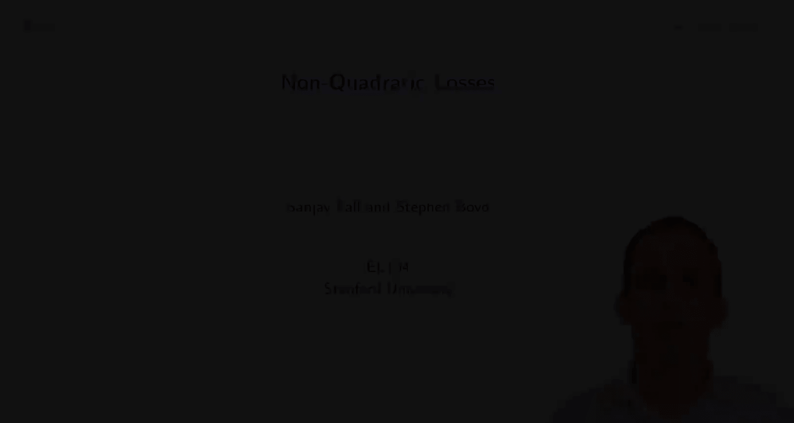

# 斯坦福大学《机器学习｜Stanford EE104 Introduction to Machine Learning  2020》deepseek翻译 p06 Lecture 8 - non quadratic losses.zh_en -BV1utzNYqEkr_p6-

Hello， welcome to the section on non quadratic lossessses。So far we've talked mainly about。

Reggression， that is the case when the target variable。です。A real number or a real vector。

We've seen several different predictors for such things， including things such as neural networks。

And simple linear predictors， as well as more complicated things such as trees。

And we've seen quadratic losses and a few other example loss functions。

And so today I want to go through a few more different non quadratic loss functions。

And talk about how。The resulting predictors behave。

When we use those as losses in empirical risk minimization。😊，So when way。

Solving the empirical risk minimization problem， the empirical risk。

 the average loss is simply one on n， the sum from I is1 up to N。 was the loss evaluated it Y hat I。

 Y I， where Y hat I that predicted。打 you。At position Xi， so Y at I is G theta of Xi。Now。

 very often the loss function。L of Y hat Y， the intention of it is it that it's measuring the discrepancy between Y hat and Y and how much is the deviation between Y hat and Y？

And so as a result， it's very common that the。ALo function looks like。

A penalty function P of y hat minus y。Here P。Can take several different forms。We've seen。

 for example， the square penalty are squared。Where。

The resulting loss function is therefore the square of y hat minus y。

Here are y hat minus y is the prediction error or the residual。嗯。If you've got a scal of y。

 then r is greater than zero means that our predictor is overestimating。

 and r is less than zero means that our predictor is underestimating。😊。

Not all loss functions have this form。 we've seen， for example。

 the percentage error which had a form which could not be expressed as the。

There's a penalty function of Y hat minus y。So if we have a penalty function。

 it tells us about how much we object to different values of prediction error。

 very often p of 0 is0 and P of R is greater than equal to 0 for every other R。嗯。

Very often psymmetric P of minus R P of R， in which case we really are only determining the penalty based on the magnitude or that is the absolute value of the prediction error。

😊，Sometimes p is asymmetric， P of minus r is not P of R。

And in which case we get a different amount of penalty depending on whether we're overestimating or underestimating。

NowLet's look at two common penalty functions。 Here is the square。

Penalty function versus the absolute value penalty function。So。When we're using the square penalty。

 that's p of r is r squared。Well， when the。Prediction error is very small。Well。

 then the penalty is really very， very small， small squared。嗯。When the prediction error is large。

 well then the penal is extremely large， large squared。If you compare this with the absolute penalty。

 we'll see that the absolute penalty。😊，Respons less for small prediction errors。

 the penalty is larger than the square penalty and for large prediction errors。

 the penalty is smaller。Then the square penalty。Now here's another one we've seen before when we were looking at quantiles。

 this is the tilted absolute penalty function。😊，Its this parameterized by tau。

 it's an absolute value， but it's tilted and so when R is negative。😊，The penalty is minus howu。

Times R。And when r is positive， it's 1 minus ta times R。And tau is somewhere between zero and one。

When time is a half the。Tilted absolute penalty function isn't tilted。

 becomes the same as1 half the absolute value of R。

 so we have the same penalty for underestimating as overestimating。😊，When tau is greater than a half。

 well then it's worse to underestimate than to overest。

 remember the residual is y hat minus y so the residual is positive means that。😊。

Why hat is greater than Y， and so when tau is greater than a half， well， then our penalty is less。

For positive Rs and Triitive R。And similarly， when tower is less than a half。

It's worse to overestimate than to underestimate。Now， the par function。

What expresses how you feel about？Large and small prediction errors about positive and negative prediction errors。

And as a result， they drive the predictor to prefer making certain types of predictions。嗯。

In other words， the choice of the penalty function is going to。😊。

Chaangnge the shape of the histogram of prediction errors。Remember how we construct a histogram。

 we look at all the residuals， and we divide them up into bins and we display this as a bar graph which shows the distribution of residuals。

😊，So here's an example， here we constructed random data， 300 data records。😊。

Each one of which has a scalar y and a 30 dimensional U and then we append a constant one so that x。

Starts with one and then has 30 random numbers afterwards。And we use a 5050 test train split here。😊。

And here the residual is y hat minus y， so the I residual is theta transpose Xi minus Yi。

And we've plotted here the histogram of the residuals for the predictor that minimizes the empirical risk。

And we've done this in two cases， the first case。😊。

Is the top case where we're using a square penalty。And so this curve here。Is our penalty function？

And we can see we've got some distribution of residuals。And if we look at that in the。Test data。

 we get it fairly similar。Distribution of residuals as we'd expect。Now we also try this with the。

A loss function。边。The tilted penalty the residual So in other words。

 the loss of y hat comma y is the tilted penalty function of y hat minus y。And what do we see？😊。

We see that。😊，On the right hand side of this plot。There's many fewer。Residuals。

 many fewer data points for which？The residual is positive。

 then there are data points for which the residual is negative。

Because the penalty is much greater for。Producing a positive residual in other words for overestimating than for underestimating。

And so our predictor。😊，The predictor that is chosen by empirical risk minimization。

Turns out to be a predictor that prefers to underestimate than to overestimate。

And that extends also to the test data， much as we might expect that。😊。

There's far fewer data points on the right hand side。Of the test data plot， test residual histogram。

Then there are on the left hand side。Now when I switch to another type。

Of error that we might want to。Shape。And that's the case of outliers and this is called robust fitting。

😊，So in some applications， you have a few data points that are just。Bong， that are just way off。

Sometimes this occurs because when the data was entered or transcribed， it was entered incorrectly。

 there's an error in the decimal point position or somebody just made a typo。

Other times they're caused by sensor failures or。😊。

Various types of anomalies that occurred when the data was collected。And these are。

Points are called outliers。And a consequence of having outliers。

 even if you've got only very few of them， is that the ERM can pick about your very poor predictor。😊。

Now there are several methods for removing outliers， here's one。😊，Create a predictor。

Just based on the entire data set。And now look through your data points and for each data point。

 compute the residual， compute the prediction error。

And those data points that have very large prediction errors。Mock them as outliers。

And remove them from the data set。And then wefi。Have you've still got poor prediction？So a large。

 empirical risk go through and do it again。This method can work well。

 it's not easy to implement because one has to decide what it means to have a large。Prediction。

 error。And it's certainly possible too。Choose that poorly and。Not be aware of there。嗯。

There's another way of removing outliers or at least handling outliers。

 and that is to use a penalty function。😊，That's less sensitive to outlier data points。

And we're going to look at that in this section。😊，These kind of penalty functions are called robust。

A robust penalty function is one that has low sensitivity to outliers。

And the idea is is that the way you make a penalty function robust is you make sure that it grows more slowly for large prediction errors。

😊，In particular， then the square penalty。And so。That means that the。Predctor。

Will not be predisposed to avoiding。Those large prediction errors。

 which presumably occur with the outliers。So they respond a bit more gracefully to the outliers。😊，So。

Instead of the error in other words， instead of the empirical risk being dominated by the loss and a few very large values of why。

😊，Because the。Loss function doesn't grow so rapidly。With。Y hat minus y？

Those aren't the values that dominate the empirical risk anymore。

And we end up with a robust predictor that fits most of the data reasonably well。

Now the most famous robust penalty function is called a Huber penalty function。

 this is named after a Swiss statistician named Peter Huber。And it looks like this。😊，嗯。Between。呃。

It is a function which is defined in two pieces。First it's defined for small r and then separately it's defined for a large r and so the transition value will be alpha and so for r with absolute value less than alpha。

 it's just the quadratic function。😊，It's just R squared。And for R greater than alpha。

It's a linear function。And the slope of that and the intercept of that linear function are chosen so that they meet up very nicely。

😊，With the quadratic。At Alpha and here， Alpha is one。And so here we've got a function which behaves。

Exactly like the quadratic。😊，When R is small， when the residual is small。

 it will penalize the residual exactly the same amount as the quadratic penalty would。😊，But when the。

The residual gets large， it penalizes much less。😊，Then。The quadratic penalty would。

And there's an explicit formula here for the Hu penalty。

 it's R squared when r is small and some linear function of R when r is large。😊，And。

Let's look at what it does。So here， what we have is we have a simple scr。ERM problem。

 We have a bunch of data points and what's plotted here is on this horizontal axis we have。

U and on this vertical axis we have V and we'll have the embedding that x is equal to1 u。

And y is equal to V？😔，So we're going to use a linear predictor here。

 so we're going to use why hat is equal to theta transpose。1， you。

And we're fitting a straight line to a bunch of data。We have。

A whole bunch of data points sitting in the middle here。And then we have out here and out here。

 some data points that are outliers。And as a result， if we use the square penalty function。

 so we solve this problem using least squares。😊，We end up with a predictor。

Which is that straight line there。Which， as we can see is doing rather poorly outfit fitting this data set。

And we can think about it as these data points are pulling the line down and these data points are pulling the line up and we're twisting our predictor。

🤢，And as a result， even though we've got many more。Data points are not outliers。Then。

Data points that are outliers what matters is the square of the distance between the predicted value and the actual data point。

😊，And so it's the square。😊，Of the distance between a data point down here and the predicted value up here。

 that distance squared。😊，Is how much that data point is going to contribute to the empirical risk？

This。Data points。Contribute those distance squared。

And so even though there are many more data points。That are true data points。

The distance of the outliers from the predictor is so large that by the time you've squared the magnitude of those corresponding residuals。

😊，Resulting terms in the empirical risk end up swamping the true。Lost terms in the empirical risk。

The hum， if we solve the same problem， but instead of minimizing。对。Empirical risk with a square loss。

 We minimize the empirical risk with a Hu loss。 We end up with a predictor。It looks like this。

It's still been influenced by the outliers， but as we can see it's influenced a lot less。😊。

And it's doing a reasonable job。At the rest of the data as a result。Now you can take this further。

 you can say， okay， well， I'd like a penalty function， which is even less sensitive。😊。

Two outliers than the Huber penalty。Here's a penalty that we might call the log Huber。Again。

Within a particular region here alpha is 1， so between minus1 and 1。

 when the residual is between minus1 and 1， we've got a quadratic function。

And when the residual is larger than that， in absolute value， we've got a logarithmic function。

And we can choose the。Terms in that logarithmic function。Such that the。啊。

It joins up nicely with the quadratic with the vote。Slope at that point。

Notice that even though it says log y squared there， of course。

 the log of y squared is just two log y。Now。And so we've got something which is quadratic for small wine and logarithmic for large wine。

 And that means that when we compare this with the。Qudratic loss at large R。

 we're really discounting。A lot， very large residuals。We have a diminishing。Penalty。

At large residuals or at large Y effectively。And so if we apply the log hubber loss function to our same data problem。

To my same data fitting problem。We have hair。A fit which really passes straight through the middle of the true data points and effectively ignores the outliers。

Yeah。We can see this in terms of the error histograms as well。😊，Here。

The top row of these plots show the results from applying the square loss function。Here。

Is our a predictor？We can see we've got a residual of training errors。

 so these are the training residuals， which are spread out between minus2 and 2。

And we see very similar things in test that we do on train as we should。NowIn this plot on the left。

 some of the data points are marked blue and some of them are marked red。

 the blue ones are the training points and the red ones are the test points。😊，Here's the Hu。

They fit the results from using the Huber loss function。And we can see that。😊。

What's happened is that the residuals have split up。

There's a whole bunch of residuals that are now very close to zero。😊，Those are the true data points。

And we can really clearly see the outliers。And the same thing we see。Over and test。

When we apply the log hub。We can see that the training residuals near zero get even smaller and get even closer to zero。

 we've only got two bars rather than four bars。😊，In the middle。And the same thing in test。

So one could。From either the Huber or the log Huer immediately identify。The residuals。

And we could simply say these data points here。😊，We're going to remove from our data set and then we're going to fit again。

😊，And of course， when we fit again， having removed those data points。

 we could use any one of these loss functions and it would be fine。

It's also important to notice here that when you look at plots like the ones on the left。

 it's tempting to think， well， why do we need a machine like this in order to be able to identify outliers？

🤢，And the answer is because here x and Y are1 dimensional。If。

Ex is in a million dimensions and y is in 100 dimensions Well then suddenly we can't make these kind of plots anymore and we can't see which data points are outliers and which ones are not。

Nonetheless， we can still plot。The residuals， or at least the norm of the residuals。

In the histograms of the norms of the residuals。And be able to identify outliers that way。

So the next topic I want to address is quantile agress。

The idea here is that we're going to do ERM or regularized ERRM。

 and we're going to use a loss function， which is generated by the tilted penalty function。😊。

And that's called quantile regression。And the intuition is that when tau is greater than a half。😊。

That's going to make it worse to underestimate。And so we're going to end up with predictions that are。

系。And when Tower is less than a half， it makes it worse to overestimate。

 so we're going to it with predictions that are lower。😊。

Now we can be explicit as to exactly how high or low these。😊，Predictions are。

And the way this works is that we're going to assume that the predictor has。The form。There 1。Plus。G。

 Theta， tilde of X。And that means that say Theta1 might correspond to a linear predictor where x1 is1。

And so the resulting prediction has a theta one term in it。

And I'm going to assume that the1 is not regularized。

The red other components of theta might be regularized。

 and G tilde theta of x may not be a linear predictor， it's an arbitrary predictor。😊，In other words。

 that the regular riser R of Theta does not depend on Theta 1。

 so we might have bridge regression where we're using the square regularizer and so R of Theta is theta2 squared plus Theta 3 squared all the way up to Theta d squared。

😊，Now， if you do this， then it turns out that on the training set。

 when you're using the regularized ERM predictor。The one minus tau quantile of residuals is zero。

In other words， the fraction of data for which we overestimate is tau。😊。

And that's why it's called quantile regression。If the predictor generalises we would expect to see the same thing in the test data that we see in the training data。

Notice that in the training data， this is exact apart from the possibility that there might be data points with repeated residual。

😊，B news。So we can create predictors for many different os。

 which give many different quantile estimates for a particular X。😊。

So let's look at why we get this phenomena。 Remember what we saw in the section on constant predictors we saw is that if we minimize。

That if we minimize。The empirical risk， one on n， the sum from I is one up to n。Of the。Tilted loss。

Of theta minus Yi。The resulting theater has the property， the theater is the town。🤢，Quantile。

Of the Y eyes。Now here where。Minimizing something different。 We're minimizing。One on n。

 the sum over I is one up to n of P tau of。G theater。Of X I minus Y I。So that's not quite the same。

But let's split it up by using the property of G Theta。

And that is that G Theta is Theta 1 plus G tilde theta。Of Xi minus Yi。

And we're going to minimize this over Theta， and that means our problem is minimize over theta L of Theta。

Now Theta has multiple components， Theta1 through Theta D。

 and we can regard this minimization as equivalent to， it is equivalent to minimum over Theta 1。

 minimum over the rest of Theta。😊，Eice飞da。And once we've done this part of the minimization here。

What's left？Is。A minimization that looks exactly like the one we had before。

 it looks like this where now。😊，We have。Cta 1。Plus。A term G Theta tilde Xi minus Yi。

 which doesn't depend on theta1。As a result， Theta1 is going to turn it to be the tau quantile。

Of Yi minus Gc toter of Xi。We can say that another way， the fraction。

Of the data points for which Yi minus g the to totaldoxii is less than equal to zero。

Its less equal to theta 1。Is around town。Subtracting31 from both sides。Gives us the residual。

 and so the fraction of I for which the residual is greater than equal to zero is around tau。😊。

The fraction of data points for which we overestimate。Is around town。Here's an example here we have。

 again some random data that we've solved ERM for where we're using。A loss function。

Which is a tilted loss function。And we can see exactly what we expect to see when tower is 0。1。😊。

90% of the data has a residual， which is less than zero。😊，When Tau is 0。9。

 10% of the data has a residual， which is less than  zero。And when Tower is a half。

 about half of the data is one side and half the data is the other side。😊。

Let's look at an example of ERM。Where。Where trying。To fit data。Here we have a bunch of data points。

 again similar one dimensional u one dimensional V， and we're going to embed by x is equal to1 u。

 so we'll have a constant term and a linear term in our predictor。We have got blue points here。

 which are training points and red points here， which are test points。

And we're going to fit a straight line production model。Using the tilted loss。

That's three different values of town。😊，And these are the resulting predictors。This is tau is 0。1。

A predictor for which。Our prediction at any given value of U。 Let me pick a value of U， say pick。3。

 The prediction is somewhere around one， which is clearly。Above， most of the data。The prediction。

The predictor。Prefers to overestimate， then to underestimate。With towers a half。

We get a predictor thats somewhere in the middle。And went Ta is 0。1。

We get a predictor that prefers to underestimate than to overestimate。Another way to view this data。

😊，Is to plot。The predicted value and the true value。For the data points on one plot。

So here we have the true value of V or of y。😊，And here we have the predicted value v hat on the verticalical axis of each of these three plots。

Now in the ideal world， V hat would be equal to V， our predictor would produce。Perfect predictions。

But of course， we know that's not。Very likely， particularly with this data set。And so。嗯。We see it。

V hat and V。I spread out。 So in the ideal world， would have V hand V would be a bunch of data points that would live on。

The diagonal， and that would be the perfect predictor。

If you've got a predictor that tends to overestimate well then。

The predictor tends to produce V hats that are greater than V。

 and that means it tends to produce points that are in。This half of the plane。

And if you've got a predictor that prefers to underestimate。

 it tends to produce V hats less than V and we end up with points in this half of the plane。😊。

And we can。Look at if this is training data， we can look at our data and count and we would find that 90% of the points are above the line here and 90% of the points are below the line over here。

And。With。Tows a half， well then we should see exactly half of the points on one side of the line and half of the points on the other side of the line。

😊，So there's another way of plotting this data and that is to look at the cumulative distribution of the residuals。

😊，So for any given。Q。We。Going to plot Q here。😔，On the horizontal axis。 and then on the vertical axis。

 we will plot the number of data points for which。The residual is less than Q。And in particular。😊。

I've got three plots here， one shows the residuals when we've computed the predictor using towers 0。

1， another when we've computed the predictor using towers 0。5。

 and a third they're showing the residuals when towers 0。9。And if we look at this plot。😊。

And we look at Q is equal to zero。😊，This， the green predictor with Tas a half shows us that exactly one half of the training data points are have residual less than zero。

😊，When tower is 0。1， we see exactly。Fraactction 。9 so exactly 90%。

Of the data points have a residual less than zero。Wind Tower is 0。9。We see exactly 10%。Of。

The data points have a residual less than zero。And so here we're seeing that the。

Quantile regression is giving us exactly the quantiles we expected it to。On the training data。

On the test data， let's have a look how well we did。😊，嗯。At Q is zero。We're getting almost exactly 0。

1。But tower is 。9。We're getting 0。45 so we're getting 45% of the data have a residual less than zero with towers a half and we're getting 85% of the data have a residual less than  zero with towerers 0。

1 So even on the trading data we're getting quantiles。😊，For the residual。

 that match pretty much what we expected to get。Let's summarize。

Bss function is often expressed as a penalty function of the residual residual is R equals y hat minus y。

😊，And the last function expresses how much we object to different values of the residual。😊。

Different choices of loss function give us different ERM predictors and in particular。

There are two types that are very important。One is robust fitting。

When you're fitting data with outliers， you use a penalty function which increases more slowly than the square penalty function。

 and that gives you robustness to the outliers。😊，If you're interested in producing。Predicctorors。

That prefer to overestimate or underestimate the。记得。Then you can do quantile eject， regression。

And in quantile regression， you fit data which gives in such a way that you get a specific fraction of other estimates。

😊，And you can choose that fraction by choosing tau。

