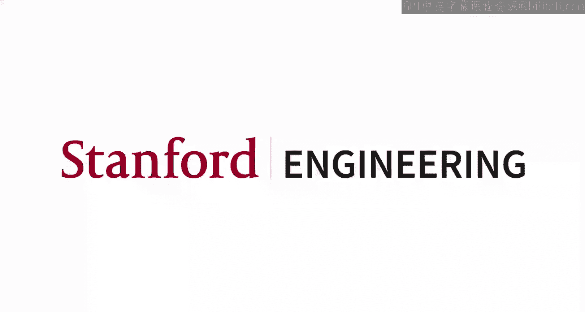
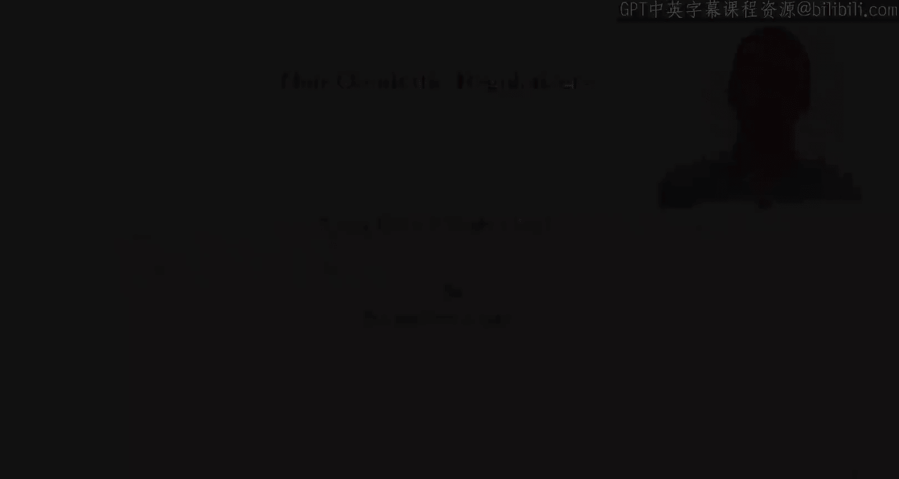

# 斯坦福大学《机器学习｜Stanford EE104 Introduction to Machine Learning  2020》deepseek翻译 p08 Lecture 10 - non quadratic regularizers.zh_en -BV1utzNYqEkr_p8-

Hello and welcome to the section on non quadratic regularizers。

So remember the idea of regularization。We want to choose a theater which both minimizes the empirical risk。

And also makes the predictor be not too sensitive。So I've got an X near an ex tilder。

Then we'd like G Theto of x to also be close to G Thedo of x tta。

And the reason for this reduction in sensitivity that we're going to put in there is that if you make the predictor too sensitive。

 then what happens is you end up with something that doesn't generalize well。😊。

And so this is a way of forcing the predictor to be insensitive to the data。

And that makes the predictor generalized better。It's a way of preventing overfitting。😊。

And so what we do in order to achieve this is we use a regularizer， a function R。

 which is a function of the parameters theta， and it's a real valued function of R。

 which measures the sensitivity of G Theta so that in particular when theta is large。

 then our function in our regularizer function is also large and so by making the regularizer small。

 we'll make theta small and thereby we' make the sensitivity of G Theta small。😊。

There's another way to think about this， and this is very common in the statistical literature from the statistical viewpoint。

 and that is that the regularis is encoding some prior information we have about  😊。

Specifically that the。Regularized RF The is actually small。😊，And so this is a way of saying， well。

 we believe that the the that generalizes now that corresponds to the true predictor underlying。

The data。The true model of the data。As a small theater。

 and so we're going to enforce that in our learning algorithm。

 we only look at theaters that are actually small。And that's a completely different way of looking at the purpose of the regularisizer but it's equally valid and in both cases you want both the empirical risk L of theta and the regularisor a of theta to be small。

😊，So regularized empirical risk minimization， we choose Theta to minimize the empirical risk out of theta plus some positive constant lambda multiplied by R of Theta。

 the regularizer。😊，And remember， Lambda here is called the regularization hyperparameter。

 which we can trade off El of Thedo against R of thedo。😊，And we choose it by validating against。

Data in a separate set called the test set。And the trick of all of this， of course。

 is that this actually works。 it works in the sense that。By enforcing regularization。

 we end up with worse performance。On the training set。

Better performance on the test set and it's test set performance that we actually care about。Now。

 when you're constructing regularizers， we've seen so far the tunnel norm used as a regularizer in midge regression and a very common format for regularizers is to have penalty function Q。

 which is a function which maps the real numbers to the real numbers。

And the regular rise of Theta is simply Q of theta 1 plus Q of theta 2 all the way up to all of our parameters。

 Theta P。And so we penalize each of the parameters。

 each of the components of theta separately and add up the corresponding penalizations。😊。

And normally we choose these penalty functions  Q sense that they're non negative。

And so that they're only zero when theta I is zero。

And Q of The2 I is therefore expressing our displeasure in choosing the predictor coefficient TheI and in particular by defining it so that it increases with the value of the2 I。

 it expresses the fact that we prefer small。😊，Theater eyes over a large The eyes。

And so we've seen the case where。We have Q of theta I iss just theta I squared。

 that's the sum of square regularizer or ridge of regression。

 it's also called the quadratic regularizer。Theyre ticking off a regularizer or the L2 regularizer。

And's the Q square。Function is just Q square as A squared。 And with that penalty function。

 then the regular rise is just the norm。Of theta squared。And in particular。

 it's the two norm of theta squared。😊，Another very common regularizer is the sum absolute function。

Where the penalty function that we're using is QABS。The absolute value。方ction。

And that way the regular function R of theta is the sum of the absolute values of the components of theta。

 that's called the one norm of the vector theta。😊，嗯。

People would call that some absolute regularization or L1 regularization or Laso。Regularization。

Another one we might see is the non negative regularizer where the penalty function is zero when a is greater than equal to zero and its infinity when a is less than zero。

😊，And that's a very hard penalty， it says that the only theater is that we will accept。

A thes for which all of the components of Thear are greater than equal to zero。So in other words。

 we're enforcing the fact that the predictor coefficients have to be non negative。And any minimizer。

 which minimizes L of Theta plus R of Theta where R has this form。

The only way you can have it minimizer as if the resulting theta is no negative。

Now let's look at this in the context of sensitivity and suppose we've got。

A linear predictor G theta of x， which is theta transpose x， and this here is。

We're predicting a scalar why？And we'll suppose that the feature of vector X changes。To x delta。

 which is x plus some delta。And Dlta here is the perturbation or change in X。

And we'll assume for now that any deta is possible， but we're going to look at the set of。

Perturbations， capital Delta， and we're only going to allow perturbations little delta that live in this capital delta set。

 we'll call it the feature perturbation set。And。We can say， well， suppose。Procedder。

Is a predictor parameter and x now changes to x plus delta， what happens to our prediction？

In that case， the。Prediction becomes theta transpose multiplied by x plus delta。

And so the change in the prediction is going to be theta transpose x delta minus theta transpose x。

 which is just going to be theta transpose delta。So if we look at the absolute value of that quantity。

😊，The absolute value of the transpose Dlta， that's the magnitude of the change in prediction。

And we can ask ourselves， well， how big can this be？😊。

When we're allowing Delta to range in some capital data。

And we can look at the worst case sensitivity， the maximum over all deltas in。😊。

Capital Dlta of the absolute value of theta transpose Dlta。This is a measure of sensitivity。エフ？

We for some specific set capital deelta。Then we can say， well。

 this quantity tells us how much the prediction can change。In the worst case。

So let's look at the case where we're looking at L2 proturbations， in other words。

 we're looking at the script， the set。😊，Capital of Delta to be the set of all perturbations。

 little Delta with two norm less than a week quarter epsilon。Epsilon is some number。

 and this is a ball， this is a sphere in deelta space。

So the set of deltas which are in capital Dlta is a sphere， capital Dlta is a sphere。

And this is called an L2 ball。And this means that the feature of x to x can change to any x tilde within。

Distance， epsilon， and in particular we're measuring distance with the tunnel。Now。

 as we've seen before， the Koosshi Schva's inequality tells us that the absolute value of theta transpose deelta is less than equal to the two norm of theta multiplied by the two norm of deelta。

😊，And the two norm of Delta we know has to be less than equal to epsilon for all deltas in our allowed set。

 and that means that the absolute value of theto transpose deelta is less than equal to epsilon times the two norm of theto。

😊，So in particular， the worst case sensitivity is therefore epsilon times the two norm of the。

And maximizing the change in the prediction and all possible deltas that we're allowed to choose。

 the one that maximizes the change in the prediction is。😊。

Epsilon divided by the two norm of theta times theta， in other words。

 we take theta and we normalize that vector and modify it by epsilon。

And so this is a justification for the sumal of Square regularization。😊，If we are concerned about。

Minimizing the worst case。Sensitivity。2。Changes in X， which。Are in a unit， L2 ball。

Then the sum of square very wise。Meius exactly that。It measures how。Badly。

 how much can the prediction change。When we know that x can only change by。An amount。Epsilon。

In distance。Now that's a way of interpreting the purpose of L2 regularization。

 it says what you're doing is you're minimizing the worst case response to particular class of perturbations。

Now， if we look at。The infinity。Perturbation class， instead。

Or then we'll get a different appropriate choice of regularizer。

So the L infinity class of proturbations， that's the allowed set of deltas。

 the allowed set of changes to x， which for which。😊，Each of the components。

Delta I has absolute value less than when we go to epsilon。😊，So people call that an L infinity ball。

 but of course really it's just。Cube。People might call it a hyperc in D dimension。

So capital delta here is a cube and we're saying that you can take an x and perturb it by a vector。

 which is in this cube and the widths of the sides of this cube are two epsilon。😊。

And the reason it's called an air infinity ball is though it has exactly the same form as the usual ball。

 it's the norm of D is less than or equal to epsilon， is the defining characteristic of this ball。😊。

But here's a norm it's a different norm， instead of being the two norm， it's the infinity norm。

And the infinity norm of a vector delta is the maximum of the absolute value of the components of delta。

😊，This is a very complicated way of defining a cube。😊，In terms of her norm。

So this means any component of the feature vector can change by Op to epsilon。

 so instead of saying we're going to think about changes to x as being changes to the vector x。

And they all live in in sphere， and if you're going to have changes in the sphere。

 it means if you change a lot in one direction， then you can't change very much in any other direction。

😊，Here we're saying you can change all of the components separately and you can change all of those components by up to Epsilon。

😊，And with that kind of model， how big can the absolute value of cta transpose delta be？😊，嗯。

Now there's a way of maximizing the change in the absolute value of theta transpose delta when Delta is required to be in a cube and the idea is is that you take the thes。

And you choose your deltas to be epsilon terms the sign。Of the theatres。So if c to I is positive。

 then you'll choose deelta I to be epsilon， and if cta I is negative。

 then you'll choose deelta I to be minus epsilon。And if you do that， then what you get is that the。

Change in the prediction， Theta transpose times delta。Well。

 that' becomes theta transpose times sine of theta。

 where sine of theta is applied element wise to the vector theta。Or multiplied by epsilon。

And that becomes epsilon times the sum of the absolute values of The。

 which is epsilon times the one norm of the。😊，In other words。If。X is allowed to change by any。

Change any component by epsilon， possibly all of the components， by up to epsilon。

The worst case change you're going to have in The transpose in。

Is epsilon times the sum of the absolute values。😊，Of the see of eyes。

And if you're concerned about those kinds of perturbations happening to X。

 then your regularizer that you should choose is the sum of the absolute regularizer。

 so R of Theta should be the one norm of Theta， which is the sum of the absolute values of Theta I。

Now， this is all well and good。 This is an analysis of。😊，What it means to。

Penalize these particular regular writers。诶诶。It's important not to take this。2。Far or too seriously。

This certainly gives us a way of interpreting the meaning。哦。Choosing these particular regulars。

 but it doesn't give us a way of choosing which one。

We should apply in a particular machine learning problem。

The way we would do that is well there' two ways， one is that we gain some experience with a wide range of machine learning problems and we see that for some types of machine learning problems the two norm regularis tends to do better and for other types of machine learning problems the。

To I normal whether wise tends to do better。And we'll have something to say along those lines in this section。

The other way is even more pragmatic and that is to say validate。You want to know which one's better。

 try both of them。Compute the performance。Compute the empirical risk on your test set。And see。

Which one did better。Oh。So we have now。啊。Two types of regularization。That were going to focus on。

One is。To norm regularization。And if we're using the square loss， remember。

 which is L of y hat y is the square of y hat minus y again when y is scalar。😊。

Then if you choose Theta to minimize L of Theta plus lambda times the two norm of theta squared。

 that's called ridge regression。The one we'll focus on is where we're using the one norm。

Of see as our aggressor。And then we're going to be minimizing empirical risk plus lambda times the one norm of theder。

 and that's called laso reion。This was invented at Stanford by Robert T Shirani in 1994 and Lasso regularization Laso。

😊，Recation。Is actually widely used in advanced machine learning。We saw for Rige regression that。

Even though it looks like an extension of least squares。

 the problem actually reduces to a least squares problem when we can apply the least squares formula。

😊，To solve explicitly for the Opimath，Laser regression doesn't have a formula。

There is no analytical expression， there is no algebraic expression for the theater that minimizes the regularized empirical risk。

😊，When the regular is the one norm。When the。Predicctor。Is linear？Then。If we're using square loss。

Both mid regression and Lasso regression can be officially computed。For Ri regression。

 there's a formula。But less our regression， we have to use numerical optimization。😊。

But these numerical optimization methods are extremely efficient and always converge to the global。

Optimmal solution， because the problem is convex。Now when we have a constant feature。

 so we have x1 is 1， the predictor coefficient theta 1 is the offset。Okay。

 when the predictor is linear， so in that case we have G theta of x。Is The 1 plus The 2 x2。And so。

X1 doesn't change even。When。X changes， we do not consider perturbations to x1 because x1 is the constant feature。

 so delta 1 is always considered to be0。As a result。

 Theta1 does not contribute to predictor sensitivity。And。As a result。

 we do not regularize the associated coefficientency to one。

And so we modify both regularizers to only include terms from cta2 through c to D where either take the two norm of c 2 through C to D or the one norm of cta 2 through c to D。

Now there's a specific property of certain regular devicess， which is very useful。

 and that's to do with sparseness。😊，So if I have a linear predictor。

 G theta of x is theta transpose x。While if theto is sparse。

 sparse here means that many of the entries of Theto are zero。😊。

So the number of non zero components of Theta is small compared to the length of Theta。

Then as a result， the prediction theta transpose X doesn't depend on some of the features X。

 in particular， it doesn't depend on those features X I， for which theta I is zero。It means that。

 well， if I've got a predictor that only uses some features rather than thinking about it as G Theta of all of x。

 I can think about it as G Theta of just those particular components of x。

Those with which theI is non zero。And this I can have practical benefits。😊，In particular。

You can make the predictor simpler to interpret。Instead of having a prediction as to somebody's illness based on a thousand different measured properties。

And diagnostic tests。We might have a prediction which is actually only depends on a few。

 and that can be much more useful， it's also much cheaper if I want to decide that I'm going to try and diagnose somebody's health using such an algorithm。

I only have to run。Four or five blood tests。Rather than 50 or 60， that are huge savings。嗯。

So the predictor is simpler to interpret， it's cheaper to actually execute and you can actually get better performance。

This happens when some of the components Xi， some of the aggressors， are actually irrelevant。

So imagine we're in a situation where we've got Y and we've got X。

And some of the components of x actually don't affect y at all。😊，You know。

 we might be trying to fit house price。And we've got various components of X， such as a lot area。

 a lot size， number of bedrooms， but we've also got components of X。

 such as the current weather in Barcelona。Which。They be totally irrelevant to the house price in Mountain View。

嗯。Even if it's irrelevant， our learning algorithm may assign。😊，That。Agressor。

 their component a nonzero seatta。Because it achieves slightly better performance on the training set with an nonzero seater。

Then it does with a zero see。And that's totally reasonable。

 and that's exactly what will typically happen。Learning algorithm can't tell the difference between。

Components of。Variables x， which are just noise and components which are actually meaningful。

Choosing non zero components makes the。Empirical risks smaller， that's what it'll do。But of course。

 it's a total nonsense from a practical perspective' got。Predicctor that we know is。

Ping the wrong thing。And so if we could somehow remove those。Irelevant aggressors。Then we might。

 if not achieve better training loss， which you won't do， but we might achieve better test loss。

And so by if we can somehow induce sparsity in our linear predictor。

If we can induce sparsity in a linear predictor， then。It may enable us to remove。

Those components of theta， which don't really matter， but just happen to be correlated the right way。

With the training data。This idea that we're going to choose the sparsey passion of The is called feature selection。

😊，And there are several different ways of carrying it out。😊，One in particular。

 his core is to use L1 regularization。And it is a。An important property of L1 regularization that it leads to sparse coefficient vectors。

In other words， if we use R of theta it's the one norm of theta。

And we minimize empirical risk plus lambda times the one norm of theta。

As a consequence of that structure， that the structure of that optimization problem。

 we will tend to produce theaters that are sparse。So one explanation for this when we're using a square penalty。

😊，Well， once you've made Theta small， Theta squared is really very small。

And so the incentive for the sum of squares regularizer to make a coefficient smaller。

Decreases once the has already become small。For the absolute penalty， that doesn't happen once。

Theta becomes small， well Theta squared may become very small but the absolute value of Theta doesn't necessarily become very small。

 it just has the same scale as Theta。😊，And so the incentive to make theta small continues until Theta is actually zero。

Of course， that's a very rough explanation。One can do a more sophisticated mathematical analysis to show that。

😊，In fact。The one norm acear。Produces sparse feeders when one uses the one norm as irregization。

We're not going to do that in this class， but we will see it in practice。So here's an example。

On the left hand side we have bridge regression and on the right hand side we have lessover regression。

😊，And so the left hand two plots are the usual regularization path plots that we make。Here we have。

Test loss。Which increases。As a function of Lada。And we have the training loss。And in this case。

 we see that the train loss also increases with Lada， we might sometimes get a small dip。😊，And。

Tes loss。We also see in the bottom plot， the usual shrinkage， we see the magnitude of。

In the size of the various components of theto at a particular value of Lada。

 and we see that those numbers get smaller as we increase theta。😊，As we increase Lada。

Now in the right hand side。😊，We have the same plots， but for。

Les O when we're using L1 regularization。And here we can see very similar。😊，Training loss。

One noticeable feature is that there's a sharp corner there and that's a characteristic feature of lasso regression。

We also see。The Te loss has a much more market。Dip。

With a significantly smaller test loss than in the。Our two regularized case。嗯。😊，Now， why is this？

And the reason is， is that。The Laso regression is eliminating the irrelevant features。

Let's look at the regularization path for Theta。What you can see。Is。That。As we increase Lada。

The components of theta tend to zero。And they tend to zero。And hit zero exactly and then stay there。

😊，And they hit Sarah exactly at a particular value of Lambda。😊，And each one of them will hit。嗯。

Lambda one after the other。And eventually we'll end up with a completely zero。

 exactly zero predictor， which will be in this case for Lambda。😊，Here。

 which is a little bit larger than one for lambda， a little bit smaller than one， we have a。

Pdor that consists of two known zero components of theta and back here we have three and once we're back to here we have maybe 20 known zero components。

Of伏edda。And this sudden hitting of zero exactly is what causes the sharp corner。😊，In the lost path。

 as well。And so。The Laso regression is selecting features for us。 It's selecting those features。

Which are relevant to the training problem， and it's removing those features， which are irrelevant。

 and it's removing them exactly。Now， because they are， the features that are removed are irrelevant。

 they're simply noise。Fitting them to the training data。May improve training loss。

But it will have the downsider that it will inherently make the test loss worse。

And that's why we see such a distinction between the Laso test loss。And the Rige Tesla。Okay。

Here are the results， so on the top we have ridge aggression with the。😊。

Square regularizer and on the bottom plot we have Lasso regularization with the absolute regularizer。

😊，On the top we can see that this is so this is a plot of the components of，Sored。

And so first of all， we take the components of the， we take the absolute value。

 and then we plot the sorted absolute values。😊，And you can see that for the tickenov regularization。

😊，That all 200 of the components of the are nonzero。And as we go down the list， they decay。😊。

But rather slowly。😊，Every one of those x's is being used in some way or another to predict why。

For Laso。And this particular optimal Lada。😊，Only the first 35。Components of Theto and nonzero。

The other 165 components are exactly zero。And so we have a predictor which doesn't use in any way。

 165 components of X。😊，Which are the irrelevant components of X。Now， after we've trained with。Les so。

 we can。Pick a particular lambda where we've only got a few。Components left， which are non zero。

 So we've done feature selection to select。The features that are most important。😊。

So here we've looked at the Lambda where we've reduced the predictor to only using seven。Features。

 and if we look back at our plot， that is。Somewhere here。

There's some cutoff lambda value at which there's only seven non zero components of Theta left。

And then what we can do is we can retrain， we can take all of our x's。😊。

Cut off all of the components of X for which the corresponding car that we have。Has a zero entry。

And as a result， our x's will produce from being 200 dimensional to being only seven dimensional in this case。

And then with a seven dimensional x， we can retrain using either tickenov regression or Lassso regression。

😊，And what do we see？We see on the left here we see Rige or ticken off and on the right here we see lesssso。

we see on the left for the plots of Thear that we're seeing the usual shrinkage as we increase Lada。

And on the right， we're seeing lessso star shrinkage where the components。

Are going down to touch zero， exactly。However， the key thing about these two plots is that if we look at the test loss。

😊，In both plots， we're getting tla， which is similar。

And that's because feature selection has happened。And。What we have now is。Only你。Those features。

Those's components of x， which are relevant to the problem we're trying to solve。

Which are relevant to why。And as a result， BlessO has no components to remove which won't affect。对。

Test loss。Yeah in a significant way。And。Conversely。

 Rige regression has no extra components to use which it can't endure。

 which it would normally use to overfit。Oh。Now， the specific property of。One norm。

Can be strengthened， so remember what these regularizers look like。If we plot them。Then。

So this will be a component of Theta and this。🤢，Will be。The absolute value。诶。

Or we can look at the component of Theta and look at the square。

Now we want to make this a sharper corner here。And then we would have a stronger sifier one way we might make it a sharper corner。

Is to replace the penalty function with a penalty function that does this。And as a result。

 we've got an even greater incentive。😊，On regularized empirical risk minimization to make the components of theta exactly zero。

Some people would call this the L12 regular vior。Its a little bit of a misnomer because the nomenclature LP。

Refers to the P norm。 And so if I use P as a half， then that says I'm using。They have one half norm。

And it turns out that that quantity， which should be defined as。The sum of I of Theta I。

 absolute value。To the one half or squared。It's not actually a norm。

 it doesn't satisfy the triangle inequality。And so。

We tend to avoid calling this yellow1 half regulator。This is a stronger specifier， it's not convicx。

 however， and as a result， algorithms to compute this may not work as well as the one norm or two normal regular rise。

😊，Here's an example。😊，On the left， we have the。Plos for。

Wdge regression in the middle we have plots for Lasso or L1 regression。

 and on the right we have an example computed with the square root regularizer。

And we can see that we're getting some very similar behavior for the square root equalizer as we do for the absolute value regularizer where we're getting exact。

😊，Srsseification and some as we increase Lada， some of the components of。Cer。Go to zero， exactly。

Now let's have one more look at one more regular writer， this is the non negative regularite。😊，嗯。

So sometimes we know or require that C to I should be greater than or equal to zero。

So when XI increases， so must our prediction。嗯。😊，that means that we'd like to impose the constraint that theta is greater than equal to zero on empirical risk minimization。

One way to do this is to have a regularisizer which。😊，It charges a cost in the objective function。

 which is infinite when C to I is negative。And is zero when feetta I is non negative。

So you might have this， for example。If your target variable is lifespan and X measures healthy behavior。

嗯。People would call this non negative least squares。If you're doing quadratic loss。

So one way of solving these kinds of problems is to solve the least square problem。First seeta。

And then say， okay， well， I've got a lease a theta， which。Minims the square loss。

 salts empirical risk minimization。And I'm going to take that theta and any components of it which are negative。

 I'm going to set to zero。😊，But we might write that as，L S。Plus。

It turns out that doesn't work very well。Because the minimization has been done without any knowledge of the constraint that the components of the have to be non negative。

And the negative components that we've set to zero might actually be very important。嗯。

It's much better to actually impose it as a regularization term on the minimization problem and solve the minimization knowing that we would like Theta to have non negative components。

😊，Here's a specific example here we have a one dimensional U。And a one dimensional V。

 we've set y equal to V。And we've constructed features from U， the features are one。

 the constant feature， U。And then u minus 0。2 plus。Remember what that is U plus？U minus 0。2 plus。

If I plot that。This will be you。And this is going to be u minus a plus。This is the point A。

And this is the function。And so the resulting predictor is going to be piecewise linear。

It's going to have kinks in it at these points 0。2， we've got 0。40。60。8。In this list here。

And so we're going to have a piece wise linear predictor。Now， if we want。See。

 if we're going to impose the constraint， the C to I B。No negative。Well。

 what does the predictor look like， the predictor looks like why hat is Theta1。Plus， theta to U。Plus。

 theta 3。U minus 0。2 plus。Plus theta 4， U minus 0。4 plus and so on。So if the thes are non negative。

 well it means that theta1 is non negative， so at zero the function。😊，Why hat has to be positive。

It means a theater。😊，Two is known negative， which means that。When u is less than 0。2。

 the function is just Theta1 plus Theta 2 U。And so that has to have a non negative slope。

So if we look at this predictor between。The values of u is 0。2 and U is 0。4。

Then we find that the slope in that region is Theta2 plus Theta 3。😊。

Because both theta2 and cta 3 are non negative， that slope is greater than or equal to the slope at between 0 and 0。

2， which is just theta 2。😊，So all of the the being non negative means that the function。マス me。

Non decreasing。And it must be convex as we increase you the slope has to increase。😊。

So here's a data set。😊，And here's the predictor。Here is the predictor。This is the optimal。

Kown negative。Least squares fit where we've used a non negative regularizer and。嗯。

And we can see that the the function indeed is convex and non decreasing。

This is the optimally squares fit。😊，Certainly piece wise linear has to be。It's convex。

 but it's not non decreasing。Now， if we use our heuristic and we say， well。

 what we're going to do is we're going to take that theta and simply adjust it so that all of the components of theta are non negative。

In particular here， we see that theater。2。Is less than zero。

 so we change this function by making theta2 equal to zero。

 Then we end up with a function that looks like this。😊，And that's。

It's an extremely poor fit to the data。We can see here that the non negative least squares loss is 0。

59。The least squares loss， of course， does better because it doesn't have the constraint that the。

Coeficency being your negative， and so it does better with03。

But the heuristic loss is 15 because the date is there。This approach。This heuristic。

Is not guaranteed to work。So the message here is that。

Simply taking the least squares predictor and truncating it。Can perform very badly， indeed。

Much better to use a non negative regular vior。Let's summarize。You want to choose a regular one。

Ultimately， the thing you have to do is use validation。😊。

If you've got a choice between two different regular minuss that you have in mind， say L1 and L2。

Try them both and see which one gives you the best Te loss。嗯。😊，And the way we do that。

 what we know is that we choose a range of Ladas， we do REERM。

 regularized empirical risk minimization to each one to compute a predictor。

 and then we take those predictors， we evaluate them on the test set。

And then we choose the Lada that gives the best test error。That tells you。

The variation of the test performance is a function of Lada。

Now we're going to do that with each of our different regular rises。

 and we' use the regular riseor that gives the best test error。😊，呃。Beyond that。

We've talked a little bit about。Some situations in which one might expect Laso to perform better。

Then。Ridge regression。 And in particular， the situation that's。

Most common is when there are irrelevant features in your data。嗯。

We've seen also that the importance of getting rid of those features can be very significant if it costs you a lot to collect data。

 then getting rid of some unwanted data can be a really useful thing to do to save you having to collect the data for future tests。

嗯。Ultimately though， it's important not to believe that one can a priori。

Determine which regular riser to use。You have to determine it based on validation。

