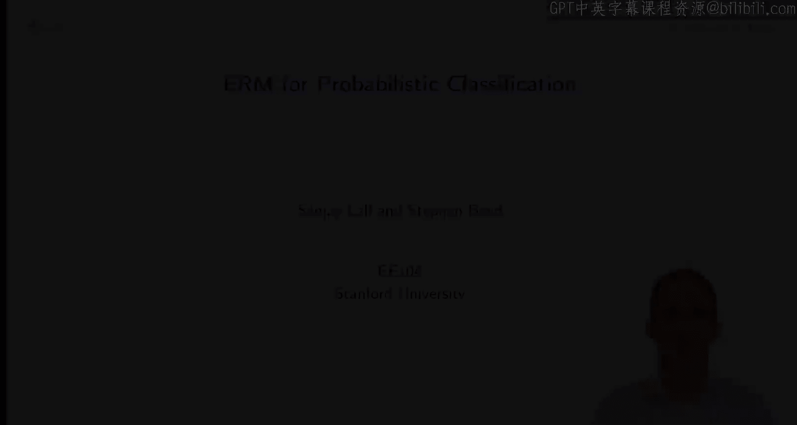

# 斯坦福大学《机器学习｜Stanford EE104 Introduction to Machine Learning  2020》deepseek翻译 p15 Lecture 17-erm for probabilistic classif..zh_en -BV1utzNYqEkr_p15-

Hello， today we're going to discuss ERM for probabilistic classification。😊。

So the key idea is that we have a probabilistic classifier G。😊，Subidter。

 which depends on a parameter The it takes as。Input you and it returns to us a probability distribution over the target set。

And we're going to choose the theater by ERM or regularized ERRM as we usually do。

And we want to judge the performance of the probabilistic classifier using the average negative log likelihood。

😊，On a test data set。And our data set， remember it consists of， it consists of n points， U1。

Through UN and V1 through VN。And we're going to produce corresponding distributions。

 P hatAT1 through P hat n。Which are our predictions。 and each of those。Data points U1 through UN。

And then we're going to compare。Our predictions， P hat I with the true value V I。

So in order to do that， we need a loss function and the loss function has to be able to compare two things。

😊，A P hat and a V。And the P hatAT is a distribution on our。Target set， script V。

And the B is actually an element of script B。And so we're comparing things that aren't really like。

One thing to notice here is that PAC is actually a probability distribution， it's a function。😊。

And so we're feeding in to this function L， another function and a V。

 which is just one of our possible targets。😊，AndSo once we've got such a thing。😊，We are going to。

Look at the average loss one on n sum from I1 to n， the loss of P hat I and B。

 and we're going to choose the theta to minimize the average loss。And if we're doing regularized DRM。

 then we'll have a regularization。诶。Function R of theta and willll minimize the average loss plus lambda times r of theta。

And the particular。A loss of interest。Is going to be this thing LC CE。

And what it is is it's the negative log likelihood of V under the distribution P had。

And so remember that we computed the negative log likelihood of our entire set of P's and V's。

Assuming that all of the these were independent。And so here we're just looking at one of those for a single data point and we're looking at the negative log likelihood of getting that particular B under a particular distribution P hat。

😊，And this is called LCCE， the CE stands for cross entropy。

 so this is also called the cross entropy loss。And it's just the negative log of the probability of the outcome。

😊，when you look at this， it's important to realize that it really is a function of two things。

 it's a function of P hat and it's a function of V。😊，And that function is， of course。

 a composition operation composed with a negative log operation。😊。

We're taking P hat and V and we're evaluating PN at the point V。😊，And of course。

 we can do that because P hatD is a function。嗯。Now， because P hat is。Less than equal go to one。Well。

 the negative log of it must be greater than equal to0。😊。

And the only way you can have the negative log equal to zero is if P hat is equal to1。

That that would mean we will be completely certain about the outcome， in other words。

 the probability of getting that particular V。would be one and the probability of getting any other V。

 therefore would be zero。So。That's when our prediction is that。

The true V is actually the V we're evaluating it。And with 100% probability。嗯。😊。

So we want the negative log likelihood to be small， so that。As as close as possible。

 we're getting P hat of V close to one。Now。This cross entropy loss。It is a loss function。

 but it's a loss function which is aimed specifically at probabilistic prediction。嗯。

And this is a little different from when we did ERM for either deterministic classification or for regression。

😊，There there， we had a loss function which was a function of why hat and why。

And it was comparing Y hat and Y the predicted value Y hat with the actual value Y。

 And those are both the same kind of quantities。 They were both vectors in our M。

And here this is a little different in two ways， first of all our prediction isn't a Y hat。

 but it's a P hat， so it's a function， it's a probability distribution。

And the second is is that the second argument of the loss function。😊，Isn't an embedded V。

 It's actually the raw target B。And。And of course， the raw target B is simply one of the。嗯。

One of the original targets set script fee。And we don't need to embed it into RM in order to be able to evaluate a loss。

 and so we don't do that。So we can certainly compute the empirical risk on the entire data set now that we've got a loss function。

We simply compute one on n， the sum from eyes one to n。Of L CE。Of。

The P hat I that's with B and P hat I is the prediction at the I。Vue of U。And VI is the true。

Value of the target variable。In the I data point。And PIDI is itself generated by the predictor。

 its G of UI。Now one nice thing about this is that this is actually our performance metric and so I remember that one of the things we did in regression and deterministic classification was that we had something we really cared about such as the name and person loss。

 but we couldn't actually minimize that and so we used a proxy loss。

 we used a loss function which was a replacement for the true quantity of interest。

 the true performance metric。😊，And here we don't need to do that。

Because the average value of the cross entropy loss is the average negative log likelihood。

Which is performance metric that we care about。The probability。

Of seeing those data points BI under PhaAT， or it is the likelihood of the joint distribution P one with PAT in。

嗯。Now remember we've seen already that when you have a constant predictor that means P hat I doesn't depend on I that you can work out what this quantity is and that is the cross entropy。

 so the average cross entropy loss is the cross entropy when P hatAT is a constant。

So when we're interpreting this， we think about it as a measure of。Implorusability。

The cross entropy loss of P hat and V。Is large when V is implausible and distribution P hat。

And it's small when V is likely under distribution P hat。😊。

And so people have names for this kind of thing， you might call it surprise or perplexity。😊，Yeah。Now。

We would like to be able to do predictors to use predictors which generate vectors。

So we've certainly seen that if we've got a tree， then we can simply label the leaves of the tree with probabilities。

 probability distributions， and that's enough we could simply evaluate the output of that predictor in the。

啊。In the loss function。嗯。A。However， if we've got， say， a linear predictor。Or。啊。啊。

Certain other types of predictors。Then the predictor produces a vector。And。Of course。

 we can't just use that vector as a probability distribution， it might not be non negative。

 it might not sum up to one。嗯。And so we need a way around that。If we were doing point classification。

 what we would do is we would unembed a vector Y hat in RK。😊。

By just picking the corresponding target to be v sub I， where I is the。

Index of the representative Psi I， which is the closest of the representatives to Y hat。嗯。😊。

And that is great， it maps the vector y hat in RK into the target set script V。

That's not quite what we want to do here。 We want to unembed and map why hat into。

A probability distribution on the target。Set script B。And there's a way of doing this。

 which is very common。😊，And that's the following on embedding。

 it's called the Lo map or the soft Do Max function。😊，嗯。

And what we do is we define P hat of VK to be the exponential of Y hat K divided by the sum of the exponentials of Y hat J。

And this is a map which for each K gives us P hat of VK。

 it maps a vector Y hat and RK to a probability distribution。

And you can see that if you sum from K is1 up to capital of K of PHc VK， you get one。

And you can see that because it's the ratio of an exponential and the sum of exponentials。

 it's a non negative number。😊，So it certainly satisfies the two fundamental requirements for。

And probability distribution。And this map sigma。😊，It has lots of names。

 I guess the community cannot agree as to what the right thing to think of it。

 right way to name it is。😊，People call it the logistic map， people call it an activation function。

 and they use it as an activation function in a neural network。😊。

People call the inverse link function。The soft dark max function。

 the normalized exponential or the soft max function。😊，嗯。

Let's take a look at it slightly more closely。嗯。So。What does it do Well。

 the exponential is mapping the real line to the non negative half of the real line。

And so what the exponentials are doing is replacing all of the entries。

 all of the components of Y hat with。No negative numbers。And then， the。Division。

 all that's doing is normalizing it， it's arranging for the components of P hatAT to sum up to one。

So we can see that we are getting a probability distribution。You can also see that， for example。

 if you take Y hat， you're predicted。An output of your predictor。And add a constant to each entry。

 but then that doesn't effect。P。嗯。You can also see that if you increase one of the components， say K。

 you increase Y hat K。Then that will increase the probability Pt VK and decrease all the others because the others have to be chosen to sum up to one。

And so it is larger Y hacks correspond to larger probabilities。嗯。

But it can never equal either0 or one。嗯。P hatt VK is close to zero when Y hat K is much smaller than all the others。

And PHAC BK is close to one when YHCC K is much larger than all the other components of YhaAC。

There's one more special case， which is when Y hat is zero and when Y hat is zero。

 well then you end up with P hat of VK is the uniform distribution 1 over k。😊。

And the fact of why hat is。A vectorctor with all of its entries equal。

 then you'll also end up with the uniform distribution。

So now we can do ERM with logistic and embedding。嗯。

Let's just compare with what we would have done in the。

Deterministic case in deterministic classification。😊，We take our U's and our Vs。

 we embed them as x's and Y's， and then we use ERM to minimize。The loss evaluated at G of X。

 I and Yi。The average losts over all of the eyes。And then we get the resulting predictor by composing it with the embedding and the un embedding。

 so if you give me a particular you， this should say。😊，You， so this should say be hat。Is Si dagger。G。

C的。Bye of you。Then I compose， I take you， I apply the embedding to it five of you。

 I apply the predictor G Theta to that， and then I unembed the resulting output of G Theta to give me a V hatt。

And same here， this quantity here should be a U。嗯。For probabilistic classification， we don't embed B。

We embed。You using Phi。And and then what we do is we minimize the average loss。

 the average cross entropy loss， and here the two entries in the cross entropy loss。

 one of them is simply V， the true V and the other one is the unemedded。😊，valuealue。

Of the output of the predictor。 So G Theta of Xi is going to produce a Y hat。

And sigma of G Theta of Xi is going to produce a P hat。😊，And so the resulting predictor is given by。

啊。Sigma composed with GC composed with phi of U。So the role of the unembedding here is a little different。

 like the un embedding lives inside the loss function。😊，In probabilistic classification。

And its role is to take those vectors that come out of our linear predictor G Theta。

And turn them into probability distributions。Let's take a closer look at R。Loss function。

Let's suppose that we're un embedding using the logistic map， the logistic un embedding。

So we've got a predictor that produces a Y hat and we pump it through the function sigma to get a probability distribution P hat。

Now let's look at the cross entropy loss and say。We've got such a P hat and let's evaluate what the cross entropy loss at P hatt VK is。

 so we've got a particular V， say VK that we're evaluating at。So what is that， well。

 the cross entrytropy loss just says evaluate the probability distribution P hat at the point BK。

So it's just the case entry of that probability distribution。 That's just the negative log of。呃。

The exponential of Y hat K divided by the sum of the exponentials of all the entries。

And that's the cross entropy loss。We could simplify that slightly。😊。

It's going to be minus y hat k plus the log of the sum in the denominator。

And this is an expression that we've seen before。😊，嗯。

This is simply the logistic loss when cap I is one。😊，And so the。Logistic loss， which we used for。

Theterministic classification。It's exactly the same as the cross entropy loss。

When you use the logistic， un embedding。And so if we're computing one。

 we're computing the other and we're doing exactly the same thing。

And so when we look at the empirical risk that we are using for。

Logistic regression in the deterministic case， that's exactly the average negative log likelihood。😊。

And we can simply use the Y hats that come out of logistic regression， those predictions are vectors。

 but instead of unembedding them using the nearest neighbor map。

 we unembed them using the logistic un embedding。P hat is sigma Y hat and that way。

 instead of getting a deterministic。😊，Classifier， we get a probabilistic classifier。So that's nice。

 it says that。In some sense， what we've been doing when we were doing logistic regression。

Is actually computing a probabilistic classifier all along。

And now we know how to compute the probabilities。嗯。And we can interpret this。Look at what P hat is。

 it's well it's sigma y hat and let's use this in vector notation。

 x of y hat here means the element y is exponential of the vector y hat。

And one transpose is doing the sum for us， one transpose experto Y hat is summing over all of the exponentials。

And why how here is theta transpose x when we're doing logistic regression and we're using a linear predictor。

😊，The next one is one is the constant feature and we're standardizing all the other features。

And that means that the first row of theta， Theta 1 transpose。Is why hat when？X22 d is0。

So all of the non constant features are taking their mean value。

And the corresponding distribution is sigma of Theta 1。Now。とこ。Then C J gives the effect of X on。

P hat J。 And so that tells us in particular that if we。Have a very large component of theta Ij。

 Then Xi is going to be a significant effect on the probability distribution。P眼圈。

Now we can also do exactly the same for Boolean classification。

 we can do Boolean probabilistic classification， and we could just use the methods we've seen so far。

😊，But there's one special wrinkle that people like to do for bud and classification。

 and that is take advantage of the fact that when you've got a probability distribution over two，😊。

Quantities， you only actually need to specify that by one number rather than by two numbers。

Because the other one has to be one minus it。So if V is the target set is V1， V2。

And we're going to guess P hatt is G ofU。嗯。Instead of just giving P a V1 and P hatD of V2。

 we can just give one of them since we must sum up to one。And so we might give P hat of V2。

 which is the probability that B is v2 and just define p hat of v1 is 1 minus p hat of V2。Now。

 if we're only going to need one number。One probability then we only need one component of Y hat。

 so if we're using a predictor which is generating a vector in RK。

 but we're reducing ourselves to instead of needing two probabilities needing one probability。

 we can just pick K is equal to1 or m is equal to1。

And then we've got a scalar produced by our predictor， a Y hat， and we want to generate。😊。

A probability out of that scaler。So that y hat could be any real number。 What do we do。

 We take one on one plus E to the minus Y hat。This is also called the sigmoid function。

And people donote this by also sigma。😊，And it's giving us a number which is between zero and1。😊。

It's a。Zero as Y hat gets large and negative。And it becomes one。

 that's why hat becomes large and positive。嗯。And so we're saying， okay， well now we take Y hat。

 we take sigma of Y hat that gives us a number between0 and1。

 which we will use as our proable prediction probability。For target value V1。

And to get the prediction probability for target value V2， we'll just take one minus sigma of Y hat。

And so we've mapped a real number to a distribution on V， which is exactly what we needed to do。😊。

And so this is called the syigmoid function， the inverse map。

 which allows you to map from the probabilities back to the Y hat。

 we don't need to do that for classification， but that it has a name， it's called the logOs。

 log odds or the Loit function。😊，And here's a plot of the sigmoid you can see it goes between。

zero at minus infinity and to one at plus infinity and it's half when y is zero you can also see the symmetry。

 that symmetry is that if I take it and rotate it about this center point right here。

Then I get the same function and that's expressed neatly here that sigma of minus y hat is one minus sigma of y hat。

😊，So let's compute exactly as we did in the multiclass case。

 let's compute what happens if you use the Sigoid down embedding。😊。

And you evaluate the cross entropy loss。So we've got the cross entropy loss is the negative log of the probability。

At V I。And。Well， we know what sigma of Y hat I is。If。啊。And。

We need to it's either it's going to give us two numbers as our distribution。

 you'll give us sigma y hat I for the probability that V is v1 and it'll give us one minus sigma y hat I for the probability that V is V2 and so when we're computing the cross entropy loss。

 we need to evaluate this probability。😊，At B eye。And so if VI is V1， well。

 then we get the first case minus log sigma， y head I， if VI is V2， then we get the second case。

And now we go through into the algebra and we see， well。

 log of sigma is sorry negative log of sigma is log of1 plus e to the minus y hat。😊，And。

This is also something that we've seen before， this is the Boolean logistic loss。

And so when we were doing Boolean classification in the deterministic case， we were also。

Behind the scenes， doing probabilistic classification。

And the way one gets the probabilities is by taking the Y hat that comes out of the predictor and feeding it into the sigmoid function。

😊，And this is the corresponding empirical risk minimization problem。

1 on n times the average of sorry the loss， the empirical risk is the average of the cross entropy loss。

 and the cross entropy loss splits into two cases， the cases where VI is V1 and the cases where VI is V2。

And we choose theta to minimize the empirical risk as before， and once we've got theta。

 Theta transpose x is y hat， and then sigma Theta transpose x is the probability that v is v1 at x and1 minus sigma theta transpose x is the probability that V is v2 at x。

😊，Yeah， and this is simply expressing the same thing in a more convenient notation where we've used the vector notation here。

Let's look at a couple of examples here we have。A two class problem。

 three different two class problems， we've done empirical risk minimization。

 and here we've plotted the data points， the red and the blue data points。

 there's no test or train set here。 we're just using one data set。

And there's no regularization and we've plotted here in color in the shading， the corresponding。😊。

Probability distribution。Sigma of theta transversese x。

And you can see that it does what we expect it to do in the middle here along this line。

There's uncertainty and the probability is half。As we move this way。

 the probability of red becomes one， as we move this way。

 the probability of red becomes zero or equivalent the probability of blue becomes one。嗯。

You can also see that here in this example in the middle。

 we've got data points where the blue and the red overlap considerably。😊，And as a result。

 the distribution。goeses quite smoothly and slowly between being quite certain over here that it's red and being quite certain over here that it's blue and then probabilities that are somewhere between zero and1 in this middle region。

🤢，And there's this wide band of uncertainty where the predictor cannot make a very definite prediction as to whether。

😊，Target variable is going to be red or blue。Here's a case where it's much more separated and there's a narrow band of uncertainty and then very definite blue。

 very definite predictions of red。And this is the advantage of using a probabilistic predictor over a deterministic predictor is that the probabilistic predictor when it's giving you a prediction of probability。

 which is close to a half，Well， then you can say， well。

 we're in some region where we can't make very certain predictions and we're on the boundary and the reality is it could be either a blue or a red point。

You can also see this in the matrix in the vector Theta。

So here the norm of theto is rather small and here the norm of theta is much larger when the norm of thedo is large。

 well then theto transpose x varies rapidly with x。

 and so sigma of theto transpose x varies rapidly with x and the probability changes quickly as we move in this direction。

😊，Over here， because an notheta has a small norm， then the probability changes slowly as we move in the corresponding direction。

😊，Here's a three class case， this is the IIS data set and remember what we had where in this IIS data set when we look at these particular two components of the data。

 we find that the red points are well separated from the green and the blues。😊。

But the green then blues overlap considerably and it's hard to tell a green from a blue。😊。

So on the left hand plot we're seeing multiclass logistic regression。

 we're unembedding using the nearest neighbor unembedding and this is deterministic classification。😊。

And in the right hand plot， we're unembedding using the logistic map。😊，sigma of theta transpose x。

 and we're getting out of that a three dimensional probability vector。

Which gives us the probability of red， the probability of green and the probability of blue。

And what's showing up here is this is。The level of certainty of the prediction。Over here。

Red is really very certain。Then when we transition。Across this line。

We end up in a region where there's significant uncertainty。 So over here， our prediction is10 zero。

😊，Or close to that。And over here。😊，A prediction is zero， a half， a half。

And there's much more uncertainty， we know it's not red。

 but we can't quite tell whether it's green or whether it's blue。😊，So let's summarize。

 we use the average log likelihood。On the test data to judge a probabilistic classifier。

 this is our performance metric。And it happens to equal the empirical risk when we're using the cross entropy loss。

And there's a loss， so there's a loss function which exactly equals to our preferred performance metric。

那么。And once if we're using a linear predictor， then we can unembed。

The prediction into a distribution using the logistic on embedding。

 and that gives us probability distributions。And the deterministic methods that we've seen for classification using either Boolean logistic loss or multiclass logistic loss。

😊，With the one hot embedding are exactly。The same ERM optimization that we do when we do。

Probabilistic classification。But to construct the probabilities。

 instead of unembedding using the nearest neighbor map to get the deterministic prediction。

 we unembed using Sigma to get the probabilistic。😊。

