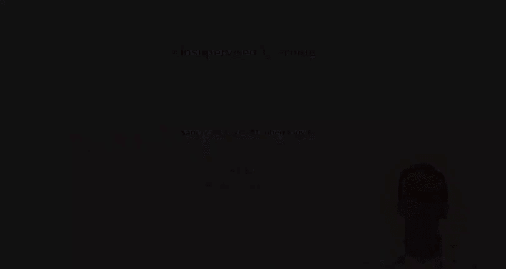
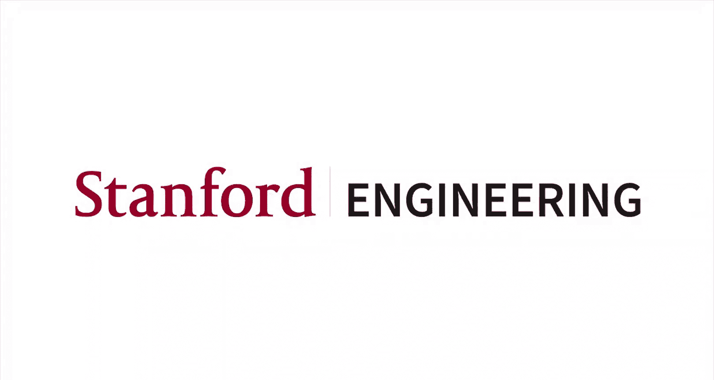

# 斯坦福大学《机器学习｜Stanford EE104 Introduction to Machine Learning  2020》deepseek翻译 p16 Lecture 18 - unsupervised learning.zh_en -BV1utzNYqEkr_p16-

Hello and welcome to the section on Unsupervised Learning。😊，So this is really。😊，Sudden。Shift。

In topic we're moving on to a new section within the class so far everything we've talked about in the class has been supervised learning and now we're going to start talking about unsupervised learning。

😊，And the idea in supervised learning is that we have pairs of records U and B。😊。

And we want to learn。A model which predicts V given you。

And it's called supervised learning because the the Vs are。😊。

Giving us information about what the right answer is in particular cases， corresponding to the UIs。😊。

And this is supervising is the idea， the learning of the model。In unsupervised learning。

 it's different， we only have records you。And our goal is to build a model of the use。

And so we'd like to be able to do things such as reveal the structure of the set of possible views。嗯。

We'd like to be able to deal with missing entries in the use and figure out what they are。

 that's called imputation。We'd like to be able to detect anomalies。

 unusual cases which we've not seen before。And the idea of reveal revealing structure or detecting nominees are both kind of vague at this point and we'll make them a little bit more precise。

And imputing misries well。We will see exactly how to do that。So just as before we。

Work with embedded data， we take our data U， and we embed it into a feature vector X。

X is phi of U and x is some vector that lives in RD。

And then we build our data model for the vectors X。And when we need to。

 we aren embed to go back to the v vector U。So from now on in this section， we're going to work。

With feature vectors x， so we have embedded data set x1 through xn， each of these is a vector in RD。

Now， the way we construct a model。For this data set is via a loss function。

We'd like to have something which characterizes the elements of the data。

 which tells us what elements of the data look like or should look like。And。

I'm going to do this with a loss function， which we could also call in this case。

 an implausibility function。It's a function on RD， which is our space of possible Xs， real valued。

And it tells us how implausible x is as a data point， so if L of x is small。

 then mix looks like our data it's typical， and if L of x is large。

 then x does not look like the data。😊，Now the model might be probabilistic， so X might。

Correspond to a probability distribution or a probability density。P of x。

 and then we would take L of x as to be the negative log of P of x， which is the negative log。

Probability density， we might think of that as a negative log likelihood of X。😊。

Other names for LX we might talk about surprise or perplexity。😊。

An L is often parameterized by a vector theta。It might be a matrix data。And so we'll put a subscript。

Theta O L L sub theta of x。Let's look at the simplest example。

 suppose our data model is x is near a fixed vector Theta。😊，So。

The model here is parameterized by the vector Cder。

And we're going to try and learn that from the data。

you might have implausibility functions associated with this， for example。

 you might have the square loss。Which would be the sum of the squares of the two norm of x minus theta。

🤢，在。That's correct。Or the one norm of x minus theta。

 which is the sum of the absolute values of Xi minus theta I。

A different data model is the K means data model here。

 the idea is is that rather than just having one ideal01 representative， we have k of them。

 the to 1 so C to K， all vectors in RD。And we believe that our data。

Is close to one of these representatives。嗯。Now we measure how implausible。Data point X is by saying。

 what's the distance between x and the closest representative？

Which is just the minimum from I1 to k of the norm of x minus theta I。Squared。

 if it's the distance squared that we're using as our distance measure， we might equally well user。😊。

A one norm or a different norm， normally for K means， K means specifically means。Squared。Distance。

 the squared tunenal。Then the。😊，Model is parameterized by these K D dimensional vectors。

 which we could equally well view as a D by K matrix， which are called Theta。

Whose columns are theta1 who theta K？Now it's worth looking at what the role of the loss function is in supervised versus unsupervised learning。

In supervised learning， the loss function is used to choose a particular predictor from a family of predictors parameterized by the。

And。Once we've chosen the predictor， we no longer really care about the loss function。

The predictor itself is our model of how x and Y are related。In unsupervised learning。

 the loss function plays a slightly different role because it characterizes what the data looks like。

But the loss function actually is the data model， getting the loss function。

 that's the primary goal of unsupervised learning。So using this loss function enables us to build。

 for example， an anomaly detector。that's a particular way of using a data model in order to identify anomalies。

 suspicious feature vectors， feature vectors that aren't consistent with the other feature vectors that we've seen。

😊，For example， the common application is say network traffic monitoring。

We might have feature vectors that includes statistics of the size and distribution of packets。😊。

What we do is we fit our data model， we have a loss function L parameterized by CEA。

 we fit that by choosing the CA。And then we will say that if we look at all of our data。

 x1 through Xn。We can look at the corresponding distribution of the loss function。And we can say。

Let's find the percentile value， say the 99th percentile value of that loss function so that 99% of the values that we've observed of L of x are less than or equal to t。

😊，And then when we're getting new。Data coming in as we're watching the network。If we。

Every time we get an X， we evaluate the loss function on it。

We are flaggged as anomalous if the loss function is greater than our special T。

 it's greater than that 99 percent percentile value。😊，嗯。And this is anomaly detector。

We can also use data model to impute missing entries。

So we'll suppose that X has some entries missing， we might label them with question mark or NA or NAN for not available or for not a number。

😊，Within the data。And。We'd like to。Fling。Those is missing data entries。So。For any given vector X。

We've got a subset of the numbers1 through D， which is the set of known entries。

We will call that set script K for that data element X。And。We're going to replace。X with X hat。

And X hat is going to be such that well， its value on the known entries on if I is one of the known entries。

 then we'll have X hat I equal to X I。Now if I is not one of the known entries， well。

 then we're going to have to fill it in and we're going to have Xat hat eyes。😊。

A question mark that we're going to have to replace。So on the slide here， we have an example where。啊。

X here has a dimension 4。And K is one three， which means we know。The first and the third。Entri。Of x。

And our job is going to be to fill in these unknown entries。Here we filled them in。With minus 1。

5 and 3。4 and this quantity on the right is x hat。And the first and the third entry of x hat are forced to be equal to the first and the third entries of x because we know the first and the third entries。

But our job is different fill in the others。And of course。

 k is might be different for each of our different。Data。Records so for each eye。

 we might have a different K。So an example of this is for， say Ore recommendation system。😊，啊。

Features here are different movies， and。嗯。The examples are customer ratings。

 so we will have D different movies and in different customers and each customer has filled in ratings for some of the movies。

So if D could be very large， if we look at the Netflix catalog and there may be many thousands of different possible movies。

And so x says a vector in R of 10，000。😊，But for each particular customer。

 it may have only watched a few of the movies and so most of the entries will be question locks。

 and then some of the entries will be rateed， maybe they'll be rated on a Lyrt scale from one to five。

嗯。And then our job is to impute。The entries， the missing entries。

And that tells us what rating the customer would give if they rated that particular movie。😊。

And then we're going to use this information to actually make a recommendation。

 We will look for each customer at。😊，The imputed values and find。诶。Those imputed values。

 which are large， so movies that they would have rated large。If only they'd waited it。

And we'll send a recommendation to them saying， you might like this movie。And this is exactly。😊。

What is called the Netflix challenge where。A few years ago now。

 there was a prize offered by Netflix for people to build a recommendation system。

Which could impute ratings in this way。Another application would be to fill in missing features for supervised learning。

😊，So you're trying to do supervised learning， you're trying to do classificational regression。

And your xs have some missing features。And so far， what we've done is removed records that have feet missing features all of the methods we've seen so far have required us to have every。

Data record I。I have an XI which is complete， it can't have any question marks or NAs in there。

And sometimes you do lose a substantial fraction of the data。So， for example。

Some of the data sets we looked at earlier， for example， we looked at an Australian weather data set。

We've lost a substantial fraction of the data by eliminating。Those。

Those records which were just missing one element。And so an alternative approach would be to use imputation to fill in the missing feature entries。

😊，And then use the filled in data set to do supervised learning。

Another thing you can use Iutation force to detect enormous entries。

So here we're not trying to detect anomalous records， but anomalous entries。

 so particular components。Of a particular X。So what we do well for each eye， we pretend。ね。The X is。

The I component X is question mark is unknown。And we impute。To find X hat of I。

We imputee based on all the other entries of X。Then if XI and X hat I are very different。

 well then we'll flag Xi as anomalous。In the case of our movies， example。

 we've identified movies which we would expect based on all the other movies that the person has rated。

😊，That they would not have liked， but actually they gave it a high rating。Or vice professor。

Now the distinction between supervised learning and unsupervised learning is not so great。

 in particular one can view supervised learning as a special case of imputation。😊。

At least one can formulate supervised learning。😊，And is a special case of imputation。

So suppose we want to predict y based on x。Well we have this training data x1 to xN y12 yn。

 we'll construct a new set of records consisting of D plus M dimensional vectors， x tilde。

Each x tilde is simply x stacked up on top of y。嗯。Now we build a data model for XTder using this training data。

And then we impute the last m entries of X tilde。And it so happens that every record is missing。😊。

The last in entries。Of external。Now， in order to use a data model to perform imputation。

 we look at our vector。X， I。And we say， well， we don't know。What some of the entries are。

 but we know what the other entries are。 So the entries that we don't know。

 we're going to choose by picking them such that the。Loss function L is minimum。

So specifically we say， well， I've got a loss function， it's a function of an x。

I'm going to fix the components that I know， and I'm going to allow myself to vary the components that I don't know。

😊，And we minimize the implausibility， which is just the loss function。

So this is a very natural thing to do and it turns out that it works very well。So here's an example。

 so here we have a constant data model。And so we have a bunch of data points here shown in。Withd。

And we have our Theta， which is the。Perarameter that specifies the model。 Our model says that。

We expect all of the data to be close to Theta In other words we have a loss function which is the norm of x minus theta squared。

First thing we do is we pick the theater given the data。

 and that gives us that the theater is the mean of those data points。😊。

The second thing we do is you say， well， we've got a theater。😊。

And now we're going to find solve an imputation problem。And in our imputation problem。We are given。

An X with a missing entry。So we know X， it has。啊。Two components。 The first one is unknown。

 and the second one is 2。8。 and that means that。The true X is somewhere along this line。

Somewhere along the line of vectors x， which have second component equal to 2。8。

We get to pick x1 and the way we're going to do that is by minimizing the loss function over。😊，X1。

 subject to the constraint that x2 is 2。8。And though that gives us。

This point might hear we get to move along this line。

Alongong that line to get as close as possible as we can to The， The being right there。

And that turns out to be x hat1 is 0。79。If we have a K means data model， well。

 here we have an X with some unknown entries。😊，Now the loss function is the minimum。

Over I of the norm of x minus theta I squared。 so in other words。

 you look over all of your k different theta vectors， K different archetypes。

 pick the one that's closest to x and look at the distance between x and that closest archetype squared。

And that gives you the loss。Now we've got an X that has some missing entries and so when we do this。

 well some of the entries are fixed， we can't do anything about those。😊，And the other entries。

 we get to minimize the loss function with the spec to。So the first thing we do is we say， well。

 let's find the nearest representative theta J to x， but we can only use the known entries。

 and that means that instead of looking at the two norm。

 we have to look at the sum over of the known entries。

 the I's in k and look at that sum of X i minus the I component of theta J squared。😊，That is the。

Loss function here。Evaluated， let's include the minimum。😊。

Evaluated where we've allowed the components that we don't know to be free。😊。

When we allow the components that we don't know to be free。

 will they gravitate to be such that x sub i is equal to the I component of theta J because that minimizes that loss。

😊，And so we end up with a loss that has only these terms left in it。好。

So just to be explicit about that， the minimum。😊，Over I。Of the norm of x minus。The the eye。

Nm squared， that's R L of x。And what we're trying to do is we're trying to minimize L of x subject to the constraint that x。

X hat， X hat I is equal to X I for I in the known set。And if I take the minimum。off。This L of X。

 I end up with minimizing。Over。X hat， the minimum over I of the norm of x hat minus theta。

I guess I've used I twice， let's use J for one of them。So we replace that one with a J。

X minimum over J。Yeah。Minus theta J norm squared。And this minimum on the outside is a minimum with respect to the unknown components。

Minimize with respect。To unknown。Components。Of X hat。

And if we minimize with respect to the unknown components of x hat， this quantity。Well。

 one thing I can do is swap the order of the minimizations。😊，And that becomes the minimum over J。

 the minimum over the unknowns。Of the norm of x hat minus theta J。And this。Well。

 if I'm allowed to choose the unknown components of X hat to minimize that quantity。

 what am I going to do， I'm going to make the unknown components equal to the corresponding components of theta J。

😊，And that leaves me with。This part of the cost function here， equal to just this。

So that that tells us how to pick the。啊。The representative corresponding to a particular X tells us how to pick J。

And then what we want to do is we want to pick the。Unknown components。

 well we already know what they are， have to be equal。

 such they have to be such that X hat I is equal to the I component to of C to J。😊，So。

For the unknown entries， what we do is we guess the entries of the closest representative。

So we have a data model and just like in。Supervised learning， we need to be able to validate。

That our data model is actually good。And our imputation method is actually good。

And we do this in the following way， we split the data into a training set and a test set。

 we use the training set to build the data model。And then。

What we do is we look at the test set and we mask out some of the entries in the test set。

 we pretend they're unknown。😊，And we impute those entries。

And then look at the average error of the imputed values。So the RMSE， for example。

And that validates that our imputation method is working correctly。😊。

And we would typically pick the training and the test split randomly or by kfold validation。

 that would be fine。And then we would in order to do the masking。

 we would typically mask randomly mask random entries within the test set。😊。

So how do we fit a data model？We have x1 to Xn。And。Let's suppose we have no missing entries。

And we have a parameterized imploruszaability function L theta of x。

How do we choose the parameter theta？Well。We minimize the empirical risk。The average implausability。

That's 1 on n in terms of sum from I 1 to n of L theta of Xi。We choose The to minimize this。

And we may have some constraints on theaterta， sometimes the allowed theaters are limited in some way。

And then we choose the parameter theta so that the observed data is the least。Impoussible。

Let's look at the simplest case， the sum of squares loss。

So the loss function is l theta of x is the norm of x minus theta squared。

The empirical loss is the average of that quantity。

And we've seen this before when we were looking at the constant predictor problem with the square loss。

やてよ。Best choice of Theta， the minimizing choice of theto is the mean of the data vectors。

If we have the。Absolute loss。 some absolute loss。 Well， again， this is a。

Exactly like the constant predictor case here in the unsupervised case。

 we will have a loss function which is the norm of x minus theta the one norm because the sum of the absolute values of the components of x minus theta。

😊，And we look at the empirical loss and the optimal The is the median。😊。

Of the data vectors x1 through xn， and what this means is the element wise median of the data vectors。

Then the K means model。It goes like this， the implausibility function or the loss function is the。

The norm squared of the distance between x and the closest archetype theta J。

And so our parameter is a D by K matrix equivalently it's simply K D dimensional vectors。

 Theta1 through cta K。And the empirical loss is， therefore the。啊。

Average of that over all of the data points， so that's one on n， the sum from i is one to n。

 and then for each eye we have to find the closest。😊。

Aretype theta J and look at the distance between Xi and theta J and of course。

 which closest archetype that is depends on which data point you have。And this is the。

Called the K means objective function。And we use an algorithm called a K means algorithm to minimize this。

So this is one of the cases where we have a specific problem。

 which is the K means optimization problem we discussed and the algorithm has the same name。

 which is a little confusing because one could use different algorithms to solve the same problem。😊。

So but the most commonly used algorithm is called the K means algorithm。😊。

And the way it works is that。For any given choice of these。K vectors theta 1 with theta K。Well。

 Ive got these K vectors and then I've got a bunch of data points and each data point。

 its contribution to the loss is the distance to its closest。😊，Aretype。And so we can say。

 let's assign。😊，To each data point， a corresponding archetype。The archetype。

 which is the closest to that data point。And we're going to label that assignment with a vector C in RN。

And the idea is is that C is。A number between1 and K。

 which tells us which of the theaters has been assigned to that data point。

 in other words which of the theaters is the closest to that data point。And then。This loss function。

 which is the empirical risk。Is one on n， the sum from I is1 to n。Of。

The distance squared between Xi and its closest archetype。Well。

 that's explicitly one on n in terms the sum from eyes1 to N of。This quantity。

X I minus theta C because C is the assignment。Now what we want to do is we want to choose both C and the thetas。

So we have to choose the assignment and choose the corresponding theaters。

Once we've chosen the theaters， the assignment's easy。The assignment is that we assign。

To eat to the I data point， the closest dootype。So we find over J， the minimum of X minus theta J。

 the norm of X minus theta J squared。And that's what C is is is which of the Js minimizes that quantity。

😊，How do we minimize the thetus we can。Minimize。This quantity。Once we fixed the sea ice。

So first of all， we'll do the assignment， we'll find the best CIs。And then。

Minimizing the ceds is straightforward over the cedars is straightforward because each。Of these。

This quantity here splits up into K different terms， one for those data points。Assigned to Theta 1。

 another for the data points assigned to The 2 and so on。 and so it becomes。Well。

 it becomes this it becomes。1 on n times the sum over all I such that C is one of the norm of X minus theta 1 squared。

Plus1 on n times the sum over all I， such the C is2 of the norm of X I minus theta 2。

Squared and so on， Doctor K。And each one of those， we would like to minimize that sum over theta 1 through cta K。

 and so to find the minimum over theta1， we mini this over theta 1 and minimizing that over theta1 simply tells us to set theta 1 to be the mean of the corresponding Xs。

😊，To minimize this。Over Theta 2， we set Theta 2 to be the mean of the corresponding Xs。

 in other words all of the X's which have been assigned。😊，2。Category 2 and so on。Once we do that。

 well then we've got new Cedar I and that means that the assignment might change。And so we reassign。

We go。 we， we。Go through and once again pick the seas。That sign each。X I to the closest Theta J。

 That's a new assignment。And that means that the theaters are going to change and so we go through and we update all the theaters to be the corresponding means of their assigned data points。

And we alternate between these two steps assign。Data points to archetypes。Then。

Adjust the archetypes to be the mean of their assigned data points。

Then assign data points to Dotypes and cell on。And this is a heuristic for approximately minimizing。

😊，This empirical risk。Here's an example。So， we start out with。Some。Guees for Car。

 and we might initialize those completely randomly。 That would be very common。

 So here there are three guesses。This is。系。Cta 1， Theta 2， and Theta 3。嗯。And now。Given those。

Gues for the theaters， we can make assignments。All of the points which are closest to The one than any of the other theaters are being colored in red。

The points that are closest to The2 of colored blue and the points that are closest to The 3 are colored green remember we don't have any colors associated with our data。

 our data is just points， but once we've picked theaters we can label，😊，The data points。

And those labels are the Cs， so all of these red points are those points for which C is one。

The blue points points which C is2 and the green points are points which C is3。

So now we've got an assignment。😊，We've picked the seas by a painting。

The points in are appropriate colors。Now we can see that， well。

These theaters don't minimize the empirical risk with those assignments because I can make the empirical risk smaller by moving this theater to the mean of all of these data points。

 which is somewhere here。😊，And I can move this theater to the mean if it's assigned data points there。

 and this one doesn't move very much， maybe it moves a little bit in。😊，This direction， say。

So I move them and this is where they end up。😊，And now that I've moved them。

 I can reassign each data point to its closest archetype。😊，That changes their colours。

So now I've got the same data points， but I've recolored them according to their closest archetype。

 so now these are the red ones here。😊，These are the blue ones。And these are the green ones。

And we can see that some data points have changed from red to blue and some have changed from blue to red。

None of the green ones have changed。And so now I've reassigned data points。😊。

My archetypes are no longer in the best possible place。

I adjust my archetypes to be the mean of their corresponding data points。

 so this one's going to move up a bit， this one's going to move down a bit。

And I keep going until I converge。Alternating between assigning colors and taking the means。

And here is the sort of convergence you see where this is converged very quickly after four iterations we've completely converged。

😊，And notice that this converges perfectly in the sense that once we once we're not changing the assignments C anymore。

 well then the theatres don't change either， and so this isn't。

This reaches a point where the theaters are stuck and no longer move at all。Here we can look at the。

😊，Both the training loss and the test loss and the imputation error and so you can see here in blue。

 there's the training loss。In green， you can see the test loss follows pretty closely。

And then the red is the imputation error。And this tells and this is as a function of k， the number。

 the parameter， which is the number of archetypes we're choosing。And so how do we choose this， Well。

 this suggests that maybe we should pick a k somewhere around。Four or five or maybe even three。

 So I guess this is one， this is two， three。 So we should pick a K that's three。

Which is quite reasonable if we look at our data， our data set really does split naturally into three。

😊，Cluters。And。Our algorithm has found that。And then we can validate by removing either U1 or U2 from each record in the test set and computing the RMSE。

