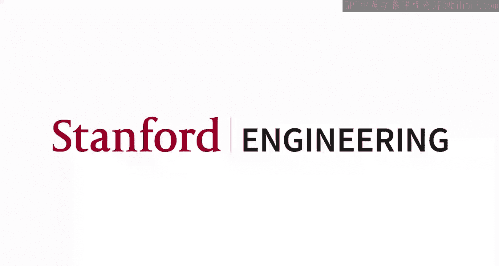
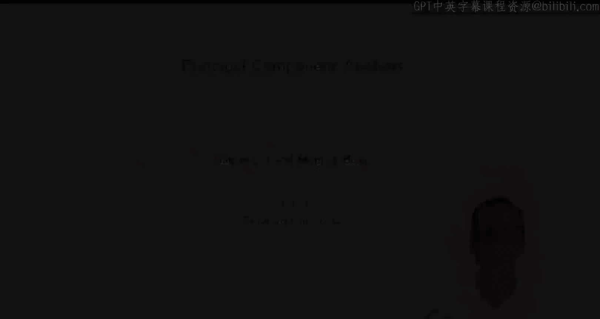
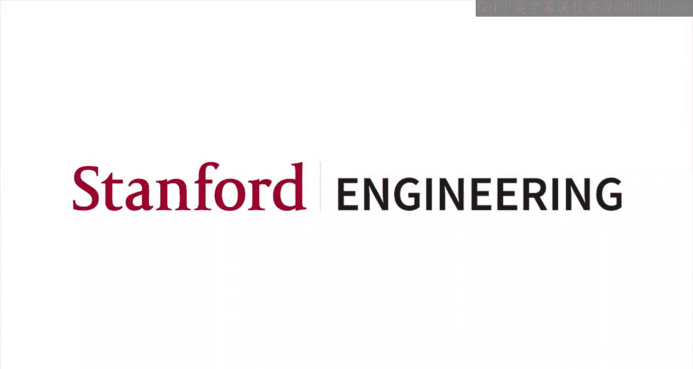

# 斯坦福大学《机器学习｜Stanford EE104 Introduction to Machine Learning  2020》deepseek翻译 p17 Lecture 19 - principal components analysis.zh_en -BV1utzNYqEkr_p17-

Welcome to the lecture on Pri Compent Ana。Prinncciple component analysis is。

A type of unsupervised learning。Where we use a。Particular。Data model。And in order to do that。

 we need the following idea， which is the idea of distance to a subspace。So here we're going to have。

啊。A set of D dimensional vectors， Theta1 through theta R。And。

When we take all possible linear combinations of those vectors， we get a subspace。So in other words。

 I'm looking at combinations of the form。啊。X is equal to a1， Theta 1。Plus， a to。Theater 2。

All the way up to AD D。C to D。And I'm allowed to pick the A's any way I like and if I look at all such possible vectors X I can construct。

😊，That's a subspace and it's a D dimensional。And it's a r dimensional subspace of R to the D。

And we might write that。As。Theater A where The is a matrix whose columns。啊。

The individual vector be the I and A。Is a vector。A 1， A 2。Onlylay up to AR。Of the coefficients。

And so the matrix theta times the vector a is equal to the linear combination of the columns of theta。

And the coefficients in that linear combination are the AI's。And so here we have。

D by R matrix and I guess I labeled。That incorrectly。 So let me fix that。 That is theta R。

 not theta D。So we have a D by R matrix。😊，C的。And that is the matrix that describes our subspace for us。

 it defines the subspace。And we can pick any point in the subspace by picking the vector A。Now。

 if we want to say I've got another vector X。And I'd like to。

Figureuring out how far is it from the subspace， Let's draw the picture for that。

So here is my subspace。Here is my vector。X。And this distance here is what I'd like to know。嗯。

Then well， what is that， well every point in my subspace here S has the form theta times a。

And so out of all such points theta times a， I want to find the one that's closest to x。

 and that's this optimization problem right here。😊，Minimize over a x minus theta a。

On the normal of x minus theta a。It is the distance。Between x and a particular point。

 the to a within this hubspace。Now this is if I square that objective function。

 so I look at this distance squared， well， minimizing the distance and minimizing the distance squared。

😊，Are the same problem。 And so。This becomes a least squares problem。

And we know what the solution is to least squares problems。

 it gives the optimal a as theta dagger times x。And。Seeita dagger。Is theta transpose， theta inverse。

 theta transpose， that matrix。And this works if Theta has linearly independent columns。

 in which case Theta transpose Theta is invertible and Theta dagger is Theta transpose Theta inversese。

 theta transpose。So that tells us what a is。 and once we know what a is， well then we know。C to a。

Is this point right here。And which is the best。The closest point in the subspace to my given point X over here。

And we might call this thing。Exhat。嗯。That's the closest point in S to x。

People would call it the projection of X onto S。X hat is theta times a。

 which is just theta times theta transpose theta inverse times theta times x。

 So here we've simply substituted in。说A。And I don't know what that transpose is doing there。

Because that transpose。This should actually read。X hat is equal to Theta。

Theta transpose Theta inverse， Theta transpose X。Somehow that transpose got misplaced。

And so if I want to know what the distance is between x and the subspace， well， that's x minus x hat。

😊，The norm of x minus x hat。And X hat is this thing here， and so substituting X hat in。

Gives me this rather unpleasant expression。But really， if you look at that unpleasant expression。

 it's really just。😊，Let's call this matrix W。It's the norm of w times x and w is this matrix。

 identity， minus theta， Theta transpose theta inverse。Theatre transpose。😔，Yeah。

 so here's the picture I just drew， this is the case when R course is one when we got a one dimensional subspace。

😊，That's S。嗯。And then the subspace is a line， there's a。Theer is a matrix which has only one column。

 which we might as well think about as a vector。But it certainly makes sense and the。啊。This。嗯。

Theed of the trans the of inverse。Theto transpose gives us an A， which is a scalar。

 and then if I multiply it by Theta， I get X hat。😊，And that's this thing here。

In this case will be a two by two matrix。Because theta is a two by one vector。

So what's our data model now we've got the idea of distance。

The data model is that x should be near to a linear combination of the vectors Theta 1 through C to R in RD。

 in other words， it's near to a subspace。The parameter that defines the subspace is this matrix Theta。

 which is a D by R matrix。So we believe。对。There is a subspace and for such a subspace X。

All of the data points X are close to it。嗯。😊，Now the quantity R， the number。

 the dimension of the subspace， is also called the rank of the model。

And the vectors Theta ones we see it are called the principal components。Or the archetypes。

So this is called principal componentent analysis。This is called a PCA model。

 because some people call it a low rank model。And our loss function or implausibility is simply the distance between x and S squared。

It will be convenient to assume that Theta has also normal columns。

Alsosonoma columns means that theta transpose Theta is the identity。Of course。

 any subspace that I want to describe， I can describe it by a set of vectors。And I can。

Choose the vectors that I'm using to describe the subspace be orthoormal。

And so there's no loss of generality in making this assumption。

If you have a theater that doesn't have also normal columns， you can compute。对啊。おのも。A set of columns。

 which。Defins the same subspace by the QR factorization of the matrix。

So you take the QR factorization of the matrix Theta and you get rid of Theta and you replace it with Q。

And then the。Set of linear combinations of the columns of Q is exactly the same subspace as the set of linear combinations of the columns。

😊，Hope， the original theater。But the columns of Q are also normal。

So when Theta transpos the identity。The loss function is the distance between x and S squared。

 which has this nice matrix expression。It's。The norm of W X squared， where the matrix W is。

Identity minus theta， theta transpose， theta inverse theta transpose。

And because theta transpose theta is the identity， that's just identity minus theta theta transpose。

😊，Now computing this norm。Times x， well， we have that' equal to the norm of x minus the theta transpose x norm squared。

Which is。Ex。Norome squared。Plus， the norm of theta Theta transpose x norm squared minus twice the cross term。

And we can simplify that in particular。😊，呃。The norm of theta times any vector v squared is v transpose theta transpose theta V。

Which is just equal to the norm of v squared。And so。啊。That tells us that this term。Pair。

Is equal to the norm。Of theta transpose x squared because it's theta times theta transpose x。

And as we've just seen， norm theta v is the norm of V。And this。Here is。Minus2。

 the norm of theta transpose x squared because it's x transpose theta theta transpose x。嗯。😊。

And that was nicely。Add up。To give us minus the norm of theta transpose x squared。

Which is a very convenient expression。Right here for the loss function。So now the empirical risk。

 that's the average on the loss function， the average of the loss function on the data set。

Simply one on end， some over eyes one to n and the distance from Xi to S。😊，Squared。

And the PCA data model says we should choose also normal Theta 1 through Cta R to minimize this empirical risk。

So we get a bunch of x's， a bunch of data， we then。Pick the cedar that minimizes the empirical risk。

😊，And then we can use that model， for example， to do imputation。So this is the case when R is 1。

 it has a nice interpretation geometrically。😊，We have all these data points shown in green。

Here we're trying to choose a one dimensional subspace， which is just a line。

And the loss function is the distance between the point and the line， these red distances here。

And the sum of the squares， some of the squares of those distances。😊，That's the。啊。

That's the empirical risk scaled by n。So we're trying to find the subspace that best fits the data。

And we're measuring the quality of fit by。The normal distance。Between a point and a subspace。

 in this case， a point and a line。お。We can。Look at this。In matrix notation。

So let's express the empirical risk and matrix notation as before we construct the data matrix for the x's。

 this is just the same one data matrix we used in regression。

 it's N by D matrix each row of which is a corresponding。Data element Xi。

 so the I row of the matrix X is x is little X transpose？

So the empirical PCA loss is then expressable in terms of the matrix by noticing that the sum of the norms of X squared is。

😊，The Frbeius norm。Of the matrix x squared， and then if I want to compute theta transpose times X I。

 well I can compute the matrix X times theta and that will give me a matrix whose I。

Row is precisely theta transpoposedse X all。Transposed。Notice that here。There should be a。For of n。

There。Now， in order to。Fit the PCA model， we start off with our in data points x1 through Xn。

 and we're going to minimize the empirical risk。We've got the additional constraint that we want to find the theater。

It minimizes the empirical risk， but also should satisfy theta transpose theta as equal to the identity。

 in other words， the columns of the matrix The should be also normal。😊。

Because the empirical risk is the norm of x。Minus the norm of x theta。

Minimizing this quantity over theaterta is the same as simply maximizing。😊。

Minus is simply maximizing the norm of x theta f squared。嗯。And of course。

 the minus changes the minimum to a maximum。Now it turns out that there's an exact algorithm for doing this。

😊，So it's not heuristic。😊，These algorithms are call a singular value decomposition or the eigenvalue decomposition。

😊，In this class， we're not going to go into the details of how those work。

But it's worth knowing that they exist， that their complexity takes is of the order of n d squared。

Where D is the dimension of x and n is the number of data points。And there are， in fact。

 more efficient methods when R is much smaller than D。😊。

What do we do when we've got such a data model， one thing we can do is imputation and the idea is straightforward。

😊，We fitted this upspace。Here it is。We've got。😊，A data vector with some missing entries。

 so suppose for example， we only know x2， then we know。对。

The true X lie somewhere on that line and we pick。This point right here。

To fill in the remaining X1 entry。And that corresponds to exactly what it corresponded to。You know。

 previous。Session on Iutation， we minimize the loss function。Over the unknown components of X。

With the components of X that are known fixed。😊，Now， in order to find the。Intersection point。

Right here。The way we do that is we have to find the A， remember a parameterizes the subspace。

 so we have to find the A corresponding to that intersection point。

That corresponds to minimizing this objective function。 So here we're looking for the。啊。

The point A that minimizes the norm of the difference between x minus c to a。

 that's the point in the subsplace。which is as close as possible to x。

 however we don't use the entire norm because some components of x are unknown and as a result we simply use only those entries of x which are known and that gives us the sum over all I in the known set of X I minus theta A。

Sub I squared。And that finds exactly this point right here。

 and if we look at the corresponding X hat， which is theta a and look'll at the I component of it that will give us the missing entries of X hat。

😊，Now when we are fitting our model， we start off with data points x1 through Xn and we would like to choose the best theater so that we are minimizing the empirical risk。

Now the way we do that is we look at the distance between x and S。

 where we've parameterized the subspaces S by Theta。In order to compute that distance in turn。

 we have to compute the optimal A， optimal A tells us which point in the subspace is the closest to x。

And there's a different A for each of the different x's。The computation that goes into that is。😊。

This computation right here。We find the A that minimizes X minus theta a。

And that we know is AI is theta。Transpose The inverse。Theatta transpose X。

And if we're restricting ourselves to own looking at Cedar。With also normal columns。

 then that's just theta transpose Xi because theta transpose theta is the identity。

And we can write this in a convenient way， we can have a matrix A。😊，Where the ice row。

Is the corresponding Ithe A transposed？And so now the matrix A will be an in by our matrix。

And that a is going to be equal to x Theta。Let me erase that and write it correctly。

And that just says a is equal to x theta， simply says equivalently that a transpose is equal to theta transpose。

 x transpose。And therefore， that the ice row of a。AI is equal to theta transpose Xi。

 It's simply writing this。There's a matrix equation。Now。Once we've got the A。

 we can correspondingly work out the X tilde， the corresponding closest point， there's our subspace。

Is a point。There's the closest point。This is X I， and this is x tilde I。An external to I， well。

 that's what AI tells us X to I。😊，Is just。嗯。Theer。Times AI。

And we can write that as a matrix equation as well。😊，In the same way。

 we all like x tilde having its components， x tilde1 transpose。

Up to X tilde n transpose the n rows of x tilde。And then the equation this equation here。😊。

Corresponds exactly to the matrix equation x tilde is equal to a。Theater transpose。So。

Our empirical risk。Is the average of the distance between Xi and X tde I。😊。

If we forget about the factor of one on n。😊，Then that becomes the Frbeius norm of x minus x t the squared。

Each row of x being the corresponding Xi and each row of x tder being the corresponding x t to I。

 and so the Frabbrius norms gives us some other squares of the differences in the norms of the vector pairs。

We could write this like this。😊，Since X tilde is。啊。

Is a theta transpose and a is x theta and just substituting those two in gives us x tilde is x Theta Theta transpose。

Another thing we could do is we can simply say x till there is a theta transpose。😊。

And so let's look at this expression directly。😊，And that says that， well。

 we start off with X and our job is to find。Both an A and a the。Of course， once you know。Theta。

 well then a is given to you， a is theta transpose X。Conversely。Once you know A。

 well the next tilde is given to you。But here we're simply saying。

 let's try and find simultaneously both A and Theta transpose。

And the idea here is that this is a matrix factorization we want to find a matrix A which has to have the dimensions in by R and a matrix theta transpose which has to have the dimensions R by D。

 I guess this should say a D here。😊，So that x is approximately a theta transpose。

And the dimensions look like this， the dimensions。啊。There's a。And that has to be approximately equal。

Sorry， that's X。It has to be approximately equal to a。Theater transpose。

Where this is in and this is D， this is therefore for n and R， and this is therefore for R and D。🤢。

Now， in general， if r is small， one will not be able to find exactly a pair of matrices a and theta transpose。

 such as x is a times theta transpose。嗯。And so this is an approximate matrix factorization problem。

And what PCA is doing is finding。The closest matrix2 x， that is product。

Of an N by R and an R by D matrix。Now the mapping A is theta transpose。

 can be thought of as an embedding， it's taking an X and giving a vector A。

The vector x has dimension D， and the vector A has dimension R。

 So this is an embedding which is taking x which may have a large dimension。And giving us an A。

 which would normally have a much smaller dimension， R would normally be much smaller than D。

 And so it's a dimension reduction。We can think about a as a。

Compressed feature vector when x is the original feature vector。嗯。Now。

 when we've done feature engineering。In the past， we've done things like constructing products and applying linear maps to X。

To construct features， but here the embedding is based on the data set。

 the embedding is being learned。And so this is a learned linear embedding。😊。

From the D dimensional space of x's to the R dimensional space of A's。Now。

 one of the nice things about this embedding is that it approximately preserves distances。

So that points that are far apart in our original D dimensional space are also far apart in our R dimensional space and points that are close are also close。

😊，But because R is less than B， it cannot do that exactly。And so it does that as well as it can。

Let's have a look at this。So this property that the distances are almost preserved is called the approximate isometry property of PCA。

An ismetry， say a map from r to the P to r to the Q。

 a map is called an ismetry if it preserves distances。

 which means that if I've got two vectors x and X tilde， I map them both under F。

 I get f of x and f of x tilde。😊，And the distance between F of x and F of x toder is approximately the same as the distance between x and x toder。

😊，The most well known simple example of this is F of x is  Q times x where Q is a matrix which is orthoormal columns。

 Q transpose  Q is the identity。Then。We could see that norm。Of Q。Go Q x minus Q x tilde。Squared。Well。

 that's equal to  Q that the norm of x minus x tilde。Squared。Which is equal to x minus x tilde。

Transpose Q transpose Q。X minus x tilde and  Q transpose q is the identity so this is equal to the norm of x minus x tilde squared。

😊，Now what we're doing in PCA， our last function is the norm of x squared minus the norm of theta transpose x squared。

And the the。啊。The theta transpose x， well that's precisely a。

 so this is the norm of x squared minus the norm of a squared。😊，Once you know x well。

 then you know A。And so what we're doing is we're trying to make norm of x squared。😊。

Approximately equal to the normal a squared。In other words。

 this means that the embedding is be there' an approximatexi ismetry。

 the smaller we can make the loss function， the closer to an asmetry it'll be。😊，In particular。

 we'll see that often we choose R to be two or three。

 simply so that we can visualize the data effectively。We'll be able to by picking Rs2。

 we can plot all of our data points in the plane， each XI gets mapped to an AI and these AI are two dimensional vectors。

And often by doing that， the PCA embedding picks for us and shows for us a map of our data in two dimensions。

 where points that are close are similar and points that are far apart are dissimilar。

Let's see an example of that。So the example we're going to look at it's called latent semantic indexing。

The idea here is that we have a corpus。A body of documents， a collection of documents。

Each of our records， UI will be a document。In that cor documents。

 we can look at all the words and count up the number of different words that are in there。

 and we'll call that number D， the number of unique words in all the documents。😊，Now。

 whenever now we've got D， we can number all of the words。

That are sharp anywhere in our corpus of documents from1 through D。

And that means that gives us a very natural way of embedding documents。 We can look at a document。

and we can set x1 to be the number of times word one occurs in that document。

 x2 to be the number of times word two occurs in the document and so on so we'll have a histogram of the word。

Occurrences for each document。 and that's a very reasonable embedding。嗯。

From which maps a document to a D dimensionsal vector。In fact。

 we don't tend to use that particular embedding， but we use a very similar embedding。

 an embedding which has the same idea where x， the J component of x is approximately equal to the number of times the Jth。

😊，Unique word occurs in that document。And is larger the more often the word occurs。

But it's not quite that。And let's see why not。Now we're going to use two in order to construct this particular embedding。

 we're going to use two quantities The first is called the term frequency of word J。

And so what that is is that if you give me a particular document。

 I count up the number of occurrences of word J in that document。

 and I divide it by the total number of words in that document。

So that tells me what fraction of words in the document are word J。

That's called a term frequency of word J in document U。Now I can also look at a different quantity。

 the document frequency of word J。😊，And that is， if I look at the entire。A corpus of documents。

 and you look at the number of documents in which that word occurs。

And I divide by the total number of documents I have。嗯。Now， why is this a good idea？

If we just kept a histogram of the term frequencies。

That would certainly make a vector which would have large entries to words that show up a lot in that document and small entries for words that don't show up a lot。

Tubleless is that some of the large entries would be kind of meaningless。

 they'd be words like the if and but。And those words were sharp a lot。In all documents。

And so as a result， we would like to scale in some way to deemphase words which are popular words in all documents。

 and that's what we do with the document frequency。😊，And so this thing is called the TFIF embedding。

 the term frequency， inverse document frequency embedding。

And it's not quite the ratio of the term frequency to the document frequency。😊。

But it's the term frequency multiplied by the log of one over the document frequency。😊。

And this kind of does the following if。A word， J。Occurs very often in a document。And。

It doesn't occur very often in all documents。Then。The TFIDF embedding will be large。And here where。嗯。

Have a way of discounting。The occurrence of very common words， such as the。

So let's look at a specific example， here we're going to have two texts。

 the critique of pureer reason by Emmamanuel Kant， and the problems of philosophy by Bertra and Russell。

😊，These are both very famous philosophical works。😊，Both in a specific area of philosophy。

 and they're famous in part because they take opposite opposing views。😊。

And these we going the way we've analyzed these is we've taken 50 excerpts from each of these books。

 each excerpt has about 3000 characters。😊，For each excerpt we've taken， we split them into words。

 removed any punctuation or capitalization。And that gives us a total over the whole corpus of 3。

566 unique words。We embed these using TFIDF embedding， and we standardize and we apply PCA。

So here is an example of a thousand characters of Kent。

You can read this and get the sense of what it sounds like。And a thousand characters of Russell。Now。

 just based on 1 thousand0 characters， of course， you can't glean too much from the meaning。

 And the question is， can we learn something that would enable us to。Distinguish these two documents。

And so here， this is the embedding that PCA comes up with。😊，We've picked RS2。

 we've got a data matrix X， which is 100 by 2262。And。This is a。100 different excerpts。

 50 from Russell， 50 from Kt。Now each data point， each vector Xi， gets mapped to an AI。

That AI of course is just theta transpose times Xi。And because we've picked Rs2。

 each document corresponds to a vector in the plane。

 and so we can plot all our documents in here they are。😊，Colored the blue ones corresponding to Kent。

 the red ones corresponding to Russell， and you can see they're quite well separated。

And that's one of the things PCA does for us is it shows us the structure。

 it's given us an embedding。Where it has tried to spread out the features as much as possible。Now。

We have a theater， which is。A vector， which is a matrix， which is D by2 as two columns。

 theta 1 and theta 2。And the way we should think about that is that these are our basis vectors for our subspace S。

Each entry of Theta 1 corresponds to a particular word， same for each entry of Theta 2。

And so here we can take all of our words and plot。For each word， Theta 1 and theta 2。

 the corresponding entries of so Cta 1 I and theta 2 I。

 the corresponding entries are Theta 1 and Theta 2 for word I。Now what does this mean？For example。

 let's pick a word， let's pick this word down here。Which is representation。

Now the word representation here has a Theta2， which is negative and a Theta one which is quite small。

 close to zero。And it means that if we have a document in which the word representation shows up。

A significant number of times。Then the corresponding embedded vector A will have an A2 which is shifted negative by those words and an A1 that isn't really changed。

Similarly， if I look at a word over here， this word is about。

That's got a positive The two and a negative The one。And as a result， if the word about occurs。

Significantly in a particular document， then the corresponding embedded A will be moved。

 so here's the origin。Will be moved in this direction。So now。We can look back at our。Texts。

And we can say that。Because。Cans documents。Our town here。And。Russell's documents are up here。

That suggests that。Wors。These words over here are words that。Kt tends to use。

 and these words over here are words that Russell tends to use。Let's。Look at some of these。

 I happen to know that there's transcendental over here and conception over here。If we look at cant。

There we can see in the middle， transcendental conception。Right there。And so。The reason why these。

Documents。Split up like this and then we can distinguish Russell from Kent。

Is they tend to use different words。With different frequencies。And that shows up。

And is detected by PCA。Now， of course it doesn't always happen that a two dimensional embedding will split your documents so nicely like this。

But nonetheless， this gives us a great choice for an embedding which will enable methods such as。

Classification or regression， which we learned earlier in the class to do a good job。😊。

And we're seeing that。Here。we may need to use an R is higher dimension。

 in which case we won't be able to visualize it， but it will still make our classification in our ag methods work well。

😊，No。Now I think that brings us to the end of the class officially we have one more lecture scheduled for next week。

But I think there is no need to。Try to fit one more topic in in one lecture。

 and so we're going to stop here。I know it's been a very challenging quarter。

And I appreciate you all working hard on this class during such difficult times。

Despite the continuing challenges we are facing in spring 2020。

I hope you've had a productive quarter， and I hope this class has gone well for you。

And I wish you all the best for the summer。

