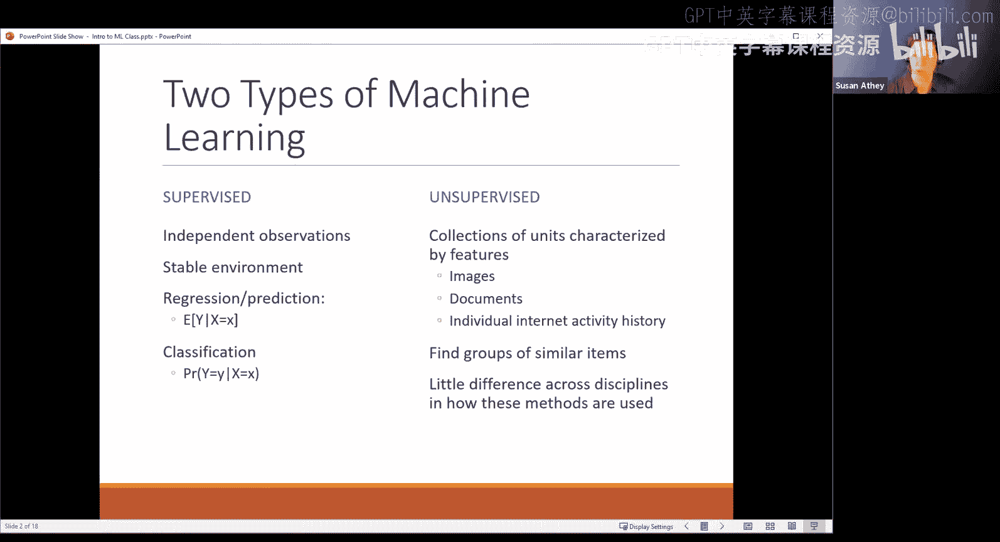
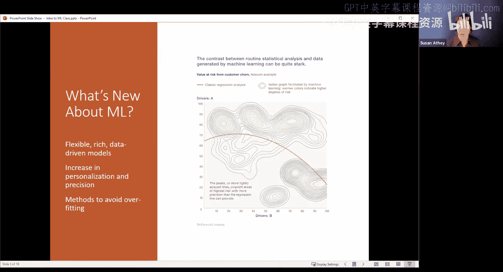
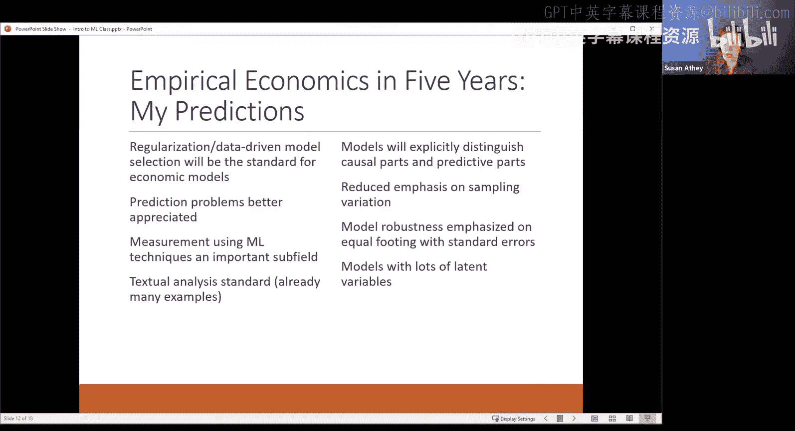

# 斯坦福商学院《机器学习和因果推断｜Machine Learning & Causal Inference： A Short Course》claude-4s p01 -01-Machine Learning and Economics_ An Introduction.zh_en -BV1M9W7zCEsf_p1-

So thinking about machine learning and economics or machine learning and econometrics or machine learning and social science。

 we can start by saying you know what are we talking about here with machine learning。

 there's two big types of machine learning there's actually lots of types of machine learning beyond this like reinforcement learning and different parts of AI。

 but two really big types for distinguishing for what the comments I'm going to make today are between supervised and unsupervised machine learning。

 so unsupervised machine learning is like when when you have a bunch of videos or you have a bunch of pictures or a bunch of documents。

And there's no labels on them， Nobody has said that's a cat。

 that's a dog to start with your input is just a bunch of objects。

And what you're trying to do is put those into groups that are similar in some way so they might be you know images and then when you put them into groups you look at group number5476 and that group when you open up all the images in that group you see that they're all cats so then you'd say a my machine learning algorithm discovered cats what it actually did is it put a bunch of images together that it thought were similar and then later on you looked at it and you said a that looks like cats but you didn't tell the algorithm that cats existed or that there was any specific reason to be looking for cats that's just something that discovered it was discovered there's little difference across disciplines with how these methods are used or what their purpose they're generally a first step towards something else。

That something else can differ it could be that you know' you're going to use it as an explanatory variable and a regression or it could be you're going to use it to describe features of products there's many different things you might do with it afterwards。

 but when it's done in this kind of isolated way，I feel like if you want to learn how to do this。

 you can just Google it， find some great videos， find something on Coursera。

 and if you're a social scientist， you can just apply the methods and I don't have anything new to say to you about how to do them they're going be similar I would say that you know political science is used text quite a bit and so some methods will get more popular and some discipline than others。

 but fundamentally there's not a difference in the goals。

The place where it's things get I think a little bit more interesting or where things that seem alike actually turn out to be different is in supervised machine learning。

 which is the thing that sort of looks like running regressions which is something that we do a lot of in the social sciences and we teach a lot of in econometrics class so in supervised learning you start with a setting where there's independent observations in a stable environment。

 so you know each observation is exchangeable with another observation。Um。And in the simplest case。

 you know there's no correlation between them， so a regression problem was that we all teach in first year econometrics where we're trying to build a model of the conditional mean。

 the expectation of y is a function of x。And supervised machine learning is also about predicting Y as a function of x。

So those basically look like the same thing。And classification where in this case why would be discrete so why is maybe a label like is it a cat a dog or a horse that's trying to understand you know which label is most appropriate given X's。

 that looks like a multinoial logistic regression， which is also something that we teach and study and use a lot in social sciences。

 so it looks like supervised machine learning is the same thing as what we do in social sciences and to make them seem even more similar when you take a machine learning course。

 probably the first prediction model you learn is regression and probably the first classification model you learn is you know logistic regression。

So this all sounds like we're solving exactly the same problem。

 but then what's kind of funny about it is that we do these things differently。

 and so I want to kind of talk to you a little bit about why we approach that same problem in different ways and actually why it's meaningful to ask different questions from those same methods。

So just to start with though， let's kind of take a look at an example of classification of one of the most common problems that's been studied in machine learning and one of the biggest successes from the last 15 years is our improvement in the ability to solve classification problems。

Typical classification problem is you know you have a bunch of pictures， say pictures of animals。

 these pictures you download it from the web and what you're trying to do is to classify them so in the classification problem you're starting with a training data set where you have images and you have labels so people have in your training data set the data you're using to estimate your model。

You have labels， the wise， like cat dog horse， and you have the pictures。

In order to build this classification model there's some processing you have to do so first of all you have to try and the image into observable characteristics of the image and just a simple way to think about that is like on your computer screen you're staring at right now you can make an image of me talking to you or my slides using red green blue and the brightness of each of those colors and that together will create an image so that's one way you can translate an image just into bits and bytes they're the pixels each of the pixels and then for red green blue how bright they are and now I've got a a digital description of the image。

😡，Then I want to put that into a model and classify， you know， given X is this a cat。Now。

 already there's a little bit of a gap because in some machine learning applications。

 you're not actually trying to build a model that gives a probability of a cat。You just want to say。

 is it a cat？So when these algorithms work in production。

 they're not necessarily spitting out a probability， they might be， they might not be。

 they might just be spitting out cat dog cat dog， and it might actually take additional computation for it to spit out a probability well if we were studying this problem in economics。

 we would be building a logistic regression and trying to use that to come up with a probability。😡。

And actually， the way that we use the regression in economics would typically be that we would be interested in the coefficients。

 we would be interested in the function itself， and we would be trying to understand if I changed something。

If I changed an x， how would that change the probability？

So we would be really trying to understand the model rather than just spit out。

 is it a cat or is it a dog？Now one of the so some of the big advances for images neural nets turned out to work really well and you know who who knew that that would be the case。

 but they are a very rich functional form and so what what the advances of machine learning have been all about is figuring out how to。

How to solve this hard problem where you have all these bits that are representing pixels and I'm going to somehow get a meaningful prediction out of that and the neural nets can be thought of as a very flexible functional form to do that。

So here's an example of like why machine learning is great。

 this is a marketing brochure for McKinsey。And so in this marketing brochure。

 the problem was to predict which customers would churn， and that means to abandon a service。

And we have on the X axis and Y axis of this， we have two drivers of churnN and you can imagine that might be you know how often you've logged into the website or some other behavior could be a characteristic of a person。

 so these are the X variables that could be used to predict churnN。

And so the McKinsey is in this picture contrasting a churnd model based on a simple。

 old fashioned logistic regression。So in the logistic regression they've got a binary outcome。

 churn or no churn and they have these characteristics of the consumers and they're using those characteristics to predict churn and this nice smooth green line is the ISOproability line for so everybody along all the drivers's A drivers' B pairs along that line have the same probability of churn。

😡，And so McKsey's pointing out that in these hand tuned simple functional forms that people would write down by hand。

 you would have a very simple relationship between driverss A and drivers B in terms of predicting churn。

Now， all these fancy hills and valleys are what come out of the machine learning model。

So and I'm going to assume that McKinsey ran the software correctly and so that McKinsey's model did a better job classifying churnern than the simple logistic regression model。

Um。So that's good and let's assume that's true and then we can also assume that it's true that this kind of complicated relationship between A and B in terms of prediction was actually better at predicting outcomes in a test let's imagine that's true。

 but how would you do as a social scientist or even as a business person trying to use this output to make decisions。

So if you took this literally， if you held drivers A A at 80 and increased driver's B。

What this model seems to be telling you if you interpret it that way。

 is that if you held drivers A fixed and you increase drivers B。

That the probability of churn would go up and then down and up and then down and up and then down。

 so you have all these hills and valleys in the probability。So if you。

 if you went out and tried to think about making decisions based on that， you might。

Get some counterintuitive results and it might not be the best guide about which customers to recruit。

And and it might also not be that convincing on mechanisms so you think why is that？Well。

 part of the thing is the goal of a predictive model is just to predict。

It was estimated and trained the shape of the functional form was all about just getting the y right。

 getting the best prediction of whether you're going to churn or not。

And that's different from a causal analysis where I might want to say well what if B is something I can affect like what if I could get people to log into the website more well would I want to try to get people to log in the website more do I think that would actually cause them to churn less that's a very different question and you would estimate the model very differently to answer that question and so one of the insights and the recorded lectures will go into much more detail about is you know when you could or couldn't interpret。

😡，A model。In terms of terms of causality， in terms of what you might want to manipulate or even in terms of who you might want to target for something。

And so there's different objectives for different kinds of questions and actually your estimation techniques should differ depending on the question you're asking。

To think about this another way， we could use this model to try to predict who should we call。

 should we who should get a phone call now the McKinsey model is going to be very good at figuring out who's likely to quit。

 but maybe some of those people are quitting your service because they graduated and they're moving away。

Maybe they're graduating from Stanford and they're going to move to a different country or they're going to move to a different city。

 so calling people who are going to move away is not going to be very beneficial for for a company so that's lookinging at a higher level if you were trying to use a prediction model predicting who's going to quit isn't the same as finding the people for him you should intervene those are different questions and you would use different models to answer them。

so that's that's really going to be one one set of themes that we're going to want you to learn from this class if you go to an econometrics class。

 they're going to assume you're trying to understand you know what happens if I hold everything fixed and I change one variable because that's one of the ways we think about regression while if you go to machine learning class。

 they're going to assume that you want to predict。😡。

Or you want to classify and so the objectives are actually different。

Machine learning's great， it can fit these complex shapes。

 so my friend who was at Microsoft made this goodness of fit for clippy the paperclip。

 who was Microsoft's first AI and Cpppy didn't work very well sadly， was not a very good AI。

 but we can use AI to fit Cpy shape and finally you know 15 or 20 years later。

 we actually have help assistance that actually do help us unlike a poor little clippy who was made fun of。

So just then to put a little more structure on the comments I made earlier and again this will be elaborated on further in the additional recorded lectures this week。

 but when we think about prediction， the goal of prediction is going to be to estimate a single number。

 what is my if it's y， what is my best prediction of y and I'm going to do that to try to minimize the mean squared error in a new data set where only x is observed so the stated problem of machine learning is that I have a data set with y's and X's。

 I build a model。😡，If you give me new x's， I predict it， I can predict what the y will be。

So if you think about it from a professor's perspective， I could hire a research assistant。

 give them some x's and Y's and tell them to go back and build a model and then in my office I'm going to hide some data and I know the X's and I don't know the Y's when the research assistant comes back I'll see I'll give them the x's and I'll test them。

😡，On how well they can predict the wise。And all I need to know。

 I don't need to know how the research assistant did it。

 I don't care if they built a neural net or a random forest or something else。

 I just care that Im I'm going to just give you a pop quiz I'm going to feed in the X's and you're going to tell me the Y's and I'm going to score you just based on those Y's。

 nothing else。Okay and so the machine learning problem is actually then a sort of a simple problem because I don't care what you did or why it works。

 I just care that it works and if my the actual way I want to use the model is again to。😡。

Give it more x's and have it predict more ys。 All I care is that it works。

 so it's kind of machine learning you can think of as like a robotic research assistant you know。

 I used to go tell my research assistant to run 100 regressions now I've got a robotic research assistant and they're going to run a billion regressions。

And they're going to come back with the best one and I'll be able to tell right away if they did a good job。

Okay， so that's what machine learning is good at。Now there's some details like it turns out that minimizing mean squared error is going to actually entail a bias variance trade off and it's always going to accept some bias。

 so that's a different objective than trying to get an unbiased estimate of the conditional mean function。

😡，The idea of how these machine learning algorithms work is you consider a family of models and you use the data to select among the models and the common approach is cross validationation。

 so it's like to prepare for your big test you pretend that you're studying for a test you hide some of the data from yourself and see how well you do and so then you give yourself a bunch of pop quizzes pretending simulating the scenario that you will later face in my office and you find the thing that does best in your little pop quizzes that you're giving to yourself where you hide some data from yourself。

 you figure out the thing that works best once you've got that all sorted out then you come to my office and I give you the final test and see how well you did but if if you practice well and simulated the testing environment you will probably have found something that will also work well in the test that that I hid from you and machine learning basically works well because you can。

Accurately evaluate performance without a lot of additional assumptions。

All you have to see is how well it fits because its only goal is to fit。

You don't have to argue about additional assumptions yeah you can argue about whether the environment you're going to apply it in is actually stable maybe it's going to change over time there's a few things to argue about and of course you can argue a lot about whether the algorithms are fair or biased or have some societal implication。

 but just do they work。😡，Not much to argue about。So let me now I'm going to do a little bit of provocative discussion here and I should say I am I consider myself a machine learning person so I can make fun of both economists and machine learning because I publish in both journals and go to both conferences so I'm to I can make fun of both sides I'm going to say what do we say versus what do we do coming from the machine learning perspective machine learning basically says machine learning is everything。

And actually we probably invented it I think right nobody ever did anything before machine learning was a thing。

 so I've been told many times by machine learning folks that if economists had had anything to say about how I use data。

 somebody would have told me it would have showed up on my machine learning class。

 you know and I've been asked even do economists use data， know I thought they did theory。

So there's a little bit of a lack of appreciation for the fact that many disciplines。

 political science and economics and biostatistics and so on have been grappling with statistical problems for decades and even centuries and have had some ideas along the way that are helpful for solving certain kinds of problems machine learning often though well use the language of answering questions or solving problems。

 even when they are not answering questions or solving problems。

So it's very common and I see this a lot with startups， a startup will come to me and say。

 I have software for prioritizing customers。😡，Like this churn example I gave。

 I have software that will help you prioritize which people should get a sales call to prevent them from churning and say。

 great， let's see your prioritization software。And what they'll show me is a model for predicting churn。

But again， as we previously discussed。Being able to predict who's going to quit is not the same as determining who should your salespeople call half the people。

 the people who are most predictably going to quit might be people who are moving away and are not at all affected by a sales call so they'll say I've got this great AI algorithm that will prioritize your consumers for you。

 but in fact， this great AI algorithm is actually just prediction。😡。

And it's predicting the wrong thing。It's not predicting the thing you would want for prioritization。

Now it could be helpful for prioritization because certainly predicting people who are not going to quit。

Means those people probably shouldn't get a sales call， but among the people who might quit。

 you need something else to figure out who should you actually call who for whom would a call be effective。

 that's a causal question and so people in social sciences are very used to thinking about well gee do you even have data that could possibly answer that question we spend tons of time thinking about is your question even answerable and that's not the type of thinking that you're taught in a basic machine learning class you just assume every question is answerable and you just need good algorithms add a few layers to your neural net and I'm sure the problem is now solvable that's kind of the mentality that you get from you know especially introductory or basic machine learning。

😡，So basically what we say is we can do everything and we've solved most problems。

 we have a great hammer and everything is a nail。And that's sort of true like from as a general purpose technology。

 like prediction is incredibly applicable and you can have the same algorithms that can be used across lots of domains so that's actually really important for economics actually like big picture economics like is a general purpose technology and it can be used really widely and we can make algorithms open source and they can affect a lot of the world so I am a big believer in that and I give entire lectures on that。

😡，But it's not true that just off the shelf， that every question is best answered using just those tools。

And that's where there's a big divergence between social scientists and machine learning so generally machine learning people actually do is they use predictive models。

 they ignore other questions， whether it's causality， equilibrium。

 feedback effects and then they have you know little conferences or subfields that sit around and wonder or worry about interpretability。

 reliably robustness， fairness but they have little ways to ask algorithms to optimize for it and a lot of times a lot of the literature on fairness is viewed as like an X post thing I'm going to verify that my algorithms are fair or I'm going to put constraints on them rather than actually completely changing the way you think about them。

And which would be， I think， more of a social science approach。So traditional econometrics。

 economists often focus on the case with a lot more observations and covariates。

Every one of you who made it through your first year econometrics or courses had to probably memorize the proof for your final exam that OLS is blue I still have the little sticky notes sticking out of my econometrics textbook for the page with proof for OLS is blue so what does that mean for those of you who haven't had to take that final exam that means that ordin least squares is the best linear unbiased estimator of the coefficients。

😡，Of of a linear prediction model okay so ordinarily squares is trying to be unbiased now when I I studied that proof and dutifully passed my exams and you know got an A。

Without ever really contemplating deeply why I wanted things to be unbiased。

 the way it was presented， it was just， of course， that's what you want。

Why would you want anything else， why would you want something biased？Whereas in machine learning。

 when you're trying to do prediction in a test set with a model that might be very rich relative to the size of your data set。

 you explicitly allow for bias because there's a bias variance tradeoff and predictions and the lectures this week will go into that in substantially more detail but to start to even see where that breaks apart。

 you know if you have more parameters and you have observations。

 it's obvious that OLS is not going to be good at anything， it's going to be overfit。😡。

Economists instead worry about estimating causal effects and what's called identification identification means if I had an infinite amount of data。

 could I answer my question？😡，And just to think of an example where you might not be able to consider the problem of hotels。

 so a causal question about hotels might be if I raise the price of my hotels，How many more。

 how many customers will I lose？That's a business question and it's something that we study a lot in economics and in marketing。

 what happens if I change a price？Now I might go out and collect data， I could collect data。

 I could have somebody， I could scrape prices from you know hotels。com or something like that。

 I could figure out what prices were and I could hire a research assistant to stand outside a hotel and count the people coming in and out。

You know， once a week or something like that right so then I could put together a data set that had quantities and prices in it。

And。And then I could try to build some kind of a model， I could run a regression。You know。

 quantities on the left side， prices on the right side。Now。

 what would the coefficient be on prices in that regression？Well。

 if if you ever have gone to a conference or stayed in a hotel， had a school vacation。

You would probably realize that actually， when the prices are high for the hotel。It's probably full。

So you would get a positive coefficient in that regression， high prices。High quantities。And indeed。

 if your goal was prediction， suppose I just， my goal was for some reason。

 I wanted to guess how many people were in the hotel on a particular day。

High prices is a great signal that that hotel is full from a predictive perspective。

 high prices predict high quantities，'s that's a fact。True in the data。

 absolutely true and by the way， this is true for a lot of data sets this is why economists started worrying about this because in many data sets。

 prices and quantities are actually positively correlated。Um。

 so why whats where's the the breakdown here， well the causal question is what if I hold everything fixed and I change the price？

AndBut your date you never had in your data a chance where somebody ran an experiment on prices。

 if you did you don't you may not know about it in your data。

 and so in your data the variation is coming from holidays and conferences and you know too many weddings that weekend other things that。

Increase both demand and supply and thus that induces this correlation and the data between prices and quantities。

 but that doesn't mean if you intervene and raise price that you will sell more hotel rooms。

So economists think about that all the time and they might if they ended up finding a way to figure out how to estimate this relationship。

 it's probably true that their predictive model would have very low explanatory power because the biggest thing for predicting quantities is knowing the price。

 high price high quantities if you're trying to predict that's going to explain most things。

 but if you're looking for natural experiments in price where price change for a reason that didn't have to do with a holiday。

 you're probably not going to have very many of those price changes and you're not going to have a very good ability to predict quantities。

 but you will learn more about what happens when you change price and that's what economists and social scientists really focus on counterfactual predictions separating correlation from causality。

We also obsess on standard errors because it's actually really hard to learn causal effects and it's very common that something you find is actually not that well pinned down and your coefficients could be due to sampling variation so causal effects we spend a lot of time worrying about sampling variation。

 it's also the case that it's very hard to tell if you got the right answer。

Because it depends so you really want theory to be playing a role and you want to think about the statistical properties of your estimators。

So those are things economists worry about。And we also are very aware that identification problems can't be evaluated just using a holdoutset。

 so if prices and quantities are positively correlated in my whole data set。

 if I take a random sample， prices and quantities will also be positively correlated in my test set and I'm not going to figure out from a test set that I misunderstood why prices and quantities were positively correlated the test set isn't going to do that and some of my research and I'll talk about this at the end we construct very specially constructed test sets that can actually help you understand whether you got the answer right。

 but it's not just a random sample of the data that's going to fix problem for you。

So of course I can also make fun of econometrics， what we say versus what we do。

 what we say is that we do causal inference and counterfactuals。

 we think about the data generating process， and we say the God of economics gave us the model。

 you know， and we pretend that we just estimated one model。We say。You know。

 the God of economics told me that log of wages depends on the log of something else and something else squared and something else cubed。

Now and we the report cause estimates and appropriate standard errors plus a few additional specifications for robustness now what we actually do is we go and tell our research assistants to run 100 different specifications just to make sure it doesn't change our results and then we kind of pick five representative ones and we show them and we produce them as if we hadn't done that at all。

😡，Now it's not that we're all bad people， I mean maybe we are。

 but that's not is not necessarily true that we're all bad people for doing it that way instead were we're working with what we have if you like and were we didn't really have a good way to try to do this robustness systematically and of course you don't want to publish a result which goes away if you add in a cubic term so you want to be sure that' you're accurately representing the way the world works because people are going to use your results for policy。

So what one of the things that machine learning can do is it can take us out of that conundrum。

 it can give us a way to do robustness， systematically fully describe honestly what we did and still be able to report results about the parameters we care about and that's gonna to be one of the things we'll teach about in this course。

 how we do that， how we get rid of that very uncomfortable。

 unpleasant and unreliable part of research where we just run a bunch of specifications hope we've been comprehensive enough and hope we haven't been so comprehensive that we've screwed up and gone data phishing for our favorite results。

嗯。So some key lessons for e kconometrics， mini problems can be decomposed into predictive and causal parts。

 and one of the things we're going to show is that once you do that decomposition。

 then you can use off the shelf machine learning for some of the predictive parts。

We also want to learn from machine learning how to do data- drivenriven model selection。

 but we want to do it a little differently， we want to be tailored to our conconometric goals。

 tailored to parameter estimation， and there's some insights。

 things like you know crossfitting that come up once we tailor our estimation for our goal。

 and we also might use different optimization criteria。

 different objective functions depending on our goal。😡。

And we want but were going to so we're going to modify things in a way that optimizes for a specific objective like parameter estimation and retains the ability to do inference。

嗯。😊，Machine learning inspired approaches for robustness， another thing we can learn validation。

 machine learning always has a test set。I've worked on some of my historical research about auctions had that kind of setting where I had two different auction models and I estimated using one auction game and predicted in another auction game。

 but that's been relatively rare in economics and so one of the things that I've been working on in my own work is how to come up with clever ways to what types of data sets to look at and ways to define test sets that help us assess better whether we've done a good job with counterfactuals and some of that's in supermarket data where we have lots of price changes。

We've also can learn other computational approaches， even for structural models。

 things like stochastic gradient descent or really powerful computational techniques that can unlock a lot of performance in in structural models and I'll talk more about at the end of the course。

😊，So。Prediction in five years， a lot of these techniques will be standard in social sciences and honestly they already are becoming a standard。

 they're becoming a requirement， not an option regularization and data drivenri model selectionction will be standard prediction problems problems the part where you really do just care about a prediction it will be better appreciated and better delineated from causal models。

Measurement using machine learning techniques might be an important subfield。

 textual analysis will get bigger， and again it's already very big in some parts of economics and political science。

We'll be better and more careful about explicitly distinguishing causal parts and predictive parts of models and then we'll delegate the parts that are more predictive to machine learning and data- drivenrive fit we're going to have reduced emphasis on sampling variation and more on model robustness and we may consider models with lots of latent variables or factor models more commonly for panel data or different types of data structures that are not just you know single shot independent observations。

Okay。