# 斯坦福商学院《机器学习和因果推断｜Machine Learning & Causal Inference： A Short Course》claude-4s p02 -02-Applied Machine Learning_ Introduction.zh_en -BV1M9W7zCEsf_p2-

Hi and welcome to this first of a set of webinars on practical applications of machine learning to behavioral science and appliedli Oconometrics more broadly。

 joined with I 42。I am Jann Pe， I am an assistant professor of Op。

 Information and technology at the Graduate School of Business of Stanford University and also an affiliate of the Goop Capital Social Impact Lab。

In this first chapter of our webinar， I will give an introduction to machine learning from an applied perspective。

Specifically， I will target researchers and practitioners of applieded Econometrics who think about how to add machine learning to the Econometric toolbox and are interested in learning how novel tools based on machine learning can improve practical empirical analysis。

When we think of machine intelligence， we may think of futuristic scenes like this one from Xmkina。

 where a machine takes on human form and can communicate to us as if it was a human。

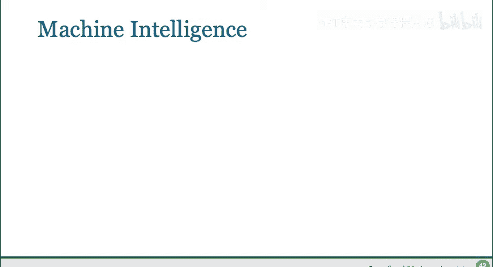

So this may be kind of futuristic machine intelligence and not what we have right now。 However。

 there is a lot of machine intelligence that is already available to us and then we have in our pockets every day。

 So just to give you one example， Facebook， for example。

 recognizing not just where in a picture is a face。

 but also which of your friends is in that picture is an amazing feat of machine intelligence that is already available to all of us。

😊。

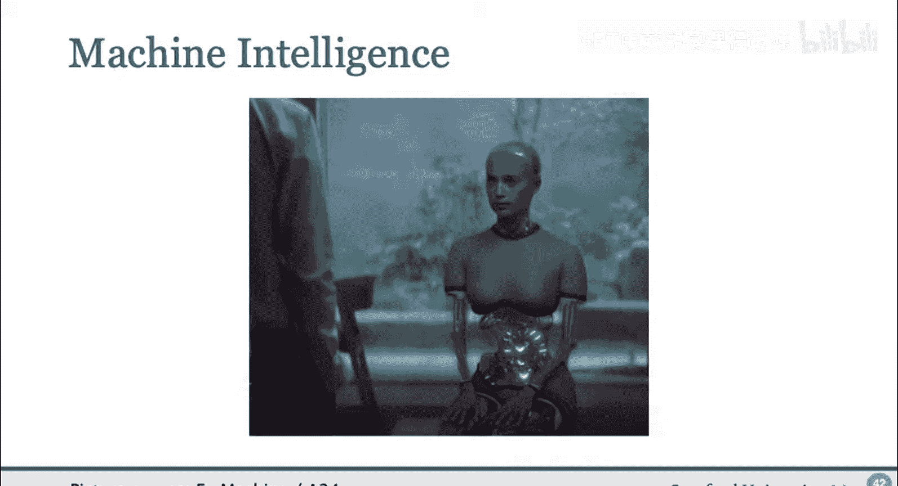

Another example would be Google Translate。 So Google Translate is not only able to take a picture of some written text。

Convert this picture into something a computer can understand。

 but also then to take that text and translate it into a different language。

And then further superimpose that new translated sentence over the original one。

 So all this is available already in your pocket。

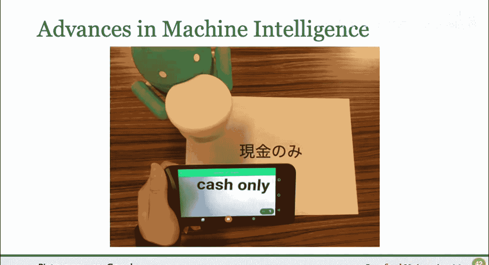

As a final example， consider self driving cars。While full adoption of self driving cars may still be a few years away。

Modern cars are able to detect obstacles in the environment and take evasive action。

 and some cars are even able to completely drive themselves。

So just consider this amazing feat of engineering that a car that you can buy these days is able to actually detect what's going on around it and itself able to take driving decisions which used to be done by a human。

And so these examples very much form a motivation for what I'm going to cover in those next few modules。

 So specifically， first， I want to ask， how is it possible， How is it possible。

That we are now able to。Solve such complicated machine intelligence tasks and second I want to ask given what we know about these machine intelligence tasks and how they are solved。

 can we learn anything for applied econometrics and can we learn anything from that that would allow us to perform some interesting analysis or improve some analysis that we usually do when we。

 for example， analyze a field experiment。To understand better how modern machine intelligence works。

 I want to start with one illustration that I found a few years ago in a New Yorker。

 So this is a story of a cucumber farm in Japan。Where these three people。

 which is a couple and their son， run this farm together。

And so in order to achieve a good price for cucumbers。

 it is very important to correctly classify them by their quality。

 and usually that is the job of the mother， which is on the right here。

And so now the son who's here on the left， he wants to help his mother and asks。

 how can I somehow help her with a tedious task of taking each cucumber and then assessing its quality and organizing it into different quality categories。

 And so what the sun does is the sun builds a machine。

And that machine automatically takes pictures of each cucumber in order to decide what quality that cucumber is。

And so now what we see here is basically a camera attached to a computer。

Together with some contraption that makes sure that。

 you know one cucumber after the other gets taken a picture of。

And I now want to think about how would we program that computer in a way that the computer would allow us to see which quality cucumber it's currently taken a picture of。

And so in other words， how could we programmed this computer in a way that would support the work of the mother whose job exactly that usually is taking a cucumber deciding on its quality？

So just take a moment and think about that for yourself。You have a computer。

 the computer takes a picture， you have this big picture， lots of pixels。

 and now you want to decide is this a good cucumber or not？So。

Note first that the structure of this is very much the structure of what we call a classification problem。

 We have some data， which I call X。And that data X here constitutes of the many pixels of the pictures。

And I want to look at this data X。 And based on the data X。

 I want to decide what is the likely quality of that cucumber。 So is that a high quality cuumber。

 a low quality cucumber。And so I don't know about you。 but when I first thought of that question。

 here's how I would have thought about solving it。I would have thought about solving it by trying to understand what are the features of a cucumber that makes it of high quality and then write some computer program that tries to identify exactly those properties in my image。

 For example， maybe I would have tried to write a small program that tries to figure out。

The specific pixels that belong to the cucumber or belong to the background。 and then based on that。

 for example， measure the color of the cucumber and say this is a particularly good cucumber is that color is very healthy。

 it's a very healthy green。Maybe I would have also programmed some small program that would try to measure the curvature of the cucumber and say you know。

 depending on the curvature and maybe of the dimensions of the cucumber。

 this would be a cucumber that could sell for a higher or lower price。

And this is very much how old style artificial intelligence used to look like。

 So the idea here is that we try to understand how a human would take such decisions and we then code up a computer to do that automatically。

 So the computer would look at different features of that picture。

 And based on those different features， the computer would then decide。

Is that a high quality cucumber or not， based on some rules that we code in， for example。

 is it has it a certain maximum of a certain curvature。

 does it have a healthy color and then if it does have those things， then okay。

 this is going to be a high quality cucumber。So this approach to artificial intelligence was not very successful。

So instead， the modern way of doing artificial intelligence， of doing machine intelligence。

 specifically of leveraging machine learning， is to turn this question into a question of effectively training on training data and applying our knowledge on new data。

 in other words， a question of statistics。So specifically that new style machine learning。

Tries to induce the structure in a mapping from pixels to cucumber quality。

 not by human initional introspection， but largely from training data。

So how could that work in this case， In this case， we could take what is called label data。

 So data where we already know which quality cucumber each of the pictures corresponds to。

And then fit a function that maps each of those images to one of the。Quality categories。

And by fitting such a function， we solve this classificationification problem by finding one that fits particularly well。

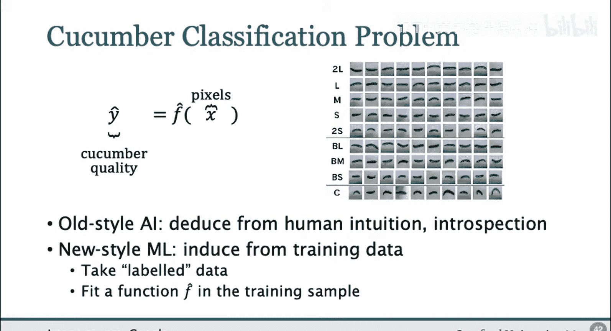

Now， what I just explained， which is that machine learning would solve this intelligence task by simply looking at training data。

 finding a function that maps the pixels to the quality。

And in applying that on new pictures that it hasn't seen yet。 Well。

 that very much just looks like statistics in statistics， we also use some data。

 Often it has a form of having some outcome variable Y， some covariates x。

 and we want to extract some structure that relates the x variables to my bio variables。

So what is different here？Well， one first obvious difference between the world of machine learning that allows us to solve such problems as the cucumber classification problem is that the functions that make it work look quite different。

So think back to some say introductory econometrics where we are also fitting some function to the relationship between outcome and right hand side variables。

So one function that we may fit there is a simple linear regression。

 or maybe in the case where the outcome is binary， so it's like either high or low quality。

 we would fit something like a logistic regression。So if you fit a logistic regression。

 that may work well for data where there's only a few x variables， but in this case。

 our x variables are all the pixels of our image and that is simply a very high dimensional vector for which the logicit that we have on the slide here wouldn't work particularly well。

 it would work particularly well first， because the vector x is far too high dimensional for it to work well。

 But second， despite this vector x being far too complex。

The function that we fitted to would not be complex enough to capture the relationship of pixels to quality well。

 And that's because。For understanding an image well。

 we don't just have to know whether each pixel is say， a 1 or a0 or has this color or that color。

 we actually also have to understand how neighboring pixels relate to each other。And in other words。

 these， like standard functional forms are very inadequate for a number of reasons。

And and the functions that we require here are much， much more complex。 So specifically。

 what we may be using here rather than a simple logistic regression is something called a neural network where the outcome。

 which is on the right here。M is not going to be a function simply of the inputs。

 not simply of the x variables， so the x variables are on the left here。And but。

They are also a function of some intermediate variables in the middle here。

 So think of this in the following way。The output， so my final prediction is gonna be not a function of the pixels。

 but it's gonna be something like a function of functions of the pixels。

 So it's gonna to be something like a logit of logits of my pixels。Now， in practice。

 we don't just use logs of logjas。 We actually use many， many， often more than 10 such layers。

And so as we move from simple neural networks to deep learning， we add more and more layers。

 And so in this example， for example， my prediction would be something like。Elogit。Of a logit。

 of e logit of my input variables。

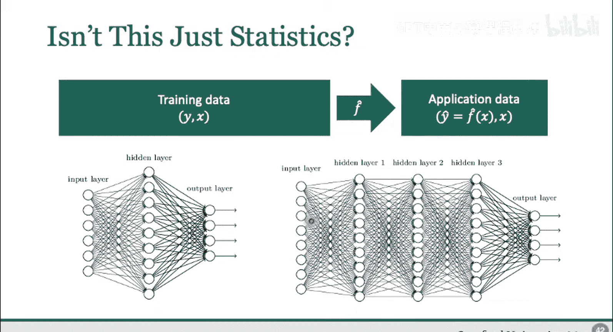

So when we therefore think about what makes machine learning work and what makes it different from standard linear regression type methods。

 then a first obvious difference is that it works with much more flexible。

 richer data driven models than our typical linear regression approach。And because it does so。

 it is actually able to work with very high dimensional data， such as image data。

 so we don't have to take a very strong stance on just having only a fewarrows to look at。

 but we can work with many more variables， let it be in images or in other data。Now。

 in order to make that work， I will argue in the next module that we need two other crucial ingredients。

The first ingredient is that we actually have to limit the expressiveness of our functions to avoid overfit so that we make sure that what the machine finds when it searches to those very complex functions isn't going to be spurious。

And second， we can actually use the data to decide how much of that expressiveness to allow。

 in other words， how much to regularize and which will be called tuning。

A final nice feature of these machine learning tools。

 and it makes them really influential is that they are readily available。

So in addition to those conceptual breakthroughs。And I should say that some of those insights had already been around in statistics for a very long time。

We now also have the ability to work with very complex data that is readily available in an automated way because we have the computational capacity to do so。

And these tools， these software tools are also available to all of us。

 So just to give you an example in this cucumber example with the family in Japan。

 the son of that family was actually able to implement this cucumber classifier by leveraging an openly available tool provided by Google in this case。

 Tensorflow to solve this intelligence task and code app。

 So all of us would be able to actually implement it on our own computers or maybe in the cloud。😊。

So when I talk of features of machine learning here。

I should say that I'm going to focus on one specific type of machine learning and specifically I'm going to focus on supervised machine learning that focuses on prediction。

 So I have some data where I have labels so I have data we have Y's and X'。

 and I want to learn the relationship between that Y and that X。

 and the idea behind using machine learning to solve the kind of tasks that are motivated that this talk with in the beginning was to turn intelligence tasks into supervised learning problems。

 the cucumber classification was one example here it was about finding the good cucumbers but you could also think about doing something similar when a bank or lender decides who to give credit to and works with past records of somebody's financial behavior and wants to decide whether to give them credit which basically boils down to trying to predict how likely that person is to default on their loan。

Similarly in public policy， we could think of a tax authority deciding which returns to audit。

 usually a human would go through tax returns and check which ones to audit。

 but here we could instead say， why don't we simply turn this into a supervised learning problem。

 where the goal is to find those returns that are problematic。

 and we use training data from the existing audits to find those。Other examples of image recognition。

 and I want to pause for one moment and ask you， how would you think of self- drivingriv cars in that context。

 So what would a self-driving car learn from a supervised learning approach or how could we train a self-driving car using a supervised learning approach。

So just take a moment to think about it。 I think one first。

Obvious way in which we could leverage supervised learning algorithms here are in the kind of machine intelligence。

 image recognition way where we。Use the images that a sensor of a self driving cast generates and then use that in order to。

 for example， identify obstacles， identify trees， and then we can write a rule that says。

 you know there's a tree， we should probably not drive against it。

But my point here just to drive this point home is that if he wanted to program a self driving car。

 we could。Do it in an even simpler way。 We could do it in a way that is purely a task of supervised learning or prediction。

 doesn't have to be the best one。 And certainly not the the way that self that state of the art self driving cars end up working。

 but just to。Kind of highlight the power of this paradigm。

 What you could have done is you could have simply taken all the sensor inputs as you x variable。

 and as you buy variable， you could have taken the steering actions of a human。

 You could have simply predicted what does a human do when a human is in that or that situation based on all the sensor inputs。

 And using that， you could implement a first self driving car。Dad takes all these sensess input。

 It knows which situations is into that， but you don't code up anything about the logic of driving。

 You simply rely on learning what a human would do in a similar situation。 Again。

 I'm not saying that this is how a state of the art， selflf driving cars are actually， in the end。

 working because for them， we want to have a lot of more guardrails。

 We want to actually know a little bit more what's going on。

 But just embracing this idea of supervised learning， This is how we could do it。

So in addition to being widely available， supervised learning has also been incredibly successful。

 and I just want to highlight that with one small example。

 and that example is going to be image recognition。

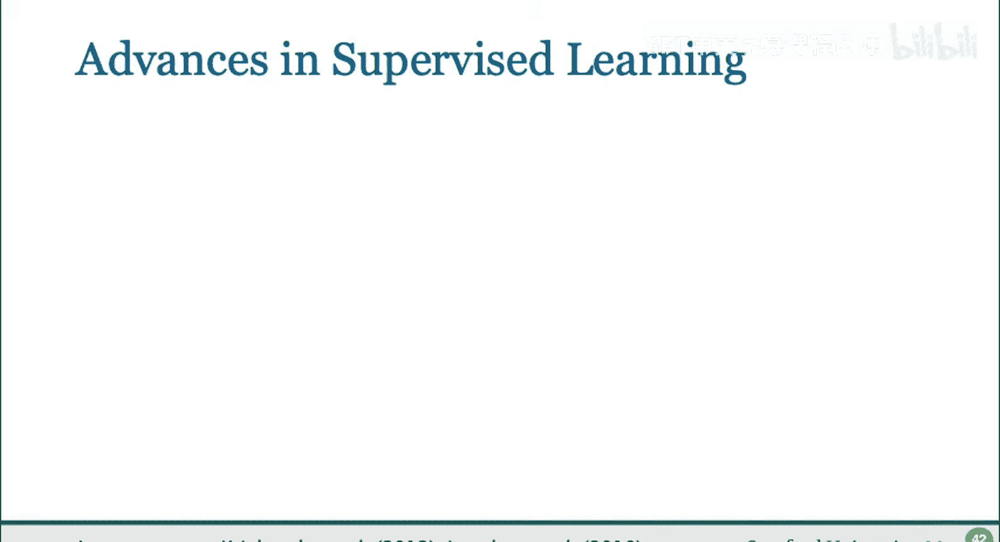

So there is a standardized data set and a standardized competition in order to evaluate the quality and of machine learning predictors in image recognition。

And that is called Inet， so the database of many images and using those images。

 the competition is basically about， I give you a large training data set with many of the images where the images are already labeled。

 so for each image I tell you what it is。And then I give you a new set of images where I don't tell you what they show。

 and I ask your machine learning algorithm to tell me what the machine learning algorithm can identify in those pictures。

And because you haven't seen yet what the ground truth theory is。

 I can then compare that to what that image really shows。So here， for example。

 are a number of images， as well as their true label。

 meaning what they really show and the best guesses by one of the。

Machine learning algorithms that was tested on this data set。So for example。

 the second on the left on the top would be a container ship， and in that case。

 despite not knowing that this is a container ship。

 the machine learning algorithm correctly identified as to be most likely a container ship。

So it is a container ship and a machine learning algorithm says that's most likely， so in this case。

 machine learning algorithm was right。Let me give you one example where the machine learning algorithm got it slightly wrong。

 So this picture on the bottom here， second from the right is actually characterized as cherry and the machine learning algorithm says this was a dog。

 which actually makes a lot of sense because it is also dark visible in the picture so in this case what the machine algorithm learning algorithm says actually makes a lot of sense despite it being not a correct classificationification here。

 Another one here on the right is a madagastcar cat， honestly I wouldn't have known it myself。

 and the machine learning algorithm says this is likely going be a scrollrel or a monkey a squirrel monkey。

 sorry which I think is a total reasonable guess but in this case would be considered a mistake。So。

Before I go to show you the results of how well machine learning does。

 I just want you guys to think first， what do you think。

 How many mistakes would a machine learning algorithm make on these pictures and second。

As I just said， even I got it wrong， like how good would a human be。

And so the number I'm about to look at will be the percent that we get wrong。

 So we ask the algorithm， or we ask a human to classify each of those pictures and we compare it against the labels we have on new data where the machine learning algorithm hasn't seen the ground truth。

And then we count in how many percent of cases does the machine learning algorithm get it wrong？

So without further ado， let me get to the results。

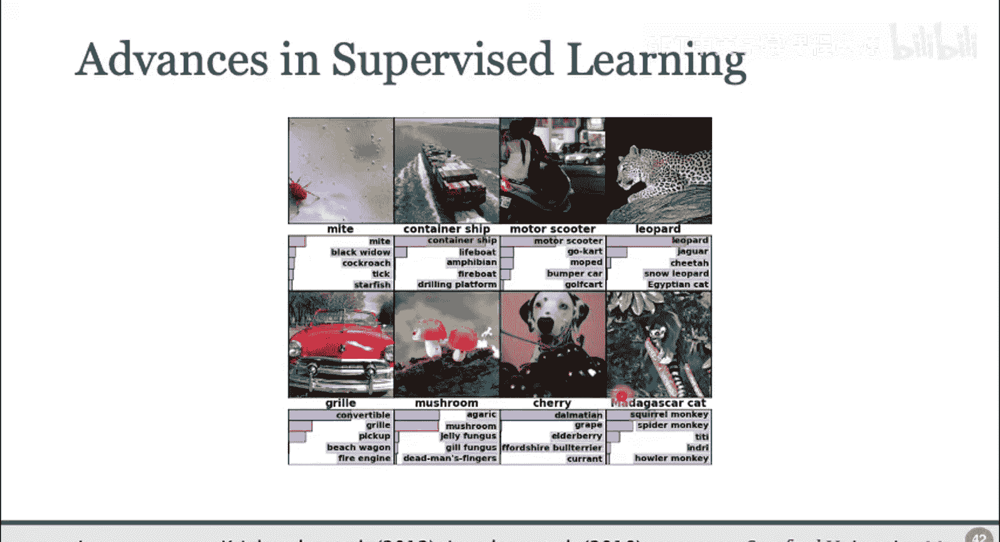

So this is how the performance of the top performing machine learning algorithm has developed over the last 10 or so years。

So first， to start with， machines got it wrong around one third of the time， which， to be honest。

 is already pretty impressive。 had I not known anything about machine learning。

 I would have been impressed by a machine learning algorithm that gets it right two thirds of the time when assigning such detailed labels。

But the really shocking thing is that this improved massively over the last 10 years alone。

 and I don't have up to date data here。 so by 2017 it had already hit around 2%。

 so I assume this is now around 2% mistakes。What is even more remarkable about that that a human gets it wrong around 5% of the time？

So in other words， machines are now systematically outperforming humans in something that we would have thought as one of the things that humans are particularly good at。

 which is in this case， image recognition。Now I presented here advances in supervised learning。

 in other words， advances in prediction， for example， image recognition。

The results I just shared show the incredible success of machine learning at solving supervised learning or prediction tasks。

 but the success of machine learning goes far beyond those supervised learning tasks。

 and I think there are many other areas we will hopefully be able to learn from。So specifically。

 there is a whole area of so called unsupervised learning。

 which tries to find structure and data where there are no labels， but instead for example。

 tries to find clusters of points that look similar to each other。

Another example in that space is topic modeling that we can， for example。

 apply powerfully to understand structure in text。So， topic models aim to。Group documents。

 for example， by their topics in order to automatically extract structure from massive corra of text that would then allow us to understand for example。

 how text has changed systematically over time， how certain topics have changed over time or what the prevalent themes in a large body of text is。

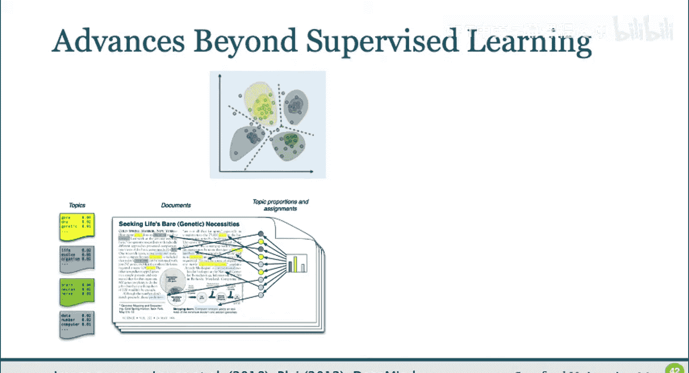

I want to end this small overview over the successes of machine learning on one other example that has a slightly different structure but I think shows nicely how far we've come from classical artificial intelligence and all the way to where we are these days with modern machine learning。

 and that is humans playing against computers， or more specifically computers more and more winning against humans at very complex games like chess and Go。

So when computers first beat humans convincing the chess。

 the idea behind the programs used there was very much still one in the classical paradigm of artificial intelligence。

 where we use expert knowledge， where we use human understanding of the logic of the game and experience in order to code up explicit rules。

 how the computer should play chess。But modern computers。

 and specifically those that first war convincingly against humans at go， specifically Alphago。

 they actually work much more like modern supervised learning in that they are trained on existing playss by computers。

 but also by humans， in order to learn how good humans play in order to learn and mimic them in order to learn how to play against them。

But now， the even more modern。Programs that win convincingly， both against humans and against。

 for example， Alphago。 for example， Alpha 0， they work on an even more advanced paradigm where they don't even require anymore to learn against humans。

 They are able to completely only play against themselves。 and by doing so finding。

Good plays that are dominant both against human play and against computer play。

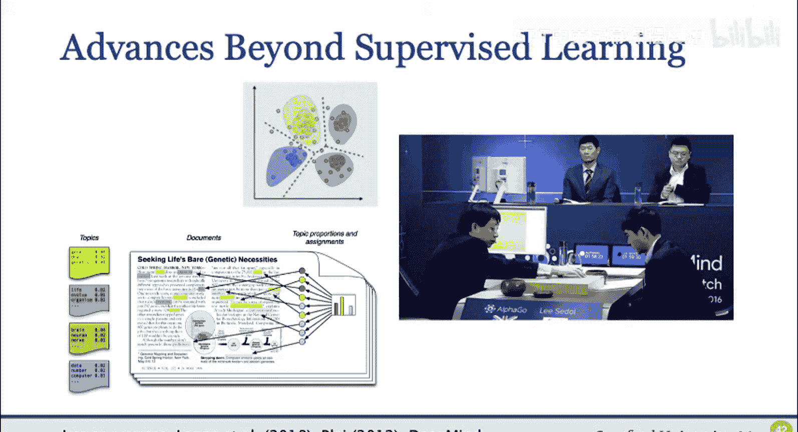

So with these motivating facts about the tremendous success of machine learning。

 I now want to go back to the goal of this webinar。

So specifically， we are not going to teach you state of the art machine learning here or how to fit your neural net。

This webinar is much more about trying to connect this world of machine learning。2。

 the world of applied econometrics and behavioral science where we want to use machine learning as a tool。

Specifically， we think there are plenty of resources out there to learn machine learning as well as the statistics behind it。

 not just the kind of deep learning that I just hinted at。

 but also the more statistical learning that is sometimes more applicable to the kind of data sets that we have in behavioral and social sciences。

And so rather than showing you how to use those machine learning tools， technically。

 we want to show you how to use them conceptually and how you can apply them concretely in program evaluation。

And so specifically my goal for the next two of those modules will be to present you with a framework for using and critically evaluating machine learning in applied econometrics on which we will then build in order to bring it together with typical tasks in causalian friends and program evaluation。

And so specifically， we want to end on giving you some concrete tools with which machine learning can actually enhance applied work。

So throughout I should clarify， I will focus on supervised learning on social science type data。

 so I will neither deal a lot with unsupervised learning or for example topic modeling nor will I dive deep into solving machine learning problems when we indeed have like very large pixel maps that we want to learn from or we want to solve image classification problems I will be much more concerned with typical social science type data sets where。

 for example we may want to predict house prices from the characteristics of houses or we may want to learn who we should target。

When we think of eradicating poverty。I will also only touch on some of the technical challenges implementation。

 A lot of work has gone into making all these things computationally feasible and making code available that efficiently run so that you can run many of those methods on your computer。

 I will take most of this as given。And I will focus on using those tools rather than， rather than。

Kind of coding up these tools ourselves。 but I will try to give you enough understanding of how they work so that you conceptually know what to look for and where you should be careful and where you can hope that those tools can help you improve your work。

Finally， I should flag that this is very much work in progress on an evolving agenda。

 so many of the things that we're going to talk about are very close to current research and they may as well change over the next few years。

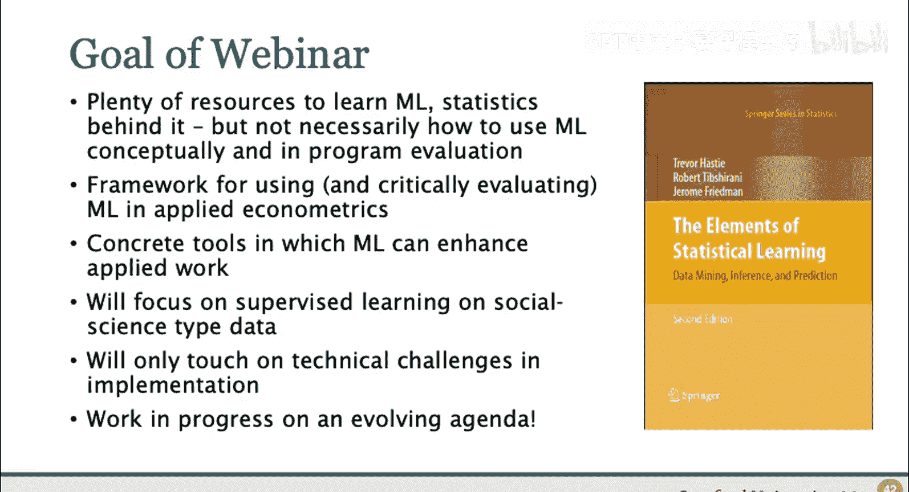

So with that， this is the structure of my part on machine learning basics today in this module I went over an introduction where I argued that a lot of what is driving modern machine intelligence has the structure of a prediction exercise where I take some training data。

Their training data has some outcome Y， some right hand side variable X。

 which looks very much like statistics。 and I now learn a function from that in order to apply it to new instances。

Tomorrow in our next module we want to understand what the secret source of machine learning is。

 we want to understand what makes this kind of prediction be so successful when it seems a very。

 very hard task if we were to use our standard linear regression tools which hardly would fit to something like a complex Pix map。

And in my third and last module。Of this first big chapter of our webinar。

 I want to then end on characterizing the differences between the。

Techniques that come from machine learning and those that we typically use in econometrics by pointing out that the two of them fulfill different goals。

And I will want to use that in order to。Provide a bit of a framework of where we can use machine learning most profitably and where we have to be particularly careful in using it。

See you then。

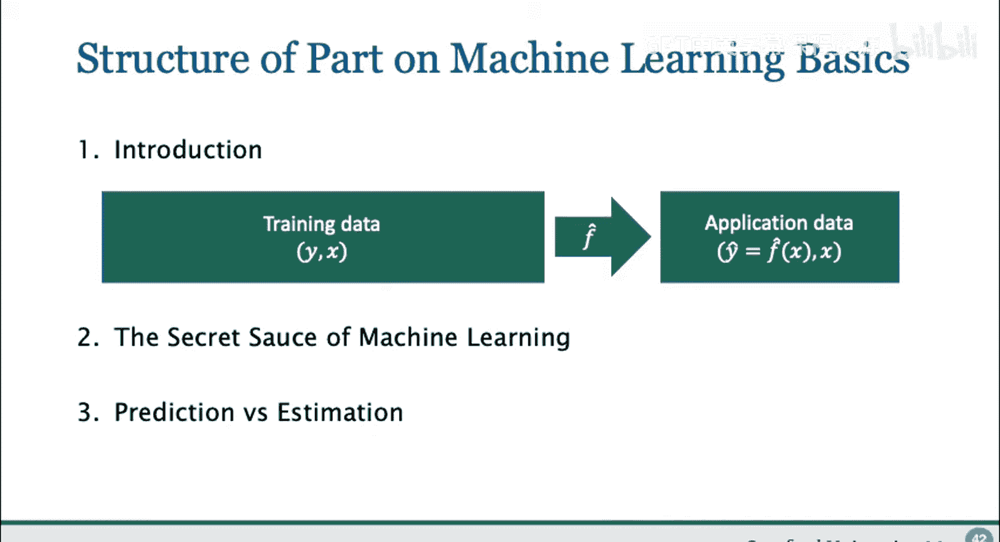