# 斯坦福商学院《机器学习和因果推断｜Machine Learning & Causal Inference： A Short Course》claude-4s p03 -03-Applied Machine Learning_ Secret Sauce.zh_en -BV1M9W7zCEsf_p3-

Welcome back to the second part of this webinar which introduces machine learning from an applied perspective。

 targeting specifically researchers and practitioners of applied Econometrics who think about how to add machine learning to the econometric toolbox and want to understand how novel tools based on machine learning can improve practical empirical analysis。

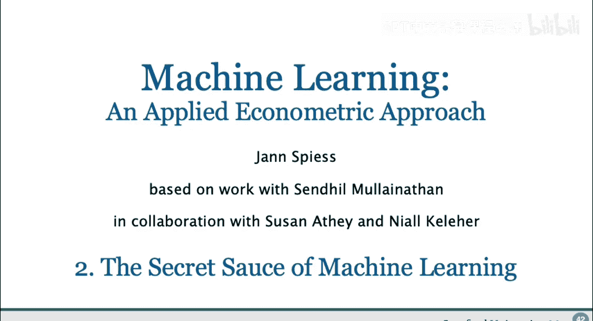

In the previous module of this webinar， I argued that machine learning is particularly good at solving prediction problems where we want to find a good prediction function from some training data that extrapolates well to new data points。

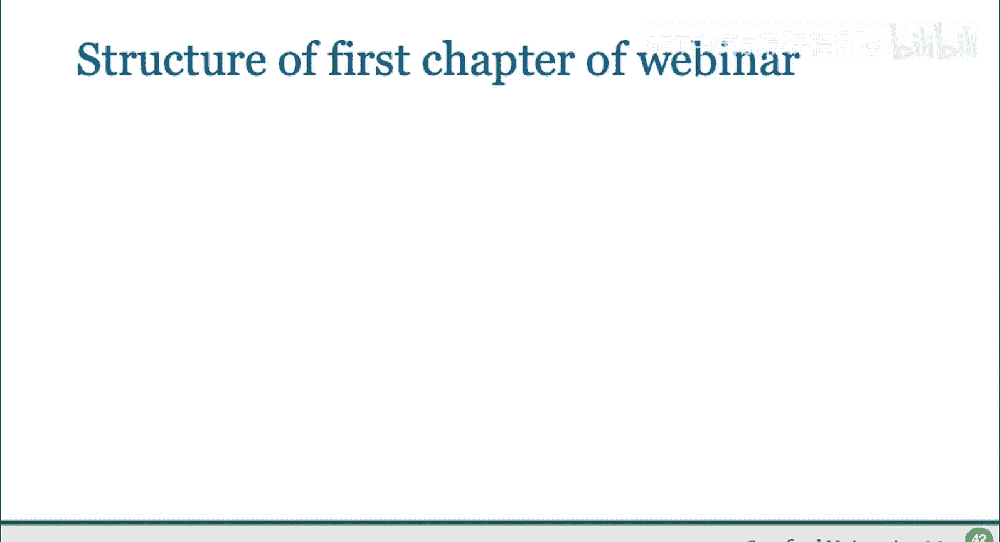

I also argued that the solution to such prediction problems has been essential to the progress that has been made on solving machine intelligence problems。

In this module， I want to ask how machine learning does so well at predicting。

 especially in very complex data and using very complex functional forms。

I will then go on in the next part of this webinar to discuss some implications of the way that machine learning works。

 and I will particularly be interested in asking the question how machine learning applies when we are actually interested in estimation。

 including in causal estimation。

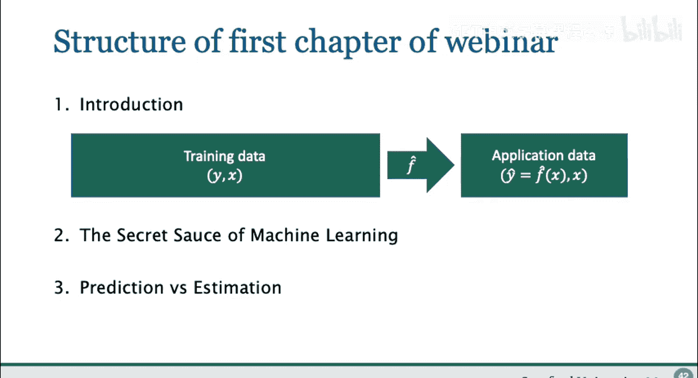

For now， however， I will fully focus on solving a prediction problem。 So here is our setup。

I assume that we have a training data set。With data points that constitute of an outcome Y and and right hand side variable or covariate x。

 And our goal will be to predict y from x。To make more precise what that means。

 let's assume there is also some loss function。That loss function expresses the cost I have to pay whenever I predict why hat。

When the truth is why。And I deviate from the truth why。

Our goal is then to predict the outcome Y on a new data point drawn from the same distribution。

Based on the Covariate x and using some prediction function F in a way that this average loss is as small as possible。

Now， the way that I have said that so far sounds very much like standard econometrics。

 There's some outcome Y， some covariate x。A first difference between standard econometrics and machine learning is simply that these variables are usually called differently。

 whether you talk to an econometrician or somebody who is trained in computer science。

And specifically， what I would call an outcome variable Y。

Would be called a label in machine learning。 And what I would call a covariate X is typically called a feature。

So let me rephrase the goal of machine learning。The goal of machine learning is to take some training data set with label data。

So we have labels and features for every instance in our training data set。And from that。

 we want to find a prediction function such that the average loss or the risk is small when we predict the label from the features on new data points。

 and I should clarify that here I am talking about supervised learning。

 supervised learning meaning that we actually have labels in our training data set。

 and we don't have to， for example， find structure in the excavvariates without being guided by those labels。

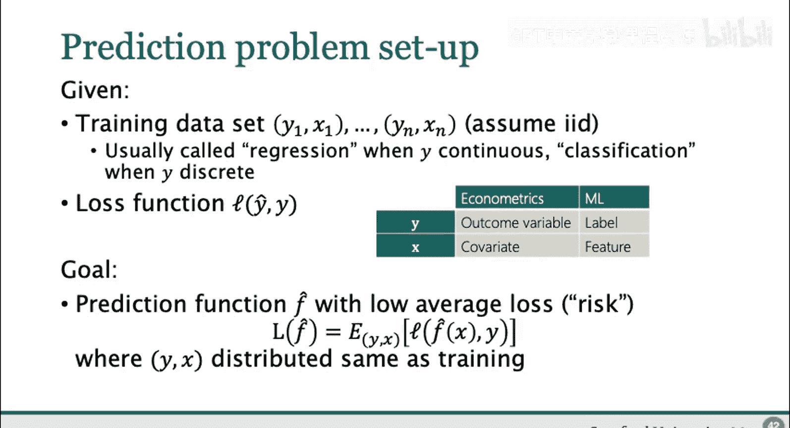

2 standard version of this prediction problem come to mind。The first， called regression。

Is when the outcome variable itself is continuous。A standard loss function that we often use either for convenience or because it has good properties for the specific task at hand is square error loss。

 where our goal is to minimize the average square difference between our prediction。

And the true label on new instances drawn from the same distribution。 In other words。

 the loss function here is simply y hat， which is our prediction minus y， which is the truth squared。

So two examples that I will use throughout today's module。We could， for example。

 be interested in predicting lockhouse prices y of a new home based on the characteristics X of that house in some serator of homes with the same distribution。

And so in that case， we would use whatever we know about our training homes in order to find a relationship between house prices and characteristics so that we can then say something about houses whose price we don't know or whose price we want to determine。

 but where we have those characteristics or features available。

A second example I will use throughout the module today is that of predicting consumption based on household characteristics。

 and that turns out to be a very important task， for example。

 when you think of poverty targeting and and the targeting of social programs to those people who are particularly poor。

 where consumption may be good measure of their poverty。

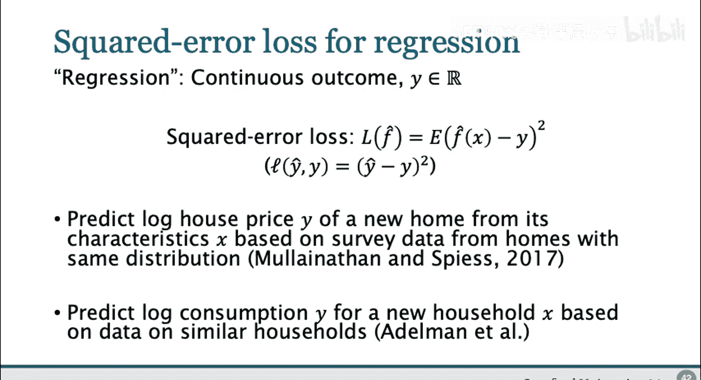

A second canonical case of prediction is when the outcome of interest itself is binary。

And in that case， we call the prediction exercise classification。

Let's think of the case where the prediction itself is binary。 So basically the truth is 001。

And I give you my best guess of whether that variable is 0，1。In that case。

 there are two ways in which I could make an error and therefore two cases in which we may want to associate a price with the error we make。

The first case would be the case that the truth is actually 0， but the prediction is one。

We would call that a false positive or a type 1 error。A second case happens when the truth is one。

But my prediction is 0。 We would call that a false negative or a type 2 error。Now。

 if I now wanted to design a loss function， I could， for example。

 put certain prices on type 1 and on type2 error， possibly informed by the specific problem I care about。

And then try to find a classification function that minimizes that error or that minimizes that price associated with those errors。

In many cases， however， when we are in the case of binary classification。

 we actually predict the probability of the outcome being one。

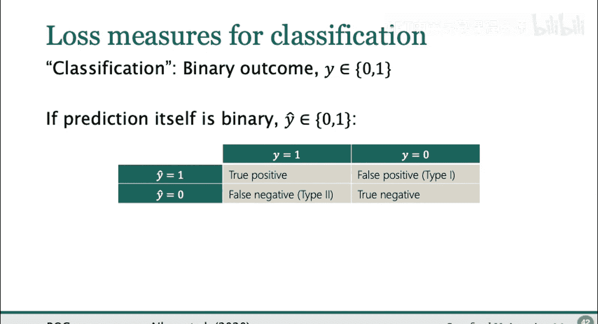

And in that case， one popular way of quantifying the quality of the classification rule。

Is to plot the receiver operating characteristic curve。

That on the x axis has the false positive rate， and on the Y X has a true positive rate。

So were every false positive rate。Which is the proportion of false positives。

E as a fraction of all negatives， meaning the fraction of false positives as a fraction of false positives and true negatives taken together。

I then plot the true positive rate， which would similarly be the fraction of true positives among all positives that are in the sample。

 So in other words， the fraction of those that I call one among all that are actually one。

So I can now do that at different thresholds， so saying that I call everybody a one whose probability whose predicted probability is very high and I vary that threshold I can then plot the false positive rate and the true positive rate against each other and the further I am to the top left of that graph。

 the better my prediction is。Therefore， another way of quantifying the quality of binary predictions or classification is often to look at that curve and ask how far to the top left is that curve。

 which I can， for example， do by integrating the area under it。

 which gives me the area under the curve。So while I will not go into much detail here about doing classification。

 meaning about doing prediction with a binary outcome。

 I think it is helpful to have heard the terms receive a operating characteristic an area under the curve or AU in order to understand that these refer to different ways of quantifying the quality of an classification function or in other words。

 quantifying the quality of a prediction when the outcome of interest is 001。

I now want to go back to the goal of prediction in the case of regression。

 meaning our outcome is actually continuous。So let's assume that we want to find a prediction function F hat。

Such that the average squared error or the mean squared error relative to the true outcome y is as small as possible。

For example， we could try to achieve that by using linear functions。These linear functions。

 very much like linear regression， which is what this is。

And would simply put a coefficient on the different covariates X。

 where assume that those covariates or features themselves continuous variables。

So from the training data， for example， I could pick the coefficient beta in my linear regression。

 It provides the best in sample fit。 And this is something we are very used to。

 This is simply linear regression。 So what does linear regression do。

 It says my goal is to minimize the outside out of sample mean square error。

What is the best thing I can do well I simply look at the data I have and I ask which set of coefficients minimizes the error within the data I have。

 and that is the coefficient that I want to choose。

So let's step back for a moment and let's ask ourselves。

 how good is this method which we are very familiar with because it is simply linear regression。

 how good is this method at solving the prediction problem at hand？So。First of all。

 there is some good news， which is we know that linear least squares or linear regression has a number of optimality properties。

 and that apply to this case。 For example， we know， by Gausmarov。

 that if all the error terms here are homokoastic， meaning the error doesn't systematically vary with the covariates X。

😊，Then OS is indeed the unbiased estimator of the coefficient beta that has the lowest variance。Now。

 I just said a whole bunch of things。 I said that it is up that， first of all。

 I noted that it is unbiased because I said it is the optimal unbiased estimator。 And second。

 I said that among all unbiased estimators， it has low variance。

But it is not immediately clear whether this is exactly what we want when we talk about out of sample prediction。

 and indeed， we can now ask a question whether these properties translate into an optimal predictor out of sample as well。

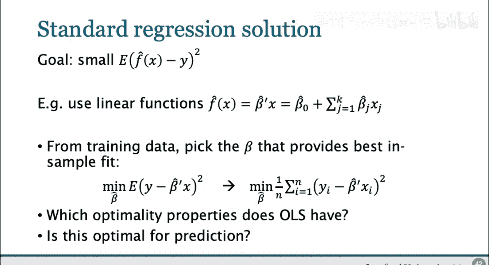

I now want to go through a somewhat formal argument to understand whether the linear regression estimator is not just good at estimating the parameter beta in a sense that we just discussed。

 which means it has zero bias and it has low variance。

But whether these properties also translate into a good prediction solution。And to do so。

 I look at a new data point， I assume that that new data point is actually generated by a linear relationship between the covariates x and the outcome y and by some additional noise。

 So I assume that this new data point is given by y equals beta times x plus some noise epsilon。

When I now estimate my coefficient beta， buy some beta hat。

 so buy the or less solution in my training data set， then I make a certain mistake。

The mistake corresponds to the difference between my prediction Y hat and the truth Y。

 or in other words， my prediction beta hat times x minus the truth， beta times x minus epsilon。

When I now square this up and I take the average over it。

Averaging both over the draw of the training sample and over the aeroone epsilon。Then， we see that。

This error has multiple components。First of all， I always make some error because there is this additional term epsilon that I cannot get rid of。

 so there will be some irreducible variance that will appear in my loss calculation。Secondly。

 there is gonna be a difference between the。True coefficient beta and my estimate beta hat。

So we have the difference between the true coefficient beta hat and beta up here。

 and we have the difference between the true coefficient beta and the estimate beta hat down here。

 but this part of my loss actually I can write as a combination of two parts。First， I can ask。

 on average， if I redraw many training data samples， is my beta close to my beta hat close to beta。

 that is the bias part， which is the difference between beta and the average of beta hat。And second。

 I can ask， as I redraw my training sample， how much does my beta hat vary from draw to draw。

 which contributes variance。So in other words， the loss that I obtain has three components。

 It has one component， which is irreducible noise。It has a second component， which is the bias。

 meaning on average， how much is my coefficient away from the true coefficient。

 And it is a third part， which is variance， which means as I calculate the coefficient again and again。

 how much does this coefficient vary from draw to draw。Now。

 this type of decomposition called a biasvariance decomposition is an important framing of the challenge of good prediction within econometrics and statistics。

 because it shows that when my interest is good prediction。

 meaning I want to be close to the truth on average。Then an estimator that is unbiased。

Is not necessarily an optimal estimator， because while it has0 bias。

 So while this bias component here is 0， it may mean that the variance component is higher than it has to be。

 And I can sometimes do better by balancing those two against each other。 In other words。

 by resolving the bias variance straight off optimally。Now， for machine learning。

Functional forms can look more complex than this linear regression。

 and sometimes the loss functions are also different than the square error loss。

 So I personally prefer a formraming that says we have a trade off here between approximation on the one hand and overfi on the other。

 So what does this mean。Approxiation bias happens whenever my function is not able to approximate the function。

 Well even on average， even as we we sample the。F many times while it is able to approximate well。

 if it is very flexible and therefore can fit the function that I want to fit in great detail。

On the other hand， such high approximation quality also means that there is high overfit。

 which means that from draw to draw， I always fit not only the signal。

 not only the true relationship between y and x， but also a lot of the noise。

 also a lot of what is epsilon here， leading to a high variance。So in general。

 I therefore like to call this an trade off between approximation overfi。

 which generalizes nicely to other machine learning methods that are not necessarily in the same space as the simple linear regression。

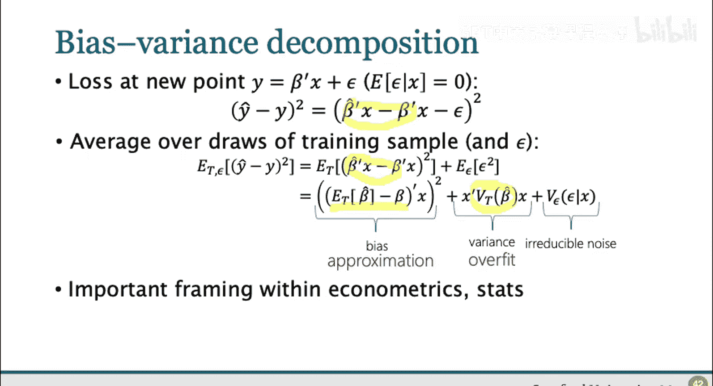

To explore this approximation overfi more and to give an example that doesn't rely on the math that I just showed。

Let's think of a case where our goal is to fit this relationship here between variables between covariates x and outcomes y。

Where my goal is to find a function that predicts well on new data points。So here I looked at those。

 in this case，8 data points， and I used a simple linear regression between the outcome y and the covariates x in order to find the relationship。

And now I could try to find out how well it does by seeing how well this line fits when I draw new data points。

 which are here in red。So I call the blue data points， my training sample。

 I call the red training the red data points， my training sample and my test sample and my goal is to use the blue data points to use the training sample to be as close as possible to the test sample points with respect to my regression line。

 So in other words， I would love to be on a line that is as close as possible to those red points here so that I predict their y y value well as a function of their x value。

Now。Let's think whether we can do better than what we see here。 For example。

 what we could be doing is we could use a more complex function that is not just a simple linear relationship between y and x。

 but we could， for example， instead， have used a polynomial of degree 2 or parabola to fit the same。

So this parabola， so this blue line that now is curved actually fits the points in the training dataset set better because it is more flexible。

 Is it able to capture the relationship of those blue points within the training dataset set better。

 However， at the same time， we see that the fit in the test on the test data points actually get gets worse。

 So what happens here， We have a more complex function。

 This more complex function is able to approximate the relationship between the。😊。

X variables and or between the y variables and the x variables in more detail， however。

 at the same time is also overfits more because some of the flexibility is used not just to fit the true relationship between y and x better。

 but also to fit some of the noise。And this one becomes even more extreme as we add more degrees to all polynomial。

 so for example， as I add two more degrees here and I look at the polynomial of degree 4。

 I see that the blue line starts to fit the points in the training dataset almost perfectly。

 however it fits the points on the test data set in a worse and worse way。So what's going on here。

Well， as we add more degrees of freedom to our functions。

 meaning as we make our functions more and more flexible。

 which here I express by adding additional polynomials to my regression。

And as I add these degrees of freedom， my ins sampleble fit， which is blue here。

 gets better and better。 So the ins sample fit goes down and down and down because the more。

Degrees of freedom I add， the better can dysfunction approximate whatever the underlying relationship is。

 and the better it will actually fit the data it has already seen。At the same time。

 for the fit on new data points， which is what I'm after here。

 recall that my whole goal is to find a function that does well in predicting all of sample。

And for those new data points， the prediction quality will increase。

 meaning the loss will go lower and lower and lower。

 but at the same time it will also start to fit more and more to the idiosyncrasies of what is going on。

 and therefore the loss at some point the net loss will increase and the prediction quality will decrease because the negative effects of overfitting。

 outweigh the positive effects of better approximation。So to summarize。

 as a model becomes more complex， it starts to fit the true function better and better。

 so its approximation quality increases。But at the same time。

 it also starts to fit the noise better and better， and the overfi also increases。And hence。

 when we do machine learning， when we want to be able to predict well in very high dimensions。

It is important that we don't just use flexible functional forms that are able to express that relationship well。

 but that we also limit their expressiveness or in other words that we use regularization in order to control how much overfit we allow。

And optimally， in this example that I just showed， would we then find a point where theres two trade off in a way where the overall prediction quality is better？

I now want to give a few concrete examples how such regular can look like。The example I just showed。

 we simply varied the。Polynomial degree in our linear regression in practice。

 that may not be the wisest way of constructing more complex or less complex functions。

 especially not in a case where there are already a lot of ex covariates available。So instead。

 what we will do here is we will explicitly include regularization。

 meaning we will explicitly limit the expressiveness of the function。

 still staying for now within the framework of linear regression。Specifically。

 rather than running the OS solution where we minimize the ens sampleble fit。

 we minimize the ens sampleble fit subject to some constraint that says that our function is not all too complex。

And specifically， we will implement this by saying that we use some norm or some pseudo norm on our coefficients。

 and we say that those coefficients are not allowed to be too large。

 So what are the typical norms that we consider here。The first one is actually not a real norm。

 but it is very intuitive， It says let's limit the number of coefficients that allow to be nonzero。

 So in other words， when I use this first criterion here。

 what I would do is I would say let's find the regression fit that only uses a specific number of variables。

 say C of the available variables。And all other variables have to be0。And based on those variables。

 I try to find the best fit。So this would give me a sparse solution。 However。

 it has the big downside that it is computationally infeible to run。

 because I would practically have to try out many different combinations of variables in order to find the optimal of it。

Instead， one frequent way in which we regularize is by using a norm that says let's put a limit on the absolute value of all the coefficients in a sense that we take the absolute value of the coefficients in our linear regression。

And we sum over those absolute values and then don't allow this absolute sum of coefficients to be too high。

A third very well behaved way of regularizing would be to instead use the Euclidean norm or the sum of squares of those regression coefficients。

And to say， let's find a solution where the sum of squares of those regression coefficients is not too high。

In all of those cases， would we practically achieve that we have a lever according to which we can control the complexity of our function。

 For example， by saying that only a given number of coefficients can be nonze or that the total size of the coefficient isn't allowed to be above a certain threshold。

I will now go through two of those examples， specifically those corresponding to the one norm and those corresponding to the two norm。

 so meaning those corresponding to the sum of absolute coefficient sizes and the sum of squared coefficient。

And and throughout， I will for， as a technical assumption and for pra practicability。

 assume that these coefficients are。Not penalized on the intercept so we don't here want to kind of shrink the intercept and that we have already normalized also already normalized the X covariates so that the different directions are actually comparable and makes sense to put a norm on those coefficients。

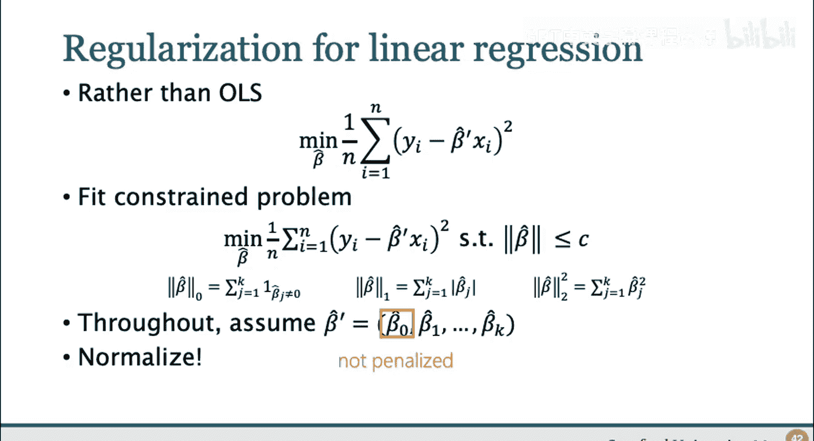

The first example I want to consider is the example where we limit the size of the coefficient in terms of the one norm or the sum of individual absolute coefficient sizes。

So what would that mean so let's take a very simple case where our coefficient is test two dimensional。

 so beta has just two directions going to the right and going to the top here。Let's also。

 in this case， consider the unconstrained optimum。And now。

 rather than allowing this unconstrained optimum， let's say that we put a limit of one on the one size of this coefficient。

What does it mean that the oneor of the coefficient is limited to one。

It means that all of the coefficients that I'm allowed to use have to lie within this simple diamond around the origin。

 and therefore， rather than finding the unconstrained optimum。

 which is in the center of those concentric。Circles。

 I would instead find the pointer is closest to that center， according to。

The distance that is implied by prediction here and within the feasible set。

 meaning within that smaller set of coefficients that is feasible in this case。Now， in practice。

 we would actually not solve this problem。 we would， in many cases。

 solve the laggrange relaxation of that problem， which replaces the constraint of the coefficient not being too high by a shadow cost that says。

You basically have to pay a price whenever that coefficient increases。

 meaning that we put a price on the size of those coefficients themselves。

 and instead we solve the Lagoian jewel that says we want to minimize the loss that we have in sample plus a cost for the size of the coefficient。

So this specific regression is called Lassal regression。

 and I now want to go through a few of its properties。

The first property that you can already see on this right graph here is that it tends to produce。

Outcomes that are not just shunk， meaning the coefficients are smaller than those for or less because we associate a cost with larger coefficients。

But there often are also spae， meaning this regression method also selects a subset of variables。

That I used in the prediction。and makes many of the variables exactly zero and the reason for that is that the feasible set for this constraint that we have discussed before is actually while it is convex。

 it is also it also has kingins， meaning that in some cases it will produce solutions that have exact zeros。

So one way of understanding what the Lasso does is that the Lasso is capitalist。

When the laso could choose multiple coefficients that are non-zero and these coefficients contribute in a similar way to the prediction。

 it tends to just choose one of them， so it tends to choose winners， so it tends to be capitalist。

And as a consequence， it tends to produce solutions with many zeroes。

So how does this look like in practice in practice。

 we can vary the cost lambda that is associated with more complex coefficients in our less regression。

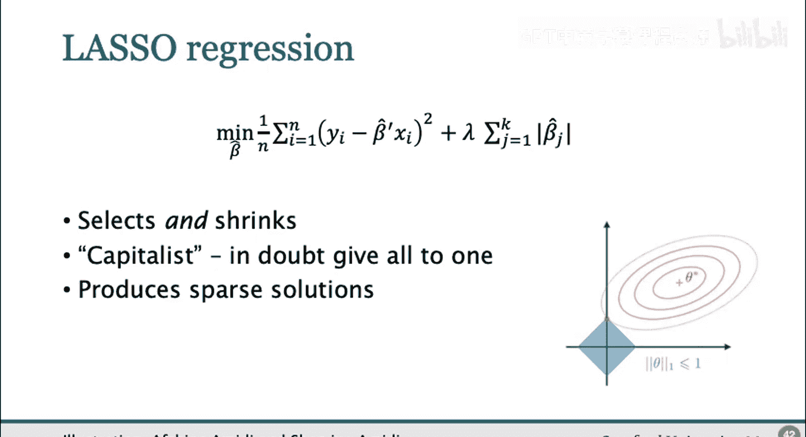

So here is one graph in which I did exactly that， so I ran a laserssoal regression。

And I varied the coefficient Lada。 So in this case， the Lada is very high on the left。

 The lambda is very low on the right。 So the axis here is inverted from the usual。

That means that on the left， there is a very， very high cost of having a coefficient that is non0。

 And indeed， we see that cost is high enough。 The optimum solution will actually set all coefficients to 0。

 Now， each of those colored lines is one of the coefficients。So as we decrease our lambda。

 as we make it cheaper and cheaper to include coefficients。

We see that some of the coefficients start to be nonze and also start to increase as we reduce the cost of larger coefficients。

Interestingly， more and more of those coefficients will enter our support。

 so more and more of those coefficients will be chosen。

 but it doesn't necessarily mean that all of those coefficients will increase。

 it can also be that they first increase and then decrease again as other coefficients are included。

So this again is one way of doing regularization， it's one way of controlling the complexity of our linear regression solution by saying let's use a constraint that works very similarly to saying I only want to fit a linear regression on a limited set of variables。

 but instead of limiting the number of variables which would be computationally。

 very hard and would have some undesirable properties。I， instead of that。One。

 to find a solution where the size of the coefficient isn't too high， where in this specific case。

 I measure the size of those coefficients by the sum of the absolute values。

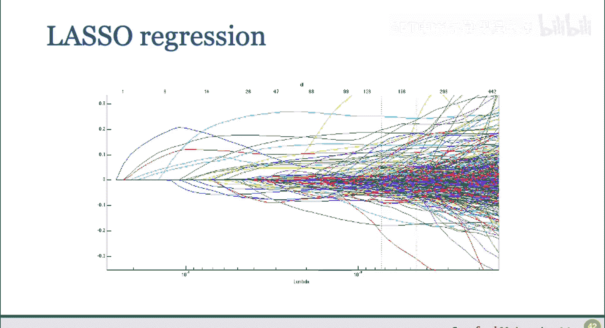

Another popular and very similar regression method is rich regression。

 where instead of the sum of absolute values， I choose the sum of squares of the coefficients in my。

In my penalty parameter， so now I have to pay a price whenever the sum of squares of the coefficient gets larger。

So how would that look like in our previous picture so in our previous picture where we considered how the constraints set looks like that limits this parameter。

 this penalty or the size of the coefficients to a specific number and that means that in this case we would limit them to coefficients that all lie within a circle around the origin。

So specifically if for example， I limit my parameters to be in within a maximum of1 with respect to the sum of squares。

 then I would exactly limit the parameters I can use to a concentric circle around the origin with a radius of1 and I would pick the solution that is closest to the OS solution in a specific norm implied power prediction。

Within that， within that circle closest to the or S solution， according to that distance metric。Now。

 unlike the laso， the properties of rigid regression are quite different。

While rich regression still leads to lower size of coefficients。

 because it puts a price on higher coefficients。It is actually unlikely that rich regression sets some coefficients exactly to zero。

Instead， if there are multiple coefficients that can play a similar role。

 meaning they have a similar role with respect to the prediction they produce。

Rhih tends to be socialist， meaning that in doubt it will distribute the predictive power between multiple coefficients and produce multiple coefficients that are nonzero。

 but not as high， rather than producing a few that are non-zero and high and a lot that are zero。

So in other words， this socialist estimator does not produce spa solution。

 instead it tends to produce solutions where all the coefficients are not too high。

 but none are too close to zero。One interpretation of this estimator is that it can be interpreted as a Bayesian posterior。

 where I'm assuming that I have priors on my coefficients that are normal and center around zero。

 so it expresses a belief that coefficients are more likely to be closer to zero than further away which leads to exactly that kind of shrinkage。

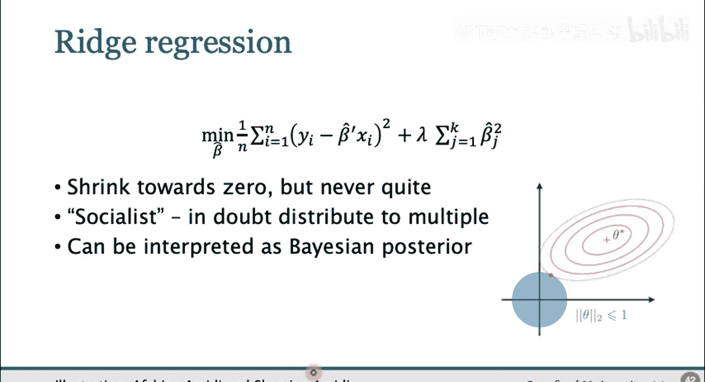

We have now seen two ways in which we could restrict the complexity of linear regression。

The first wave the laso tended to be capitalist and set certain coefficients exactly to 0。

The second or rich tended to be socialist and distribute the coefficients in a way that they weren't too high coefficients。

 but it also did not put any exactly to zero。There is a third method called the elastic net which mixes between those two by adding a penalty that mixes between the rich penalty and a lastso penalty。

 and in that case I could both play with the degree to which I want to put a price and complexity。

 so the parameter or lambda， as well as a parameter that is usually called alpha。

 which tells me how I mix those two against each other。Now。

 these were two estimators that we often call machine learning estimators。

 but honestly they are quite close to linear regression， theyre also coming out of statistics。

 the rich estimators a very classical statistical estimator。 However。

 I use this as an entry point into our discussion of machine learning。

 because despite these estimators being quite close to linear regression。

 they have many of the general structure that a machine learning estimator typically has。

And specifically， many supervised learning algorithms。

 meaning many algorithms that are constructed to solve a prediction problem are characterized by a combination of features。

 first of all， by which function class they optimize over， second。

 by the way in which they regularize， meaning the way that they control complexity。And third。

 by the way， that they solve the optimization problem of finding an estimator that。

Optimizes fit subject to the regularization constraint。

The linear regression estimators that are showed are only some examples and are now one to show some other algorithms that fall under the same kind of structure。

To motivate the next kind of estimator that I want to look at。

I want to consider one important example of using prediction methods in public policy。

 and that is poverty targeting。In poverty targeting， our goal is to find those households。

That are in particular need for support。And so we can effectively think of this as a prediction problem where the outcome of interest is consumption。

And the variables we have available， so the features we have available is whatever features we have。

 for example， administrative data that we can use to target。And so effectively。

 we are now solving a prediction problem with household characteristics on the right hand side and consumption。

 or in this case， we use lock consumption on the left hand side。

Let me now give you a very concrete example， where we simply。

Predict lock consumption using just two variables。The two variables we consider here is the number of residents on the X axis and the number of rooms on the Y axis。

And here we see the predictions by color gradient plotted as colors。So specifically。

 we see here predictions based on the linear regression of log consumption on a constant rooms and residence。

And we see that a linear regression by the nature of how it is constructed has these very global gradients that translate to a gradient running in this case from the top left。

 where consumption is considered to be particularly high to the bottom right。

 where consumption is considered to be particularly low。And note， however。

 that not everywhere on this graph， will there actually be households in our sample。

 So let's instead look just at those households in the sample。

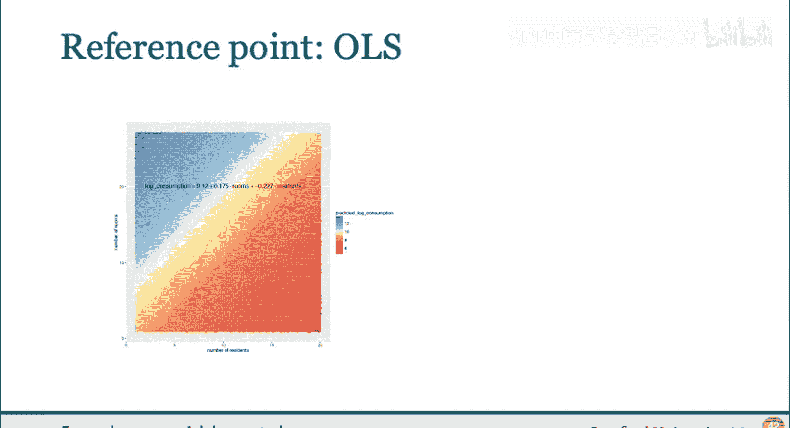

And just for those households in a sample， we see that there are actually very few households that have both a very high number of residents and a very high number of rooms。

 but there are some that have a low number of residents and a high number of rooms and there are some that have a low number of rooms and a high number of residents。

So let's see how this linear regression that tries to fit a global relationship between those two variables and log consumption。

Compares to the actual values in our sample in terms of what actual consumption is。

So while on the left， I plot predicted consumption on the right。

 what we are looking at is actual consumption。And we see that this roughly lines up in the sense that。

 yes， in the top left， consumption is indeed very high。

 which are those people with a small number of residents in a large number of rooms。And on the right。

 where the number of residents is very high， it looks like consumption is indeed very small。 However。

 when I look at this， I would argue that the linear relationship on the left is not really very good at expressing the relationship of those two variables and how they affect the outcome which here is not consumption。

So specifically， when I look at this。I would say that there could be some interaction， where。

The question how the number of rooms affects consumption very much depends on the number of residents。

 So specifically， theres a gl gradient on the left here。 So for a low number of residents。

 the number of rooms seems to go up。As consumption goes up， or I should be more precise。

 consumption goes up as the number of rooms goes up。However。

 that relationship is less clear on the right。 It seems to be that basically most people who live in a household with a very high number of residents have low consumption or are likely to live in poverty。

So in other words， there seems to be a relationship here that is a combination of some kind of binning where there may be a critical threshold in terms of the number of residents and some interaction where the relationship between the low consumption and number of rooms。

 also depends on the number of residents， not just in a simple additive way that linear regression models。

So one way we could now go about that。Is we could step back and say well。

 didn't look like this specific function worked very well。

 so why don't we try out a few other linear regressions where， for example。

 we by hand create some of those features。We could， for example， by hand， create some of those bins。

 and we could then include interactions in our linear regression。However。

 that sounds very tedious and it is unclear whether we would be able to do this iterative process well when there would be many more than just those two variables。

Instead， what I now propose to use is a method that automatically searches for those kind of interactions。

 and specifically I now want to introduce regression trees。

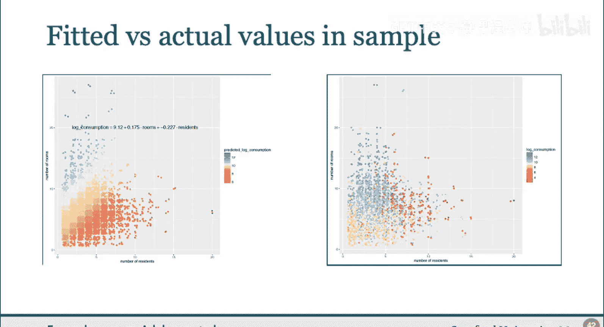

A regression tree tries to fit a different functional form than the linear regression type estimators that we discussed so far。

Specifically， the regression tree。Predicts the outcome by recursively splitting across different features。

Creating a decision tree where each split corresponds to asking whether one feature is below or a certain or above a certain threshold and then forming predictions in the final leaves by averaging over all the instances that fall within that leaf。

So let's look at one concrete example。In this case。

 let's assume we want to predict house prices and in this case。

 this regressionary that we see in front of us means that if the number of bathrooms is below 1。5。

 in other words， if the number of bathrooms is 001， then the average house price is 9。

4 which here in log units。Or if the number of bathrooms at least two。

 meaning we are going to the right here， and then the average house price is around 10 in logs。

So that would give me one prediction function。 But， of course。

 I may want to be able to get to a more precise prediction。 So I could add more。

Layers to our prediction function and now create a whole decision tree that maps the different features to the predictions in the leaves。

So in this case， this decisionry would not just take continuous。Variables into account。

 but also some discrete variables， so it would be able to split in the following way。

If I have an instance。Meaning， in this case， a house where the number of bathrooms is below 1。5。

 meaning the number of bathrooms are 01， and the floor is of type 4，5 or 6。

Then the predicted house price would be 9。1 in logs。If however， for example。

 I had a house with seven bathrooms， which means I would go right on the top。

Then I would also go right on the bottom。So， then I would go right on the bottom as well。

 That's correct。 And so my predicted house price would be 11。And so in principle。

 I could expand these regression trees more and more， and I could add more and more layers。

 So let's see how such a method would do in our poverty prediction example from before。

On the left here I'm plotting our O fitted values， and we saw that by the nature of OS。

 OS tries to fit one global gradient， meaning that the marginal contribution of the number of residents and of the number of rooms is unaffected by the value the of those variables。

The regression tree goes in the opposite extreme。The regression tree recursively fits a tree that tries to explain the outcome as well as possible by recursively splitting and thereby finding interactive effects。

So， for example， this tree here first splits by number of residents and then within number of residents。

If the number of residence is very low， starts to split by the number of rooms。

While if the number of residence is higher， may split again by the number of residents。

And thereby it is able to express a strong interaction effect between those two。

 specifically that the gradient with respect to number of rooms looks quite different for low number of residents than it does for high number of residents。

And indeed， it looks like that in this data， a high number of residents by itself is already indicative of low consumption。

 while only among people among households with lower number of residents。

 we see a clear gradient with respect to the number of rooms。

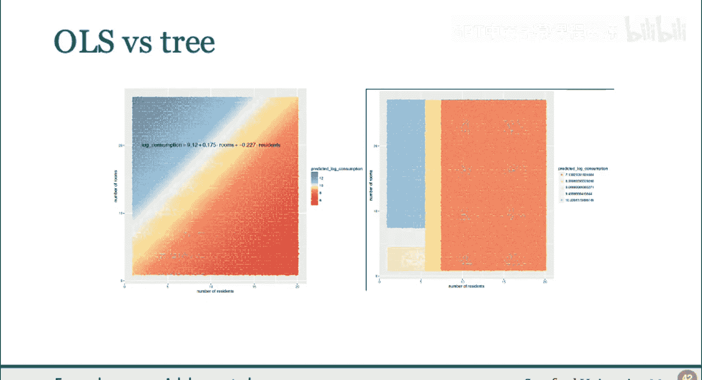

I now want to discuss how to find an optimal tree。Specifically。

 there are two challenges with finding a great tree here。

 The first challenge is actually computational。 It's not easy to find a tree that fits optimally。

 And that problem， we typically solve by using a greedy optimization algorithm。

 which recursively finds a tree， which is something I mentioned repeatedly in passing。

 So that just says that rather than finding one optimal tree。

 we find a tree by always doing the best thing one step ahead。

 but not necessarily the best thing overall。 So in other words。

 we fit the tree by first splitting across the variable that looks best in the first split。

 and then in each of the leaves splitting again by the variable that looks best within that leaf。

 and then fitting again at the third level within the variables that look best within the respective leaves without taking into account that I will further split the leaves。

 but simply doing it one step ahead。 So that's the first challenge。the second challenge is that。

Where do I stop， right？ I could simply continue splitting more and more。

 I could always improve my fit by adding another split by， for example， in this case。

 on the bottom leftmost leaf， splitting further than just by those two variables or three variables that are splited at that point。

So in other words， why wouldn't we simply continue to split more and more and more until there is only a single home left within each of the leaves？

Well， the answer is pretty intuitive。 If there was really only a single home left within each leaf。

 we would be able to fit whatever data we've already seen perfectly。But at the same time。

 it's very unlikely that this would produce a good prediction out of sample。

 because for a house that we have not yet seen。The leaf it will end up in。

 there will only be one other house that may actually be quite different。

And that may turn out to be a very bad prediction。So， in other words。

We again see that there is an approximation overfit trade off here。So， in this case。For example。

 the number of levels that we allow our tree to have。 So the number of levels at which it can split。

Determines the approximation， but also the overfi。The more levels we have。

 the better the approximation is， the better this tree is potentially able to fit to any even very complex relationship。

But at the same time， the more overfi we get。 So the more idiosyncratic this fit may be。

 which could then actually make our outer sample prediction worse。

So as before we have the following structure， we have a function class。

 the function class here is the function class of regression trees。

We have a regularizer which could for example be the number of levels of our tree。

 it could also be something like the minimal number of instances I want to have within each of my leaf before I stop splitting。

And then finally， we need an algorithm that actually solves that problem for us。

 which in this case I briefly mentioned， is a greedy algorithm。

 meaning an approximation algorithm that gives us a good result。

 even if that result is not necessarily an optimal one。

So this means that this tree falls very much in the same follows very much the same structure that ridge regression and lasersser regression did。

Although the function class is quite different and the regularizer used， of course。

 is also specific to that function class。However， just like in the case of lasersal regression or which regression。

For the tree I have told you that we should regularize。

 meaning we should choose a complexity parameter in order to avoid that the complexity is too high。

 but I have not actually told you how to choose that organizationization parameter。

 I have not actually told you how to choose that lambda that expresses the price of complexity for Rige and Lasso or I have not told you how to choose the number of levels that our tree should have。

So before I tell you how this is done in machine learning。I want you to think about that。

 for a moment。How would you go about choosing the right parameter。Well。

 here is a trick that we can use。Assume that we。Split our data into two parts。

And as we did in the pictures before， we fit our data on some data points and then we use some other data points in order to see how well we do。

Before I fitted our data on eight data points and I looked at eight other data points in order to see how well we do。

Now we repeat this for all the different complexities we consider so in the starylizedt example before we considered first a simple regression line it was linear。

 we then considered a parabola meaning a polynomial of degree 2。

 and then we also considered a polynomial of degree 4。

And rather than taking as our guide to choosing how complex to be the ins sampleble fit。

 which is what happened within the blue points only。

 which would only tell us that more complexity is good。

We could now simply use the fit on those rat points and say。

 how well do we do on data that we have not yet seen？Of course。

 that's a great thing to do if you have a lot of data。

Meaning that we can still use a lot of data to fit our function and then a lot of data to see how well we do that would then allow us to choose our regularization parameter optimally。

In practice， however， data is often scarces。 So let's take the case where we actually don't have the luxury of having those eight points and then an extra8 points。

 so we don't have the blue pointss and the red points in addition。

 But let's assume we only have those blue points。 so we only have those points。That。

We have already used to fit our data on。 So what could we have done differently in order to。

Get information about which regular parameter to choose。

And the answer to this is that we can use a trick by repeating the holdout exercise that we ran here。

 which was that we held out some data that we hadn't looked at for a prediction exercise and repeat the same ins samplele within the points that we have already seen。

So specifically what we could have done is we could have done the following among our eight points that we used before to fit our regression line。

We hold out two of them at a time。So the first time we do it。

These two red points that you see in the top left quadrant here。

 those two we do not include in fitting our regression line。And instead。

 we use them to evaluate the fit out of sample。When we do it the second time we take hold out two other of the points。

 third time， three other of the points， the fourth time， two other of the points。

 so in other words we divide our set of points in this case into four groups。

 every time we hold out one of the groups， we only use all the other groups。

 and then we evaluate how well we do。By seeing how well we do。

 on average across this holdout exercise。So this is called cross validationation。

And when we think about how to choose the regularization parameter。

 we could either do that by doing a holdout sample。

 meaning we create an out of sample in our sample by simply not using certain points to be fitted。

 but in order to avoid losing a lot of sample size。

 we could then extend the same to cross validation。

 which means that we create repeated holdouts within our sample。

So this is how this would look like we create falses before these folds were four folds。

Every time we use only the data that is not in the current group for fitting our function。

 so this would be the red data in every case， and we hold out the data that is in the currently active fold for validation。

 so here we would hold out the first fold。We would then calculate our error。

 meaning the loss that we incur when we predict from the red to the green points。

 and we would then evaluate our full fit by averaging that error over all those folds。

 meaning we produce an error that on average gives us the answer how well our function does out of sample。

The secret source of machine learning therefore does include at least one additional ingredient。

In addition to using very flexible functional forms and limiting the expressiveness using regularization。

One key element is also to use the data to learn how much to actually regularize。

 which is called tuning， and typically we do that by doing cross validation。

 which is the method that I just briefly introduced。

So here therefore is the typical structure of a machine learning prediction exercise that also translates to many applications that you will hear about in future webinars。

So we typically divide a sample into two parts， one on which we fit our function and a second that we hold out for final validation。

On the fitting sample， our goal is to obtain a prediction function F hat。

 which we do by first run in cross validation in order to find which parameters we want to use for the complexity of our function。

 So in other words， we use tuning data driven tuning using cross validation to determine our regularization parameters。

We then fit that function， and then we use that function， and we estimate its final properties。

 For example， its loss on the holdout sample。So why is it important that we hold out some additional data here？

Well， despite our best efforts and using cross validation in our fitting sample。

 because we have now chosen all of our tuning parameters based on the data itself。

 the loss that we obtain in cross validation may still be optimistic because it was evaluated at the best possible choice of tuning parameters in terms of the measurement of our loss to cross validation。

 so when we do such work， it's always important that we keep some final data that we have not touched to verify how well we are actually doing。

And here is where the firewall principle comes into play as long as we make sure that we have not used the additional holdout sample other than for final validation of the final function。

 we have not used it at all for choosing the function。

 as long as that is given then very simple econometric guarantees。

Make sure that our final loss estimate， for example。

 is unbiased and can be estimated well with valid standard errors。

While whatever we do on the fitting sample。does not have to follow any specific protocol but can include trying out some different methods since that would not affect our final estimate。

And so that gives econometrics in my eyes two different rolls on the two different sides of that firewall。

First of all。For sure， we want to be able to have a guarantee on how well our prediction function does in the end。

 and we achieve that by taking a holdout sample and by using， for example。

 valid standard errors creating confidence interval for the performance of our function on the holdout sample。

At the same time in the fitting sample， econometrics can be extremely helpful in understanding better what kind of function is likely to do well in a certain case。

However。In the end， which function does better is a purely empirical question。

 It is a question of which function does well out of sample and we can show to have good out of sample properties。

 assuming that our only goal is indeed the prediction exercise of finding one that predicts well out of sample。

 So that liberates a somewhat in what we can do on that fitting sample we can use different functional forms we can see which one of those look best and we can even combine multiple of those。

 which is something I will go back to in a moment。So far I argued that two of the machine learning methods that we encountered。

 specifically regularized linear regression and regression trees have a common structure。In that。

 they combine very flexible functional forms。With a regular riser。

 so with a way of limiting expressiveness， as well as a way of using the data to decide how much flexibility to allow。

Of course， there are a number of important researcher choices here。First。

 we have to actually know which class function we want to optimize for。

AndAnd that may depend on our specific application。Second。

 we have to make sure that we split and manage the data in a way that the final estimate actually represents。

A estimate of a loss that we care about in a way that we， for example。

 make sure that we predict an outcome of interest in a way that is representative of the way that we。

 in the end， want to use our prediction function。Another important choice is how we represent the features in our data。

Especially for linear regression， results may look quite different depending on how we represent the information in our X variables。

And finally， importantly， we have to decide in the first place which function class and which regular riser to use。

So far， as I said， I focused on linear regressions with regularizers given by limits on their coefficients。

 as well as trees where as regularizers， for example。

 I discussed the number of levels that the tree has or the of instances that should be at least in each of the leaves。

I now want to。I now want to argue that this structure is more general and encompasses many other machine learning prediction methods as well。

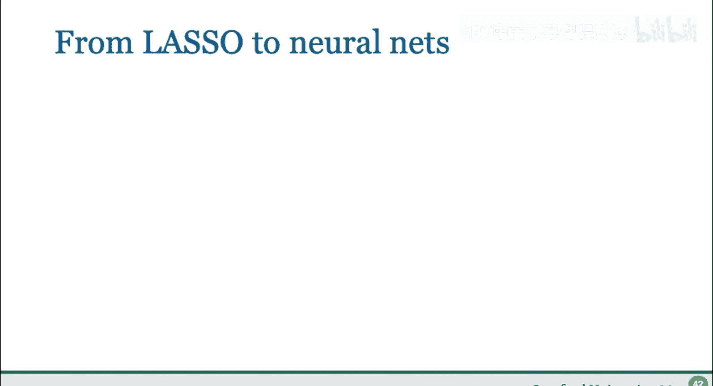

So specifically we can characterize many of the methods that are available by a combination of function class and regularizer。

 and in many cases there is also an additional level of which optimization algorithm to use。

Let me give you one extreme example。

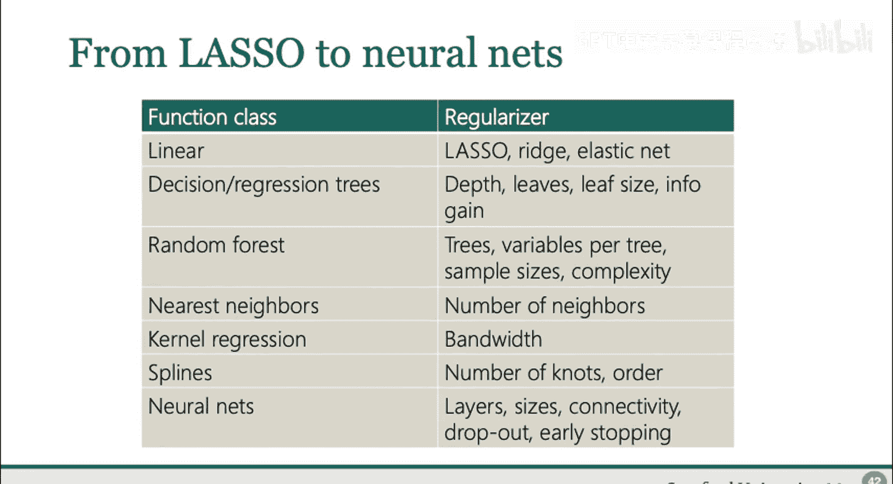

For neural networks， which we discussed。In our first module。

 there are different ways of regularizing them。 So first of all。

 note that a neural network was basically something like a logicit of a logicit of logic。

 So it was a function that depended itself on functions of the input or a function of a function of a function of a function of the inputs。

 So these neural nets can become arbitrarybitrarily complex， the more layers we add。

 So this already suggest one first way of regularizing， which is limiting the number of those layers。

 the less layers， the less expressive manual network is。In the same way。

 the more connections there are between layers， the more expressive manual network is。

 and therefore also the more prone to overfitting it may be。Now。

 that may be a pretty obvious way of regularizing， but there are some ways that are less obvious。

 Here is one particularly smart way。So one smart way of regularizing is called early stopping。

 It says rather than optimizing the neural network more and more and more。

 Why don't we just stop the optimization algorithm at a certain level， for example。

 after a certain number of stops。 That will mean that the optimum I find is not actually an optimum within my sample。

 but instead stops short of trying to fit the ins samplele fit optimally Now。

 that may sound like giving up on optimization correctly。

 but it actually has the feature of regularization。

 It has a feature that avoids excessive overfit by not regular by not optimizing too much with the additional feature of not。

Needing that many optimization steps and therefore running quicker。

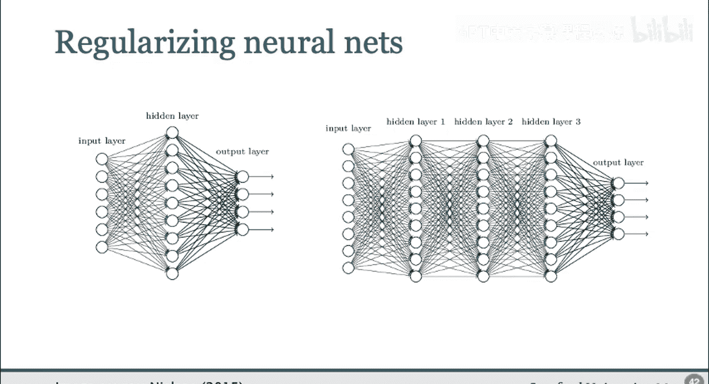

In addition to those different machine learning predictors。We can also combine。

Machine learning predictors from different function classes with each other。In that case， we could。

 for example， use a weighted average between those different predictions where we choose the weights themselves in the same way that we would choose some regularization parameter。

 for example， by cross validation， in order to find a combination that does particularly well in terms of prediction。

Now， it may not be that surprising that on average。

 these ensembles do pretty well because they basically invest in a portfolio of different prediction algorithms。

What may be more surprising is that such ensembles basically outperform each individual predictor。

 including the very best ones， routinely at prediction competitions。

 meaning that a combination of multiple prediction algorithms from different function classes seem to do consistently better than even the best individual predictor。

 suggesting that there is some complementarity between the different function classes。

A second way in which we can combine models。Is by combining models of the same class。

Some of the most successful out of the box， machine learning algorithms that work particularly well on the kind of social science data that we often deal with。

Are actually ways in which we combine multiple trees。Into a more complex predictor。

The first way we could do that is called bagging or bootstrap aggregating。

 and in the case of regression trees， aggregating many of them together will be called a random forest。

 so rather than running a simple regression tree where we just take a single tree。

 we instead repeatedly draw bootstrap samples from the data。

We then construct trees from each of those bootsstr samples。 And when we form predictions。

 we simply average the predictions across those different trees。

So while before we obtained predictions that were either from linear regression or a single tree。

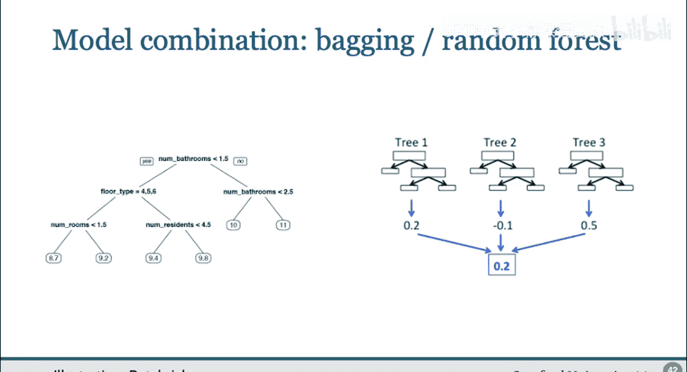

I now want to show you how it looks like when we form predictions from a random forest in the case of poverty prediction。

Or prediction of consumption in this case from a number of residents and number of rooms。

 So as you can see by combining many trees， the resulting picture is actually quite smooth。

There is some weird areas here where it looks like with a high number of rooms and a high number of residents。

 suddenly the predicted log consumption goes up again and is non-montonic。

 my best guess is that thats simply because theres not enough data in that area。

 But when I look at the big picture here， it is able to both capture the interactive effect of residents and rooms。

 as well as the gradient of rooms on the left， in a much more smooth fashion that the individual tree was。

 So just to compare those three with each other， or less has very smooth coefficients。

 but a very global structure that does not really allow for interactions。

 unless I explicitly model them。

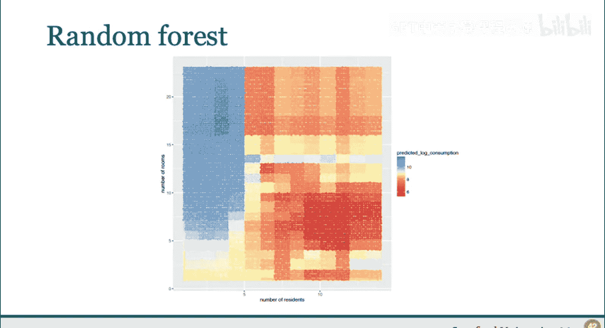

The tree allows for interactions， but at the same time。

 has a very crude way of splitting up things that is not very smooth。

 The forest here does considerably better by actually combining some of the smoothness of Oles with the ability to also fit interactions just like the tree。

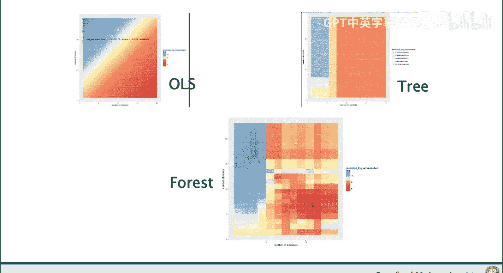

A second way in which trees are often combined and improved is by boosting。

 Boosting means I first fit a simple tree。Then I look at the arrows I make and to the arrow I make。

 I fit a second simple tree。 I construct a new error relative to my prediction target。

 and then I predict the arrow with a third tree and so on and that why I combine many trees with each other。

So rather than going into more formalism， how this works， let me just show you a picture。

So this here would be the first few steps of a booster tree algorithm where we assume that the truth which the which these blue points are drawn from basically are taking one of five different values and are locally constant。

So what happens with the first tree， So this is simply using a simple tree stamp meaning a tree that just splits once。

The first tree simply selects two areas to the left and to the right of that third bucket here。

 meaning that the first three buckets on the left， the second two are on the right。

And then it forms residuals， meaning mistakes it makes relative to the blue points。

And then it fits a new tree to those residuals。In this case， it looks like this new tree split still。

4our buckets on the left relative to the right to the bucket on the right。

 And then those trees get added up to one combined prediction。 We form residuals again。

 we fit a tree to residuals。 The new tree gets updated and so on。

So what I'm showing here you you hear is the first three iterations， as well as iterations 18。

19 and 20。 So there's quite a lot going on in between。 But we see that by iteration 18。

 the tree has actually already perfectly fitted what's going on here。 And from then on。

 it just starts to round off the edges a little bit more。 So in that case。

 we would likely learn there would be good to stop this boosting algorithm after not too many steps。

 which here would be an important tuning parameter。 Many we can regularize by simply saying。

 don't do it too often stop after a given number of steps。 And also in each of your updates。

 Don't update too much。😊，In addition to those machine learning algorithms that I have now mentioned。

 I also wanted to mention one whole paradigm that can help us construct good machine learning algorithms。

 which is doing Bayesian regularization。So when you think about what a Bayesian method would do。

 a Bayesian method is characterized by the idea that I combine a data that I see with a prior I have over how the relationship of variables could look like。

So specifically， in the case of rich regularization， for example。

 we could interpret Ridge as saying I have a prior that my coefficients are normally distributed and not too large。

 And I then form my posterior。After looking at the data in order to form good predictions。

So therefore Bayesian methods naturally provide some sense of regularization because they are shrink towards the prior。

 let the data they don't let the noise overwhelm the signal because they shrink the information that I see towards the prior。

 thereby balancing approximation and overfit against each other。So in general。

 these Bayesian methods are a powerful way of constructing regularized predictions and some of the most successful one。

 including which regression， but also Bayesian trees are actually performing incredibly well。

So let me just recap what the main ingredients of a successful machine learning algorithm that I showed you today are。

First of all， using flexible functional forms that are able to capture the relationship between y variable and x variable well。

Second， limit their expressiveness or in other words。

 use a regular riser to make sure that there is not too much overfitting。And third。

 learn how much you should regularize from the data itself。As I mentioned。

 there are important researcher choices left that you have to consider when you use such a machine learning algorithm when it comes to choosing function class and regularizer。

 we saw that you can actually also choose multiple ones and then do some more tuning in order to decide how much way to put on each。

I now want to end here with two comments。The first comment is on implementation。

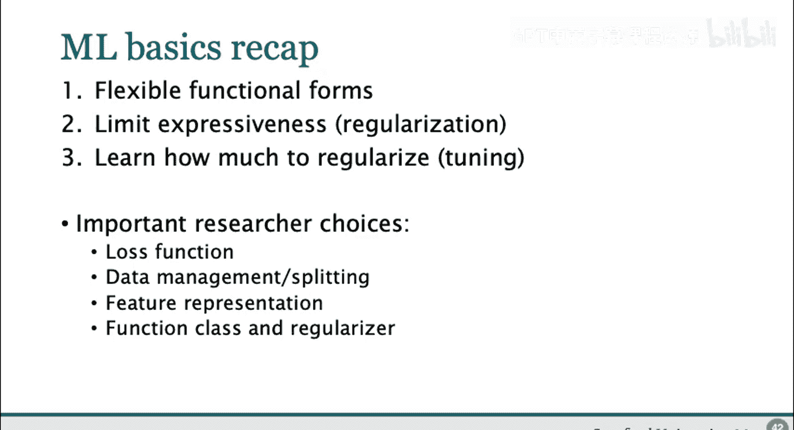

I don't have time to go into detail in this module on how you would implement these methods。

 but I wanted to point out that all of the machine learning methods I mentioned today are readily available in all major programming languages where I would say that R。

 Python and Julia are the three most natural programming languages to work in when you consider using machine learning。

A， in particular， has become a language that has many of those。

Language those methods available while also being very amenable to doing applied econometrics。

 so in many ways it would be the language that right now I would recommend if you are interested in applying machine learning in kind of an applied econometrics context where maybe computation and how long it runs is not your main concern and you want to combine some conventional staistic analysis like linear regression analysis with machine learning。

 or you may want to use some modern methods like those developed by my colleaguesleague Susan Ay。

 which are all available as our packages。

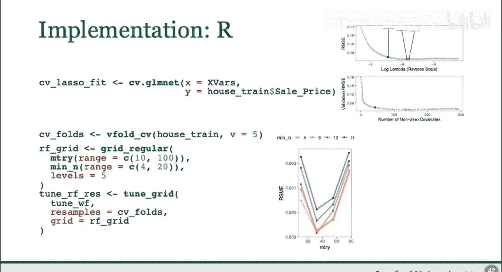

A second comment I want to make here。Is a comment on。Where all these methods come from。

 a lot of what I talked about is actually not new。 It has been known in statistics and has been used in statistics for a long time。

For example， the idea that I can improve prediction by shrinkage。

Goes back to at least James and Stein， who showed that for high dimension linear regression。Here。

 high dimensional means there is is at least three covariates。

 We can do better by including some data driven shrinkage in order to improve our prediction quality。

Rand and For themselves predate many of the recent surge in machine learning were introduced by Brahman in 2001。

Machine learning is， by some scene as just a fancy word for non and semi parametric econometrics。

And indeed， many of the prediction methods that we use today are quite similar to some of the methods that have been discussed in statistics and econometrics。

However， I would argue that something new has happened here。

One is simply that we now have much more data available in an automated way that we can all download and work with。

 including， for example， settle out images that are now all digitally available and available in a way that our computers can actually work with them。

We have the computational power， meaning we have both the。Hardware to compute。

 but we also have the software to perform that computation。

We also have functional forms that work on some other data。 for example。

 finding good functional forms， finding good neural net that perform good。

Image recognition is by itself， a big achievement。And the focus on prediction that machine learning brings with it。

 unlike some estimation tasks in econometrics。Fousees the goal and the way that we achieve things more on an engineering competition that is simply about finding good predictors。

 Now， we will discuss next module， whether that's the right thing to go for or not。

 But at least if I want to focus on a prediction problem。

 then there's focus on prediction and allows us to basically turn finding good predictor into an engineering competition。

And finally， I would say。There are some new theoretical。

 interesting insights that are coming out of research around machine learning that have increased our understanding of prediction very high dimensions to name just a few。

 I think the doubledes phenomenon which I'm not focusing on here。

 which amends our understanding of the biasvariance tradeoff is one example。

 as well as some better theoretical understanding of deep learning and treebased methods。

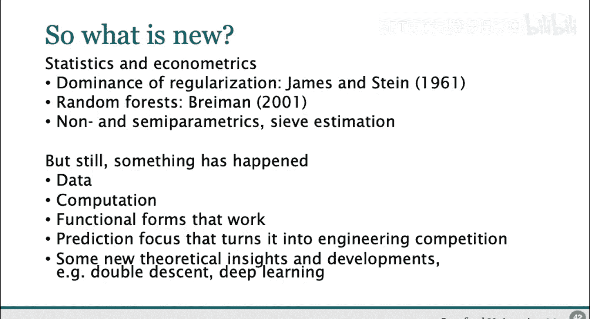

Okay， so let me re up machine learning in the way that I presented it here often is a combination of using very flexible functional forms。

 regularization and tuning。But now that we have understood that， the question for me is。

What do these features of fitting a function actually imply about the properties of the fitted prediction function。

 and how can we therefore use the prediction function we get out of it in applied work。

 And the background is that that we hardly ever focus face a pure prediction problem because often the question that we are interested in a more causal in nature。

 or we want to have some guarantees on the object we get out of it。

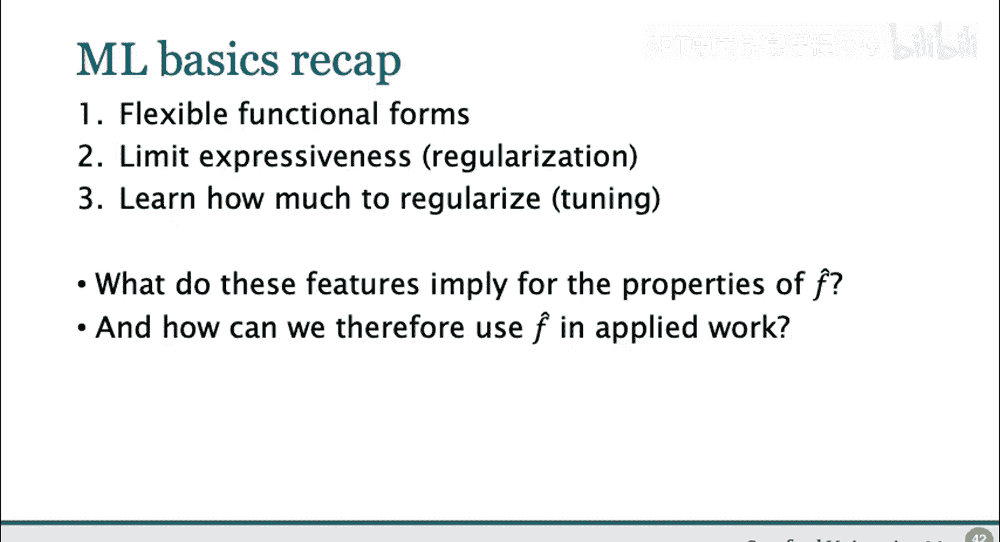

So therefore， after first motivating。What we're doing right now by pointing out that machine learning is very good at prediction and that prediction solutions are behind many innovations in machine intelligence。

And by today talking about how many of those machine learning methods work。

I will in the final and next module talk about how we can use the output for machine learning and how that output relates to classical estimation output。

 for example， from linear regression。

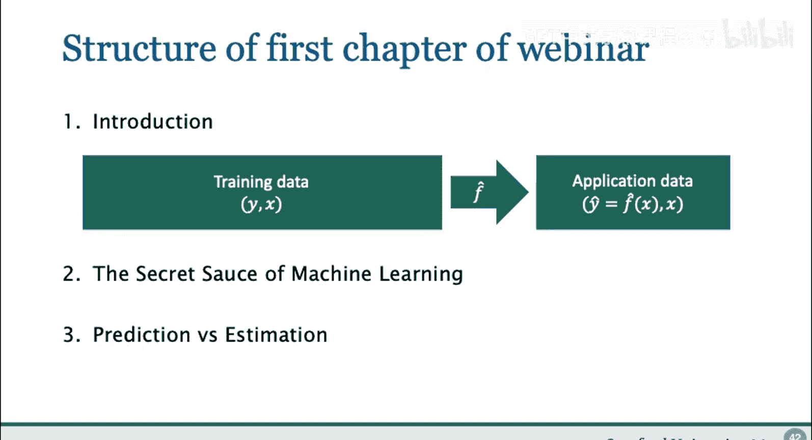

See you then。