# 斯坦福商学院《机器学习和因果推断｜Machine Learning & Causal Inference： A Short Course》claude-4s p04 -04-Applied Machine Learning_ Prediction vs. Estimation.zh_en -BV1M9W7zCEsf_p4-

Hi and welcome back to the third part of this webinar where I give an introduction to machine learning from an applied perspective。

 specifically targeted at researchers and practitioners of Apped Econometrics。

Who think about how to add machine learning to the econometric toolbox and one to understand how novel tools based on machine learning can improve practical empirical analysis。

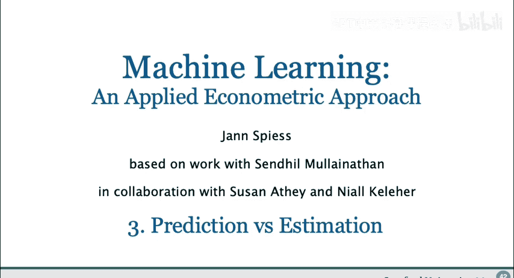

In the first part of this webinar， I motivated。Why looking at machine learning is particularly interesting。

 specifically that machine learning is very powerful at solving prediction problems and that solving such prediction problems underlies many modern machine intelligence tasks。

In the second part of this webinar。I introduced some of the central ideas of what makes machine learning predict so well。

In this last part， I want to ask。Given what machine learning does， what can we learn from its output？

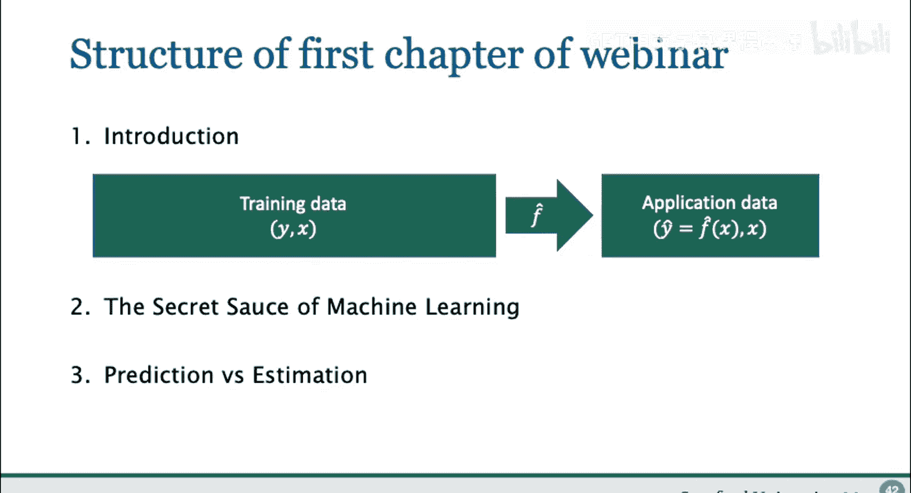

To recap the basics of machine learning from the last module。

I argued that machine learning is characterized by a combination of three features。

It uses very flexible， functional forms。But it limits their expressiveness in order to avoid excessive overfitting。

And it uses the data to resolve the trade off， specifically it uses the data to learn how much to regularize and how much overfit how much expressiveness to allow。

In this part of the webinar， I want to ask， what do these specific features。

 So what is the fact that we。Fit machine learning in this specific way。

 imply for the properties of the resulting prediction function。

 and how can we therefore use those prediction functions in applied work。To remind ourselves。

 here is the basic setup that we studied machine learning in。

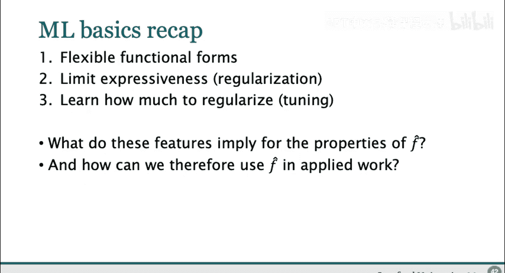

We considered specifically supervised learning or prediction where we are given a data set。

 which is the training data set of some outcome variables y and some covariates x。

As well as a loss function and our goal is to find a prediction function so that we predict y well from X with respect to that loss function。

 specifically we wanted to produce an outcome with a low expected loss where the expectation here is over a new sample point drawn from the same distribution as our training sample。

So now， assume we have solved that problem。 We have found a prediction function。

 that works really well。 Maybe that's a regularized linear regression， like a lassso or ridge。

 or maybe that's a random forest or a booster tree。What can we now learn。From dysfunction。

 F had about the truth。

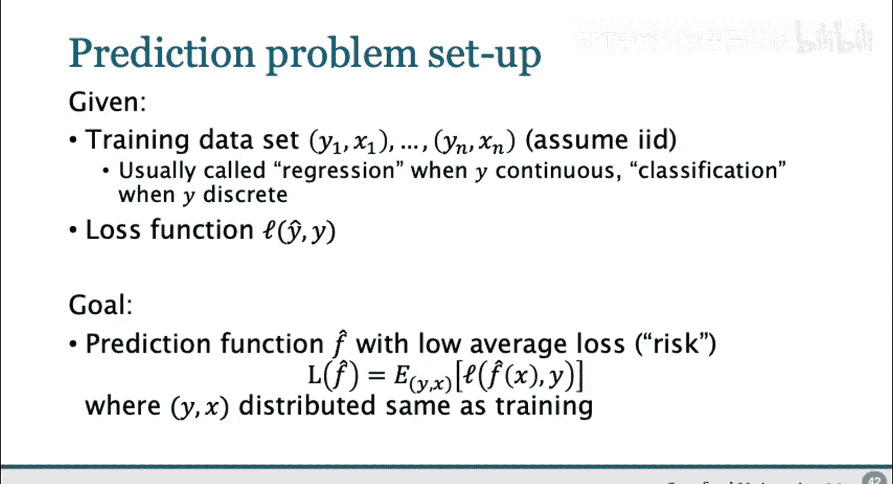

So specifically， assume we have this prediction function that fits the relationship of y to x well。

What can we learn about the world from the prediction function have had。

So often we may be interested in using a function that we fitted to the relationship of y to x to make inference on the conditional expectation of y given x。

 So to make inference on basically the optimal true relationship between the outcome y and the。

Covariiate x in this regression sense。So that may be particularly tempting to do when the output has a very common form。

 For example， when the output， as is the case in regularized linear regression like G or ridge。

 actually itself has a form of a linear regression。

 So the question is to which degree can we now use the coefficient of that regularized linear regression。

 in case sum can say something about the world。 For example， which of the。

Features in a world which of the covariates actually matter to for determining the outcome or maybe even saying something about the causal relationship between the X variables and the y variable。

So in typical econometrics， what we want to know about those coefficients。

 the kind of properties they may， for example， include the following。

We we want to know whether the coefficient has bias so whether on average it gets us to the truth。

Maybeway want to know whether the coefficient is consistent， meaning in large samples。

 it approximates the true coefficient well。We may want to also be able to do inference。

 meaning we may want to establish properties like asymptotic normality or being able to calculate standard errors or be able to perform tests in order to say something about the true parameter beta from what we learned from this data。

And finally， we may want to understand how robust our estimate is， for example。

 whether our takeaways depend on very specific features of the data or whether they generalize well。

 even if certain assumptions aren't exactly true。

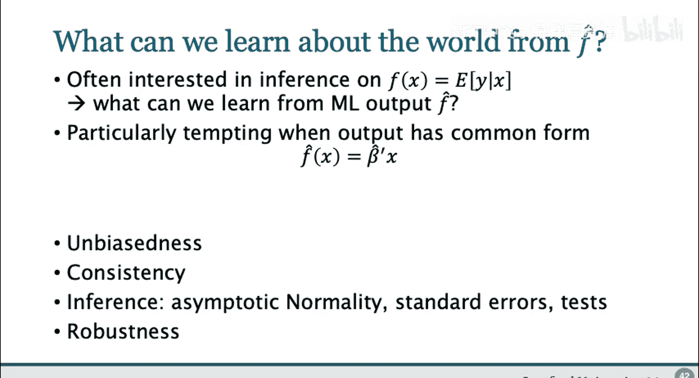

To study whether we can hope to use output for machine learning to learn something about the world in a similar way to what we are used to with linear regression。

I want to start with a laso because it produces output。 it looks very similar。To remind ourselves。

 what does the lastso do。The laso。Fits a linear regression with the additional constraint that the coefficients aren't allowed to be too large。

 that allows us to still fit the laso， even when there are a lot of x variables in our regression。

And it allows us to fit the laso in a way that balances。

The expressiveness meaning the complexity of our function against the risk of overfitting。

And so the higher the parameter lambda is， the higher the cost of complexity is。

The smaller the coefficients will B， and potentially the more of them will be 0。

So specifically we saw that the Laso does not only shrink coefficients， it also selects。

 meaning many of the coefficients may be zero， and if there are multiple coefficients that produce a similar prediction outcome。

 then the lasso may be capitalist and that it just chooses a winner and gives all to that one winner。

So what does that step from or less to lastso look in an example for that one I'm using an example where our goal is to predict default。

 so say this is default probability， and we want to predict default from a number of information in our data that would be in a typical credit file that may include a person's income。

 their age， maybe information about their education。

 maybe their credit score and some other variables here I assume there a total of 80 of them。

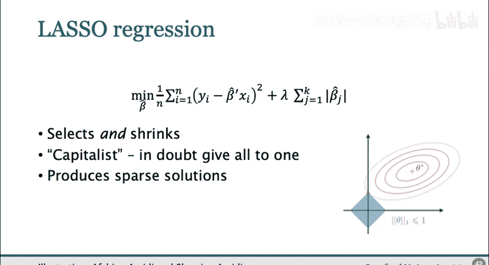

So what what does Laso do relative to OLS or the problem with OLles is that there may be excessive overfitting in that using all those variables。

 many of which may even be close to colonlineia。And may lead to very unstable and high variance coefficients that lead to bad prediction performance。

The Laso instead says， let's only use a subset of those by putting a penalty on coefficients that are particularly high or in the case of the Laso。

 implicitly also by coefficients with a lot of nonzero coefficients。So。When the Lasso selects those。

 there is a hope here that the resulting sparse solutions can actually tell us a lot about the variables that matter。

 Maybe， for example， the Lassso could be good at telling us which variables cause default to be higher or lower。

So to study to which degree we would be able to do so。

 here is an exercise that we ran in a paper on credit scoring。

 specifically the fairness of credit drawing and attempts to regulate it。So in that case。

 what we did is we didn't only run the Laso once， but we ran the Laso multiple times on different subsets of the same data set。

 so we chose 10 random subsets of the same data set。

So the distribution of all those10 subsets is the same。

And then we ran the Lasso on each of them even holding the penalization parameter Lada constant。

 and every time we checked what are the variables that are selected by the Laso in each of the runs。

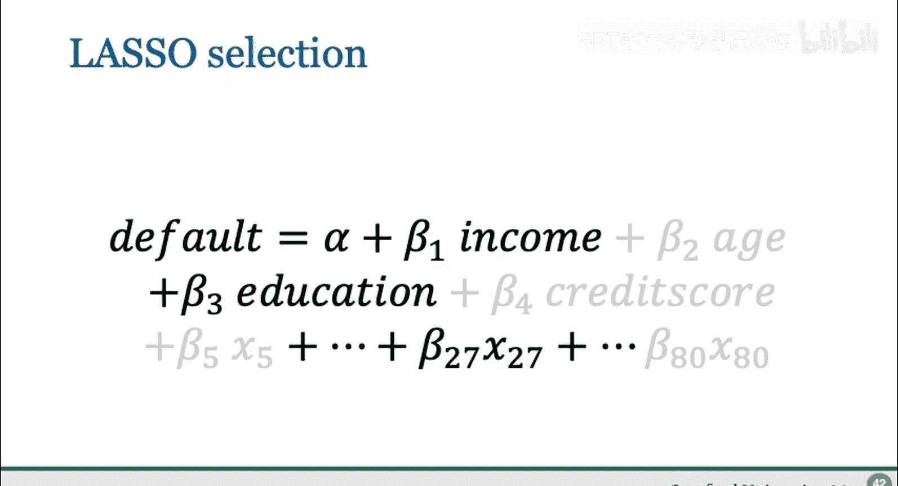

Here's the result that we got。On the X axis， you see the 10 different iterations。On the Y axis。

 you see the coefficients that were actually selected。

What you can see here is that there are clearly some patterns。

 There are some coefficients that are persistently selected。

And there are some coefficients that are persistently not selected。 So black meaning it is selected。

 meaning the coefficient is non0。 So if there is a black line all the way from the left to the right。

 it means that this coefficient was included in all of the models across all the 10 runs。

If on the other hand， theres a white line， meaning the coefficient is never selected。

 then that means it was always set to 0 in all of those 10 iterations。

But the shocking thing that I think this exercise shows is that while there may be some persistent patterns。

For many of the coefficients， there is no clear pattern visible in the sense that many of the coefficients are sometimes selected and sometimes not selected。

So， now。Before we think about the implications， let's think about what could be going on here。

So what happens here？Sometimes， the。Lasso will select some of the coefficients。

 at other times it will select some other of the coefficients。That is perplexing at first。

 because we may think that a good prediction function should always look similar given that the data in each of those folds was basically the same。

However， in high dimensional data and in many typical data sets that we may work with that have a very high number of covariates。

It can be the case that these covariates are very highly correlated， and that， for example。

 age in this regression can very well be。Expressed or predicted by a combination of other variables。

 Now， if one of those variables can very well be predicted by a combination of the others。

 then whether age is included or not doesn't really change much the lasso's ability to predict because it could simply choose some of those variables that are highly correlated with age include those instead and still get the same predictive power。

 And indeed， it turns out that de quality。And even the predictions themselves do not vary too much across those10 draws。

So what do we take away from that， So if he had really hoped that the Laso tells us something about which variables matter。

 then at least in this example， in in a high dimensional case。That is probably。

 it's probably not a good idea to put a lot of weight on which variabless were selected by the Laso。

 simply because of the fact that which variabless get selected change so much from draw to draw。

But beyond this very general statement， we can become a little bit。 We can get a little bit more。

Precise and study in a little bit more detail what kind of biases can actually happen when we think about which variables get selected by the Laso and what their coefficients are。

So if you want to just get the general intuition， I think the example I just went through may already be enough。

 but now I want to be a little bit more precise and look at one very specific example and talk about the biases that can happen here。

Specifically， I'm assuming that there is just three variables， x1， x2 and x3。

 some outcome variable y， and that the outcome variable only depends on x2 and x3 in a specific way。

So what could happen when I fit the lasso here， which doesn't like to include a lot of the covariates。

First of all， there could be selection biases where if2 and x2 and x3 are very highly correlated。

Then the Laso may decide decide not to exclude include x3。

 because x3 by itself will not be very predictive if x2 is already included because of x2 and an x3 are very highly correlated。

And then it may be easy to express most of the effect of x3 by simply using x2。

 and that would reduce the cost of complexity while not making prediction much worse。

 So I would call this compactification bias， meaning the set of variables that are actually included are less than the variables that are in the true model and they are in this case。

 a subset。 So I'm only including x2， despite x3 also mattering in the true model。

But there can also be the opposite thing。 there can be expansion bias。

 It can even be that a variable gets included in a Laso that is not in the true model。

 Why can that be。Well， assume that x1。happens to be very correlated with y in this sense。

 that it is a good expression of what the combination of x2 and x3 is that really matters for the outcome。

This may be a little bit artificial， but in very high dimension。

 we can see all kinds of correlations。 So in this case。

 x1 alone would be a better predictor than x 2 alone or X 3 alone。

But including both x3 and x2 may be very costly， and therefore the last one may prefer to just include the one variable that is correlated with both x2 and x3 explains both reasonably well。

 rather than including any of the true variables。Beyond what is included。

 there can also be biases in size。 So assume x3 is not selected。

 That doesn't mean that the variable x2 is correctly represented。Specifically by excluding x3。

 the laso will also bias the coefficient on x2。Through omitted variable bias。

 So we are aware that there can be biases in our regression when we omit certain variables。

What the lastso does is by excluding variables， it actively encourages or generates omitted variable bias。

So in that case， the laso decides not to include a certain variable because another highly correlated variable is included。

 that automatically will create omitted variable bias in the variable that is still included。

Even if x2 and x3 are selected， there will still be some bias by shrinking the coefficients towards0。

 so even then there will be some shrinkage bias， but that I think is typically second order to the permittedted variable bias。

 which may be more misleading than simply shrinking towards 0。So in high dimensions。

 I would say that such correlations can happen a lot。

 and therefore we always have to be aware that such biases can happen。

 and we should be very careful with interpreting。Now。

 rich may be slightly better behave because it doesn't include things， but rich can also have biases。

 So let's recall what Rich does。 Ri is socialist in nature。

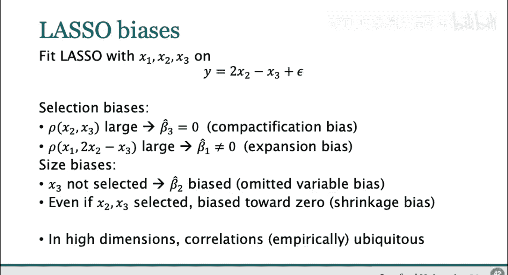

It tends to smooth out the coefficients because it penalizes very high coefficients by penalizing the sum squares of those coefficients。

In that case， the biases we can see。We can see in a simple example， just two variables， x1 and x2。

 let's assume the outcome only depends on x2。In that case。

 we can actually explicitly write what the coefficient on x 1 and x 2 will be as a function of the correlation between x1 and x 2。

 as well as a function of the。Of the regular parameter over here。

 I I'm for simplicity assuming that there is no noise whatsoever。

So what happens here here I have two kinds of biases。 The first is an expansion bias。

Meaning that the rich regression puts weight on x1， despite x1 actually not mattering for y。

Whenever X1 and x2 are correlated， because it tends to be socialist and smooths things out。

At the same time， there can be shrinkage bias where the coefficient on x2 is therefore lower。

 So in that case， we could see a regression where it looks like x1 has quite some effect。

But that is really because of rich and regularization and not because x1 has a true effect。

Furthermore， this behavior is not restricted to linear regression type estimators。For example。

 we could repeat something similar by looking at the trees that get selected when we fit a regression tree and just look at what are the variables that get selected in the top trees in a small tree。

And what we will see there is something similar and this is just illustration I don't think it's like the cleanest example for anything really。

 but just showing that you know when I just look at the top variables chosen by the two you sure again there are some ones that get selected quite frequently like this one here on top。

But a lot of them go get selected sometimes， but not that often。 So the same thing。

 just looking at a tree is unlikely to tell us something about the true underlying stable relationship。

Just witness by the fact that it changes a lot from draw to draw。

So what is my takeaway from all this。My takeaway is that we should distinguish carefully。

 not just between the methods we use， but also between the questions that these methods try to answer。

Specifically， I want to distinguish between two goals here。

 One is the goal of prediction where we care about out of sample loss minimization。

And the other is the goal of estimation where we care about inference on coefficients and finding out which of the xs specifically affects y。

So in high dimensions， we can still be in a world we can of good predictions。

 even when the coefficients are unstable bias a inconsistent estimation as hard。

But because in big data many functions that look quite different can of similar prediction properties。

 it will be very hard to distinguish between those。

 and therefore it will be very hard to perform good estimation。

So my big takeaway here is that the very features。Meaning the complexity。

 the regular and the tuning that machine learning brings in that make predictions so successful also make estimation hard because they make it much harder to understand coefficients well。

 they make it harder to interpret them well because of bias。

 and they make it harder to interpret them well， also because we do data driven tuning。

 which actually makes inference considerably harder。Therefore。

 my big takeaway here is that machine learning is amazing at why had problems。

 at problems that are about finding good predictions。

But it's not by itself built to solve Peter had problems or problems that are about doing inference on parameters。

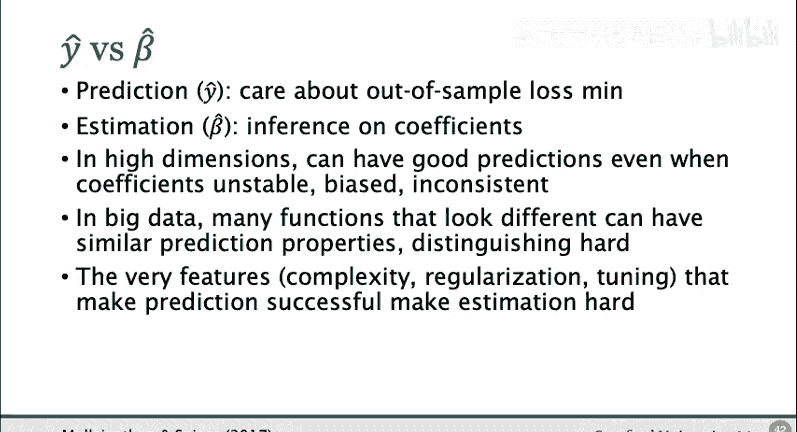

So just to clarify what I mean by those terms， when I say machine learning。

 there' prediction and kind of linear regression type estimation is having a different goal。

So what I mean by prediction is that。Of course。In one way。

 machine learning is not great at prediction。 It's not necessarily great at prediction。

AndWhat would happen if。I use an alternative policy， which is inherently a causal inference question。

 So I don't mean the kind of what would happen if prediction or the what will happen tomorrow if something has changed。

 What I mean by prediction is。Readally not this counterfactual that requires structural or cause knowledge。

 but it is the question。Can I get a good fit。Of why I had to write on data from the same distribution。

 So it's really saying prediction， holding a distribution constant。

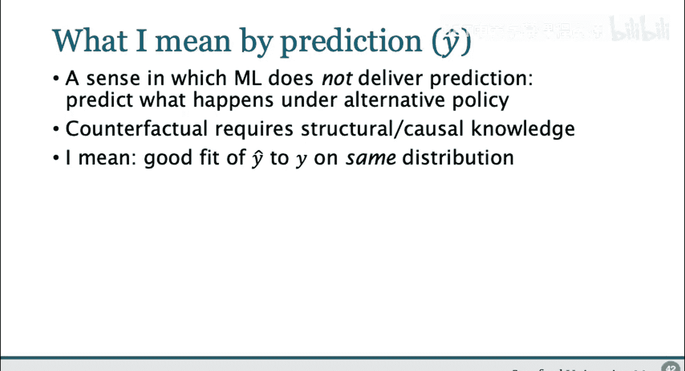

On the other hand， when I look at in and I say it's not grade estimation， of course， in one sense。

 machine learning is grade estimation， it's great at approximating the optimal prediction function well。

😊，With minimal loss， however， this loss is prediction loss。

 It doesn't really tell us much about the difference in parameters。

 It only tells us something about the difference in terms of whether this set of parameters produces different predictions or not。

So when I say that machine learning is not great at estimation。

 I really mean it's not great at something like estimation consistency。

 meaning the coefficient is close to the other coefficient in a norm that is not implied by prediction。

So taking all this together， here are my takeaways for ride work。

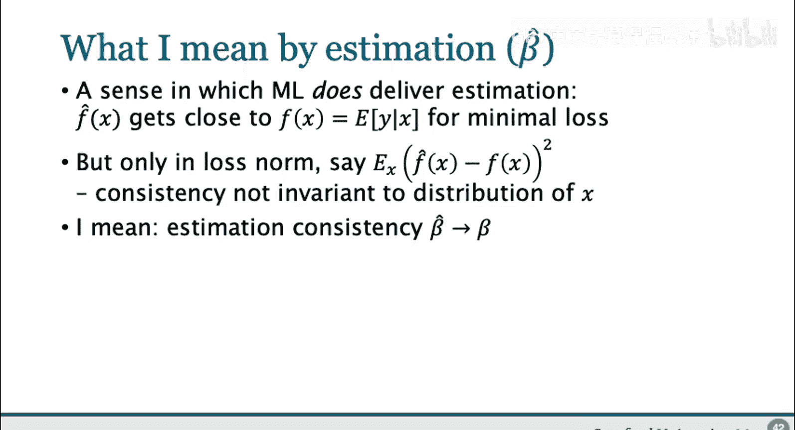

Machine learning provides high quality predictions I hat。But the。

While the prediction quality comes with guarantees from the holdouts， so for example。

 I'm able to say it predicts at least that much with some statistical uncertainty。

There is typically no guarantees about the quality of estimation and no estimation consistency。

 or at least estimation consistency， meaning the coefficient converging to the true coefficient。

 getting very close to the true coefficient is much harder to establish than prediction consistency。

Hence， by itself， when we look at machine learning output， we should not interpret it。

Structurally or even causally in a sense of how are the x's related to the y's。

 but we should take it as what it is， which is a great predictor。As a side note。

 it is also very hard to do inference on this F hat because in many of the machine learning methods。

 they're very complex。 they use data- drivenve tuning。

 so it's very hard to use tools like the bootstrap and a bootstrap may typically fail So simply saying。

 well， couldn't I just have bootstrap this and seeing that the lastso is unstable。

 It's not that easy because the Laso doesn't typically fulfill the kind of conditions under which we know that the bootstrap works。

So therefore， where can we use machine learning？I'm a big fan of machine learning。

 I think it provides very good predictions， so in my eyes。

 the right answer to that is we should use it for prediction problems and ask where are interesting prediction problems。

 and here are some cases。

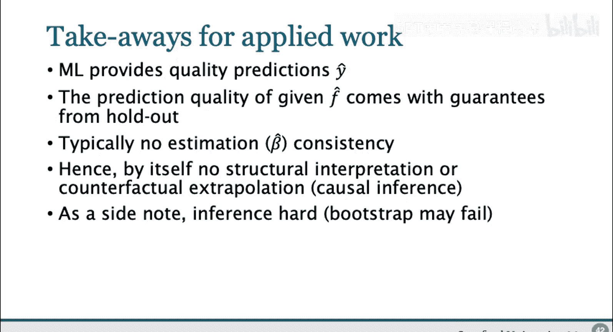

First of all， we could use machine learning， or we can use machine learning it is already done for data preprocessing。

 for example， using text data， using image data。Simplifying very complex data to the most important components。

 all this can often be cast as a prediction component。 For example， I can predict whether you know。

 I can predict crop yield or economic outcomes from satellite image data and then use satellite images in place of the data。

To construct good proxies。A second big area is tasks that are actually inherently prediction tasks。

 meaning tasks where prediction is an interesting question of interest。

And these have also been coined as prediction policy problems。

 and one good example would actually be poverty targeting in the case of poverty targeting。

 I'm interested in understanding who which household likely has low consumption so that I know which household to help。

And in that case， we could cast this as a prediction problem where it's really not about understanding。

 of course， Of course， it's also interesting understanding what， what leads to a household。

 having low consumption。 But in the end， for the poverty targeting question of just。

 where should I send help， It may be most important to simply have a good prediction。

 And I think they are a whole host of。Questions in that area host of problems in that area that are pure prediction problems。

Third。There are many questions where we care about parameters in some part of the problem。

But there may be some implicit prediction problems in the background。

 something like using high dimensional variables as control variables。

 using them for propensity scores， using high dimensional instruments。

And in the next part of our webinar series， my colleague Susan Athey。

 will specifically talk about ways in which we can combine those two。

 in which we can enhance causal inference by using tools and techniques and ideas for machine learning in order to enhance them。

 which will often require to carefully adapt machine learning to the specific task at hand rather than just using it out of the box。

So with that， let me wrap up for the webinar that I presented。

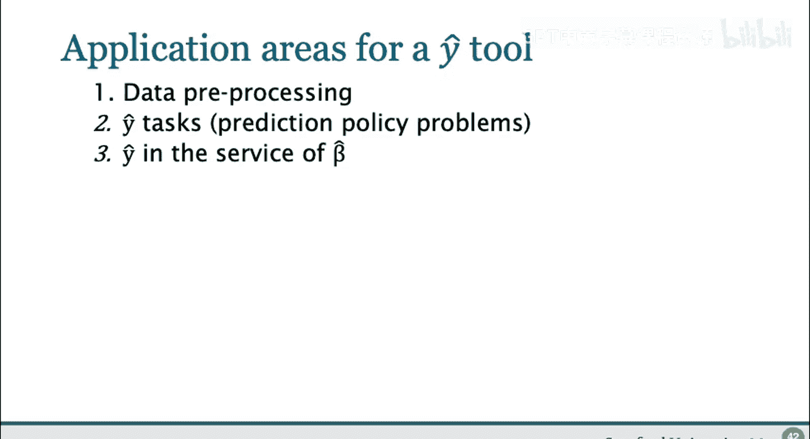

Here is what I did。 I first motivated this by this webinar by saying machine learning is amazing at prediction and also prediction solutions actually provide a lot of value in modern machine intelligence tasks。

Second， I asked the question how we can get good predictions and what machine learning does to get there。

 In other words， I asked the question， how can we get good Y hats。And in this last part。

 I compared getting good white hats to getting good be hats， or， in other words。

 getting good estimation。 and I。Derived as a takeaway that machine learning is great at good high quality Y hats。

 but by itself doesn't deliver good beta hats or good estimation。And with that。

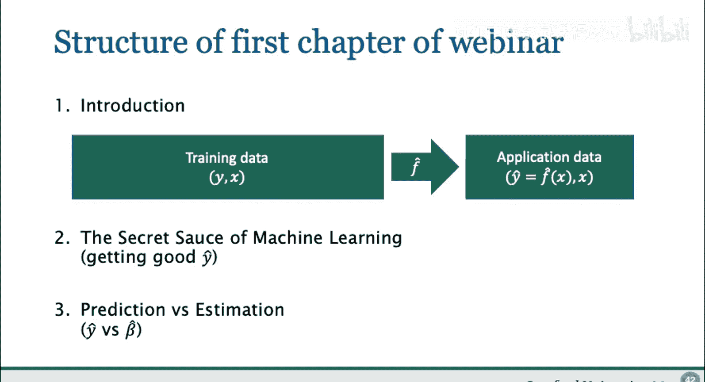

I want to thank you for following the webinar。I would very much appreciate your feedback if there were particular parts that you liked that you found helpful。

 or especially if there were some parts that you didn't like as much or had a hot time following。

 please shoot me an email and let me know so that we can improve those webinars in the future。

Thank you。

