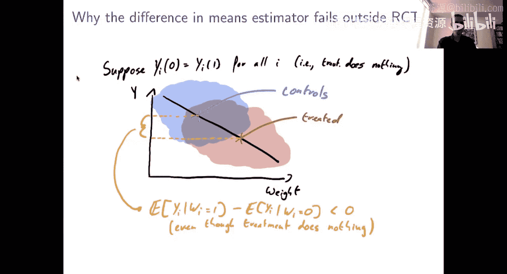

# 斯坦福商学院《机器学习和因果推断｜Machine Learning & Causal Inference： A Short Course》claude-4s p05 -05-Average Treatment Effects_ Introduction.zh_en -BV1M9W7zCEsf_p5-

Hi everyone， welcome to week two of Machine learning and causals inference。

Just to get everyone up to speed last week， right， you had a crash course on machine learning。

 just a reminder of what are some of the widely used methods in machine learning。

 what people are doing out there。I imagine that for most of you， that was a review。Or mostly apath。

Now is when we get into really the core of this class that is。

How you can use and deploy machine learning based methods in causal analysis。This week。

 we're going to focus on more of a classical topic and causal inference estimating average treatment of effects。

I'll say more in just a few slides about what that means。And how we can rigorously deploy。

Out the shelf type machine learning tools for this task。In the upcoming weeks。

 we're going to dig deeper and look at some more specialized tasks。

Including treatment personalization and look at how we can kind of develop。

Special special purpose machine learning methods for those tasks。So anyways。

 before saying anything else， just of course， the core tension of this class and one that both Susan and I have already emphasized many times。

 but it doesn't hurt to say once more， is right what's machine learning about machine learning methods are about prediction。

 they're about given a type of data， understanding what usually happens。In a given situation。

For example， you could download historical weather data。And then based on that data。

 try to understand。Given。the conditions you expect there to be tomorrow。

 what's the chance that air pollution levels will be dangerously high？嗯。That's prediction。

 but that's not usually what we care about in many economic or social science applications in many applications like this we care about causal questions。

 we don't just understand care about understanding what would usually happen in a given type of situation we want to understand counterfactuals。

 we want to understand say what would happen not only do we think tomorrow might have high pollution levels。

 but can we change this by say reducing the number of cars on the road。

 or most interested in interventions we might take kind of improve the situation。😊。

So this is obviously a different kind of question。😊，As we'll see many times in the class。

 an naive application of machine learning methods that are designed for prediction to cause the task can get one into quite a bit of trouble。

😊，But as we'll also see if done right， then actually machine learning methods can be usefully adapted to causal tasks and can be very helpful。

😊，So anyways， having said that。This week。Our goal is to understand how machine learning methods can be rigorously deployed for the classical task of average treatment effect estimation。

And。Com and。With this the main result， we're going to give it。And the fourth part。Of this lecture。U。

 the main result is going to be a methodology based on double robust estimation that can kind of take as inputs。

 generic black box type machine learning estimates。And as output give you confidence interval。

What kind of elementing normal sampling distribution and all the guarantees。Good luck。But okay。

 we need to work up to it and so this will be done in kind of four videos。The first video。

In this one， I'll introduce the notion of average treatment effect to talk about some basics about how we can think about average treatment effects in the context of randomized trials。

Then in part two， I'm going to talk about kind of。Some simple。

Ways you could think about using machine learning private treatment effect estimation。Compare that。

 do kind of classical regression based methods and see what's good， what's bad。

 what the limitations are。😊，The spoiler guess this is not really a spoiler alert。

 the naive method won't quite work。You'll leave something on the table。

 you won't get the confidence intervals of the type you'd want at the NA method。

So we need to do something else。And here。We're going to start working towards it part three may feel like an aside at the time。

 I'm going to introduce propensity score methods。嗯。And kind of。

An estimation tool get built around that， but by the time we'll get to part four。

 you'll see that this was not an aside。That kind of state of the art way of incorporating machine learning methods into the average treatment of estimation world kind of combines the naive approach with。

Insights from propensityities core based methods that's going to take us to what's called the double robust methods。

And out of all the methods I'm going to talk about today， that's the one eye。

Recommend in practice and that's one I also use。Often in my own research。All right。

 so that's the outline and now we're in part one， so what's the average treatment effect？😊，嗯。

Here's the definition。I should。Emphasize again， like we mentioned in the intro video。

 when it comes to defining core notions from causal inference。

 we're going to move quite fast in this class， so if you want more background on these notions。

 it may make sense to say read some kind of introductory econometrics resources。

 including some of the ones we've listed on the syllabus。So okay， for all of today。

 I'm going to work in terms of this classical statistical setup。

 we have N units and independently sampled units。And for each unit， we observe a feature vector。

That's kind of background information about who you are。A response why？And that's the outcome。

 the thing we usually want to improve using a treatment。And then a binary treatment， it's zero or1。

 zero if you didn't get treated， or if you got assigned control and one if you got treated。

So this is。Standard causal setup。And then in order to talk about causality。

 what I'm going to do here is I'm going to。Posit the existence of these quantities Y0， Y1。

 these are called potential outcomes。And the way to interpret these quantities is that YI0 measures the outcome you would have observed for the IT unit had they received control。

 and YI1 is the outcome you would have observed for the IT unit had they received treatment。

Then of course， the outcome you actually observe Yi is the potential outcome corresponding to the value。

WI of the treatment that you actually received。Why are potential outcomes useful。

 it's because they enable you to kind of very directly define a causal effect。

The causal effect of the treatment is the difference in potential outcomes。

For the I unit and the effect of the treatment is just the difference between what would have happened to the I unit with the treatment versus without。

So this is。The treatment effect for the ice units。And a lot of causal inference。Is going to be up。

Trying to say something about these differences in potential outcomes。Now。

Today we're going to kind of。Focus on one specific question you can ask in terms of these potential outcomes and that is what is the average treatment effect or what is them。

Average。Difference in potential outcomes if the effect the causal effect of the treatment on the I unit was Y1 minus Y0。

 then here's the thing we're calling tau the average treatment effect。Is the average。

Across the sampling distribution of these individual treatment events。

And the adverse treatment effect is。Not surprisingly， often considered kind of a first。

 very helpful summary measure of the effectiveness of a treatment in some population。😊，So。

Why is this problem not completely trivial？Taking averages is not that hard and we know how to do that。

And here's the difficulty， of course， is that you have a missing data problem。For each unit。

 the treatment effect for the individual treatment effect of the IT unit。

 Y1 minus y0 is defined as the outcome you would have gotten if you were treated minus the outcome you would have gotten if you weren't。

 that's the difference of two things， but of course you only ever get to observe one of these two things。

 either you're treated in which case you observe the potential outcome or your control in which case you observe the control potential outcome。

 but you never get to observe both。So you have this fundamental missingness issue。

 that's what makes this problem。Trivial， on the other hand。

Support it to be interesting it also needs to be possible and it turns out that kind of given the right methods estimating average treatment effects is。

So。Where I want to work towards， like I said earlier this week is getting to a point where。

We have kind of more complicated types of data and we can kind of bring machine learning tools to the table to kind of。

Enable flexible and robust estimation of average treatment effects in quite a bit of generality。

 but just as a warm up， let's talk about the simplest case in which you can estimate an average treatment effect。

😊，And how that works out。And of course， the simplest case between causal inferences is the randomized trial。

嗯。We say that you're in a randomized trial if the treatment assignment is randomized。That is。

There are some people who get treated， some people who get the control assignment。And it's really。

Who gets treated or control is chosen completely at random。

 there's kind of no association between the potential outcomes of a unit and the treatment。Quatively。

 you could think that it's a randomized trial if for every person you flipped the coin if the coin came out of heads you。

Assign them to treatment， otherwise you assign them to control。And okay。

 why do we like randomized trials？It's。Well， here's kind of a very short。

Deervation which shows that essentially the average treatment effect。

 that is the average difference between the kind of treated potential outcome and the control potential outcome。

 this thing here。Can be expressed as。In this other way。

 that is the expected value of the outcome for the treated units minus the expected value of the outcome for the controls。

😊，And of course this thing here is easy to estimate this is you could just kind of literally in the randomized trial。

 take the average of the Ys for the treatedage units and this for the controls。

 so this kind of immediately suggests an estimator that you could use for the average treatment effect。

And of course， the important difference here is that here we defined expectations in terms of potential outcomes。

😊，Potential outcomes are not always observed， so we have a missing data problem。Down here。

 we have a conditional expectation， but in terms of YI's， that is kind of actual observables。

There's no problem in estimating the average of y conditional on w equals one。

 so this we can just read out from the data。And there's no problem。

And really the key step in this derivation here was this first line where we argued that。

The average of。The treated potential outcome over the whole sample is the same as the average of the treated potential outcome conditional on WI equals one。

And this follows from。This randomization state。Because treatment is randomized。

 conditioning treatment doesn't change。TheEx。So this is safe。

Then in the second line here we went from the expectation of the treated potential outcome conditional on being treated to just the expectation of the outcome being treated。

 this is kind of more mechanistic kind of we already agreed that when you're treated the thing you observe is the treated potential outcome so this is kind of a more notological consequence of the definition。

We've set up。But so what does this mean？It means that。

Even though there's this fundamental missingness problem in causal inference。

 you have treated and controlled potential outcomes。

 causal effects are defined in terms of differences of the things of things you can only ever observe one of then it's actually possible to estimate an average treatment effect using a randomized trial that is。

A data set where treatment。Wheres generated。You不。All right， so just to kind of illustrate。

This in terms of kind of a。A simple example， suppose again that we wanted to understand the effect of。

Driving restrictions on air quality。So。What I'm showing in this slide is essentially。

Orracle data that kind of。An omniscient statistician could hope to have。Every day you have Y0。

 the pollution levels you would have gotten that day if there were no restrictions on traffic。

YI won another potential outcome that is the pollution levels you would have gotten with the traffic reduction and then this tai。

 that is the effect of the traffic reductions on pollution that day。Here I made a plot。

Of the potential outcomes Y0 and Y I1。You see that there's very strong correlation between y0 and y1。

 that is most days pollution was what it was going to be and kind of the traffic restrictions only had a kind of second order effect。

But at the same time， you also see that Y1 is typically smaller than Y0。

 the data kind of lives below the diagonal and this means that kind of。

The traffic reductions did help， the restrictions did help reduce pollution a little bit。

And if you take the averages of all these， then what this says is the average treatment effect。

 that is the average daily effect of the traffic restrictions is here negative 10 in the units of the problem。

😊，If we had access to this full table， getting this negative 10。

 which is averaging the tawis would be very easy， but of course this instance what real data looks like in real data。

 even if you had the kind of best data you could hope for。

 you have a randomized trial then every day you flip a coin and depending on how that coin comes out。

 you either observe YI0， the control potential outcome or you observe Y I won the treated potential outcome。

You don't get to observe both。And so in particular， your problem is that you never observed Taois。

 so you might be wondering how can I estimate the average of the Taoaiis？If。

I never get to observe a single taie。But this is kind of。the theorem we just saw earlier。

 you get an unbiased estimates of Taai by taking that average。😊。

Of the outcomes on days where you got treated minus the average of the outcome on days where you got control。

 and then this gives you an average treatment effect estimate of minus1 here。好。This is how it works。

Branandomized trials are very nice。Not much need for kind of。

You can do most things you want in randomized trials。

 at least in terms of estimating average treatment effects without using any very sophisticated methods。

Um， but okay， we're not always in randomized trials and then we need to work harder。And。W。因为。

Essentially a very kind of simple example where this kind of discussion from the couple last slides wouldn't apply is if。

😊，The treat assignment isn't random， but is actually associated with confounder。

So let's just consider a very simple example。You want to understand the effect of some。嗯。

Treatment that helps mitigate and prevent obesity on quality adjusted life years。

But you didn't assign this treatment in randomized trials。

 rather you just have data from electronic medical records with decisions made by doctors。

As they saw fit。And here you might assume。That look doctors aren't going to assign the treatment kind of uniformly and random。

 they're going to prioritize this treatment to people。Who have higher weight coming in？

And if this is what's going on， then。Just taking a difference in means can fail。To give you。

A valid notion of an average treatment。So kind of let's consider an extreme example。

 let's suppose the treatment does nothing so for every unit。

The treated and control potential outcomes are just the same。But。Here you see kind of。

People vary by weight， they vary by outcome。There's your negative association and。

What is the only effect that's going on here is essentially that doctors are more likely to assign treatment to people with higher weight than with lower weight。

And what's going to happen here where you can have some treated units that live in the。

The higherweight region controls who live here。And the lower plate region。

So kind of the treatment does nothing。But if we start looking at a difference in means type estimator。

 we look at the average outcome for treated units versus controls， what are we going to get？Well。

 the average outcome for the treated units here for the control units here is higher than for the treated units。

This is just a function of doctors choosing to treat different people based on weight and there being negative association between outcomes and weight。

And when you put these two things together， you see that actually the average outcome for treated units is going to be lower than the average outcome for the control use units。

So if you just kind of naively study this as a randomized trial。

 you think that the treatment here was harmful， whereas actually。It does nothing you just had。

A selection bias issue。And you're kind of detecting that bias。

So this is the end of the first part and the second part。

 we're going to start talking about conceptual and statistical solutions for。

Estimating average treatment effects when you're not in a randomized trial。

