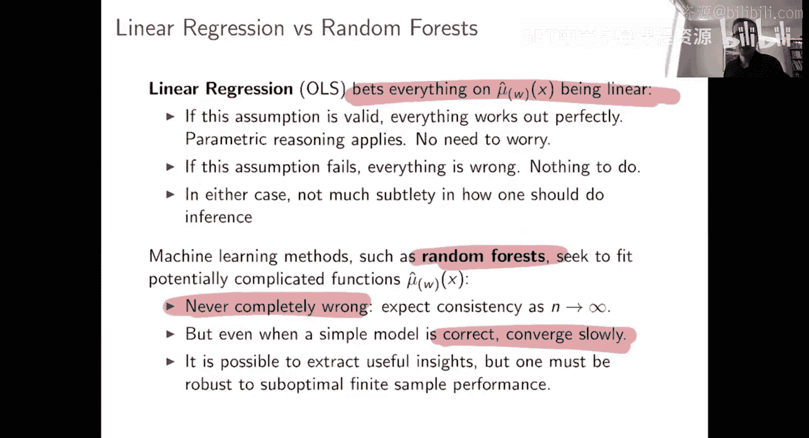

# 斯坦福商学院《机器学习和因果推断｜Machine Learning & Causal Inference： A Short Course》claude-4s p06 -06-Average Treatment Effects_ Confounding.zh_en -BV1M9W7zCEsf_p6-

Okay， so we talked about the average treatment effect， we talked about randomized controlled trials。

We talked about why estimating average treatment effects in randomized trials is very nice。

 but we also talked about how not every setting in which we want to estimate an average treatment effect is a randomized trial。

😊，And so then our next question is what can we do there？And。

So the setting I want to focus on now is one in which we observe some pretreatment covariates x。

 and we're worried the treatment is not random in that it may be associated with some of these pretreatment covariates x。

If that's a situation， then we need to control for these excess。

And how best to do so is essentially the direction we're going。In particular。

 we're going to want to see how does machine learning fit into all this。Now， before going there。

 though， there's obviously a question under which conditions is controlling these x's enough。

 under which conditions does kind of bringing these x's to the table help us。😊。

Enable us to identify an average treatment effect where kind of we're not in a randomized trial。😊。

And。We， of course need to be explicit about that。😊。

So here the assumption I'm going to be working with throughout is。

It's assumption called unconfoundedness。😊，Whereby treatment？May not be randomized overall。

 but once you condition on excess， treating this as good as random。Conditional on X。

As I'll discuss over the next couple slides， once you have this assumption controlling for excess is enough to identify the average treatment effect。

😊，And then。Thatttle。So have to focus on our main question that is。

So given that the every treatment effect is identified， how do we estimate？All right。

So to be a little more formal about this assumption。

 that is that treatment is as good as random given。Measured covariance x。

 what do I mean we're going to be in the same setup as before。

 we have X YWs with the same interpretations before potential outcomes。

 the definition of the average street in the effect is the same。😊。

But instead of assuming that we have a randomized trial as before。

A randomized trial right would just be within orange here。That is that the treatment is random。

It's independent of the potential outcomes here we're not going to assume that。

 and instead we're only going to assume that kind of once you condition on x for a fixed value of x。

 the treatment diseases as good as random。So the treatment might not be randomized overall， but once。

For every fixed value of x conditioning and x， the data looks like it comes to randomized trial。

This assumption is also known as selection of observables or no unmeasured confounders。

 but this means is that。If there are any variables， but。

WS associated with in a way that makes you deviate from the randomized trial assumptions。

 then you need to be able to measure them and condition on them。To bring you into this nice setup。

One question you might have here is。This is kind of a in terms of the nomenclature we were worried about a confounding problem and here this assumption is referred to as unconfoundedness so what's up with that the point here is that。

If。W， the treatment assignment probabilities can vary with x's。

 then overall you canfound it overall you don't have。The randomized trial type assumptions。

 but once you bring the x to the table， once you condition on the x's。

 then at that point conditionally on X， you have the。

Treatment looks as good as random so once you condition on X you've reached unconfoundedness so that's the meaning you were confounded before。

But now you brought an X and now you've achieved outcome that。So this is the assumption。

 it's really an important assumption， I guess I felt the need to highlight it in three different colors。

😊，This assumption does not hold in all applications， for example。

 an instrumental variables problem you're interested in settings where this doesn't hold。

But in many settings of interest it does hold and the rest of this week's lectures are going to be on inferenceprint about that average treatment effect。

啊。In something that's not a randomized trial， but unrrunconfoundedness。

 that is when this assumption holds。So okay。We have an assumption。Good， we have a question。

Now how do we proceed， how do we estimate the average treatment effect underlying？

There are many ways to go from here， and I'm going to talk about。One approach now。

 another approach in part three， the double robust approaches can kind of combine both ideas to get some really good。

But let's start from one idea。And it's the following point。In this general unconfoundedness setting。

The average of the treated， the average treatment effect does not match the average of y conditional1 w equals 1 minus the average of y given w equals0。

 that was the last picture we saw in the previous part。

But what you can do is just try to do a similar derivation。

 but now and reexpress what is the average treatment effect well？We're just going to kind of。

If you've taken comp probability causes， this will make perfect sense。

Otherwise I hope you'll just buy that derivation you get at the end it's reasonable。

 we're going to kind of by change rule at a conditioning on x here。

 then kind of once we condition on x， these three lines here。😊，嗯。

Are essentially the same proof as before。What they say is that conditional on X。

 the expected treated potential outcome is the same as the expected outcome conditional on X and receiving treatment。

And。Okay， I'll let you start at the derivation more aside if you want the end result is that。

We find that the average treatment effect can be expressed as the expected difference。

Between these conditional response functions， where here mu wx is expectation of y given x equals x w equals w。

So mue Wx is kind of the solution to the non parametric regression problem where we try to predict y from x and W。

And。What this calculation shows is that underinfoundedness， under this kind of assumption here。

 then in the average treatment effect。Is the expected difference in kind of your best prediction given x of what would happen to you under treatment versus control if you were to kind of know these mu one of x im muial of x functions a。

So this is kind of a characterization of Tau， how do we turn this into an estimation strategy？

And at least kind of the notation heavily suggests one mue w of x is a nonparmetric regression problem so you could try to solve it。

😊，Here the true tau。Is the expectation of mu1 of x and mu0 of x so what could we try。

 we could try estimating mu zero of x from data， so here kind of mu zero of x is the expectation of y among controls conditional and x equals x so you could learn mu zero of x by learning to predict y from x among controls similarly learn mu1 of x and then estimate tau hat of x。

By taking the difference over your whole data set of these two regression functions。And。

Kind of what I've shown so far is that if you were to do this using the true mu zero of x and true mu1 of x。

 then this would be an unbiased estimate of the average treatment effect。And。

Let's say it's quite clear that this estimator will be consistent。For the average treatment effect。

 if the mu hat Wx's are consistent to the muWx。So consistent is good is okay。

 but this is actually good， does this let you get confidence intervals and so forth。😊，And。Here it。

It's complicated。嗯。In order to kind of。Talk about how good this strategy is。We of course。

 kind of in order to kind of talk about in general。

 how good is this estimating the average treatment effect by taking the average difference in predictions from the mu1 of x of0 x functions。

 we need to talk about kind of specifically in steps one and two。

How did you get these mu zero x mus estimate？And here there are many different strategies。😊。

One of them， the classical one， would be to use。L me a regression more kind of more formally。

 ordinarily squares， Os。So。What does the OLS approach do？It first starts。This is not algorithmic。

 but it's very important， it start by positing a linear model。😊，Remember， mu Wx is。

Measures what is the expected value of y among treatment status W given covariate values x。

You're doing linear regression， linear regression fits linear functions so you can kind of。

Find the right functional shape if the linear model is actually correct well specified。

So we're going to start by assuming that mu Wx is。Correctly specified linearly and then once we've done this。

 then it's kind of clear what we can do we can just kind of fit soe mute0 of x is x times beta 0 and so forth。

 we can estimate beta hat zero by just regressing y and x among the controls we can fit beta1 by regressing y and x among the treated。

So。This is just very standard and then once we kind of get we can extract predictions from linear regression as usual and then。

What's our estimate of the average treatment effect。

 well it's just going to be the average difference in predictions from linear regression as you'd expect and。

😊，I guess you can do the algebra this is equivalent to just taking the two regression parameters beta one and beta hat zero taking their difference and interconing that with x bar that is the。

Average of them。es there's a typo here that should be divided by M。All right。

 so this is linear regression， is it good， is it bad， what are the pros and cons？😊。

Here' is pretty clear。Linear regression essentially hinges on well specification of the linear model in this setting。

😊，What's the pro when the linear model is well specified， this is great， this is simple。

 it's familiar， it's easy to run， it has great guarantees。

 it cons at parametric rate it gives you everything you could ever want。😊，What's the con， well。

 what if the linear specification doesn't hold， but if you don't have linearity here。

Then linear regression just。Weon't give you the right answer。

So it's one of these things if kind of the parametric assumptions you posit are valid。

 this is very good， otherwise it's not。So this is linear regression。What else can you do？

I think it's pretty clear where I'm going with this is in this class。

 we want to use machine learning， we want to avoid kind of assuming that functions are linear unless we have strong scientific reason to do so。

😊，And。So okay。An idea here is let's follow the same strategy。

 except instead of assuming that the functions mute wx have linear specifications so you can fit them by linear regression。

😊，Let's just assume that they're generic fit them by machine learning and see what we get from there。

嗯。One thing I should emphasize here is。Kind of last week。

 we talked about machine learning as kind of。BThere are many machine learning black boxes， deep nets。

 boosted trees or random forests， Dlaso and so forth。That help you predict y from X。And here。

We don't superficially， we're not trying to do prediction。

 superficially what we're trying to get is we're trying to get at these conditional response functions mu w of x' is expectation of y conditional on x and w。

But now。下。It's just。should note that kind of underscore squared or loss。

 what is the optimal prediction of Y given x and w Well it's just going to be。

if you only know x and w， then your best prediction of y is the expected value of y given x and W。

So actually an oracle would predict my hat。I is muwi X so kind of。

A good predictive method should be predicting using something that's very close to these functions。

So what we're going to assume is that we when we train our machine learning method and it gets predictions。

 then these predictions are going to be。Close to this because kind of the better the predictive method。

 the closer it's going to be to using these functions for prediction。So。

Where this leaves us is the idea is to pick our favorite machine learning to predict y from X andW。

In general， I'm going to run this。One could predict y from x separately under treated or around the controls。

 or one could try to kind of fit a joint model for both。

Talk more about that a couple of weeks from now。Then。

One could use these predictions as estimates for the function we care both mu 0 of xM1 of x。

 and then we're going to estimate tau hack is just the average of muhad 1 of xi and muhad0 xxi。😊。

So just very concretely what's going on here， muha one of x this。

 the way you kind of get it ugly machine learning method is。😊，You ask， hey。

 here's a person with covariates Xi and they're treated， what's your prediction to the outcome？

The machine learning method is going to tell you this。Then for the same person Xi。

 now I'm going to tell you that they're not treated。

 can you predict what's out and y going to be in the machine learning method， well。

 this is going to be the prediction they get out。And so then Ta hat is this average difference predictions。

And really the hope here is that machine learning methods should enable accurate predictions without having to model the shape of the mu0 x and1 of x functions。

So。It almost seems like first， if the machine learning methods were just perfect。

 then it almost be like a free lunch？😊，You don't assume linearity。

 but you fit the mu1 of x and mu0 of x function anyways， and then you get to go。So let's see。

 let's see how this plays out。So here。It the simplest way to see how this all plays out is just to try it so I'm going to try to use the regression adjustment form throughout so all the estimators i'm going to consider are going to have this kind of form。

嗯。And then I'm going to just try two different strategies for learning the new hats。

 we could get them out of linear regression or we could get them out of some machine learning method。

This week I'm going to use random forests as kind of a standard method for generic machine learning。

If for no other reason is that they're。A machine learning method and they're very easy to run and there's very few tuning parameters in them so kind of they're very nice to use as kind of reproducible examples for that。

😊，Re so it's not that they don't have tuning parameters。

 but they you can run them with default tuning parameters and that's good enough for an example。

So all right， these are the two。Basic settings and then I'm going to talk about them in two different simulation studies。

 one where these kind of response functions the expectation of Y given x among the treated and control separately。

 one where they're linear so linear regression is well specified linear regression is justified。

And one whether' not。So linear regression has an incorrect specification。And how does this work？

So here I just in the slides kind of very briefly， this is how you'd actually get tau hat at a linear regressiong。

 I'm not going to go through this in detail， but just in case you wanted to run this and wanted to copy pastte and code here is on the slide similarly here is using a random For。

😊，Similar thing。Here kind of very explicitly， we're getting these kind of muha zero muha ones out of here and。

Our estimate of the average treatment effect is going to be the average difference in predictions。

Alright。And。What settings are we going to look at well just like I mentioned。

 we're going to look at a linear setting， This is and by linear， I mean that。Y responds to X。

In a linear way， the linear function may be different among treating and control groups。

 notice this is normal noise with mean zero in variance  four。Then。

The nonlinear setting looks similar except here now the relationship between y and x is nonlinear step functioning here there is a quadratic。

Linear regression won't capture that。So。What's going to happen？Well， bi linear regression。It's。

Probably this should be familiar what's going to happen i'm changing the sample size here so here and as a sample size at the low end we have 100 units to estimate average treatment effect at the upper end we have 1600。

And what happens here？First， what I'm showing here is a box plot and this box plot shows the realization of。

The average treatment effect you get across multiple simulation。

So the first thing to notice is it kind of regardless of the sample size。

The box bond is always centered。The average treatment effect estimate you get biline regression is unbiased。

怕。This is this is good as you'd hoped， this is kind of。

And what else happens when you get more data well youre always embarrassed so that's not something you're solving。

 but the other thing that happens is kind of the box plots narrow you're getting more accurate so kind of with 100 samples you're right on average but you're very wrong and most replications whereas with 1600 samples you're right on average and also you're pretty。

Close to the drift most of the time。So this is what you like to see。

What happens in the nonlinear setting where linear regression is misspecified。

 well some things look like before linear regression。

Is going to have the same average answer kind of regardless of the sample size。

 it's going to give you that answer more and more accurately as you collect more data but what's your problem your problem is that that average answer of linear regression。

😊，Isn't equal to the。True answer， so here kind of。The true average treatment effect was zero。

 so here the dashed line you would have wanted to get zero here you got zero on average。

 whereas here you did not get zero on average。😊，And yeah， so this kind of shows it。

Linear regression kind of as you collect more and more data， if the linear specification isn't right。

😊，It's hopeless right， you just won't get the writing。So what about random forests？

Here's actually very interesting。嗯。😊，It's a completely different picture。Now。

 first thing is remember here zero is the correct。As you collect more data。

You get closer to the correct answer in both settings。

 so both in the linear setting and in the nonlinear setting， you're converging to the right answer。

But。😡，And use the。They can。Problem issue that one needs to deal with。

We don't have this setting like linear regression where kind of when you're well specified。

 not only are you getting more accurate， but kind of even finite samples， you're unbiased。Here。😊。

You're always converging to the right answer， but in final examples you may be very biased here in the linear setting。

 we see that kind of for all sample sizes I'm looking at。

The point estimates for the average treatment effect here are kind of。

Strongly kind of systematically。Based upwards。We， we have a。

They're not symmetric around zero at all here in the nonlinear setting it's interesting for large sample sizes。

😊，The treatment effects are kind of better centered at the right answer， but for small samples。

 you also were kind of very biased。So。This is going to be。A problem。

 as we're going to see in kind of subsequent parts， really the reason this is the problem。

 if all you cared about is getting the right answer in very large samples。

 this wouldn't be a problem。😊，Like I said， random forests are going to get you here consistency。

 what consistency means is that in the limit of infinite data you're going to get the right answer。😊。

But often when you're running this you care about more thancon。

 you want to get a good rate of convergence， you want to use your data effectively and you want to get confidence intervals that kind of even in moderate samples cover。

The truth。And the problem with nominal probability。

And the issue is kind of putting these kinds of very biased estimators。

 it's essentially they're not going to have good rates of convergence and it's essentially hopeless to get confidence interval。

😊，At least using standard constructions。So。That's an issue。嗯。

What's the tradeoff between linear regression and random forests linear regression bits on everything being linear if this assumption is valid。

 you get unbiasedness， I haven't shown constructions for confidence intervals yet。

 but kind of the fact that linear regression is unbiased is closely related to the fact that confidence intervals all work here。

😊，So。All right， if if the linearity assumption is valid。

 everything works perfectly with linear regression， if it fails， everything goes out the window。

 there's nothing to do。😊，And this gets us into kind of a setting that might be quite familiar for meganometric classes right you like think very hard about bidding a parametric model and once you've picked the right parametric model。

 then estimation is easy。😊，But。Machine learning it really puts you in a different world linear your regression kind of depending on whether you wrote the right model down your。

Either essentially doing the right thing or the wrong。But with random forests。

 you're kind of never quite wrong， but you're never quite right either。😊。

You're never quite wrong in that you're always going to get the large right answer with infinite data。

But。😊，You're generally going to get there in a way that's kind of。Rather slow。And。In order to get。

An accuratecur estimates of the average treatment effect that use the data effectively or to build confidence intervals。

 you're going to have to do something about this。😊。

