# 斯坦福商学院《机器学习和因果推断｜Machine Learning & Causal Inference： A Short Course》claude-4s p07 -07-Average Treatment Effects_ Propensity Scores.zh_en -BV1M9W7zCEsf_p7-

The next thing I want to talk about is the propensity score and propensity based based methods for average student effect estimation。

There are many reasons for doing this The first is essentially that the propensity score is one of the most important objects in。

Oserval studies and causal inference， so in a class like this we were kind of bound to talk about it at some point and now is as good a time as any。

😊，The second is that propensity core based methods for average treatment estimation have an interesting connection to machine learning and there's actually been a lot of recent discussion around the relevance of kind of a machine learning based approach to propensity based methods。

So I'm going to talk about that and it's going to give an interesting compliment to what we just saw in the case of machine learning based progression adjustments。

The last is that propensity score based ideas， the ideas we see here are going to play a key role in enabling the kind of central test practice methods for average treatment to destination based on machine learning。

 so we kind of need it as a preliminary for that。

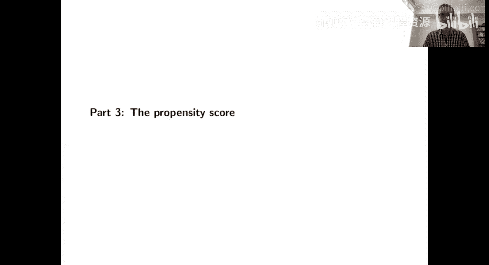

But anyways。What is the propensity score， it has a simple definition。

 the propensity score is conditionally on covariance x。😊，The probability of receiving treatment。

In a randomized trial， you might remember。Treatment is assigned uniformly at random。m。

Ignoring kind of anything about the person being treated or not。

And a way of saying this in to propensity score is that in a randomized trial。

 the propensity score is constant。Say in a uniform a 50，50 randomized trial。

You flip a fair point to determine if someone gets treated or not。

 so in a trial like that the propensity score would just be uniformly 0。5。

What this also kind of suggests is that。At this qualitatively， if a randomized trial is。

A setup where you have constant propensity scores， then maybe if you look at the propensity score and plot the spread of the propensity score。

 that gives you some notion of how far。A given observational study is from being randomized。

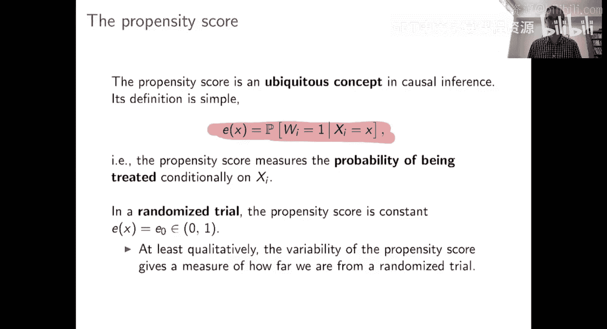

So anyways。What's interesting about the propensity score and the key fact here really is that under unconfoundedness。

诶。That is the same condition we saw in part two， the average treatment effect can be characterized。

Via you could call the inverse propensity weighted transformation。So here， what's true is Tau。

 remember it's this the average treatment effect， kind of redefined it for you just in case you got over the past 10 minutes。

The average treatment effect， you can rewrite it as the expectation of WY divided by E。

A minus other term。And this is our。This is another representation for the average street p。

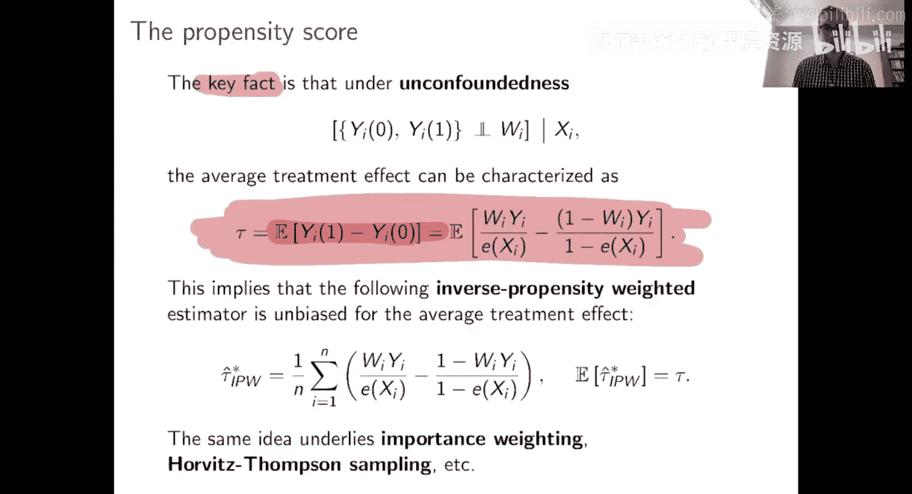

嗯。And again， kind of what's interesting about this is that here when we originally defined the average treatments effect。

 it was defined in terms of potential outcomes， kind of Yi1s Y zeros in general， you don't see。

Potential outcomes in nature， you observe the actual outcome Y I so wise。

This representation helpful well here kind of this representation in terms of English intensity weighting doesn't depend on potential outcomes it only depends on actual outcomes。

 so this is something you can measure whereas this is something that kind of。

You can't directly measure how you need to rerepresent it before measuring it。

And so then given this representation。What this immediately suggests is a practical estimator for the average treatment effect。

 it's the inverse propensity weighted estimator takes on the following form。

And kind of this unbiasedness result here immediately tells you that the inverse propensity weighted estimator is unbiased for the average treatment effect。

你的个嘛。嗯。Ideas of this type are very common。many areas with statistics。

 you might have encountered similar idea in different areas under a name like importance sing or Harvard Thompson sampling。

 these are kind of all different instantiations of the same idea。

Why is inverse propensity weight unbiased？The short story is something like this remember the treatment assignment here is binary it's either one or zero。

WhenW is one。hen you're always treated， so you only get to observe the y's here when w equals one。

 which means that you can essentially replace this yhi here by the treated potential a y1。

Same thing in the second term， you only get to see that second term when w is zero when you're in control condition。

 so you kind of could equivalently just think that here。You only see the control potential outcome。

And what about this ratio， the remaining terms， the w over E and the one minus w over1 minus e？Well。

 just remember。W is the。Whether you actually got treated or not。

 E is the probability of getting treated， so these ratios are one an expectation。😊。

So the hope is that kind of since these ratios are one in expectation。

 they cancel out an expectation。And。😊，That's how you get unbiasedness。

The formal argument for checking out that this works relies on unconfoundedness。

And I kind of spelled out a more specific calculation here。

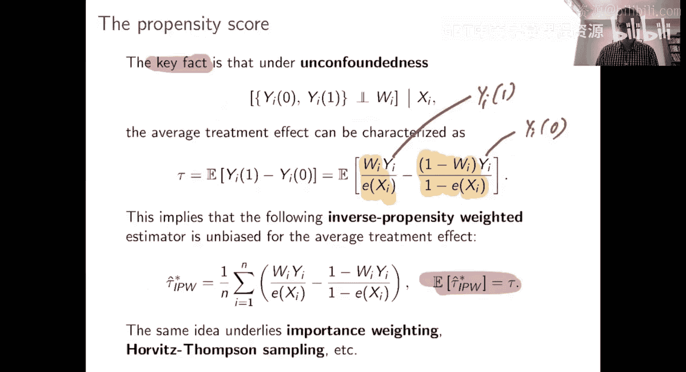

The nice thing with the asynchronous format is that if you。

Want to think about this more now is a great time to pause the video and go through this line by line。

😊，嗯。And if you don't， the ideas are similar to the ones seen earlier。And otherwise。

I'm just going to keep going here， remember。All of this relies on unconfounded。

If you don't have something found in this。Then of course。

 you need to do something else to identify that treatment。

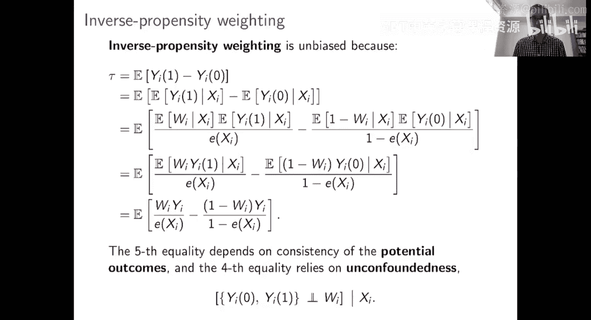

All right。So what we have so far。Is a result that here's this kind of。Nice estimator1 IPW。

 it's unbiased for the average treatment effect。One thing to emphasize is that here。

When defining this estimator， I use the true propensities scores that is I actually knew。

I had access to the probability of being treated conditionally on X。For all of my units。

 so I could actually form this score。I'll talk about this as the Oracle estimator because of course sometimes you don't know EX and then you can do this and I'll put a star up here to remind us that in order to construct this。

Estimator you needed to kind of。Have more information about the sampling。All right。

 if Oracle IPw is unbiased， then。What can we do if we don't know the propensity score well。

 one very natural idea here is to first kind of estimate E hatAT。You can first estimate E hat。

And then kind of once you've estimated the Ehats， you can plug these Ehas。

Ins the denominator here so kind of this is not spaed this is a this is a feasible estimator。

 so we're going to kind of。😊，First， estimate E hatAT。

This is just a prediction task right you're trying to predict w from x。

Throw your favorite machine learning method at it， boosting random forest deep nets， anything else。

 And then kind of once you have estimated the propensity score。

 you could kind of try running through。The IPW framework kind of as though you knew the propensity score。

And this is actually if you look at kind of。The timeline of machine learning and causal inference。

 this is actually kind of one of the first things people wanted to do they had this idea that。😊，Look。

 if we're running IPW， we want propensity scores， we could get propensity score estimates out of machine learning and just kind of。

From there proceed。The question， of course， is， is this an egogo？

We know that the Oracle IPW estimator with the trueop propensities scores is good。

Is the feasible IPW estimator with estimated propens scores good？Now we're getting into some。

Slightly subtle territory I won't。Give a kind of comprehensive study up at IPW with estimated proensity scores here。

 that' would be beyond the scope of this class。嗯。But what I all do here in terms of trying to see if this is good or not。

 I'm going to try one line of attack。That you might hope would work。Show that it doesn't go through。

Give up I won't kind of study downhead IBW further than that and then what's going to happen is there the same line of attack。

When applied to double robust methods， that we'm going to talk about in the last part of this lecture。

 then this line of attack is going to work。😊，So what's the idea？

The idea is essentially that this tau has star IPW， the Oracle IPW estimator。If this is good。

Then what you might hope is that kind of estimating the propensity scores and un plugging them into here。

That essentially it wouldn't matter too much and if you have decent kind of realistically accurate Ehas out of a machine learning method。

 then if you。Rund this kind of。Feaible IW estimator， it behaved like the Oracle。

Then you could study the oracle in detail and if these two things are similar enough。

 then the kind of same study would also implies some good results about the feasible town and IBW and if this line of argument worked。

 we'd be in great shape。Okay， spoiler again， I've already given the spoiler this doesn't go through。

 but kind of to see why it doesn't go through， let's look at this in a little bit。😊。

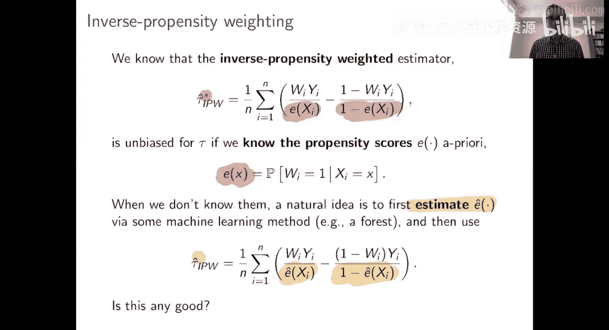

So this argument has to have。Two parts right first， we need to have an understanding of。

What does Oracle IPW？Do kind of。What would be the kind of ideal properties we want this feasible IPW estimator to satisfy。

 and then we need to study the gap between the feasible and the Oracle IPW estimator and kind of argue that this gap is small relative to。

😊，tochastic fluctuations in the original estimator。

So let's start by looking at this Oracle IPW estimator。So this one here。What we should see。

 right is that。Remember， we've assumed that kind of your data points x Y YW are drawn IID from a distribution。

And also。Here that this means that if you know the propensity score function， E ofs a priorityi。

Then actually this thing in orange， it's just on average of N IID things。

Each of which is unbiased for the thing you want to estimate that is tau。So now。

We know averages of I things well， right？they're going to satisfy under very general conditions a central limit theorem they're going to converge at a root and rate and so kind of once we've noticed that oracle IPW is just an IID average then。

We're going to get a central limit here immediately。

And this kind of central limit theorem is what justifies kind of all the standard constructions for building confidence intervals for the average treatment effect。

And so forth。So here just to emphasize， I'm going quickly， I'm assuming that。

Everyone here either has taken kind of a first class in econometrics or a class in statistics statistics theory maybe on the level of stats 200 so I'm assuming that this should all be very familiar to you once you see an average you understand that the average is getting under general conditions satisfy central limit theorem and。

😊，Once I tell you the central limit the second orange display， you'all kind of。

Know how to turn this into a statement about confidence interval and how to build confidence interval。

If this isn't true， I encourage you to kind of go to office hours。

Go through what's going on with the TA and also kind of reach out with some more reading materials here。

But anyways， so this is the Oracle estimator。The thing that converges at a one over rootdent rate。

 which we'd want hope is for the feasible estimator with estimated propensity scores to also satisfy this kind of behavior and to also converge at a one overrodent rate。

And what will this look like？😊，It had looked like essentially this feasible estimator here。😊。

We want this to kind of look at look like the Oracle estimator。

Which we're here is a perfectly fine estimator plus an error term。

The error due to kind of using E hat instead of E as the propensity score metric here。And。

For this argument to go through， we'd essentially want this difference between。Andum。

Feaible and oracle IPW to be smaller than one over roin to kind of be dominated by the stochastic fluctuations in Taid IPW。

 because this would then mean that you can ignore these errors when studying。This estimator here。

So all right。If we wanted to ignore the contributions of propens core estimationimation in IPW。

 we'd want this error to be much smaller than one overroot。

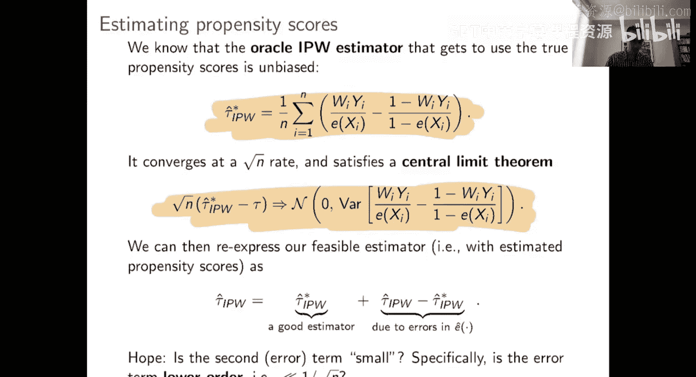

And is it？Now， we need to kind of。Try something， try an upper bound here I tried an upper bound using the kosher shorts and quality。

So first， remember we want to bound this difference， tau hatt IPw minus the oracle， Tauhad star IPw。

So here I just wrote it down what you should notice is that here you're dividing by estimated propensities scores。

 here you're dividing by true propensities scores， the only kind of。

Difference in how I wrote this down is I took the outcomes here that had been kind of。

Everywhere and I just kind of。Put the outcomes off to the right。Then given this。

 we can apply the coachher Schwartz inequality。It's going to give us。This here。Um。

You see two terms here。First， let's talk about the shorter one。

 the square root of the average of the Yi squared。This is something that kind of as you collect more data。

It's not going to get big or small it's just going to be on the order of one this is going to converge to kind of。

The square root of the expectation of why quick。😊，So that's fine the more interesting term here is the first one。

 this is the one that kind of would be zero if you kind of。

Use the trueop propensities score that if kind of E has were exactly E， how far is this from zero？

Well。Just of you can go through the arguments in detail if you want。Essentially。

The nicest thing you could assume is that the propensciities call， of course。

 are all bounded away from zero and one， so then you can apply some kind of tailor expansion。

Once you do this， you land on your feet and you find that this difference is essentially going to be on the order up to constants of the root mean squared error of the propensity square。

So anyways。This is one derivation， you could try other derivations here， I'm not going to do that。

 but kind of at least with a khi Schtz approach， which what do we get？

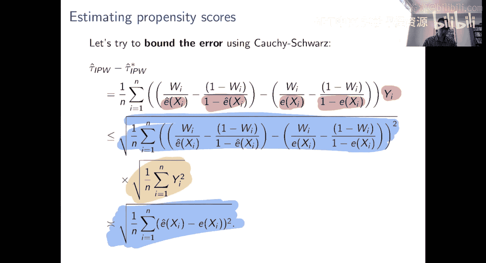

Well， essentially， we found that。

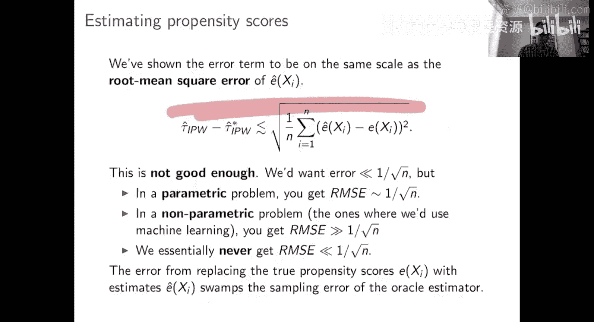

We have an upper bound for the discrepancy between Tau hat IPW and Tau hat star IPW that is the kind of we have a bound for the effect of using estimated propensities scores in IPW。

And this bound depends on the rooty squared error of。The estimated propensity score。

Is this good enough？Well， the answer is going to be no why， as's remember。We wanted。

 in order for these errors not to matter， we need the discrepancy between feasible and Oracle IPW to be much smaller than one over Ruan。

Is this。Realistic to get out of a machine learning method。If youve studied statistical learning。

 you'd immediately see that no， if you haven't， then you'll have to just take it on paper here。😊。

But essentially， what's realistic to expect in terms of root square error？Well。

 if you're in a parametric problem。And of a very easy problem where someone tells you that kind of say a linear model is West ball specified and you just need to fit the parameters of that linear model。

Then what you can hope to get in terms of root means square error is a rate of convergence of one over square root of n。

Now， the problems where we apply machine learning are generally more complicated non parent problems where。

Getting parametric rates of convergence is too optimistic and we should generally expect to have rootmi square error that's much bigger than the parametric rate of one in Buruda。

冚。And thinking of this， you should kind of also think back to。

Our attempts at using random forests for regression adjustments in the previous part。

Where we saw that kind of random forests will often eventually get you the right answer。But kind of。

The cost of。Being very flexible and nonparmetric means that in any specific problem。

 you might converge slower。So actually in general。When you're using a machine learning method。

 you should always assume that your rootmus error is going to be much bigger than one of root。

Whereas here we kind of， in order for this bound to give us what we want。

 we would have needed the regimes square air to be much smaller than one of Ruen and that essentially never happens。

With a machine learning。So。Okay， this argument doesn't go through。Of course there's。

There are some loose ends here， I've essentially just computed an upper bound and said the upper bound wasn't strong enough。

But it turns out this isn't a problem this upper bound was perfectly fine， the problem was just that。

看了。A more careful study would show that just the problem is that TalHD IPW and TalHD star IPW aren't particularly close in general when you estimate propensity scores by general machine learning method。

And that。What's going to happen is that in IPW， if you use a machine learning method to estimate propens scores。

 then kind of。The error due to kind of plugging in estimated preventensity scores is going to swamp the sampling error you could have gotten by using Oracle IPW。

So even though kind of IPW， with true propensities course is a good method。

If you plug in machine learning based estimates。Of the propensity scores。

You're generally going to end up in trouble。

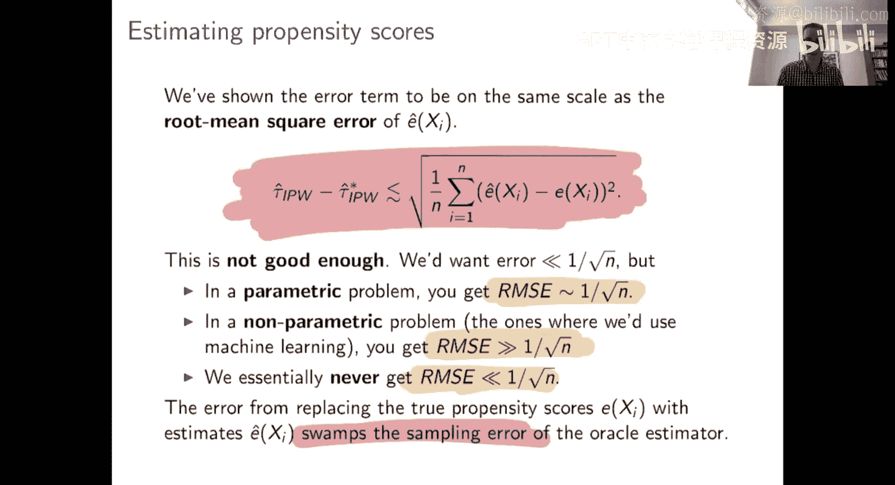

And so again， kind of just just to restate the main problem here is that。Generally。

 when we use machine learning methods， what we want out of machine learning methods is kind。

Robust flexible estimation guarantees what we want is that kind of without having to model the problem specifically。

 we kind of under very general。😊，Conditions can hope to get consistency in large samples。But。

Just because machine learning gives you kind of。The right answer。

In very large samples doesn't mean that in finite samples， you can ignore its estimation here。Right？

Machine learning really at a high level。Gives you predictions that are always pretty good but never great and under infinitefin samples。

 you almost always have non negligible errors。😊，Kind of when you're running IPW。

When you're using a regression adjustment as we signed the previous part。

When you're running kind of machine learning based methods here。

The kind of difference in using EhaD versus E and IPW all kind of。In many other analogous settings。

 the error from using。the kind of error from using machine learning here is not negligible and if you don't take it into account you just can kind of。

Be very wrong about。The accuracy of your estimator and so forth。So generally。

 we cannot ignore this estimation error and the bias that comes from it。

And a naive approach that does so well generally。Result in confidence intervals and kind of other inferential statements that are just laid off。

And again， why is this the case？ItWith IPW， we just saw a very concrete example。Kind of the standard。

Approach for building confidence intervalvols and Oracle IPW will give you confidence intervals that are length one over root n。

 but now。If you use a machine learning based method to。Estimate preventity scores。

 you're going to kind of introduce an additional error term that's way bigger that's bigger than one over done so kind of。

Once you have error terms that are larger than the confidence intervals you built originally。

 this kind of makes the original confidence intervals。这个死。So okay， that's what were now。

What I hope I've gotten across so far is that even though machine learning methods。

Can be used to estimate a variety of functions under reconsiderable flexibility if you're going to use them for every treatment effect estimation you need to be very careful and if you're not careful then kind of。

That the kind of error you incur from plugging in machine learning based predictions into your estimation pipeline。

It's just going to be prohibitively large。What can we do about it at this point you might think the situation is hopeless that we should just kind of throw out machine learning based methods and go back to parametric modeling since then at least when the parametric model was well specified。

 we know what to do。But it turns out that even though kind of naive applications and machine learning method don't work out here。

There are things that do。And the solution is kind of。Toideful simple。

You can do exactly the kind of thing we've been doing so far， that is take a simple estimator。

 plug machine learning based predictions in， and then attempt to ignore the error of the machine learning based method。

😊，The only thing is that you need to be careful about what kind of estimator you plug these machine learning based predictions in and。

Okay， regression adjustments。Alone， IPW， please don't do the job。

And in the last part of this lecture， I'll introduce an estimator that does。

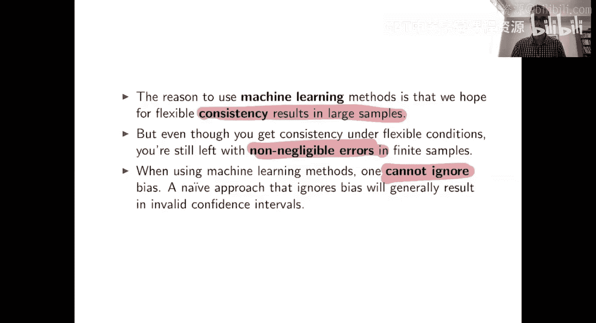