# 斯坦福商学院《机器学习和因果推断｜Machine Learning & Causal Inference： A Short Course》claude-4s p08 -08-Average Treatment Effects_ Double Robustness.zh_en -BV1M9W7zCEsf_p8-

All right， now I finally get to share with you a method for average treatment of effect estimation based on machine learning that's actually good。

So all right。

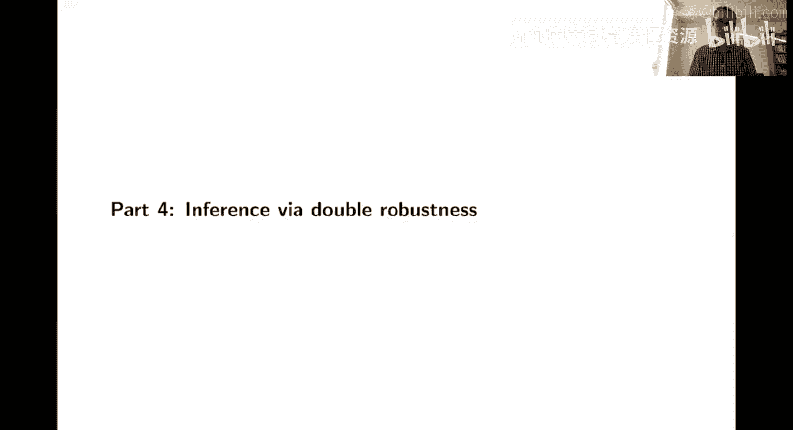

What do I mean this？The average treatment effect， we've been talking about it for a while。

 we want to estimate the average treatment effect under unconfoundedness there's no question here but of course the thing I've left more implicit。

 what do I mean by actually good？😊。

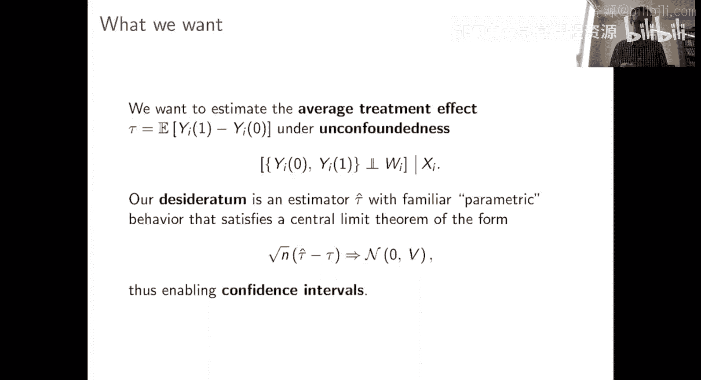

And by this， I mean an estimator with kind of parametric type guarantees。

We want an estimator tau hat that。Converges to the average treatment effect at a rootdent scale that satises the central limit theorem and that' can enable us to build confidence intervals in the usual way。

Why is this a notion of good？Well， in the classical setting of parametric modeling。

 if you were to run linear regression with a well specified model。This is essentially。

What you'd expect， you could get root and rate confidence samples。If you're using machine learning。

 then you'd hope that at the end of the day you get something with compably good properties as to what you would get out of traditional parametric modeling just kind of。

Under more flexibility。

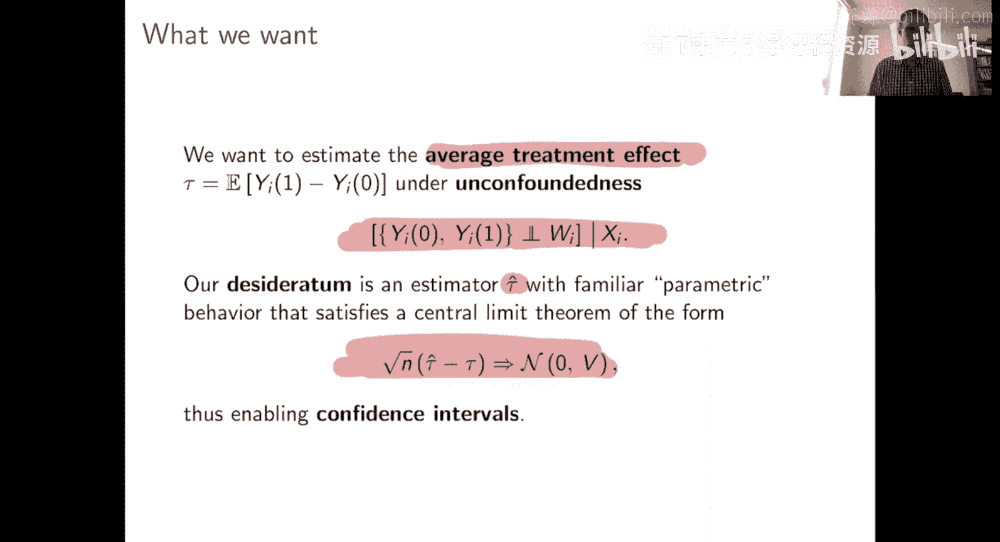

So this is what we want， what do we have， we have machine learning。

But that's of course again rather nebulous so now I'll need to be more specific again about what I mean by access to machine learning and this by this I mean we have access to a predictive black box。

😊，That's good， that's flexible， but that's not too good。U。

And what I'll say specifically is that we have a way of estimating mu hat and these mu and E functions。

 the conditional response function and the propensity score that converges in roots square there at a four root n。

Yeah， remember n is the sample sign。So。This might look like something of a strange assumption。Okay。

Why this？Well， first the first thing to note is kind of how are we writing this assumption down and we're writing this assumption down in terms of the root mean squared error。

 RMC， why is this natural？Well， remember， the claim of machine learning methods is that they're good at。

The claim is that machine learning is good at prediction。Under squared error loss。

 like I mentioned earlier， being good at prediction means having small mean square error。

The optimal predictor under squared error loss would just be kind of using mu Wx and EFx。

 the optimal prediction of yn y giving W and x is mu Wx。All right。

So machine learning claims to be good at prediction。

 that means it must be claimed to be good at rmacy and also in fact。

 if you tune your machine learning method for predictive accuracy。

 then you're simultaneously tuning it to be as good as possible in terms of rarmacy。

So the reason I want to be using this assumption is I want to be assuming things of machine learning methods that they actually claim to be good at。

As opposed to assuming something else。So this is about the functional form。

 the second question is why the pour through end here？😊，This is a more delicate question。😊。

If this were kind of a stats PhD class， I would talk for a while about the exponent here and debates about what is optimal exponent here and trade offs。

 but for our purposes， the main things to note is first， this rate of convergence four root of n。

 it's smaller than one over square root of n that is kind of for big values of n1 over four root of n is bigger than one over square root of n。

So this is a list stringent assumption， if you had a parametric model。

 then traditional parametric methods of estimation could get you1 over square root of n rates of convergence。

And here what we're assuming is that you have some convergence guarantees that are weaker than one over square event that's the important we're not assuming parametric convergence in。

And now。we need some number here I made a big deal of why this is kind of a weaker guarantee than assuming one over square root and rate convertence now we need something here one over four through then。

I'm just using it as something that's convenient。That'll enable simple formal results。

 and that's also kind of obviously。啊啊。Weaker than what you get in parametric problems。

 so there's some room of them。Machine learning to be doing a good but not perfect job at prediction。

So all right， this is what we have and then the question is how can we use this predictive black box to reach our goal that is estimate the average treatment。

😊。

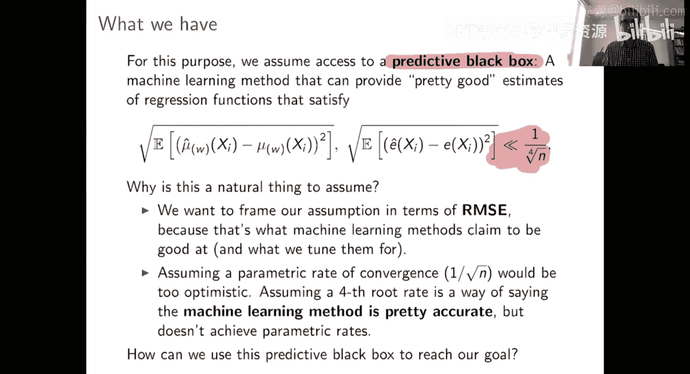

And。So the answer ends up being。We've talked about methods based on regression adjustment where you only estimated the mu functions and then you try to form an average treatment effect estimator based on those。

And that didn't really work and we've talked about methods based on inward propensity weighting where you only estimated the propensity score。

 the E function and tried to use that driver treatment of effect estimation。

 and again that wasn't accuratecurate。What's going to work is that you need to estimate both models and combine them in a clever way that trades off the errors of each model against each other。

And how do you do this， well for now I'll just write down the answer。

 you want to use the following functional form for the estimator。

This estimator is called the augmented in propensity weighted estimator or AIPW。And。

The short story is it inconsiderable。Generally， this is a good estimator of the average treatment effect。

 even when Yu hats and Ehas were obtained from a machine learning method。so。

I guess in looking at this， your first reactor might be like。That's a called guarantee。But。

Maybe maybe you feel like i've lost you here this is this is。A very complicated looking estimator。

I've been like definitely， I like what you're telling me but。

I've never used an estimator in any of my papers that took two lines to write down。And。

Maybe you don't feel like changing that。And I understand the sentiment， but I hope。

I can convince you that the estimator kind of once you understand what it's doing。

 it's not quite as bad as the functional form suggests。😊。

So what's going on here instead of just writing it as a giant blob let's write it in two parts first i'm going to kind of cut it up into the orange part and second blue part which is kind of。

😊，The rest here。And now。

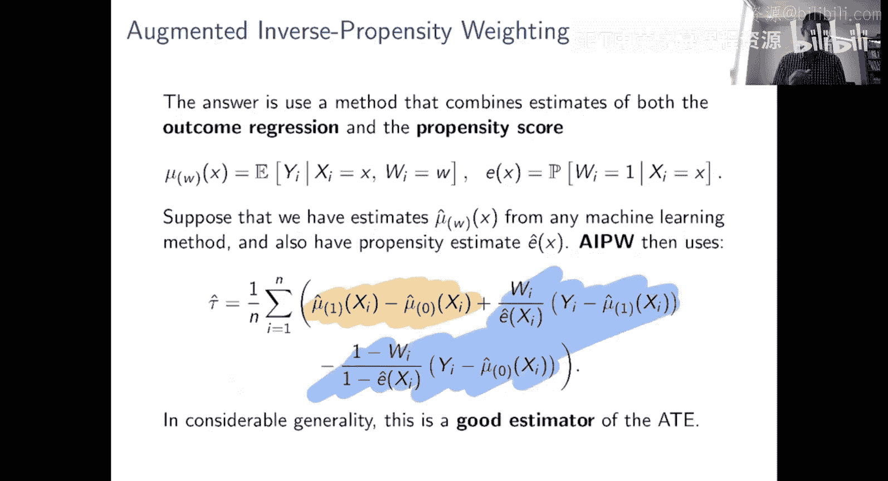

Okay， if we write these two parts separately， so we have the blue part and the orange part。

 these are the same from last slide。

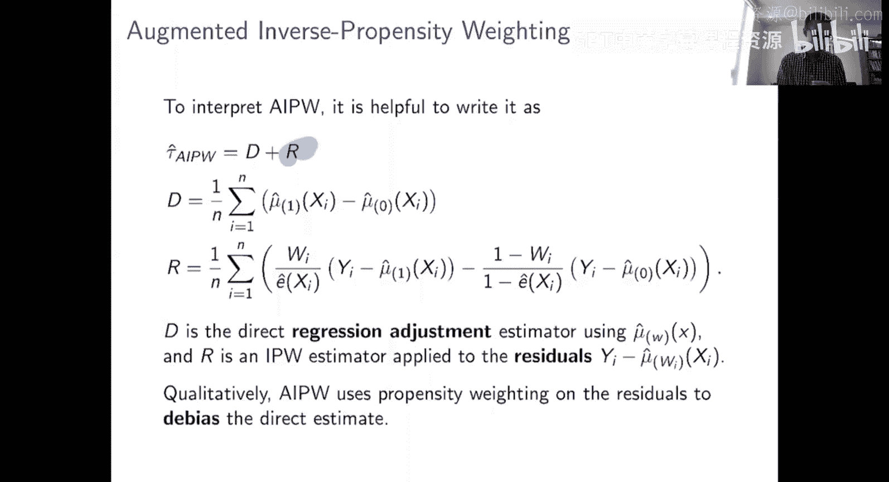

Then。We can interpret them as followss。The orange part， this is actually something familiar。

 this is something we've seen before。On average from is 1 up to n of mu hat 1 of Xi minus mu hat  zero of Xxi。

This was just。The machine learning based regression adjustment we talked about。

At the beginning of this lecture and part two。We talked about how。Under flexible。

 the mu hats you get out of machine learning are going to be consistent。

 so this term uppercase D is going to be consistent for the average treatment effect under considerable generality but。

The machine learning methods don't converge fast enough and so D is not going to converge to a squared end rate。

 there's connected bias and we can't get confidence in it。So D is something we had seen before。

 then the question is what is this art here？This is kind of a correction that we apply to D。And here。

 if you stare at this and you compare it to the IPW estimator， we just saw earlier。

 this should actually look quite familiar。What was IPW IPW looked like this， so IPW was the average。

Over n of I equals one up to n of W over e hat times yi and one minus w over one minus e hat times Y so if you just had the red stuff here。

 then this term R would look like what you got。Out of IPW， this was the thing we had before。

What happens now is that this term R。Is applying IPW。

 but it's not applying them to the original outcomes Yi， it's applying them to these residuals here。

 Yi minus mu hat1 of Xi in the case of the treated units and Yi minus mu hat zero Xi in the case of the control unit。

And。This might seem like a strange thing to do， but here's the intuition。

Imagine you were kind of listening along in part two of this lecture with the regression adjustment and you kind of liked the regression adjustment and you felt like this was a pretty good estimator but then I told you look machine learning methods of errors。

The regression adjustment leaves these errors on the table。

 this means there's bias so we can't use the regression adjustment alone， you feel okay。

Maybe maybe this isn't perfectf， maybe the regression adjustment left some signal there。

 but I'll just try to patch it up afterwards。I'll try to kind of salvage that signal and kind of apply a correction to the basic kind of regression estimateimator capital D。

So here's what's going on， this kind of Y I minus mu hat1。

This is kind of a measure of how much signal kind of if this you had one of XI were a perfect prediction of Yi so this so this was kind of just mean zero noise irreducible noise then there's kind of R term that would be essentially zero but if it's true that there actually is some signal left over from the first progression stage。

 then you should expect that there's some signal left here and some signal left in these residual tools that kind of。

Is a measure of the bias of this pure kind of orange regression adjustment estimator and now kind of you might have this wild hope that you can just take these residuals and extract the information that was left over by throwing these。

Residials into iw kind of you start with a regression you have two ways of estimating an average treatment effect the regression adjustment and IPw so what you're going to do is prototype run the regression adjustment and then use IPw to fix up。

The regression adjustment and kind of soak up any information that was left oak。

This might seem like a wildly optimistic idea， but turns out it worked very。

So let's see this play out in an example here， it's a simple simulation， not a parametric function。

 notice these positive parts here。😊。

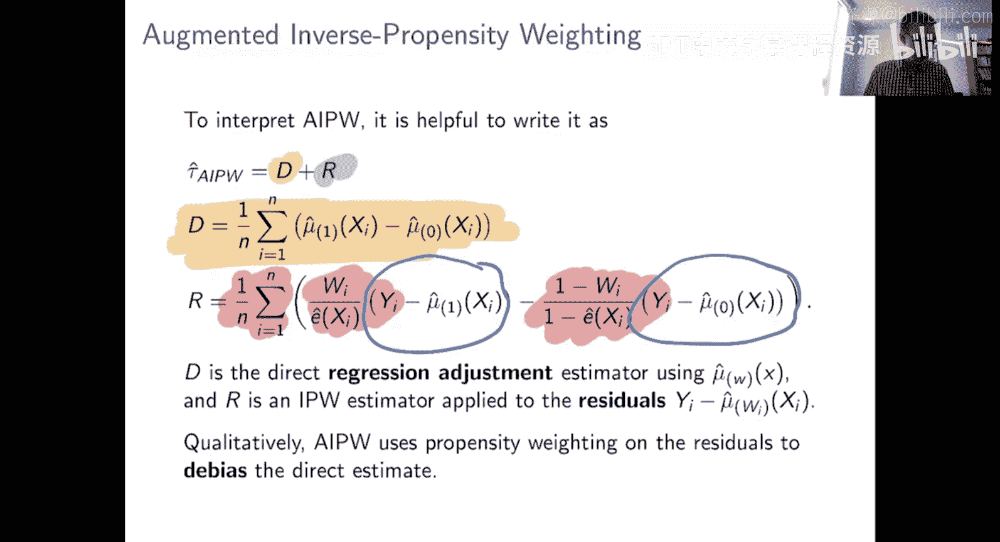

And we want to estimate the average。The average treatment effect in this setting is going to be negative 0。

05。First thing you could try， just estimate these mu zero mu one functions using a random forest take the average difference in predictions。

 this is a regression adjustment estimator， you can do it it's going to be consistent is it going to be particularly good well here on average we get an answer of 0。

09 when the true treatment effect is negative 0。05。Okay， but not great。

So what we're going to want to do is then patch this up and correct it。And。

So here what we're going to do in the second step is we're going to fit a propensity model， E hatt。

We're going to apply IPW to the residuals of the random forest。

 this is going to give us this correction term R， and then we're going to add this correction term R to the original estimator。

So here the correction term R is negative 0。1， our estimator from before was 0。09。

 and when you add them together， then you get this point estimate of negative 0。01。

 which again isn't perfect。But it's a lot closer to the true answer than the original regression adjustment。

To kind of get an idea of how good is this， I'm here showing a box plot of kind of。

Across 100 replications of the treatment effect estimates you get。😊。

So here this is first the box plot of the regression adjustment estimators and you see。

Is really not that good kind of the true answers here negative on average the treatment the is positive and not only that but kind of。

In every single realization in the simulation setting。

The regression adjustment gives you a treatment of existing that's bigger than the truth。

 so you don't even have any spread of this box plot around the truth。😊。

Then here this is the correction， it's a remarkably stable correction here it just kind of pushes this box plot down and then AIBW what do you get where you get the follow。

It's again all。Not perfect we're not nailing this answer this is again kind of there some pilot sample phenomena here suggesting we're not kind of in a。

Perfectymptically unbiased type regime yet。But still。On average。

 AIW is much closer to the correct answer than the kind of regression adjustment on its own。

 and also you see that now at least the true treatment effects starts to be within the spread of。

Things you could get out of AIPW and there are some simulation replications where AIPW falls below oh kind of is negative has a negative resident positive。

So here's the correction element。

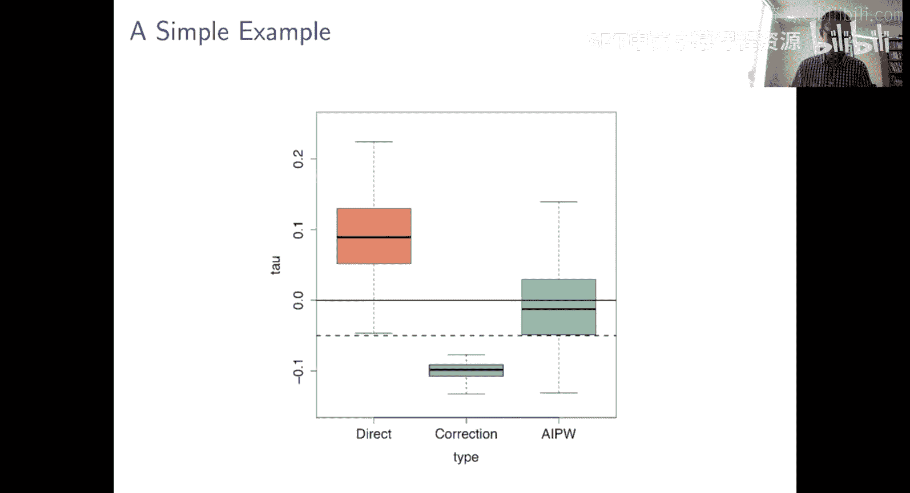

All。嗯。And aside， I just want to make still。So I hope this helped a little bit。

In reassuring that this kind of daunting IPW functional form， it has a simple explanation。

 it's run a regression adjustment， then take the residuals and stick them into IPW。😊，啊。

Even so you might feel like this is a lot to implement and again something I kind of want to reassure you is that kind of once you know that AIPW is a thing you want is a thing to do when estimating average treatment effects using machine learning。

 then kind of hopefully you can find a software based solution that implements it for you。😊。

For example， in the package GRF that。Susan and I maintain。喊。You can。

Run this function causal forest under the hood what this is going to do is going to do a bunch of stuff we're going to talk a about more in upcoming weeks but it's going to give you the mu hat and e hats based on random forests for the things you need and then if you went through an AIPW you can just call a function average treatment effect。

On the call forest object and work in it。Do all of this for you。走。Anyways。

 it a it's a question in some cases you may want to implement this on your own but often when you're running this in practice you don't need to deal with kind of。

AMass functional form。All right， that's AIPW that's what it looks like algorithmically received generally。

 but I've been kind of。Hping this up for a while now saying that it's good。

 so let's actually talk about the sense in which AIPW does give you a good estimate of the average treatment。

😊。

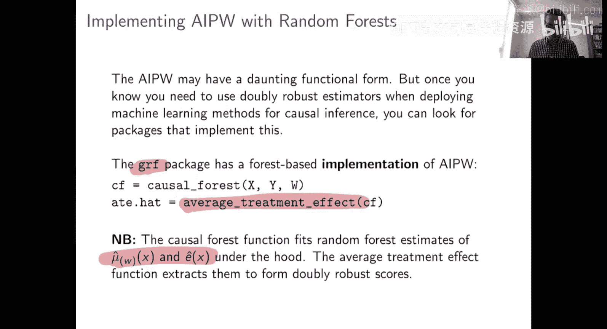

And the key result here is that AIPW actually satisfies。Theorem。That we trying to prove about IPW。

Its just kind of playing in re propensity waiting but didn't go through。And so like。Did there。

 I'm going to start by writing down this Oracle version of AIPW。

So if you remember from a couple slides ago， this thing I'm highlighting in orange。

 this is exactly the same as the AIPW estimator， except every time when there's a mu or an E。

 I'm putting the true value of mu and E in here， or not though。Estimated Muha or Yhat you got out of。

哦 the machine learning。And the strategy here is going to be to show that under reasonable assumptions about the machine learning methods that。

ThisThe feasible AIPW estimator that uses these kind of estimated mu hats and Ehas is going to be equivalent to first order。

 is going to behave just like this oracle AIPW estimator that uses the true values of muA。

In the case of IPW， we tried to prove this kind of result。

But it turned out that kind of at least using our proof strategy。

 the discrepancy between the feasible tau hat and the Oracle one。啊。

Was was much larger than the kind of target error scale。

 whereas here the opposite is going to be true。And。The theorem is essentially the following。

This is kind of a very simple version of a result of which there are many。

Alternatives out there in the literature。I'll point you some more references。

At the end of this lecture。But so。Let's start by assuming。What I assumed earlier。

 that is that all our estimates we get out of machine learning are。Not perfectly accurate。

 they're not converging at a ron rate， but they're pretty accurate， they converge at a fourth。😊，Then。

嗯。The feasible estimator tau hat and the oracle up there in orange are equivalent at the squared then scale。

 meaning if you take their difference and you blow it up by squared root then。

 this converges imp probabilityability to zero。😊，their first order equivalent。

I'm not going to approve this result here it's beyond the scope of this class。

 if you want to see a approved， please send me a note and I'm happy to share a reference。

In particular， on the last slide I'll have some references kind of that kind of prove this kind of result in the case of specific machine learning methods。

 also in the Stats 361 class I teach that there are lecture notes that I referred to in the syllabus and in chapter  three of those notes there's a proof of this kind of result。

But for now， I just want to kind of emphasize。The form of the result。And。

Contrast that to what we got with IPW。With IPW， we kind of tried to bound the discrepancy between the oracle and feasible estimators and what we found is that if the propensity score。

Converges at 1 over4 through n in written square there。

 then the discrepancy between the feasible and oracle estimators。Well。

 you can p it to order for throughda there was no gain there。

 you were limited by the accuracy of the method you putda。

But here something else happens we have a bunch of regression adjustments and we're only assuming that they canverge at forth through then。

And yet the error， kind of the effect of kind of plugging these mu hats and E hats with four through and scale errors into this estimator results in kind of。

Only alters this estimator to scale that's less than one overro。

So this somehow violates this garbage and garbage out principle where you think if you kind of plug stuff into here with four through and scale errors。

 then you must kind of induce four through and scale errors in the final product。

But that's not true you can plug in four student scale errors。

 but essentially this estimator is very carefully designed in a way that makes it that kind of。

First order errors and Uhath and Ehath cancel out。And that's why kind of you can plug in。

Components of four throughdent scale errors into here。

 and in the end you change the final result by less than one over root n and you get this kind of result。

What this means is that we can do what we actually wanted to do with IPW。

 that is we can just study this object。Give a central limit DM for it that's going to convert at one over squared n rate and then we can use this kind of result to invoke or to argue that actually Tauhat AIPW also satisfies any guarantees you proved about that。

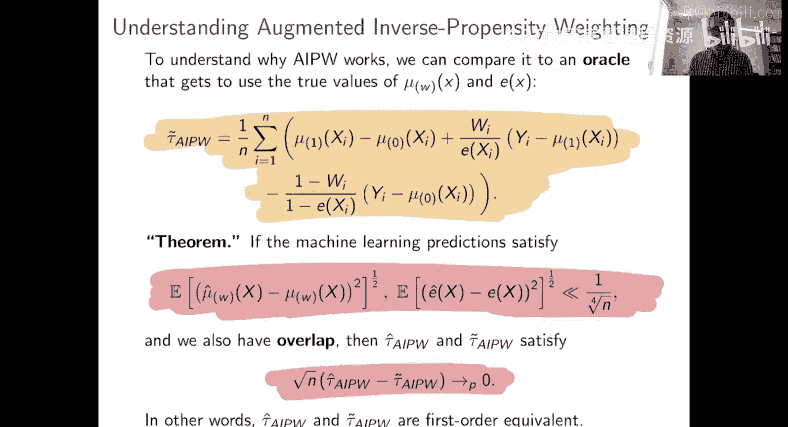

And kind of concretely right just again this T tilda here if you know this mu E stuff and this is a big expression。

 but this is just an average of IID terms averages in IID terms satisfy central limit terms in considerable generality and discussed earlier so what you can check is that。

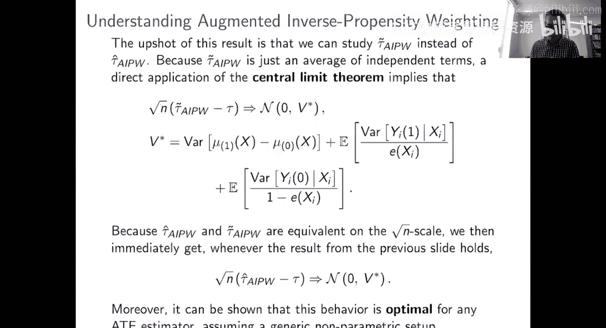

This oracle  intator is going。We asymptically normal with one of root and deviations around the true average treatment effectile you can check that it's。

Variance is going to depend on this quantity v star stone blue。And really。

 the point here is that because Tao hatt AIPW and Tu Telda AIPW are equivalent on the root end scale。

 then kind of once you' got this central limit theorem for the oracle estimator。

 you also get this central limit theorem for the feasible estimator where you plugged in machine learning based nuisance branch。

So。This is the first result I've given you today where。You don't need to use parametric models。

 you can just start from kind of machine learning reasonable assumptions on machine learning combine predictions from a bunch of different machine learning models and you land on your feet。

 you get an estimate for the average treatment effect that has classical。

Gauian parametric rate behavior。So you get us into limit theorem that's very good it turns out actually that this V star we got here。

😊，It's a very good variance parameter and actually this is the best central em theorem you could get for average treatment estimation using any method。

Under kind nonparmetric assumptions。So that's again beyond the scope of this class。

 but just kind of this isn't just any central limit theorem， it's a good one too。

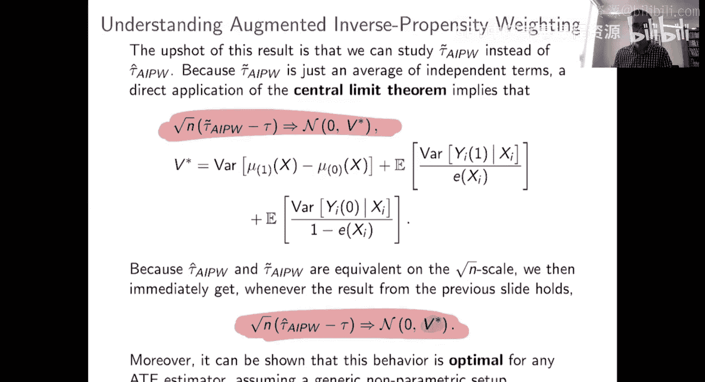

So this is nice and actually the。Proof gives you more than。What I wrote down。

It actually tells you that kind of。Okay， Alllan Gomicically。You can write。

To hat AIPW as the average of these capital gamma hat eyes， I'm going to call these things。

Double robust scores， you're going to see them occur。Several times in this class。

 so you can think of Taohan AIPW as being an average of double robust scores。

And these double robust scores， of course， are not。IID， they're not。

Independent from each other in general， because you plugged in these mu hats and E hats in there and。

This kind of induces dependence across terms。But the thing is that actually。

Under the assumptions we made， that is。Under the assumption that EhaMU hatW convert as forhood write。

 then these gamma hats are close enough to being independent that you can ignore this dependence and you can build confidence intervals for Tao as though Tao AIPW were just an average of gamma hats and the gamma hats were independent。

So you can just do the usual thing I'm spelling it out here。

 but this is really kind of if you stated it， this is just the usual estimate a variance for a sample mean and this is just kind of the usual asymptotically normal construction for confidence interval for a sample mean so you can kind of just really。

Do kind of very standard things for building confidence intervals for tau once。

Once you're working with this AIPw estimate。

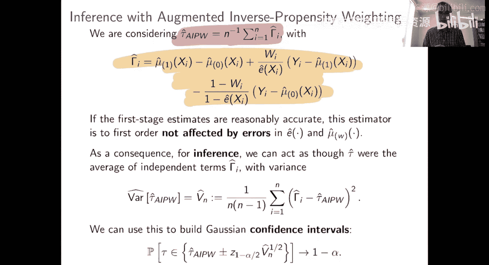

So that's really nice， that's essentially it's hard to kind of ask for much more than that in terms of guarantees。

😊，啊。I just wanted to kind of close out this discussion by highlighting a few details that I had neglected dimension in the statement with theorem。

 but are still important。The first is。I should put an asterisk on the claim that you can just kind of plug new hats and Ehats into the IW estimator and everything is fine as long as these are accurate。

This is almost true。But to make this actually true。

 you need to use this algorithmic trick called crossfitting if you're familiar with cross validation。

 it's a very similar idea。The simplest type of cross fittingtting is you divide your data set into。

 you fit kind of models on both half the data。And then when making a prediction for the IT observation。

 if the Ih observation is in data half a， use the model trained on data half B， and vice versa。

 if the IT observation is in data half B， use the model trained on data half。So essentially。

 you never want to be making predictions like Mu has one of XI at the I training example using a model that actually got to see the IF example while being trained。

So that's something that。Matterters， you really should use this most standard packages that kind of。

Two AIPW pis machine learning will'll do it for you if you want to implement by hand。

 you need to remember to use class fitting。But kind of it's a little bit of effort。

 but it's really kind of algorithmically it no more work than cross validation and this kind of。😊。

The guarantee you get out of crossfitting is the kind of idiosyncrasies of how machine learning methods use individual data points don't affect your guarantees。

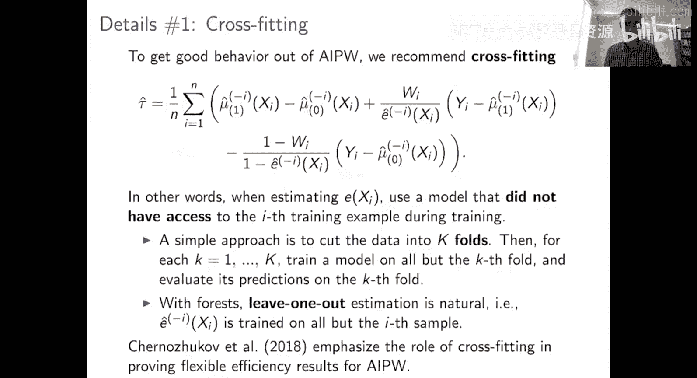

So this is the first detail， the second is。I did have one more assumption on。The slide so kind of。

For AIPW to give good estimates of average treatment effect， you need uncompfoundedness。

You need the machine learning methods to be reasonably accurate and the third thing you need is you need overlap and overlap here。

Means essentially that the propensity scores can't be。

Get too close to zero or one and specifically I'm going assume that there's kind of positive constant ada such that kind of。

Everyone has at least a probability eda of being treated and at most a probability one minus eda of being treated there are no people in the data set who conditionally on x are essentially deterministically sent to control for treatment。

嗯。There are many reasons you'd want to have overlap conceptually it might feel kind of funny you try to estimate treatment effects。

In a data set where some people are deterministically assigned to treatment or control and there's kind of no kind of genuine treatment variation if you kind of feel worried about that。

You're right to feel worried about that。Another kind of just more algorithmic argument for why you don't want propensity scored close to 001。

Is that in this kind of variance of AIPW， you're dividing by E of x and one minus E of x。And。

If you're dividing by E of x and E of x is close to zero， that's going to blow up so essentially。

Even if you even kind of given all the guarantees we have here。

 if you let propensity scores get close to zero or1， your variance is going to be very bad。😊。

Your treatment the effects won't be accurate。So。Wwhichch we do about this in applications I'd recommend you kind of think about overlap it's generally not something that you't need to worry about too much for the kind of simple reason that kind of in any given application you can check if you have overlap or not。

It's not like unconfoundedness， which is kind of one of these identifying assumptions that you just need to kind of sit down for a long time and think about whether you believe in it or not。

 but you can't validate from data overlap。If you're running AIPW。

You have estimates of the propensity score， so just every time your propensity scores make histogram if the histogram is kind of nicely。

Between their own one， far from the extremes youre in good shape， if it's spiking their own one。

 you may have a all。

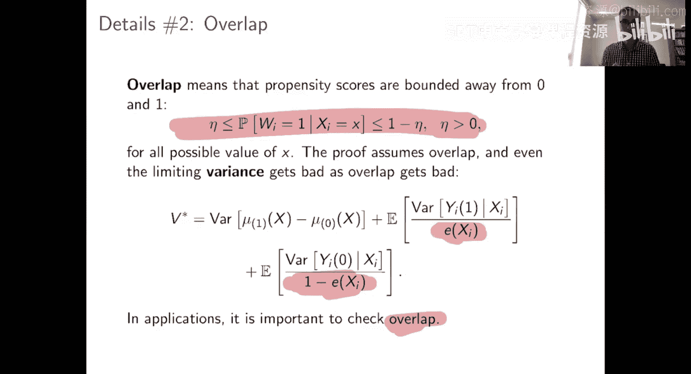

And so just you show this in the case of an example from a paper from Susan and coauors。嗯。

They were studying。A setting where you want to study different auction mechanisms and the question was what's the effect of using on open sealed auction versus an open ascending auction？

And they have data from Idaho， California here here。We say that an auction is treated if it's sealed。

 and the propensity score would be the probability conditionally andvariates that the a would be sealed。

So。Then kind of here in this data， you can kind of do what I was suggesting that is make histograms of the propensity scores in both Idaho and California and see how it looks。

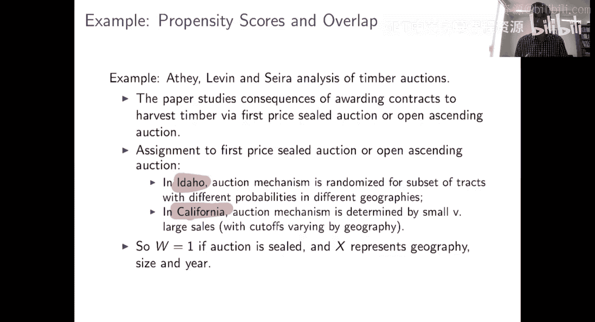

嗯。In Idaho everything looks good， so this plot actually shows density plots not histograms and it also stratifies by treatment type。

 so I believe this one is a density plot for the treated units versus for the controls。😊，But overall。

 you see you're in pretty good shape。Most of the kind of propensities scores。Are far away from 011。

 you're in pretty good shape。You might probably that you have kind of。

Quite a bit of propensity scores that are kind of stacked near zero here。😊。

Maybe you should be estimating an average treatment effect on the treated anyways。

 there are solutions to get around these problems， but anyways this is looking very good。

On the other hand， same data set but in California。

All the controls essentially have a propensity score of zero and all the treated units essentially just have a propensity score of one。

 which suggests that kind of most of the data set， what was happened is kind of based on covariates。

 if you were controlled， it was that you were going to deterministically be a control。

 if youre treated then you were going to deterministically be a treated unit。😊。

And if you propensity' core plot looks like this。Then you have something to be concerned about。And。

You should do something。嗯。What can you do about it， there's a number of things。

And this is kind of a fairly fairly wide literature I'm not going to go in it today。

 but you could kind of filter your data set into regions where kind of you have better overlap your propensity scores are less extreme。

 you could try changing the question you could kind of if you have a lot of propensity scores that are close to zero but you don't have a problem year one。

 you could estimate an average treatment effect on the treatment。

 this is kind of another alternative average treatment effect for which you can kind of do。

Everything we've done in this lecture， but kind of in separate notation or kind of a slightly different functional form。

 so I'm not going to do that。😊，Here。嗯。But essentially。You have a problem。

 but onces you know you have a problem you can often solve it and this is something I'm happy to talk with if you encounter this kind of issue。

Actually in your project， I just wanted to kind of really flag this as a thing to be paying attention to because。

😊，Every couple months someone kind of sends me a bug report being like I tried to run AIPW and nothing was working and everything blew up and then I asked them can you give me a to out your propensity score and all their propensity scores are deterministically zero and one and then I can help tell them that they were dividing by zero and that's why they were。

Anyways， that's overlap。

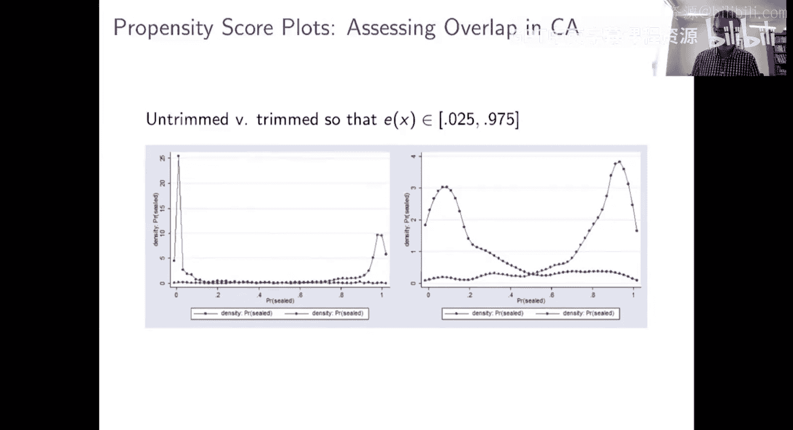

So in recap。What have we done in this lecture we wanted to estimate the average treatment effect。

 the average treatment effect is one of the kind of。Most standard targets and causal inference。

We wanted to estimate an average treatment in an observational study。

 and this meant that kind of we had to control in some sense， for variables， x pret covariates。

And we wanted to use machine learning to control for these xes to avoid making parametric assumptions。

And。At first glance， right， there are many popular。Ideas for estimating average treatment effects。

 you could do a regression adjustment， you could do in propensity weight and you might think。

I know what you do， I'll take the regression adjustment for formula。

 but just plug in machine learning and everything's good， right？No。

 unfortunately not machine learning methods are pretty accurate。

 but not as accurate care with parametric models。😊，And。

Not as accurate as parametric models and well specified parametric designs。

So then kind of that didn't quite work， you don't get confidence interval out。

And then you could look at IPW， you could again say hey， I know what to do。

 I see an in propensities score， I'm going to estimate my propensities scores using a machine learning method。

 plug that in and that's going to work right。Again it's like that point， it's going to be consistent。

 but we're not getting guarantees that are comparable to kind of good root and right parametric type guarantees that we need for content。

So okay， is the situation hopeless， no， the simplest most naive things you might want to do don't work。

 but you can put machine learning to good use for causal inference。

 you just need to do so using the right strategy and here one good strategy is AIPW it's a kind of carefully designed estimator to start with the regression adjustment and uses IPW to correct the regression adjustment and in doing so cancels out the errors of kind of the regression adjustment and IPW to first order。

嗯。You might think that I kind of just pulled this estimator out of a hat and then it's kind of strange。

 but。Maybe that's true， but I'll just reassure you that it's a big hat and there are many other things you can pull out of that hat and there's a theory for how to do so and kind of really AIPW is just kind of one first example of an estimator with this property if youve heard terms like orthogonal moments or double robustness。

😊，These are kind of very general terms that apply to AIPW， but also apply to many other estimated。

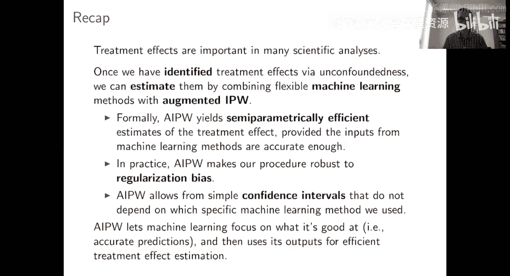

So。嗯。That's the big picture。What's kind of the difference between linear regression and machine learning？

K of one thing you could say is that linear regression when given a wellspecified linear model。

 it has very good behavior， parametric behavior， it's urged to case one over square in and everything is wonderful。

 but in a general setting if the linear model isn't right。

 then linear regression is inconsistent you get the wrong answer and that's bad。

Machine learning on the other hand， it's more flexible in a linear specification it's going to be okay in a general setting it's going to be okay the reason you want to use machine learning is to kind of get。

😊，Decent estimates of the thing you want to predict under considerable generality。And。That's good。

Using machine learning opens the door to a bunch of flexibility。

 but the cost of doing so is at now you need to remember that actually machine learning methods。

 whenever you're deploy them they're going to have errors that are generally a little bit bigger than what you're used to when using kind of parametric methods in parametric models and you need to use kind of post processingces strategies that are robust to moderate final sample errors。

In the context of average treatment effect estimation。

 we saw that AIPW is one solution with this property and kind of throughout this class we're going to be seeing more of that。

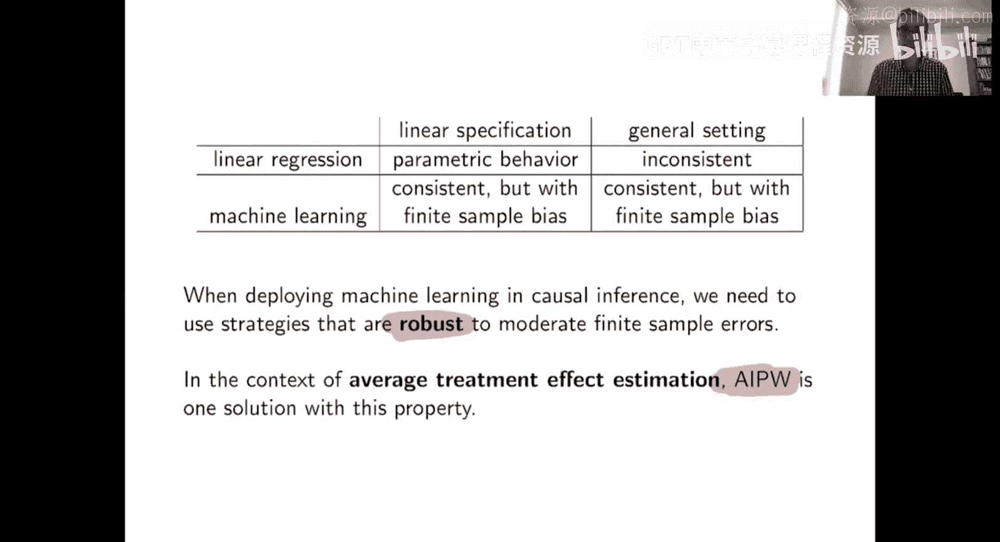

All right， that's all I had。Or now I'm going to leave you with some references just here kind of the first three are closer to what I was talking about today。

 they kind of outline this agenda in much more breadth and this kind first and third you can think of more is kind of giving you the agenda and kind of generalizations of where you kind of what are problems where you can plug machine learning in and get good。

Get good kind of parametric type guarantees and confidence intervals for the causal parameter you're interested in。

And then kind of this paper flushes out all。What I presented today。

 but kind of in the context of deep nets and actually proves the guarantees for deep nets that you need to use to apply these results for。

I'm also quoting these two results here today I talked more about this kind of nonparmetric setting there' is a parallel very similar kind of discussion of what happens when you want to use you're in a high dimensional setting and you want to use methods like theasso to estimate average treatment effects there instead of things like trees or forest or boosting like you would in a nonparmetric setting。

I'm'm going to say more about that here， but if you're interested in。The high dimensional setting。

 then these two papers are a place to get started。

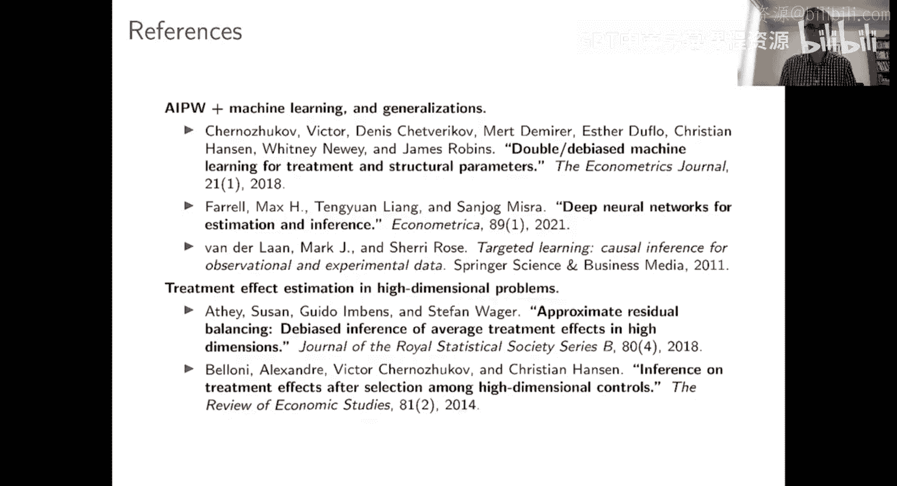