# 斯坦福商学院《机器学习和因果推断｜Machine Learning & Causal Inference： A Short Course》claude-4s p09 -09-Conditional Average Treatment Effects_ Overview.zh_en -BV1M9W7zCEsf_p9-

In this lecture I'm going to be talking about new methods developed in the last 10 years or so to use machine learning to estimate treatment effect heterogeneity。

 that is how treatment effects vary with observable characteristics of individuals。

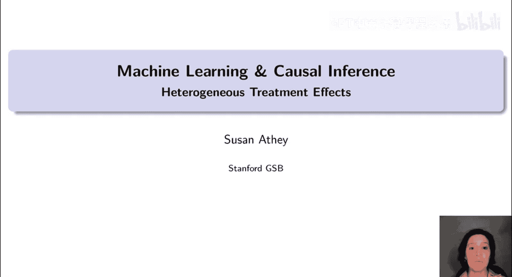

Machine learning has a lot of potential for improving our ability to do policy analysis with data。

One of the main benefits of machine learning is it allows us to build more granular statistical models。

 and it provides algorithms to do so in a systematic way， in a reproducible way。

Imroved causal inference about the effects of policies or programs or interventions can be enabled by machine learning because we are able to make more granular predictions about counterfactuals。

 what would have happened to individuals in the absence of a treatment。

We also can more efficiently use observables in order to do things like control for confounders。

 that is variables that might affect both treatment assignment and outcomes and thus might otherwise if ignored lead to bias in estimates of causal effects。

Machine learning has the potential to do a better job with that because it has algorithms that have been refined and improved to basically use the data and use it flexibly so that we don't have to rely as much on prespecified functional form assumptions。

That in turn can help us have。Really a more reproducible approach to addressing some of the challenges in causal inference。

And the lack of reproducibility and the of sensitivity of methods to functional form has been really one of the things that has held back the credibility of causal estimation in policy problems。

A second thing is that we can actually understand better what works for whom and why using machine learning to understand the sources of heterogeneity and treatment effects can provide insight and it also can allow us to better target treatments to the people for whom it works the best。

That's， for example， estimating personalized or targeted treatment assignment policies。

 and by personalized here I mean targeted to individuals observable characteristics。

We do need to consider， though。Modifications to machine learning tools in order to make them most useful。

 and in particular， we have many well established machine learning methods that perform very well in practice in prediction tasks。

But they don't necessarily have well- establishedablished statistical properties and recall for the problem of prediction。

 you don't really need a lot of statistical properties because you can just assess in a test set how well a model does with with predicting outcomes and if your only goal is to do a good job predicting outcomes。

 we can just see the ground truth and a test set and assess how well we're doing while unlike that case in for causal inferenceprint。

People don't walk around with treatment effects stamped on their foreheads。

 we don't know what the ground truth treatment effect is。

 we don't know what would have happened to you if you hadn't taken the drug if you're in a treatment group and we don't know what would have happened if you had taken the drug if you're in the control group so we don't actually have the ground truth for each individual and thus we have to do a little more work to figure out how we're going assess the performance of causal inference methods for machine learning。

We also need valid confidence intervals for a lot of applications。

 everything ranging from even AB testing and tech firms that you're still interested in making sure that the results that you find aren't just due to sampling variation if you're thinking about doing clinical trials for drugs or vaccines we want to make sure that you haven't just gone fishing to find certain subgroups for whom a drug works and then try to get that past FDA approval so we need to make sure that our methods are going to give us reliable results。

And。What I'll talk about in this lecture and we'll talk about in subsequent lectures as well is how we can get the best of both worlds。

 how we can use machine learning to have data-d discovery of things like treatment effect heterogeneity。

 while maintaining reproducibility and allowing for valid statistical inference。

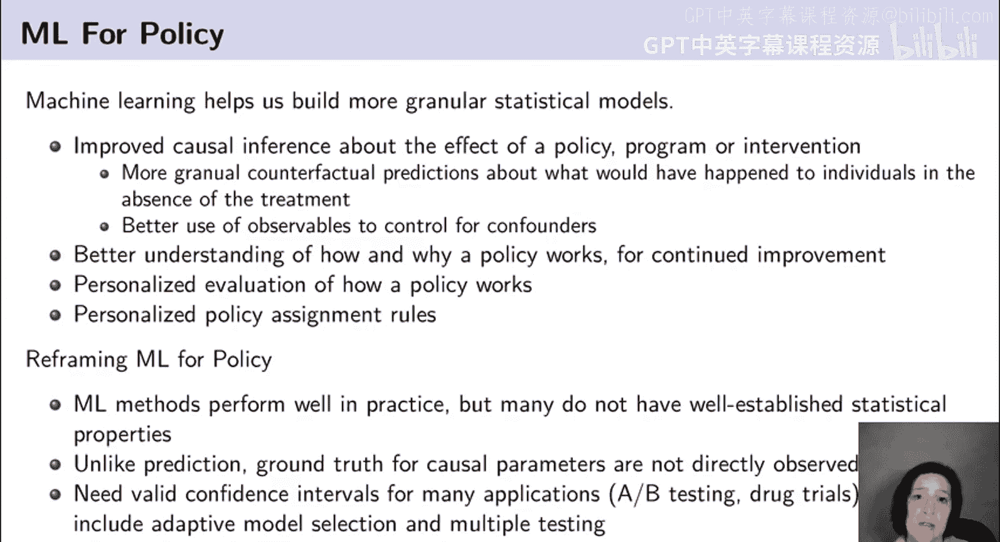

Yeah。So to elaborate a little bit on the themes that come up when combining machine learning and causal inference。

 one of the big themes is that we can use machine learning algorithms to do data-dven model selection with very flexible functional forms and even though we've been trying to do that for a couple of decades in the social sciences using things like kernels and so on。

 a lot of times those methods just didn't have great real- world performance。

 especially when there were lots of covariates， while modern machine learning algorithms do a really good job of handling lots of covariates and flexibly making use of the data and adapting to the data to find the right kind of functional form and those techniques of crossvalidation can be really helpful with that。

Another big theme is regularization， we want to balance our desire to have a rich and flexible functional form with something that's going to again hold up well in a test set。

 something that's not going to be overfit and so that can include penalization for regularized regression model averaging。

Sampling and so we'll talk about each of those techniques in the context of different applications of machine learning as we go through these lectures。

We recall that one of the machine learning themes is to evaluate success by goodness of fit in a held out test set with the same distribution in a stable environment。

And so what we're going to be trying to do when we bring these machine learning themes into causal inference is to decompose the problem so that we can find the components of the problem where this type of machine learning optimization can be applied。

Without sacrificing our primary objective， which is to get accurate estimates of causal effects and in some cases unbiased or consistent estimates of causal effects or causal effects where we can produce confidence intervals for those effects。

These are all similar goals， as semiparmetric estimation in the econometric literature。

 but the machine learning methods just have better practical performance we don't fully understand why。

We're missing some theory here， but what we've been doing over the past decade or so in the community that's combining machine learning and causal inference is filling in some of the theory and helping enlighten exactly how to apply machine learning methods and what modifications can be used so that they perform as well as possible in environments where previously we might have used to my parametric estimation。

So one really easy way to think about a contribution of machine learning to econometrics is that we go back to the semiparmetric econometrics literature。

And instead of using kernels or other types of methods that had previously been studied。

 we substitute in flexible machine learning methods and we'll find that that's actually quite successful as long as we make some appropriate modifications and make sure that we're optimizing for the right criteria。

So we've actually seen quite a few successes so far and we have multiple literatures that have really blossomed in this area。

 we've seen contributions to estimating average treatment effects and other lectures in this series have covered that。

We've seen contributions to instrumental variables， for example。

 trying to use machine learning to select among many possible instruments。In other lectures。

 we'll talk about panel data models， say matrix factorization is an alternative to the differences and so on。

But in this lecture， we're going to talk about heterogeneous treatment effects and that will lay the foundation for later applications in estimating optimal policies or even doing adaptive experiments to try to estimate optimal treatment assignment policies。

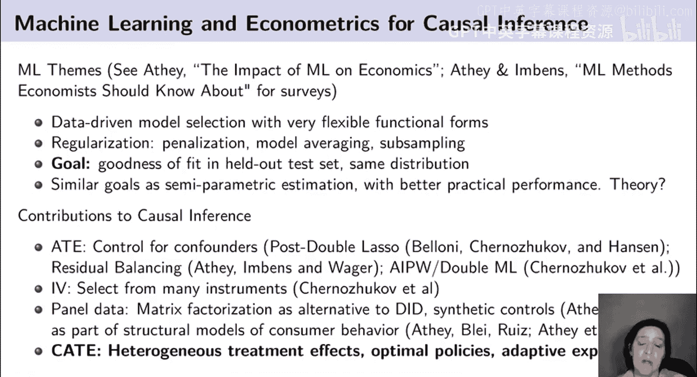

So if we're trying to think about heterogeneous treatment effects。

 there are a number of applications where it can be really useful to estimate not just an average treatment effect。

 but to understand how treatment effects vary with individual characteristics。

One of the examples that really motivated me to study this problem to start with were AB tests in large technology firms so in a big technology firm。

Engineers spend time developing new algorithms or new ideas， and then they want to test them。

Now it's often the case that a certain algorithmic improvement might work better in some situations than others。

Or a certain design of a web page might work better for some scenarios than others。

But just like the FDA and scientists before them， the gatekeepers of the AB testing platforms and tech firms understand that if engineers are allowed to analyze the data after the fact。

 they'll always be able to find some group of scenarios where their new invention works。

And this kind of post hoc analysis of just ph in the data until you find some group of people where are some situations where your treatment works。

That's well understood to be prone to false discovery is P value hacking and so as a result of that there's actually some fairly strict limits even in these large technology firms about how people can use the results of aB tests on the other hand of course it's incredibly useful to learn。

Where does an algorithm work well and where does it not work well that can give you insight for developing new algorithms that can help you decide well maybe it works well for some groups and not others and so we should just apply this new innovation in the scenarios where it works。

And of course you would like to do that all else equal。

 so I was motivated to try to come up with methods that could be built into AB testing platforms to automatically search the data and uncover heterogeneous treatment effects。

 but do it in a way that was reliable and not su prone to false discovery problems。嗯。

A similar motivation comes up in something like a drug trial。

We might want to understand for whom does a drug work and who does it not work and we might want to understand where side effects are problems so again we'd like to do that in a data-dri way we don't want to just be restricted to prespecified hypotheses Other types of applications include observational studies of you know we release the new product we want to understand what the impact of that was we want to understand the impact of advertisements that were run。

In all these cases， our goals are to systematically identify subpopulations and estimate treatment effects and also do valid inferenceprints to make sure that our findings are not just due to sampling variation。

And again， when we're thinking about targeted policies。

 we have to remember that sampling variation can be a pretty big problem。

If I'm trying to understand how well a drug works for someone just like you， well you're complicated。

 you're different， you're unique， and so we never have enough data to really understand fully how how a treatment is going to work for a particular individual。

 especially if we observe a lot of characteristics for that individual。

 so sampling uncertainty is going to be important once we get down to this kind of individual level very targeted treatment effect estimation。

We also want to understand mechanisms， we understand why if we know that we have problems for a certain group。

 say young women are having more side effects of a certain drug that can help us develop hypotheses about why they're having those side effects and that might help us reformulate the drug。

And that would help us。Develop new and improved treatments。

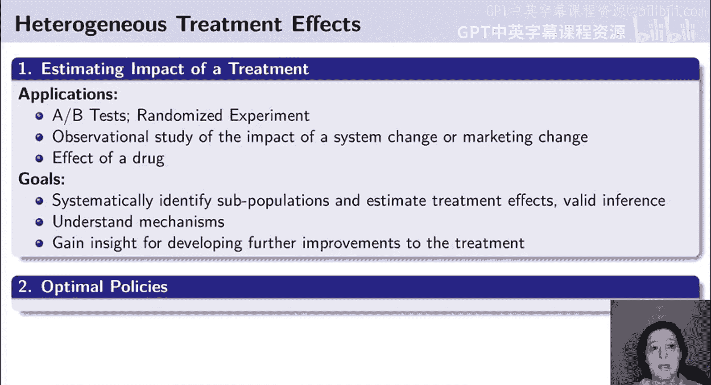

An important application of heterogeneous treatment effects is once you understand。

For whom a treatment works better or worse， we can figure out who gets the treatment。

Now a treatment might be better than control for everyone。

 so just because you have treatment and effect heterogeneity doesn't necessarily mean that that a personalized or targeted treatment assignment policy does better than a uniform treatment assignment policy that that depends so treatment effect heterogeneity is a lot easier to find that heterogeneity in which treatment is optimal for different groups。

 but sometimes treatments are costly， so even if when the treatment is beneficial for everyone。

 it can still be useful to figure out who should be prioritized most highly for a treatment。

We won't in this lecture， I'm not going to go through the methods for optimal treatment assignment policies that will come in a subsequent lecture。

 but I want to highlight that the problem of heterogeneous treatment effects is an input to understanding optimal treatment assignment policies。

 that's one application of heterogeneous treatment effects。

 but you can still be interested in understanding treatment effect heterogeneity， for example。

 in order to motivate future innovation， even if you're not going to use it to target treatment assignment policies。

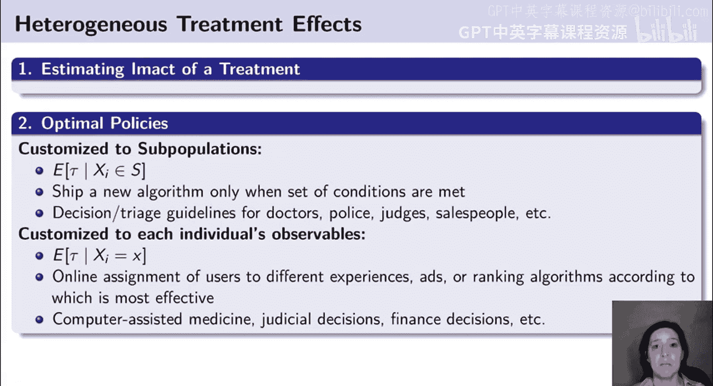

So without further ado， let's dive into the heterogeneous treatment effects section。

So let me start by saying that there's actually a pretty wide literature and it's growing really fast。

 so I've just listed here a small sample of the papers that have been written in the last 10 years that are analyzing treatment effect heterogeneity and one thing I want to emphasize is that there's not just one question here there's not just one question and one best method for that single question instead there are many question around treatment effect heterogeneity and each question will have its own set of methods so today I'll talk about one type of method which is identifying subgroups where each subgroup has different treatment effect different average treatment effects。

And that's useful in some circumstances and not in others。

 we might also want to do something like test heterogeneity across all covariates and figure out how to deal with multiple testing problems。

We might be interested in treatment effect heterogeneity in order to understand questions about robustness to model specification。

 if treatment effects vary a lot across with characteristics。

 there can be the model specification can make a bigger difference。

We can try to understand flexible conditional for average treatment effect estimation。

 which is another thing i'll talk about in today's lecture another type of problem is identifying the individuals that have the highest estimated treatment effects and I'll also show you some examples of that today so rather than think about this as being a competition where one group thinks one question is important and a different group thinks a different question is important。

I would instead encourage you to think about in your context which question or set of questions are relevant and why and then find the best method to deal with those questions。

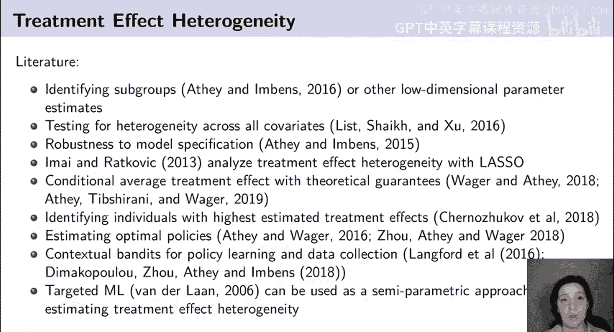

So as previously described， we machine learning methods perform well in practice。

 but they don't in general have well establishedablished statistical properties because that hasn't usually been the goal。

 you can just evaluate performance using a test set。

 but since the ground truth for causal parameters are not directly observed。

 there's a greater role for statistical inference in the context of heterogeneous treatment effect estimation in general causal effect estimation。

Some themes that have emerged in terms of how to do this include first。

 we might decompose the problem into a prediction component or and a causal component。

And then outsource the part that's a prediction problem to machine learning methods。

So that has some advantages because if you do this decomposition。

 you can plug in any machine learning method you want and since machine learning methods get better all the time and computation changes and you know innovations occur。

 we can have。A single causal inference method。With the most modern and recent machine learning plugin method。

 and of course， different machine learning methods are going to work better in different environments so we can tailor those and use the very latest and greatest for the specific type of data that I have。

An alternative approach is to build novel methods that are inspired by ML。

 but that are actually tailored and fundamentally changed for the causal inference setting。

And so personally I've done both of these things and I think they both have their place it's a lot of work to know keep updating machine learning methods that are tailored to causal inference to make use of the latest and greatest computational techniques and so on so you know it can be really advantageous to be able to use off the shelf methods。

 but at the same time if you have a specific objective you might as well try to know really solve the problem you're solving and that can have advantages as well。

Another theme is sample splitting or crossfitting， so one way that we avoid overfitting a machine learning is just doing cross validation to balance bias and variance。

But that's not enough， it turns out to get valid statistical properties and so one of the things that the machine learning and econometrics literature has really focused on and found to work well both in theory and in practice are things like sample sitting in crossfitting。

 which basically boils down to，Not using the same data to select a model or to choose the model specification。

And to come up with。The parameter estimates of interest。So for example。

 that might mean if i'm say using propensity score waiting in order to estimate average treatment effects。

I don't use the same data to estimate the propensity score model。

And to when I wait a particular observation， so the propensity score I use to weight an observation is estimated using a data set that doesn't include that observation。

So those types of techniques can be helpful for。For the validity of parameter estimates when we're trying to actually estimate a treatment effect。

We've also found that just generally building on the insight system my parametric theory is really important。

 there's a lot of theory that was already done to say。

 how can I estimate parameters of interest like causal effects in a world where I don't know functional forms。

 and so we can use that theory to come up with well- performingforming and efficient。

 efficient in terms of minimum variance estimators when we bring in machine learning。

And so one of those insights is the use of orthogonal moments。

 and so orthogonal moments will develop it along the way in different applications。

 but they're basically going to build in a tolerance for slow convergence in nuisance parameters。

And so machine learning methods are they're very flexible。

 and so they're going to converge to the truth more slowly。Then something like an average。

And so these techniques are going to help us。Make use of slowly converging machine learning methods while still getting estimates of something like an average treatment effect or a conditional average treatment effect that might converge at a faster rate。

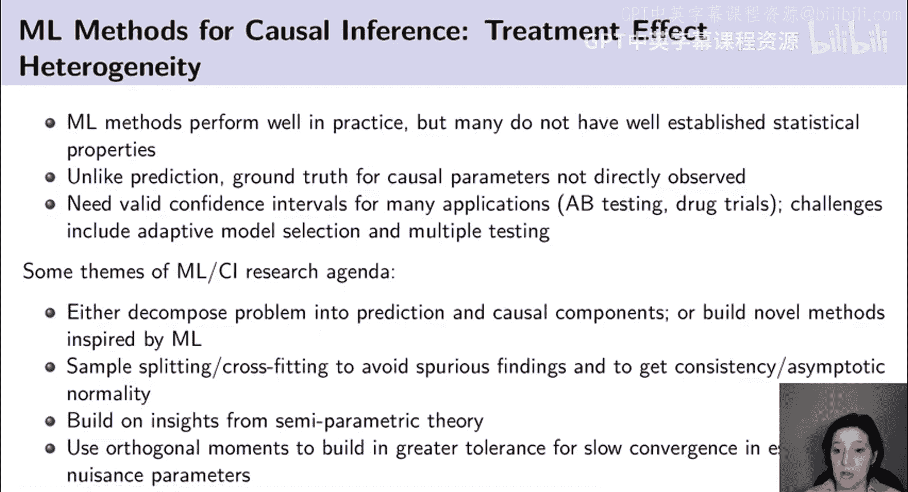

So to get started on the formal analysis， consider the potential outcomeses framework。

Just to remind this。We're going to represent each member of an IID set of subjects with a TL XI。

 which is the features or the covariates， those are the characteristics of individuals。

 a response or an outcome， YI， and a treatment assignment WI。

And following the potential outcome frameworks we'll posit the existence of quantities， Yi of zero。

 Yi of1。And actually， those sometimes are represented with subscripts or sometimes not。

What we're going to interpret those as is those are the response we would have measured。

 given that the I subject received a treatment。Or no treatment so for each person they have an outcome that would have occurred if they were treated and an outcome that would have occurred if they were a control unit。

So our goal here is to estimate the conditional average treatment effect。

 so that's the expected value of a treatment effect conditional on a particular realization of the covariate。

And reminder that even in a randomized experiment， we only get to see the outcome for an individual in one of the two treatment scenarios。

If we don't make any additional assumptions， it's not possible to estimate treatment effects or treatment effects conditional on X either one without any additional assumptions we can't estimate that because we don't see any individuals in both the treated state and the control state at the same time so we have to have some way to use data from some individuals that are treated and different individuals that are controlled to estimate these treatment effects so one of the common assumptions used in the literature is unconfoundedness which is also called iorability or selection on observables and what that basically means is that conditional on observable characteristics the treatment assignment as good as random。

And when this assumption holds a variety of methods can be used to estimate treatment effects。

 the historical literature has focused on things like matching or propensity score estimation。

 and those are usually consistent， at least as long as there's overlap that is for each value of x。

 we have some probability of each treatment state occurring。

So the first method I'll consider for analyzing heterogeneous treatment effects is going to build on a method called regression trees or regression and classification trees or CART。

Before I dive into applying regression or classification trees to causal effects。

 let me just do a quick reminder about how simple prediction trees or classification trees work。

And then we'll generalize those and apply them to the problem estimated causal effects。

So here's an example of applying a classification tree using data from who lived and who died when the Titanic went down。

So this kind of a tree， we can look and see， first of all， what class was the passenger in？

And if they were in a class。Greater than 2。5， which means they were the low class。

 They had the cheap tickets on the Titanic。We see in this left branch here that a lot of them died。

 370 out of 501 passengers， low class passengers died when the Titanic went down。

And because class is such an important predictor of who lives and who dies。

 the tree here splits on that first。Then we look in the right branch and we can say， well。

 if you were in first or second class， the next important predictor for understanding who lived and who died is age。

So if your age was。Not greater than 16， that is you were a kid。

 34 out of 36 kids in the upper classes lived。Now， if you're an adult in the upper classes。

 then it matters again， whether you're in first class or second class。

 and it looks like among people who were in first class。

 more of them lived while adults in second class， more of them die。

So this is a simple way to break up the data into subgroups according to class and age。

 and just by dividing the data into those subgroups。

 we can get a reasonably accurate prediction of who lived and who died。

Now I haven't told you yet how this tree was created。

 just how you interpret it and how you understand the results。

 but one reason that regression and classification trees have been incredibly popular since they were introduced and this is a machine learning model that's been around for decades is that they're very easy to explain to people。

You're once you see the tree you have to of course understand how you got the tree。

 but once you see the tree the predictions are simply going to be based on the proportions in the leaves。

 so it's very simple to understand why people in say the upper classes that were kids。

Are classified is likely to live。That's because。In the training data in the data we have 34 out of 36 of those people that met those characteristics lived。

 so there's not a big black box in understanding how your estimates are obtained given this tree。

On the other hand， getting the tree is a little more complicated。

 but it's actually not that complicated to understand how you get the tree either at the top of the tree。

 what the algorithm does is it looks over all the covariates in the data and all the different ways you can split on each covariate and it finds the way to split where you're essentially for classification you're maximizing classification power of the division you're trying to find groups that are homogeneous now there's a couple different measures of what it means for the groups to be homogeneous I won't go into that now。

But you're essentially trying to find the way to split that maximizes the discriminatory power of the split。

If this was a regression problem where we were just trying to predict the value of something。

 we would basically try to maximize the difference between the two in terms of sum of squares。

Another way to understand trees is to realize that any particular regression tree or classification tree that you build can also be represented as just a partition of the covariate space。

 so over on the left here I've depicted a tree where the tree is based on two covariates X1 and x2 while on the right side I've depicted that same tree as a partition of the covariate space so basically what a tree is doing is it's figuring out how to divide up this box this X1x2 box into rectangles。

Where I'm trying to find the rectangles that where within a rectangle， we have homogeneous outcomes。

Now one way that we traditionally did this in econometric。

 something I used to do is I might have taken this box of X1 and x2 and divided it into say 100 squares by decile by decile plots。

 and actually Raj Chetty has a nice little state of package for doing that。

 but it's something that I would often do in my own empirical work。嗯。

What we're doing here is instead of driving this into 100 squares which might take up a lot of squares and we might not have much data in each square it might be unnecessarily fine here we figure out that we can actually fairly accurately represent the nature of this data generating process with a smaller number of rectangles and weve used the data to figure out how to do that so what we figured out is we first we split in the x2 dimension and then we look on the left side and say for the low values of x2。

 we want to split at a high value of x1 but actually for the high values of x2 we split at a lower value of x1 and we slice it differently depending on whether x2 is low or high。

 so that gives us flexibility but allows us to more efficiently describe the data。

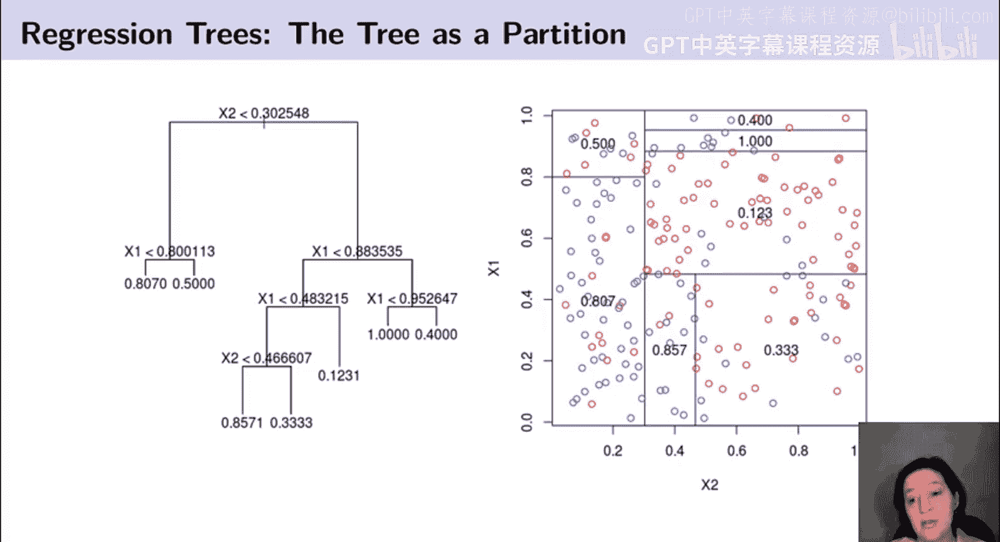

Now that we've reminded ourselves what regression trees and classification trees look like。

We can now consider how to apply these ideas to estimate heterogeneous treatment effects。

 and in particular， our goal is going to be to divide the population into subgroups in order to minimize the means court error of treatment effects。

So how will we use the causal tree， what kind of problem is it intended to solve？

It's designed to allow us to do things like report heterogeneity in treatment effects without a pre analysislysis plan。

 but with valid confidence intervals afterwards。Now。

 something that's going to be special about causal trees。Is it it's going to。

Try to come up with a data driven way to estimate treatment effect heterogeneity。

But it's still going to come up with a small number of estimated parameters。

Small relative to the size of the data。So we can think of this as a form of moving the goalpost。

We're going to use the data to define the problem。The estimate。

 because we're going to use the data to figure out what the subgroups are， and then second。

 estimate treatment effects for these data defined subgroups。

We're going to solve the overfitting problem with sample splitting。

That is going and we're going to choose subgroups or determine what the scrub groups are in half the sample。

And estimate the treatment effects on the other half of the sample。

Now this might seem inefficient because。We're only using half of the data to actually produce our treatment effect estimates。

But that doing the sample splitting is going to give us a lot of advantages because it turns out if we don't do that sample splitting。

 will often end up with inconsistent estimates of treatment effects。

Now there's ways to compensate for that directly， but it turns out that it's actually pretty hard to beat the performance of sample splitting because once you start trying to correct for the fact that you've used the same data to determine your subgroups and estimate effects。

 you have to be pretty conservative。So in practice。

 using sample splitting is going to have these big advantages。

 It's going to be very transparent because you're going to。

Use half the data to decide the subgroups and then cleanly use a second part of the data that hasn't been touched yet to estimate the effects。

 so it's going to be very easy to explain to people why they should trust your estimates。

And this transparency can be helpful and it also is going to give you a lot of robustness。

 we're not going to require a lot of fancy theory to understand why this approach works。

So once I've solved one problem by adopting this approach of sample splitting。

 the remaining challenge is to figure out exactly how should I define the subgroups？

And the nature of the challenge， why is this not a straightforward application of regression or classification force that already exists。

 well， if we try if we're trying to optimize my subgroups for treatment effect heterogeneity。

 what we are interested in is not mean squared error of outcomes。

 but mean squared error of treatment effects。However， as we've discussed。

 the fundamental problem of causal inference is that we don't observe individual treatment effects。

 so we don't know exactly how to apply these existing off the shelf methods because the objective is infeasible。

 so what we'll need to do is find a way to address that and it will propose a couple of different alternatives but the one that we find to be preferred is to actually estimate that objective function。

Another challenge with this method and this can can be a fairly big challenge is that when you do sample splitting。

 there's a problem that your estimates are going to be somewhat unstable I can split the data and find one partition one tree。

But if I sampled the data again， I might get a different tree。

And it's not that either of them are wrong， they're each good descriptions of treatment affect heterogeneity。

 but they're not the same， so that makes it harder to replicate results and might impede the reliability of your results。

And that problem doesn't have an easy solution。

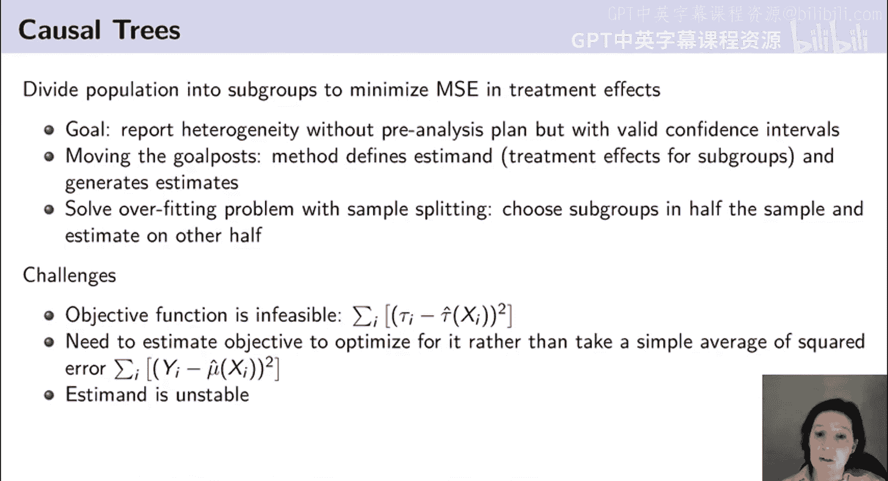

So in the face of this problem of trying to understand how I should。嗯。

Adapt regression and classification trees to the problem of estimating conditional average treatment effects。

In the Athean Ibin's PNIS paper， we have a couple of different approaches and we talk in that paper about what the advantages and disadvantages of those approaches might be。

So the first thing you might do in trying to use regression and classification trees to analyze treatment effect heterogeneity is just build a single model。

Model outcomes y as a function of x and W， so just treat your treatment indicator W as if it was another feature or covariate and just throw it into the regression tree。

And we call that the single tree method。And what is the problem with that？

Your tree might not even split on the treatment effect and so if you have you know one part of the tree。

That splits on x， define subgroups by x， but doesn't define subgroups that are different by W。

 that's going to mean that your implied estimate of your treatment effect。

In that area for those x's will be zero。So that's not going to be very helpful for coming up with treatment effect heterogeneity because we're going to get the same answer no matter what W is。

A second approach we call the two treee method and that was later dubbed the T learner by there's a paper by a group Kzol from Berkeley that later kind of apply the same kind of taxonomy to general machine learning method。

 so they called the single treee method， the SLer and the two treee method， the T learner。

And so in the case of building two separate models for the two different that treated and control。

That can work better because it'll ensure that you actually do pay attention to your treatment variable when you're building the prediction model。

 but it can have a fairly subtle disadvantage to see what that disadvantage is。

 imagine that we are considering a particular value of x， a male who's 60 years old。Well。

 if we just build two separate models， one for treatment group and one for control group。

 and we say use something like trees， it could be that the treated tree splits on gender。But not age。

 while the control tree splits on age and not gender。

If we then wanted to understand what does this model tell us about the treatment effect for a six year old male？

That well， the prediction for the male in the treatment group。

Would be the average outcome for treated individuals who are male。

But the prediction for this individual from the control tree would be based on his age。

So what we'd end up doing to estimate his treatment effect is compare the average treated outcome for males。

To the average control outcome。4 old people。And of course。

 that doesn't make any sense why would we want to compare treated males to control old people's that's not comparing apples to apples and so that could end up with biased estimates of treatment effects spurious estimates of treatment effects you might find treatment effect heterogeneity where there isn't any where if we actually compare treated males to control males there's no difference。

 but comparing treated males to。Old control units makes it look like there's treatment affect heterogeneity when there's not。

Now this might seem like this is really specific to trees。

 but one reason that it's really useful to think about this in in the context of trees is you can immediately see what the problem is and see what's going on more complicated machine learning methods would have the same problem they would。

But you might be less transparent to see what's going on。

So this is not a very good method for estimating treatment effect heterogeneity it's only going to work if you have you know really accurate estimates of treatment effects of outcomes in the treatment and control group if you don't have enough data to fully estimate what the outcome function looks like you're going to do a bad job。

So a third method that we propose in this paper is the transformed outcome method。

And this takes a little bit to explain， and I'm not going to go into the details of that here in this lecture。

 but what we do is we figure out a way you can transform the outcome。

And then if you transform the outcome， you're then able to build a single prediction model with this transformed outcome。

And this was later generalized to actually use the AIPW score。

 the augmented inverse propensity weighted score as an outcome in a regression or in a prediction model。

So in our paper， we show the extent to which that actually works， and we show that it works okay。

 but it also can have some disadvantages in terms of efficiency。嗯。

What we do instead in this paper is we estimate the mean square error criteria and that's the thing that performs the best in our paper。

 although there could be settings where the transformed outcome type of approach could work better as well。

So this kind of helps us also see one of the themes that I alluded to in my introduction that sometimes you can approach a causal inference problem by modifying the problem and then applying off the shelf prediction methods and sometimes you're going to want to actually modify the method and so now I'll show you how we modify the method。

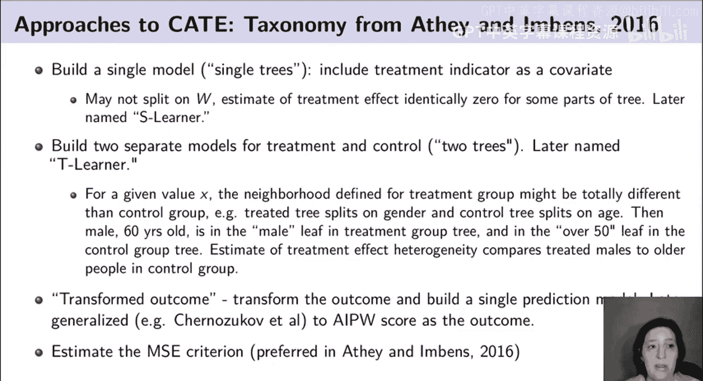

Although we won't go into the full details of this transformed outcome approach in these lectures。

I can just briefly give an overview just to give an example of how you can apply off the shelf machine learning methods to the problem of estimating Kates。

And so the the idea is that there's a way to transform the outcome so that the expected value of the transformed outcome is actually the。

The treatment effect。So to see this， I can define this transformed outcome Y I star if P is the assignment probability。

 the probability of treat being treated， I can just。Do a simple transformation。

 if it's a treated observation， I'm just going to divide the outcome by P if you're a control observation。

 I'm first going to take the negative of your outcome and then divide it by 1 minus P。

And that's going to be my estimate of an individual units treatment effect Now this is a little crazy if you think about it。

 because you know your outcome， maybe your outcome could be constrained to be between 0 and1。

 say or it's between zero and 100 and that's my score on the exam， for example。

 and I could see whether the my question could be whether treated units get higher scores on the exam so I can look at you and I can say hey。

If I did a 50，50 treated control split， if I find a certain person that was treated。

 Spley got a 75 on the exam。 Well， their transformed outcome is going to be 75 divided by a half。

 which is 150。So my estimate of their treatment effect will be 150。

Which is crazy because nobody could have a treatment effect of 150 because this you。

 scores are between zero and 100。Now I take somebody else in the control group。

 say their score was 72。Well my estimate of that person treatment effect？

Will be minus 72 divided by a half。Which is-144。Also， a very noisy， extreme。

 unrealistic estimate of that of somebody's treatment effect。But the idea is that on average。

 if I add up this transformed outcome。And average it across everyone。Well。

 there's about half the people will be treated。And so I'll multiply by a half these wildly big treatment effect estimates。

The other half will be control。So I'll multiply by a half。And minus one。

 their outcomes to get this estimate for them， and I take the difference。

And that's going to be on average， the difference between the sample average treated outcome and the sample average control outcome。

 remember the control guys we've transformed and multiplied by -1。

 So if I just average up all these transformed outcomes。

 I'm going to give an estimate of the treatment effect。

So this is a simple insight that says that this is a wildly noisy estimate of treatment effects。

 but for an individual， even though that individual was only observed as either treated or control。

 I can still look at their outcome and come up with an unbiased estimate of their treatment effect it's not going to be very useful for that individual。

 but if I average up people similar to that person。

 I will get an unbiased estimate of their average treatment effect。Once I see that， well I can say。

 all right。If I take any group and average these transformed outcomes I get the treatment effect。

 then I can just use this transformed outcome as the left hand side as the dependent variable for any prediction method。

And the resulting predictions will be estimates of conditional average treatment effects。

So this seems at first like it might be specific to randomized experiments。

 but actually if it's a setting with unconfoundedness， an observational study。

 I can just replace that P with the estimated propensity score。And in fact。

 I can go further and I could also use the AIPW method。

 which would basically adjust this further for an outcome so I could estimate an outcome model and a propensity model and come up with the AIPW score and use that as a left hand side variable。

So that's one way to use off the shelf models， prediction models to estimate conditional average treatment effects。

But there are other ways， and that's what I'm going to focus on for the rest of this lecture。

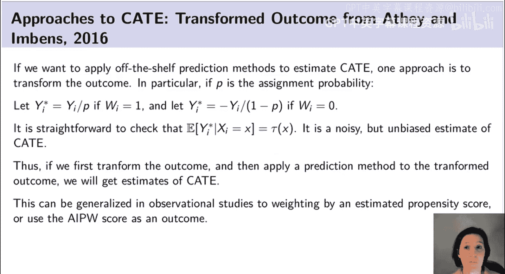

So in order to explain further this causal tree method。

 I need to introduce some notation so first of all we're going to have different sets and not just a training and test set。

 but we're also going to have a set called the we'll call the estimation sample so what we'll call this training set is actually going to be the set that's used to construct the tree the estimation set will be the set that we used to construct parameter estimates。

And then we'll also consider the hypothetical test sample。

It's not going to be used directly in the estimation。

 but we want to talk about that our goal ultimately is going to be to do a good job with mean square error of our treatment effect estimates in a test set。

嗯。So in order to describe how this works， we're going to use the notation capital pi to denote a partition。

 and we'll let tau hat of x。Be parameterized first by the estimation sample that's used to form the estimates of treatment effects and pi the partition。

And so we let tau hat of X S and pi be the sample average treatment effect and sample S S。

Give in the leaf。That Mr。 X I is assigned to。So again， you take a unit and you take their covariates。

By note， if I understand their covariates。I can figure out which leaf they're in。

According to this partition。Pi。So it's like when we had the example of the partition with the rectangles for each X。

 it falls into a rectangle， so L is the leaf that Mr。 I falls into as determined by its covariance。

Once I have the rectangle that this unit lives in。My estimate of the treatment effect is just the sample average treatment effect for that unit。

In the leaf。And so all this notation is just saying that it's the difference between the sample average of the treated outcomes in the leaf。

My and the sample average of the control outcomes in the leaf。

And so here what we're summing over are the units in the estimation set that lie in the same leaf as this x。

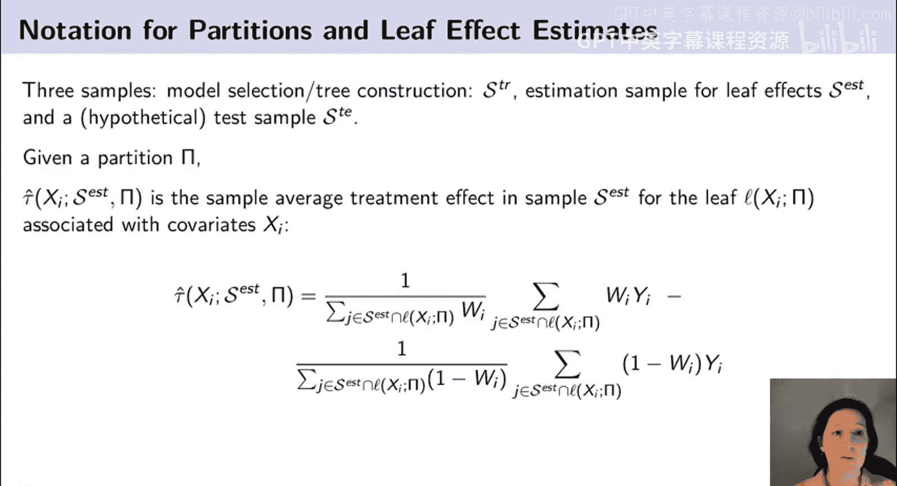

。Now， as I mentioned earlier， what we want to do is try to find a partition that does as good a job as possible at matching our estimated treatment effects to the actual treatment effects so I can define this infeasible mean squared error objective function。

 what is the objective function if I could actually observe tau I， the true treatment effect for Mr。

 I， which I can't observe。I can also define， I'm going to actually。

Define this as a function of two sets， so my overall objective is to minimize means co error in the test set。

But my tau hat， the estimates are going to be parameterized by the estimation set that I use to construct my sample average estimates。

 as well as my partition。And you remember my partition in turn， came from the training set。

So the tau hat， the pie。Comes from the training set。

 but the tau hat is the sample average treatment effect for a leaf。

As estimated from the estimation set。 And then my ultimate goal is to。

To find a good tau hat function that would perform well。In an independent hidden test set。

So I can write this means square error or objective as this sum of I in the test set of the tau I minus the tau hat。

对。I can then just do a little bit algebra to expand that out and see that this means word error can actually be written in three terms。

 the tau I squared， the minus2 tau I times tau hat and the tau hat squared。Yeah。Now。I can then。

Think about what the expected value of this mean squared error would be where I'm taking the expected value over a training set and a test set and what I want to do is at the time that I'm choosing my partition。

 I want to choose my partition pi in such a way that in expectation。

It will do well in minimizing means courtd error in a test set。

So at the time I choose my partition pi， I won't know my SS and my STE。So。

 but I'm going to try to choose my pin to do a good job on that and expectation。

So when I take the expectation， I can do a little more algebra and I should say this line you have to do a few more lines of algebra behind the scenes to get to this expression。

 but I can when I take the expectation， I can do a little about algebra and express it in the way that I've done here in this last equation。

The first term is。The variance。Of tao hat。And so。Basically。

 a tau hat that's more expressive that varies more is going to be all else equalQL is going to be good if minimizing the means square error of the test set。

And one of the reasons that we know that variance is going to be good is that our tau hat。

By construction is going to be unbiased within the the leaves of the partition。

And the reason we know it's going to be unbiased is that the estimation set is independent。

 the estimation set wasn't used to construct the pi so because we've got our tau hat defined as a difference in sample averages。

 it will be an unbiased estimate。Because it's unbiased。Conditional on being unbiased。

Having a tau hat that varies more than accurately adjusts with x is going to do a better job minimizing means square error in the test set。

一。Then we can look at this last term going all the way to the end。

 we have this term this expectation of tau I squared。

That expectation is is doesn't actually depend on my estimate， Tao hat。Because of that， we。

We can ignore it when choosing pi。So whatever pi is。

 the expectation of tau I squared is going to be the same。

 so even though it might be hard to estimate the expectation of tau I squared。

Doesn't matter if I'm comparing and contrasting two partitions so remember I'm going to use this expected value of the mean squared error as an objective function for choosing partitions pi that's our goal we need a good objective function for comparing pis if I compare two pis I'm going to take the difference in the mean squared error from one pi and the mean squared error and the other pi and this E tau I squared is going to cancel out。

So I can ignore that even though it's hard to estimate， I don't have to care about it。

Then the middle term is the expectation over x of tau squared。The tau is an unknown parameter。

We don't know what the true Tao is。But we can estimate that using the data。

 and so what this is all going to come down to is coming up with good estimators of these two expressions and then using that as a criteria for choosing pi。

Yeah。Yeah。And I want to emphasize that this expression is making heavy use of the fact that in the particular algorithm we're proposing our estimates Tau hat will be unbiased。

And that's crucial for this particular formula to be a good estimate of the mean squared error。

 if I didn't know that my Tau hat was unbiased， this algebra wouldn't work and I wouldn't be able to have this particular representation。

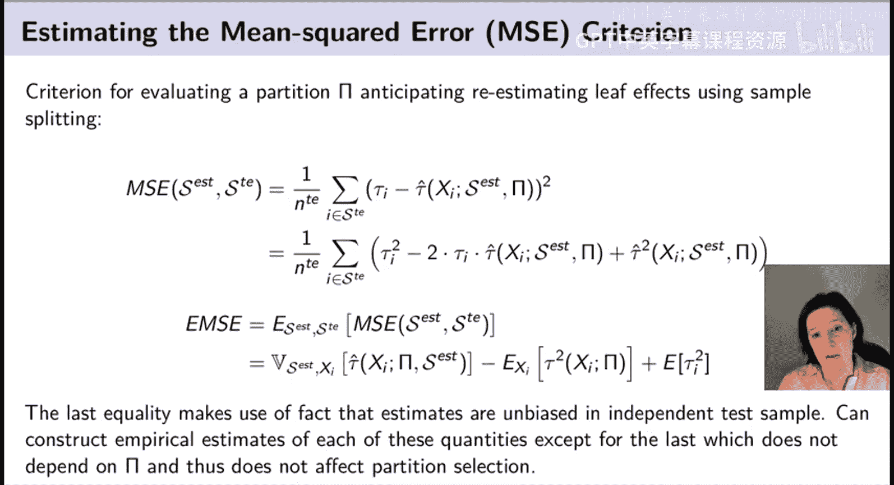

So once we've solved this problem of coming up with an objective to optimize and again we've just derived an objective using a little bit of algebra。

 we've figured out even though we can't observe tau I for any particular observation we can come up with an estimate of the infeasible mean squared error criteria once I have a mean squared error criteria I can then use the causal tree algorithm that's very close to what the original regression tree algorithms look like it's just that I have a different criteria I'm optimizing over so in particular I'm going to use a greedy algorithm to recursively partition the covervarit phase x into a partition pi and in each node the split will be selected as the one that minimizes our estimate of expected mean squared error over all possible binary splits。

I'll also have to have some minor modifications to make sure that each time I do a split。

 I actually have treated and control units and a minimum number of those in each leaf。

I don't want to end up with a leaf that has only treated units because then I can't estimate a sample average treatment effect。

I'll use cross validation to select the depth of the partition that minimizes an estimate of the mean square error of treatment effects using left out folds as the proxies for the test set。

Finally， I'll select this partition pi star， the optimal tree by pruning my partition to the depth selected from cross validation。

 or I'm going to prune leaves that provide the smallest improvement in the goodness of fit。

And finally， I'll estimate treatment effects in each leaf using the estimation sample S。

So this algorithm is exactly the same as a regression tree algorithm。

 except that instead of just minimizing mean squared error of outcomes。

 I'm now going to minimize the expected mean squared error of treatment effects and I'll also put in some extra constraints to make sure that when I do splits I have enough treated units and enough control units so it's basically just a regression tree。

Optimize for treatment effects。But I'm also going to use this sample splitting。

 which was not commonly used in the machine learning literature and the sample splitting is going to ensure that instead of using the same data to choose my splits and estimate treatment effects。

 I'm going to use a new sample to estimate the treatment effects once I have the partition and that's going to give me the nice statistical properties that I prefer。

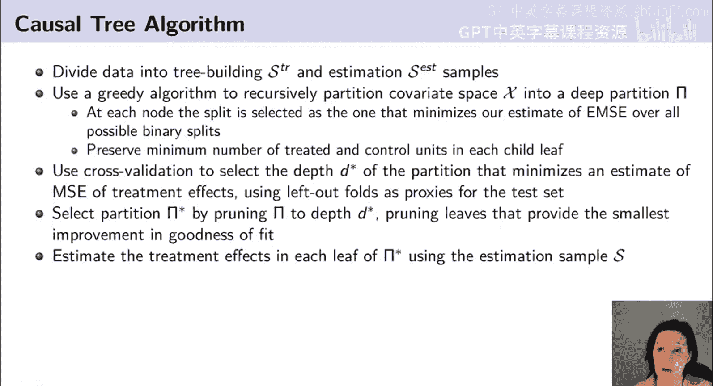