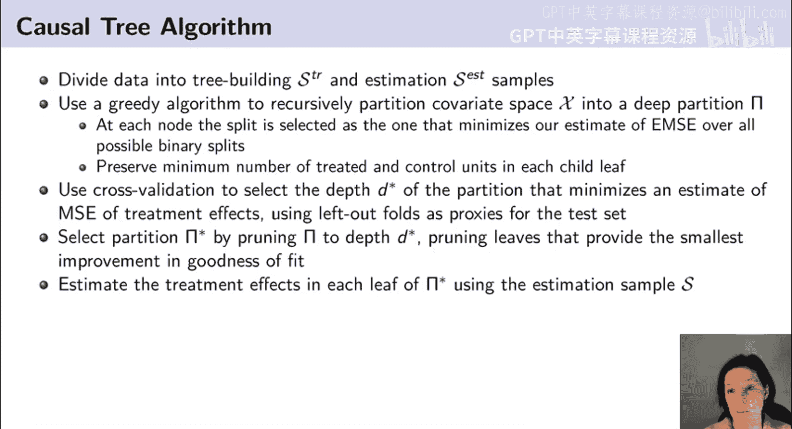
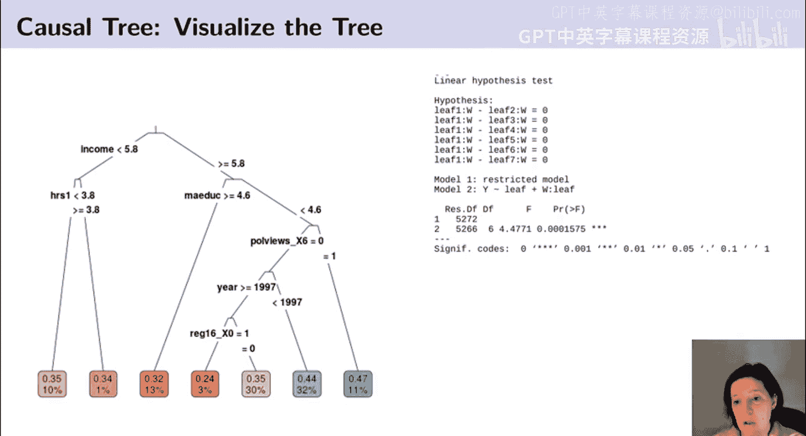
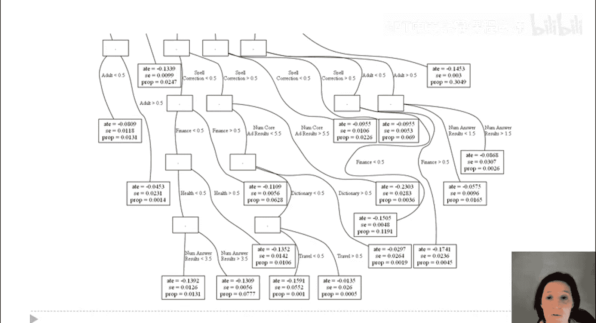
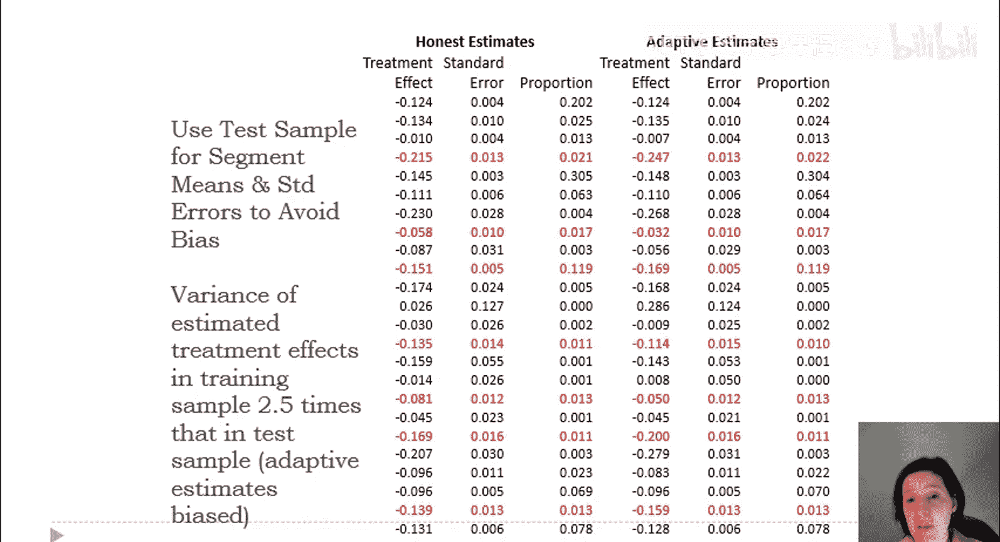
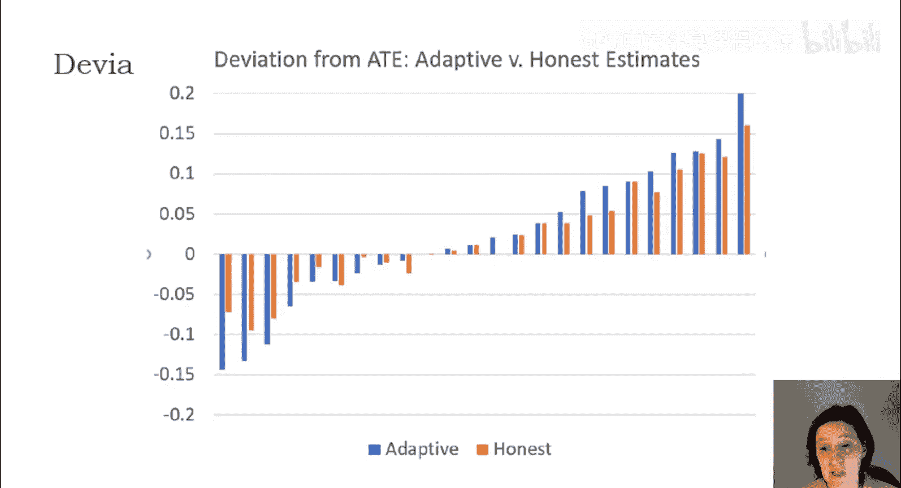
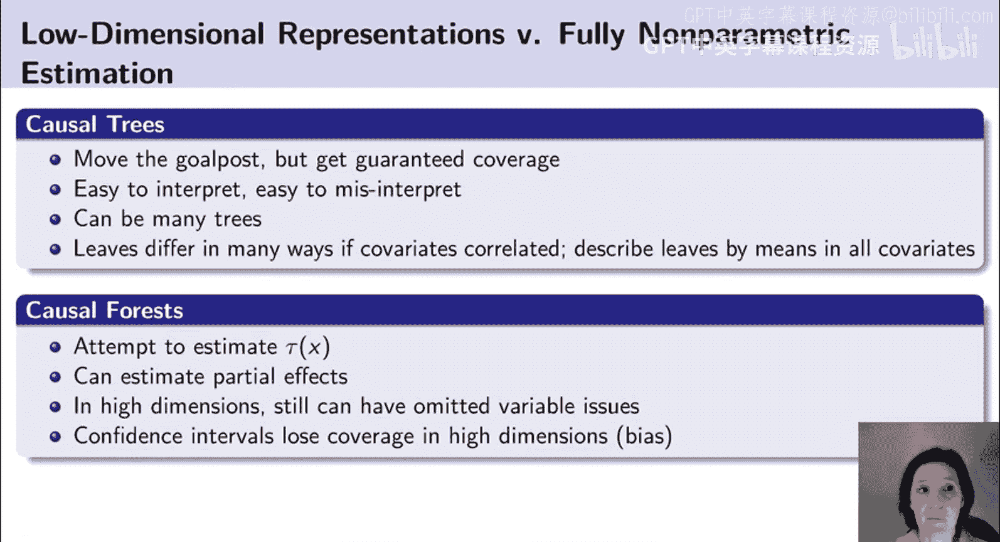

# 斯坦福商学院《机器学习和因果推断｜Machine Learning & Causal Inference： A Short Course》claude-4s p10 -10-Conditional Average Treatment Effects_ Trees.zh_en -BV1M9W7zCEsf_p10-

So once we've solved this problem of coming up with an objective to optimize and again we've just derived an objective using a little bit of algebra。

 we've figured out even though we can't observe tau I for any particular observation we can come up with an estimate of the infeasible mean squared error criteria once I have a mean squared error criteria I can then use the causal tree algorithm that's very close to what the original regression tree algorithms look like it's just that I have a different criteria I'm optimizing over so in particular I'm going to use a greedy algorithm to recursively partition the covervarit space x into a partition pi and in each node the split will be selected as the one that minimizes our estimate of expected meand error over all possible binary splits。

I'll also have to have some minor modifications to make sure that each time I do a split。

 I actually have treated and control units and a minimum number of those in each leaf。

I don't want to end up with a leaf that has only treated units because then I can't estimate a sample average treatment effect。

I'll use cross validation to select the depth of the partition that minimizes an estimate of the mean square error of treatment effects using left out folds as the proxies for the test set。

Finally， I'll select this partition pi star， the optimal tree by pruning my partition to the depth selected from cross validation。

 where I'm going to prune leaves that provide the smallest improvement in the goodness of fit。

And finally， I'll estimate treatment effects in each leaf using the estimation sample SS。

So this algorithm is exactly the same as a regression tree algorithm。

 except that instead of just minimizing mean squared error of outcomes。

 I'm now going to minimize the expected mean squared error of treatment effects and I'll also put in some extra constraints to make sure that when I do splits I have enough treated units and enough control units so it's basically just a regression tree。

Optimize for treatment effects。对。But I'm also going to use this sample splitting。

 which was not commonly used in the machine learning literature。

 and the sample splitting is going to ensure that instead of using the same data to choose my splits and estimate treatment effects。

 I'm going to use a new sample to estimate the treatment effects once I have the partition and that's going to give me the nice statistical properties that I prefer。

Now let's see how to apply the causal tree idea in an example。

 so the first example I'll use is this survey experiment that was conducted in the general Social survey。

 so the general social survey is a large survey that's conducted every year it asks lots of questions about people's opinions and so on。

occasionallyccasionally they do experiments where some of the survey participants get one wording of a question。

 while other survey participants get the same question but with different wording。

 and so this experiment that was run between 1986 and 2010。

 some people were asked how do you feel about welfare？

While other individuals were asked how they feel about assistance to the poor。

So if you're not from the United States， welfare is assistance for the poor in the United States。

But the term welfare has been politicized， especially during this time。

 welfare was viewed as a negative depending on your point of view。

 and conservatives tended to be more critical of the policy of welfare。

And they use the term welfare more often， so the outcome of interest was whether you express support for government spending in this domain and the question was does calling it welfare or calling it assistance to the poor change your response？

So to analyze this， we looked at 88 covariates and some of these are highly correlated with one another。

 so here's a big correlation matrix。And just as we talked about in machine learning prediction methods。

 it's important to realize that if some covariates are correlated with one another。

 the tree might split on。One Covariate。But it could just as well as split on another covariate。

In principle， if two covariates are highly correlated。

 it doesn't matter at all which one it splits on。So we have to remember when interpreting trees that we can't over interpretpret which covariate the tree splits on because in some cases you would get the exact same grouping of individuals。

Bike bike slicing them in different ways。 So here we see the output of estimating a causal tree in this particular data set。

And so looking at the tree， we see that it splits on income。It also splits on education。

 and it splits on political views。 And so this particular tree is the one that。

Did the best job of of。Dividing the data into subgroups。

Where each group has within a group similar treatment effect。

 heterogeneity and across groups differences in treatment effects。

So the estimate we see at the base of the tree are。Estimates of for each leaf。

 what is the treatment effect of asking the question and so we see that you know for all groups we see there's a large treatment effect。

 so people are more supportive of assistance to the poor than they are the term welfare so we see positive treatment effects everywhere。

 but some of these groups and especially groups that are more conservative appear to have stronger treatment effects。

On the right here， we've just tried to test the hypothesis， first of all that。Each of these。

 they say leaf one has the same treatment effect as each other leaf。

And what we can see is we can strongly reject that hypothesis。

 so this is evidence that we have indeed discovered treatment effect heterogeneity。

We can do other kinds of tests as well， we can test different leaves against each other in order to assess the whether this treatment effect heterogeneity is real。

Now one thing we want to emphasize is that we've。Constructed the tree using half the data and we've come up with our treatment effect estimates on the other half of the data。

 we call this honesty and that's going to ensure that the effects that we've reported here are going to be unbiased estimates of the treatment effects for these particular subgroups。

And you can verify and you can do this as a separate exercise that if you don't actually use honesty。

 if you use the same data to。Determine the tree and construct the estimates。

And then you look in a test set and see if you get similar answers。You won't。

So it's very important to do this type of honest estimation。

Now let's to consider another application of causal trees to an experiment that I ran back when I was working with Microsoft on the Bing search engine。

This experiment was run to understand the impact of switching the positions of algorithmic links in the search engine。

So we actually ran a set of experiments in parallel let's focus on the 13 switch so what we see here in the left bar。

Is the clickthrough rate that the top link on a search results page gets。

On average across a bunch of search queries and these are basically all search queries except we've thrown out some of them。

 we've thrown out navigational queries， so like if you type in Bank of America and you're trying to get to the Bank of America app that type of query is thrown out。

Among the remaining queries， the non navigational queries， we see that in this particular sample。

 we saw the top link got clicked 25% of the time。In the treatment group。

 right before the search results were shown to the user。

We switched the ranking of the first and third links。And the remaining clickthrough rate。

Was about 12%。And the dotted red box shows the clicks that were lost。

By the thing that should have been in the first position when it was moved to the third position。

Now you might say why do we need to run an experiment。

 why don't we just look at the raw clickthrough rates。

 well that's because search engines put more relevant results on top。

The thing in the first position is generally a better match to the user's query than the thing in the third position。

So we can't just compare the first and the third positions in trying to understand the role of positions。

 And indeed， the dark gray shaded box shows what what the link in the third position typically gets。

When the the links have not been reraned， so typically the thing in the third position gets click 7% of the time。

But when the search results are reraned。The thing in the third position now gets clicked 12% of the time。

So we can see that the thing in the first position is actually on average better than the thing in the third position。

 because when we randomly put the first position in the third position， it gets  12% of the time。

 which is more than what a typical result we get in the third position。

But the randomized experiment allows us to see that if you take something good and put it in the third position。

 even though it was good， the users still don't follow it there。

 the item loses about half of its clicks when it moves to the third position so that was an experiment that I ran on millions of users in order to understand the role of search manipulation。

We can then apply the causal tree estimation method to the data from this experiment。And so again。

 we're going to split the data into a training sample and an estimation sample。

And use that to partition the data such that each element of the partition。

 each leaf of the tree has within the leaf， similar treatment effects。

 but across leaves the treatment effects are different。

And so on average we saw that the treatment effect was losing 0。

125 clicks from the demotion in this first to third experiment。

 but we see in this tree that there's a fair bit of treatment effect heterogeneity for example。

 images queries that were classified to be a good match for showing an image as well as queries that were classified as being a high match for being about a celebrity see relatively small treatment effects and part of that is because those kinds of queries just don't have a lot of clicks at all。

 those are queries where people look at pictures so there's not much of a treatment effect from reranking the results。

On the other hand， in some of these leaves that appear lower on the page， we see something like。

Something that was classified to be a good match for Wikipedia has a large treatment effect。

 which is suggesting that more informational queries can can be。

The ranking matters more and manipulation therefore would also matter more。

Now so here you can see the rest of the tree and this is this shows you know all sorts of different segments with a fair bit of treatment effect heterogeneity this application had hundreds of thousands of observations。

And the cross validated tree， again， the tree structure was determined on a training sample。

 now has a 20 odd。leaves。So the eventual thing we're doing is we're estimating treatment effects on you know 20 odd。

Leaves so that's。We're just calculating， say a small number of parameters using hundreds of thousands of observations。

 so you might think that sample splitting wouldn't really matter in this case。

 it's like running a regression with hundreds of thousands of observations on 23 dummy variables。

So seems like， you know sample splitting shouldn't matter very much in should be large relative to the complexity of the model。

But what we're going to see is that in fact。It does matter to do the sample splitting so we see here on the left the honest estimates。

 those are the estimates that are obtained on the estimation sample。

 while the adaptive estimates are the estimates that are obtained when we use the same data to construct the tree。

As to estimate treatment effects in the leaves of the tree。

And the first thing we can see is that the estimated treatment effects。

In the training sample or these adaptive estimates are more variable。

 they're more spread out from the average treatment effect and remember the average treatment effect was minus 。

125。

It's actually a little bit easier to do this comparison if I visualize them in a graph。

 so what we've plotted here on the Y axis is the are the treatment effects in the leave as a deviation from the average。

 so I've subtracted I've taken away the average treatment effect which is minus 0。

125 and now I'm looking at the deviation from the mean treatment effect。

And I've ranked the leaves in terms of their deviation from the mean treatment effect。

We see the adaptive estimates are in blue and the honest estimates are in orange。

So the orange estimates are on the independent estimation sample and what you see is that the blue bars are taller。

 they're more negative and more positive， and that's saying that we've getting more extreme estimates when we use the same data to choose the leaves and estimate the effects as when we take that same tree structure over to a new data set and estimate treatment effects in each leaf on the new data set。

And so the honest estimates are less spread out and that's evidence of overfitting the fact that even though we had hundreds of thousands of observations。

 we had lots of covariates too， and so those leaves in the training set were built around extreme observations and they therefore tend to find treatment effect heterogeney that's greater than what really。

So summing up about about causal trees。The advantage of these causal trees is that we although we've moved the goalpost。

 that is we're using the data to find a low dimensional set of parameters that we're trying to estimate the treatment effects in each of a small number of leaves。

The advantage of this method is we get guaranteed coverage。

 that is we're able to be sure that our estimates of treatment effects。A unbiased estimates。

For the leaves， as defined。So。That's not going to give you the best goodness of it。

 a more flexible method， and I'll talk about that in a moment might do a better job of being expressive in terms of treatment effect heterogeneity。

 but we might rely on more assumptions in order to test hypotheses。

 This is going to give us a very simple way to test hypotheses。A few other comments。

 the trees are easy to interpret but also easy to misinterpret。

 so I want to emphasize that we shouldn't overinterpret the way the trees have been split because there can be many ways to divide a tree into the same groups。

 we might be able if two variables are highly correlate it。

 we can split on one of them or the other one and that's going to identify the same individuals。

 so just because a tree doesn't split on someone doesn't mean that that variable isn't related to treatment effect heterogeneity。

It's also the case that there can be many valid causal trees。If we split the data differently。

 we'll get different trees and it doesn't mean that one is wrong and one is right， just in general。

 there can be many partitions of the data that express treatment effect heterogeneity。

The causal tree algorithm is going to find the one that fits best in a sense。

 but there might be many causal trees that have similar goodness of fit in terms of treatment effect estimation。

So one of the things we recommend since leaves can differ in many ways if the covariates are correlated is actually to describe the leaves by the means of all of the covariates in the leaves。

 so even if you only split on three leaves we can take a leaf and say well we can define the leaf。

 say these are people with high income and high education。We can define the leaves that way。

 we can also look at other characteristics of those leaves and compare them。

 and so I'll come back to that when we talk about how we also process the output from causal forests。

Just as a study in contrast， we're going to move from causal trees to causal forests in the next part of the lecture。

Casal forests are actually going to attempt to flexibly estimate tau of X smoothly so that every X will have a different tau estimated tau of x that's going to contrast with causal trees where lots of x's will correspond to the same treatment effect estimates。

 that's because everybody in the same leaf of a tree will have the same treatment effect estimates。

So there's obvious problems with using a partition that you know if your x is right on the boundary between two leaves。

 well you're going to get an estimate that depends that it is not really tailored to you。

 it's going to be tailored more to the average person in a leaf， but if you're on the edge of a leaf。

 your estimate won't be that good for you and if your X changed just a little bit and shifted you into a different leaf。

 you would get a discontinuously different treatment effect estimate and that has some disadvantages。

If we try to estimate flexibly a smooth function tau of x that is really tailored to each x。

 we're going to get a more flexible and。Estimate and willll have a smaller means word error overall。

 but we still may have other problems because even though in principle。

 we'll show how to get statistical guarantees for our estimates。

 that performance might not be good in practice and we might have trouble getting valid hypothesis tests。

And I just also emphasize these are really different questions in the causal tree is trying to say let's find a partition and then estimate treatment effects in the partition it's trying to。

Divide the data up， and then estimate treatment effects。In in these divisions。

 while finding out what's the very best estimate for an individual is a different kind of question。

 so it's not that one is better and one is worse and you can think of scenarios my both might apply if I have to put up a poster that shows you know how do people get allocated to a financial aid program。

Well， I want something I can describe。On the other hand。

 and if a doctor has to memorize the situations under which they give you a drug。

It might be good if it's simple and there's a decision tree for the doctor。On the other hand。

 if the doctor has a computer handy and they can just plug all of your symptoms into the computer and the computer comes back and tells you what drug you should get。

 then we could have something very flexible and there's no reason I would need to use a simple decision tree。

 So which kind of method you use kind of depends on on the kind of question you're asking and how you're going to use the estimates that come out。

 It's not that one is right and one is wrong。So that wraps up my discussion of causal trees。

 I hope that this discussion in the context of a very simple algorithm has highlighted some of the challenges in doing combining machine learning and causal inferenceprints as well as some of the opportunities。

And then in subsequent lectures， we will continue to look at alternative methods as well as alternative questions around combining machine learning and causal inference to estimate treatment effect heterogeneity。

