# 斯坦福商学院《机器学习和因果推断｜Machine Learning & Causal Inference： A Short Course》claude-4s p11 -11-Conditional Average Treatment Effects_ Forests.zh_en -BV1M9W7zCEsf_p11-

So in this section of the lectures， we're going to move from estimating simple representations of treatment effect heterogeneity。

 like the case in causal trees to estimating flexible functional forms for Kates for the Tau of X。

And when we think about why we'd want to have these flexible functional forms。

 why we would want to have a smooth non-parmetric estimate tau of X。

 there's a variety of motivations， one is that we might want to understand partial effects。

 we might want to understand how treatment effects change if I hold some X is fixed and I change others。

Another motivation is that were going to use these as an input into estimation of lower dimensional objects like we're going to use estimates of Ks in order to。

the highest CA individuals and assign them to a treatment or we might use them to estimate optimal policies so they can either be of interest in their own right or they can be an input into another type of estimation problem。

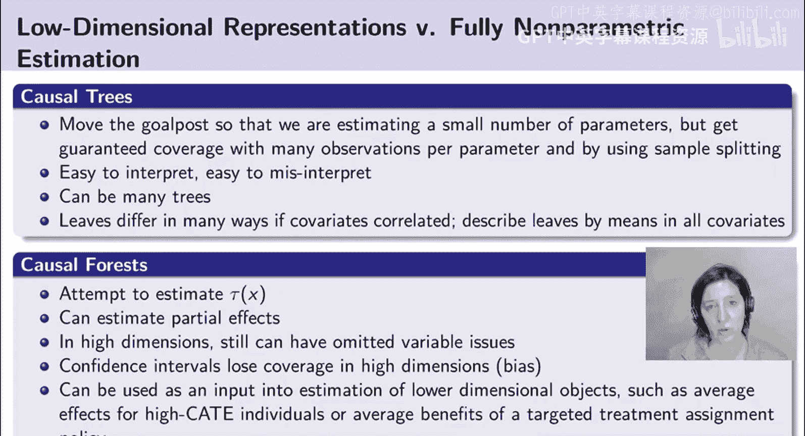

So to get started， let's think about a baseline method for estimating flexibly tau of X。

 the conditionalal treatment effect。methodethod that's been around for a long time is known as matching。

 or in the machine learning paper， it's often called KNN where NN stands for nearest neighbors and K is a number of neighbors。

And using K and N， the estimator for tau of x is constructed by first for the target x。

 the realization little X that you're trying to go for， you take the K closest treated observations。

 take the sample mean， then you take the K closest control observations， take the sample mean。

 and then you take the difference between the two， and we'll use this to construct an estimate of tau hat of x。

So an advantage of this method is it's very straightforward to understand what's going on and it's actually got good robust performance when the number of covariates is small。

 but a challenge with it is it's got an acute curse of dimensionality。

 even for relatively small numbers of covariates say if you have 20 covariates in 20。

000 observations， the curse of dimensionality starts to kick in。

Another version of this is a kernel regression and you can think of a kernel regression as a generalization of K and N in this case for a given x。

 we're finding putting equal weight on all the nearest neighbors to x and zero weight elsewhere。

A kernel is going to take a weighted average of nearby treated observations。

 but it's going to wait closer observations more highly and farther away observations less so。

 but it's going to just do similarly a weighted average of observations that are treated near x minus a weighted average of observations that are near X but are control observations。

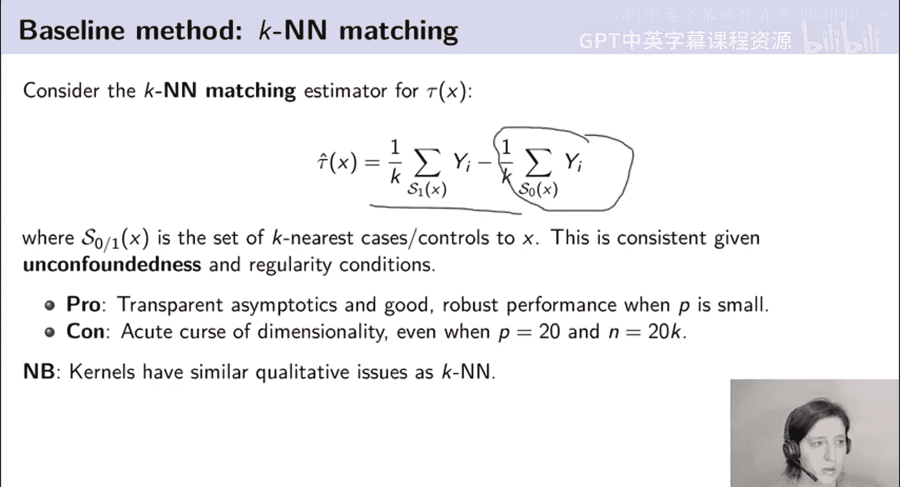

Now let's talk about random forests and we're going to interpret random forests in a way that's a little different than standard。

 we're going to interpret it as adaptive nearest neighbor matching。

So randomand forests are a popular heuristic for adaptive nearest neighbor estimation。

 they were introduced by Bman in 2001。And they actually have an excellent empirical track record and they're often used as a black box and we don't and they work well out of the box if you don't tune them。

 they tend to still perform pretty well， so they're one of the fastest high performing machine learning methods you can get coded up。

But we often use them without really understanding why they work or how to evaluate their performance。

In the early 2000s， there were several people that started thinking about using various types of forest methods for treatment effect estimation。

 but without formal theory。What what Stefan Walker and I did in the Stefan's job market paper was provide the first formal results allowing random forests to be used with provably valid asymptotic inference so what we did was we figured out how to how we could modify forest algorithms in order to make them usable for inference and those were the first results for prediction with forests of that sort and then we extended those to estimate causal effects as well。

 so to understand how a causal forest works， let's start with a causal tree so we've already covered causal trees they defined neighborhoods for matching based on recursive partitioning and they advocate for a sample splitting to ensure that we get assumptionfree confidence intervals for treatment effects in each leaf。

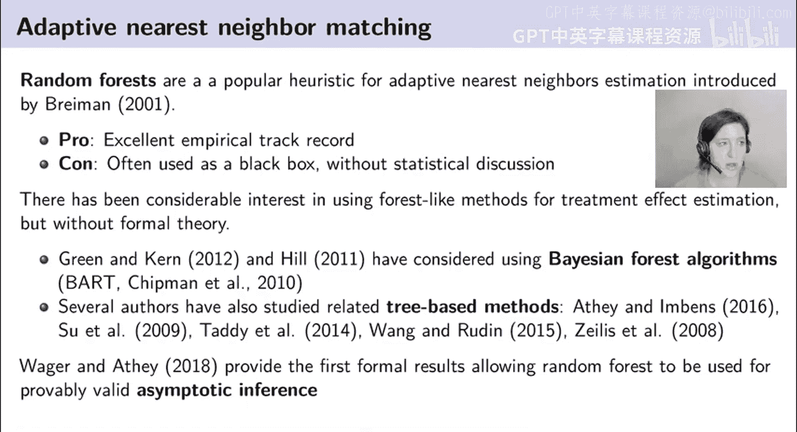

And so we can contrast tree based neighborhoods with K&N on the right。

 we see this picture where for a target X， we're going to understand the treatment effect estimates for X。

Based on the sample average treatment effect for observations in the same leaf as x。

 so we'll use recursive partitioning using our and if it's causal inference using our our causal inference splitting rule。

We'll come up with this partition of the x base， and then we'll estimate the treatment effect for x on a separate estimation sample based on the observations in the same leaf if we contrast that to nearest neighbor matching。

We would take a target X， we would draw a circle around that。

 so we would find all observations that are closest to x。

And then we would again get the sample average treatment effect for those observations that are nearby Xs。

Now how do you go from trees to forests Well again。

 imagine we have a training set with Covariates x outcome Y treatment assignment W and a test point。

 and suppose we have a tree predictor so we've estimated say a causal tree and for a particular value of x we have a predictor based on a tree the random forest idea is to build an average many different trees so our estimate of tau hat of X can be an average over many trees of estimates of treatment effects。

Now how do we turn a single tree predictor into having lots of different trees well there's a variety of ways。

 one is bagging or subsampling the training set and this can be this is helpful for smoothing over discontinuities so when we have a single tree remember that you know if x is near the boundary then the estimate for the treatment effect for X can change discontinuously if we change X across the boundary。

Now the literature has but tried both bagging and subsampling。

 we're going to focus on subsampling because that's going to give us nicer statistical properties another thing that's often done to make each tree different from one another is to focus on a subset of covariates for each tree and because we're using different covariates of each tree will'll get different trees Now the literature actually often focuses more on bagging and a lot of that's the default setting in a lot of random forest packages but subsampling is particularly nice because if we take a subsample of the observations to construct a tree。

We can then get estimates by taking a second subsample。

 and that's going to make each of our trees honest and if we average up a bunch of honest trees。

 we'll get unbiased estimates。

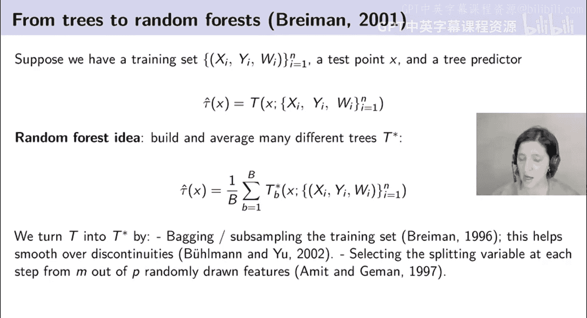

So honest trees don't use the same data to select the partition and make predictions。

So what we're going to do is build forests out of those kinds of honest trees。

And so the main result in Wager and8 2018 is that when we build forests by averaging up a bunch of honest trees。

Using some sampling under some technical conditions。

Then as the number of observations goes to infinity。

The the estimates are going to be asymptotically normal and centered around the truth that allows us to。

 for example， construct confidence intervals。

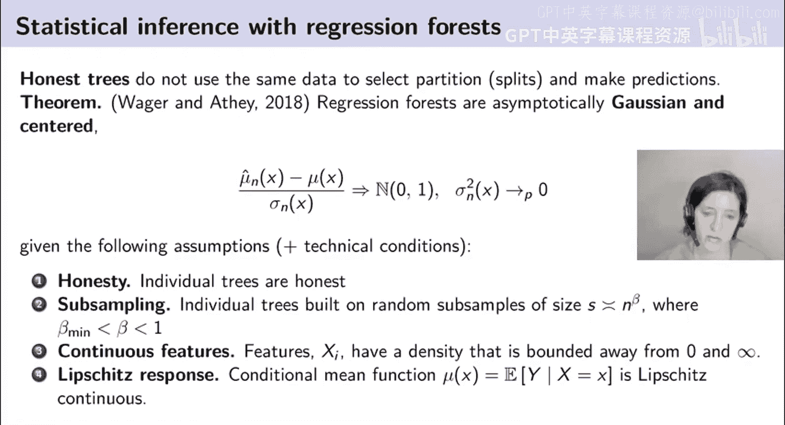

So to see an example of how this works in practice， let's imagine we have 20，000 observations。

 we have uniformly distributed features and six covariates and treatment assignment is random。

And suppose that all of the signals concentrated along two features。

 so the rest of four of the X's are kind of noise covariates and two of them actually affect treatment effects so we look over here first on the left we see a plot a heat map of the true effect so we've got this nonlinear relationship and treatment effects are bigger in this right upper corner and lower elsewhere。

We see that when we use causal forests to estimate these treatment effects。

 we pick up this nonlinear shape， although you can see it's a little bit boxy relative to the truth。

 and that's coming from the fact that the forest is an average of trees。

We look over here at the KNN estimate and we see that the estimates are a bit smeared and that's because in six dimensions what what we're looking for are neighbors that are similar in all six dimensions。

 but only two dimensions matter， so in order to get close in the other four dimensions which the model doesn't know don't matter。

 we have to be somewhat farther away in two dimensions while the causal forest is going to use this adaptive splitting rule。

 it's going to figure out which covariates are important to split on when building trees and so it's going to construct neighborhoods that are based on x1 and x2 and not the noise covariates。

So these figures illustrate the cursive dimensionality， now we try the same exercise with 20。

000 observations。We see the causal forest now it's actually extra sharp and we've got it's kind of too sharp in terms of understanding the boundary of treatment effects。

 but the KNN estimate is incredibly smeared now we're trying to find K nearest neighbors where the neighbors are nearby in 20 dimensions and it just doesn't work so again we see the advantage of adaptivity the trees which are targeting treatment effect heterogeneity zero in on the right covariates and are able to do a much better job discriminating treatment effects heterogeneity than the KNN approach。

So we can look here and see how well calibrated the models are and we see that on the left when we look at what causal forests。

 we see that things look very well calibrated， that is on the X axis we have true treatment effects and on the Y axis we have estimated treatment effects and they're lining up on the 45 degree line。

 which means that estimates are close to truth now we do see a little bit of issue here around the boundaries where there's clearly some bias going on here and that's coming from the fact that the trees are still having a hard time building neighborhoods near the boundaries that discriminate well enough among the different the different values of the treatment effects。

We see a much bigger problem over here with the K&N model where it's not nearly as well valued that calibrated on the right。

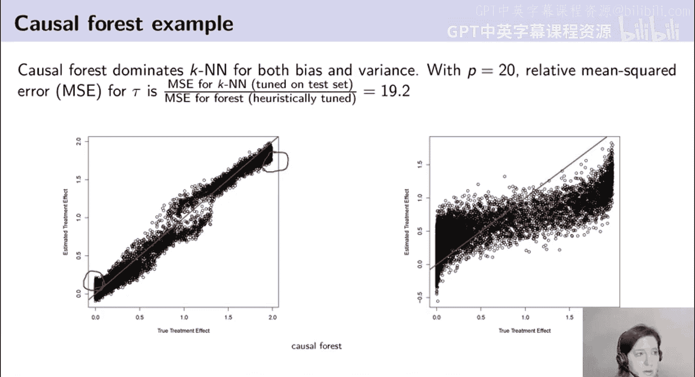

So there's actually been a fair number of applications of causal forests already。

 one by Hitch and Mira looking at using causal forest to target catalog mailings。

 another one by Davis and Heller， analyzing heterogeneous impacts of summer jobs。

And then a little bit later， I'll tell you about one that I've worked on with Neil Kellerher and Janon Sp looking at applications for financial aid。

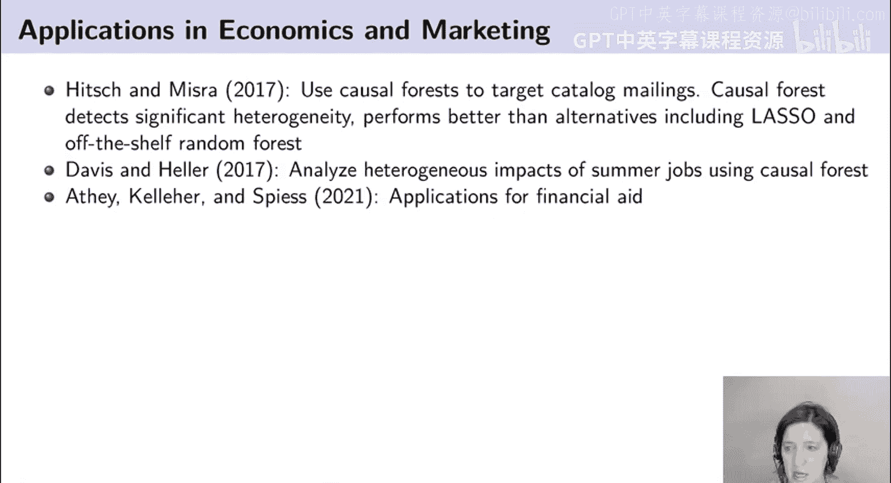

But first， let's jump into to a。More stylized example， the general Social Sur。

 so the general Social surveyve again is an extensive survey collected since 1972 that measures demographics。

 political views and social attitudes of the US population。

And there was a question that was randomized where some individuals were asked about whether we're spending too much money on welfare while others were asked if we're spending too much on assistance to the poor。

 again those are the same thing and so the question is seeing how does wording the question affect the answers。

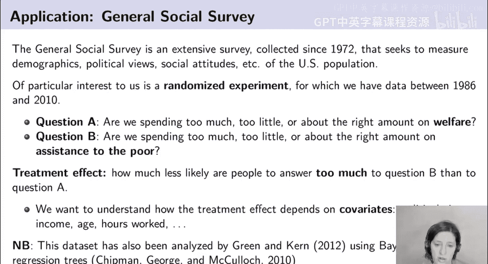

So here's how we can think about analyzing this and here we're going to use the GRF package later on we'll talk a little bit more about GRF。

 which is basically a generalization of causal forests。So here's the R code that runs the model and。

Here's the step where we actually estimate the causal forest。

So the first thing we do is we look and make sure in our data that it looks like this really was randomized。

 so we estimated propensity scores and with those propensity scores we then can see how what's the distribution of estimated propensity scores in the control group versus the treatment group and we see that the estimated propensity scores all are very concentrated around 0。

5 and they look similar in the control in the treatment group and that's basically what you would expect if in fact everybody was randomized 5050。

Next， we look at the out of bag conditional average treatment effect and we look at a histogram that shows the distribution of those so what we're showing here on the x axis is the estimated K and on the Y axis is the count and so we see this nice distribution where it looks like there's a fair bit of heterogeneity in Kates sometimes the treatment effect as as high as 0。

5 other times it's as low as about 0。25 so it looks like our model has found that there is systematic heterogeneity in treatment effects。

However， we don't know yet how well calibrated our model is and we want to be very skeptical because there are many。

 many examples where we're in a low signal environment and there actually aren't real treatment effect heterogeneity in the data generating process so here it looks like there's heterogeneity but of course even if there was no heterogeneity。

 we would still estimate some dispersion just like we did with the provinity scores due to sampling variation。

 so our next question is is this heterogeneity that appears here is it actually real。

 and we can figure that out by using estimating the model in a training set and then looking at what happens in a test set but before we do that let's take a look at calibration using an approach based on regression。

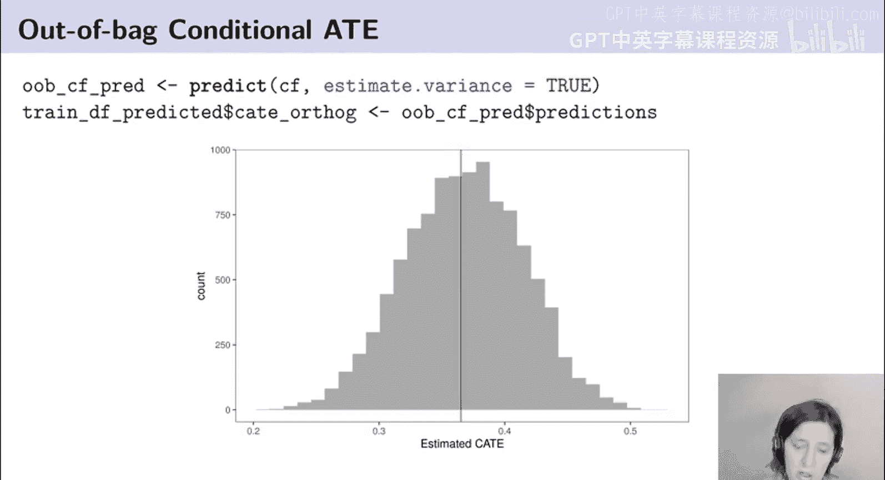

So we're going to use this method that was formalized in Chernnazakov etal 2018 that's related to this transformed outcome approach that we suggested in Atthean Invents 2016 so here what we're doing is we're running a regression we're doing a best linear fit using the forest predictions on held out and we're didn to do this regression on heldout data。

And so the regressionors are going to be the estimated Kate。

 so for each observation we're going to look at a transformed outcome that represents treatment effects on the left hand side。

 actual treatment effects and the held out data， and on the right hand side。

 we're going to have the Kate。And what we're going to look at here is what is the coefficient？Is 1。

579 on the Kate， and so this differential forest prediction is basically the Kate minus the eight。

And it looks like we have a coefficient of 1。57， first of all， that's different than zero。

 which is good， which means that it looks like when our estimated CA changes。

That is positively correlated with actual treatment effects。

 and we can also we can reject that it's one though it says this is not perfectly calibrated。

And we can also reject that this coefficient is zero。

 which says that there's actually treatment effect heterogeneity。

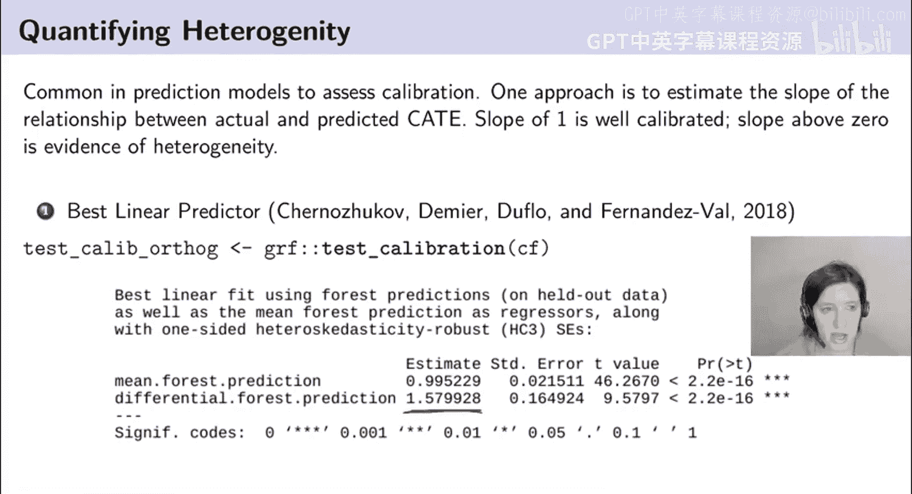

A related exercise we can do is to basically break the data into four quartiles of estimated cases。

And then looking held out data to see for each quartile of Kate。

 what is the estimated treatment effect for each of those quartiles and we can put confidence intervals around those so exactly what we do is we go through k folds of the data。

For fold little K， we hold out that fold， and on the rest of the data， we estimate a model of CAe。

 for example， using causal forests。And then using that those estimates。

 we define a mapping from covariates to the quartiles of the Kate distribution， so for every x。

 we assign them one， two， three， four based on where they are in the distribution of Ks。

Once we have that estimated， we can apply that to the covariate values x in fold K。

So that way we've used data outside of F K in order to build a model。

Which we use to assign the units in。Group K to quartiles。嗯。😊。

If I go through this and loop through the cases。Across all the folds。

 then at the end of looping through all the folds， each observation has been assigned to one of the four quartiles and that assignment doesn't depend on that unit's outcomes。

Crucially。If that's the case， then we can。Average up across everybody that's been assigned to quartile4 or average up across everybody who'st been assigned to quartile1。

The treatment effects。So that's you can for example。

 the orange or the sample ATE that is for each quartile。

 we just take the sample average treated minus the sample average control to get the estimate of treatment effects and then we just construct standard errors in the usual way。

And what we see here is we have some evidence of heterogeneity。

 so it looks like you know the high quartiles are above the low quartiles。

But it's also pretty hard to tell the difference between quartile 3 and quartile4 so but we are able to discriminate quartile1 versus2 and 2 versus three。

The next question we might want to ask is okay， it's great to understand we can tell things apart。

 but what predicts whether you're in a high quartile or a low quartile so here actually we we've divided things even finer we've done the same kind of exercise but now we're looking at deciles。

And so what we do in this table is for decile one， the low treatment effects。

 we look at all the covariates of those individuals and average them up。

And we can compare those to all the average values of the covariates for units in the 10th decile。

 and we see in the final column here， we test the hypothesis that those means are equal and they're different for all of the covariates except for this other value of political views。

And so if we， if we then try to interpret this， we're able to say， okay。

 it looks like there's older people。A in the 10th decile so that's saying that older people have higher treatment effects for older people it matters more。

 whether it's welfare or assistance to the poor higher income people are in the highest decile their lower education。

 but it's not it's not as big a gap here。And then we see with political views。

 the low political views are left leaning and the high political views are right leaning。

 the treatment effects are higher for the right leaning people， and they're higher for men also。

And so this way of understanding the groups， it avoids some of the pitfalls of trying to inspect a tree and deciding what's important and actually in the machine learning literature for Fors。

 there's often this measures of variable importance which says how often do the tree split on a variable we're not giving that type of set of analysis here and it's actually not really a good idea to do that because again with variable importance。

 you can split on one variable that say income and education are highly correlated。

 it could be you split on income all the time but you could have split on education and gotten a similar set of neighborhoods or a similar partition？

So here we've done it more descriptively we've just said let's look at the characteristics of people in decilele10。

 I don't really care if you split on education or if you split on income。

 but I can I'm looking at the people that you' picked out now one thing that's interesting here is actually income and education go in a bit of an opposite direction so saying it doesn't matter which one you use is not actually true in this data set but it might in a different might be similar in a different problem。

😊。

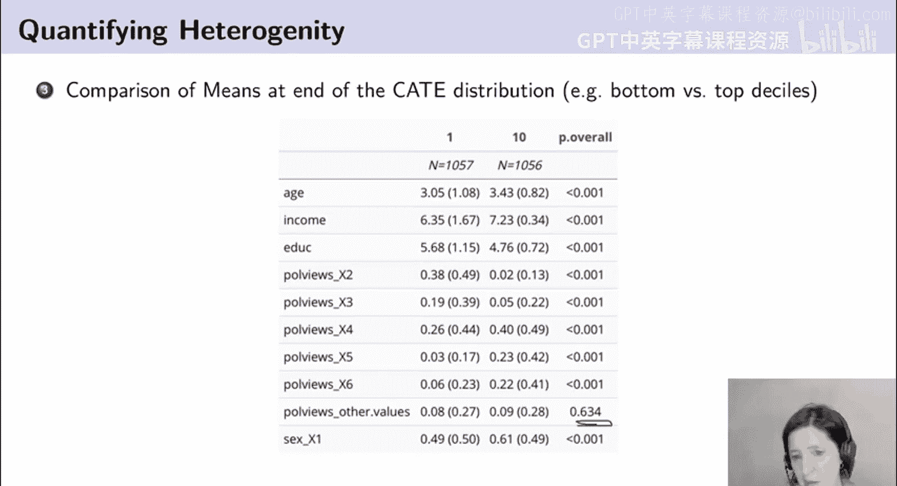

So this figure depicts partial effects， it basically says we're going to hold fixed all covariates and we're just going to change liberals to conservative spectrum and the less income to more income spectrum。

And what this picture depicts is that first of all。

 the relationships are nonlinear so there's sort of interactions between political views and your income。

 and then we also see high conditional average treatment effects for high income more conservative people and low conditional average treatment effects for liberal and less rich people。

😊。

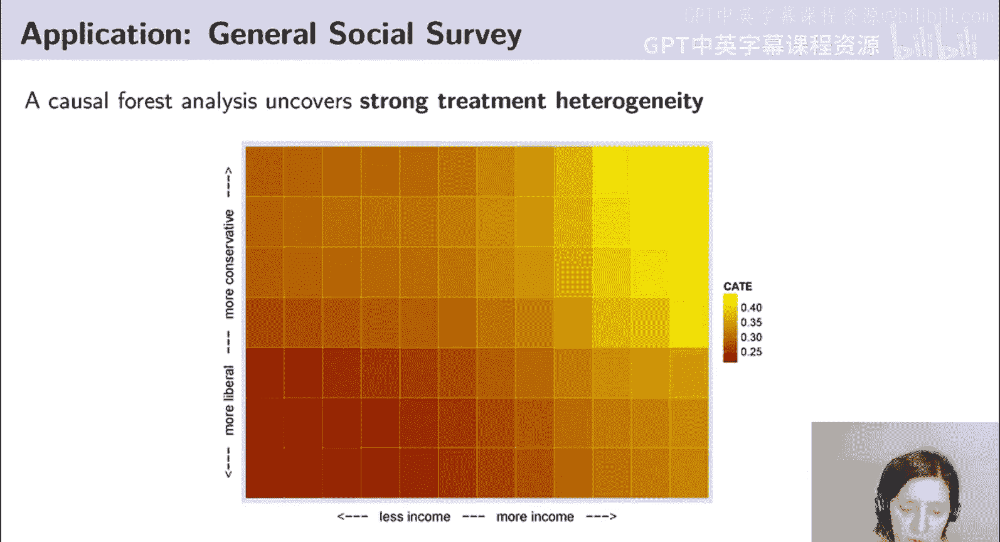

Now we'll consider another experiment， this one was analyzed in a collaboration between Stanford IDS 42 and the City University of New York。

 and the research questions were about nudging people to fill out financial aid forms and trying to understand for whom nudges are effective and how well different targeting approaches do。

So the experiment was run in 2017 and 2018 by Is 42 and CUNY。The control group。

 you got business as usual emails from the college while the treatment groups got supplementary behavioral emails and text messages。

 the people in the study were matriculated students from CUNY Community colleges who had not yet renewed phoSA in February of the study year。

In 2017， there were 25，000 students from three colleges in the experiment and 2018， 40。

000 students from five colleges。And so when analyzing this data。

 the average treatment effect showed that the on time submission of financial aid increases by in percentage points。

 6。4 percentage points in 2017。😊，And 12。1 in 2018。And that increased early filing rates from 37 to 43% and 38 to 50% respectively。

 so this was a successful experiment just to see what the experiment looked like the text messages were sent and they would say things like hi this is your student persistence team we want to send you a few helpful texts and then we would then they would get text about renewing their financial aid forms。

😊。

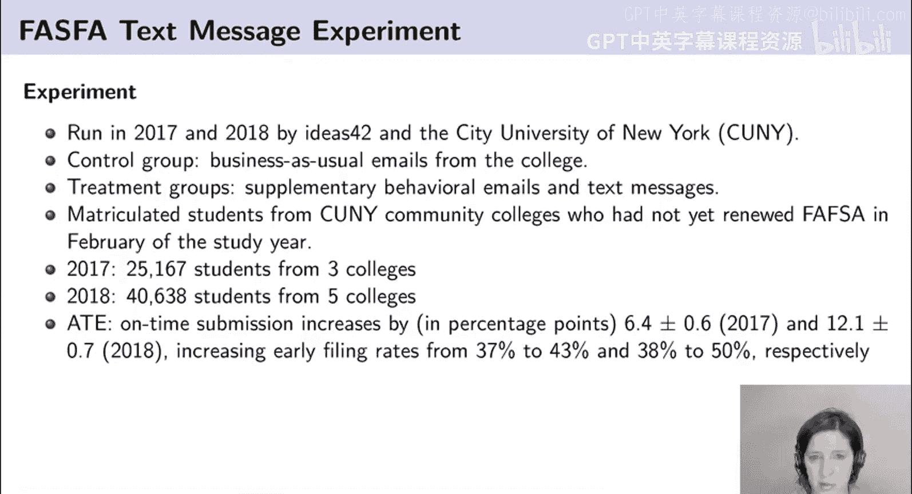

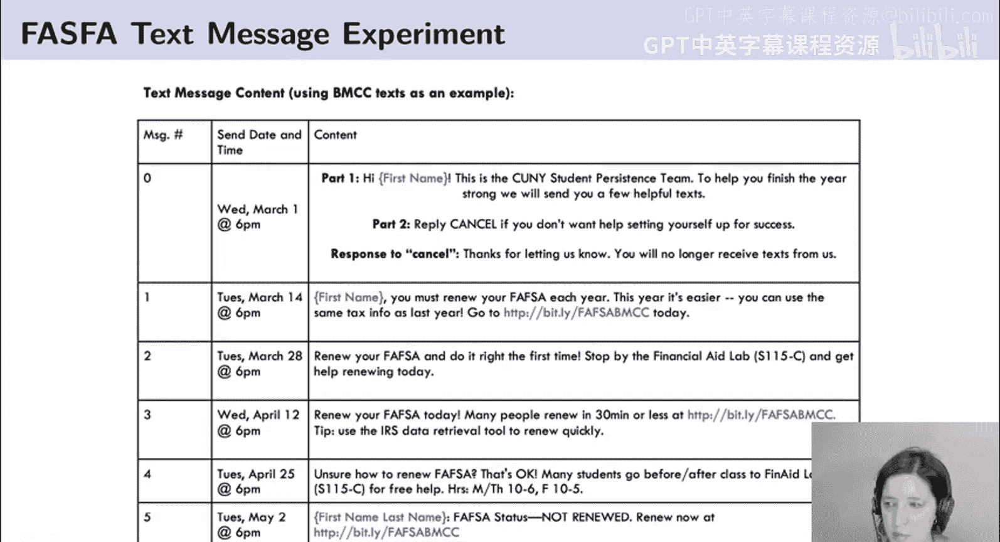

So。嗯。😊，One of the first things we do is estimate a causal force to estimate heterogeneous treatment effects and this get these estimates tau hat。

And then again， we look at calibration using the transformed outcome approach。

 we put on the left side the transformed outcome and we regress that on Tau Ha of X。

And what we see is that the that。The slope estimates are significantly different than zero。

 so when we run regressions you're going to test the hypothesis about whether the coefficient is 0 and these P values are all less than 。

05， so they're all statistically significantly different from zero， but they're pretty noisy。

 and we also see that the estimates are also far away from one。

So we see there's evidence of heterogeneity， but we see this model is not very well calibrated。

 if it was very well calibrated， then if we regress the transform outcome on Tau how of X。

 we should get a coefficient of one， treatment effects should be lining up with estimated treatment effects。

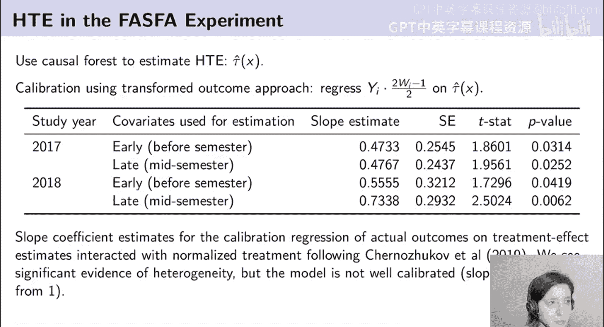

So again we're going to do this type of quartile exercise again。

 we're going to hold out one fold of data K， build a model of Kate on the remaining data and use that model to build a drive model mapping x each of four quartiles based on the tau hats from from this。

The case iteration， we're going to put the observations into the four quartiles in the held out fold and then we'll finally estimate the average treatment effect in each of the four quartiles for fold K using the outcomes in fold K。

😊，And to make use of all our data， we're going to do this exercise across all folds of the data。

 which is called crossfitting， so we'll average the ATEs for a given quartile across folds。

So here's the results we look in 2017 and 2018 and unlike the general Social Sur。

 we're seeing results are a lot noisier here， so first of all。

 actually in 2018 as you go from the first to the second quartile what we would be hoping is that the average treatment effect should be going up。

Our model says quartile2 has higher treatment effects in quartile 1。

 but in held out data that's not holding up so we're basically saying we can identify what this picture looks like in 2018 is we can tell apart kind of high treatment effect people the top half of treatment effects in the bottom half of treatment effects。

 but we can't tell very well the difference between。

Cortile3 and four and we can't tell the difference between quartiles1 and 2 Well in 2017 we're able to pick out quartile1。

 but we're not able to distinguish between the top three quartiles。And somewhat sadly。

 this type of picture is relatively common this is this is showing a low signal environment that is the the there's more noise than there is signal and so when when there's a lot of noise and there's not a lot of signal the causal forest is kind of just。

Picking up random stuff due to sampling variation。 It it's not actually distinguishing very well treatment effects。

 Now， there's some distinguishing here。 This isn't nothing。 And again， in the regression analysis。

 we saw there was a significant relationship between actual treatment effects and estimated treatment effects。

But it's not super strong and that's what we're seeing playing out in this picture So when we look at which x's are most associated with Kate heterogeneity enrollment status is the top covariate。

And to think about this， some students have actually dropped out。

 so if they were students at the beginning of the year， but they've dropped out by February。

 they're less likely to consider enrolling than the next year。

 and so there's going to be a low conditional average treatment effect because they are not interested inrolling therefore they're not interested in filling out financial aid。

And it turns out if we'd started with this hypothesis we would have identified strong heterogeneity if you just distinguish the enrolled and unenrolled students。

 we see high treatment effect estimates for the enrolled students now the treatment effects are not zero for the unenrolled students and that's because a lot of students actually come and go from community college and some that have dropped out are planning to come back the next year。

 but the ones who are nudged more strongly who are enrolled have a stronger effect of the nudge。

I also want to emphasize that machine learning kind of comes at a cost here because we used data to search for heterogeneity and that added some noise and that noise can actually dominate in a low signal environment while if we just focused on this prespecified hypothesis about enrollment。

 we would find clear separation in terms of treatment effects。

Now the last exercise I want to do here is to look at using these treatment effect estimates to target a treatment assignment。

 so we imagine that it's expensive to send text then we want to think about targeting only z% of individuals so in this picture here the percent treated is on the X axis。

And what we're going to show here is what is the benefit of treating Z% of individuals where Z's on the X axis relative to randomly assigning treatment。

Now let's focus on this pink line first， just to orient ourselves to the graph。

We've estimated positive treatment effects。 So the benefit of treating more people。

If the treatment is randomly assigned is just linear， so if 100% were treated。

 we would get this estimate of enrollment， I mean and the estimate of filling out financial aid forms that's what we estimate for 100% treated so on the Y axis is how many people enroll so our estimates show that if we randomly assigned treatment to people that as we get more people assigned each of them is going to get that treatment effect and then at the end if 100% of people are treated we get well get these about 43% of students actually filling out financial aid。

Now these other bars look at what the enrollment rates would be if we use other targeting policies。

 so this olive line here is corresponding to what happens if we target people according to Kate。

 and so if we look for example， at the first， say 12 and a half percent。

 we targeted those according if we pick that 12 a half% to be the highest CA people instead of randomly assigning 12 and half percent to a treatment。

Then we're going to do better， we're going to have higher enrollments if we target the treatment to the highK people。

Then actually， the olive line kind of hugs close to this purple line。 and that' saying actually。

 if we tried to target， say， you know， 30% of the people。

Targeting high Kate is about as good as just randomly targeting people so there our targeting policy isn't that effective then we start to see more separation again up at these higher percentages。

 so for some reason we had a budget of treating 60% again it looks better to do targeting to the top Kate people rather than randomly assigning the treatment。

But now what are these other pictures well we can then look at what if we just targeted based on enrollment。

 so we first sent the text to people were who were enrolled。

And we can think about doing that for enrollment or we actually could evaluate it for inverse enrollment。

 so we can look at that and actually targeting by enrollment looks like it does pretty well。

 especially up in the the higher targeting percentages。We finally can look at。

A baseline and baseline is basically you know the going to be the baseline prediction of whether you're going to not fill out your form so suppose we targeted people who weren't going to fill out the form which kind of seems intuitive we target we say hey people who we think we're not going to fill out the form will send them text and that'll make them fill out the form but it turns out here this that's this red line here that's that's significantly worse than just targeting randomly so we don't want to target people who were had a baseline predicted probability of not filling out the form。

On the flip side of that， if we this kind of aqua line up here。

 that's targeting people who we predicted we're already pretty likely to fill out the form it turns that the nudge works best on the people who were already pretty likely to fill out the form and so we see that this aqua line is higher than the pink line and what that's saying is targeting by people who were who were most likely to fill out the form already will be an effective targeting policy So summarizing this picture is sort of showing how you can use something like a Kate estimate as an input to something else in this case targeting people for text messages。

So I've shown a bunch of examples of forests for causal effects now they're not the only method that can be used and indeed they may not be the most appropriate in every circumstance。

 for example， many economic data sets have smooth relationships。

 relationships might be monotonic or u shaped while forests actually try to fit a line as a step function which is very inefficient。

A variety of machine learning methods might improve upon this， but sometimes there' little theory。

For example， you know neural nets might be a good way to go。

 but we don't necessarily have you know reliable statistical properties of them so one solution that worked on with a former graduate student rhna Freeberg was to introduce what we called local linear forests。

So to see what goes wrong with forest， here's a picture， there's a true relationship between y and x。

 which is illustrated with the black line。And then we look at how what are the predictions on a test set of random forests。

 and we see here that when there's lots of dimensions and the forest might get confused and it ends up fitting a step function to this curve。

 which doesn't look very good， especially for high values v。

What we'll call local linear forest corrects for that， so let me show you how。Actually。

 before I do that let me also show the difference between a causal forests and local linear forest in the example of the general search survey where there was the randomization of the treatment。

 remember the treatment was what do you ask about assistance before the poor versus do you like welfare？

And what we see here on the X axis is how liberal or conservative you are on the left and we see that the causal forest kind of gets flat near the boundaries and that's because it's the average of trees and the trees are having to build leaves that are big enough to have observations in them。

 and so when you get towards the boundaries， you're averaging only data points。

 say to the left of the right boundary which tends to kind of flatten out the curves。

 but what we call the local linear forest does a better job of maintaining this relationship which turns out it fits better when we look at test sets and it does a better job of fitting the true relationship and we see a similar problem with income that the causal forest flattens out a little bit towards the edges while the local linear forest does not。

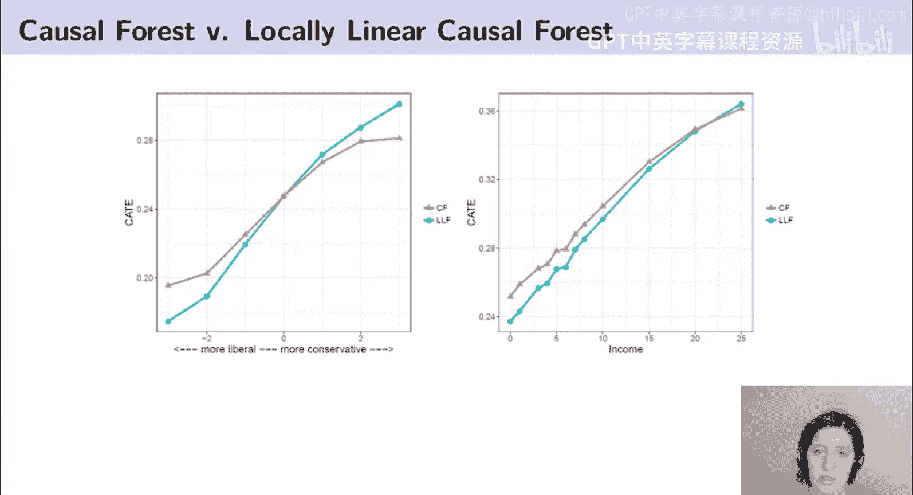

So how does it do that well basically it thinks about running a regression， a weighted regression。

 and the weights are determined by how close points are to the target point。U。

In leaves of the forest。And so but then the method also includes it's a regression and so we're going to actually estimate a slope coefficient that says how does x affect y and by estimating those slope coefficients。

 we're able to adjust for the slope of the data generating process near boundaries so if a data point is near a boundary we're going to actually estimate the slope of the relationship between x and y near that boundary and even though't have data sets on the other side of the we don't have data points on the other side of the boundary。

 we're able to predict what happens at the boundary better by understanding the relationship between y and x say it's increasing as you lead up to the boundary you'll be able to do a better job fitting and so we have a theorem that says that this works well。

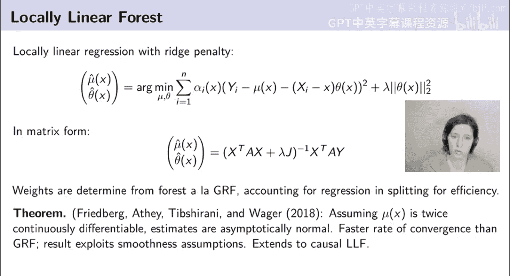