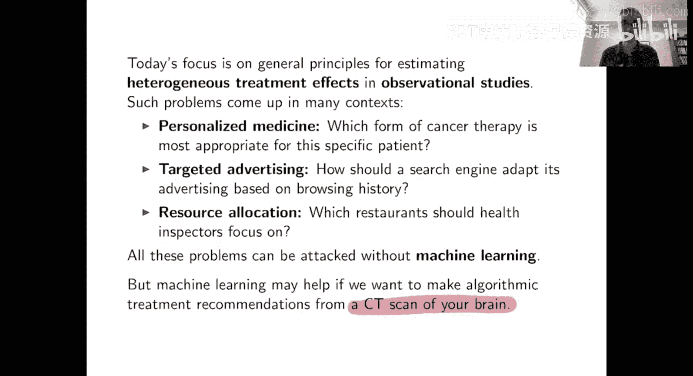
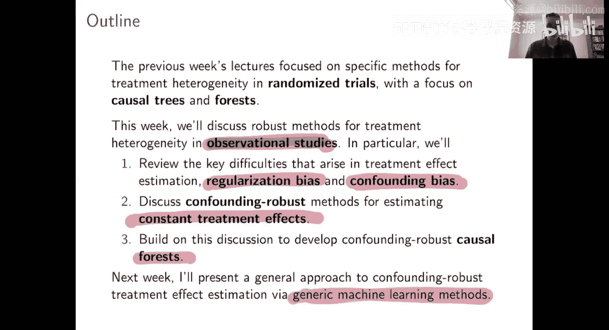
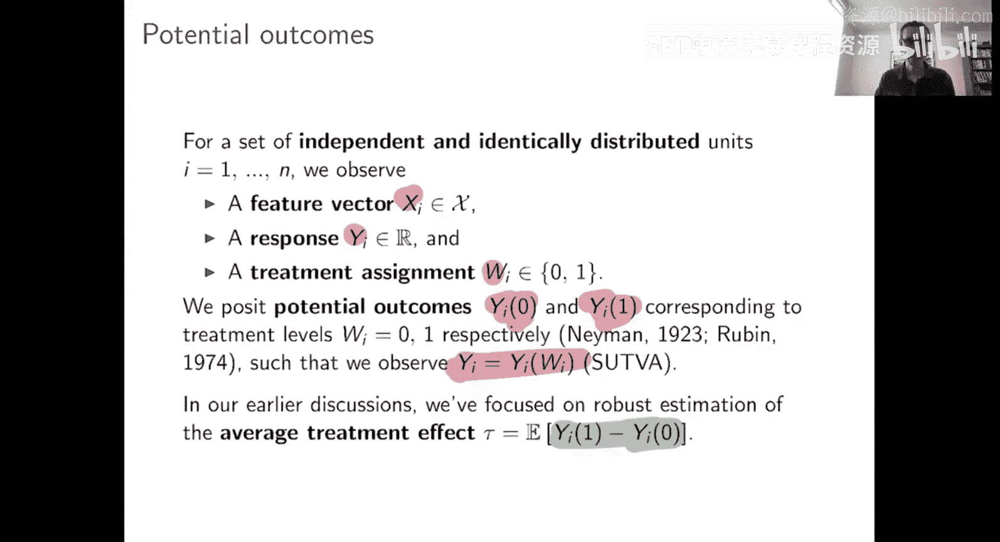
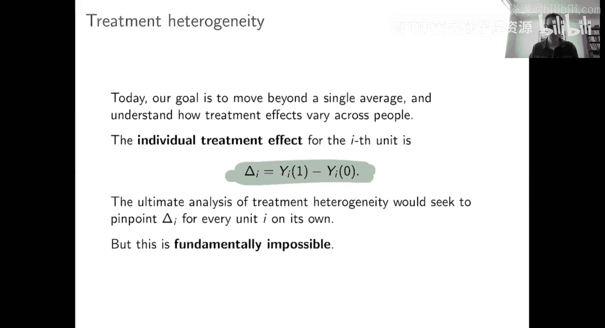
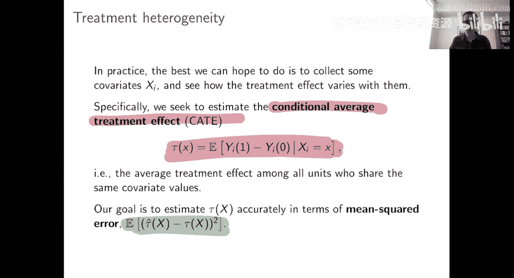
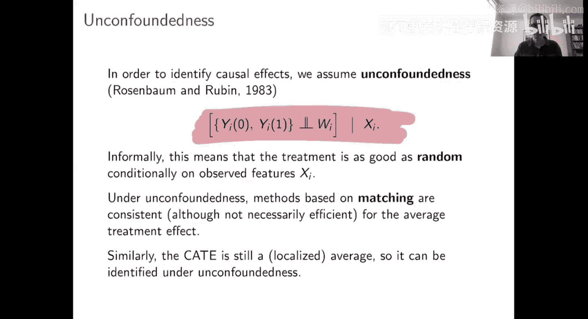
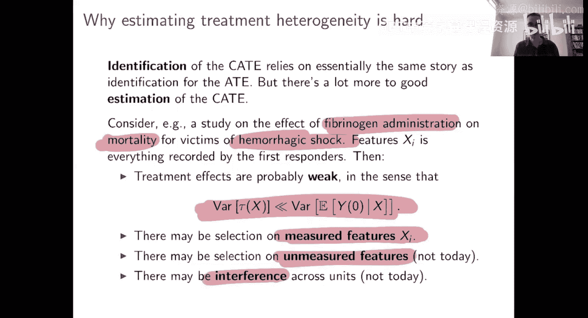

# 斯坦福商学院《机器学习和因果推断｜Machine Learning & Causal Inference： A Short Course》claude-4s p12 -12-Robust Estimation of Treatment Heterogeneity.zh_en -BV1M9W7zCEsf_p12-

Hi everyone， welcome back today we're going to continue our discussion on methods for treatment heterogeneity。

😊。

So as Susan emphasized last week and gave many examples。

 treatment and heterogeneity is a problem that comes up in a number of application areas。

And for this reason， it's kind of one of the big focuses of this class。Just to kind of。

Give one example to get everyone back up to speed。嗯。Suppose you have a new。

Medical treatment that you're interested in deploying。😊，You think people benefit from it。

 but maybe some people benefit from it more than others。

You'd want to kind of based on medical history or other facts。

 prioritize the treatment to people who benefit fromed the most。嗯。

You end up in a problem where you want to kind of understand the heterogeneous effect of the intervention。

The flip side of this is again， suppose you have some treatment that has severe side effects。

And the side effects are actually kind of a problem， so you'd want to avoid giving Kong。

The intervention to people who are at high risk of side effects。Now， understanding。Who are people？

ho are the most vulnerable to side effects giving a new treatment that's again。

 a question in treatment heterogeneity where now the outcome isn't kind of a good thing you want to promote it's the side effect you want to avoid。

 but statistically the problem is the same。😊，Other areas where this comes up。

 say in industry include targeted advertising， people working in these settings often have very large data sets to work with so they are able to kind of tease out very。

 very subtle signals using machine learning in these problems。A， so as is the theme of this class。

 today I'm going to focus on machine learning based methods for treatment heterogeneity。

 something I just want to emphasize。Before going there， though， is that。

There's a lot of discussion these days about machine learning based methods between heterogeneity。

 but this doesn't mean that you have to use machine learning based methods to do so。

There are also classical things you could do， say run。

Linear regression and put an interactions between the treatment and the measured covariates and this could also。

Kid have treatment heterogeneity in a useful way in some applications and there's nothing wrong with that。

Using machine learning methods doesn't change the nature of the problem。

 it just enables you to work with larger。More complex data sets and to automate some of your analysis。

Just kind of to pick an extreme example， let's say you wanted to do personalized medicine and one of the inputs to your algorithm was a CT scan of your brain。

 you wanted to kind of based on CT scan figure out who's going to benefit from some treatment or not。

Come。It's a problem in treatment et Triity。Good luck。

Doing this with or approaching this with linear regression， though you're probably going to need。

Image recognition based machine learning tools for that。

All right， so last week Susan gave an introduction on treating heterogeneity with a focus on problems that come up in randomized trials。

She also discussed some methods to treatment with heterogeneity， including co trees and forests。

This week， what I want to do is kind of continue that discussion。

 but now no longer in a setting of randomized trials。

 but in an observational study setting where you also need to worry about some units。

Selecting into treatment and this meaning that not all units a priori have the same probability of getting treated。

And this ends up being quite a delicate problem。That essentially combines most of the challenges we've seen in this class so far。

嗯。There's and we too we discussed about we discussed challenges in estimating average treatment effects the average treatment effect in itself is a very simple parameter it's just one number but the difficulty comes from the fact that。

If you're in an observational study setting， you need to control percovariance。

 you need to estimate propensities scores and so forth and doing that well。Take some a。

 take some effort。On the other hand， last week。The focus was on treatment heterogeneity estimation in randomized trials here in a randomized trials。

 so there's no difficulty from confounding， but the difficulty comes from the fact that the heteroous treatment that function might be quite complicated and so you need to kind of work harder to represent to derepresent it in terms of the tree or something else。

Um today we're going to have all of these difficulties our target is still going to be the heterogeneous treatment effect function。

 so it's going to be complicated， but at the same time。

We're going to also have to worry about confounding。

eststimating propensity scores using that to make ourselves robust。

So we're going to have that dimension to the problem also。It turns out though， that luckily。

 if you can combine ideas from the class so far and the right way， you can make everything work。😊。

So treatment heteroity and observational studies is our topic for。嗯。

There are kind of be three aspects of this I'm going to focus on this week。

The first is kind of a review of key difficulties that come up when estimating treatment nitrogen80 kind of regularization bias you always get this this also came up in randomized trials and now we also have the problem confounding bias。

Which is going to be our main focus today。Then after that I'm going to talk about and this may seem a little bit like a detour but it will be very important。

 I'm going to talk a little bit about confounding robust methods for estimating constant treatment effects in observational studies。

You might ask。Why do we care about estimating constant treatment effects if we want to kind of understand how treatment effects vary and focus on the heterogeneity？

😊，But if you kind of think back to what does a causal tree do， for example。

 a causal tree tries you first partition your space so you can find。

Regions where the treatment effect is essentially constant。And then within each leaf。

Hoping that the treatment effect is roughly constant in the leaf。

 you can estimate the treatment effect parameter for the leaf。😊，啊。

If we're in observational study setting， this means you can't turn a causal tree unless you have some idea about how to estimate a constant treatment effect in a leaf where you hope the treatment effect is constant。

So we're going to talk about that we're going to talk about constant treatment defect and then in the last part of the lecture we're going to talk about。

😊，How to build on these ideas to build trees and forests for nitrogen8。

So that's our plan for this week and then next week we'll continue and I'll discuss kind of how to go beyond these ideas for trees and forests that are compounding robust。

And kind of build methods that really mesh with any generic machine learning method。So that's a plan。

In terms of the statistical setup， it'll be the same as usual。

 we're going to assume we get to work with a set an independent and identical distributed unit each of them has kind of a feature vector X and outcome Y treatment design W we have potential outcomes corresponding to the outcome you would observed with or without treatment that kind of so that kind of。

The actual outcome you observe is a potential outcome corresponding to the treatment assignment you actually received。

And then。Okay， what do you want to estimate？In lecture two。

 we were in this setting and we wanted to estimate the average treatment effect。

The average difference in potential outcome。But today we want to focus on treatment heterogeneity。

 so we're still going to focus on causal effects， this difference Yi1 minus Y0。

But we're not going to just。wantant to have the average of this quantity。

 we're going to kind of want to have a more nuanced picture of what's going on。

And all right。How could one do so？Just。Go。Quick thing before I talk about the thing we actually want to estimate。

😊，It's kind of， if you say you want to estimate kind of personalized treatment effects。

Then it's very tempted to think that the quantity you want to estimate this is Y1 minus Yi0。

Remember why I won？Is the outcome you would have experienced with treatment y zero is the outcome you would have experienced with control so delta I as defined here is kind of literally the effect of the treatment on the I person。

As defined in the potential out water。It's called individual treatment。And of course。

 if you could know the individual treatment effects then。You would want to estimate that。

But the problem is that these individual treatment defects are fundamentally unknown。😊。

For any specific person。Either。I give you the treatment or I don't give you the treatment。

 I can never both give you the treatment and not give you the treatment。

And that means that kind of for any specific person， either you observe Y1 or you observe Y0。

 you can never observe Y1 minus Y0。So you can never observe deelta I for a single person。

 that's fundamentally unknowable。And。😊，Kind of to estimate treatment effects。

 we always need to kind of make comparisons across some people。

Who got treated and other comparable people who didn't get treated。In in。

Kind of targeting the average treatment effect in a randomized trial， for example。

 is a very kind of simple way of making these and direct way of making these comparisons work。😊。

So anyways， we don't want to estimate deelta I what do we want to estimate we want to estimate what's called the conditional average treatment effect and this is essentially like the average treatment effect so it's looking at。

On average， I' created minus control potential outcomes。

Except instead of estimating an average overall， we're estimating an average conditional on covariance。

So。Who're not asking kind of for this specifics person， what was their treatment effect？

If there are say some covariates， you imagine the data set kind of。Based on gender， age。

 medical history， and so forth， you can ask， well， for people with this type of covariates on average。

 what was their treatment impact？And kind of when I'm going to say。

 we want to measure treatment heterogeneity。What I mean is I want to understand how the conditional average treatment effect varies with。

Xs you can measure。All right， this was just kind of like quick quick review you've already talked about。

😊，The condition library of treatment depict the bunch last week。

And then just to kind of have a clear target in mind today when I say we want to estimate the condition of treatment of that function。

What I'm going to mean specifically is if we want to capture it accurately in means square error。

 that is kind of。We have a distribution of people， every person has their x covariates in terms of your x's。

 you have your true tau X， your true conditional average treatment effect。

 and then we're going to estimate tau had a x， a conditional average treatment effect for you and we want to kind of for the typical person these are close。

So that's the conditional average treatment effect and like I said earlier。

 we want to estimate conditional average treatment effects in observational studies。

 this is the same setting we saw in week two， we're not going to assume that the treatment is randomized but we're going to assume that there X is that you can measure so that conditionally on X the treatment is as good as random。

😊，Com。This is the assumption that we saw that you identify average treatment effects。

It'll also in very much the same way， I'll let you identify conditional error treatment effects。

And again。The statistical difficulty when working under this assumption is always just。

 how do you efficiently get rid of confounding effects due to x without biasing your estimate？😊。

So all right。Just the last thing I wanted to say before kind of。Ding diving into kind of。

The details for this lecture。Is。Just to say a few words of kind of。喂。

Is estimating kind of treatment heteroity difficult？What are things to look out for？

And maybe also what are situations where you think estimating treatment effect heteroity might be easier or harder and kind of just so you know what to pay attention to。

嗯。The reality is that kind of accurately estimating heterogeneous treatment effect functions is much harder than accurately estimating just an average treatment effect。

 you often need more data。And there are many problem settings。

 you'll see this if you work with the data provided in the class where you might go look for heterogeneous treatment effects and just kind of with available data。

 you can't find anything。好。This is normal， estimating treatment hydrogenity is a hard task。

 it's kind of one order of magnitude harder than estimating an average treatment effect you're going to need more data。

 but also kind of it doesn't mean that it's not worth looking for treatment hydrogengeneity because when you do given a medical treatment you find that the treatment not only helps on average。

😊，But that the treatment helps some people more than others。

 then you can kind of be smart about prioritization or who should be getting the treatment or not。

 and this can have huge value。So when you can find hydrogengeneity， it's often very good。

 but you're not always going to be able to do so。And the reason。Often。

 all it takes is the thing in of an application to see why this would be quite difficult。😊。

So imagine we're looking at victims of hemorrhagic shock that's heavy heavy bleeding and we're looking at。

The effect of treatment administering Fbrinogen， it's something people believe helps and we're looking at the effective fibrinogen on mortality among victims of hemorrhatric shock。

😊，And let's say we also wanted to look for heterogeneity there。

 that is are there some people who benefit more from Fibrinogen than others in preventing mortality？

So it's an important question。But there are some things that kind of。

Stand out immediately when you think about the problem。First， right。

 the outcome we care about is mortality， that's kind of very drastic outcome。

The condition we're looking at。Hemorrhagic shock， that's also very bad。So。

There's kind of a lot of stuff happening in this problem relative to that administering papernogen。

Maybe it helps a little bit， but there's kind of a clear upper bound to how much it can help。行。

Realistically， right， this is。Data collected by first responders。

 you could imagine that there's some people you get to them。

 you see that they're so severely injured that there's nothing you can do to help them and they're very likely to die regardless。

On the other hand， you might come to other people and see that they're bleeding。

 but essentially they're mostly fine and they're going to survive kind of。Regardless。

There might be some group of people in between who。

Are kind of on the fence and where administering Fibrinetgen early might really make a difference。

But the thing is。There are some people who kind of might be at night0。

An  ID0 plus percent chance of survival others below 10。

 if administering fibrinogen increases survival chances for some people by 5%， that's very。

 very valuable， but the kind of magnitude of the treatment effects is just going to be much。

 much weaker than baseline on it。So this kind of shows that kind of relative to everything else going at the problem。

 treatment effects even when very important might just kind of end。Absolute magnitude be very small。

嗯。The other thing again in this problem is that again you have data from first responders。

 they might be more likely to administer fibrigen to people who kind of based on observed characteristics they think might need it more so they may be selection un measured features XI you need to deal with this。

And again， when paired with the fact that treatment effects are weak。

 especially when treatment heterogeneity may be weak。

 you might really be worried that kind of confounding effects might be big relative to the size of the treatment effects you're interested in。

 so you really need to be careful in controlling for compound。

So these are these first two challenges， how to accurately estimate treatment effects while recognizing that treatment effects are probably weak and there may be a confounding those measured features X。

 this is what we're going to talk about today and kind of design methods that are kind of a best attempt to address these difficulties。

There are other difficulties too， there may be confounding due to unmeasured features。

 there may be interference where kind of say you gave your dose of fibrinalgen to one person。

 which means you can't give it to someone else。And you have come of these cross subject effects。

These are both kind of very delicate topics they're important。

 not going to talk about them in this lecture， but I just wanted to kind of flag them。

So you're aware to look out for them in case they show up in your application。

