# 斯坦福商学院《机器学习和因果推断｜Machine Learning & Causal Inference： A Short Course》claude-4s p13 -13-HTE_ Sources of Bias.zh_en -BV1M9W7zCEsf_p13-

The first thing I want to do a deep dive on today is unfa modes for estimators of heterogeneous treatment effects。

The motivation for this is really is it often in an engineering setting。😊，Someone will。

Propose and advocate for a machine that does something， to'll tell you that it works。

But then you can look at some。Performance diagnostics is the machine working or not。

 it's kind of hard to tell。Generally what's considered a best practice is that。

If a machine does a job well， it solves some problem you might have had so first you demonstrate the problem you could argue the problem is difficult to solve then you show that the machine solves the problem。

And I at least does get some confidence that the machine is doing something useful。

So this kind of the approach I M。Take with methods for treatment heterogeneity in observational studies I'm first going to show you。

Some things that can go wrong， two things in particular。

 I'm going to worry about our regularization bias and compoundfounding bias。

And then I'm going to discuss how you can design methods that avoid these problems。

And so throughout this part of the lecture。I'm going to go by kind of example。

 I'm going to show kind of a series of baselines。Methods for et heterogeneity talk about when they work。

 when they don't work and kind of。By sending these methods as they work or not work。

 you can kind of get an understanding up。What regularization and confounding bias are in Brexit。

But so in terms of baseline methods， the simplest thing you can do is based on。

We're following a direct observation。Remember we're working under unconfoundedness。

 the treatment is as good as random conditional impact。😊。

Then kind of following the same kinds of calculations we saw in lecture two。

 you can see that conditional average treatment effect。

That is the following thing can be written as a difference mu 1 of x minus mu zero of x where mu 1 of x is the expectation of y。

Given x and treatment equal to 1 ME0 of x is the expectation of y given x for controls。So。

The point here is that these two problems here， mu1 of x at mu zero x。

 these are just non parametric regression problems。So we could kind of。

Attempt to learn how to predict y from x and W directly and then。

Try to learn you want to x and use0 of x， take their difference， call that an estimate tau hat of x。

And this will of obviously be consistent。given an update。

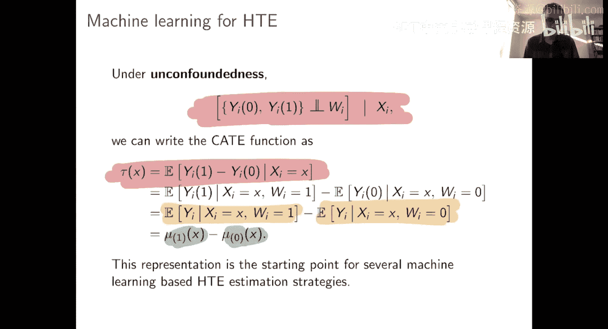

So。To be a little more specific， you could try doing this in two ways the first is and here i'm going to fellow noingclature from this。

A recent paper by a little text reference to it in the course outline。

So a first thing you could do is what's called the T learner is you could try to solve two different regression problems first。

You can estimate mu had zero by predicting y from x on the controls。And then you're going to learn。

You want to x by predicting y from x on the treated。

 and then you take the difference of these two regression estimates。

It's called a Tea learner because you run two regressions。

But beyond that it's just a very different direct application of kind of。

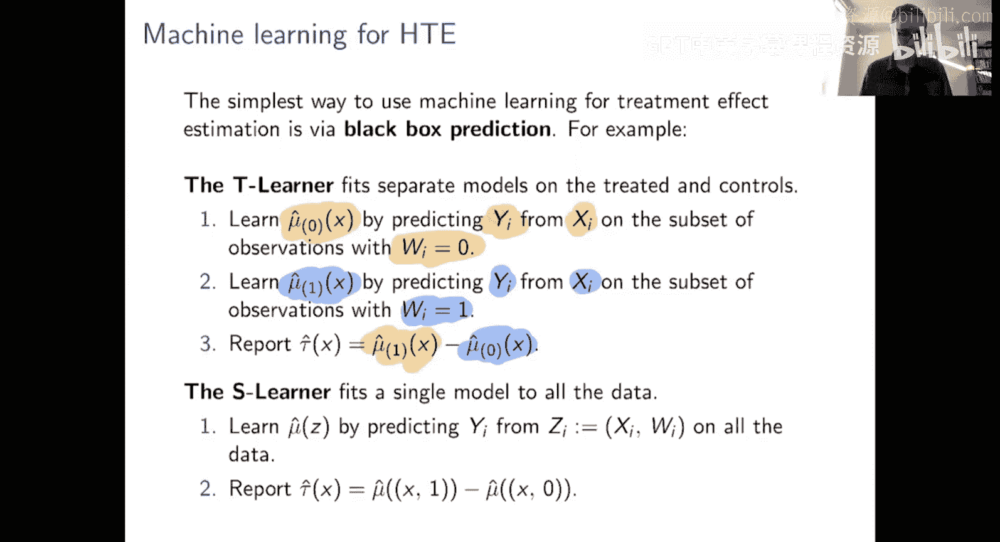

The identity here essentially a tau Vx is mu1 of x minus mu zero vi， that relationship is true。

 then the T learner just puts hats on everything。😊。

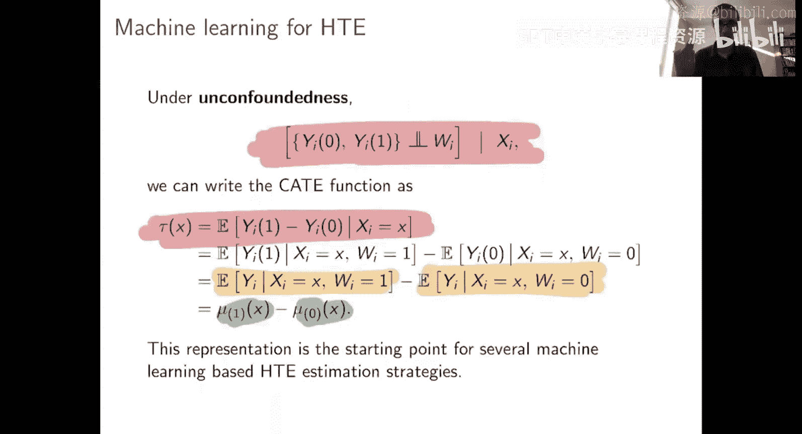

It estimates mu had one of x and mu hat zero of x。

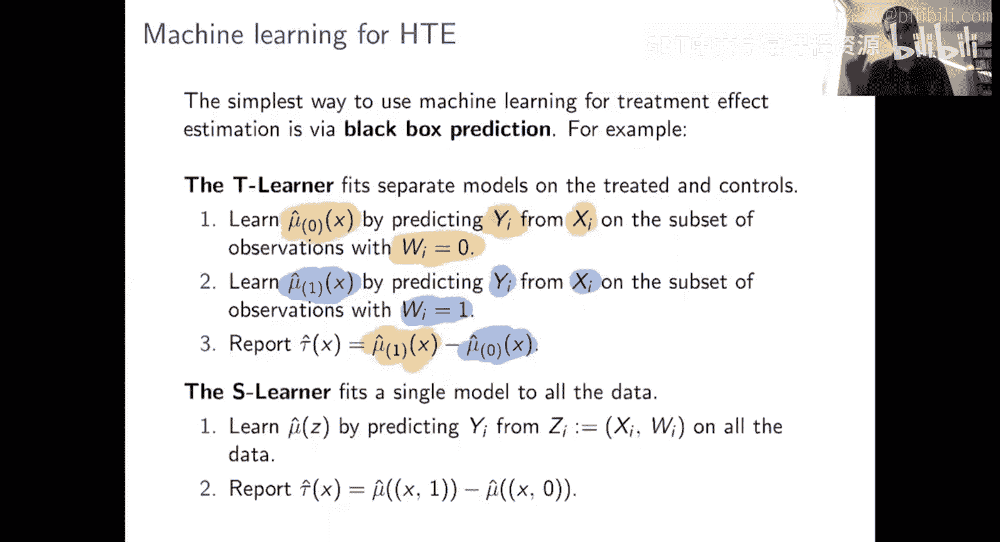

By kind of any type of nonparmetric regression and then setsta had to be their difference。

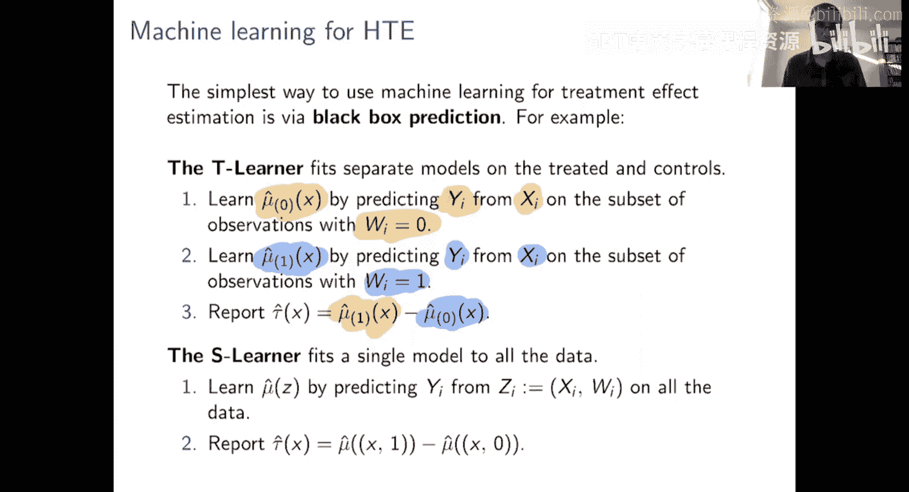

So that's one thing you could do。Another very similar thing you could do。

 but kind of algorithmically looks different。😊。

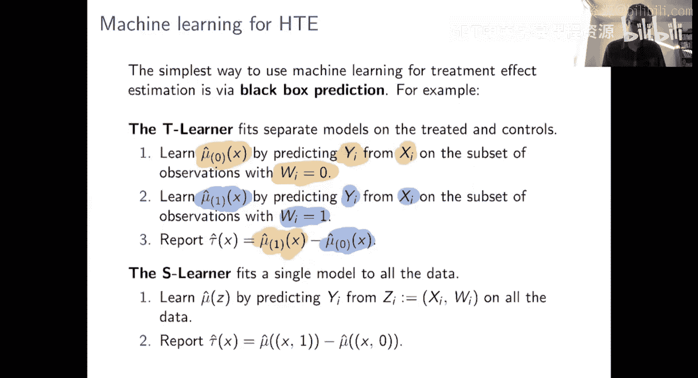

Is that instead of predicting y from x on treated and control separately， you could just kind of。

Gloob your x's and ws into a single covariate called z and learn to predict y from x and w simultaneously so now you have just a single mu hat function that you can give it。

Covariates and a treatment status and then。Pdics from。And then then make a prediction there。

 and then you could kind of query the same U hat function twice of once with treatment set to1 and one with treatment set to zero and get predictions tau hat of x ata。

This is called S learner because you're in a single group。真不了。So far， I've been a very。好。

I can open ended about how you'd actually implement this。

 you need to choose some method right to predict y from either x and x and w there are different choices you could make。

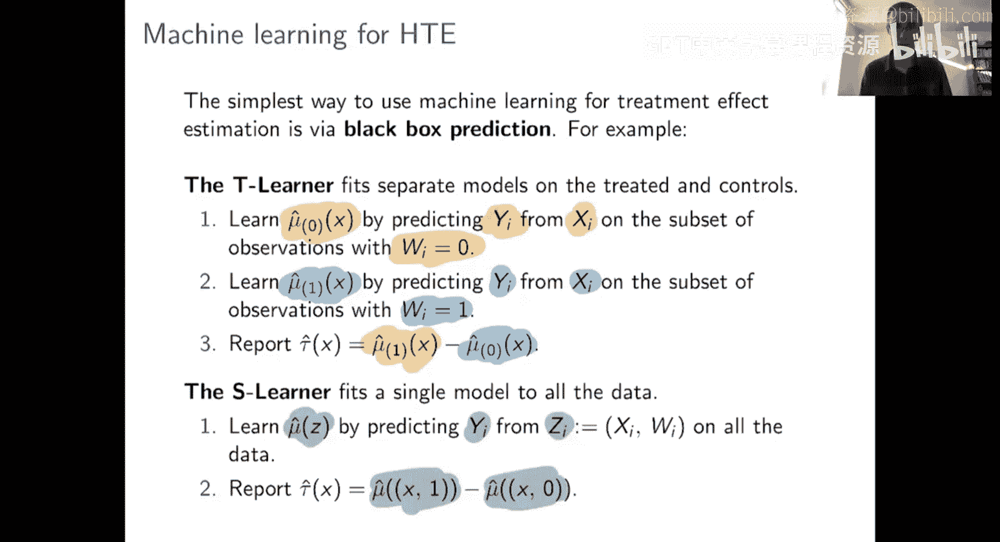

Here I'm going to show some examples using random forest kind of just because they're easy to run。

 you could really kind of do this with any other。Approach。So。

Okay in order to kind of understand a little bit of what's going on here。

 I'm going to show just kind of a couple slides to remind you about how trees and forests work I know you've already already seen it so far but it's just to kind of in diagnosing what could could be going right or wrong it's just helpful to remember。

What's going on specifically the algorithm。If you ran this with La or boosting in the simulations。

 you might see similar results as to what I'm going to show later on。

 but kind of understanding step by step， how that happened might look a little different。

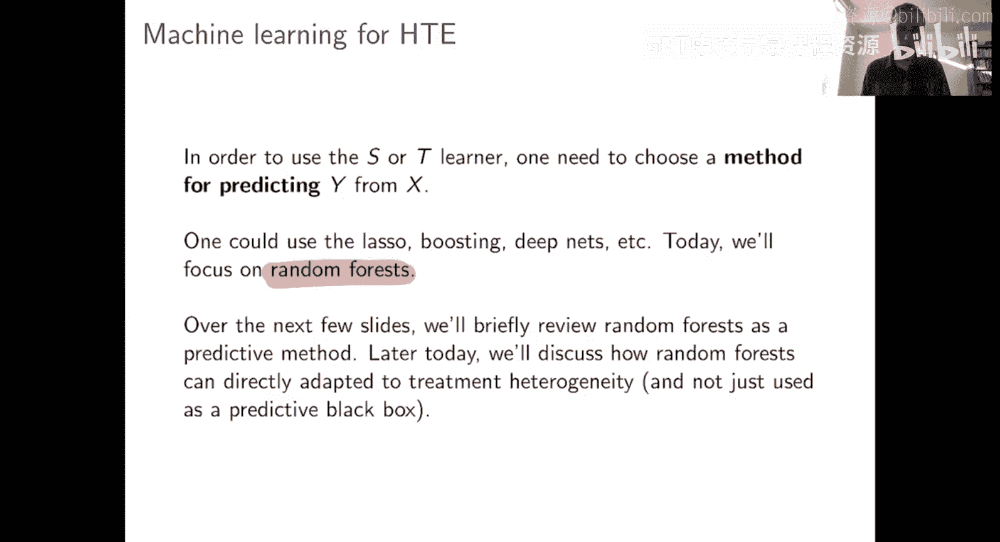

So anyway。What's a random forest a random forest is a method that kind of kind of tries to predict y from x。

 so it's just kind of this。The black box predictive method。And。Exactly the type we wanted before。

How does it operate well essentially each tree on its own。

 it's going to kind of subdivide a space into rectangles and it's going to average。

 it's going to predict at this point x by averaging outcomes for everyone who falls within this rectangle。

嗯。And。A random forest is going to aggregate trees。So just very quickly。

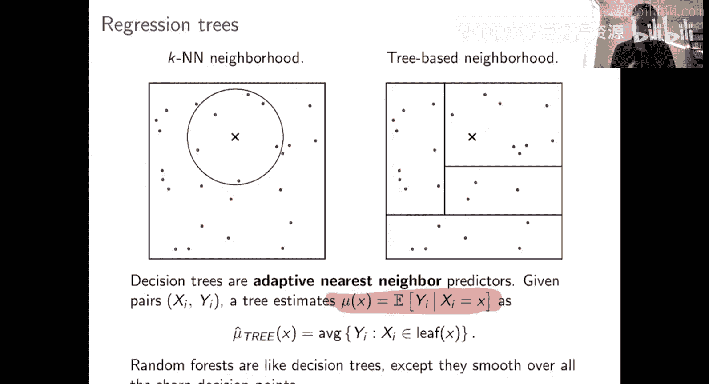

Now we've already seen this before trees kind of。Are you going to zoom in on which rectangle you split in by kind of recursively partitioning the feature space this is a somewhat unstable procedure so then kind of。

Back in the day there was a lot of discussion of kind of if you're training decision trees。

 if there are many different ways you could have trained a decision tree that all look similar or perform similarly。

 which one should you choose？There was this。Don't think people work hard on until kind of at some point people realize you're better off not choosing just kind of if there are many reasonable looking trees。

 just train all the trees and kind of get a consensus prediction as their average。

And that's what kind。An enforce paper by Bman does。And so really kind of pictorial early。

 if you have a bunch of trees here， one tree predicts by averaging the outcomes in this leaf and another tree predicts by averaging the outcomes in this leaf and so forth in the random a forest。

 it's going to predict by just。😊，Averaging。The predictions by made by all the trees。

 so it's kind of a double。So this is what's going on。

 there are different ways to kind of increase the diversity of the forest。

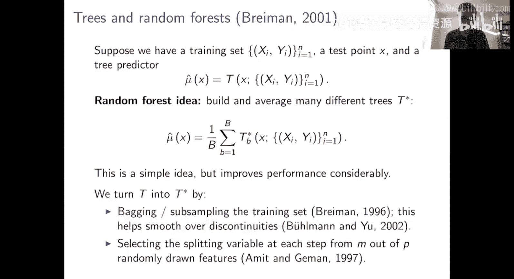

This is enough to understand what is going on with with a T learner and S learner so anyways what is a T learner doing specifically we estimating mu hat0 x it's going to training trees that kind of try to find regions where kind of your best prediction of y given x is roughly constant。

It's going to make several predictions in each of these regions then if youre to do a forest。

 you're going to do this with a bunch of trees and。嗯。Average those predictions。

You're going to train different trees to predict y from x on the controls versus the treated。

 and then tau hat is going to be this difference。嗯。The S learner is going to do something different。

 it's going to try to build trees where kind of at each point you choose。

 do you make a split on one of the x's that is going to do you create heterogeneity？

Or do you make a split on W？Which is kind of means creating a treatment effect。

From a treatment of estimation point of view， the esL learner random forest algorithmically might look a little strange。

 but in terms of black box prediction。😊，This just it looks like it。So this is what's going on here。

How good are these methods for treating heterogeneity， let's try it out。

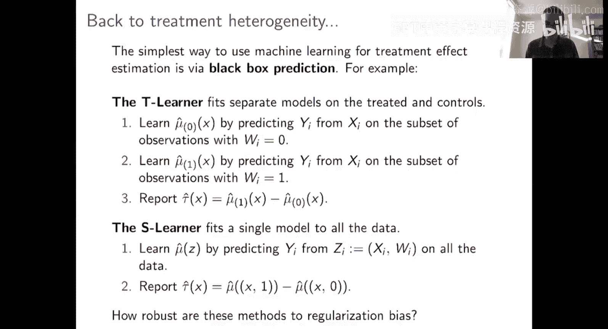

And just before going there， I just kind of wanted to， in case you want to copy paste on the slides。

 here's kind of a few lines of code that implement the T learner and the S learner using。

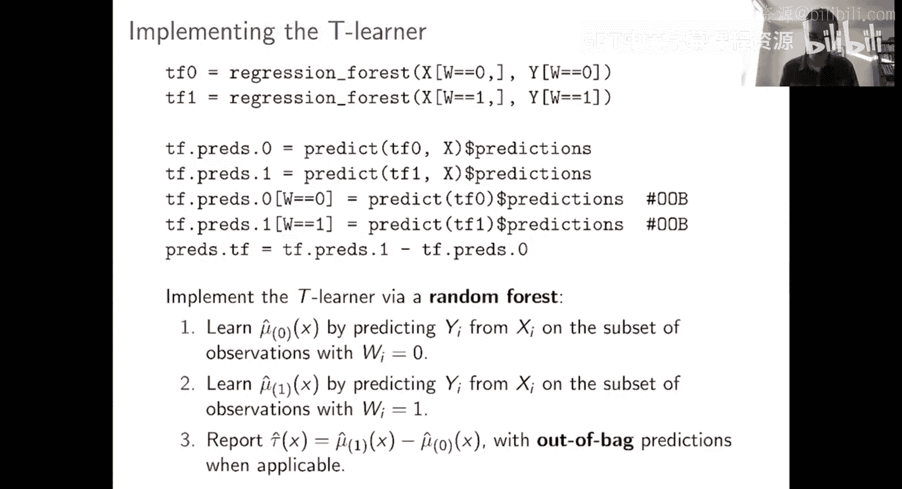

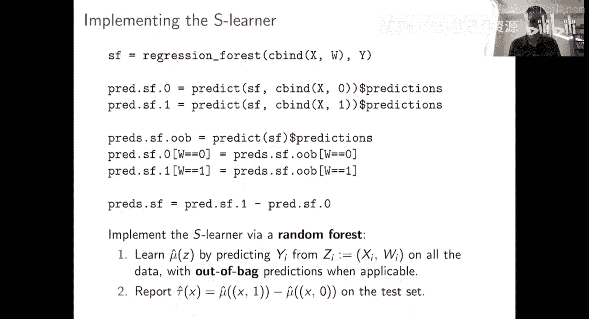

The regression forest function for antiforests。Or how well do they do and here's kind of a very simple。

Simulation exercise for estimating treatment effect。So you see， I'm running a simulation with 4。

000 samples and 10 dimensions， the probability of being treated is 0。3。And。Sient point here is that。

First， treatment。Is everyone is treated with probability 30%。

 so this's a randomized trial there's no association between any kind of unit characteristics and their probability of being treated。

So this is。Kind of from a parallel inference point of view， makes the problem a lot easier。

The second is you have this conditional average treatment in the effect function I'm calling it tau here it's also very simple。

 it's actually just the logistic shape in x3 if you knew that kind of the conditional average treatment the effect that a logistic shape you could recover it very easily by a parametric modeling。

😊，But okay， the point is that with machine learning you don't need to know the parametric model a priori。

 we can kind of discover it from data and then there's going to be this baseline effect。😊。

Max of x1 x2 and0， this is a little more complicated， so essentially。

This is sitting that's supposed to be super easy if you're doing the right thing。

 the study is randomized so there's no confounding， the treatment if it functions is very simple。

 so you're kind of focusing on the right objective。😊，You should just nail it。

 but there's this kind of more complicated and interactive baseline effect that if you're not careful。

 might cut you problem。And。How does everyone do？

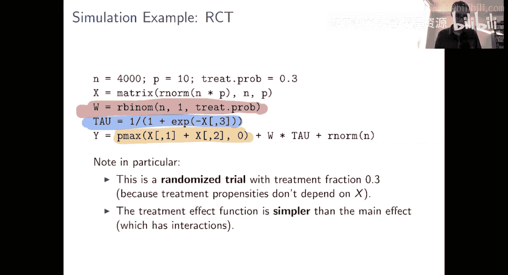

actually like pretty terrible， right？So here kind of I'm plotting。

 remember the conditional average treatment effect was just a function of x3。

 so I'm plotting kind of。Anna test it for each data point。The true kind of here in true red。

 you see kind of true relationship between x3 and the condition average treatment effect here and in black you see the estimates from the T force or the S force。

And you see， it's kind of disastrous sleep bad。The tea forest is just kind of very， very spread out。

😊，And the S for not only is spread out， but it's kind of systematically biased and underestimating the size of the treatment。

So。嗯。This is somewhat concerning you might have hoped for better。

Right because I just kind of started by writing tau of x is me1 of x minus me zero x。😊。

Let's estimate you want of excellences you using a forest， forests are okay。

Let's estimate you0 of ex using a forest again forester okay。

 and you think you're doing something okay， and then you kind of。

Get this very bad empirical performance。

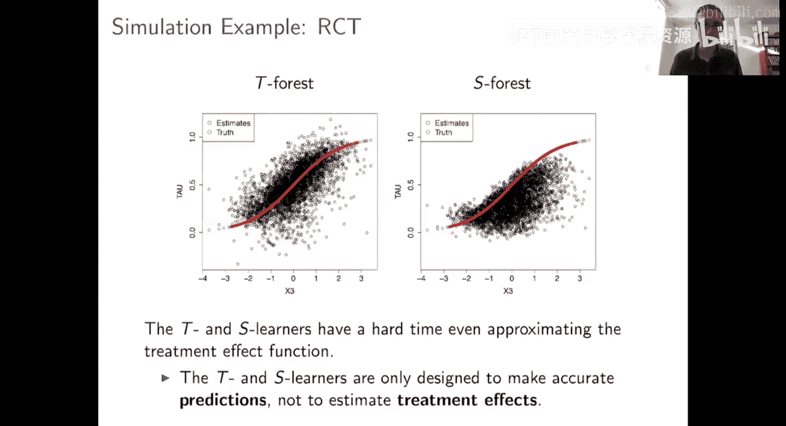

So。What went wrong。And。The problem is essentially， I think I was calling earlier。

 regularization price。😊，So。To understand this， I like this picture from this paper by Kingins and etll。

 I mentioned earlier。嗯。What they're imagining is estimating treatment effects in the following very。

 very simple study。😊，Here x is one dimensional。So you only have one co。W is also one dimensional。

It's a randomized trial。And I'm plotting all the data。

 so each control point is x and each treated point is a blue dot red x for the control points。

And the only wrinkle here is that you have a lot more control points than treated。Okay。

What's the treatment effect here？By eye it's kind of clear right there's this difference between the treated and controls is kind of。

Always one so kind of by eye， you know the treatment effect has to be money here。

 but what happens when we try to estimate the heterogene treatment effect？

Let's try doing so using the Ter。So what I'm going to start by doing is。

Remember the T learnner approach what it does is it first estimates mu hat zero of x。

 it predicts y from x of the controls， then it estimates mu hat1 of x。

 it predicts y from x of the treated， and then it takes the difference。

And so what's going to happen here well？Let's say I run a tree。

 so I'm going to kind of put I'm going to first run a tree on the controls and I'm going to see that the signal changes here and that the signal changes here。

 so I'm going to do a very good job kind of。Here's one leaf and my treatment effect here。

 here's another leaf and my treatment effect here。😊，And here's a third leaf my treatment effect here。

 and you could say this tree is very good。The task was to fit y for X under controls that was kind of an obvious region in the middle where there was a。

Shift in the response function and you value it and you adapt it to it。So kind of wellld done。

So now the next thing we need to do is estimate。When you had one to mix to predict y for makes of controls。

We're again going to use a tree， but here we have less data。

Do we do we see any jumps at the data obviously， I mean when you know there should be a jump here and here you kind of see it but。

Honestly， a kind of well tuned tree given just this data。

 it probably doesn't see any patterns at all。So your treat as the reasonable thing。

 if you don't see any evidence that you should split， just don't split。So。

We estimate the expectation of a y given x as essentially a constant function。And。Again。

 that's very good。SoSo we're in good shape， we did a great job fitting muha one of x。

 we did a great job fitting new hat zero of x and then what are we going to do at the end。

 remember what we want is we want to fit tau hat x is equal to mu had one of x minus mu had zero of x。

😊，And we've done a great job fitting both mu has1 of x and MU has zero of x。And this picture。

But now we take their difference。And what do we get？The difference style out of x will here。

It's big is big it's big it's big it's big you have a big treatment effect and now have this middle zone where suddenly we have a very small treatment effect because me had zero kind of。

😊，We got bigger and now again， you get a big treat in the effect at the end。And。Wow。

 there's a lot of treatment here today， right？These people here and these people here really benefit from the treatment。

 but these people in between here not so much。All right， so it looks like we found treatment。

But this is obviously very bad we agreed that there's no treatment hetero in this picture。

 the treatment effect is constant at one the whole time and kind of the worst thing you can do in data analysis in general is to claim that you found something you found heterogeneity you found a signal in a case where theres not。

😊，So that kind of in such a simple problem， you could be tricked into thinking there's heterogeneity when there's none is really unexcusable。

Whitland wrong。嗯。Well， the problem is that essentially you were using machine learning and of course machine learning。

Regularizes as to kind of adaptive adapt the shape of the function and you didn't adapt to the shape of the function in a way that kind of recognized the task at hand。

When you were fitting the function of the controls， when you were fitting this red line。

 you had a lot of data， so you were able to kind of。Very kind of。

Accurately see any changes in the data and respond。So。You kind of regularize very little。

It function aggressively， that's good。And fitting this blue curve out of the treated units。

You had less data， so what you do， you don't introduce as many splits because you don't have enough data。

 you can put more splits effectively you're regularizing more。

 you're pushing your function more towards a simpler thing。And that's again， good。

But then what happens is you have a discrepancy between how much you regularized the function of the treated and the controls。

 you regularize your function on the treated a lot and very little on the controls。

And then just because you regularize kind of this part of the difference very little and this part of the difference a lot。

 then you kind of inconsistently regular regularized tau hat and this kind of。

Hydrogeneity emerges somehow apparently。In the difference and that's no good。So。Okay。

 that's regularization bias。嗯。What I'm emphasizing here is just kind of。Tow of x。

 it's true that tau x is mu1 of x minus mu zero x， but that doesn't mean that kind of machine learning based approaches that kind of directly are motivated kind of by this。

Functional equivalentvals without being careful about what they're doing estimation wise would be any。

So that's regularization bias， what can we do about it？

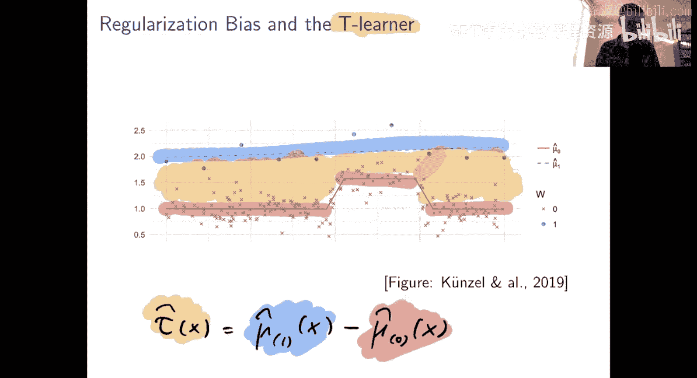

嗯。And notice that regularization bias is something that kind of arises even in randomized trials last week。

Susan talked about causal trees as kind of one algorithmic way of avoiding this problem in the case of trees specifically here just to kind of still want to talk about these topics。

 but to kind of show you some other ideas also on how to avoid this problem。

I'll talk about the X learner， which was introduced by this paper from which I'm taking the pictures。

So。What they wanted to do is they're like the T learner， the S learner， they're very nice。

In that you can just write them down as kind of a generic recipe。

 you have a generic recipe for predicting y from X。

You can just apply it and turn it into a treatment effect estimator they liked that aspect of it。

 but just kind of didn't like that。Gives you a lot of regularization price。

So the excellent learner is an idea。That kind of does the same thing， but in a slightly fancier way。

We're going to start by fitting。We're going to start by fitting mu had zero like before predict y from x。

Then。Once we fit y from x， we are the treated units。Kind of。

Predict mu had zero x so this kind of crudely you could be thinking as trying to impute for the for each treated unit what would have happened if you gave them control and then。

Look at Delta i1 of x， that is kind of the difference between the actual outcome for the treated unit minus kind of your best guess of。

What you might have seen what you might have had。Yeah， had you received the control？

And this is kind of。You could think of this as a noisy proxy for the individual treatment effect y1 minus Y0。

嗯。If this functional form。Looks familiar to you and reminds you of synthetic controls that's a good thing to be thinking about it's a very different application setting with very different considerations。

But the kind of。Estimator structure looks very similar。what's done is synthetic controls。

So they do this once。And so they do this and then the way they're going to estimate the conditional average tree specific function is essentially by on the treated units regressing these differences Yi minus mu had zero Xi the actual treated minus imputed control outcome they're going to kind of。

😊，Regress these delta I's against x non parametrically， that's again a prediction problem。

 you predict delta1。From Xi on the treated units， and that gives you a first estimate tau hat zero of x of the treatment effect。

Then with they're do， sorry， that gives you first estimate ta at one of x of the treated。

 and then what they're going to do is they're going to swap roles so they're going to estimate mu hat one from the treated。

On the controls， look at actual outcomes， actual control outcomes。

 look at mu hat one of x minus Yi on the controls。as another kind of proxy for the ITE and then estimate tauha zero from there。

 and then they're going to tool these and turn tauha estimate the final treatment as a weighted average of these two k functions you estimated the trees and the controls。

😊，The thing to note here is this last that the use of the propensities score E hat is just heuristic。

 but the thing to note is kind of if most people are in the control。

 then E hat of x is going to be pretty close to zero so then kind of you're essentially just going to use the tau hat of x function that you get by first learning to predict y for x on the controls and then taking these difference treated。

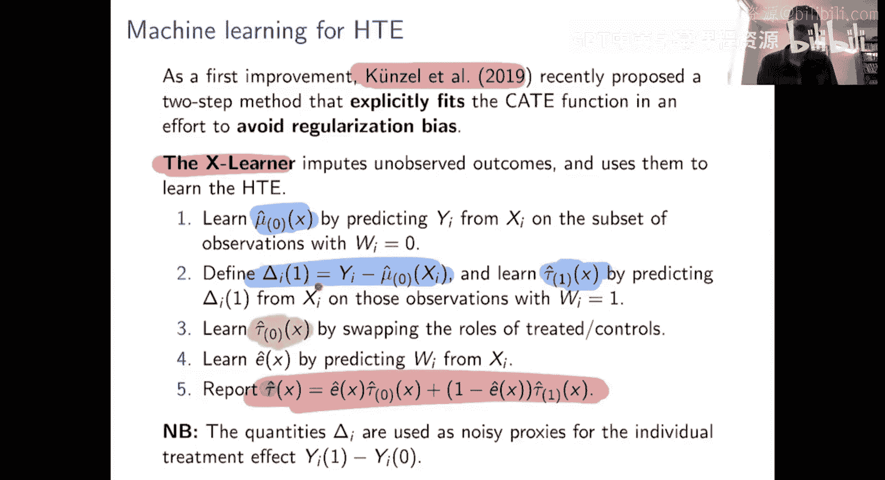

So。Again， if you want code using forests。

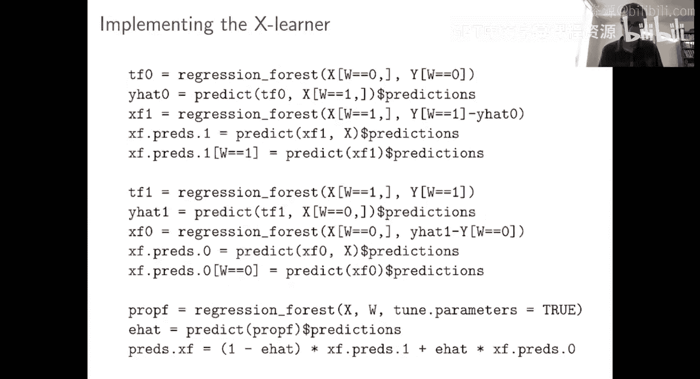

But how does this work kind of much， much better？This function， you might be disappointed that okay。

 shouldn't shouldn't good predictions have。Kind of the black dots lie on top of the red dots like you would kind of if you had perfectly fit a parametric model。

 you might hope for that， but you never get better from machine learning kind of one theme。

Really emphasizing the lecture and average treatment effects is that machine learning methods。

 you should hope that theyre。😊，Almost always pretty good but never perfect and this kind of X forest kind of in predicting the condition of a treatment effect from x3。

 I think lives up to that goal。The black dots have the same shape as it。他电 not。

And certainly this is much， much better than the S&T tourists。

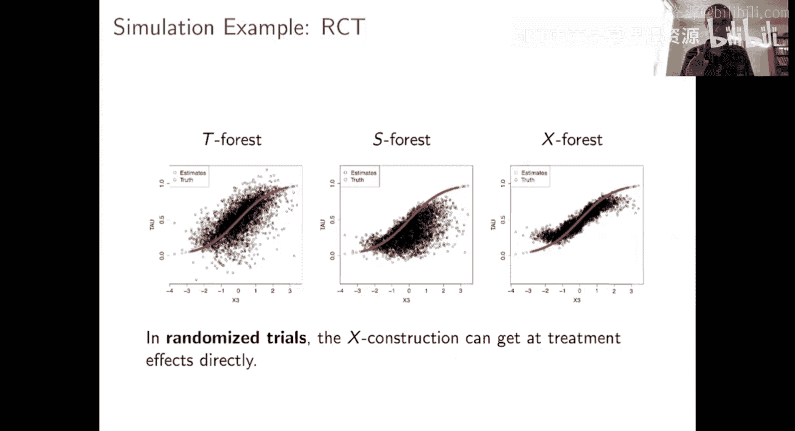

So why was this better？I think it's helpful to kind of consider the same pictures before。

 so remember the X learner starts by kind of fitting the same kind of red and blue curves we had before。

But then what it's going to do is it's going to take。It's going to estimate these deelta items。

 so kind of these imputed treatment。So the way you can think of this as on the picture is kind of for every blue dot。

You're going to draw a curve。Down to the red curve。

And you're going to think of these as your deelta I1 these are you kind of imputed。

Individual noisy proxies for the individual treatment effect for treated people similarly for controls。

 we' always can look at the blue curve as an imputed with will will happen to me under treatment。

 so we're going to draw all these lines here。Okay， there's way more of them。And。

We're going to look at these areas。Ser a symmetric role they're going to。

What be kind of would have called Delta zeros on the previous slide。And then。

The x learner is going to estimate the k by predicting delta 1 from x and delta 0 from x。

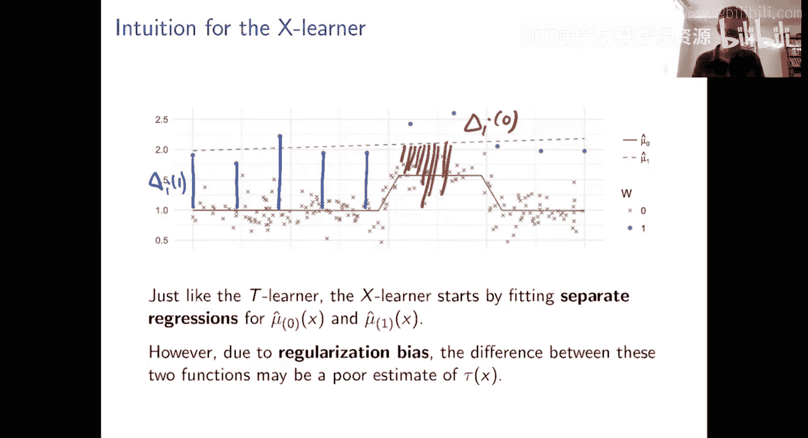

And。How does this work？Well。It turns out that kind of here， remember。

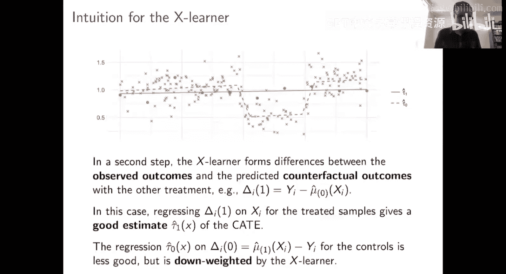

The red curve here was very good， we got the shape， mu had zero x is very accurate。😊。

So then these blue lines are going to be kind of good proxies of the treatment。

So if we're going to try to estimate toweru of x by regressiongressing these blue lines on x。

 we're in good shape。On the other hand， the blue curve the estimate mu has one of Vs wasn't so good。

 so these red lines are going to be much less good proxies for treatment like they're pretty short here。

 but they're much longer here。

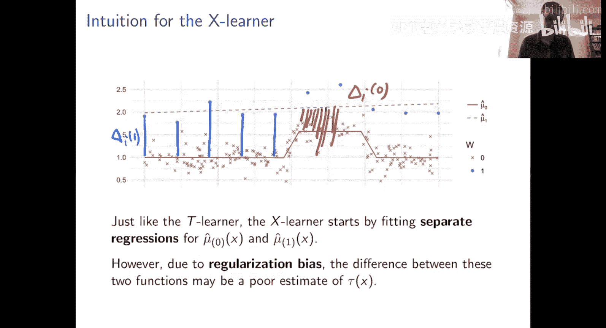

So。When we actually get this， then we're going to get tau has one of x。

 that's the thing that kind of predicted the delta is is treated。

 it's going to be a very good estimate treatment effect， essentially constant。

We're going to also get this tauhat 0 x which is going to be quite bad。

 but then kind of remember that the X learner kind of tries to pool tauhat 1 of x and tau 0 of x in a way that if most units receive control。

 then it's really just going to up Tauhat 1 of x a lot。

 so then the kind of final prediction of the X learner is going to be some weighted average of Tauhat 1 and tauhat 0。

 but it's essentially just going to give you this blue curve here， which again is what we wanted。

An accurate estimate of essentially a constant treatment effect。So。

This is this is what's going on kind of the X learner looks a lot like the T learner or the S learner and there's kind of a recipe where you just solve a bunch of prediction problems in a row。

 but kind of by being more careful about the recipe design。

You got better results and are more robust regularization bias。This thing you can use it。

 it's cool that in my experience the X learner in randomized trials works very well。

And it's kind of very easy to implement because it only requires prediction。

So that's kind of thing a good thing to know。

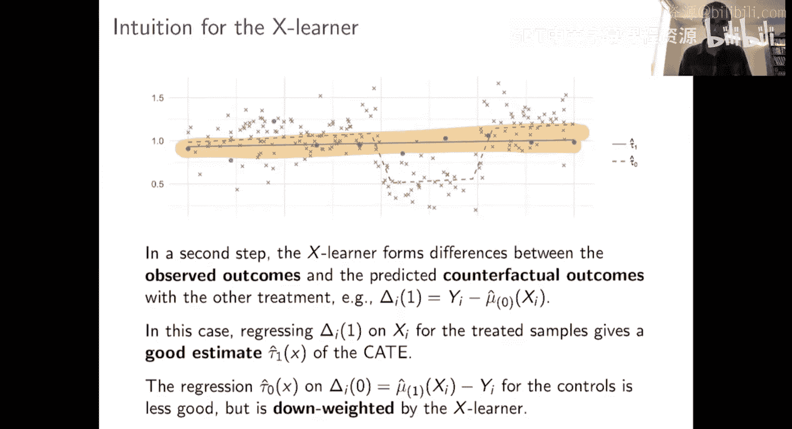

All right， so that was regularization bias， the next thing I wanted to worry about is。😊。

T we should worry about is confounding bias that's what happens when you're outside of a randomized trial。

Your treatment assignment probabilities vary with x。And this relationship may be problematic。

And again， to get started with the simulation here。We have a similar setting。

 except now the treatment isn't assigned uniformly and random。

Now kind of there's a logistic shape in terms of x3 where kind of the bigger x3 is the more likely you're going to be created。

On the other hand， the treatment effect is constant here so if you kind of。

Get the get get get rid of all the confounding。Treatment heterogeneity problem driven there's no hetero A there's a constant treatment defect taco one。

 but now they're more confounding because you'll notice not only does your probability of being treated kind of vary with x but actually generally the bigger x3 is the bigger y is going to be on average so there's this kind of。

Correlation between your baseline effect and treating time and probability。

If you don't interested the infounding， well， you're going to end up in trouble。

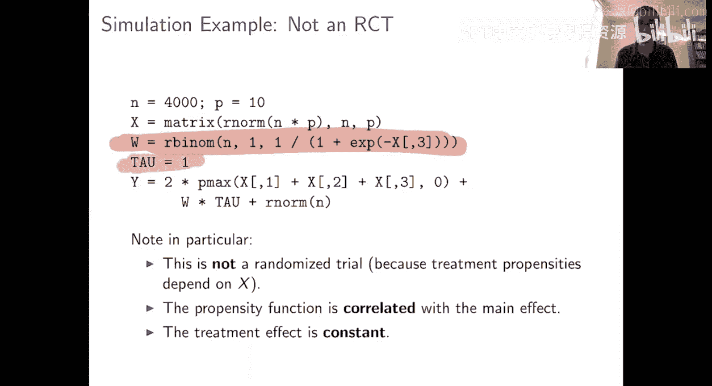

So what happens？Well。The tea forest is outright， terrible。

The export is also out terrible the export here isn't quite as bad， but it's。

Definitely not good right like the X forest， it thinks that there are bigger treatment effects here and here。

 for example， it seems to be finding some heterogeneity。😊。

Where there is not and kind of the overall all three methods here。

 even though we saw that the treatment effect is。Constant that one， there's no heterogeneity。

All of these methods hallucinate heterogeneous treatment effects。

AndI should emphasize the word heterogeneous on the slide also， they all kind of。

Haucinate heterogeneous treatment effects here， even though the treatment effect is constant。😊，And。

Why is this？Well。The theme conceptually is very closely related to what we saw earlier。

The propensity score here is in constant。If the propensities score isn't constant and you should be worrying and about。

 how are you adjusting for that？When estimating the average treatment effect using AIPW was a nice way to do it。

We need to also be able to adjust the propensities scores if propensities scores aren't constant on M study。

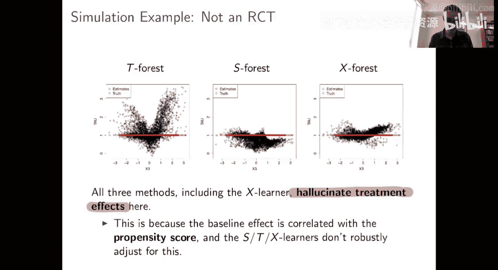

So。That's going to be the focus of。The next part of this lecture， but so just。

To recap this first part， right， there are many things to worry about when fitting treatment heterogeneity。

Their' regularization bias， there's confounding bias。Regularization bias is always there but。

Even in randomized trials。But there are many ways to address it。

The kind of causal reconstruction you saw last time is a kind of very direct way of doing that。嗯。

The X learner is also a nice way of addressing regularization bias using kind of this。

Prediction recipe type approach。嗯。But okay， in observational studies。

 there's also this other type of bias。Confounding bias。And dealing with that is a little trickier。

 we're going to need to bring the propensities scores to the table again and we're going to need to be very careful in kind of separating。

The treatmentres affect component of the problem from the confounding component of the problem。

And find ways to kind of eliminate the confounding component while kind of。

Approply fitting and expressing the treatment。

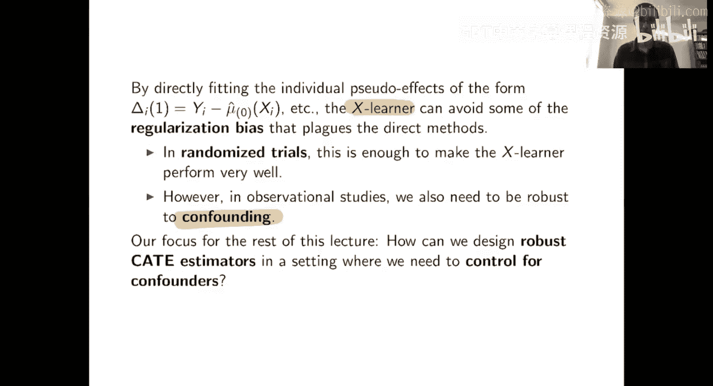