# 斯坦福商学院《机器学习和因果推断｜Machine Learning & Causal Inference： A Short Course》claude-4s p14 -14-HTE_ Confounding-Robust Estimation.zh_en -BV1M9W7zCEsf_p14-

On the path towards developing confounding robust methods for estimating heterogeneous treatment effects。

 the first thing we need to do is review how to estimate constant treatment effects in a confounding robust way。

To see why this matters， it's helpful to think in terms of a concrete algorithm。

 suppose you wanted to develop a tree based method for treatment effect estimation that's confounding robust。

Well then remember how do trees work， trees are first going to cut your feature space。

 your X space into leaves， and then in each leaf you can estimate a constant treatment effect。

The immediate implication of this is that if you want a confounding robust for treatment effect estimation。

 you're going to have to have access to a confounding robust method by estimating constant treatment effects and then that's the thing you're going to want to deploy in each leaf。

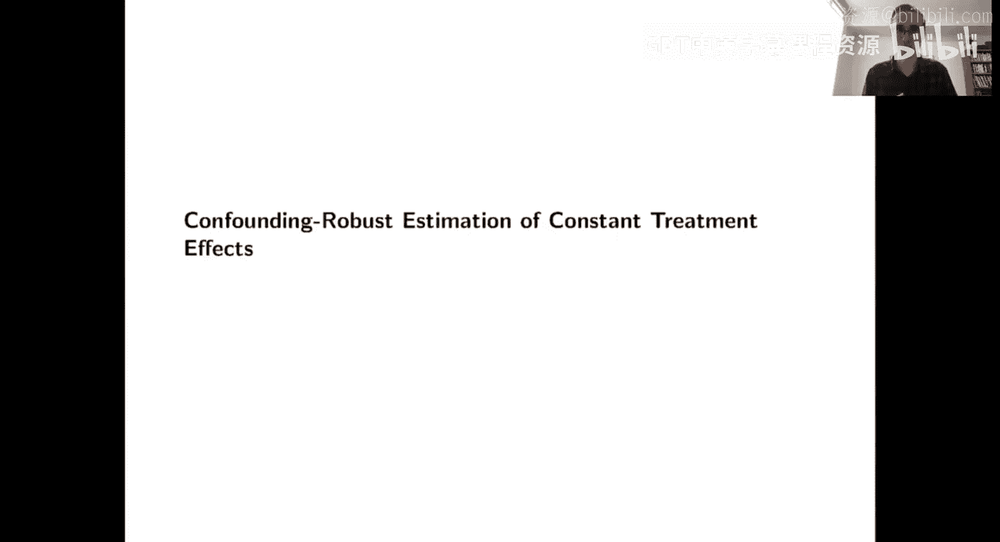

So this is going to be the focus of this part of the lecture。

In order to kind of get some grounding and be able to thought about formal results。

 I'm going to make a pretty drastic assumption here。

 that is I'm literally going to assume constant treatment effects， that is for every unit。

 there's a treated and a control potential outcome and that these potential outcomes are separated by the same amount for every person for every person。

 there's a reward you would have gotten with treatment。

 minus the reward you would have gotten without treatment and that difference is tau。

 constant for every unit and what we want to do is we want to estimate this tau。啊。

Next organized kind of。This is a very strict setting。

 but the methods we're going to develop motivated by this question are going to be applicable or even heterogene also。

😊，I should also note just in terms of notions we've encountered in the lecture so far。

We've seen the conditional average we've spent a lot of time talking about the conditional average treatment effect function tau of x。

 and of course， if treatment of x are constant， then this means that the conditional average treatment effect function tau of x is just constant tau for each value of x。

😊，And actually kind of。esttimating purposes， this is what we're actually going to use to motivate our approach。

 not the stronger assumption here。I'm going to say more about this later。

 we've talked a lot about average treatment effect estimation estimating constant treatment effects is a different problem。

 it's an easier problem。😊，Essentially， when you're imating an average treatment effect。

 you let this function tau of x。😊，Very arbitrarily and you want to kind of。

Estimates an average overhead it however is here kind of。

I gave you an extra piece of information that is a treatment effect is actually constanted。😊。

And you can target that and that's kind of kind of。Theses a different estimation period。

I'm going to say more about that in just a few minutes。

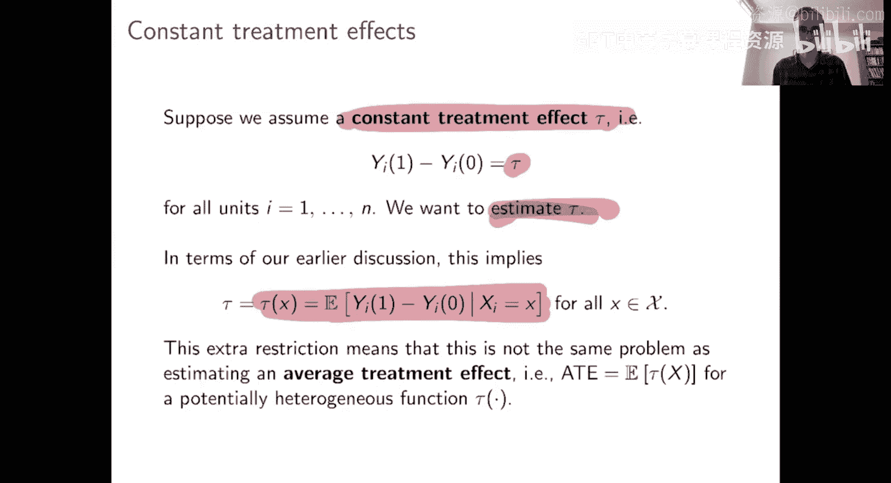

All right。When we have this constant treatment defect model。

 also can assume unconfoundedness like throughout。And what this is going to imply is that unconfounded inness plus a constant treatment effect model is going to mean that the expected value of y。

 conditional on both x and W is going to be decomposed as follows。It's first the baseline effect。

 this is the expected control potential given x， it may vary with x。😊，And then if you're treated。

 your treatment effect is bumped up by tau， that's the constant treatment。嗯。So。

And this kind of tower is the thing we want to estimate。One thing that's nice。About this formulation。

Of treatment effectss in terms of this kind of partially linear model is that it's kind of you can see exactly what's going on。

 you can also use it to get a nice reminder of why it is estimating ta not so easy。

You could end a setting。Think you could estimate tau by just taking the average of the treated units minus the average of the control units because of course all the treated units had their outcomes bumped up by tau。

 but if you do so what you're going to get is sure you're going to get this tau。

 but then you're also going to get this second bias term here。😊，Which is essentially。

The expected baseline effect among people who were selected into treatment versus the expected baseline effect for people who are selected into control and if you're not in randomized trial。

 this orange thing may not be zero in general。And so kind of being robust to that is why estimating tau is a non pro。

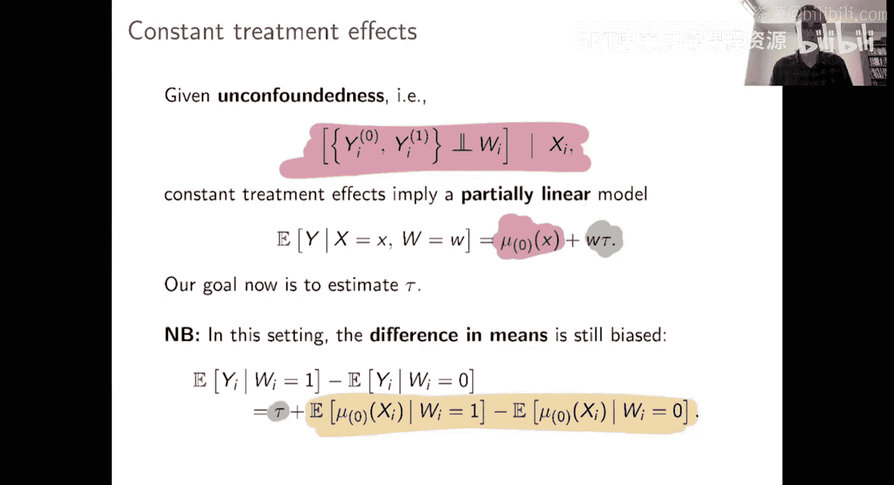

走。What are we going to do？嗯。This problem here that kind of is induced by the constant treatment effect model is often called a pars linear your model。

Why is partial linear well this term w tau looks like what you'd having linear regression kind of。

As in linear regression， you have a treatment indicator。

 the treatment indicator gets a coefficient tau and you want to estimate。😊。

So this part is the linear， but then you have also the baseline effect how you depend on x and that's not nonlinear。

If we replaced this and kind of instead of mu zero x， we just had something like x beta here。

 so we kind of assumed that the baseline effects were linear in x， then we'd have a linear model。

What the par linear your model does it is kind of。That's the way kind of the exit of the problem being on parametric。

 but still preserves the linear。Structure on the treatment。So this is the problem we want to solve。

 it's also often called a semi parametric problem just。Again， because this part is parametric。

 there's a single treatment type parameter you want to estimate。But theres a non parametric。

 what's called a nuisance term。It's a nuisance term because it's a nuisance because it's something we need to estimate but we're not necessarily interested in it。

 so we have a non parametric nuisance term rather than a parametric target。😊。

So how are we going to estimate Tu？Any parametric problem essentially because it has this kind of non parametric component requires a little care。

And approaching estimation。But here， it turns out there's a very nice solution。

That kind of starts from what's called。Robinson's transformation introduced in this paper。

And the idea is first， let's define these auxiliary quantities。The first thing we have here。

Is E of X our old parent the propensity score， like I mentioned earlier。

 it was a concern that the propensity score didn't feature heavily in your STX learners because you the propensity score。

playslays a key role in helping you be confounding robust， so here' theity score makes a return。

We're also going to define this other quantity， which is a little less commonly used but still easy to interpret。

 this is the expectation of y given x ignoring treatment。

So this is kind of my best guess of what your outcome would be if I only know your value of x。

 but I don't know yet where you treat it or not。In the partial of an earvat model。

 m of x is mu0 x plus tau times the probability。And。Given this notation。

 what you can do is you can just essentially subtract。Com。

I'll sububtract m of x from both sides of this expression here。

 and then what you see is that y minus M of x is equal to tau times the treatment minus e of x plus epsilon。

😊，Epsilon here is really just kind of。The difference between y and its expectation given x and W。

 the point is that we know that the expectation of epsilon given x and W is zero。😊。

In rewriting the problem in this way， we've essentially done nothing。

But we still get some very helpful insights out of here。Suppose you actually knew M and you knew E。

Then how would you estimate tau， it's very easy just run a unvari linear regression。😊。

Well your response variable is this difference y minus m， your single regressor is this variable。

 w minus e， and then tau is just kind of the regression coefficient you get by regressing y minus M on w minus E。

好。If you knew M& E， then this approach would give you very simply a consistent asyntically normal。Oh。

Method for estimating tau with kind of standard inferential guarantees also。And of course。

 the difficulty is that unless you're in a randomized trial。

 you probably don't know the propensities score E and you certainly don't know this baseline effect M。

Or this kind of expectation of y given x。A best guess of why ignoring treatment function M。

You can't apply that strategy。

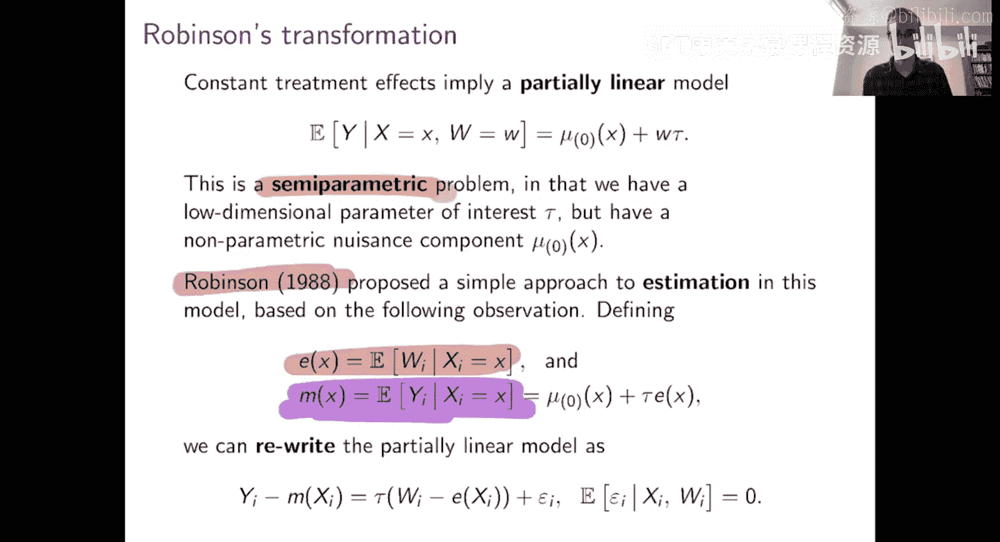

But this still suggests a practical algorithm。If we know what we would do， if we knew EM。

 but we just don't know it， then you could hope that kind of。

we've got access to a number of machine learning black boxes to solve prediction problems here。

 this predicting w and Y from x， these are just basic prediction problems so we could estimate E hat and M hat by throwing a predicted black box at the problem and then we could estimate tau by residual and residual regression if we had kind of plug the true M and E terms in here this would kind of by Robinson's transformation immediately give you a good estimate of tau here we're going to have to estimate the Ms and E's but you might hope。

That this would still work at least reasonably well。嗯。How good is it。

 it's not clear from writing this down， but kind of what would be immediately clear is that if M&E are consistent。

 then To I should also be consistent for the constant treatment type。😊。

Another thing I should note is this expression I wrote here。

 this is just the closed form solution for the kind of unvari of the near regression problem here。

This is kind of this thing in purple here means nothing else than just run the unvariate regression of y minus M hat on w minus E hat。

All right。

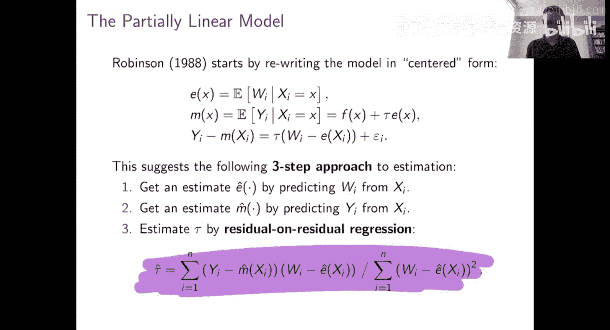

We have this is obviously consistent， is it good？😊。

I wouldn't be telling you about this if it weren't good we get a very nice。😊。

result on the asymptootic properties of Taoha。And this should be kind of reminiscent of the result we saw for our average treatment effect estimator using AIPW we saw in Me2。

And the guarantee is as follows。The end result is what we want。

That is a central limit theorem for the constant treatment effect。

With errors that decay one over root end， that means when we take the errors and we blow them up by root end。

 then we get a kind of limiting normal random variable so that's exactly what we'd want and what are the conditions。

The conditions are again that this。And these M hat。And Eha estimators。Well。

 they don't need to be perfect。But they need to be reasonably accurate。

 but they don't need to be kind of one over root and a scale accurate。So， kind of。

Like I emphasized in week two whenever you're using machine learning methods for causal inference。😊。

It's okay to assume that they're pretty accurate， but you should never assume that they're perfect and this guarantee here is exactly the kind of thing we'd like。

 which is N steps one and two when we kind of through machine learning black boxes at the problem West minute E M hat we need them to succeed in being。

😊，Reasonably accurate， but not necessarily perfect。And again， just， I know I' emphasizes a lot。

 but you kind of。Emphasize the counterintuitiveness of the result。😊。

You might think that there's this kind of garbage in garbage out principle where if you have to estimate E hatAT and M hat terms。

 well， if there's kind of some error scale on these M hat and E hats。

 then theres no way tau hat could be more accurate than kind of these estimated things for M hat and EhaAT you're putting into the expression。

But this theorem tells you that the garbage and garbage out principle doesn't hold here。

You're allowed to have kind of estimates here whose typical errors are in the order of 104 through then that's a pretty big error scale and yet just like with the AIVW estimator。

 the errors are going to cancel out in just the right way。

 so actually even though these might have four through then scale errors 1 over4 through end scale errors this will be accurate on the one over root end scale。

 so it'll be an order of magnitude more accurate。

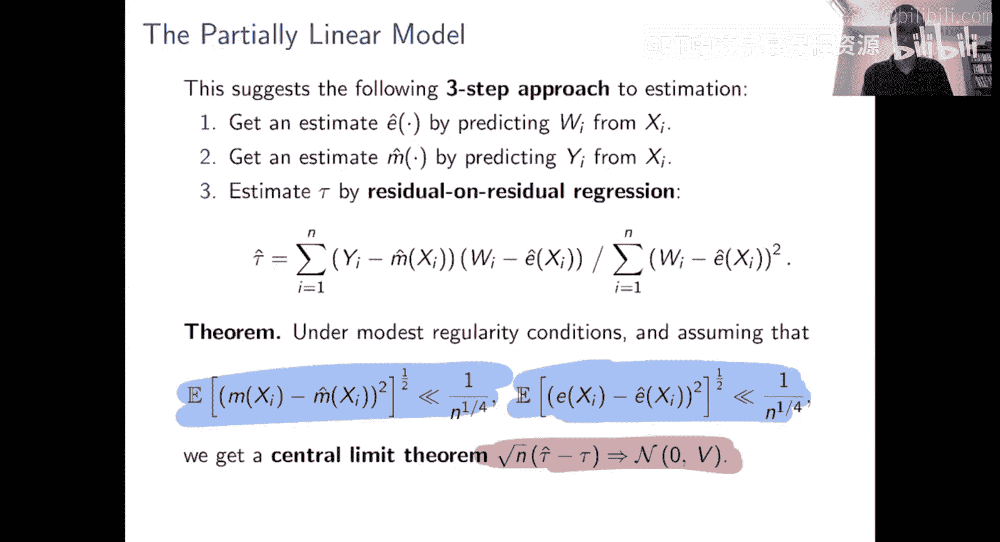

In terms of details， the conditions are essentially the same as what we had for AIPW， which is here。

 I said you needed some modest regularity conditions。

What are those regularity conditions what it turns out just kind of as long as you use crossfitting you can essentially ignore any regular conditions that go in there so the setups essentially going I need to be even run this estimator。

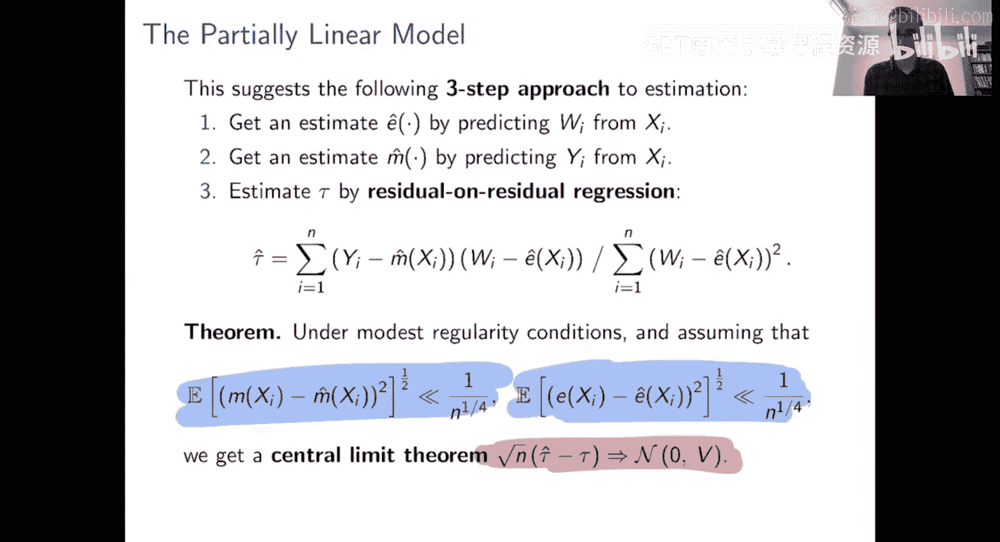

Get M Ehat， use crossfitting。Like like in week two and then as long as I met and E had are reasonably accurate。

 you're going to get the central limit them you want for。Now had。

And I'm not going to talk about it now， but kind of you can get confidence interval her v。

Out of this residual and residual regression， the way you'd usually get confidence intervals out of a regression of this type。

 the theorem essentially tells you that you can ignore any as long as you use crossfitting。

 you can ignore。The sampling error of M hat and E hatt。

In building confidence intervals with the conditions of the theorem hold。And。

That gives you a kind of very simple way of constructing government。

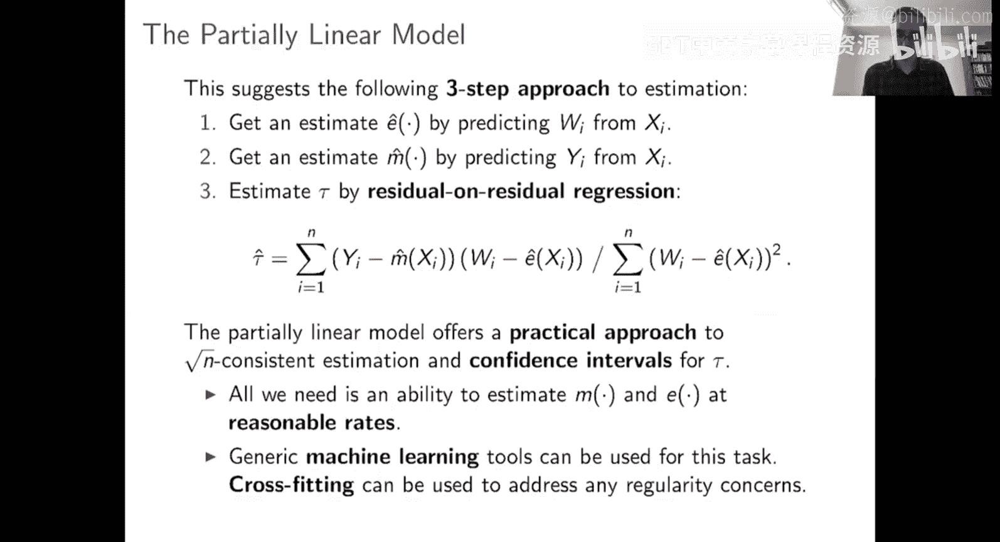

So。Our last thing kind of， this is kind of an aside， but just to of connect some dots。

If you think this kind of way of estimating a constant treatment effect is a little bit。

Strange or unusual， I just kind of。To try to convince you that it's not。

 I just wanted to connect it to an estimator that hopefully is familiar。😊，And that is。

The linear regression， the kind of standard linear regression estimated。

 the treatment effect where kind。What you do is you just run linear regression， why I kind of。

Til the Xi plus WI so this is kind of an R notation just。

Pdict y as a linear function of x and w and grab the coefficient in W as your treatment effect estimate。

😊，And if you've taken a。kindind of linear algebra based class on linear regression。

 you'll probably know that there's this following equivalent characterization of linear regression。

 which is to estimate the coefficient of w on y in a model where you control for x where you can kind of construct that coefficient as follows。

First， fit a linear model。Of w on x， then fit a linear model of y on x and then the coefficient。

But w in the full regression where you predict y for x and w is going to involve。

Bning a residual on residual regression where you kind of regress regression residuals of y versus your best prediction of y from x versus those on w versus your best prediction of w from x。

And so what this actually shows is that at algorithmically。

 linear regression is just a special case of this kind of estimator based on Robinson's transformation where we've。

😊，Instead of using machine learning methods for EhaD and MATAT。

 we just use linear regression to predict y from X and w from X。So。嗯。

There's a lot to say about this connection and kind of many lenses under which you could investigate it。

😊，嗯。But at the very least， I hope this connection suggests that this estimator based on Robinson's transformation。

Is a very natural way。Kind of move beyond linear regression。

At least in a setting where you want to kind of。Preserve the constant treatment effect assumption。

 so you still have something that's like a constant treatment effect parameter that you could hope to target using something that's like a generalization of linear regression。

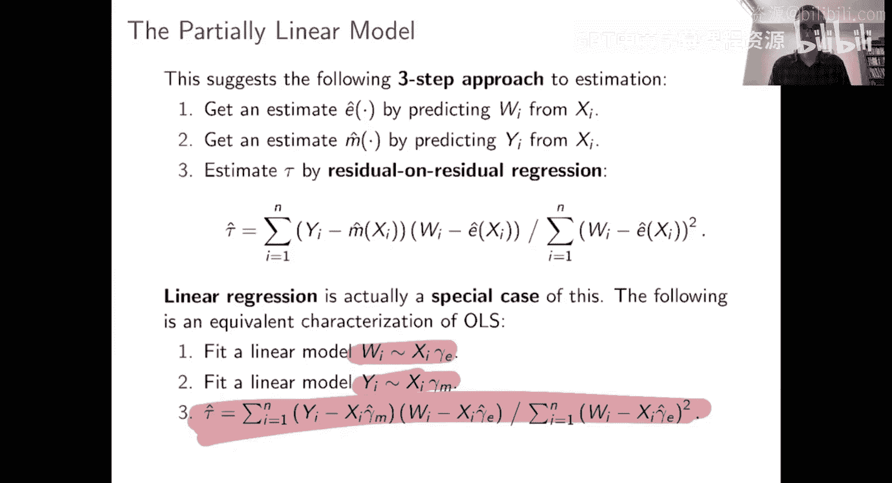

So。This is how。微度。How one can estimate constant treatment effects in a way that's compounding robust。

Under the kind of no unmeasured confounder' assumption。In my experience， it's a very good estimator。

 it's one I recommend using。😊，And just kind of the bigger picture is that now we've seen two different confounding robust estimators。

 this means the AIPW estimator we saw in week two， and the residual residual regression estimator based on Robinson's transformation for the con effect。

And。Both of these estimators had very similar properties where we were working under the unconfoundedness or no unmeasured confounders assumption。

 then we ended up in this kind of semiparmetric type specification where we have kind of a low dimensional object of interest。

 either the average treatment effect or the constant treatment effect parameter。

 and we also have non-parmetric nuisance components， the baseline effect。the propensity score。

And then what these the shared property of these estimators is that they kind of start with machine learning based estimates of the nuisance components。

And as long as they're reasonably accurate， then you get a one overrodent rate central limit theorem for。

The thing you actually care about。So。That's all I'm going to say here other than kind of recommending the use of both estimators。

 for those of you who want to dig deeper， I should emphasize this both are a case of a much more general recipe。

😊，And you want to read more about it this paper here by Chajuov and Goau has kind of much more much more to say about。

How and why these kinds of estimators with these kinds of properties arise。

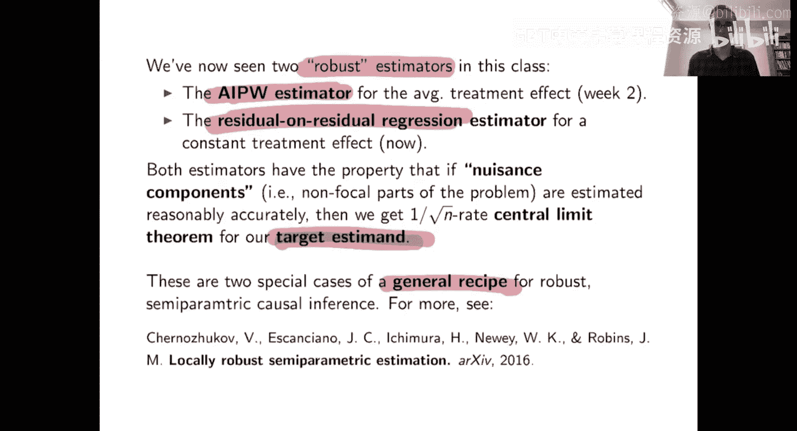

All right， the last thing I wanted to say about estimating constant treatment effects。

 and this is a little more of an aside。But I just kind of。Some of you may be confused。😊。

We talk about estimating average treatment effects。

 we talk about estimating constant treatment effects， what's up with that。

 they seem like very similar estimate。Very similar problems， why is there a different？嗯。

And to see why there's a difference。consider a problem where kind of you have a fairly large X space。

And then you have some regions of x space where it's very easy to estimate treatment。

Say kind of you a good balance across treated and control units， you have many units of both types。

And then you have another region of Xspace where it's very hard to estimate treatment effects。

 maybe kind of almost everyone was assigned to control， so we barely have overlap。😊，Well。

 in that kind of setting， estimating a constant treatment effect versus an average treatment effect are going to end up being very different problems。

If you want to estimate an average treatment effect， what do you essentially have to do。

 you need to estimate the treatment effect here where it was easy。

 you need to estimate the treatment effect here where it was difficult and then kind of。😊。

Take the average of the two treatment effects and if over here your treatment effect system is more inaccurate。

 there's kind of nothing you can do about it your treatment effects are going to be inaccurate everywhere。

😊，On the other hand， if I tell you a priority that treatment effects are constant everywhere， well。

 you can just kind of ignore this part of feature space where the problem was too hard and just kind of estimate your constant treatment effects over here where you actually had good signal and then just extrapolate that。

And that makes the problem a lot nicer。

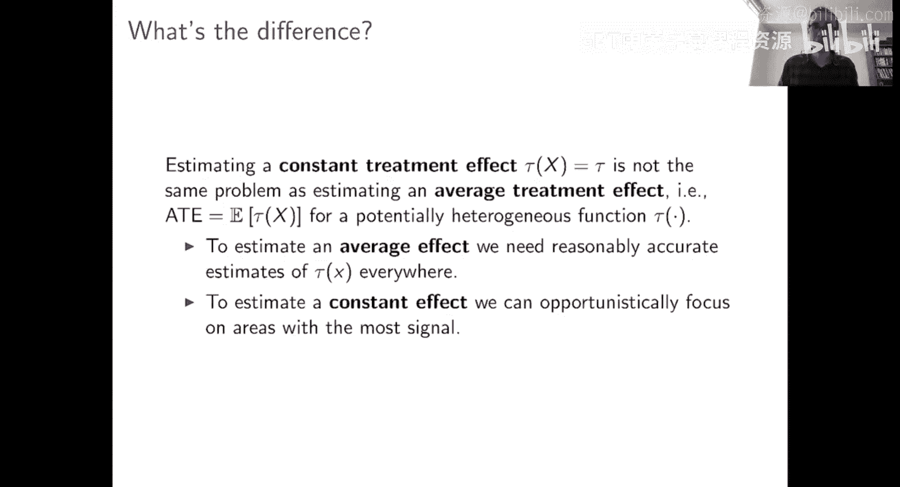

To。To kind of see this play out in an example。Here's a simple simulation。

 the salient part here is that first the treatment effect is constant。It's everywhere 。3。

So if you know that the treatment effect is constant。

 you can just kind of run methods for constant treatment effects。

 but maybe if you don't know that the treatment effect is constant everywhere。

 then you'd kind of and you want to estimate an average treatment effect。

 then you'd do something else。And why is kind of this problem？

Harder when you're kind of you don't know that the treatment effect is constant and you have to kind of。

Estimate treatment tos everywhere and aggregate them。You can see this by essentially。

Cutting the problem into three zones based on the propensity score。

So here the propensity score is here， it depends on x3， there are some units。

 theres one group of units but the propensity score is very small。

 most of these people receive control， theres some region feature space where most people get treated。

 the propensities score goes to one。And here's this in between zone where propensity scores are far from both011。

 this is kind of a region with good overlap， this is kind of the type of data we like we' estimating。

这个だ。So if you wanted to estimate an average treatment effect with what happened。

 you would kind of qualitatively have to separately estimate treatment effects into these three zones here estimating a treatment effect is very hard。

 almost everyone gets control， you have hardly any treated units so you just have very little information about what the treatment effect actually is。

😊，嗯。This middle zone you have good overlap so estimating a treatment effect is easy and again here it's going to be hard again because most people receive treatment so there are very few controls and then。

😊，With the average treatment effect。Approach is going to have to do is then kind of aggregate to。

Mostly kind of treatment effects estimators for these two regions we're estimating treatment effects was hard。

And so。Probably those treatment effect estimates are going to be pretty inaccurate with kind of the more accurate one from this easy zone。

 but then kind of any inaccuracies you built up in the difficult zones are going to add up。😊。

On the other hand， if youreestim your constant treatment effect， you just kind of。

Don't care about these two zones， you effectively throw this data away。

 you just kind of only zoom in on the part of the data where you've had go good overlap and where you can estimate treatment effects accurately。

 you learn what the treatment effects is there and you just don't you don't worry about the rest of the problem。

This is of course， a qualitative story for what the methods do， but in practice。😊。

It the intuition goes through over what actually happens also。

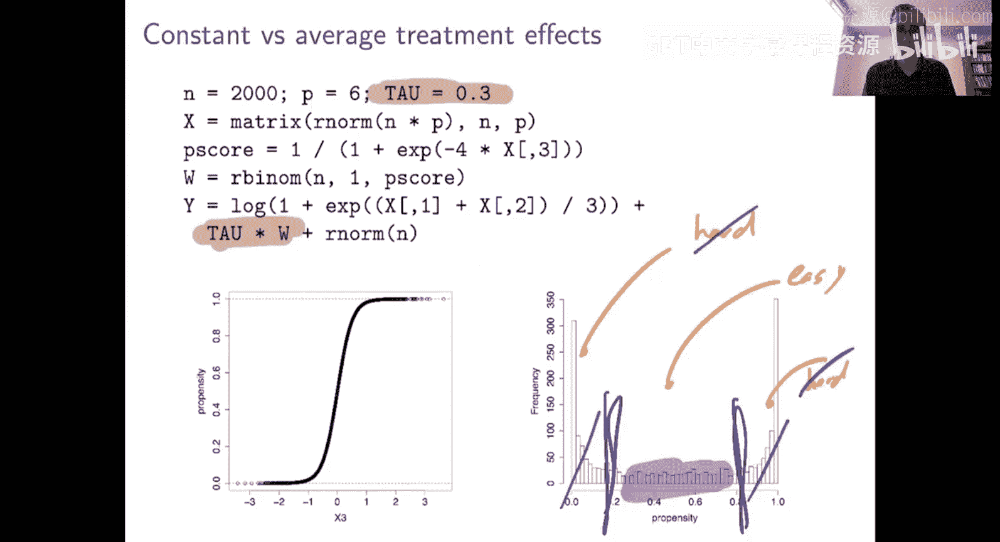

And。Okay what do the numbers look like so here as always I kind of just give you a little bit of code you can copy paste this implements the constant treatment effect that's the emit by residual residual regression with heterocaacasticity robust standard errors。

😊，And if you do this， you get。Remember， the true concentration effect was 0。3。

If your 95% confidence interval is 0。3 plus or minus 0。5， this is very good。啊。

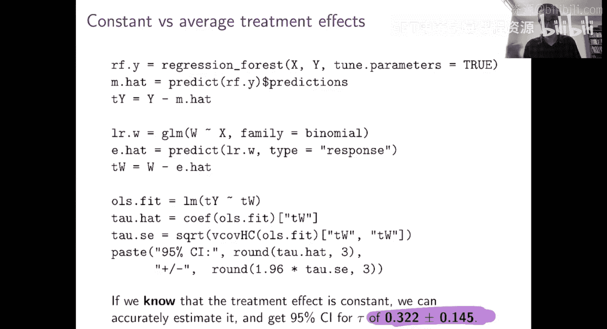

What about if you didn't know a priority that your treatment effect was constant。

 so you kind of had to。Use a method for average treatment of effect estimation that aggregates data from everywhere。

 including the difficult zones and then try to synthesize well the treatment effects eggs you get out of this is going to be much less accurate here we got 0。

56 plus or minus 0。35。😊，The point estimate was less accurate and the confidence intervals were wider and this just kind of highlights the extent to which the problem adverse treatments like estimation is harder。

Im in the problem with concentrate the effect estimation。

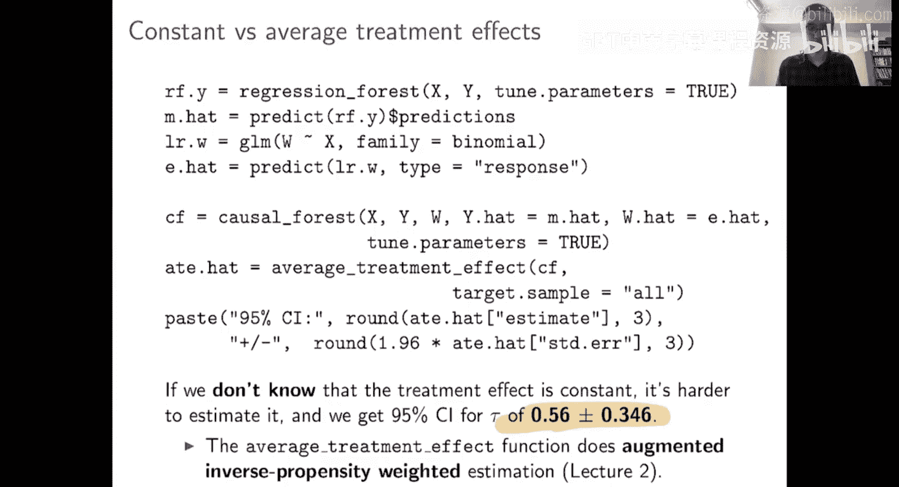

嗯。For those of you kind of think you were problems in terms of the kind of applications。

You might be sensitive to the attention here， right kind of in this problem。

The treatment effects actually were constant， but kind of as an analyst you had two strategies。

 you could either assume that the treatment effects were constant。

 kind of assert knowledge from theory， but without validating it from data。

 and if you're willing to assert constant treatment effects。

 then you can kind of estimate the constant treatment effect very accurately or you could kind of take a more agnostic approach where you don't start by assuming。

That treating the V are constant you allow for hydrogenity。

 and then you want to estimate an average of this tau of x functionhuh。😊，And our way is more robust。

And you might like doing this because it doesn't require asserting that treatment effects are constant a priori。

 but here you see that there's kind of。A large cost and precision from doing so。

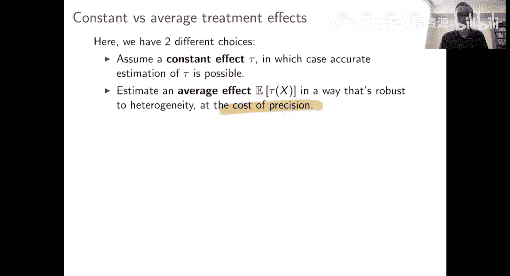

It's kind of a tricky trade。嗯。If if you're interested in the trade off。

 then kind of one very important thing to ask is what happens if。

You think the treatment effect is constant， so you kind of run our residual or residual estimator for the constant treatment effect。

But actually there's treatment hetero 80 so kind of。

There doesn't exist a thing that should be called the treatment effect parameter。

So if you just run this。Etimator that was justified under the setting of constant treatment effect in a setting where caalx is not constant。

What do you get and the thing you end up getting？It's actually very nice if you assume a constant treatment effect。

 but there's actually heterogeneity， then what the constant treatment effect estimator is going to converge to is this thing I call here tao E。

😊，Which is a weighted version of the average treatment effect where kind of different parts of feature space are weighted。

拜拜。E of x times1 minus e of x that is kind of regions of feature space with more。

Proensity scores that are further kind of nicely between 011 are given more weight and which regions where propensities scores gets very close to 011 are given less weight。

And。Actually， you can check。That。Among all waited。Average treatment effects this tau E is the weighted average treatment effect that you can estimate with the best precision under kind of a homelesschoastic model with this proensity score。

😊，So anyways， if you're interested in this stuff， this is kind of a rabbit hole one can。

Call very farend， but the point is that。ThereIn the literature。

 you can think of two ways to justify Robinson's method， it can either be。

methodod that kind of takes a treatment effect， the treatment effect is constant assumption very literally and then just tries to estimate that tau in an efficient way。

😊，Or you could relax， you could say you essentially think that the treatment defect are almost constant and given these assumptions。

You're going to run this method， you recognize that there's some heterogeneity and the treatment effect and the thing you're going to get is actually。

A weighted average of the treatment effect， but if the treatment effects are close enough to being constant。

 then maybe this weighted treatment effect is close enough to what you care about and you can just relax。

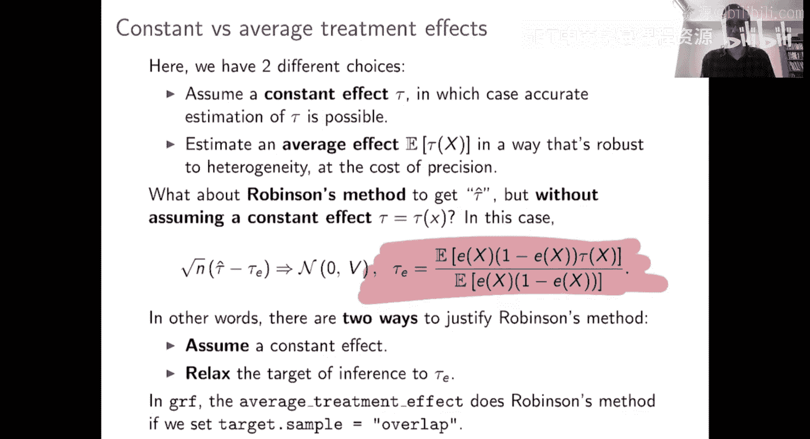

And use that estimator in your analysis。