# 斯坦福商学院《机器学习和因果推断｜Machine Learning & Causal Inference： A Short Course》claude-4s p15 -15-HTE_ Confounding-Robust Forests.zh_en -BV1M9W7zCEsf_p15-

We're now ready to use Robinson's transformation to develop a forest that can be used to estimate heteroous treatment effectss and observational studies。

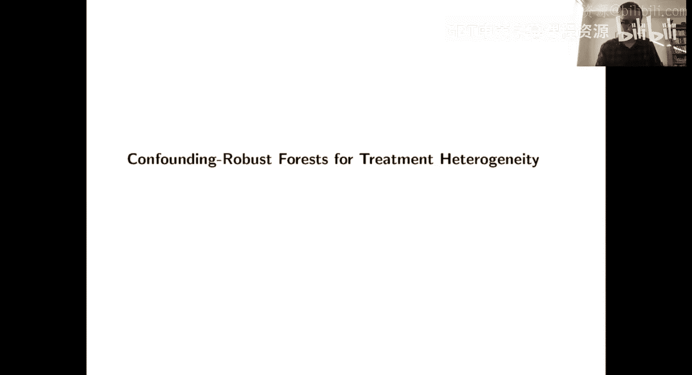

The principles we'll need in doing so are ones that kind of Ive foreshadowed heavily enough at this point。

 I think that calling them ideas is a bit much， but I'll still go through over them once more。

So the first idea in doing so is。What does it mean to estimate heterogeneous treatment effects what essentially means first finding some regions of feature space where treatment effects are roughly constant and then within。

Each of those regions estimating a treatment effect using kind of。

Methods we've already learned how to use。And the second idea is， okay。

 you need to find regions of feature space。over which to estimate constant treatment effects for the purpose of then getting kind of global a heterogeneous shape for the treatment effect。

 while if you're going to do so you might as well use trees and forests。😊，Guess they are pretty。

ed widely used to help with this kind of task in the broader machine learning mode。

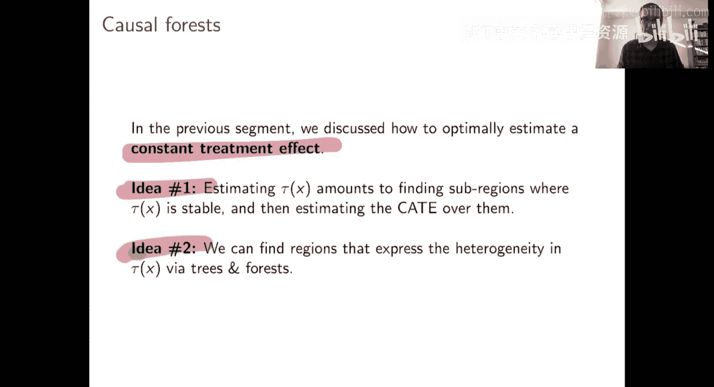

As a roadmap for what we need to do， let's first start by thinking about。

A very simple estimator hydrogengeneous treatment defect。

 see what goess wrong and then see how kind of。The concept we've covered so far can address these issues。

And kind of as a very， very simple thing to do， suppose that instead of estimating a whole heterogen treatment direct function for now。

 I just wanted to estimate a treatment fact at a specific point x。

And the way I'm going to do this is in order to estimate a treatment effect at x。

 I'm going to draw a circle around x， the idea that this circle kind of finds contains a set of people who are representative relevant for us to maintain the treatment effect at x。

And then I'm going to apply the difference in mean estimator inside this circle。

 so here's the circle， the set of points， everyone who's kind of within a radius delta of x。

 and then imagine using tau hat of x， which is just the average of the treated minus the average of the controls in that circle。

This kind of。It's going to be okay， it's going to be consistent， but it has some issues。The first。

And this kind of。By now is something you should be worried about is that this is a difference in means estimate。

It tries to estimate treatment effects by taking the average the kind of direct average of the treatmentized controls。

differenceiffence of mean estimators are generally okay in randomized trials。

But if you're in an observational study setting where propensity scores might vary。

You should always worry about kind of is variation in the propensity score associated with variation in the baseline effect and can this be problematic。

And so kind of what this problem number one highlights is that for this method to work。

 you actually need this neighborhood around to be so small。

That essentially the data inside that neighborhood looks is the what came from a randomized trial。

The second thing is that。And this is a theme kind of Susan emphasized last week。Is that。Okay。

 for this to work and for kind of。The neighborhood S of x to be contained。

People who are relevant to estimating kind of the treatment like at the point x。

 you need this kind of radius delta to be small enough that you don't kind of have any irrelevant people in this circle。

 but at the same time you need this radius delta to be large enough that you actually have enough people in these sets that kind of this estimator stable。

And when you're even in moderately high dimensions。This becomes an impossible problem。

So these are two issues we're going to need to address。

The second and kind of just to give a very short outline。

 the first we can address by using Robin as transformation。

 the second we can address using kind of forest geometry and a forest construction。

But yeah， for the first。Let let's ignore the second representativeness problem for now and just kind of focus on the problem that kind of this is a difference in means estimator we had previous on the previous slide and we're worried about how difference and means estimators deal with confounding。

So now suppose just to kind of formalize the question。

 let's say someone told you that this neighborhood SRX is actually pretty good and that everyone inside this neighborhood has the same treatment effect。

 so kind of problem number two is not a thing you have a lot of data inside that neighborhood。

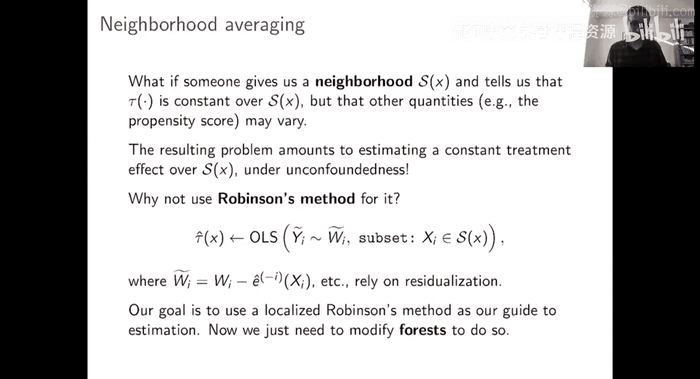

For the purpose of treatment of effect estimation， everyone at that neighborhood is relevant to estimating T V。

 but you're worried about just confounding bias， some people in this neighborhood being more likely to be treated than others and this causing problems。

😊。

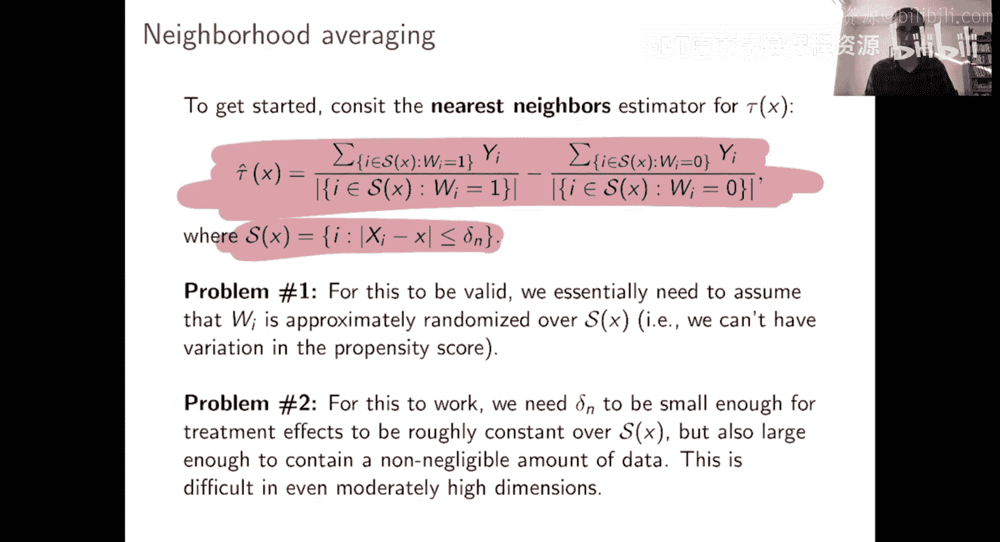

Well， by now we know exactly what to do if you have a set of data with a constant treatment effect。

And kind of。Variable propensity scores， but under unfoous conditions， we know how to。

Estimate the constant treatment effect use Robinson's method。So here we're just going to do that。

We're going to kind of first filter to only consider data set data in that。Neighborhood are on X。

 and then we're going to use Robinson's method to estimate the constant treatment effect considering only data in that neighborhood。

So。This is good。I不 going to run that。The next question is。

 how do we actually design this neighborhood over which？

To kind of estimate the constant treatment effect and can we do something better than just kind of drawing a circle？

Around our point of interest。

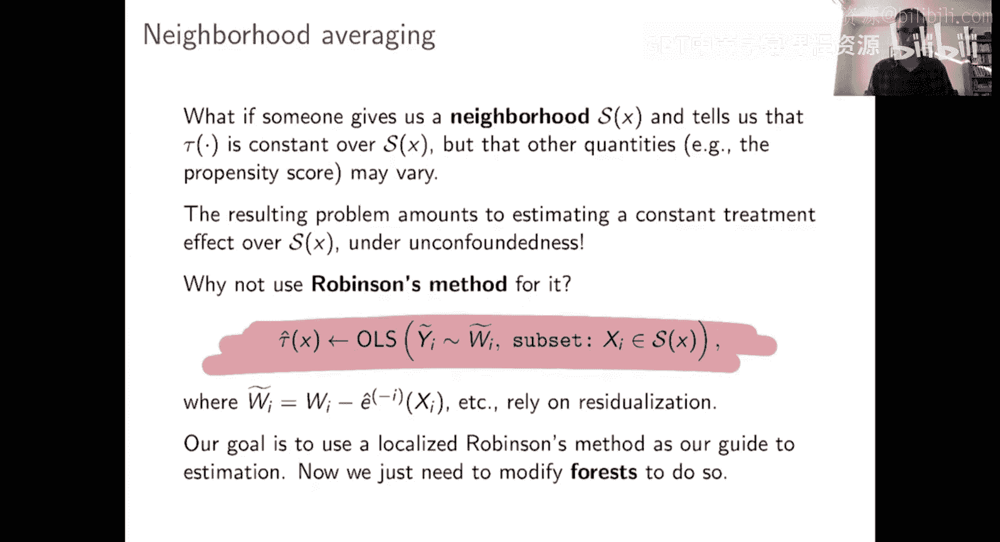

And here。Again， the idea is going to be to use trees， the kind of simple nearest neighbor estimator。

😊，You draw a circle at a point around the point that when you average all the data inside the circle。

 this in two dimensions is going be a totally reasonable thing to do。

 but like Susan emphasized last week when you get into even moderately high dimensions。

 this is going to break down kind of of the circle to contain any neighborhoods。

 it's going to have to have a humongous radius and once it has a humongous radius。

 well then the people inside that radius aren't going to be that similar to you anymore。

What trees are going to do is they're going to kind of in a data adaptive way。

 chop the feature space into pieces using access land splits and then。To predict that the point x。

 you're going to consider data and this kind of rectangle your neighborhood around x。

And in two dimensions， this might look a lot like。Ken nearest neighbors。

 but the advantage of trees is that kind if you have some features that matter a lot and others that matter less。

 then kind of the trees can have neighborhood can have these rectangles that are very narrow along the。

Directions that matter so they can very sensitive to variation there。

 but just kind of ignore dimensions that don't matter and this lets them have much more representative neighborhoods。

For estimation ofs x without running out of data。So that's what a tree does relative to ha nearest neighbor methods and then of course a randomno forest is just going to take a bunch of these predictions made by individual trees and average the predictions made by all of them。

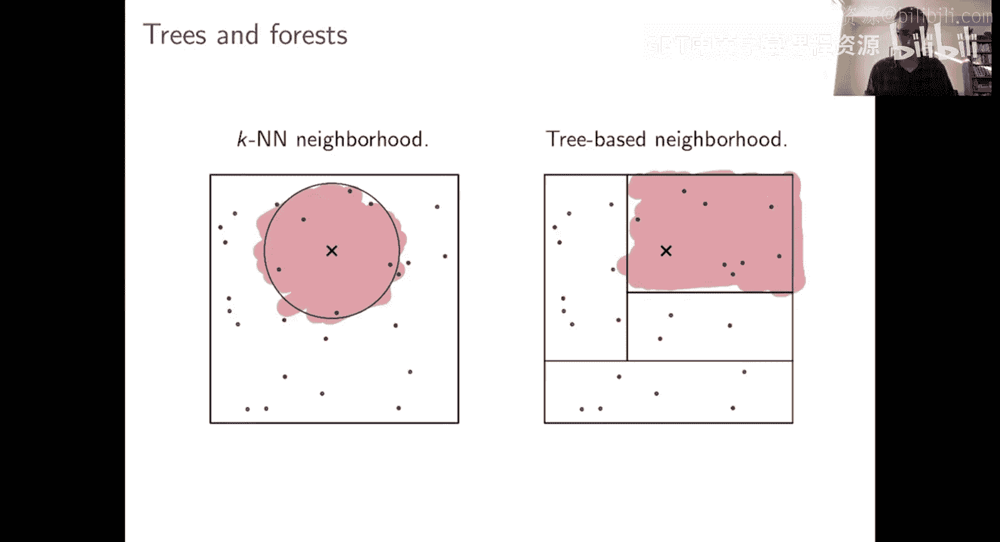

So。Our challenge， of course， is kind of their two key ingredients to this basic randomno forestest algorithm for kind of predicting y from x。

It's splitting and prediction by averaging trees。😊。

Our first question is how should we adapt splitting to design trees that kind of are optimized for expressing heteroity in the treatment effect and the second question is how should we adapt？

😊，Prediction， so that kind of once we have the geometry of the forest of many trees。

 we can get reasonable estimates of Tvax out。😊，So that's what we need to do here。

So let's start with splitting。

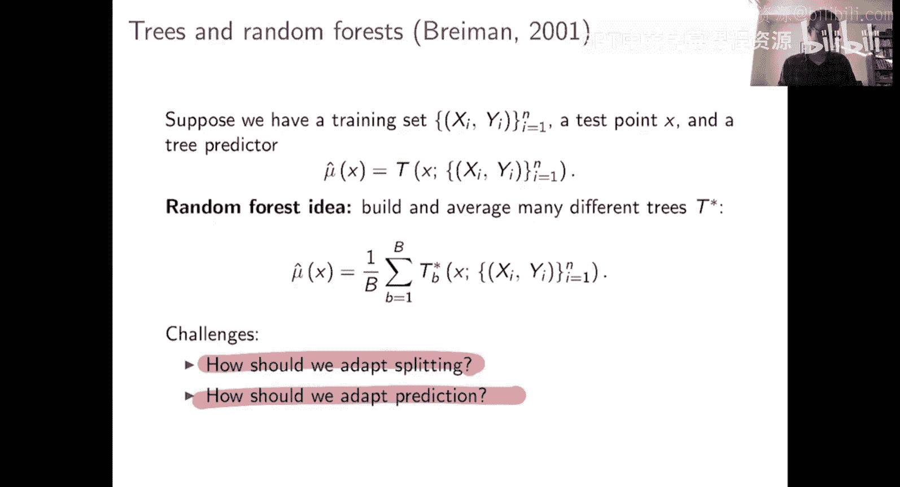

Here。I want to go first over in detail how。Regression tree split or two splits so that then we can contrast this and we adapt this to the treatment effect estimation case。

So。Here， I'm just kind of remember。We're going to assume that we have data。X I Y。

 and that we want to estimate。Mu of x is equal to expectation of Y I given an Xi equals x。

So when the regressions set in here and how is a regression tree going pick splits for this task？

Well what is going to do is going to start by kind of。Considering a big。

Square with all your data that。And then it' going to start scanning kind of first along the first axis。

 then along the second axis， then along the third axis。It's going to along all these axis。

 imagine kind of splitting。Your full feature space into two halves left and right and fitting a separate model to the data to the left and right。

Now what does it mean to we fit a separate model to the left and right。

 it's kind of trivial right we're trying to predict。

The expectation of y given x so if you split the data into two halves left and right what's your model for the average on the left well it's just kind of actually the average of the outcomes in the left leaf so you and with the average on the right well it's the average you model for the average on the right it's just the average of the data in the right leaf。

😊，So what you end up with。It's kind of。Do you have this kind of。Left leaf。In the left leaf。

You look at what is average of the data there， that's your Y hat left， you have your right leaf。😊。

But what's your average of the data there？That's your Y hat， right？

And then you're going to try to find the split among all access All splits that。

Maximizes the quality of this model。So essentially。Here。

 everyone in the left leaf we can assume that our prediction of Y given x is just kind of either if you're in the left leaf。

 it's going to be Y hat L， if you're in the right leaf。

 it's going to be Y hat R and regression forests are going to take the split。😊。

That optimizes the square error loss criteria。Now。By kind of just decomposing。

The square here and' looking at what the optimum settles on。

You can find that there's actually an equivalent way to express the split that's going to be preferred by the regression force splitting。

 it's going to be the split that maximizes the following quantity。

Your estimate on the left so the average of the data on the left minus the average of the data on the right squared so you're want to find a split that kind of there's a big difference in the average the left versus on the right。

You're going to take this different square multiplied by the number of people to the left of the split and the number of people to the right of the split。

 so you essentially want to find a split ideally。That evenly cuts your feature space in half。

 but also where there's a big difference on average on both sides。So。

This is kind of all there is to splitting it runs the split once finds the axis line split that maximizes this criterion and then once the tree has picked one split well kind of on the left it'll try again it'll build a second split it'll take up the third split it's kind of recurs in both leaves independently and always kind of as soon as you've made a split you ignore everything that happened so far you just kind of focus on your remaining kind of rectangle you're sitting in now and then you again try to cut it in half again following an axis line split。

So that's what regression trees do。We want to adapt it for treatment。

And。It turns out that almost everything regression trees do can be adapted verbaate。

Progressing trees make access aligned splits。Kind of in X space， you kind separate left from right。

Along an axis， we can do that two thats fine regression trees。Proceed in a recursive manner。

They start by kind of considering all the data and kind of this big blob。

 then they cut that bb in half and then they kind of from here on out。

 they take the left half and the right half and consider them separately and kind of recursively spot them。

We can again。Do this recursive structure， nothing stopping us from doing so。

The only thing we need to change is in choosing like how do we actually pick that we prefer this split as opposed to this split or this split as opposed to this split。

😊，So how do we pick the split criteria？And。This might seem tricky。

 but actually we're just going to follow。Exactly the kind of idea behind regression trees just kind of modified the objective a little bit。

😊。

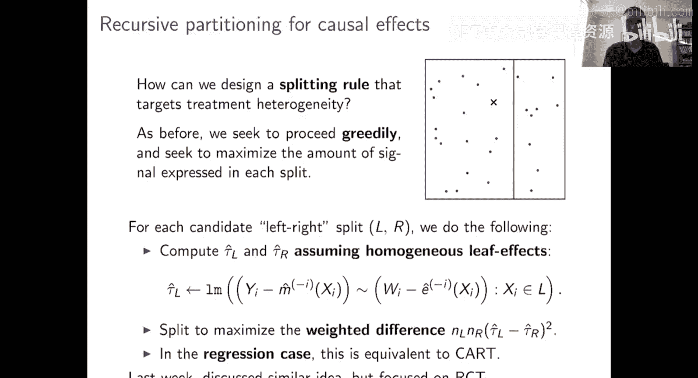

So regression trees。Algorithmically， what they end up optimizing is number on the left times。

 number on the right times difference in estimates squared。😊。

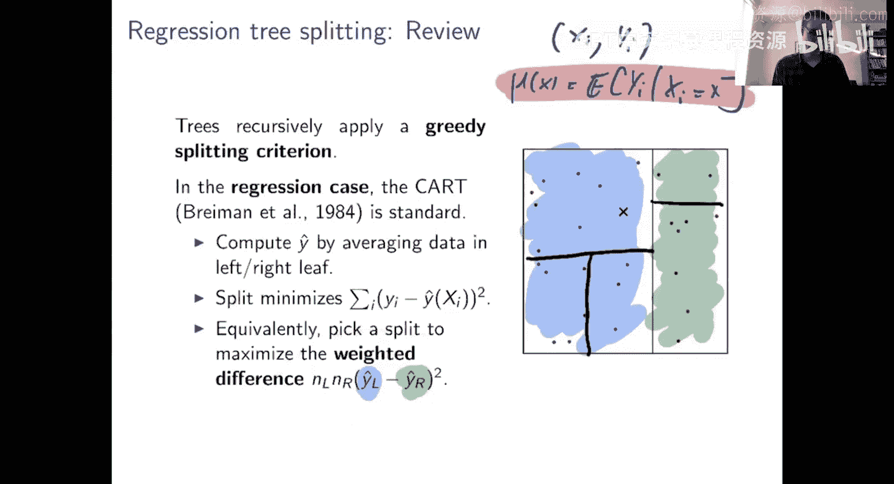

We're going to do exactly the same thing here。We're going to split on exactly the same objective except instead of the kind of relevant estimate being an estimate of the expected value of y given x and so then the difference in estimate square just becomes the difference in averages to the left and the right square here we care about treatment effects so what we're going to do is we're going to estimate treatment effect to the left a treatment effect to the right and then consider。

😊，Dence between the estimated treatment effect on the left versus on the right squared。

 and that's going then be our spliting criteria。How do we estimate treatment effects？

On the left verse is on the right， well， as always fine， using Robinson's method。

 residual and residual regression。So we're going to run residual regression on the left once on the right。

And then， and then proceed。So that's for splitting whatever the prediction。

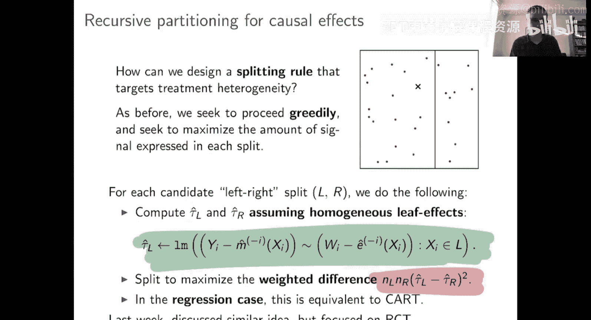

Here it's a little bit trickier。Usually algorithmically when we think of regression forests。

 what we think of regression forests doing is having a bunch of trees。

 each tree making a prediction for y given an x， and then you average those trees。Now。

For treatment effect estimation this gets a little bit delicate in our setting because let's say you have a bunch of trees so you have small leaves in the end now you want to estimate a treatment effect in the small leaf。

 so we're going to run residual residual regression in the leaf that's going to give us a treatment effect in the leaf。

😊，Now you could think of the forest as wanting to average all those predictions and that's a thing you could do。

But now something to worry about is let's say out of the you trained 1000 trees and out of those trees five had something bad happen like let's say there's actually only very little variation in the treatment。

 so the residual regression is unstable and kind of blows out。Well。

 it happened five times out of 1000， you might not really worry about it。

 but still when you take an average， if there are kind of any bad components on average thatll kind of make the whole average be quite unstable。

 so that's not necessarily a good idea。So this seems like it could be a problem。

 but it actually turns out there's a very nice way to get around it and the point is just to kind of swap the order of how you think about forests。

So the way we usually think about forests is right they're an average of predictions made by each tree and what's the prediction made by each tree。

Well， it's just kind of the average of the outcome over everyone in the leaf。

 which you can write as follows right some overall all the observations of the outcome with an indicator where you win the leaf relevant to predicting an x divided by the sizeability。

That's a double sum so what we can do is we can swap the double sum and now you can also look at the prediction made by the forest as a sum over all the samples of Yi your outcome times this other thing。

N call it alpha I x and alpha I x essentially measures。

The average weight the I training example gets when predicting Fx。So essentially alpha IX。

 you could think of it as a data adaptive kernel weight。

Capturing the relevant of the I training example for x。

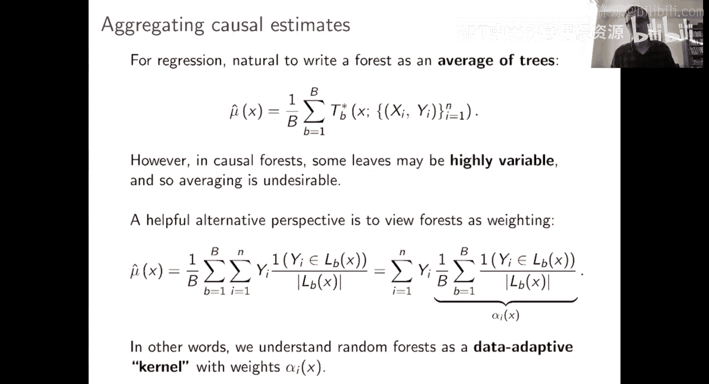

In terms of a picture， what's going on is this so kind of。

Each thing here is a tree and the first tree is going to average this data for predicting at x。

 so kind of for the purpose of this tree when predicting at x。

 all these observations get the same weight， one over eight since there are eight people on that leaf。

 everyone else gets zero weight。The next tree is going to do the same thing but with a different set of observations again there are eight observations here。

 so each of these is going to get away one over eight the coincidence I guess all these rectangles have eight dots in them。

 but you get weight one over the number of dots in the right。

Then what the forest is going to do is it's going I first average all these weighting functions。

 so kind of this thing here， these points here get very big weight because they're kind of because they're kind of in many of them trees used to predict that X。

 whereas others get smaller weight because they're in a smaller fraction that trees used to predict that X。

And anyways， what the forest， you can think the forest is doing is just averaging all these kind of constant weighting functions for each tree to then get kind of a smoother weighting function that captures the relevance of each training example to predict。

At test point X。So this is the forest neighborhood。And。

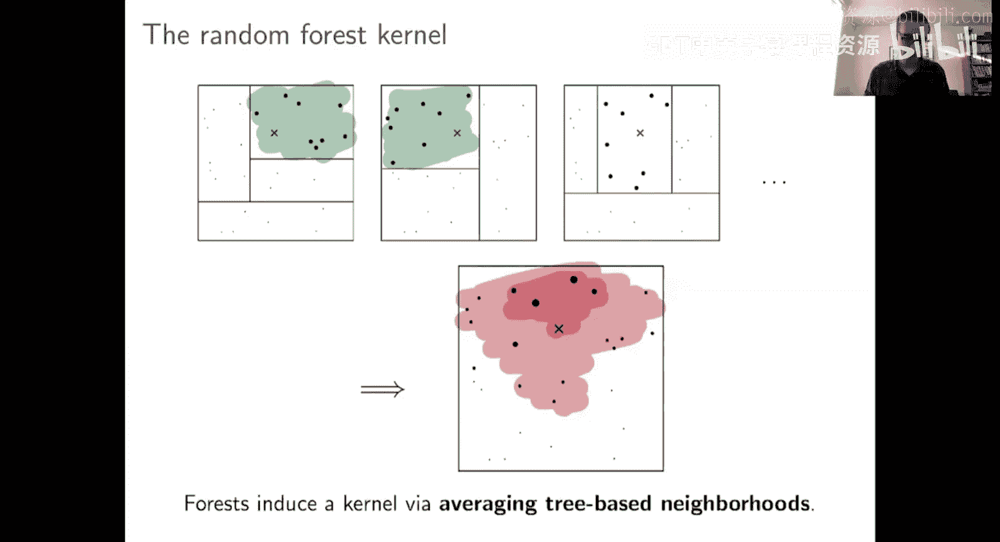

Then a regression forest， essentially you can just think of a regression force is not helpful people usually think about it。

 but it's an entirely equivalent perspective， you can think of the regression force as making a prediction by considering an alpha I x weightd average of the outcomess YI。

😊，So that's a我。The nice thing with this perspective。

 it's now very clear what to do in terms of adapting the regression forest to the treatment estimation setting。

How do we want to estimate treatment effects？I guess I'm just saying the whole same thing over and over again。

 it's by residual and residual regression。If a forest。Essentially gives you。A set of weights。

 alpha I X。That。Cture the relevance of each training example I to kind of estimation of x。

 then what's the natural way to estimate the treatment effect that x we just run。Reside。

 residual regression with。

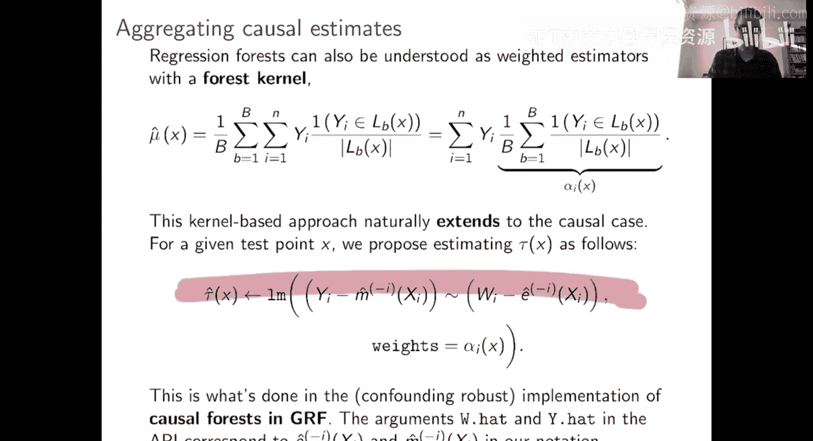

Weights alpha x。And we're done。This is going to give us a reasonable estimate of the treatment effect at X。

嗯。We solved kind of two problems we were worried about with the kind of。

Nearest neighbor matching difference in means estimator。

We're getting a notion of who's a relevant neighbor for estimating a treatment effect not by just drawing a circle around you。

 but by。Growing a forest and extracting waste from that。And we're not。

Kin of given these weights taking a different in estimator which would be vulnerable to confounding instead we're going to run a residual residual regression estimator using these weights so this is something that kind of。

If you have a relevant neighborhood。Then even if treatment proensities and baseline effects might vary in that neighborhood。

 that's okay， you're going to get the constant treatment effect。

If you found a small enough neighborhood， would treatment effect to effectively be constant in it。So。

This is， this is what we do and this is。Essentially。

 if you call into the causal force function in GRF。I think this is。What happens。

One thing I should emphasize here is that i'm looking at these m hat and e hat functions remember M of x is the expectation of y given x E of x is。

The provideity score。han。For training this causal forest。

 I'm assuming that you already have on hand estimates， M hat of x and E hat of X。

 you already have trained kind of some model to predict Y and w from X and you pass them into the causal forest。

If you don't pass them in then what the causal force it's going to do is it's first going to train a regression forest to predict y from x so it's first going to kind of train one regression forest to learn this then it's going to train a second regression for to estimate the propensity score it's going to learn W from X and then。

In the final step it's kind。Random actual causal forest on this subject。

But what I want to emphasize here is。Kind of like for AIPW。

 you had to first run some non thermometric regressions。

Then kind of combine them and average them in a certain way to get them。

Have a treatment estimateament。And the same way as full kind of。

The basic residual residual regression to estimate a global treatment effect parameter。

 you had to kind of first。Estimate some non parametric regressions。

 take residuals and kind of post process them to get an estimate of constant treatment effect well here it's the same situation you need to first run some non parametric regressions。

Get estimates of M and E。 And now you can almost think as。

The causal forest as being kind of a fancy alternative to an average treatment effect it's something that you kind of do。

After these non parametric regressions as a post processing type of thing to get estimates of treatment nitrogen。

That's here and just。To draw connection in the causal forest function call。

 there are arguments calledW hat and Y hat。You should read this as estimates of W and Y given x。

 and these correspond to exactly what we call E hat。Xi and M at Xi crossfi。In our notation。

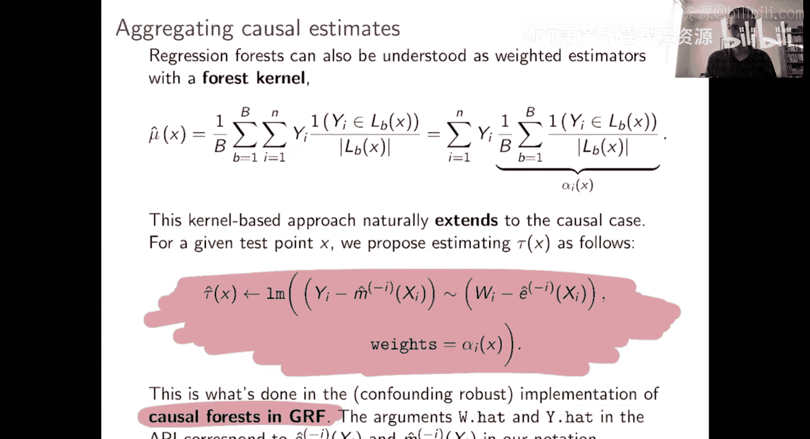

So anyways， that was。That's what causal forests do。

I kind of motivatediv the discussion a while back by saying that。

You should be able to estimate heterogeneous treatment effects outside of randomized trials and this is a simulation we looked at a while back where the treatment effect is constant so kind of getting it right should be very easy but the propensity score varies with X and if you don't correct for it then you might kind of。

😊，Get confused by associations between the propensity score， and you have some x3 in here。

 so between associations of the propensity score and the baseline effect。

 and that could lead to bias。

And what happens here， so we talked about three other methods earlier that all kind of hallucinated treatment heterogeneity in this case。

To an extent that we thought was concerning。What if you run causal forests， what happens？

Well you don't get like exactly one for everyone， you still can of almost hallucinate a little bit of treatment。

 but you're much closer to just like finding the flat line， there is no treating heterogeneity here。

嗯。There's nothing going on。You might ask， why is Colore is not perfect here？

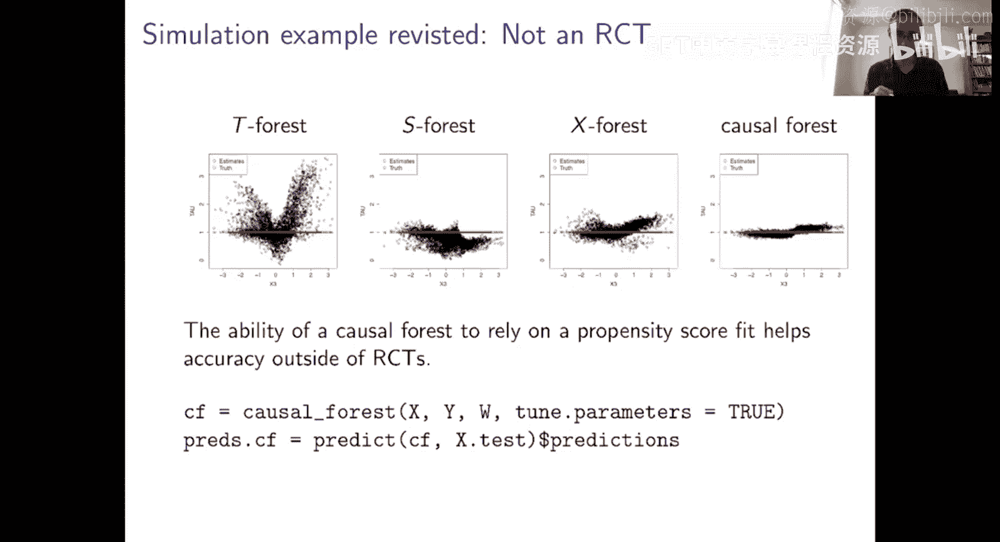

There's still kind of a little bit of zigzag here essentially the reason for this is that Pentecoal forest relies on getting this M hat and Eha function right and we got those out of the regression forests they weren't perfect。

😊。

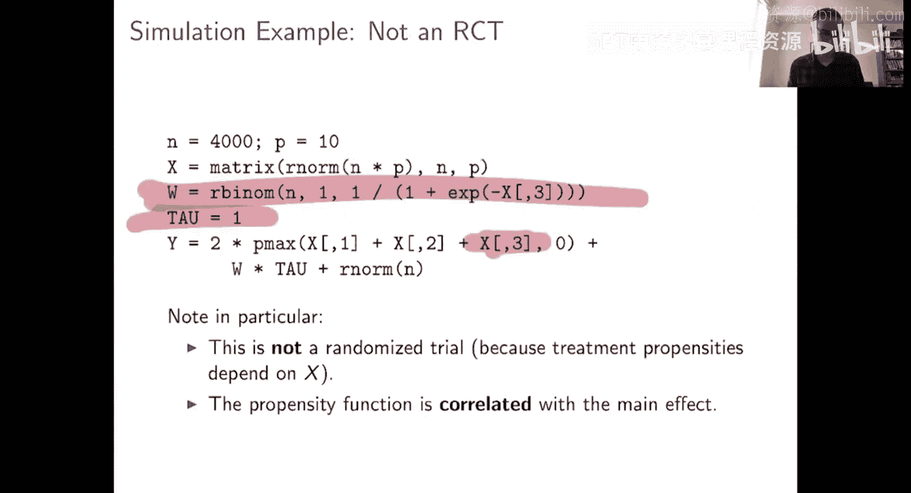

All the theory I've been。Talking about Z far kind of tells you。

Well if you get estimates and had an E that are pretty accurate。

 then you can essentially ignore any errors there and you'll be fine。

 but this doesn't mean that there'll be like literally no effect and here it seems like。

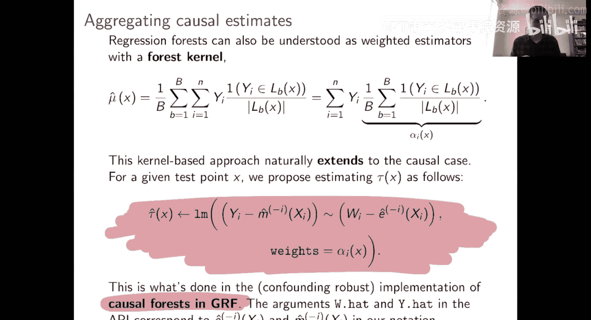

Aeroon M hat and Ehat that cracked in then created just a little bit of bias here now that you can see on the。

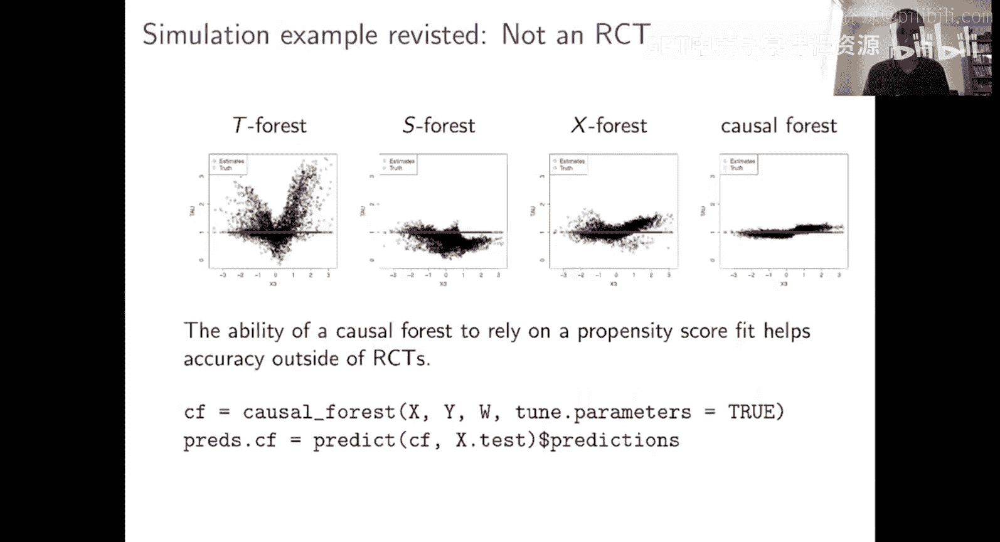

So that was this example you can also try running causalal forest in a randomized trial here we talked earlier the X forest did pretty well the causalal forest here seems to be regularizing more aggressively than the X forest why。

Honestly。Part of the mainstream machine learning is you work with kind of very complicated software packages with different trade offs that interact in different way this and this for kind of run using kind of different。

So from pipelines that were tuned slightly differently。

 it looked like the causal force was tuned for more aggressive regularization。😊。

So yet both of these essentially if you look at mean square error numbers。

 the X forest and the causal forest are pretty good， whereas these here。

 the S&T forest that kind of don't feel at regularization bias。Are much less accurate。So again。

 this is a randomized trial， so there's no confounding bias here。

 the only error you could have is regularization bias and both the X forest and the causal forest do a good job at avoiding death。

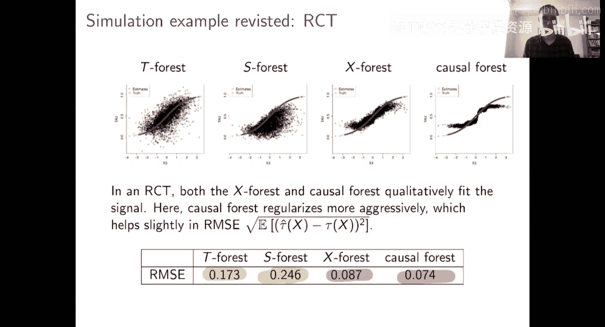

So anyways。We've covered a lot of material this week so I'm going to stop at this point。

 so essentially what we talked about this week was estimating treatment and heterogeneity in observational studies。

talkedalked about two things you need to worry about regularization bias and compoundfoing bias。

 we talked about algorithmic solutions to avoiding regularization bias。

 the ex learner is a very nice way of doing this。And then we talked about confounding bias。

 we talked about Robinson's method as a way。To avoid confounding bias in the case of。

In the case of constant treatment effect estimation。

 and then we talked of kind of a type of causal forest algorithm that builds on Robinson's estimator for the purpose of estimating heterogeneous treatment effects also。

So。Next week， we're going to continue this conversation for here。We're going to see how kind of。

The principles we used in the Gulf forest algorithm to make it confounding robust can also be used in the context of kind of。

General。Lss based machine learning， so isn't actually going to introduce loss functions for training kind of arbitrary treatment effect estimators that kind of have the same type of compoundfounded robust behavior we're going to talk more about assessing and evaluating methods for treatment effect estimation and see of given some tau H of X estimate。

In a real data setting， would you have an idea？How can you have an idea that you do a good job or not？

So we're going to talk about that and then we'm also going to talk about some further applications。

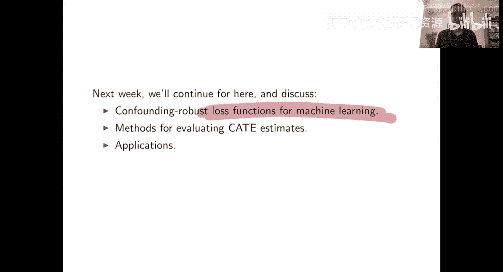

对。So this week I'm going to leave it here and just in terms of references。

 if you want to read more about regularization bias in general， here are two recent papers。

 they both very nice。I encourage you to read them that in particular， this first one is one I。

Used some illustrations in the first half of the lecture。

And then in terms of causal forests in the observational study setting。

 the general paper to look at is general fan of forests。And。

IfIf you want a paper that's kind of more in line with the discussion here。

 that's kind of more focused on。How to run this in practice as opposed to mathematical details。

 then this tutorial paper and observational studies might also be something good to look at。

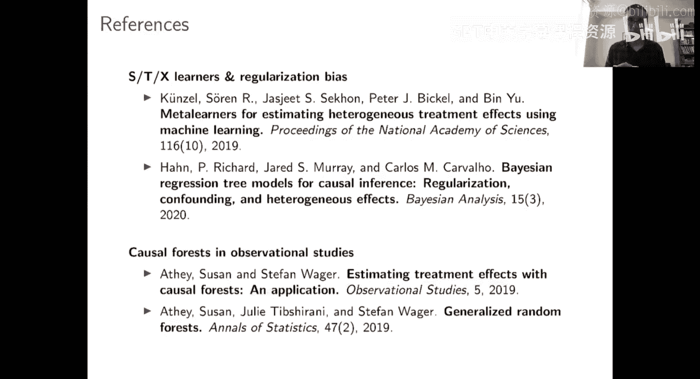