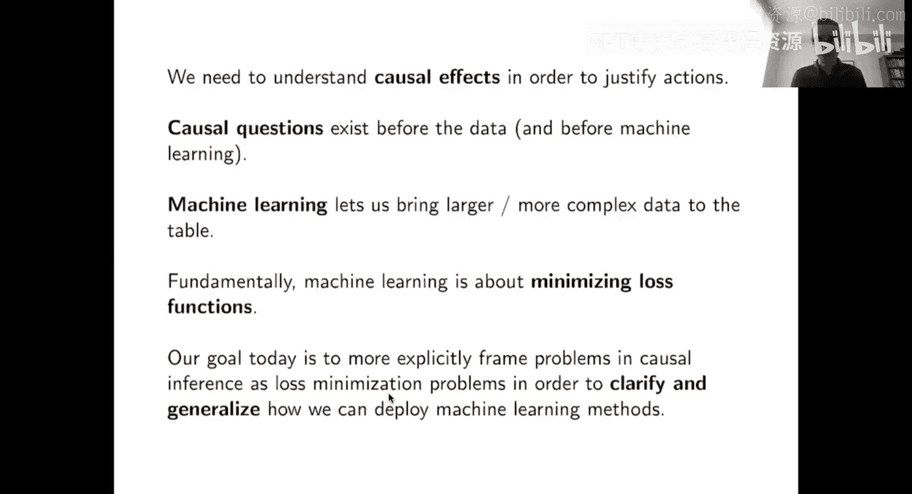
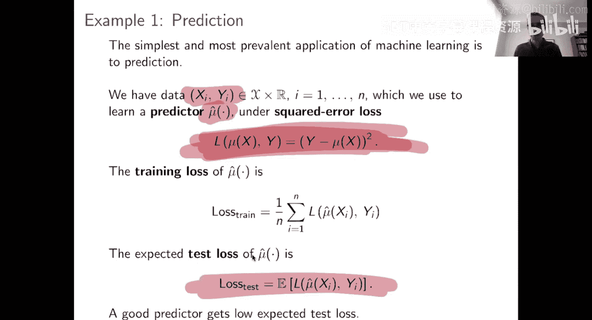
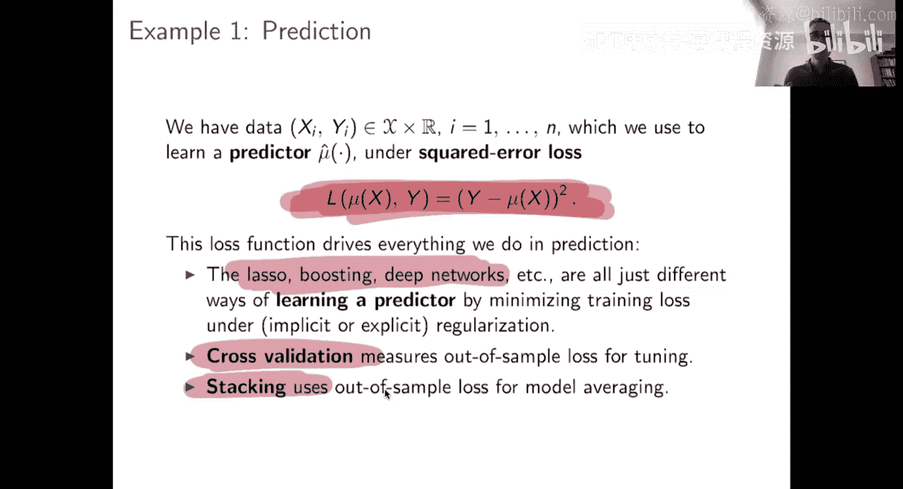
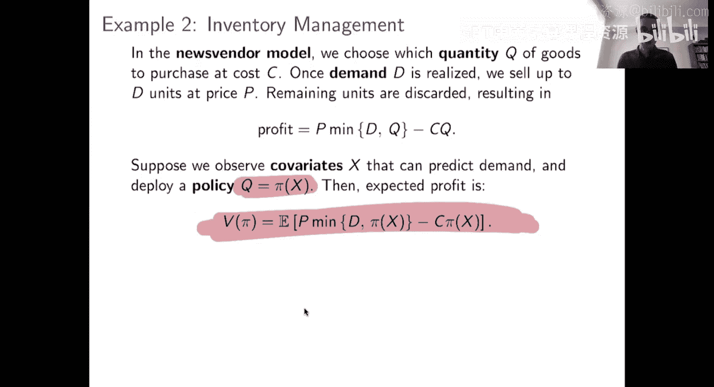
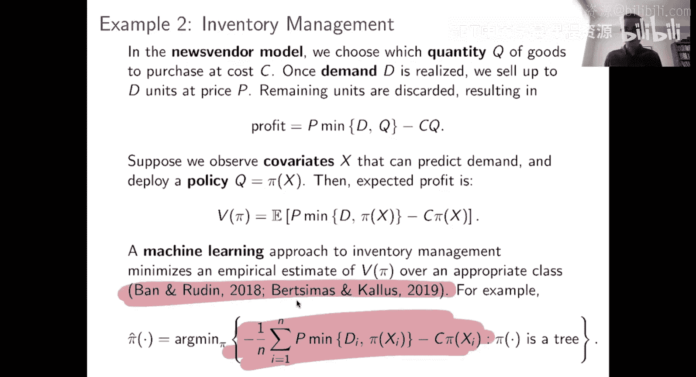
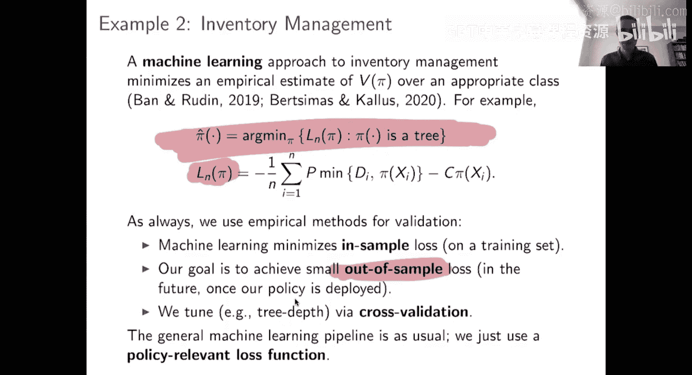
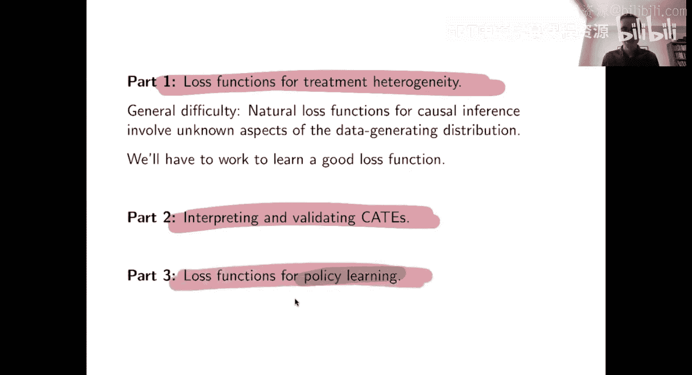

# 斯坦福商学院《机器学习和因果推断｜Machine Learning & Causal Inference： A Short Course》claude-4s p16 -16-Loss Functions for Causal Inference.zh_en -BV1M9W7zCEsf_p16-

Hi everyone， welcome back to Machine learning and causalsal En。

The overarching pitch of this class as Olar has been something like this。

We need to understand causal effects in order to do good data driven decision making。Causal effects。

Are out there， they're defined in terms of potential outcomes。

 they exist before you collect any data， and they certainly exist before you even think about applying any method to the data。

So if we talk about machine learning and causal inference。

 we talk about causal effects as kind of these fundamental objects that are in nature and machine learning as a set of tools that helps you better。

Understand and estimate these causal effects。In particular。

 machine learning provides a set of tools that are helpful whenever you have large or particularly complicated data sets you want to use in understanding causal effects。

So this is a story we've talked about quite a bit so far。

 and in doing so we've really focused on the causal inference side of the story and tried to build some bridges from causal inference towards machine learning。

One part of the story we focused a little less on is the machine learning side of things。

And kind of what is machine learning， really？One thing to note is that。By now in social sciences。

Most people have had some exposure to machine learning。

 but mostly to a very narrow slice of machine learning involving prediction problems。

A lot of people will think of。Machine learning essentially is a thing you go to when you're looking at you when you have a large data space of images。

 images of cats and dogs and。You want to use these images to trade an algorithm that can distinguish cats and dogs in a way that can generalize to new unseen data and if that's your task。

 then machine learning is the place you go looking for methods for it。But if you talk to engineers。

 they might tell you that this is actually a fairly narrow view of what machine learning is。

There's a huge number of tasks out there that fit under the general umbrella of machine learning and prediction tasks is just。

It's a very nice and kind of very high impact area of machine learning。

 but it's still a pretty small slice of the pie。Trying to give a general definition of machine learning like for any area is a delicate thing。

But if you wanted to attempt to do so， some ingredients you'd certainly need is that a machine learning problem involves a task。

 something you're trying to do。It involves a loss function。

Something that rewards you or punishes you for performing the task well or poorly。

And then it involves data that you can use to learn an algorithm that can perform the task well。

 according to the loss function。So if you think about your image classification task。

distinguishing cats from dogs， it clearly fits under this perspective。

 the task is recognizing cats and dogs， your loss is one if you get the classification wrong then zero if you get it correctly。

😊，嗯。And then you just want to use these images。To learn to classify accurately。

 it fits obviously under thisumbrella。But another completely different task and that still fits into this umbrella could be flying a helicopter。

好。Your task is to keep the helicopter up in the air。

Your loss function is zero as long as you're in the air， it's one if you crash。And your task。Well。

 it's to fly the helicopter while maintaining a low loss that is while staying in the air。

 once's the data you want to use， well here it could depend。

 you could have access to videos of professional pilots flying helicopters。

Or you could give your algorithm access to a flight simulator where they can try different flight strategies and see what works and what doesn't。

And again。This might look completely different from a prediction problem。

 but if you talk to engineers， this is certainly something that would fall under the umbrella of machine learning and it's also certainly a problem that involves a well definedfin task。

 a well definedfined loss function and using data to optimize that loss。So anyways。

What I want to do in this week's lecture。Is to build on our earlier discussions of treatment effect estimation and more formally connect them to this loss based view of machine learning and essentially to show how you can turn。

Our discussions about treatment the big estimation so far into loss functions that capture these treatment effects。

So then when you try to train a machine learning method against these loss functions。

 they give you treatment effect estimates as a byproduct and you get what you want kind of。

In a fully general machine learning setting。Before talking about how to design loss function treatment fixed estimations and all the nuances that' will entail。

 I first want to kind of as a warm up and review， talk briefly about what this loss space view of machine learning looks like in some simpler。

 familiar settings so then。

Can see how to extrapolate from there。So again， the simplest machine learning problem， of course。

 is prediction， so we have data xs and y's， we want to predict y from x and formally we want to design。

A predictor will want to learn a predictor in your hat that takes its input， your x's。

 and outputs predictions for y。And given a predictor what's your loss function？

While a predictor takes its input an x outputs a prediction mu of x and you lost there is L of mu of x comma y。

 it's the prediction error y minus mu of x squared。

Where do we go from here well for any given predict you had your training loss is a sum over your end training examples of。

This squared vector loss。In general， to learn new hat。

 you're going to minimize the square error loss with some amount of regularization。

And then what is the criterion you care about the end。

 you hope that this mu hat you learned on the training set is going to when deployed on the test set。

 make predictions mu hat of XI for unseen examples， Yi and get low squared error loss。

So really what I'm emphasizing here is that kind of。

Everything in prediction goes through the square G loss function。

OnceOnce you're given this loss function， everything becomes more algorithmic procedural。

 you have a training set， you have a test set， you have a training phase， your regularization。

 but the loss function is there at the center of every task。

嗯。So kind of more specifically， if you want to train a predictor。

You're going to be given a training set and on that training set you usually can run some algorithm。

 this could be the last so it could be boosting， it could be deep neural networks。嗯。

These methods for actually learning a predictor kind of algorithmically look pretty different。

 but fundamentally all they're trying to do is minimize the training error loss。

 the squared error loss function you have here using different functional forms and different types of regularizations in the hope that minimize getting a low training loss in terms of squared error on the training set will then generalize into a low test loss on a test set。

So this loss function is used in training if you want to measure the accuracy of your model and kind of predict tested performance。

 you can use cross validation， which essentially just involves considering the squaredter loss。

Out of bold in your training set。Or if you want to combine different models。

 I'm going to talk about stacking later in this lecture。

Then you can use stacking as a tool for model averaging that's also going to be governed by square。

So again， once you have this query or loss function， everything else is just defined in terms of it。

So。To to kind of understand the power of this idea。

Let's talk about a different setting where we also might want to do machine learning but。

It's not a prediction problem。And here one。Nice problem that's less often talked about。

 but where everything works out K nicely is the following problem in inventory management。

It's called the news vendor model because you can kind of think of the problem as motivated by the following story。

 you're running a newsstand and you need to choose how many newspapers queue you're going to purchase before the start of the day。

If you purchase too few newspapers， you're at risk of stocking out。

 which means you'll lose sales due to that。But if you purchase too many newspapers， then。

You have a high risk of having newspapers at left October at the end of the day。

 and of course no one wants yesterday's newspapers so that's going to be pure waste。So。

You'd want to pick order a quantity of newspaper queue that's not too high and not too low and then kind of for any specific quantity。

What's your profit going to be well you need to first purchase your Q newspapers。

 you're going to purchase them at cost C so you're going to pay CQ then what's your revenue going to be well the number of newspapers you sell is the minimum of demand and the number of newspapers you have in stock so what's going to be the minimum of D and Q where D stands in for demand and then you're going to sell them at price P your profit is just going to be the difference between these two terms。

That is。Eevennue and costs。So far， so good now let's say you're kind of。

A fancy news vendor and you recognize that different days are different， for example。

 maybe after a major sporting event you might expect to sell more newspapers and you want to take that into account。

So now what you're going to do is you're also going to measure some Covariate X that help you predict days or kind of anticipate days when you should purchase more or less newspapers。

And then what you after is a policy is a stalking policy pi of X， where kind of on different days。

 depending on the covariates x， you'll purchase a different number of newspapers， Q equals pi of X。

So if you were to deploy this policy。What's your expected profit going to be when it's just going to be the expected profit from above。

 except now I'm just going to specifically writeq as pi of x， so the value of your policy pi。

Say that's the expected profit。It's just going to be。P。

 the price at which is selling newspapers times the minimum of DM px minus your average cost。

 that is the expectation of C times px。So。So far， I've just been talking about definitions that is given a policy。

What is。Your expected profit from deploying that policy in this newspaper venture model。But now。

 of course， the question is how could you actually come up with a good policy and in particular。

 how can you use data to figure out a good policy pie？And I hope I've kind of。

suggested the solution strongly enough that at this point it shouldn't be a surprise。

 essentially there's a task。You need to choose how many newspapers to purchase。

And there's a reward function V of x， that's your expected profit。 your loss function is going to be。

The negative profit。And。You you'd want to kind of。Think of this as a machine learning task where you want to use covariates to choose how much to order。

 such as to maximize your profit or minimize your loss the negative of the profit。

And once you adopt this perspective。kindin of。What to do next is very clear for example。

 if you think about regression trees as trees that kind of。Try to minimize credit loss。Well。

 both would be a tree based algorithm for optimal inventory management。

You could perfectly well imagine in training a tree by recursive partitioning as we usually do。

 except now your loss function for traininging the tree isn't squared or loss。

 your loss function for training a tree。Is。Negative profit。And you kind of take it from there。嗯。

If you want to read more about this here， two recent papers that go into that。But。

Anyways， the point here is that if we want to deploy machine learning for inventory management。

 essentially you need to remember what the news problem is about。

 you need to remember what kind of stocking quantity demand cost， price are。But once you've done so。

 then you can kind of codify all that subject matter knowledge into a loss function。And then。

When you actually start deploying this your。Kind of the part where you do machine learning looks exactly the same as for prediction you're trying to kind of。

Using an algorithm， minimize your trainingin loss， hope regulars class functions， say trees。

 what it could be deep also。And where do we go from here？

Well your tree is going to try to minimize in sample loss on the training set。

 you could use this loss function Lm here for cross validation kind of cut your training set in folds and always kind of。

On some of the folds， drain a tree that kind of pres stocking quantities and on the held out fold。

 you could try to see how well you did。When you want to kind of see at the very how well you did。

 well then you'd kind of want to deploy your method on a test set and assess。

Tests and loss for your stocking policy， but the point I'm。Making is as kind of。

Once we found a loss function that captures。What's important about inventory management？

Then the problem of deploying machine learning for inventory management is kind of algorithmically verbatim。

To what we did before。What the only difference is that you。So often a different lesson option。

じ。With that background。Today this week's lecture is about is loss functions for gaal problems。

So there are going to be three parts today， the first part is going to be on loss functions for treatment hydrogen。

So specifically， I'm going to continue last week's discussion about causal forests。

which essentially were kind of more of an ad hoc forest based algorithm for estimating heterogeneous treatment effects in a way that was robust in observational studies。

And the goal today is going to be to kind of extract。

The key parts of the algorithm that made causal forest work and then distel those into a loss function that you can use with any machine learning。

So。The main difference relative to what I showed you earlier with prediction or inventory management。

Is that unlike in those cases， there isn't going to be quite this obvious a loss function。

To use in this context so we're going to have to work a little bit harder to design a good loss function。

So that's part one， part two is going to be on interpreting and validating estimates of the conditional average treatment effect。

Essentially by now。We've talked a lot about how to estimate cases accurately。

I want to say a little bit more about what you might want to do once you actually。

Estimated case and want to see how well did you do what have you learned？

So that's part two and then in the last part today。

 I'm going to talk about policy learning and by policy learning， I mean the problem of learning。

Decision rules that try to exploit causal impacts。The problem of learning treatment policies is very closely related to the problem estimating heterogeneous treatment effects。

But it's slightly different。When we'reestimating heterogeneous treatment effects。

We're trying to give a numeric answer， what kind of for agiven person we might ask is the treatment effect 0。

1， is it 0。3， and we try to tune that under kind of square error loss on the Kate scale？

On the other hand， if we're talking about warninging treatment assignment policies。

 then our decision is going to be more like a classification decision。

It's going to be a zero or a one treat， don't treat。And。

This is going to lead to some subtle differences， so i'm going to talk about that。

 I'm going to talk about the problem of policy learning and then I'm going to talk about how to design。

Los functions for that task also。