# 斯坦福商学院《机器学习和因果推断｜Machine Learning & Causal Inference： A Short Course》claude-4s p17 -17-Loss Functions_ Treatment Heterogeneity.zh_en -BV1M9W7zCEsf_p17-

Our next goal is to develop a robust loss function for audgeneous treatment effects once we have it。

 we're going to be able to use it for treatment effect estimation in a generic machine learning setup。

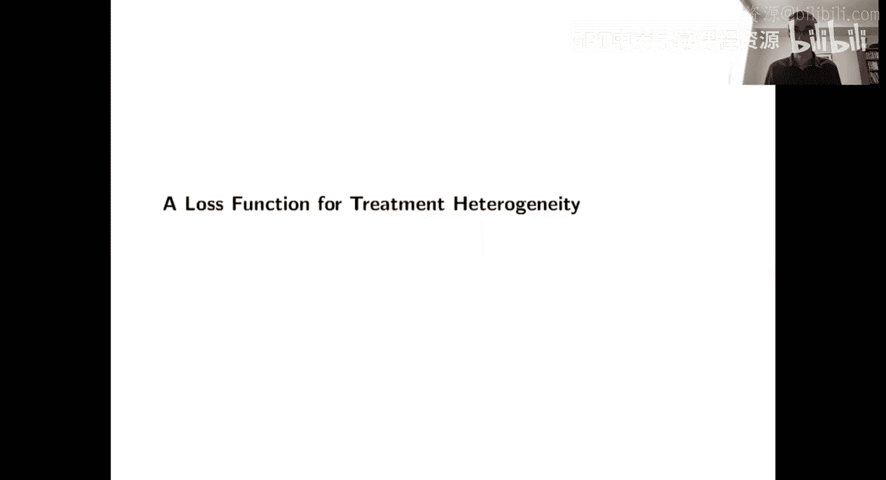

Just to go over our statistical setting， it's the same as always。

 we have x is Ys Ws that these are treatment wise our outcomes。

 outcomes are generated in terms of the potential outcomes model as usual and what we want to do is estimate the conditional average treatment effect that is the expected difference in potential outcomes conditionally on features x。

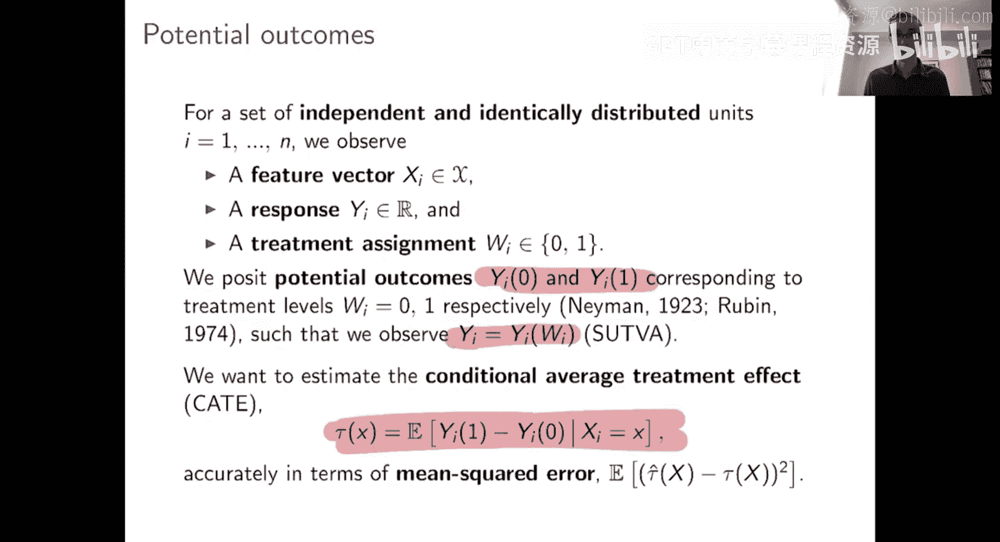

In the setting to do this， we're going to assume unconfoundedness。

 that is that treatment is as good as random， conditionally on covariance x。

 and the propensity score， that is the probability of being treated conditionally on x is going to play a central role。

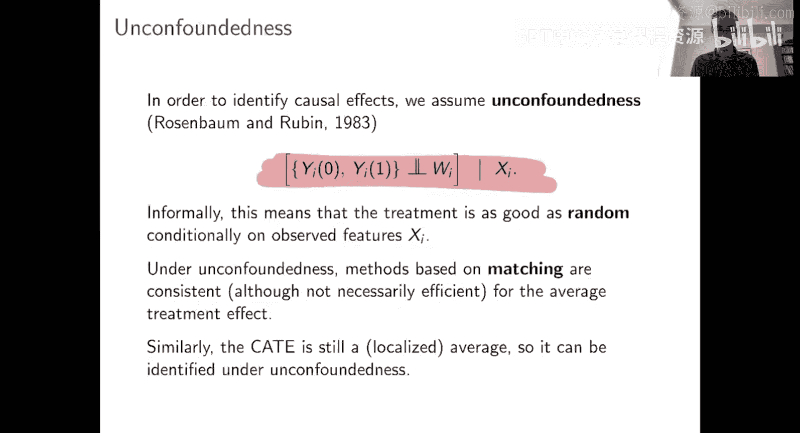

So here I'm going quickly because this builds on things we've already seen last week。

But essentially under unconfoundedness， you can always write that expectation of。Y。

 given x and w is mu0 of x， the baseline effect plus w times tau of x that is your outcome is the baseline。

 your expected outcome is the baseline effect plus if you're treated， also the treatment effect。And。

Since this is an expectation， you can also write it that Yi is actually mu zero of x plus w tau plus epsilon I for some epsilon implicitly defined in terms of potential outcomes where we know that the property of epsilon is just that it has mean zero conditional on x and W。

Like when estimating constant treatment effects， we're going to want to reexpress this so that Yi is M of Xi。

Plus WI minus the propensity score of times like Kate plus noise。

Where E of x is the propensity score， M of x is this kind of marginalized based line effect。

 your best prediction of Y given x without knowledge of treatment。And once we have this。

 we're going to land on。Essentially Robinson's transformation like before that is under unconfoundedness y minus m as equal to w minus e times tau of x plus mean zero noise。

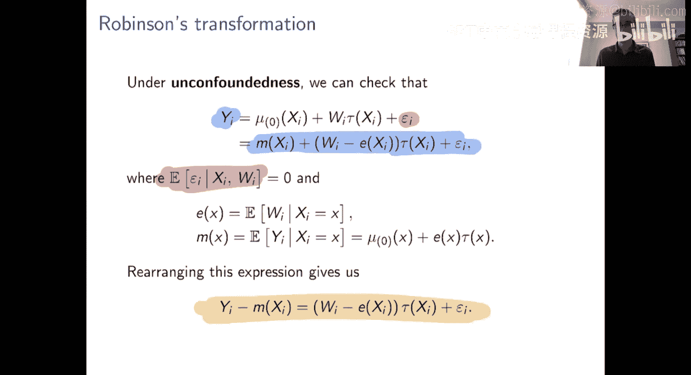

What we emphasized last week is that if you were to assume further。

The tau of x equals theta is constant across all units then essentially up here。

 you could replace this tau of x with just a constant theta and you could estimate this constant treatment of a parameter by regressiongressing y minus m on w minus E。

We talked about properties of this estimator and we found that。

Kind of this residual residual regression， even if you have to estimate M hats and E hats。

Reasonably accurately using sub machineine learning method。

 this residual residual regression is going to give you root rate。

 a rootdent rate central limit theorem and kind of very good guarantees for estimating data。😊。

Because of kind of。It's nice robustness properties。

The difference between last week and today is that now we're not going to assume that the treatment effect function is constant that tau of x is data for all values of x。

 but we're going to let Tu x vary guess right we want to estimate this tau of x function more broadly。

😊，And here。Essentially the useful thing to notice is that。

Of course we can't do a global regression to recover kind of the single parameter theta anymore because there is no single parameter theta anymore。

 but what you can do is imagine kind of，Filtering。For each value of x only to the samples at x and then regressing y minus m of x against w minus E of x only for。

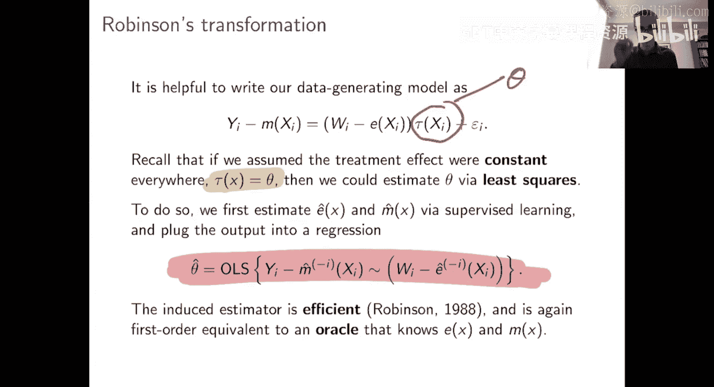

Units with a specific value of x and kind of what this thought experiment shows you。😊。

Is that by Robinson's transformation， T X， the Kate function is actually the minimizer of this following。

Qudratic function， so tau x is the minimizer of this function L。

Where L is y minus m minus tau times w minus E of x squared。Essentially。

 what this is telling you is that if I fix x。And now at a fixed value of x。

 I ask you to predict y minus m from w minus E。Then T of X is the best。

Is the best thing for doing so。So here I just want to emphasize that this kind of minimization is to be taken non parametric。

That is tau was no longer a number that minimizes。Some objective function。

 but tau is a function of x where at each value of x ta x can be unrestricted。

 but it actually turns out that。The K function， the thing we want is the thing that over the population at each value of x minimizes the expectation of this loss function。

 L or this quadratic function L。😊，So。It might seem like I haven't done much here。

Took the cake representation， I rearranged it a little bit， and I noted that。From this rearranging。

We see that Talx can be characterized as a minimizer of this。Qudratic functional。

But it turns out that actually， if you're thinking about estimating Tu of X， this is super helpful。

And just to kind of give one example。

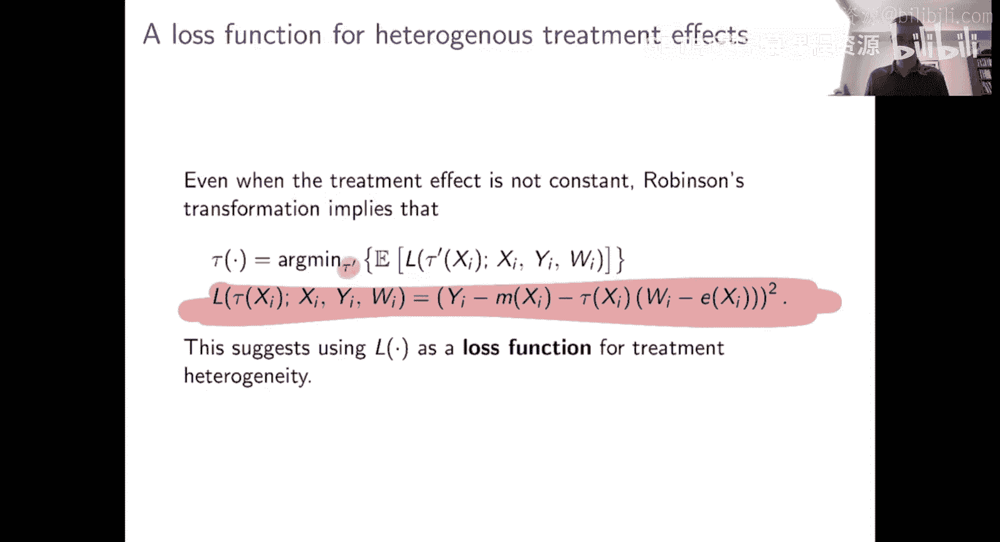

哦。Let's think back to the last。So you saw this a few weeks ago。

 the Laso usually we think of it as a method for prediction。

 we want to use the Laso to predict y from x， and we're going to use the Laso if we think that there is a linear model that's good for predicting y from x。

 but this linear model may be very high dimensional。

 the number of the parameters in the model P maybe be much larger than n。And in this setup。

 what the Lasso does is。It tries to predict y from x。So it minimizes。A squared loss。

But it doesn't kind of linear regression would only minimize this red thing。

 so it actually kind of finds the beta that predicts y from x the best in sample。

 but the lastword is something else， it adds this L1 penalty of beta to the objective also。

Where kind of。What this is saying is it's looking for parameter vectors beta that predict y from x well。

 but kind of。With a preference for simpler parameter vector is beta with a small L1。

There are many reasons to like this kind of putting this L1 norm here reserves vrsity and。

It makes sure that kind of predictions is kind of good prediction is still a meaningful objective in high dimensions。

嗯。But anyway， so this is the last so this is something people do a lot。Now。

Our natural follow up question would be let's say we're still in high dimensions。

 we still like linear models but。We don't want to just have a high dimensional linear predict prediction model we now have x is y and also treatments W and we wanted to fit。

A Kate function， toweru of X。Where now tau x is linear in x， but where x is high dimensional。

 so beta is a high dimensional vector。How could you fit this beta？This might seem like a。

Tricky problem that you kind of have to think about for a long time to come up with appropriate methods。

But actually kind of once you realize that。machineachine learning is about minimizing loss functions in some specific way。

 so kind of any specific machine learning algorithm should combine a loss function and kind of an algorithm by which you minimize it。

Well how do you think about the Laso the lastso here's the loss function that's in red and the thing in blue that's like the algorithmic choice that makes it makes it the lastso you don't just kind of minimize the loss directly。

 but you make fit a linear model and you L1 penalize the coefficients for sparsity so what are we going to do for fitting Kate。

Well again， we want to run something like the lastso。

 so we're going to linearly parameterize our predictions our predictions are going to have the form x beta and we're going to put an L1 penalty on。

The parameters is be。On the other hand， what are we going to use the loss function？Well。

 instead of using square error loss like for prediction。

 we're going to use this loss from the previous slide I just described that is kind of。

The thing you get out of Robinson's transformation。And。

Essentially the claim is that look now the problem is essentially solved。

 you want to have a Lasso like estimator for the K just run the Laso but swap out your squared error loss for this Kate appropriate loss function and your in business。

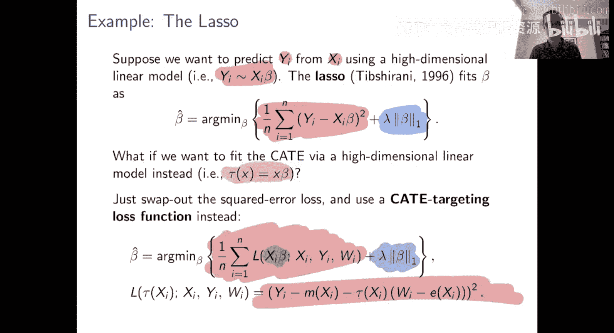

So。Okay， there of course， is。One wrinkle to the problem that gets kind of a wrinkle we've seen many times。

 which is that this loss function here。😊，It depends on。

can remember that this loss function is something that you' wanted to just depend on the data。

 X YW and tau， the thing you want to estimate， and then you'd kind of want to find tau that minimizes the loss function averaged over the data with some regularization。

But the problem is that in this loss function， you don't just have your X， Y W and tau。

 you also have M and E， these kind of other functions that are just hanging out there。

You're not interested in them， but you can't form the loss function。Without telling them。

And this is a problem if you knew M and E a priority then。What I just described would have been。

Exactly the same as what we saw in the earlier slides with inventory management。

 that is there was a task， there was a loss function。

You learned your decision rule by minimizing that loss function and there's nothing else to say。

But here we can't actually form our loss function because the loss function depends on these M's and E's。

Which are unknown and so。What are we going to do？I think giving the theme of the class。

 it's quite clear what we should do。😊，That is we're going to need to。First。

 somehow estimate M hats and E hats。Using some first step regressions， this is what we did。

First made concentration with effects using Robinson's method。

 this is what we did in causal forests this is what we can have to do again and then the question is。

Can you still learn？Kate。using this kind of loss function if M hatt and Ehat were learned from data。

But。Luckily， happily the answer is yes。This is an algorithm referred to as the R learner kind of extending the。

Alphabet soup for different types of algorithmic strategies you can think of for generic machine learning based CA estimation。

😊，And the R learner involves first fitting M hatAT and Ehat。

By learning to predict Y and W respectively from x。And then。

What we're going to do is we're going to form this loss function here with the cross fitted plugin values of M& E。

 and then we're going to fit tau hat。

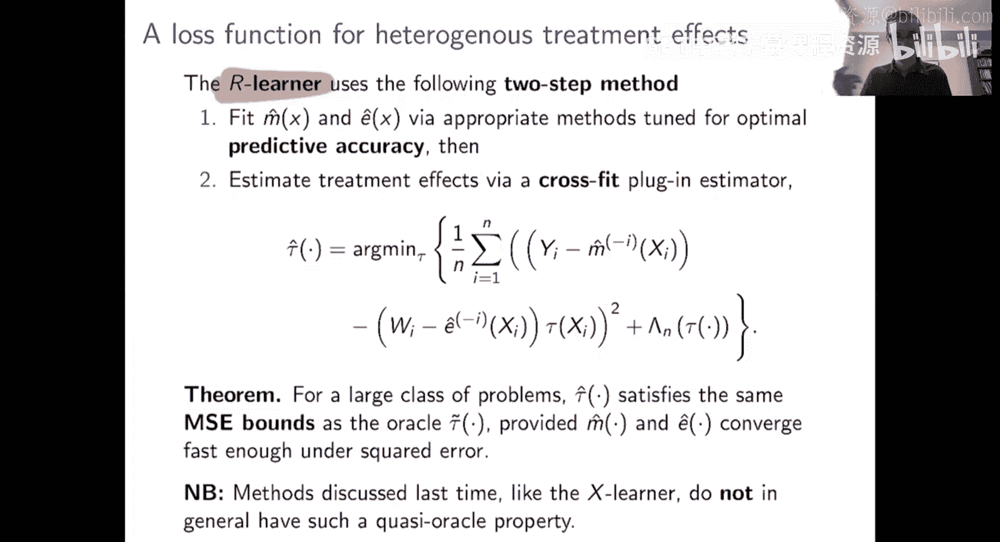

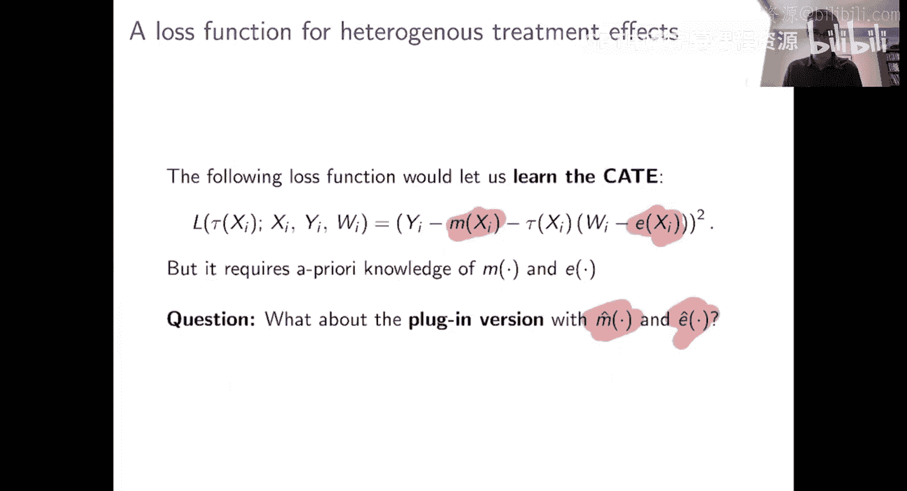

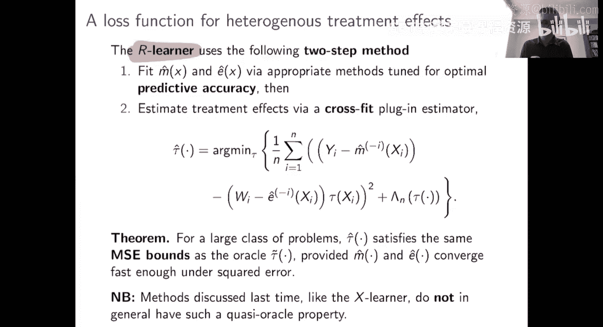

By minimizing。This loss function with plugin values of ME and this term here， this lambda in。

 this is kind of some amount of some type of regularizer on town。

That the regularization could be explicit， give it's the lastso。

 then tau is actually going to be of the form x beta and your regularizer is going to be an L1 norm of beta。

But。In other types of settings， like if you wanted to minimize this loss function via boosting or via deep nets。

Then this lambda N could be something much more implicit， for example， in deep learning。

One common idea is to regularize a network using this technique called dropout where you kind of during training。

 randomly emit some nodes from the network。That gives you a type of regularization。

But it's more implicit， but anyways。With this notation。

 I'm trying to capture both explicit and implicit regularization。And anyways。The formal result is。

And I'm not going to go into it here because kind of just dating it is more。Technical and。

What I wanted to do now， but the point is that you get similar robustness properties as we saw with Robinson's method for constant treatment effects and as we saw with AIPW。

That is。😊，As long as you estimate M hat and Eha using reasonable accuracy then。

Your guarantees for learning the cake using this kind of loss function are as good as you would have gotten using kind of a priorary。

Perfectly known M& E in the loss function。So the reason I don't want to talk about this is we haven't in this class talked about。

 say， optimal rates for estimating。😊，Functions over non parametric classes so even kind of to talk about what would be a good rate of convergence with tau hat under different regularity assumptions on the function class containing tau X tend to be a long aside from the class so i'm not going to go there but the main point is that。

😊，If M had an， E had are reasonably accurate， then。

You can get guarantees for tau hat that are as good as though you had plugged the true values of M and E into the loss。

 and it's possible to get guarantees for tau hat， where tau hat converges in squareter loss much faster in order to magnitude faster than M hat or E hat。

So this is。A nice property， this is a property we saw out of say constant treatment effect estimators this is not a property that any of the metal learners we talked about last week had so。

The ST and X learners in general or not can have a property where they can achieve faster rates of convergence for the CA than they do for their nuisance component estimate。

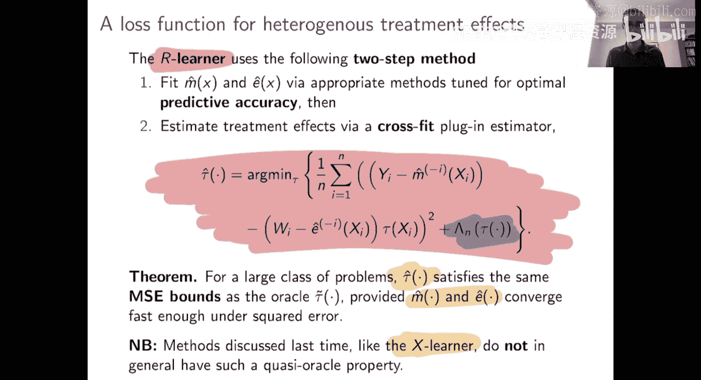

But so anyways， the claim is that kind of the。Our learning framework。

The claim is that you can essentially。Do most things you want to do in the world of Kate estimation by just。

First estimating M hat E hat， then forming this as your loss function and then just。

Applying machine learning generically using this loss function。嗯。In the next part of this lecture。

 I'll go into more details of how you can use this loss function for model choice for model validation。

 so you can use this loss function for cross validation or for comparing。Casal forest or the exleer。

 for example。But in this segment。I'll focus on kind of using this loss function for just kind of。

Learning tau directly， that is we're going to try to get tau of x by minimizing this loss function by a different means。

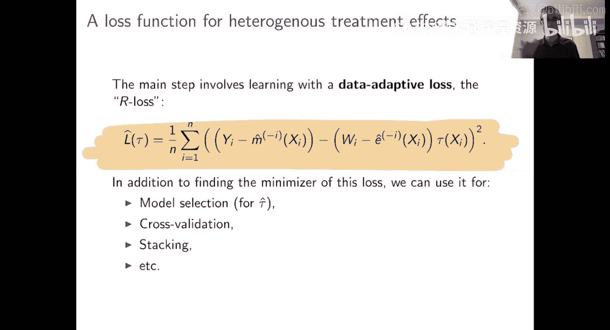

And okay， just one example showing kind of a semi synthetic example where we see kind of the different trade offs and choices involved in doing so。

So this is。An example motivated by this paper by Arrssenal etal on the effect of get out the vote calls on turnout。

So we're going to take the real data， this data set has confounding essentially because。

And as documented in the paper in some districts， you were more likely to get called than in other districts。

 essentially based on the competitiveness of the election。So it has a selection unobservables。

 I mean， that is kind of you need to control for some x's to get rid of that。

But what we know also is that there's essentially no treatment effect this is because。

And this is a point made in the paper also。This paper is trying to measure the effect of one get out the vote call on turnout。

And。For all intent of purposes right like one phone call I think about how many phone calls one might get during a competitive election。

 the effect of one phone call alone is essentially zero so the main point of the paper was that here's a setup where obviously the treatment effect has to be zero but if you don't control for compounding carefully you'll find something that's not zero。

But anyways， for our purposes what we're going to do is we're going to assume we're going to take the real data。

 assume that the treatment effect is actually zero in the original data and then we're going to spike in a little bit of synthetic treatment effects by strategically flipping some outcomes so now。

😊，Weve spiked in a treatment effect and the question is， can we use？

various methods and machine learning based methods to recover it。

And so here you see a histogram of the magnitude of thecate we spiked into the problem。

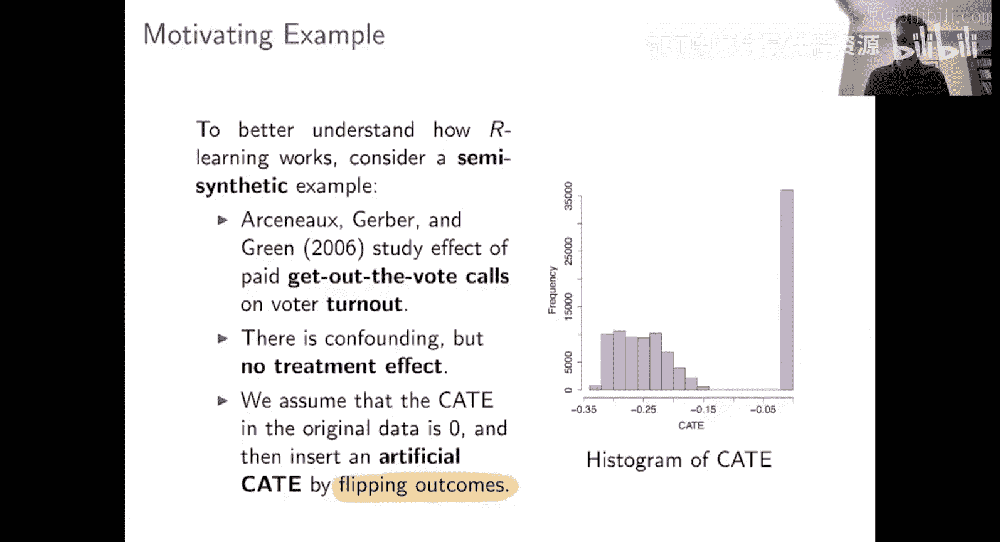

And。What do we need to do to carry this out using our learner approach？

What we're going to do is first we need to learn M had an E hat that is to predict Y and w from x respectively。

 then we're going to need to combine all this into the R loss and then we're going to need to run some third machine learning step where we use the R loss as the loss function for learning。

So。First we need to fit yeah had an M hat of course。

 and here for both tasks we tried both the last so and。

Boosting and in both cases we can cross validate it to see which one was doing better and in both cases cross validation told us that boosting was more accurate than the last so year。

So we used。So then we got cross fitted E hatAT and M hatAT estimates from boosting。

Then in the second step， what we're going to do is we take the our loss or the R objective。

 and we're again going to try to minimize it using Lasso or boost。For Laso。

 we're going to run Laso on the our loss objective。We're going to do just what I described earlier。

 that is we're going to do this except here instead of using the L that depends on the true unknown M and E。

 we're going to run this with plugin values at M and E。

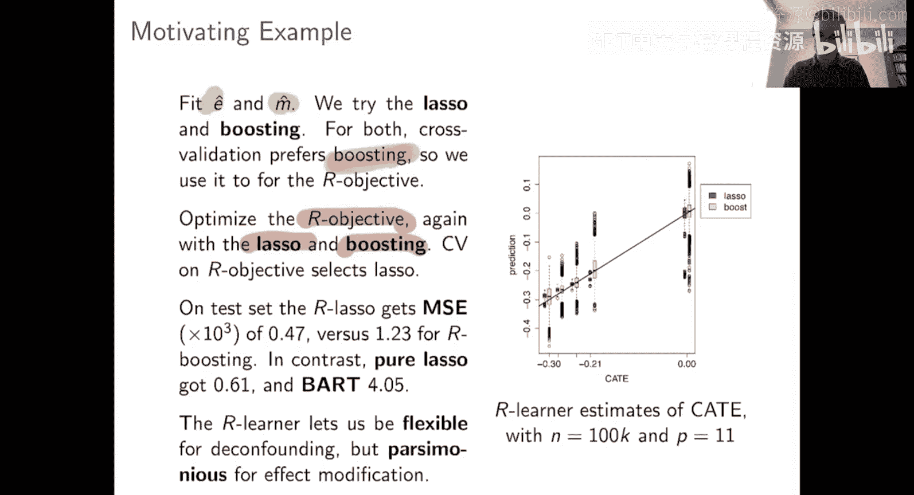

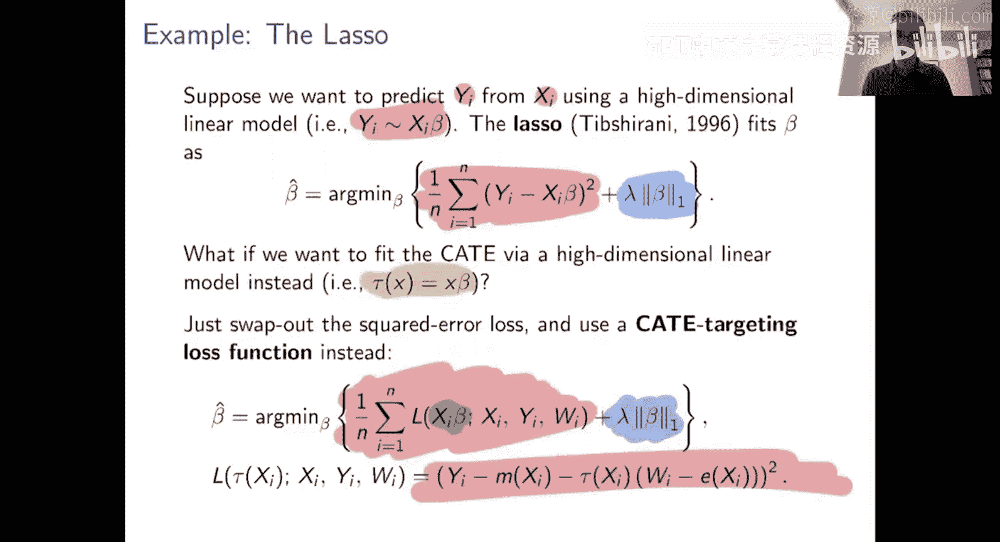

We're also going to consider boosting。If you know what boosting is。

 then we just kind of run boosting as you know it， but we swap out the squarer loss with our loss if you don't know what boosting is。

Well then you can just know that if you wanted to do this all you would have to do is read about boosting and then swap about the loss function。

 but anyways we ran this and then we cross validated again based on now the our loss not square their loss and here。

Cross validation prefers the lastso， so we end up getting M hats and E hats that are boosting。

 but a final fit for tau of x that's going to be linear in x and fit by the lastso。And。

So now what's nice is that this is actually this is a semi syntheticthetic kind of in the end。

 we know what the true ta of x was so we can see how well we did and we were write our mean squared error。

Kind of scaled up by  a00 for the art last so was。0。47 whereas。

Kind of our boosting would have gotten in 1。23 so kind of cross validating on our loss。

Not only helped us train the LaA well， but helped us correctly notice that the LaSsA was doing better than boosting here。

On the other hand， other things you might have tried here is you might have been interested in kind of。

Just kind of fitting everything by a single la。Something like an S La so here that did worst than the R Laso or you could have just kind of thrown。

 I haven't talked about it here much but bart it's a popular Bayesian tree approach and here it also is less accurate。

So。嗯。The main point is that。Again， this kind of our learning approach is。

Flexible and once you're using it， everything just looks kind of very familiar。

From kind of a machine learning workflow。You pick the best E according to square error loss。

 you pick the best M， according to square error loss， you pick the best R according to tau loss。

And then you proceed。

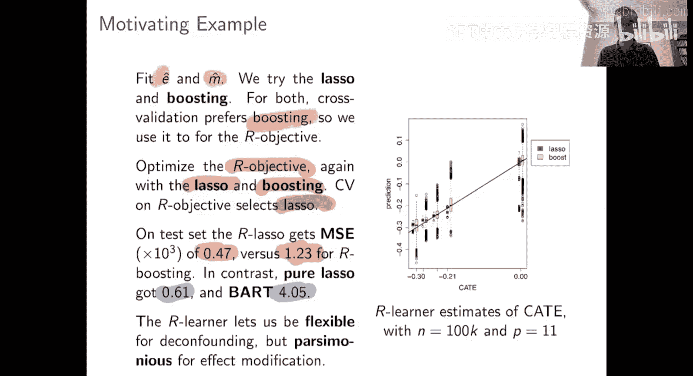

So this is one thing you can do。嗯。Another kind of。Nice application just to show that kind of once you have a loss function you can really do a lot of things with it so one popular idea in machine learning is what's called stacking。

Stacking starts from kind of， you have capital K。Different estimates。

 you can you say you have kind of K experts you hired to give you K estimates and they all give you different estimates and now you don't know which one to pick and really you think maybe all your experts are onto something and maybe they're onto to something slightly different so you'd want to find a consensus estimate that kind averages all your expert predictions。

And let's say you wanted a consensus estimate。That's。

Here it's some offset plus a positive weighted average of all the towel case。

You don't want to insult anyone， you don't want to give any of your experts negatively in your model。

 that kind of。What this thing could do is it could just kind of say。The fifth expert is the best。

 so just sit tau of x to tau five or it could kind of give some positive weight to a number of different。

And then of course， if you want to stack， the remaining question is how do you pick these weights alpha K。

 how do you choose how much weight to give each expert？And。This might seem like a difficult problem。

 but again， once you have a loss function for Kate， it's very clear what to do。Just。😊，Right。

They have x added the x in the above in the form as usual and then fit these parameters by minimizing。

😊，The loss function for Kate and here。The kind of only difference from what we do usually is that there's also this constraint saying that here the parameters we want to learn are these alphas mostly。

 and we're going to add a constraint that these alphas should be positive。

Solving this optimization problem， this is going to be kind of a quadratic objective with positivity constraints。

 it's a quadratic program。If you kind of want to learn how to solve this kind of optimization problem。

 you could say take a class in comics optimization， but the point is that。

Once you have this loss function， kind of what to do is immediate and then kind of。

All the difficulties are just routine machine learning type difficulties， saying。

 how do you solve a comics optimization problem？

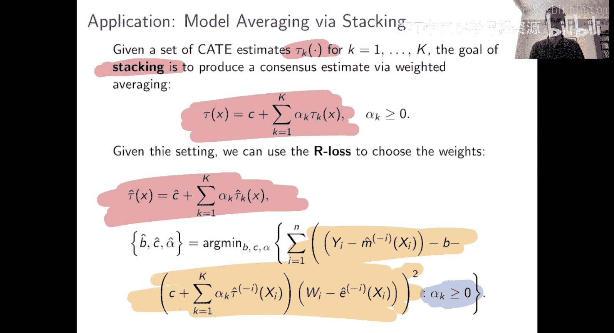

啊。And just kind of to see this。Working again here we had one example where there's a simulation study I won't go into details here。

 but kind of this paper there's a there's a reference on the last slide to this one if you want to read more but essentially in a pair of simulation studies we tried bi called forests so this is kind of。

Complicated forest based method right that like does a lot of things it causal forests like the our learner are built on this Robinson based insight。

 but of course causal forests aren't a direct consequence of kind of Robinson's transformation there's a lot more going into it kind of how exactly we chose to implement out。

Then I tried running something else here， I tried running barRTt barRT is。Like I mentioned earlier。

 it's another popular tree based method， but kind of based on hierarchical Bayesian model。

So algorithmically， it's very different。😊，And。Tried fitting causal forest。

 tried fitting bart which one is better well at least in this one what's interesting is you see I tried stacking causal forest and bart using the method from the previous slide and what you see in green here is the mean squared error for the stacked estimator it actually ends up being better than either causal forest or bart on their own。

So。I guess this makes a couple of points first in machine learning kind of is inherently an engineering focused area。

 so what's going to work best。😊，It's kind of unpredictable。

The kind of best thing to do generally is to be empirically driven and try a bunch of things and see what works。

And then the other thing is in order to be empirically driven。

 you need a criterion of success or failure， otherwise you're kind of flying blind and the claim is that okay estimation。

😊，The our loss provides。One such measure of how accurate a CA estimate is that you can use for many purposes。

 ranging from learning to model average。

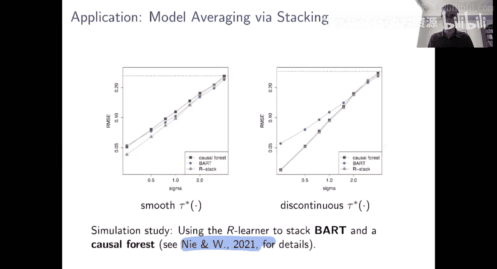